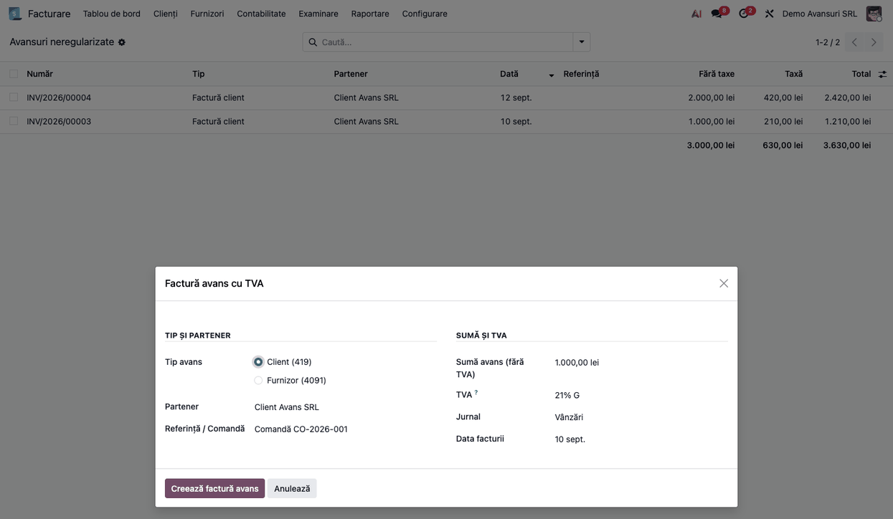
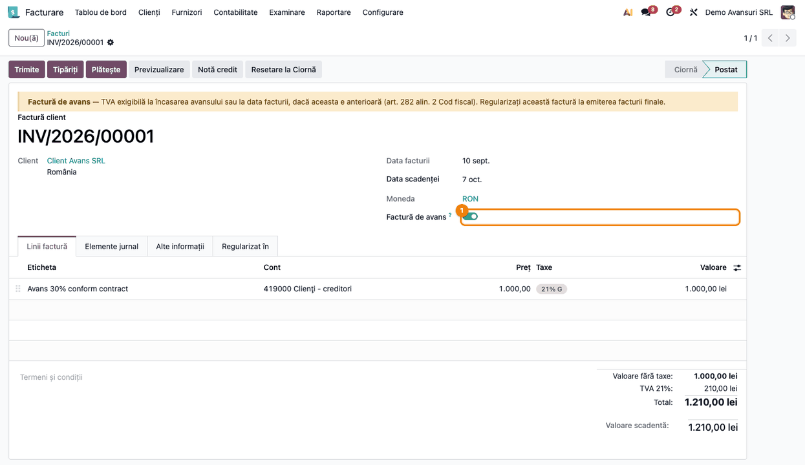
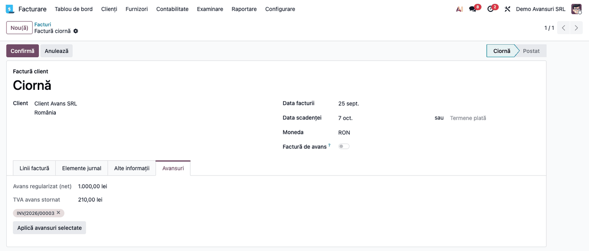
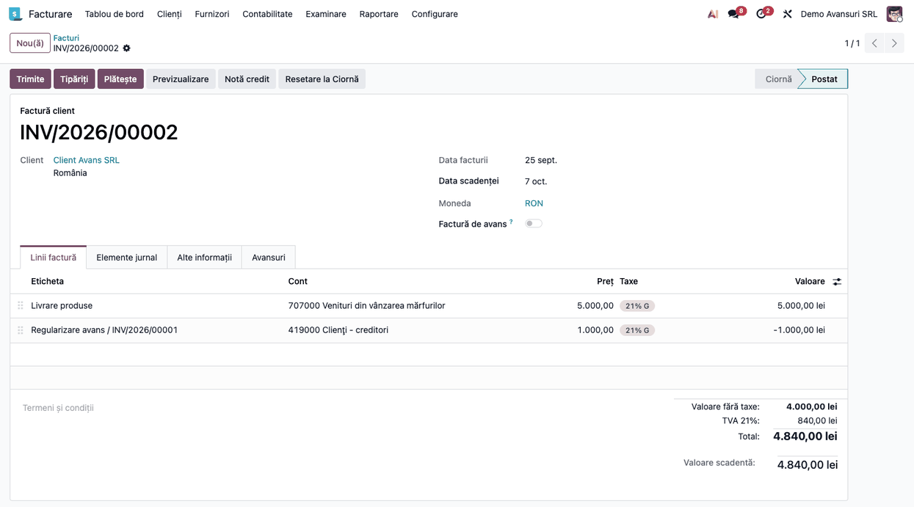
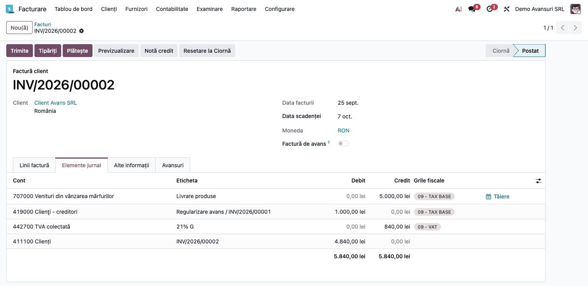
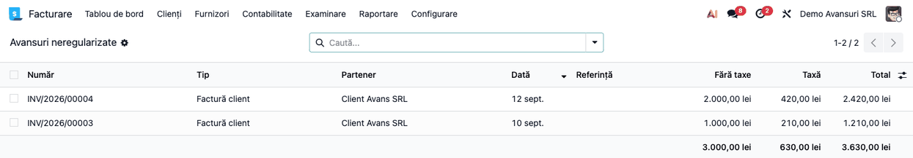
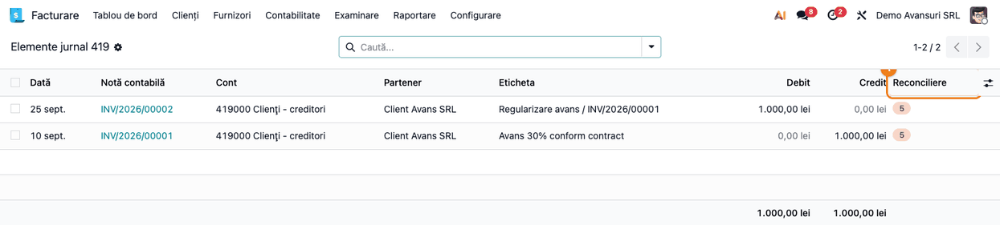
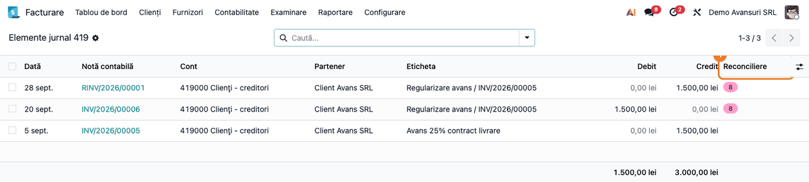
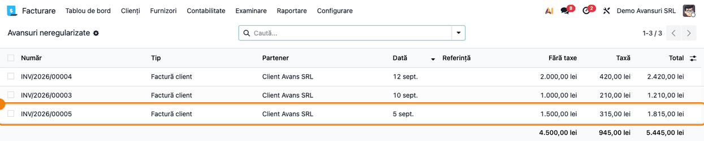

# Fișă Modul: Avansuri Clienți/Furnizori cu TVA (419/4091)

**Poziție plan:** B5.1
**Modul:** `l10n_ro_advance_invoice`
**FR:** FR-34
**Capitol manual:** Cap 9.2
**Utilizator principal:** Contabil clienți/furnizori, Contabil TVA
**Prioritate:** 🔴 Ridicată (frecvent în practică: avansuri pe contracte și comenzi)

---

## 1. Scop business

Când o firmă încasează un avans de la client (sau plătește un avans unui furnizor) înainte de
livrare, TVA-ul devine exigibil la data încasării, deci avansul se facturează separat, cu TVA. La
livrare, factura finală trebuie să conțină valoarea întreagă, din care se scade avansul deja
facturat, ca baza și TVA-ul să nu fie declarate de două ori. Modulul emite factura de avans dintr-un
wizard, regularizează automat avansul pe factura finală (cu același cont și aceeași taxă, cu minus)
și oferă lista avansurilor încă neregularizate, pentru urmărirea soldurilor 419 și 4091.

## 2. Bază legală și context

- **Codul fiscal, art. 282 alin. (2)** — pentru avansuri, TVA devine exigibilă la data încasării
  avansului (sau la data facturii de avans, dacă factura se emite înainte de încasare).
- **Codul fiscal, art. 319 alin. (20) lit. i)** — factura finală arată baza impozabilă „ori, după
  caz, avansurile facturate”, pe fiecare cotă: de aceea regularizarea apare ca linie cu minus, cu
  taxa avansului.
- **Codul fiscal, art. 291 alin. (4) și (6)** și **HG 1/2016, pct. 35 alin. (2)** — la schimbarea
  cotei de TVA între avans și livrare, avansul se scade la cota lui, iar livrarea se taxează integral
  la cota de la data livrării; avansul în valută se stornează la cursul de la data avansului.
- **OMFP 1802/2014** — contul 419 „Clienți-creditori” se debitează la decontarea avansurilor
  încasate; contul 409 „Furnizori-debitori” se creditează la regularizarea plăților către furnizori.

Regularizarea este o operațiune normală de business, nu o corecție de eroare: nu se folosește
stornarea în roșu.

## 3. Utilizatori și roluri

- **Contabil clienți / Operator facturare** — emite facturile de avans și facturile finale.
- **Contabil furnizori** — înregistrează facturile de avans primite de la furnizori (pentru avansurile
  plătite de firmă) și facturile finale de achiziție.
- **Contabil TVA** — verifică regularizarea în D300 și D394.

Roluri recomandate pentru testare:
- utilizator cu drept **Facturare / Contabil** (vede meniurile modulului din **Facturare → Clienți**);
- un al doilea utilizator, cu drept doar de facturare: trebuie să poată deschide wizardul și să emită
  factura de avans.

## 4. Conturi și date implicate

| Cont | Rol |
|---|---|
| 419 „Clienți-creditori” | avansuri încasate de la clienți |
| 4091 „Furnizori-debitori pentru cumpărări de bunuri de natura stocurilor” | avansuri plătite furnizorilor |
| 4111 / 401 | clienți / furnizori |
| 4427 / 4426 | TVA colectată / TVA deductibilă (prin taxele de 21%) |
| 70x / 3xx, 602–604 | venituri / stocuri sau materiale ale livrării finale |

> Wizardul de emitere folosește contul `419` (client) și `4091` (furnizor). Pentru avansurile pentru
> prestări de servicii (4092) sau pentru imobilizări (4093/4094): după **Creează factură avans**, pe
> factura de avans în Ciornă schimbați contul liniei în 4092/4093/4094, apoi apăsați **Confirmă**.
> Regularizarea pe factura finală preia contul liniei avansului, deci se închide pe același cont.
> Pentru imobilizări (4093/4094), contrapartida este **404 „Furnizori de imobilizări”**: pe factura
> de avans în Ciornă, în tabul **Elemente jurnal**, schimbați și contul liniei de furnizor din 401 în
> 404 (sau folosiți un partener cu contul de plată 404); la fel pe factura finală a imobilizării.

Date minime pentru demo:
- companie românească, cu planul de conturi RO și taxele de 21% din `l10n_ro`;
- un client și un furnizor români;
- jurnalele de vânzări și de cumpărări;
- opțional, moneda EUR activă, cu cursuri la două date diferite (pentru exemplul în valută).

## 5. Configurare inițială

1. Instalați modulul `l10n_ro_advance_invoice` (dependențe: `account`, `l10n_ro`).
2. În **Facturare → Configurare → Setări**, verificați taxele implicite de vânzare și de cumpărare
   (21%): wizardul le precompletează.
3. Verificați în **Facturare → Configurare → Plan de Conturi** că există conturile 419 și 4091.
4. Verificați că în **Facturare → Clienți** apar meniurile **Factură de avans** și
   **Avansuri neregularizate**.
5. Pentru avansuri în valută: activați moneda în **Facturare → Configurare → Valute** și introduceți
   cursurile pentru data avansului și data facturii finale.

## 6. Flux de utilizare

### Pasul 1 — Emiterea facturii de avans (wizard)

Accesați **Facturare → Clienți → Factură de avans**. Meniul stă sub **Clienți**, dar se folosește și pentru furnizori. Se deschide
wizardul **Factură avans cu TVA**. Completați:

- **Tip avans** — Client (419) sau Furnizor (4091). Pentru un avans plătit unui furnizor alegeți
  Furnizor: se înregistrează factura de avans primită de la acesta;
- **Partener**, **Sumă avans (fără TVA)**, **TVA**, **Jurnal**, **Data facturii** și, opțional,
  **Referință / Comandă** (la furnizor, aici treceți numărul facturii furnizorului: devine referința
  facturii).

La schimbarea tipului, jurnalul și TVA-ul se precompletează cu jurnalul și taxa implicită a
companiei (cota standard 21%); le puteți modifica.



### Pasul 2 — Verificarea și postarea facturii de avans

La **Creează factură avans** se deschide factura generată, în stare Ciornă. Verificați pe ecran:

- bannerul galben **Factură de avans** din antet și comutatorul **Factură de avans** activat;
- linia facturii este pe contul **419** (furnizor: **4091**), cu taxa de 21%;
- totalul = suma avansului + TVA (exemplu: 1.000 + 210 = 1.210 RON).

Apăsați **Confirmă**. Factura postată arată ca în captură; tabul **Regularizat în** va arăta,
după pasul 5, factura finală în care a fost regularizat avansul.



### Pasul 3 — Selectarea avansului pe factura finală

La livrare, creați factura finală obișnuită (**Facturare → Clienți → Facturi → Nou**), cu
partenerul avansului și liniile livrării. În tabul **Avansuri**, în câmpul **Avansuri regularizate**,
alegeți facturile de avans postate ale aceluiași partener (apar ca etichete cu numărul facturii).
Verificați pe ecran că **Avans regularizat (net)** și **TVA avans stornat** arată totalul avansurilor
selectate (exemplu: 1.000,00 și 210,00 lei).

Apăsați **Aplică avansuri selectate** (butonul apare doar pe factura în Ciornă).

> **Notă:** câmpul propune doar avansurile neregularizate. Un avans aplicat pe o factură finală
> confirmată nu mai apare; dacă finala e anulată, trecută în ciornă sau stornată printr-o notă de
> credit, avansul redevine disponibil. La **Confirmă**, un avans deja regularizat pe altă factură
> finală blochează validarea, cu mesaj.



### Pasul 4 — Verificarea regularizării pe liniile facturii

În tabul **Linii factură** apare, pentru fiecare linie a avansului, o linie **Regularizare avans /
<număr avans>**:

- același cont ca pe avans (**419** / **4091**) și aceeași taxă (21%);
- preț unitar pozitiv (1.000,00) și valoare negativă (−1.000,00 lei);
- nu există o linie separată de TVA: TVA-ul facturii este calculat din taxă.

Verificați totalurile: baza = livrare − avans (5.000 − 1.000 = 4.000), TVA = 1.050 − 210 = 840,
total = 4.840 RON. Dacă reaplicați avansurile, liniile de regularizare se înlocuiesc, nu se dublează.
Apăsați **Confirmă**.



> **Avans cu altă cotă de TVA** (de exemplu 19%, înainte de 01.08.2025): linia de regularizare
> păstrează cota avansului, iar livrarea se taxează cu cota curentă — pe factură apar două linii de
> TVA, ambele corecte.
>
> **Avans în valută**: linia de regularizare se înregistrează în lei **la cursul facturii de avans**,
> ca soldul 419/4091 să se închidă exact și TVA-ul avansului să se scadă cu valoarea în lei de la
> avans. Restul facturii se înregistrează la cursul zilei facturii finale.

### Pasul 5 — Nota contabilă a facturii finale

În tabul **Elemente jurnal** al facturii finale postate, verificați:

- **Dr 419** 1.000 (închide avansul), **Dr 4111** 4.840;
- **Cr 707** 5.000 (livrarea integrală), **Cr 4427** 840 (TVA livrare minus TVA avans);
- în coloana **Grile fiscale**, linia de avans (419) are grila bazei, iar linia 4427 grila TVA a
  cotei de 21% — aceleași grile ca livrarea, deci D300 primește baza și TVA-ul nete. Denumirile
  grilelor vin din localizarea `l10n_ro` (de exemplu „09 - TAX BASE”, „09 - VAT” = rândul 9 din D300).

Pe factura de avans, tabul **Regularizat în** arată de acum factura finală.



### Pasul 6 — Monitorizarea avansurilor neregularizate

Meniul **Facturare → Clienți → Avansuri neregularizate** deschide lista facturilor de avans
(clienți și furnizori) postate care **nu sunt regularizate pe o factură finală confirmată**. Verificați pe ecran:

- avansul regularizat la pașii 3–5 nu mai apare în listă;
- coloanele **Tip** (factură client / factură furnizor), **Partener**, **Dată**, **Referință**,
  **Fără taxe**, **Taxă** și **Total** arată avansurile rămase;
- fiecare avans rămas corespunde unei livrări încă neefectuate.

La închiderea lunii, grupați lista după **Tip** (în căutare: **Grupează după** → grupare personalizată → **Tip**) și comparați totalul
coloanei **Fără taxe** al fiecărui grup cu soldul contului 419 (clienți), respectiv suma conturilor 4091–4094 (furnizori). Avansurile aplicate pe o factură finală încă în Ciornă rămân în listă până la confirmarea ei.
Lista nu ține cont de regularizările parțiale; pentru acestea, urmăriți fișa contului.



### Pasul 7 — Reconcilierea pe 419 (4091)

La confirmarea facturii finale, linia de regularizare se reconciliază automat cu linia avansului.
În **Facturare → Examinare → Control → Elemente jurnal**, filtrați contul 419 (4091 la furnizor) și
partenerul. Verificați pe ecran:

- linia avansului (**Cr 419** 1.000) și linia de regularizare de pe factura finală (**Dr 419** 1.000)
  au **același număr** în coloana **Reconciliere**;
- cu filtrul **Nereconciliat**, cele două linii nu mai apar.

Reconcilierea se face doar dacă contul are bifa de reconciliere (în planul RO, 419 și 4091 o au).
Dacă factura finală e trecută în Ciornă, reconcilierea se desface și se reface la confirmare.



### Pasul 8 — Stornarea facturii finale (notă de credit)

Dacă factura finală se stornează (butonul **Notă credit** pe factura finală, apoi **Confirmă** pe
nota de credit), avansul redevine neregularizat. Verificați pe ecran, în elementele de jurnal pe 419:

- factura finală (**Dr 419** 1.500) și nota de credit (**Cr 419** 1.500) au același număr de
  reconciliere, deci se anulează una pe alta;
- linia avansului (**Cr 419** 1.500) nu mai are număr de reconciliere: soldul avansului e din nou
  deschis.



Avansul reapare în **Avansuri neregularizate** și poate fi aplicat pe o nouă factură finală. Același
efect îl are anularea facturii finale (**Resetare la Ciornă**, apoi **Anulează**). Cât timp avansul este regularizat pe o factură
finală confirmată, factura de avans nu poate fi trecută în Ciornă sau anulată.



### Note de monografie și raportare

**Avans client (1.000 RON + TVA 21%):**

```
Factură avans:      Dr 4111  1.210  =  Cr 419   1.000
                                       Cr 4427    210
Încasare avans:     Dr 5121  1.210  =  Cr 4111  1.210
Factură finală:     Dr 4111  4.840  =  Cr 707   5.000
(livrare 5.000)     Dr 419   1.000     Cr 4427    840   (1.050 − 210)
```

**Avans furnizor (500 RON + TVA 21%):**

```
Factură avans:      Dr 4091    500  =  Cr 401     605
                    Dr 4426    105
Plată avans:        Dr 401     605  =  Cr 5121    605
Factură finală:     Dr 3xx    2.000  =  Cr 4091    500
(achiziție 2.000)   Dr 4426      315   Cr 401   1.815   (2.420 − 605)
```

Pentru servicii, avansul se ține pe 4092, iar achiziția pe contul de cheltuieli 6xx corespunzător.

- Regularizarea reia avansul cu minus pe contul de avans (419/4091), cu aceeași taxă — regularizare
  normală, nu storno în roșu.
- **D300**: baza și TVA-ul avansului intră cu plus în luna facturii de avans și cu minus în luna
  facturii finale, pe aceleași rânduri ale cotei, prin tag-urile taxei. Pe ansamblu se declară o
  singură dată valoarea întreagă a livrării (exemplu: 1.000 + 4.000 bază, 210 + 840 TVA).
- **D394**: factura de avans se raportează ca factură obișnuită (bază + TVA), iar regularizarea cu
  minus, pe factura finală. Marcajul **Factură de avans** (`l10n_ro_is_advance`) servește la filtrare
  și urmărire; generatorul D394 nu îl preia automat.

> Modulul nu generează declarațiile: D300 și D394 preiau valorile din facturi și din tag-urile taxelor.

## 7. Legături cu alte module / declarații

| Modul / proces | Rol în flux | Tip legătură |
|---|---|---|
| `account` | facturi de avans, regularizări și note contabile | dependență (manifest) |
| `l10n_ro` | plan de conturi RO (419/4091/4426/4427) și taxele cu tag-uri D300 | dependență (manifest) |
| `sale` / `purchase` | comenzile din care provin avansurile | opțional |
| `l10n_ro_anaf_d300` | preia regularizarea prin tag-urile taxei, cu minus | prin tag-uri (automat, dacă e instalat) |
| `l10n_ro_anaf_d394` | raportează avansul ca factură obișnuită și regularizarea cu minus | din facturi (marcajul de avans nu este preluat) |

**Ce e automat:** emiterea facturii de avans pe 419/4091 cu TVA, reluarea avansului cu minus pe
factura finală (cont, taxă, curs), calculul TVA-ului net și lista avansurilor neregularizate.

**Ce e automat (continuare):** reconcilierea pe 419/4091 între avans și linia de regularizare, la
confirmarea facturii finale; eliberarea avansului la anularea, trecerea în ciornă sau stornarea
facturii finale; blocarea dublei regularizări și a anulării unui avans deja regularizat.

**Ce rămâne manual:** alegerea avansurilor de regularizat pe fiecare factură finală, conturile
4092/4093/4094 și regularizarea parțială.

**Regularizarea parțială** (se folosește doar o parte din avans): selectați avansul, apăsați
**Aplică avansuri selectate**, apoi editați prețul liniei de regularizare la valoarea folosită și
**nu mai apăsați butonul** (reaplicarea reface linia la valoarea întreagă). Valorile din tabul
**Avansuri** rămân cele ale avansului întreg; verificați totalurile facturii. Avansul dispare din lista
**Avansuri neregularizate**, deci restul se urmărește manual pe fișa contului 419/4091. Dacă avansul
depășește totalul facturii finale, butonul refuză aplicarea și regularizarea parțială nu se poate
face din buton.

## 8. Verificări pentru consultant

- [ ] Wizardul precompletează jurnalul și taxa de 21% la schimbarea tipului Client / Furnizor.
- [ ] Factura de avans are bannerul **Factură de avans**, linia pe 419 (4091 la furnizor) și TVA 21%.
- [ ] Pe factura finală, tabul **Avansuri** propune doar avansurile postate ale aceluiași partener
      care nu sunt deja regularizate pe o factură finală confirmată.
- [ ] După **Aplică avansuri selectate**, linia de regularizare are contul și taxa avansului,
      valoare negativă și preț pozitiv; nu există linie separată pe 4427/4426.
- [ ] Baza, TVA-ul și totalul facturii finale = livrare − avans (exemplu: 4.000 / 840 / 4.840).
- [ ] Reaplicarea avansurilor nu dublează liniile de regularizare.
- [ ] După postare, soldul 419 (4091) al avansului regularizat este zero, iar linia avansului și
      linia de regularizare sunt reconciliate (coloana **Reconciliere** completată).
- [ ] Anularea sau stornarea facturii finale readuce avansul în **Avansuri neregularizate**.
- [ ] Factura de avans regularizată nu se poate trece în ciornă cât timp finala e confirmată.
- [ ] Pe linia de TVA a facturii finale apar tag-urile D300 ale taxei, cu TVA-ul net.
- [ ] Avans în valută: soldul în lei al contului 419 se închide exact, la cursul avansului.
- [ ] Avansul regularizat dispare din **Avansuri neregularizate**; cel nefolosit rămâne.
- [ ] La închidere, totalul **Fără taxe** al avansurilor rămase, separat pe clienți și furnizori,
      corespunde soldului 419 și 4091.

## 9. Mesaje de eroare frecvente

| Mesaj / simptom | Cauză probabilă | Remediere |
|-----------------|-----------------|-----------|
| „Nu s-a găsit contul 419/4091 în planul de conturi al companiei… Verificați că modulul l10n_ro este instalat.” | Planul de conturi RO nu este instalat sau compania nu este românească | Instalați `l10n_ro` și planul de conturi RO pe companie |
| „Factura trebuie să fie în stare Ciornă pentru a aplica avansuri.” | Aplicarea avansurilor pe o factură deja postată | Resetați factura la Ciornă sau aplicați avansurile înainte de postare |
| „Suma avansurilor … depășește valoarea facturii finale …” | Avansurile selectate depășesc totalul facturii finale | Selectați doar avansurile acoperite de factură; pentru un avans mai mare decât factura, regularizarea parțială se face manual (vezi secțiunea 7) |
| „Nu s-a găsit contul de avans (419/4091) pe factura …” | Avansul selectat nu are linii de factură (de exemplu o notă contabilă manuală) | Emiteți avansul prin wizard |
| TVA nu se precompletează în wizard | Compania nu are taxă implicită de vânzare/cumpărare | Setați taxa implicită în Setări sau alegeți TVA manual |
| Avansul nu apare în tabul **Avansuri** | Avansul e în Ciornă, e al altui partener sau e de alt tip (client/furnizor) | Postați avansul și verificați partenerul și tipul facturii |

## 10. Capturi de ecran

Capturile (`static/description/`) sunt **generate automat** din `tests/test_screenshots.py`
(mixinul `ScreenshotCase` din `l10n_ro_doc_screenshots`, import defensiv), în **limba română**,
pe planul de conturi RO (`setup_country("ro")`):

1. `01_wizard_avans.png` — wizardul de emitere avans, completat.
2. `02_factura_avans.png` — factura de avans: linia pe contul 419, TVA colectată 21%.
3. `03_tab_avansuri.png` — tabul **Avansuri** al facturii finale, cu avansul selectat.
4. `04_regularizare.png` — liniile facturii finale, cu avansul reluat cu minus pe 419, cu taxa lui.
5. `05_nota_contabila.png` — elementele de jurnal ale facturii finale postate.
6. `06_raport_avansuri.png` — lista **Avansuri neregularizate**.
7. `07_reconciliere_419.png` — elementele de jurnal pe 419: avansul și regularizarea, cu același
   număr de reconciliere.
8. `08_storno_finala.png` — elementele de jurnal pe 419 după stornarea facturii finale: finala și
   nota de credit reconciliate, avansul deschis.
9. `09_raport_dupa_storno.png` — avansul stornat, din nou în **Avansuri neregularizate**.

Regenerare:

```bash
./odoo/odoo-bin -c odoo.conf -d <db> -i l10n_ro_advance_invoice,l10n_ro_doc_screenshots \
    --test-tags=fise_screenshots --stop-after-init
```

## 11. Observații pentru manual

- Explicați întâi **de ce** se facturează avansul (TVA exigibil la încasare), apoi fluxul în trei
  momente: avans → factură finală cu regularizare → urmărirea avansurilor rămase.
- Păstrați exemplul numeric unic (1.000 avans, 5.000 livrare, TVA 21%) în toate capturile și notele,
  ca cititorul să poată urmări cifrele de la un ecran la altul.
- Subliniați că pe factura finală **nu** apare o linie separată de TVA pentru avans: diferența se
  vede direct în totalul TVA al facturii.
- Pentru avansurile în valută și pentru schimbarea cotei de TVA, păstrați notele de la Pasul 4.
