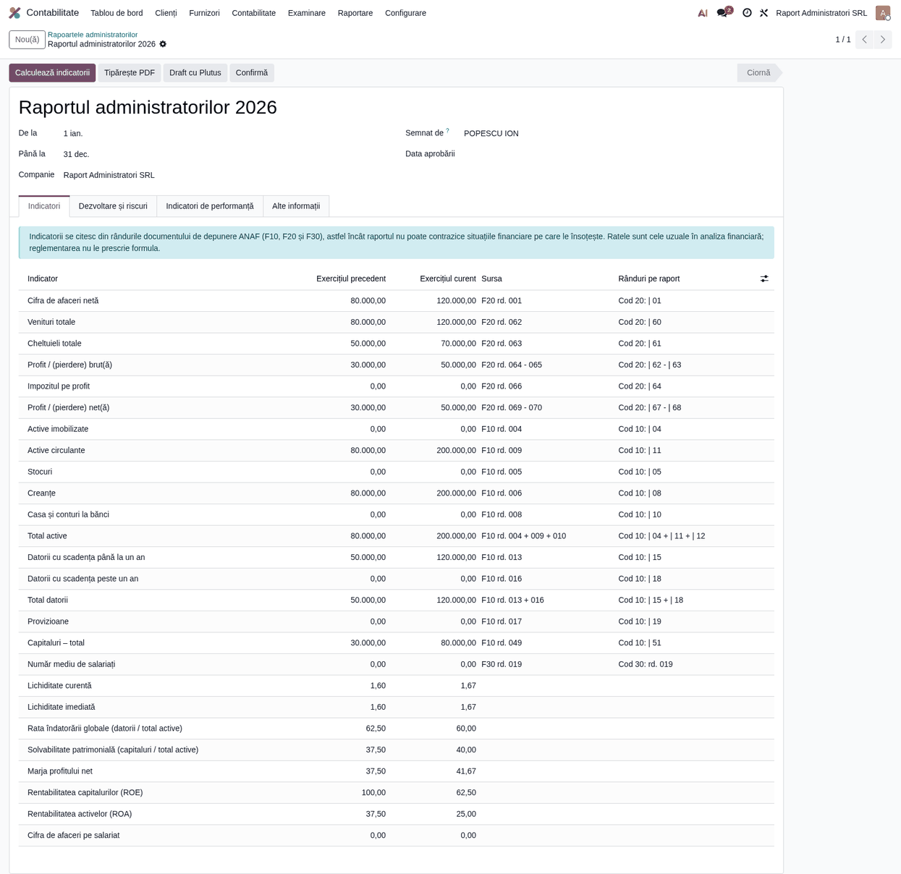
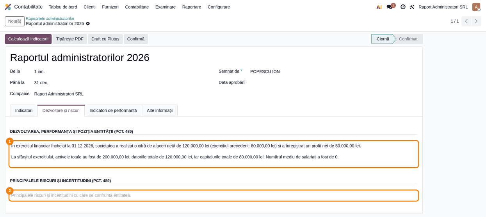
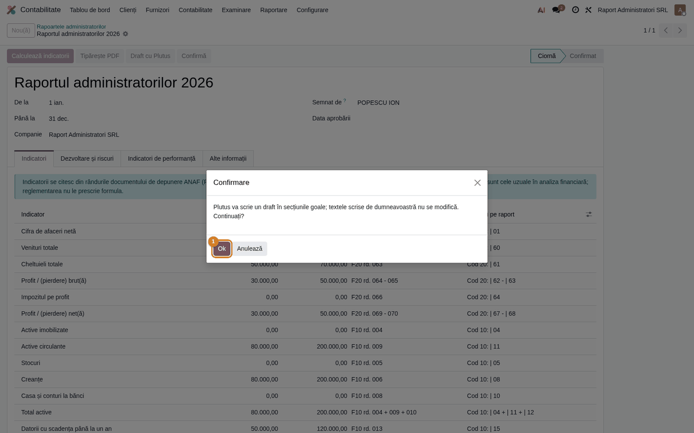
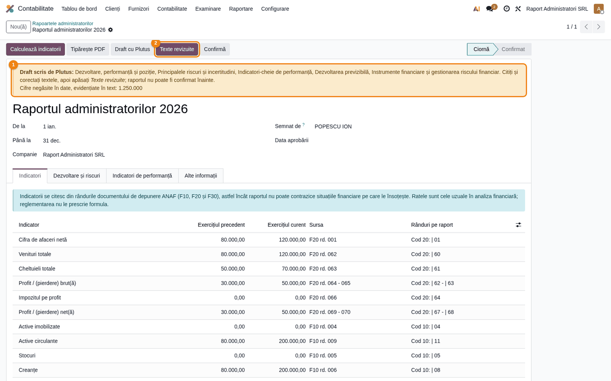
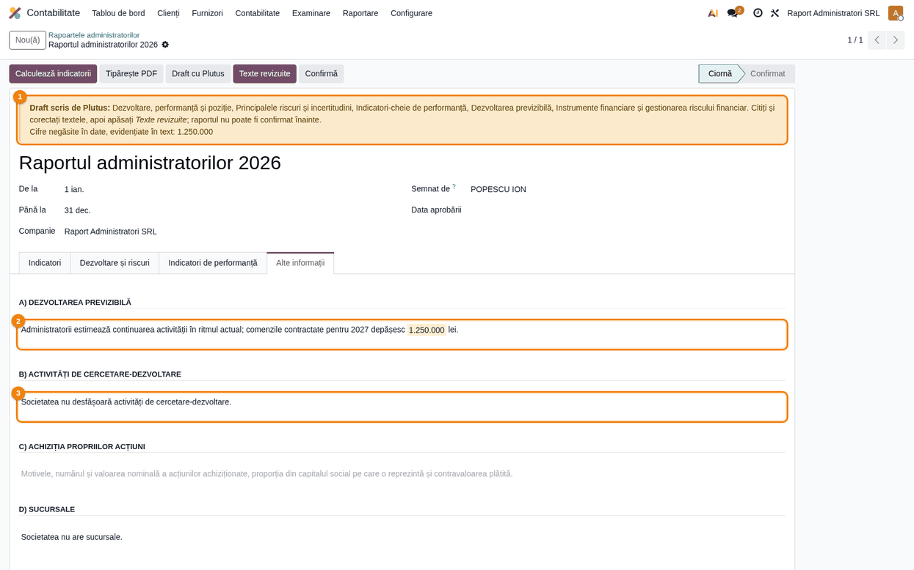
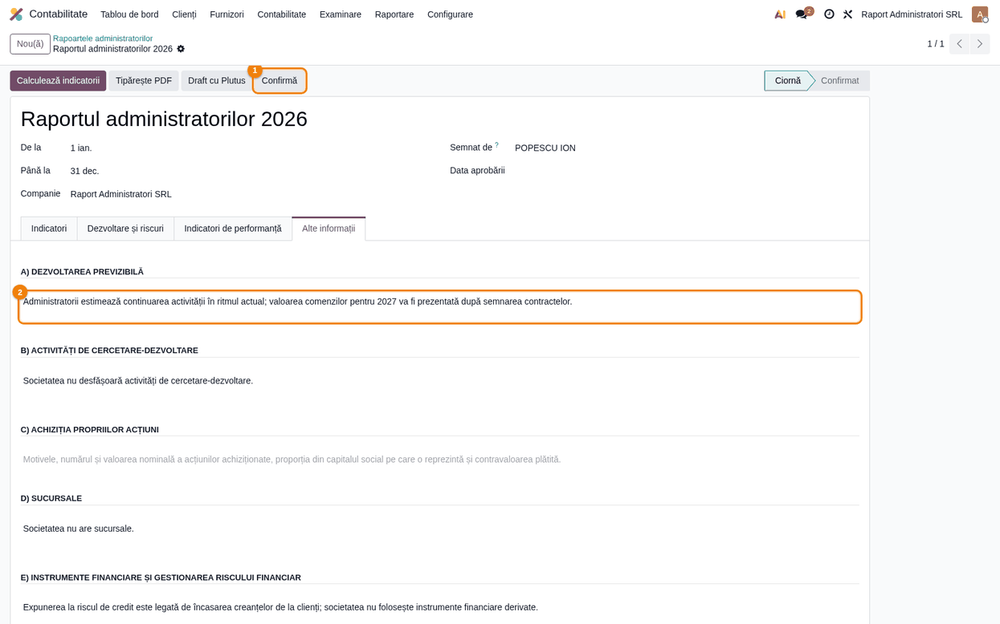
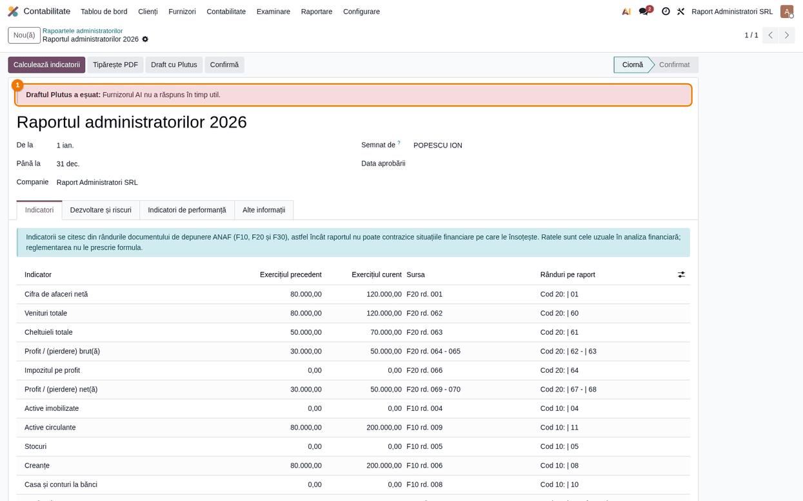

# Fișă Modul: Draftul raportului administratorilor cu Plutus (AI)

**Modul:** `l10n_ro_ai_administrators_report`
**Utilizator principal:** Director Financiar, Contabil Șef, administratorul societății
**Prioritate:** 🟡 Medie (scurtează redactarea raportului anual, dar textul rămâne al administratorului)

---

## 1. Scop business

Raportul administratorilor, care însoțește situațiile financiare anuale, cere texte narative: dezvoltarea și
performanța activității, riscurile, comentariul indicatorilor, evoluția previzibilă și riscul financiar.
Modulul adaugă pe raportul din `l10n_ro_financial_statements` butonul *Draft cu Plutus*: agentul AI scrie
draftul acestor texte din indicatorii raportului și, dacă există, din analiza anuală a aceluiași exercițiu.

Administratorul rămâne responsabil: draftul se citește, se corectează și se marchează *Texte revizuite*;
până atunci raportul nu se poate confirma. Cifrele din text se caută în datele trimise agentului, iar cele
negăsite se evidențiază și se listează. Verificarea are limite (pasul 4), deci citirea integrală a textului
rămâne obligatorie.

## 2. Bază legală și context

- **OMFP 1802/2014, pct. 489–491** — conținutul raportului administratorilor: analiza echilibrată a
  dezvoltării și performanței și a poziției societății, principalele riscuri și incertitudini (pct. 489
  alin. (1) și (2)), indicatorii-cheie de performanță financiară (pct. 491 alin. 1), evoluția previzibilă
  și, când instrumentele financiare sunt semnificative, obiectivele și politicile de gestionare a riscului
  financiar și expunerea la riscurile de preț, de credit, de lichiditate și de flux de numerar (pct. 491
  alin. (2) lit. a) și e)).

Cercetarea-dezvoltarea, sucursalele, acțiunile proprii și resursele necorporale **nu** se trimit agentului,
pentru că nu are date despre ele și ar inventa; le scrie administratorul, în măsura în care se aplică
societății (acțiunile proprii, doar dacă au fost achiziționate; resursele necorporale-cheie, doar pentru
categoriile de entități prevăzute la pct. 491 alin. (1^1), descrise în fișa `l10n_ro_financial_statements`). La riscul financiar, Plutus descrie doar expunerea din date;
obiectivele și politicile de gestionare a riscului le completează administratorul.

## 3. Utilizatori și roluri

| Rol | Ce face |
|---|---|
| Contabil Șef | Calculează indicatorii, cere draftul, completează secțiunile rămase |
| Director Financiar / Administrator | Citește, corectează, marchează *Texte revizuite* și confirmă raportul |
| Administrator sistem | Setează agentul de analiză financiară în setări |

Rol recomandat pentru testare: utilizator cu drepturi de contabilitate asupra situațiilor financiare, pe o
companie cu agentul Plutus setat.

## 4. Conturi și date implicate

Modulul nu generează note contabile. Datele trimise agentului:

| Dată | Sursă |
|---|---|
| Indicatorii raportului (cod, denumire, valoare anul precedent și anul curent, variație procentuală) | rândurile raportului, calculați din situațiile financiare (documentul de depunere) |
| Analiza anuală a aceluiași exercițiu, cu abaterile și cauzele lor | *Analiză financiară*, perioadă anuală, cu aceeași dată de sfârșit și în alt status decât ciornă |
| Denumirea companiei, moneda, exercițiul | raportul |

Date minime pentru demo: companie cu situații financiare pe doi ani, un raport al administratorilor în
ciornă și, opțional, o analiză anuală calculată pentru același exercițiu.

## 5. Configurare inițială

1. Instalează modulul (necesită `l10n_ro_financial_statements` și `deltatech_ai_financial_analysis`).
2. În setările analizei financiare, blocul *Plutus*, verifică agentul de analiză financiară al companiei
   (implicit este Plutus; fără agent, butonul refuză cu mesaj); aici se configurează și anonimizarea
   partenerilor, care se aplică doar partenerilor din analiza anuală (denumirea companiei se trimite mereu).
   Limita zilnică de comentarii AI din același bloc nu se aplică draftului raportului.
3. Limba textelor este cea a partenerului companiei (altfel limba utilizatorului, apoi română).

## 6. Flux de utilizare

### Pasul 1 — Accesare și calculul indicatorilor

*Contabilitate → Raportare → Rapoarte de extras → Raportul administratorilor*. Creează sau deschide
raportul exercițiului, în ciornă, și apasă *Calculează indicatorii* (①). Dacă indicatorii lipsesc, butonul
*Draft cu Plutus* (②) îi calculează singur.



1. **Găsește** în fila *Indicatori* rândurile (cifra de afaceri netă, venituri și cheltuieli totale, profitul,
   activele, datoriile, ratele), cu coloanele *Exercițiul precedent* și *Exercițiul curent*; coloanele
   *Sursa* și *Rânduri pe raport* arată formularul (F10/F20/F30) și rândurile din care provin.
2. **Verifică** că perioada raportului (*De la* / *Până la*; pentru exercițiul curent Odoo nu afișează anul,
   care se vede în titlu, de exemplu *Raportul administratorilor 2026*) este exercițiul corect și că
   indicatorii nu sunt goi; acestea sunt singurele cifre pe care Plutus le primește din raport.

Opțional, calculează în *Analiză financiară* analiza anuală a aceluiași exercițiu: Plutus primește și
abaterile ei, deci textele despre riscuri și perspective sunt mai bogate.

### Pasul 2 — Secțiunile care vor primi draft

Deschide filele *Dezvoltare și riscuri*, *Indicatori de performanță* și *Alte informații*.



1. **Găsește** secțiunile pe care Plutus le poate scrie: dezvoltarea și performanța (①), riscurile (②),
   indicatorii-cheie, evoluția previzibilă și riscul financiar.
2. **Verifică** care sunt goale: doar acestea primesc draft. Dezvoltarea care are încă **doar** textul
   precompletat cu cifre (cifra de afaceri, profitul, activele, datoriile) se consideră goală și se
   înlocuiește; orice text scris de administrator rămâne neatins. Dacă ai recalculat indicatorii după
   precompletare, textul vechi nu mai este recunoscut ca precompletat: golește dezvoltarea înainte de *Draft
   cu Plutus*.
3. **Treci mai departe**: completează de pe acum, dacă vrei, cercetarea-dezvoltarea, sucursalele, acțiunile
   proprii și resursele necorporale; Plutus nu le scrie.

### Pasul 3 — Draft cu Plutus

Apasă *Draft cu Plutus* și confirmă mesajul cu *Ok* (①).



Se completează doar secțiunile goale. Un eșec AI nu modifică textele (pasul 6). Pe formular apare banda
galbenă *Draft scris de Plutus* (①), cu secțiunile scrise și, dacă există, cifrele negăsite în date; în
antet apare butonul *Texte revizuite* (②). În chatter apare mesajul „Plutus a scris draftul pentru: ...”.



### Pasul 4 — Citirea și corectarea draftului

Deschide pe rând filele cu texte. În exemplu, evoluția previzibilă conține o cifră care nu se află în datele
trimise agentului (valoarea comenzilor pentru anul următor), evidențiată în text și listată în bandă.



1. **Găsește** în bandă (①) lista *Cifre negăsite în date* și, în secțiuni (②), aceleași cifre evidențiate cu
   galben.
2. **Verifică** fiecare cifră evidențiată față de situațiile financiare și documentele societății. Verificarea
   automată are limite: numerele întregi sub 100 (în afară de procente) și anii (orice număr întreg între 1900 și 2100) nu se verifică, iar orice
   număr prezent în datele trimise (inclusiv trimiterile la OMFP) sau apropiat de unul (în 0,5%) trece ca
   găsit. Verifică apoi afirmațiile calitative, pe care nicio verificare
   automată nu le prinde: în exemplu, „ca urmare a contractelor noi de servicii IT”, „un singur segment de
   clienți” sau „societatea nu folosește instrumente financiare derivate” nu rezultă din indicatori și trebuie
   confirmate sau scoase. Acolo unde lipsesc informații, draftul trebuie să spună că administratorii le vor
   completa. Secțiunile scrise de administrator (③) sunt neschimbate.
3. **Treci mai departe**: corectează sau șterge cifrele care nu se confirmă (*Texte revizuite* scoate doar
   evidențierea, nu și cifra), apoi completează manual
   cercetarea-dezvoltarea, sucursalele, acțiunile proprii și resursele necorporale (de exemplu „Societatea nu
   are sucursale.”).

Pentru a cere din nou draftul unei secțiuni, golește-o și apasă iar *Draft cu Plutus*. Dacă există deja un
draft nerevizuit, secțiunile și cifrele de verificat ale draftului nou se adaugă celor din banda galbenă, iar
statusul rămâne de revizuit. Dacă toate secțiunile sunt completate, butonul arată mesajul de la secțiunea 9.

### Pasul 5 — Texte revizuite și confirmare

După corectare, apasă *Texte revizuite*: banda galbenă dispare, evidențierile rămase se scot din text (ca să
nu ajungă în PDF), iar în chatter apare „Textele scrise de Plutus au fost revizuite.” Abia apoi *Confirmă* (①)
nu mai este refuzat. În exemplu, operatorul a înlocuit valoarea comenzilor, care nu se putea confirma, cu o
formulare fără cifră (②).



Dacă draftul nu e revizuit, confirmarea este refuzată. Confirmarea mai cere, din
`l10n_ro_financial_statements`, ca secțiunile dezvoltare, cercetare-dezvoltare, sucursale, dezvoltare
previzibilă și riscuri să nu fie goale și ca dezvoltarea să nu conțină doar textul precompletat cu cifre.

### Pasul 6 — Eșecul apelului AI

Dacă agentul nu răspunde sau răspunsul nu conține nicio secțiune cerută, apare banda roșie *Draftul Plutus a
eșuat* (①), cu eroarea; textele rămân cum erau și se poate încerca din nou. În exemplu, evoluția previzibilă
a fost golită după revizuire, iar furnizorul AI nu a răspuns: secțiunea rămâne goală. Mesajele reale ale
furnizorului AI pot fi tehnice și în engleză.



Dacă raportul avea deja un draft nerevizuit, statusul lui rămâne *Draft de revizuit* (sau *Draft, cifre de
verificat*), textele nu se ating, iar eroarea apare totuși în banda roșie. Banda roșie dispare doar la
următorul draft reușit: nu o scot nici *Texte revizuite*, nici confirmarea.

### Date tehnice (mod dezvoltator)

Tabul *Plutus*, vizibil doar în modul dezvoltator după primul apel, arată statusul draftului (*Fără draft*,
*Draft de revizuit*, *Draft, cifre de verificat*, *Revizuit*, *Eșuat*), data draftului și datele JSON trimise
agentului. Tabul nu are captură: în versiunea curentă, deschiderea lui afișează o eroare de interfață (vezi
secțiunea 9).

### Note de monografie și raportare

Modulul nu generează note contabile (nu există linii Dr/Cr). Textele revizuite se confirmă odată cu raportul
administratorilor din `l10n_ro_financial_statements`, care însoțește situațiile financiare anuale.

## 7. Legături cu alte module / declarații

| Modul | Rol |
|---|---|
| `l10n_ro_financial_statements` | Raportul administratorilor, indicatorii și confirmarea |
| `deltatech_ai_financial_analysis` | Agentul Plutus, analiza anuală, verificarea cifrelor |

**Ce e automat:** trimiterea indicatorilor și a analizei anuale, scrierea draftului în secțiunile goale,
verificarea cifrelor, blocarea confirmării cât timp draftul nu e revizuit.
**Ce rămâne manual:** citirea și corectarea textelor, secțiunile despre cercetare, sucursale, acțiuni
proprii și resurse necorporale, apăsarea *Texte revizuite* și confirmarea.

## 8. Verificări pentru consultant

- [ ] *Draft cu Plutus* apare doar cât raportul e în ciornă.
- [ ] Fără agent setat, butonul refuză cu mesajul de configurare.
- [ ] Secțiunile completate de administrator rămân neschimbate după draft.
- [ ] Dezvoltarea cu textul precompletat este înlocuită de draft.
- [ ] O cifră inventată apare evidențiată și în lista din bandă; statusul este *Draft, cifre de verificat*.
- [ ] Cât statusul e *Draft de revizuit* sau *Draft, cifre de verificat*, *Confirmă* este refuzat.
- [ ] Afirmațiile calitative și cauzele din draft (care nu sunt cifre) se verifică manual înainte de *Texte revizuite*.
- [ ] *Texte revizuite* scoate evidențierea, dar nu și cifra: cifrele neconfirmate se corectează înainte.
- [ ] După *Texte revizuite*, evidențierile dispar și confirmarea merge, dacă și secțiunile obligatorii sunt completate.
- [ ] Un eșec AI afișează banda roșie și nu modifică textele.
- [ ] Un raport confirmat nu mai poate primi draft.

## 9. Mesaje de eroare frecvente

| Mesaj | Cauză | Remediere |
|---|---|---|
| Un raport confirmat nu mai poate primi un draft. | Raportul nu mai e în ciornă (din interfață butonul e ascuns; mesajul apare doar la apel prin API) | Cere draftul doar pe rapoarte în ciornă; un raport confirmat se poate readuce în ciornă cu *Resetează la ciornă* |
| Setați întâi agentul de analiză financiară în setări. | Compania nu are agentul setat | Setează Plutus în setările analizei financiare |
| Toate secțiunile pe care le poate scrie Plutus sunt deja completate; goliți una pentru a cere din nou draftul. | Nicio secțiune goală | Golește secțiunea dorită și repetă |
| Raportul are texte scrise de Plutus care nu au fost revizuite. Citiți-le, corectați-le unde e nevoie și marcați-le ca revizuite înainte de confirmare. | Confirmare înainte de *Texte revizuite* | Citește textele și apasă *Texte revizuite* |
| Raportul administratorilor trebuie să prezinte: ... (OMFP 1802/2014, pct. 489 și pct. 491 alin. (2)). Când un subiect nu este aplicabil, menționați expres (de exemplu, entitatea nu are sucursale). | Una dintre secțiunile obligatorii (cercetare-dezvoltare, sucursale, dezvoltare previzibilă, riscuri) este goală | Completează-o manual; unde nu se aplică, scrie expres (de exemplu „Societatea nu are sucursale.”) |
| Secțiunea privind dezvoltarea conține doar cifrele precompletate. Completați-o cu o analiză echilibrată și cuprinzătoare (OMFP 1802/2014, pct. 489). | Dezvoltarea are încă textul precompletat | Golește secțiunea și cere draftul sau scrie analiza manual |
| Răspunsul AI nu conține niciuna dintre secțiunile cerute. | Agentul a răspuns fără secțiunile cerute | Repetă draftul; verifică agentul și datele trimise |
| Ups! Ceva nu a mers bine... (la deschiderea tabului *Plutus*, în modul dezvoltator) | Defect cunoscut al versiunii curente: câmpul cu datele JSON trimise agentului nu se poate afișa | Nu afectează draftul; până la corectură, tabul nu se folosește |

## 10. Capturi de ecran

Capturile sunt **generate automat** din `tests/test_screenshots.py` (mixinul `ScreenshotCase` din
`l10n_ro_doc_screenshots`, import defensiv), cu interfața în română, pe planul de conturi RO, pe o companie
de test în RON cu facturi pe 2025 și 2026. **Apelul AI este simulat** (fără cheie reală): agentul întoarce un
răspuns fix, scris din indicatorii calculați, plus o cifră care nu e în date, ca să se vadă evidențierea.

| Fișier | Conținut |
|---|---|
| `01_raport_ciorna.png` | Raportul în ciornă, indicatorii calculați, butoanele *Calculează indicatorii* și *Draft cu Plutus* |
| `02_sectiuni_goale.png` | Fila *Dezvoltare și riscuri* înainte de draft |
| `03_confirmare_draft.png` | Confirmarea butonului *Draft cu Plutus* |
| `04_draft_plutus.png` | Banda galbenă cu secțiunile scrise și cifra negăsită; butonul *Texte revizuite* |
| `05_cifre_de_verificat.png` | Cifra evidențiată în evoluția previzibilă; secțiunile administratorului neatinse |
| `06_revizuit.png` | După corectare și *Texte revizuite*: fără bandă, textul corectat, *Confirmă* nu mai e refuzat |
| `07_draft_esuat.png` | Banda roșie a draftului eșuat |

Regenerare:

```bash
./odoo/odoo-bin -c odoo.conf -d <db> -i l10n_ro_ai_administrators_report,l10n_ro_doc_screenshots \
    --test-tags=/l10n_ro_ai_administrators_report:TestAIAdministratorsReportScreenshots --stop-after-init
```

## 11. Observații pentru manual

- Subliniază că agentul nu confirmă niciodată raportul și că draftul nu înlocuiește răspunderea
  administratorilor.
- Explică evidențierea cifrelor negăsite și că ea dispare la *Texte revizuite*.
- Menționează secțiunile care rămân exclusiv manuale (cercetare, sucursale, acțiuni proprii, resurse
  necorporale).
