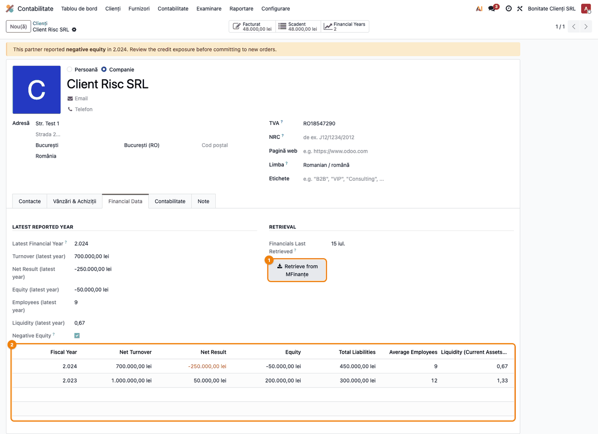
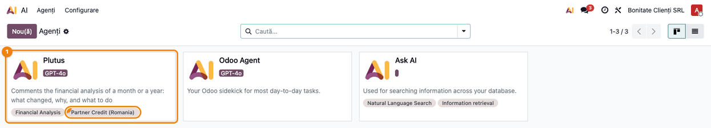
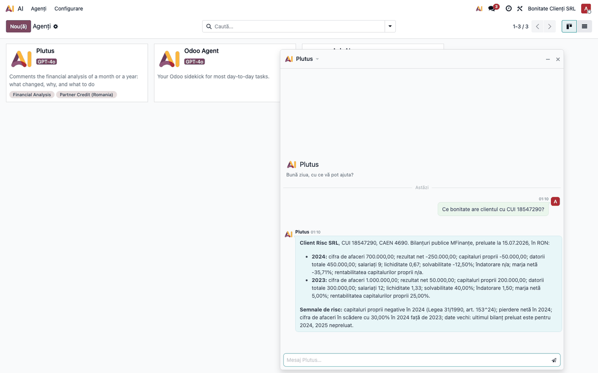
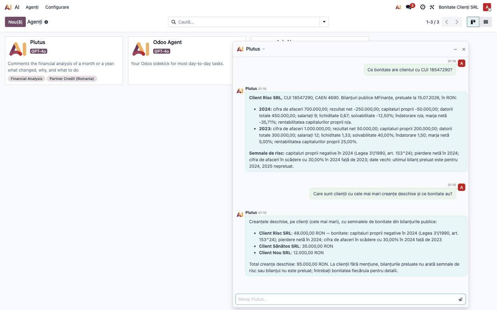
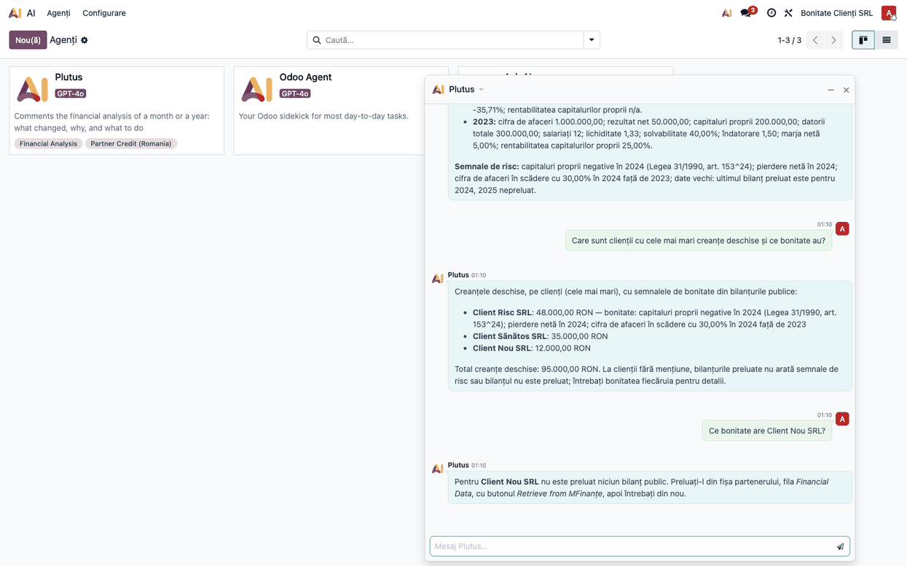

# Fișă Modul: Bonitatea partenerilor cu Plutus (AI)

**Modul:** `l10n_ro_ai_partner_financials`
**Utilizator principal:** Contabil clienți/furnizori, Director Financiar
**Prioritate:** 🟡 Medie (completează analiza financiară cu riscul de credit al clienților și furnizorilor)

---

## 1. Scop business

Înainte de a acorda termen de plată sau de a continua să livrezi unui client cu creanțe restante, trebuie
să știi cât de solidă este firma. Bilanțurile publice ale partenerilor sunt deja preluate de la MFinanțe de
modulul `l10n_ro_partner_financials`. Acest modul le pune la dispoziția lui **Plutus**, agentul AI de
analiză financiară, și a serverului MCP, printr-o unealtă nouă: *Bonitatea partenerului*.

Utilizatorul întreabă în chat, după CUI sau după nume, și primește pe ani cifra de afaceri, rezultatul net,
capitalurile proprii, datoriile, salariații și indicatorii, plus **semnalele de risc**. Semnalele sunt
calculate în cod din cifrele publice, nu „apreciate” de agent. În plus, în unealta de vechime a creanțelor,
clienții din listă care au semnale de risc le primesc pe linie, așa că se văd imediat clienții mari cu
bonitate slabă.

## 2. Bază legală și context

- **Legea 31/1990, art. 153^24** — privește situația în care **activul net** scade sub **jumătate din
  capitalul social subscris**, din cauza pierderilor. Modulul **nu** verifică acest prag: semnalul
  „capitaluri proprii negative” se declanșează doar când capitalurile proprii ale ultimului bilanț sunt sub
  zero, care este un caz extrem al aceleiași situații. Citarea articolului din textul semnalului e deci
  orientativă: o firmă cu capitaluri pozitive, dar sub jumătate din capitalul social, nu primește semnal. În
  plus, „Capitaluri – total” din bilanțul public nu coincide exact cu activul net din lege.
- **Bilanțurile publice MFinanțe** — sursa cifrelor: ce a depus partenerul la Ministerul Finanțelor, deci
  datele au cel puțin un an vechime.

Unealta este doar de citire: nu interoghează MFinanțe în timpul conversației și nu produce note contabile.

## 3. Utilizatori și roluri

| Rol | Ce face |
|---|---|
| Contabil clienți | Întreabă bonitatea unui client înainte de livrare sau la analiza creanțelor restante |
| Contabil furnizori | Verifică soliditatea unui furnizor cu avansuri sau contracte mari |
| Director Financiar | Cere clienții cu cele mai mari creanțe deschise și semnalele lor de risc |
| Administrator sistem | Configurează agentul Plutus și (opțional) serverul MCP |

Rol recomandat pentru testare: utilizator cu acces la aplicația AI (chatul cu Plutus) și la fișa partenerului.

## 4. Conturi și date implicate

Modulul nu generează note contabile. Datele folosite:

| Dată | Sursă |
|---|---|
| Bilanțuri publice pe ani (cifra de afaceri, rezultat net, capitaluri proprii, datorii totale, salariați, cod CAEN) | `l10n_ro_partner_financials`, preluate de la MFinanțe |
| Creanțe deschise pe clienți (scadente sau nu) | unealta de vechime a creanțelor din analiza financiară |

Date minime pentru demo:
- agentul Plutus configurat în setările analizei financiare;
- cel puțin doi parteneri cu CUI valid, cu bilanțurile preluate (un partener cu pierdere sau capitaluri
  negative, ca să apară semnalele);
- un partener fără bilanț preluat, pentru mesajul de lipsă;
- facturi de client neîncasate, pentru vechimea creanțelor.

## 5. Configurare inițială

1. Instalează modulul (necesită `l10n_ro_partner_financials` și `deltatech_ai_financial_analysis`).
2. La instalare, subiectul *Partner Credit (Romania)* este atașat automat agentului **Plutus livrat** de
   `deltatech_ai_financial_analysis`; nu e nevoie de configurare suplimentară pentru chat. Dacă în setările
   analizei financiare este ales alt agent, adaugă-i manual subiectul din *AI → Agenți*, fișa agentului. Chatul se deschide din aplicația *AI* (modulul `ai_app`), care nu
   se instalează automat cu acest modul.
3. Preia bilanțurile partenerilor: din fișa partenerului (companie), fila *Financial Data*, butonul
   *Retrieve from MFinanțe* (eticheta rămâne în engleză și în interfața în română), sau activează manual, din
   *Setări → Tehnic → Automatizare → Acțiuni planificate* (cu modul dezvoltator activ), cronul `RO: Fetch partner financial data (MFinanțe)`, livrat
   dezactivat.
4. Pentru MCP (opțional): în `deltatech_mcp_server`, expune metoda `mcp_fa_partner_credit` a modelului
   `financial.analysis` ca unealtă și include modelul în politica de acces, după pașii din fișa consultant a
   modulului `deltatech_mcp_server`; argumentele sunt `partner` și `years`.

## 6. Flux de utilizare

### Pasul 1 — Preluarea bilanțurilor

Deschide partenerul (companie) din *Contabilitate → Clienți → Clienți* (sau din *Contacte*), fila
*Financial Data* (apare doar la companii), și apasă butonul *Retrieve from MFinanțe* (①). Așteaptă
preluarea. Fără bilanț preluat, unealta nu are ce arăta.



1. **Găsește** în listă (②) un rând pe an, cu cifra de afaceri, rezultatul net, capitalurile proprii,
   datoriile, salariații și lichiditatea; deasupra, ultimul an raportat și, în grupul *Retrieval*, data
   ultimei preluări (*Financials Last Retrieved*).
2. **Verifică** că anii așteptați sunt preluați. Fila și etichetele ei apar în engleză și în interfața în
   română, iar anul se afișează cu separator de mii (2.024 înseamnă 2024). La capitaluri proprii negative,
   fișa arată și banda galbenă de avertizare.

### Pasul 2 — Chatul cu Plutus

Deschide aplicația *AI → Agenți* și dă clic pe cardul **Plutus** (①): se deschide fereastra de chat. Pe
card, eticheta subiectului *Partner Credit (Romania)* arată că unealta de bonitate este atașată agentului.



Întreabă, de exemplu: „ce bonitate are clientul cu CUI 18547290?”. Partenerul se caută:

- după **CUI**, cu sau fără prefixul RO: se acceptă doar CUI-ul exact (o potrivire parțială ar da bonitatea
  altei firme);
- după **nume**: întâi potrivirea exactă, apoi cea parțială.

Dacă numele se potrivește la mai mulți parteneri, Plutus îi listează (cel mult 10) și cere CUI-ul unuia
dintre ei.

### Pasul 3 — Citirea răspunsului

Răspunsul are, în ordine: denumirea, CUI-ul și codul CAEN; data preluării bilanțurilor și moneda; apoi un
rând pe an, cel mai recent primul, cu coloanele *an | cifră de afaceri | rezultat net | capitaluri proprii |
datorii totale | salariați | lichiditate | solvabilitate | îndatorare | marjă netă | rentabilitatea
capitalurilor proprii*; la final, semnalele de risc. Plutus le reia în limba conversației.



Pe ecran:

1. **Găsește** anul ultimului bilanț și data preluării: sunt la începutul răspunsului. Numărul de ani se
   poate cere (1–10); implicit sunt 3.
2. **Verifică** că: anul ultimului bilanț este cel așteptat (datele publice au cel puțin un an vechime);
   cifrele corespund bilanțului publicat; îndatorarea și rentabilitatea apar ca „n/a” când capitalurile
   proprii nu sunt pozitive, iar marja netă ca „n/a” când cifra de afaceri este zero.
3. **Treci mai departe** doar după ce ai citit semnalele. Plutus este instruit să reia cifrele și semnalele
   uneltei fără să adauge rating sau probabilitate de insolvență proprii; dacă totuși o face, se ia în
   considerare doar ce vine din unealtă (cifrele pe ani și semnalele).

Indicatorii, calculați din cifrele publice:

| Indicator | Formulă | Atenție |
|---|---|---|
| Lichiditate | active circulante / datorii totale | bilanțul public nu separă datoriile pe scadențe, deci nu e lichiditatea curentă și nu se compară cu pragul uzual de 2; apare 0,00 când datoriile totale sunt zero (nu înseamnă lichiditate nulă) |
| Solvabilitate | capitaluri proprii / total active × 100 | este rata de autonomie financiară, nu solvabilitatea generală (active / datorii); apare 0,00 când totalul activelor este zero |
| Îndatorare | datorii totale / capitaluri proprii | „n/a” când capitalurile proprii nu sunt pozitive |
| Marja netă | rezultat net / cifra de afaceri × 100 | „n/a” când cifra de afaceri este zero |
| Rentabilitatea capitalurilor proprii | rezultat net / capitaluri proprii × 100 | „n/a” când capitalurile proprii nu sunt pozitive |

Semnalele de risc (unealta le întoarce în engleză; Plutus le traduce în limba conversației):

| Semnal (unealtă) | În chat | Când apare |
|---|---|---|
| negative equity | capitaluri proprii negative | capitalurile proprii ale ultimului bilanț sunt negative |
| net loss | pierdere netă | rezultatul net al ultimului an este negativ |
| turnover down | cifra de afaceri în scădere | cifra de afaceri a scăzut cu cel puțin 20% față de anul precedent (doar dacă anii sunt consecutivi) |
| old data | date vechi | cel mai recent bilanț este mai vechi decât anul pe care modulul îl consideră publicat la MFinanțe (N−1 de la 1 iulie, altfel N−2) |

### Pasul 4 — Vechimea creanțelor cu bonitate

În chat, cere vechimea creanțelor, de exemplu: „care sunt clienții cu cele mai mari creanțe deschise și ce
bonitate au?”. Unealta listează clienții cu cele mai mari solduri deschise (scadente sau nu); pentru fiecare
client din listă care are semnale, linia lui primește la final semnalele de bonitate (în datele uneltei,
sufixul `| credit: ...`).



1. **Găsește** pe linia fiecărui client mențiunea de bonitate.
2. **Verifică** că semnalele apar doar pentru clienții care au bilanțuri preluate; aici semnalul de date
   vechi nu se afișează (ar marca aproape toți clienții), ci doar riscul propriu-zis. Un client fără sufix
   fie nu are semnale, fie nu are bilanț preluat, fie are un omonim între parteneri (linia conține doar
   numele, deci la firme cu același nume semnalele nu se afișează).
3. **Treci mai departe** cu decizia comercială (limită de credit, avans, recuperare) în afara modulului.

### Pasul 5 — Cazuri limită

- **Fără bilanț preluat:** Plutus spune că partenerul nu are bilanț și trimite la butonul *Retrieve from
  MFinanțe* de pe fișa partenerului.



- **Partener negăsit:** răspunsul spune că nu a fost găsită nicio firmă.

### Note de monografie și raportare

Modulul nu generează note contabile (nu există linii Dr/Cr) și nu alimentează declarații ANAF. Este un
instrument de informare pentru decizie.

## 7. Legături cu alte module / declarații

| Modul | Rol |
|---|---|
| `l10n_ro_partner_financials` | Preia și stochează bilanțurile publice MFinanțe |
| `deltatech_ai_financial_analysis` | Plutus, chatul AI și unealta de vechime a creanțelor |
| `deltatech_financial_analysis` | Modelul `financial.analysis` și uneltele lui, extinse aici |
| `deltatech_mcp_server` | Expunerea uneltei prin MCP (opțional) |

**Ce e automat:** căutarea partenerului, calculul indicatorilor și al semnalelor, atașarea subiectului la
Plutus la instalare, semnalele pe linie în vechimea creanțelor.
**Ce rămâne manual:** preluarea bilanțurilor (buton sau cron activat manual), interpretarea semnalelor și decizia
comercială, adăugarea metodei MCP în politica serverului.

## 8. Verificări pentru consultant

- [ ] Plutus are subiectul *Partner Credit (Romania)* după instalare.
- [ ] Întrebarea după CUI cu RO și fără RO dă același partener.
- [ ] Un CUI incomplet (doar o parte din cifre) nu întoarce o altă firmă.
- [ ] Un nume care se potrivește la mai mulți parteneri produce lista și cererea de CUI.
- [ ] Răspunsul arată anul ultimului bilanț și data preluării.
- [ ] Un partener cu capitaluri proprii negative primește semnalul *negative equity*; unul cu pierdere,
  *net loss*.
- [ ] O scădere a cifrei de afaceri de cel puțin 20% față de anul precedent produce *turnover down*.
- [ ] Un partener fără bilanț primește mesajul de lipsă și trimiterea la butonul *Retrieve from MFinanțe*.
- [ ] În vechimea creanțelor, clienții cu semnale au sufixul `| credit: ...`; semnalul de date vechi nu
  apare acolo.
- [ ] Unealta nu apelează MFinanțe în timpul conversației.

## 9. Mesaje de eroare frecvente

| Mesaj | Cauză | Remediere |
|---|---|---|
| Dați codul fiscal sau numele partenerului. | Argumentul `partner` a fost gol | Cere bonitatea cu CUI sau cu numele firmei |
| no company found for ... | Niciun partener comercial (fără contact părinte) nu se potrivește | Verifică CUI-ul din fișa partenerului sau scrie numele corect |
| N companies match ...; call again with the tax id | Numele se potrivește la mai mulți parteneri | Repetă întrebarea cu CUI-ul unuia dintre ei |
| ...: no public balance sheet retrieved | Partenerul nu are bilanțuri preluate | Apasă *Retrieve from MFinanțe* în fila *Financial Data* a partenerului sau activează cronul |

Mesajele de mai sus sunt textul exact al uneltei, vizibil prin MCP; în chat, Plutus le reformulează în limba
conversației (vezi captura 05).

## 10. Capturi de ecran

Capturile sunt **generate automat** din `tests/test_screenshots.py` (mixinul `ScreenshotCase` din
`l10n_ro_doc_screenshots`, import defensiv), cu interfața în română, pe planul de conturi RO, pe o companie
de test în RON. **Apelul AI este simulat** (fără cheie reală): întrebările și răspunsurile lui Plutus se
postează direct în chat, iar răspunsurile sunt scrise din ieșirea reală a uneltelor (bonitatea și vechimea
creanțelor), deci cifrele și semnalele sunt cele calculate de modul. Capturile cer și aplicația *AI*
(`ai_app`) instalată; fără ea, testul se sare.

| Fișier | Conținut |
|---|---|
| `01_buton_mfinante.png` | Fișa clientului, fila *Financial Data*, cu butonul *Retrieve from MFinanțe* și bilanțurile preluate |
| `02_plutus_agent.png` | *AI → Agenți*: cardul Plutus cu subiectul *Partner Credit (Romania)* |
| `03_raspuns_bonitate.png` | Răspunsul cu cifrele pe ani și semnalele de risc |
| `04_vechime_creante_bonitate.png` | Vechimea creanțelor, cu semnalele de bonitate pe linia clientului |
| `05_fara_bilant.png` | Răspunsul pentru un partener fără bilanț preluat |

Regenerare:

```bash
./odoo/odoo-bin -c odoo.conf -d <db> -i l10n_ro_ai_partner_financials,l10n_ro_doc_screenshots,ai_app \
    --test-tags=/l10n_ro_ai_partner_financials:TestAIPartnerFinancialsScreenshots --stop-after-init
```

## 11. Observații pentru manual

- Subliniază că semnalele sunt calculate în cod din cifrele publice, iar Plutus nu adaugă rating sau
  probabilitate de insolvență.
- Atenționează că datele publice au cel puțin un an vechime: se citește mereu anul bilanțului și data
  preluării.
- Precizează că unealta citește doar ce e deja preluat și nu interoghează MFinanțe în conversație.
- Semnalele și răspunsul unealtei apar în engleză; Plutus le reia în limba conversației.
