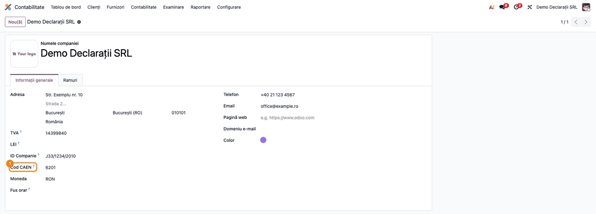

# Fișă Modul: Infrastructură declarații ANAF

**Poziție plan:** C1
**Modul:** `l10n_ro_anaf_base`
**FR:** FR-53
**Capitol manual:** Cap 4.0
**Utilizator principal:** Responsabil fiscal, Administrator Odoo
**Prioritate:** 🔴 Ridicată

---

## 1. Scop business

Modulul oferă infrastructura comună pentru declarațiile fiscale ANAF din suita `l10n_ro_anaf_dxxx`: meniuri, configurări, date de identificare declarant și mecanisme comune pentru export.

## 2. Bază legală și context

Declarațiile fiscale se pregătesc în formatele publicate de ANAF. Modulul nu reprezintă o declarație individuală, ci baza tehnică folosită de modulele D300, D390, D394, D100, D120, D318, D398 și alte declarații.

## 3. Utilizatori și roluri

- Administrator funcțional: configurează compania și setările ANAF.
- Contabil șef: verifică datele declarantului înainte de export.
- Contabil fiscal: folosește modulele de declarații care depind de această bază.

## 4. Date implicate

- companie românească, CUI și adresă;
- codul CAEN al activității principale, contactul responsabil de declarații și identificatorul declarantului;
- perioade fiscale;
- module de declarații instalate separat;
- configurări comune ANAF.

## 5. Configurare inițială

1. Instalați `l10n_ro_anaf_base`.
2. Verificați meniul ANAF adăugat în contabilitate: `Contabilitate → Raportare → Declarații ANAF`.
3. Deschideți `Contabilitate → Configurare → Setări`, blocul `Declarații ANAF România`, și completați:

| Câmp | Valoare așteptată |
|---|---|
| Cod CAEN | codul de 4 cifre al activității principale; este cerut la export de D300, D394, D112, D120, D101 și D392; la aceste declarații un cod gol, `0000` sau care nu are exact 4 cifre blochează exportul; se completează și pe formularul companiei, iar căutarea partenerului în registrul ANAF nu îl schimbă |
| Contact declarații | persoana responsabilă de declarații; dacă rămâne necompletat, exportul folosește utilizatorul curent drept declarant, iar numele, funcția (implicit „accountant”, dacă lipsește), e-mailul și telefonul acestuia ajung în declarație |
| Identificator declarație | CUI sau CNP al declarantului, folosit în exporturi; are prioritate; dacă rămâne necompletat, se folosește CNP-ul contactului de declarații, iar în lipsa lui CUI-ul contactului |
| Tip export | `Descărcare directă XDP`, `Arhivă ZIP cu XDP și PDF` sau `PDF cu datele incluse` (valoarea implicită); în interfața în engleză apar ca `Direct XDP download`, `ZIP archive with XDP and PDF` și `PDF with the data included` |

4. Bifați, după nevoie, declarațiile de instalat din același bloc: D300, D390, D394, D398.
5. Verificați că modulele de declarații folosesc aceeași companie și aceeași localizare RO.

## 6. Flux de utilizare

### Pasul 1 — Accesare

Meniuri:

- `Contabilitate → Raportare → Declarații ANAF`;
- `Contabilitate → Configurare → Setări → Declarații ANAF România`.

1. Deschideți setările și verificați datele declarantului (CAEN, contact, identificator, tip export).

   

   Codul CAEN se poate completa și pe formularul companiei: `Setări → Utilizatori & Companii → Companii → [compania]`, câmpul
   **Cod CAEN**, imediat după **ID Companie** (numărul de la Registrul Comerțului). Este același câmp,
   al companiei, nu al partenerului ei: căutarea partenerului în registrul ANAF actualizează codul CAEN
   de pe partener, dar nu și pe cel declarat.

   
2. Instalați modulul declarației necesare, de exemplu `l10n_ro_anaf_d300`, bifând-o în același bloc.
3. Deschideți meniul `Declarații ANAF` și generați declarația din modulul specific.
4. Verificați că exportul preia datele comune din baza ANAF și că are formatul ales la `Tip export`.

**Tip export (Soft A).** În același bloc **Declarații ANAF România** din setări, câmpul **Tip export**
stabilește ce se descarcă la butoanele de export XDP ale declarațiilor (D100, D101, D300, D390, D394, D398):

| Tip export | Fișier descărcat |
|---|---|
| Descărcare directă XDP | fișierul de date `.xdp`, de deschis în Adobe Reader lângă formularul PDF salvat în același folder |
| Arhivă ZIP cu XDP și PDF | arhivă ZIP cu `.xdp` și formularul PDF gol |
| PDF cu datele incluse (implicit) | formularul PDF ANAF completat (`.pdf`), gata de deschis în Adobe Reader, validat și semnat |

Cu *PDF cu datele incluse*, datele se scriu în formular printr-o actualizare incrementală, care
păstrează extensiile Adobe Reader ale formularului ANAF. Opțiunea cere biblioteca Python `pypdf` 5.0
sau mai nouă pe server; fără ea, exportul revine la arhiva ZIP. Când e ales *PDF cu datele incluse* și
serverul nu are biblioteca, sub câmp apare un avertisment: declarațiile se descarcă într-o arhivă ZIP cu
fișierul XDP și formularul PDF gol.

## 7. Legături cu alte module / declarații

| Modul / proces | Rol în flux |
|---|---|
| Module `l10n_ro_anaf_dxxx` | folosesc infrastructura comună de declarații |
| `account_reports` | sursa rapoartelor fiscale și a exporturilor |
| Date companie | CUI, adresă, CAEN, contact și identificator declarant, tip export |

Ce este automat: centralizarea setărilor comune pentru declarații ANAF.
Ce rămâne manual: verificarea datelor companiei și a declarantului, precum și depunerea declarației la ANAF.

## 8. Verificări pentru consultant

- [ ] Modulul se instalează fără erori.
- [ ] Meniurile ANAF sunt vizibile.
- [ ] Datele companiei sunt completate și corecte.
- [ ] După actualizarea la 19.0.1.4.0, **Cod CAEN** de pe companie este completat: migrarea preia codul de pe
      partenerul companiei, ignorând `0000`; dacă acolo nu e un cod, preia codul de rezervă al situațiilor financiare.
      Câmpul rămâne gol doar când ambele lipsesc, iar atunci se completează manual.
- [ ] La o firmă trecută pe CAEN Rev.3, codul de pe companie este cel acceptat de schema declarației (de exemplu
      în D112), chiar dacă registrul ANAF întoarce codul nou pe partener.
- [ ] Un modul de declarație dependent poate genera export folosind baza ANAF.
- [ ] Fără `pypdf` 5.0 sau mai nou pe server, cu *PDF cu datele incluse* ales, setările afișează avertismentul despre arhiva ZIP.
- [ ] Cu **Tip export** = *PDF cu datele incluse*, butonul de export XDP descarcă un `.pdf` completat; fără `pypdf` 5.0 sau mai nou pe server, descarcă arhiva ZIP.

## 9. Mesaje frecvente

| Simptom | Cauză probabilă | Remediere |
|---------|-----------------|-----------|
| Lipsesc date declarant | Compania nu are CUI/adresă completă | Completați datele companiei |
| „Compania „…” nu are configurat un cod CAEN valid. Completați-l pe companie…” | Codul CAEN al companiei este gol, `0000` sau nu are 4 cifre (la D300, D394, D112, D120, D101, D392) | Completați `Cod CAEN` în Setări sau pe formularul companiei (`Setări → Utilizatori & Companii → Companii`); codul nu se mai citește de pe partenerul companiei |
| Eroare la export: compania nu are identificator de declarație (apare doar la declarațiile care îl cer, în prezent D112) | Nici `Identificator declarație`, nici CUI/CNP-ul contactului nu sunt completate | Completați identificatorul sau CUI/CNP-ul contactului de declarații |
| Eroare la export: Compania nu are configurat un județ/stat valid din România (apare la declarațiile care îl cer, de exemplu D300 și D101) | Adresa companiei nu are județ sau județul nu este unul românesc recunoscut | Completați județul în adresa companiei (formularul companiei sau fișa partenerului ei; adresa e comună) |
| Modulul declarației nu apare | Declarația individuală nu este instalată | Instalați modulul `l10n_ro_anaf_dxxx` necesar |
| Cu *PDF cu datele incluse* se descarcă ZIP; setările arată avertisment despre biblioteca `pypdf` | Serverul nu are `pypdf` 5.0 sau mai nou | Instalați `pypdf` ≥ 5.0 pe server |
| „Formularul PDF ANAF nu conține pachete XFA." / „… pachetul XFA datasets." | Formularul PDF din modulul declarației nu e un formular ANAF valid | Actualizați modulul declarației; temporar alegeți *Arhivă ZIP cu XDP și PDF* |
| „Fișierul XDP generat nu conține pachetul XFA datasets." | Macheta XDP a declarației nu are pachetul de date | Actualizați modulul declarației; temporar alegeți *Descărcare directă XDP* |

## 10. Capturi de ecran

Capturile (`static/description/`) sunt **generate automat** din `tests/test_screenshots.py`
(mixinul `ScreenshotCase` din `l10n_ro_doc_screenshots`, import defensiv), în **limba română**:

1. `01_setari_declaratii_anaf.png` — blocul **Declarații ANAF România** din setările contabile.
2. `02_companie_cod_caen.png` — codul CAEN pe formularul companiei.

Regenerare:

```bash
./odoo/odoo-bin -c odoo.conf -d <db> -i l10n_ro_anaf_base,l10n_ro_doc_screenshots \
    --test-tags=fise_screenshots --stop-after-init
```

## 11. Observații pentru manual

Subliniați că datele comune ale declarațiilor (cod CAEN, contact, identificator, tip export) se
completează o singură dată, pe companie, și sunt folosite de toate declarațiile ANAF. Codul CAEN declarat
este al companiei, separat de codul CAEN din registrul ANAF afișat pe partener: la firmele trecute pe
CAEN Rev.3, consultantul verifică ce cod acceptă schema fiecărei declarații.
