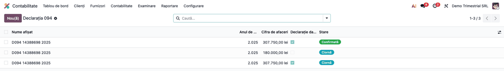
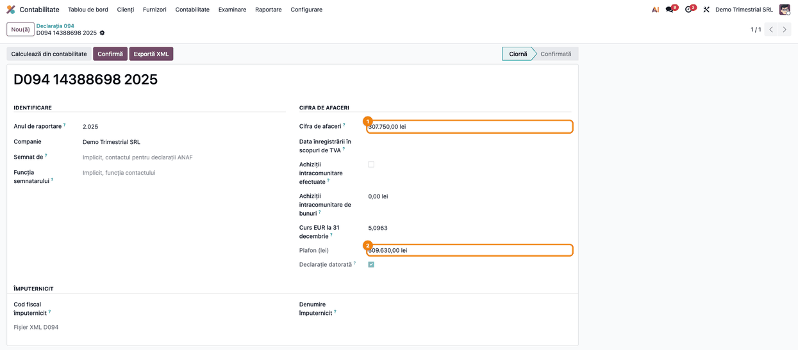
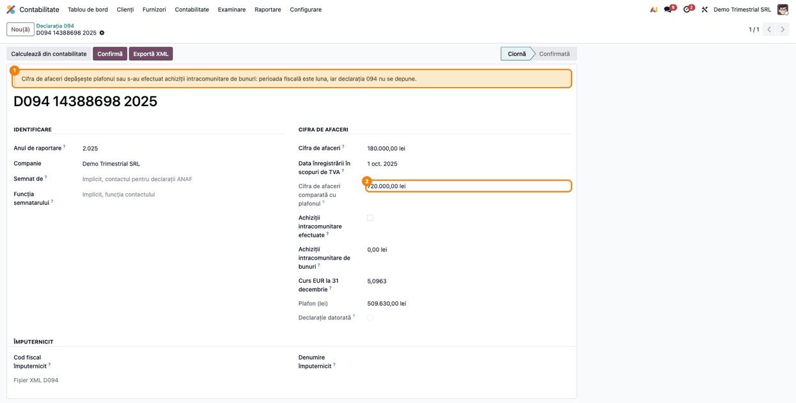
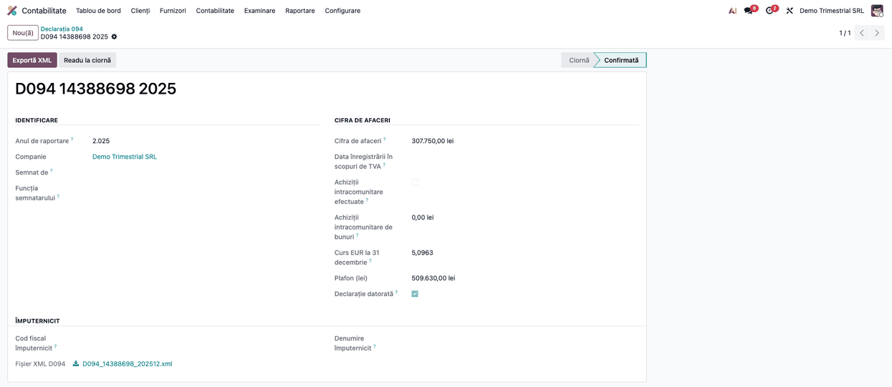
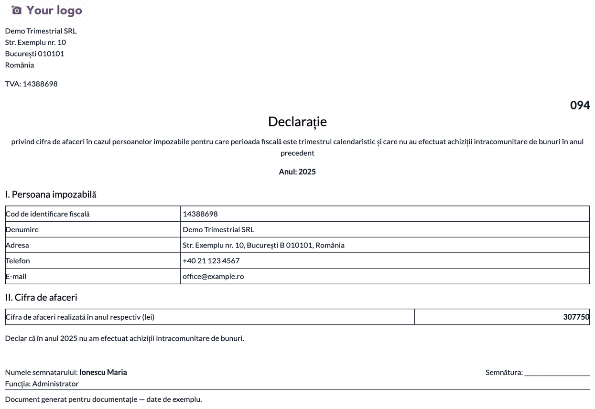

# Fișă Modul: Declarația 094 — Cifra de Afaceri a Plătitorilor de TVA Trimestriali

**Modul:** `l10n_ro_anaf_d094`
**Utilizator principal:** Contabil, responsabil cu declarațiile de TVA
**Prioritate:** 🟢 Scăzută (o singură declarație pe an, doar pentru firmele mici, trimestriale; termen fix: 25 ianuarie)

---

## 1. Scop business

Firmele înregistrate în scopuri de TVA care depun decontul **trimestrial** trebuie să confirme anual
că au dreptul să rămână pe trimestru. Confirmarea se face prin formularul **094**: cifra de afaceri
din anul precedent și mențiunea că nu au efectuat achiziții intracomunitare de bunuri.

Modulul calculează cifra de afaceri din contabilitatea anului, verifică dacă declarația chiar se
datorează și produce fișierul XML și declarația tipărită. Greșeala tipică pe care o previne: o firmă
care a depășit plafonul sau a avut o achiziție intracomunitară depune totuși D094, deși trebuia să
treacă pe decont lunar.

| | D094 (acest modul) | D300 | D700 |
|---|---|---|---|
| Ce este | confirmarea anuală a perioadei trimestriale | decontul de TVA | declarația de mențiuni (vector fiscal) |
| Când | anual, până la 25 ianuarie | lunar / trimestrial | la schimbarea unei obligații |
| Cine | doar plătitorii trimestriali | toți plătitorii de TVA | oricine își modifică vectorul fiscal |

## 2. Bază legală și context

- **Codul fiscal, art. 322 alin. (2):** perioada fiscală este trimestrul dacă cifra de afaceri din
  anul precedent nu a depășit **100.000 EUR** și persoana nu a efectuat achiziții intracomunitare
  de bunuri.
- **Codul fiscal, art. 322 alin. (5):** pentru firmele înregistrate în cursul anului, cifra de
  afaceri efectivă se recalculează pe un an calendaristic întreg.
- **Codul fiscal, art. 322 alin. (6):** cine depune deconturi trimestriale depune, până la
  **25 ianuarie** inclusiv, o declarație cu cifra de afaceri din anul precedent și mențiunea privind
  achizițiile intracomunitare. Nu o depun cei care cer scoaterea din evidența TVA pentru regimul
  special de scutire (art. 310).
- **Normele metodologice (HG 1/2016), pct. 103 alin. (2):** cifra de afaceri este baza de impozitare
  a livrărilor taxabile, scutite cu drept de deducere și cu locul în străinătate care dau drept de
  deducere, inclusiv regularizările, din deconturile de TVA. Plafonul se convertește la cursul BNR
  valabil pentru 31 decembrie.
- **Formularul:** aprobat prin OPANAF 631/2016. ANAF publică D094 doar ca PDF inteligent (versiunea
  1.0.0 din 06.01.2022); nu există validator DUKIntegrator și nici schemă XSD publicată.

## 3. Utilizatori și roluri

Contabilul care întocmește deconturile de TVA calculează și depune declarația.

Roluri recomandate la testare: **Contabil** (`account.group_account_manager`) pentru întregul flux,
**Utilizator contabil** (`account.group_account_user`) pentru consultare.

## 4. Conturi și date implicate

Modulul **nu generează note contabile**. Citește doar liniile contabile cu grilele decontului de TVA
(D300) din anul raportat:

| Rânduri D300 | Ce conțin | În cifra de afaceri? |
|---|---|---|
| 1, 2 | livrări intracomunitare scutite și regularizările lor | da |
| 3, 4 | livrări cu locul în străinătate și regularizări | da |
| 9, 10, 11 | livrări taxabile la 21%, 11%, 9% | da |
| 13 | livrări cu taxare inversă (măsuri de simplificare) | da |
| 14 | livrări scutite cu drept de deducere (export etc.) | da |
| 16, 17, 18 | regularizări taxă colectată și rândurile asimilate | da |
| 15 | livrări scutite fără drept de deducere | **nu** |
| 5, 6 | achiziții intracomunitare de bunuri | nu — dar blochează declarația |

Date minime pentru demo:
- companie românească cu planul de conturi RO, CUI, adresă, telefon și e-mail;
- contactul pentru declarații ANAF completat (nume în forma „Nume Prenume” și funcție);
- cursul EUR pentru 31 decembrie al anului raportat (exemplu: 5,0963 lei/EUR pentru 2025);
- facturi de vânzare validate în anul raportat, cu taxe din planul RO.

## 5. Configurare inițială

1. Instalați `l10n_ro_anaf_d094`. Meniul apare în **Contabilitate → Raportare → Declarații ANAF →
   D094 Cifra de afaceri TVA trimestrial**.
2. În **Contabilitate → Configurare → Setări**, secțiunea **Declarații ANAF România**,
   completați **Contact declarații**: numele lui devine semnatarul declarației, iar funcția de pe fișa
   lui completează „Funcția semnatarului”.
3. Verificați că există cursul EUR pentru 31 decembrie al anului raportat (**Contabilitate →
   Configurare → Monede → EUR**). Dacă lipsește, declarația îl cere manual.
4. Verificați că facturile anului sunt validate și folosesc taxele din planul RO: cifra de afaceri se
   calculează din grilele lor de TVA.

## 6. Flux de utilizare

### Pasul 1 — Lista declarațiilor

**Contabilitate → Raportare → Declarații ANAF → D094 Cifra de afaceri TVA trimestrial**.



Lista arată anul, cifra de afaceri, dacă declarația este datorată și starea (Ciornă / Confirmată).
Apăsați **Nou**: anul de raportare propus este anul precedent.

### Pasul 2 — Calculul din contabilitate

Apăsați **Calculează din contabilitate**. Modulul completează cifra de afaceri, achizițiile
intracomunitare și bifa „Achiziții intracomunitare efectuate”; cursul EUR și plafonul se
completează singure la alegerea anului.



**Ce găsiți pe ecran:** în grupul *Cifra de afaceri* — **Cifra de afaceri** (1), **Curs EUR la 31
decembrie**, **Plafon (lei)** (2) = 100.000 × curs și bifa **Declarație datorată**.

**Ce verificați:**
- cifra de afaceri este egală cu suma bazelor de la rândurile D300 din tabelul de la secțiunea 4,
  pe cele patru deconturi trimestriale ale anului (în demo: 92.000 + 118.500 + 97.250 = 307.750
  lei; factura scutită fără drept de deducere, de 14.000 lei, nu intră);
- cursul EUR este cel BNR valabil pentru 31 decembrie (5,0963 pentru 2025), iar plafonul este
  509.630 lei;
- cifra de afaceri ≤ plafon, bifa „Achiziții intracomunitare efectuate” este debifată și
  „Declarație datorată” este bifată.

Sumele rămân editabile: dacă pe rândul 3 există operațiuni cu locul în străinătate **fără** drept de
deducere (de exemplu, închirierea unui imobil din străinătate), scădeți-le manual din cifra de
afaceri.

### Pasul 3 — Când declarația nu se datorează

Dacă cifra de afaceri depășește plafonul sau în anul raportat a existat **măcar o** achiziție
intracomunitară de bunuri, formularul afișează un avertisment, iar exportul este blocat: perioada
fiscală devine luna, iar D094 nu se depune.



Pentru o firmă înregistrată în scopuri de TVA în cursul anului, completați **Data înregistrării în
scopuri de TVA**. Cifra de afaceri se aduce la un an întreg înainte de comparația cu plafonul: în
exemplu, firma înregistrată la 1 octombrie are 180.000 lei în trei luni, adică **720.000 lei**
anualizat (2), peste plafon (1).

**Ce verificați:** dacă avertismentul apare, nu depuneți D094; verificați trecerea la decont lunar.
O achiziție intracomunitară stornată ulterior **contează** — a fost efectuată, chiar dacă soldul ei
este zero.

### Pasul 4 — Confirmarea și exportul XML

Pe declarația datorată, apăsați **Confirmă**, apoi **Exportă XML**. Fișierul
`D094_<CUI>_<an>12.xml` se descarcă și rămâne atașat pe declarație.



Extras din fișierul generat:

```xml
<?xml version="1.0" ?>
<d094 xmlns="mfp:anaf:dgti:d094:declaratie:v2" luna="12" an="2025"
      nume_declar="Ionescu Maria" functie_declar="Administrator"
      cui="14388698" den="Demo Trimestrial SRL"
      adresa="Str. Exemplu nr. 10, București B 010101, România"
      telefon="+40 21 123 4567" mail="office@example.ro"
      cifra_afaceri="307750" totalPlata_A="307750" d_rec="0"/>
```

**Ce verificați în XML:** `an` este anul raportat, `luna` este întotdeauna 12, `cui` este fără
prefixul RO, `cifra_afaceri` este în lei întregi, iar `totalPlata_A` (suma de control) este egală cu
cifra de afaceri.

> **Fără validator oficial.** ANAF nu publică soft J pentru D094. Structura XML este cea pe care o
> scrie PDF-ul inteligent ANAF, iar modulul o validează cu o schemă proprie, reconstituită din acesta.

### Pasul 5 — Declarația tipărită

Din meniul **Tipărire → Declarația 094**, obțineți declarația în PDF, pentru arhivă.



**Ce verificați:** anul, codul de identificare fiscală, denumirea și adresa firmei, cifra de afaceri
și mențiunea „nu am efectuat achiziții intracomunitare de bunuri”; numele și funcția semnatarului.

### Note de monografie și raportare

Modulul **nu produce note contabile**: D094 este o declarație informativă despre perioada fiscală.
Cifra de afaceri se citește din grilele D300 ale liniilor contabile validate din anul raportat, după
data contabilă. Livrările sunt pe credit, deci cifra de afaceri este soldul cu semn schimbat; o
factură de stornare o reduce.

## 7. Legături cu alte module / declarații

| Modul / proces | Rol în flux | Tip legătură |
|---|---|---|
| `l10n_ro` | raportul de TVA D300, ale cărui grile dau cifra de afaceri | dependență |
| `l10n_ro_anaf_base` | meniul de declarații ANAF, contactul declarant, validarea XML | dependență |
| `l10n_ro_anaf_d300` | decontul de TVA trimestrial, aceleași grile | corelație |
| `l10n_ro_anaf_d700` | declarația de mențiuni la trecerea pe decont lunar | corelație manuală |
| `l10n_ro_anaf_submission` | urmărirea depunerii și a recipisei | complementar |

**Ce este automat:** cifra de afaceri din grilele D300, detectarea achizițiilor intracomunitare
(inclusiv a celor stornate), cursul EUR de la 31 decembrie și plafonul în lei, anualizarea în anul
înregistrării, blocarea exportului când declarația nu se datorează, XML-ul validat cu schema.

**Ce rămâne manual:**
- scăderea operațiunilor de pe rândul 3 fără drept de deducere;
- verificarea achizițiilor intracomunitare scutite sau neimpozabile (nu au rând separat în D300);
- data înregistrării în scopuri de TVA, dacă e în anul raportat;
- cursul EUR, dacă nu există în baza de date;
- declarația rectificativă (modulul generează doar declarația inițială).

## 8. Verificări pentru consultant

- [ ] Meniul apare în **Contabilitate → Raportare → Declarații ANAF**.
- [ ] Anul propus este anul precedent și apare fără separator de mii („2025”).
- [ ] Cifra de afaceri calculată = suma bazelor de pe rândurile D300 incluse, pe deconturile anului.
- [ ] O factură scutită fără drept de deducere (rd. 15) **nu** intră în cifra de afaceri.
- [ ] O factură de stornare reduce cifra de afaceri.
- [ ] Cursul EUR este cel de la 31 decembrie; plafonul = 100.000 × curs.
- [ ] Fără curs EUR în ultima săptămână a anului, câmpul rămâne gol și exportul cere cursul.
- [ ] O achiziție intracomunitară, chiar stornată integral, bifează „Achiziții intracomunitare
      efectuate” și blochează exportul.
- [ ] Cu data înregistrării în anul raportat, cifra comparată cu plafonul este anualizată.
- [ ] Peste plafon, formularul afișează avertismentul și exportul este blocat.
- [ ] XML-ul are `luna="12"`, CUI fără prefix RO și `totalPlata_A` = `cifra_afaceri`.
- [ ] Declarația tipărită are datele firmei, cifra de afaceri și semnatarul.
- [ ] Interfața este în limba română.

## 9. Mesaje de eroare frecvente

| Mesaj | Cauză probabilă | Remediere |
|---|---|---|
| „Cifra de afaceri de X lei depășește plafonul de Y lei (100.000 EUR): perioada fiscală este luna, iar declarația 094 nu se depune.” | Cifra de afaceri (anualizată, dacă e cazul) peste plafon | Nu se depune D094; verificați trecerea pe decont lunar |
| „În X s-au efectuat achiziții intracomunitare de bunuri: perioada fiscală este luna, iar declarația 094 nu se depune.” | Există facturi de achiziție pe rândul 5 din D300 în anul raportat | Nu se depune D094; dacă bifa e greșită, verificați taxele de pe facturile de achiziție |
| „Lipsește cursul EUR pentru 31 decembrie X.” | Nu există curs EUR în ultima săptămână a anului | Introduceți cursul BNR în câmpul „Curs EUR la 31 decembrie” |
| „Compania nu are configurat CUI/CIF.” | Câmpul CUI al companiei e gol | Completați codul fiscal pe companie |
| „Adresa companiei este obligatorie.” | Adresa companiei e goală | Completați adresa pe companie |
| „Numele / Funcția persoanei care semnează declarația este obligatoriu / obligatorie.” | Lipsește contactul ANAF sau funcția lui | Completați contactul pentru declarații ANAF sau câmpurile „Semnat de” / „Funcția semnatarului” |
| „Doar o declarație în ciornă poate fi confirmată.” | Declarația e deja confirmată | Folosiți **Readu la ciornă** dacă mai aveți de modificat |

## 10. Capturi de ecran

Capturile (`static/description/`) sunt **generate automat** din `tests/test_screenshots.py`
(mixinul `ScreenshotCase` din `l10n_ro_doc_screenshots`, import defensiv), în **limba română**, pe
planul de conturi RO:

1. `01_lista.png` — lista declarațiilor D094.
2. `02_calcul.png` — cifra de afaceri calculată, cursul EUR și plafonul în lei.
3. `03_nedatorata.png` — avertismentul pentru declarația nedatorată, cu cifra anualizată.
4. `04_confirmata.png` — declarația confirmată, cu fișierul XML generat.
5. `05_pdf_d094.png` — declarația 094 tipărită.

Extrasul XML din pasul 4 este text inline, nu captură.

Regenerare:

```bash
./odoo/odoo-bin -c odoo.conf -d <db> -i l10n_ro_anaf_d094,l10n_ro_doc_screenshots \
    --test-tags=fise_screenshots --stop-after-init
```

## 11. Observații pentru manual

1. **D094 confirmă perioada trimestrială, nu o cere.** Dacă firma a depășit plafonul sau a făcut o
   achiziție intracomunitară, nu depune D094, ci trece pe decont lunar.
2. **Achiziția intracomunitară stornată contează.** Legea întreabă dacă a existat operațiunea, nu
   cât e soldul la final de an. Modulul tratează identic factura de achiziție stornată integral.
3. **În anul înregistrării, cifra se anualizează.** O firmă nou înregistrată, cu puține luni de
   activitate, poate depăși plafonul anualizat chiar cu o cifră efectivă mică.
4. **Fără validator oficial.** ANAF publică doar PDF-ul inteligent. Fișierul XML respectă structura
   acestuia, dar nu poate fi verificat cu DUKIntegrator.
5. **Cifra de afaceri se calculează din grilele de TVA, nu din conturile de venituri.** Dacă o
   factură are taxe fără grile D300, nu intră în calcul; verificați configurarea taxelor înainte
   de a contesta cifra.
