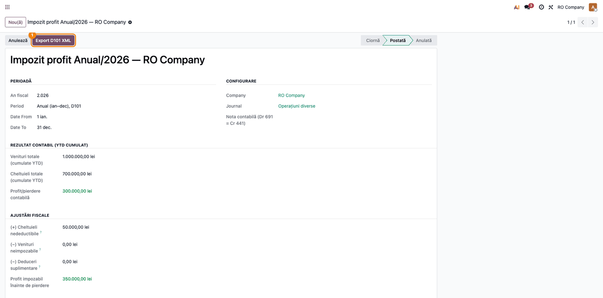
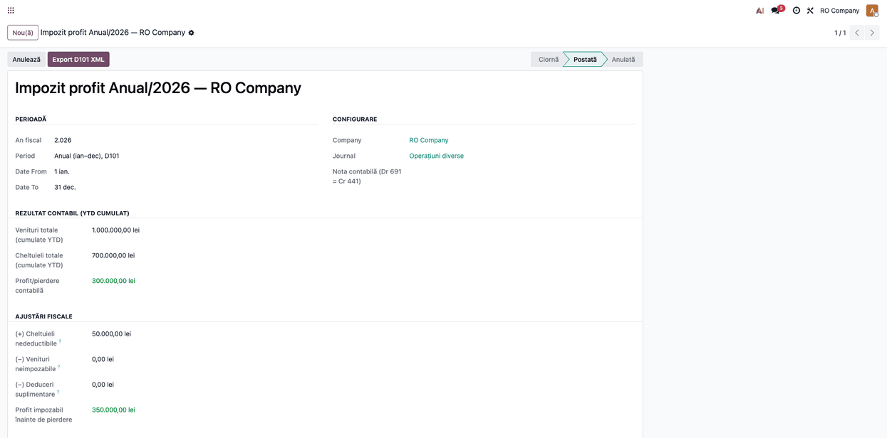
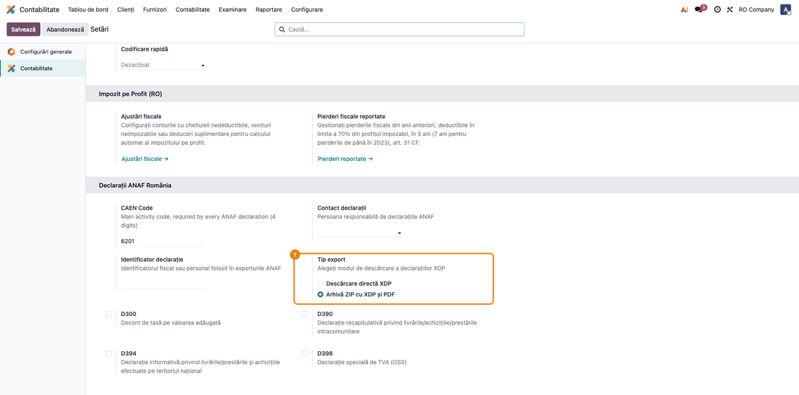

# Fișă Modul: Declarația 101 — Impozit pe Profit Anual (export XML și XDP)

**Modul:** `l10n_ro_anaf_d101`
**Utilizator principal:** Contabil-șef, Contabil impozit pe profit
**Prioritate:** 🔴 Ridicată (declarație anuală obligatorie)

---

## 1. Scop business

Modulul generează fișierul **XML al Declarației 101** (impozit pe profit anual) pentru depunerea la
ANAF, pornind de la calculul de impozit pe profit deja existent în `l10n_ro_profit_tax`. Contabilul
nu reintroduce date: alege înregistrarea de calcul anual, apasă un buton și obține XML-ul validat
împotriva schemei oficiale ANAF, gata de import în DUKIntegrator. Ca alternativă, un al doilea
buton completează **formularul PDF oficial ANAF** (fișier XDP), pe care contabilul îl deschide în
Adobe Reader, îl verifică vizual, îl semnează și îl depune.

## 2. Bază legală și context

Legea 227/2015 (Codul fiscal), Titlul II — impozit pe profit; structura XML conform **OPANAF
206/11.02.2025** (declarație 101, structura v10 — cea citită de validatorul oficial). Termen de depunere
și de plată: **25 iunie** a anului următor (art. 42 alin. (1) Cod fiscal, modificat prin OUG 8/2026,
aplicabil de la anul fiscal 2026; pentru exercițiile 2021–2025 era derogare temporară cu același
termen). Pentru exercițiul 2026, termenul este **25 iunie 2027**. Cazurile cu termen
propriu (an fiscal modificat, dizolvare) nu sunt tratate de modul: scadența se calculează pentru
exercițiul încheiat în decembrie. Modulul pune acest termen în scadență și în numărul de evidență a plății, conform regulii R17 din
validatorul oficial ANAF J11.0.4.

## 3. Utilizatori și roluri

Contabil-șef / contabil impozit pe profit.

Roluri recomandate pentru testare:
- Administrator funcțional: instalează modulul, verifică butonul de export.
- Contabil: rulează calculul anual și exportă XML-ul sau XDP-ul.

## 4. Conturi și date implicate

Modulul nu generează note — citește calculul din `l10n.ro.profit.tax.compute` (cont 691 „Cheltuieli
cu impozitul pe profit" / 4411 „Impozitul pe profit", folosite de modulul de calcul). Date minime
pentru demo:
- companie RO cu CUI valid, adresă fiscală completă, cod CAEN și județ (necesare pentru validarea ANAF);
- o înregistrare de calcul impozit pe profit cu perioada **Anual**, postată.

## 5. Configurare inițială

1. Instalați `l10n_ro_anaf_d101` (atrage `l10n_ro_profit_tax`, `l10n_ro_anaf_base` și `l10n_ro_anaf_partner`).
2. Completați datele companiei: CUI, adresă, **cod CAEN**, județ și contactul de declarație.
3. Pe înregistrarea de calcul anuală, în grupul **Configurare**, verificați **Tip impozit D101**
   (codul de obligație ANAF): implicit **103** — impozit pe profit, persoane juridice române. Alegeți
   102 (plăți anticipate, societăți bancare), 104 (impozit anual, agricultori / ONG) sau 105 (persoane
   juridice străine) doar dacă firma se încadrează acolo. Câmpul apare doar pe perioada Anual și se
   poate schimba și după postare: nu atinge nota contabilă, doar declarația.
4. Aveți o înregistrare de calcul impozit pe profit anuală, **postată**.
5. Pentru exportul XDP: **Contabilitate → Configurare → Setări**, blocul **Declarații ANAF România**,
   alegeți **Tip export** — *Descărcare directă XDP*, *Arhivă ZIP cu XDP și PDF* sau
   *PDF cu datele incluse* (implicit). Ultima opțiune cere biblioteca Python `pypdf` 5.0 sau mai nouă pe server;
   fără ea, exportul revine la arhiva ZIP.
   Setarea e pe companie și se aplică tuturor declarațiilor exportate în XDP (D100, D300, D390, D394, D398, D101).
   Se citește de pe firma înregistrării de calcul, nu de pe firma activă în interfață.

## 6. Flux de utilizare

### Pasul 1 — Calculul anual de impozit pe profit

Accesați **Contabilitate → Contabilitate → Impozit pe Profit** și deschideți înregistrarea de calcul
pentru perioada **Anual**, verificați valorile (venituri, cheltuieli, ajustări, pierdere dedusă, impozit) și
**postați-o**. După postare apar două butoane: ① **Export D101 XML** și ② **Export D101 XDP**;
în grupul Configurare, ③ **Tip impozit D101** arată codul de obligație al declarației (implicit 103).
Exportul D101 este disponibil doar pe perioada Anual și doar după postare.



### Pasul 2 — Verificarea indicatorilor înainte de export

În corpul înregistrării, verificați pe ecran că: profitul impozabil, baza impozabilă și impozitul
calculat corespund balanței; pierderea dedusă respectă limita de 70%; **Tip impozit D101** din grupul
Configurare e cel corect (vezi captura de la pasul 1). Acestea devin indicatorii P1–P53 ai declarației,
iar tipul de impozit devine `cod_obligatie` și intră în numărul de evidență a plății.



> **Atenție:** în captură, câmpul *Cotă impozit (%)* apare afișat ca „1600%"; este o problemă de
> afișare din `l10n_ro_profit_tax`. Cota aplicată este 16%, cea din XML și XDP.

### Pasul 3 — Exportul XML D101

Apăsați butonul **Export D101 XML**. Sistemul construiește elementul `declaratie101` (structura v10),
calculează numărul de evidență a plății și scadența, **validează XML-ul împotriva XSD-ului oficial**
și oferă fișierul spre descărcare. Importați-l în **DUKIntegrator** pentru depunere. Exemplu de
fișier generat (pentru venituri 1.000.000, cheltuieli 700.000, cheltuieli nedeductibile 50.000 lei;
extras, rândurile cu 0 lipsesc):

```xml
<declaratie101 xmlns="mfp:anaf:dgti:d101:declaratie:v10" an="2026" an_i="2026" luna="12" luna_i="1"
               cod_obligatie="103" Data_I="01.01.2026" Data_S="31.12.2026" scadenta="250627"
               d_reg="0" cod_bug="20470101" nr_evid="11103011226250627000040" totalPlata_A="3868000"
               cif="14399840" caen="6201" denumire="RO Company"
               P1="1000000" P2="700000" P3="300000" P7="300000" P10="300000"
               P22="300000" P33="50000" P34="50000" P35="350000" P38a="350000" P40="350000"
               P411="56000" P41="56000" P481="56000" P48="56000" P52="56000"/>
```

`totalPlata_A` este **suma de control** a rândurilor principale (P1–P53), cerută de ANAF, nu suma de
plată; impozitul de plată este pe rândul 52 (`P52`).

### Pasul 4 — Exportul XDP (formularul PDF ANAF)

Verificați întâi **Tip export** în **Contabilitate → Configurare → Setări**, blocul **Declarații ANAF
România**: *Arhivă ZIP cu XDP și PDF* descarcă împreună datele și formularul oficial
`D101_XML_2025_091026.pdf`; *Descărcare directă XDP* descarcă doar fișierul de date, pentru cine
are deja formularul salvat în același folder; *PDF cu datele incluse* descarcă direct formularul
oficial completat, fără arhivă și fără pași de dezarhivare.



Pe calculul anual postat apăsați **Export D101 XDP**. Se aplică aceleași verificări ca la XML
(perioada Anual, calcul postat, datele companiei); XDP-ul nu trece prin validarea XSD în Odoo, ci se
validează din formular. Fișierul descărcat depinde de **Tip export**:

| Tip export | Fișier descărcat |
|---|---|
| Descărcare directă XDP | `D101_<CUI>_<an>.xdp` |
| Arhivă ZIP cu XDP și PDF | arhivă ZIP cu `D101_<CUI>_<an>.xdp` și `D101_XML_2025_091026.pdf` |
| PDF cu datele incluse | `D101_<CUI>_<an>.pdf`, formularul oficial ANAF cu datele deja scrise în el |

Cu *PDF cu datele incluse*, deschideți direct fișierul `.pdf` în **Adobe Reader**. Datele se scriu în
formular printr-o actualizare incrementală, care păstrează extensiile Adobe Reader ale formularului
ANAF, deci acesta se poate valida și semna ca de obicei. Dacă serverul nu are `pypdf` 5.0 sau mai
nou, se descarcă în schimb arhiva ZIP, ca la opțiunea *Arhivă ZIP cu XDP și PDF*.

La *Arhivă ZIP cu XDP și PDF*, dezarhivați în același folder; la *Descărcare directă XDP*, puneți
fișierul `.xdp` în același folder cu formularul PDF deja salvat. Apoi deschideți fișierul `.xdp` în
**Adobe Reader**. În ambele cazuri formularul se deschide completat. Pe formular verificați:

1. **Găsiți** antetul (anul, tipul de impozit 103, CUI, CAEN, denumirea, adresa firmei pe un singur
   rând, cu părțile separate prin virgulă, scadența 25.06 a anului următor) și tabelul indicatorilor (rândurile 1–53).
2. **Verificați** că rândurile 3 (rezultatul contabil total, raportat pe exploatare), 35 (profit
   impozabil), 41.1 (impozit) și 52 (de plată) au aceleași valori ca la pasul 2 și ca în XML.
   Completați în formular rândurile de detaliu pe care exportul nu le separă (vezi *Limitare* mai jos).
3. **Continuați**: validați cu butonul formularului, semnați cu certificatul calificat, apoi încărcați
   PDF-ul semnat pe portalul ANAF (e-guvernare.ro / SPV).

Exemplu de date XDP generate (aceleași valori ca XML-ul de la pasul 3; extras — fișierul real
conține toate rândurile tabelului, inclusiv cele cu 0 și cele nenule omise aici, precum R07, R10,
R22, R33, R34, R38a, R40, R41, R481 și R48):

```xml
<form1>
  <subform1>
    <an_r>2026</an_r>
    <oblig1>103</oblig1>
    <nrevid>11103011226250627000040</nrevid>
    <scadenta>25.06.2027</scadenta>
    <Data_I>01.01.2026</Data_I>
    <Data_S>31.12.2026</Data_S>
  </subform1>
  <subform2>
    <cif>14399840</cif>
    <DENUMIRE>RO Company</DENUMIRE>
    <text_judet>Str. Exemplu nr. 10, București B 010101, Romania</text_judet>
    <CAEN>6201</CAEN>
  </subform2>
  <Table4>
    <R01><C1>1000000</C1></R01>   <!-- venituri din exploatare -->
    <R02><C1>700000</C1></R02>    <!-- cheltuieli de exploatare -->
    <R03><C1>300000</C1></R03>    <!-- rezultat din exploatare -->
    <R35><C1>350000</C1></R35>    <!-- profit impozabil -->
    <R411><C1>56000</C1></R411>   <!-- impozit 16% -->
    <R52><C1>56000</C1></R52>     <!-- impozit de plată -->
  </Table4>
</form1>
```

### Note de monografie și raportare

Modulul **nu generează note contabile** — nota `Dr 691 = Cr 4411` aparține modulului de calcul
(`l10n_ro_profit_tax`). D101 mapează valorile calculate pe indicatorii P1–P53:

```xml
<declaratie101 an="2026" cod_obligatie="103" cif="..." denumire="..."
               P1="..." P2="..." P35="..." P40="..." P411="..." P48="..." P52="...">
</declaratie101>
```

> **Limitare:** exportul automat acoperă scenariul de **profit**. Pentru exerciții cu pierdere
> fiscală (indicatori care ar deveni negativi), declarația se completează manual.
>
> Maparea pe rânduri este **simplificată**: toate veniturile și cheltuielile intră pe exploatare
> (rd. 1–3), rezultatul financiar (rd. 4–6) este 0, cheltuielile nedeductibile merg doar pe rd. 33,
> deducerile doar pe rd. 15, veniturile neimpozabile doar pe rd. 20. Impozitul (rd. 35, 41, 52) iese
> corect; rândurile de detaliu se corectează în formularul XDP înainte de semnare dacă firma are
> venituri/cheltuieli financiare sau ajustări pe alte rânduri. Impozitul minim pe cifra de afaceri
> (art. 18^1 Cod fiscal) nu este calculat și se completează manual.

## 7. Legături cu alte module / declarații

| Modul | Rol |
|---|---|
| `l10n_ro_profit_tax` | Sursa calculului (venituri, cheltuieli, ajustări, pierdere, impozit). |
| `l10n_ro_anaf_partner` | Codul CAEN pe partenerul companiei, cerut la export. |
| `l10n_ro_anaf_base` | Infrastructura ANAF: date declarant, validare companie, validare XSD, profile versionate. |
| `l10n_ro_anaf_d100` | Declarația trimestrială D100 (plăți anticipate), complementară D101 anual. |

**Ce e automat:** maparea pe indicatori, nr. de evidență, scadența, validarea XSD, fișierul XML,
completarea formularului PDF ANAF (XDP).
**Ce rămâne manual:** verificarea calculului anual și a datelor companiei; scenariul de pierdere;
rândurile de detaliu pe care maparea simplificată nu le separă (rezultat financiar, defalcarea
ajustărilor); impozitul minim pe cifra de afaceri.

## 8. Verificări pentru consultant

- [ ] Exportul D101 e disponibil doar pe o înregistrare cu perioada **Anual** și **postată**.
- [ ] O înregistrare în ciornă sau trimestrială nu permite exportul (mesaj clar).
- [ ] XML-ul generat trece validarea XSD (fără excepție la export).
- [ ] Indicatorii P (profit impozabil, bază, impozit) corespund calculului din `l10n_ro_profit_tax`.
- [ ] Fișierul descărcat se importă fără erori în DUKIntegrator.
- [ ] Cu **Tip export** = *Arhivă ZIP cu XDP și PDF*, arhiva conține `D101_<CUI>_<an>.xdp` și `D101_XML_2025_091026.pdf`.
- [ ] Cu **Tip export** = *Descărcare directă XDP*, se descarcă doar fișierul `.xdp`.
- [ ] Cu **Tip export** = *PDF cu datele incluse*, se descarcă `D101_<CUI>_<an>.pdf`, care se deschide în Adobe Reader cu antetul și indicatorii completați.
- [ ] Fără `pypdf` 5.0 sau mai nou pe server, aceeași opțiune descarcă arhiva ZIP.
- [ ] Într-o bază cu mai multe firme, tipul de export aplicat este cel al firmei înregistrării de calcul.
- [ ] Deschis în Adobe Reader, formularul are antetul și rândurile 3, 35, 41.1 și 52 egale cu cele din XML.

## 9. Mesaje de eroare frecvente

| Mesaj | Cauză | Remediere |
|---|---|---|
| „Declarația 101 este anuală — poate fi exportată doar pentru perioada Anual." | Export încercat pe o perioadă trimestrială | Selectați înregistrarea anuală |
| „Calculați și postați impozitul pe profit înainte de exportul D101." | Înregistrare în ciornă | Postați calculul de impozit pe profit |
| Eroare validare companie (CUI/CAEN/județ) | Date fiscale incomplete | Completați CUI, adresă, CAEN, județ pe companie |
| „Exportul automat D101 acoperă momentan doar scenariul de profit…" | Exercițiu cu pierdere fiscală | Completați D101 manual pentru scenariul de pierdere |
| „Resursa ANAF … PDF lipsește sau este invalidă…" | Lipsește formularul PDF din modul (instalare incompletă) | Actualizați modulul; temporar alegeți *Descărcare directă XDP* |
| „Formularul PDF ANAF nu conține pachete XFA." / „… pachetul XFA datasets." | Formularul PDF din modul nu e un formular ANAF valid | Actualizați modulul; temporar alegeți *Arhivă ZIP cu XDP și PDF* |
| „Fișierul XDP generat nu conține pachetul XFA datasets." | Macheta XDP a declarației nu are pachetul de date | Actualizați modulul; temporar alegeți *Descărcare directă XDP* |

## 10. Capturi de ecran

Se **generează automat** din `tests/test_screenshots.py` (mixin `ScreenshotCase`), în RO, pe planul RO,
în `static/description/`:

1. `01_calcul_anual.png` — calcul impozit profit, perioada Anual, postat, cu butoanele ① Export D101 XML și ② Export D101 XDP și ③ câmpul Tip impozit D101.
2. `02_indicatori.png` — blocurile de pierdere reportată, calcul impozit și de plată: ① impozitul calculat, ② suma de plată.
3. `03_tip_export.png` — setarea **Tip export** din **Declarații ANAF România** (captura existentă arată doar opțiunile *Descărcare directă XDP* și *Arhivă ZIP cu XDP și PDF*; opțiunea implicită *PDF cu datele incluse* nu apare în ea).

Fișierele XML și XDP rezultate sunt redate ca **extrase de cod** în pașii 3 și 4 (nu ca imagini;
formularul PDF ANAF e XFA și se deschide doar în Adobe Reader).

```bash
./odoo/odoo-bin -c odoo.conf -d test19 -u l10n_ro_anaf_d101 \
  --test-tags=fise_screenshots --stop-after-init
```

## 11. Observații pentru manual

- Subliniați că D101 reutilizează calculul din `l10n_ro_profit_tax` — nu se reintroduc date.
- Menționați validarea XSD la export (garanție că fișierul e acceptat de ANAF/DUKIntegrator).
- Documentați explicit limitarea pe scenariul de pierdere (completare manuală).
- Explicați codurile de obligație (102/103/104/105) din câmpul **Tip impozit D101** și când se aleg.
- Explicați diferența XML (import în DUKIntegrator) / XDP sau PDF cu datele incluse (formularul PDF
  completat, deschis în Adobe Reader) și setarea **Tip export**, comună tuturor declarațiilor exportate în XDP.
