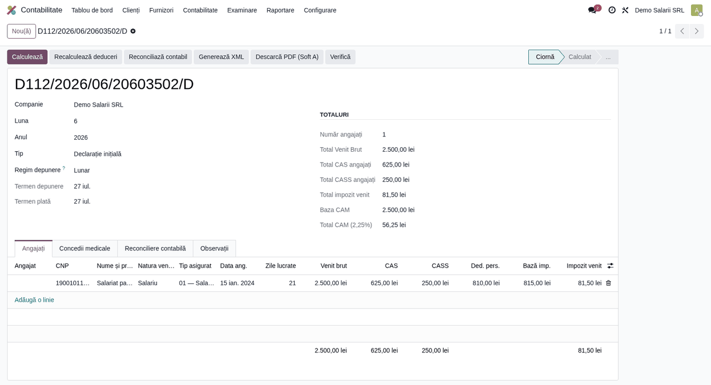

# Fișă scenariu — Contract cu timp parțial

## Scop business

Raportarea în D112 a unui salariat cu **contract de muncă cu timp parțial**. Tipul de contract
(`A_3`) și numărul de ore normă zilnică (`A_4`) trebuie raportate corect în secțiunea nominală
`asiguratA`, iar facilitatea sumei neimpozabile (rezervată salariului minim normă întreagă) **nu**
se aplică sub salariul minim.

## Bază legală

- Codul muncii — contracte individuale de muncă cu timp parțial.
- Structura D112 v6 — `asiguratA/@A_3` (tip timp de lucru: `N`, `P1`..`P7`) și `@A_4` (ore normă: 6/7/8).

## Flux de utilizare

1. **Contabilitate → Raportare → Declarația D112** → *Nou*. Alege luna și anul.
2. În fila **Angajați**, adaugă o linie și completează:
   - **Venit brut** (ex. 2.500 lei, proporțional cu timpul lucrat);
   - **Tip contract timp lucru (A_3)** = `P4` (sau alt cod parțial P1..P7);
   - **Ore normă zilnică (A_4)** = `6`.
3. Apasă **Recalculează deduceri**. Pentru venit sub salariul minim:
   - **fără** sumă neimpozabilă; **CAS** = 25% × 2.500 = 625 lei; **CASS** = 10% × 2.500 = 250 lei;
   - deducere personală de bază ≈ 810 lei; **Baza impozit** = 815 lei; **Impozit** ≈ 81,50 lei.
4. **Calculează** → **Validează** → **Generează XML**. În XML, `asiguratA/@A_3 = "P4"`, `@A_4 = "6"`.

## Verificări pentru consultant

- [ ] `A_3` reflectă tipul de contract parțial (P1..P7), nu `N`.
- [ ] `A_4` este 6 sau 7 (ore normă reduse), validat la generare.
- [ ] Suma neimpozabilă **nu** se aplică sub salariul minim (doar la nivelul exact al minimului).
- [ ] Zilele lucrate sunt coerente cu programul parțial.
