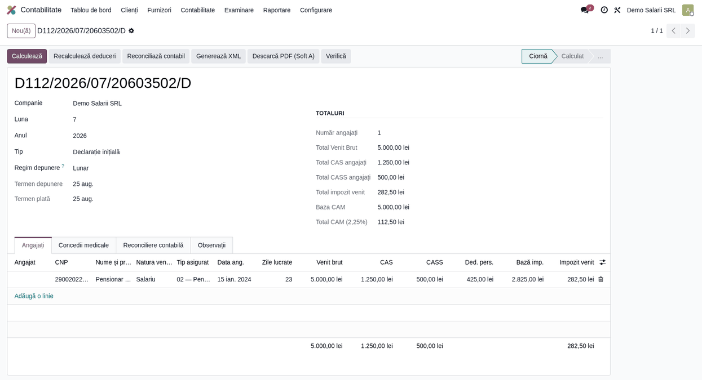

# Fișă scenariu — Pensionar activ

## Scop business

Raportarea în D112 a unui **pensionar care lucrează** în baza unui contract de muncă. Calitatea de
pensionar trebuie marcată în declarație (`asiguratA/@A_2 = 1`), iar tipul de asigurat este `02`
(„Pensionar activ"), reflectat în secțiunea de impozit (`asiguratE3/@E3_2`).

## Bază legală

- Codul fiscal — contribuții sociale pentru veniturile din salarii ale pensionarilor.
- Structura D112 v6 — `asiguratA/@A_2` (indicator pensionar) și nomenclatorul tipurilor de asigurat.

## Flux de utilizare

1. **Contabilitate → Raportare → Declarația D112** → *Nou*. Alege luna și anul.
2. În fila **Angajați**, adaugă o linie și completează:
   - **Venit brut** (ex. 5.000 lei);
   - **Tip asigurat** = `02 — Pensionar activ`;
   - bifează **Pensionar (A_2)**.
3. Apasă **Recalculează deduceri**: **CAS** = 1.250 lei, **CASS** = 500 lei, deducere personală de
   bază ≈ 425 lei (venit peste minim → DPB redusă), **Baza impozit** = 2.825 lei, **Impozit** ≈ 282,50 lei.
4. **Calculează** → **Validează** → **Generează XML**. În XML: `asiguratA/@A_2 = "1"`, `asiguratE3/@E3_2 = "2"`.

## Verificări pentru consultant

- [ ] **Tip asigurat** = `02` în linia nominală.
- [ ] `asiguratA/@A_2 = "1"` în XML pentru pensionar.
- [ ] `asiguratE3/@E3_2 = "2"` (tipul de asigurat reflectat în secțiunea de impozit).
- [ ] Contribuțiile aplicabile pensionarului sunt cele corecte conform statutului.
