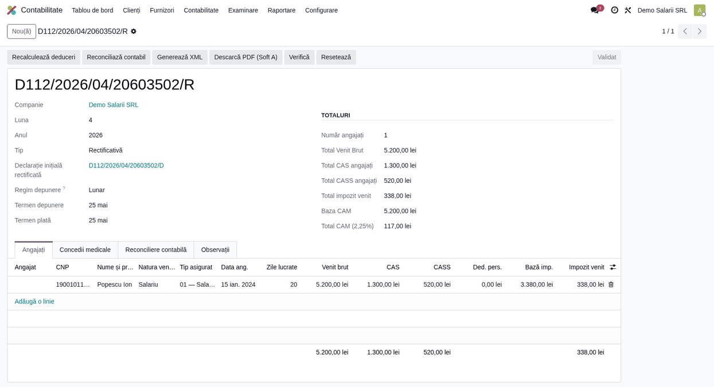

# Fișă scenariu — Declarație rectificativă

## Scop business

Corectarea unei declarații D112 deja **exportate (depuse)** prin depunerea unei **declarații
rectificative**. Rectificativa este legată de declarația inițială, este marcată în XML cu
`d_rec = 1` și `tip_rec = 1` și conține datele corectate pentru aceeași companie și perioadă.

## Bază legală

- Codul de procedură fiscală — corectarea declarațiilor fiscale prin declarație rectificativă.
- Structura D112 v6 — atributele `declaratieUnica/@d_rec` și `@tip_rec`.

## Flux de utilizare

1. Declarația inițială pe perioada respectivă este deja **exportată**.
2. **Contabilitate → Raportare → Declarația D112** → *Nou*:
   - alege aceeași **lună/an**;
   - **Tip** = `Declarație rectificativă (R)`;
   - **Declarație inițială** = declarația exportată ce se corectează.
3. Completează în fila **Angajați** valorile **corecte** (ex. venit brut corectat 5.200 lei).
4. **Calculează** → **Validează** → **Generează XML**. În root: `d_rec = "1"`, `tip_rec = "1"`;
   numele declarației conține sufixul `/R`.

## Verificări pentru consultant

- [ ] **Tip** = `R` și **Declarația inițială** este completată (legătura `original_id`).
- [ ] În XML, `d_rec = "1"` și `tip_rec = "1"`.
- [ ] Există o singură rectificativă per companie/perioadă (constrângere de unicitate).
- [ ] Rectificativa conține **toate** datele corecte (înlocuiește, nu completează declarația inițială).
