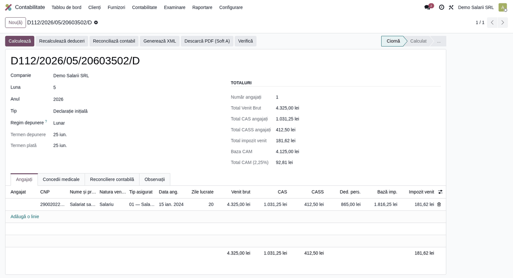

# Fișă scenariu — Salariat la salariul minim (deduceri automate)

## Scop business

Raportarea în D112 a unui salariat plătit la salariul minim brut, beneficiind de **suma
neimpozabilă** (300 lei S1 / 200 lei S2 până în iunie 2026; **200 lei, plafonată la 33% din salariul
de bază, de la iulie 2026**) și de **deducerea personală de bază**. Modulul calculează automat
contribuțiile, deducerile și impozitul, pentru firme care nu importă din statul de plată (ex.
completare manuală sau aliniere cu o aplicație externă de salarizare).

## Bază legală

- Codul fiscal (Legea 227/2015), art. 77 — deducerea personală.
- Facilitatea sumei neimpozabile la nivelul salariului minim (legislația anuală a salariului minim).
- Ordin comun ANAF/CNPP/CNAS/ANOFM nr. 605/95/928/2.314/2026 (MO 02.06.2026), aplicabil veniturilor
  lunii iulie 2026 (OUG 89/2025 + OUG 8/2026): suma neimpozabilă devine 200 lei, plafonată la 33% din
  salariul de bază.
- Cote 2026: CAS 25%, CASS 10%, impozit 10%, CAM 2,25%.

## Flux de utilizare

1. **Contabilitate → Raportare → Declarația D112** → *Nou*. Alege luna și anul.
2. În fila **Angajați**, adaugă o linie:
   - completează numele, CNP-ul, **Venit brut** = salariul minim (ex. 4.325 lei, S2);
   - lasă bifa **Calcul automat deduceri** activă și alege **Nivel salariu minim** = `S2`.
3. Apasă **Recalculează deduceri** în antet. Modulul completează:
   - **Sumă neimpozabilă** = 200 lei (exclusă din baza CAS/CASS și din baza de impozit);
   - **CAS** = 25% × (4.325 − 200) = 1.031,25 lei; **CASS** = 10% × 4.125 = 412,50 lei;
   - **Deducere personală** de bază (≈ 865 lei la 0 persoane în întreținere);
   - **Baza impozit** = 4.325 − 200 − 1.031,25 − 412,50 − 865 = **1.816,25 lei**;
   - **Impozit** = 10% × 1.816,25 ≈ **181,62 lei**.
4. **Calculează** → **Validează** → **Generează XML**.

## Verificări pentru consultant

- [ ] **Sumă neimpozabilă** apare doar la salariul minim; la venituri peste nivelul minim, devine 0.
- [ ] **Baza CAS/CASS** = venit brut − sumă neimpozabilă (nu venitul brut integral).
- [ ] **Deducerea personală** scade din baza de impozit (nu doar contribuțiile).
- [ ] Liniile **importate din statul de plată** au valori autoritare și nu se recalculează.

> ⚠️ Parametrii fiscali (`SALARY_PARAMS`) și tabelul deducerii personale se revizuiesc anual.
> Confruntați valorile cu sursa ANAF / Cod fiscal înainte de depunere.
