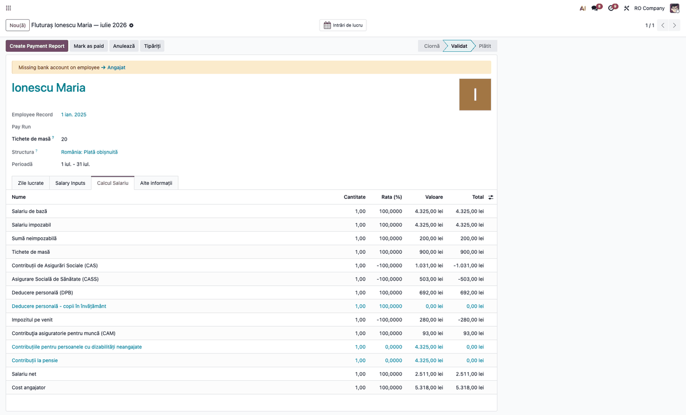
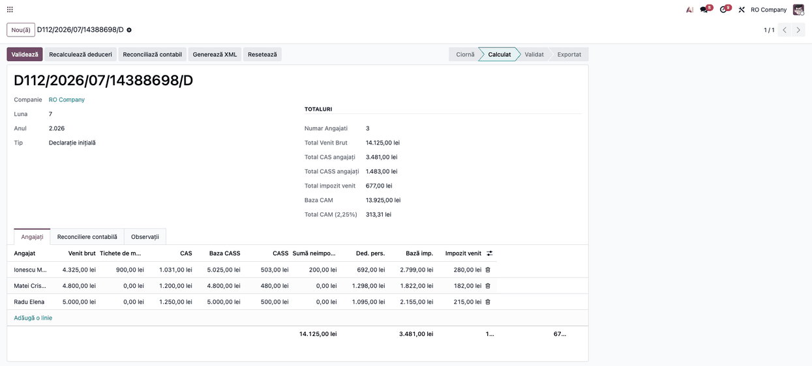
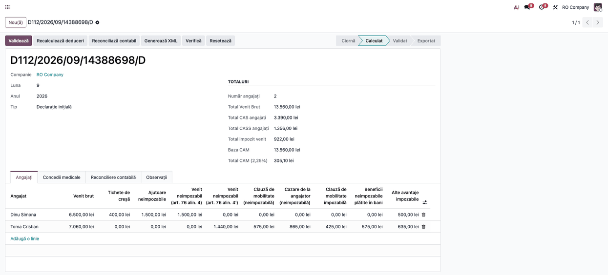

# Fișă Modul: Punte D112 — salarizare Odoo (tichete, sumă neimpozabilă, deduceri, beneficii)

**Modul:** `l10n_ro_anaf_d112_payroll`
**Utilizator principal:** Contabil salarii, Inspector resurse umane
**Prioritate:** 🔴 Ridicată (declarația D112 lunară)

---

## 1. Scop business

Evită completarea manuală a evidenței nominale din D112: declarația se alimentează direct din fluturașii validați ai
lunii. Pe lângă brut, CAS, CASS și impozit, puntea transferă tichetele de masă, suma neimpozabilă la salariul minim
și deducerile personale (de bază, tineri, copii), astfel încât baza impozabilă din declarație să coincidă cu cea de pe
fluturaș. Transferă și **beneficiile acordate salariaților** (tichete cadou și de creșă / culturale, cadouri, ajutoare, avantaje în natură,
beneficiile din art. 76 alin. 4^1) pe rândurile lor din D112: partea neimpozabilă și excedentul impozabil.

## 2. Bază legală și context

Declarația 112 (structura ANAF 2026): `asiguratA` (tipul de asigurat 51 și `A_13S` pentru suma neimpozabilă la
salariul minim), `asiguratE1`/`asiguratE3` (venituri, deduceri art. 77, baza impozabilă) și `E3_10` din `E3_60`
(contravaloarea tichetelor de masă acordate; structura cere `E3_8 ≥ E3_60 ≥ E3_10`). Calculele de pe fluturaș sunt cele
din `l10n_ro_hr_payroll_enhancement` (Cod fiscal art. 77, 78). Suma neimpozabilă la salariul minim este reglementată de OUG 89/2025
(nomenclatorul ANAF o declară cu tipul de asigurat 51) și de Ordinul comun 605/95/928/2.314/2026; baza CAM exclude suma
neimpozabilă, la fel ca bazele CAS, CASS și a impozitului. De la structura 07/2026 (OPANAF 605/2026), venitul brut `E3_8` cuprinde și
veniturile neimpozabile din art. 76 alin. (4) (rândul 8.4, `E3_69`) și alin. (4^1) (rândul 8.5, `E3_90`), care nu intră în bazele CAS, CASS și a
impozitului; validatorul ANAF cere `E3_90` ≥ suma sub-rândurilor 8.5.1–8.5.10 (regula `s129d17`). Modulul
alimentează 8.5.1–8.5.9; 8.5.10 (`E3_95`, dobânda preferențială) nu are corespondent pe fluturaș.

## 3. Utilizatori și roluri

Inspector salarizare (validează fluturașii), Contabil salarii (calculează și verifică declarația).

## 4. Conturi și date implicate

Puntea nu generează note contabile. Date minime: fluturași validați pe structura **România: Plată obișnuită**
(`l10n_ro_hr_payroll_enhancement`) și compania cu datele declarantului completate în D112.

## 5. Configurare inițială

1. Instalați `l10n_ro_anaf_d112`, `l10n_ro_hr_payroll_enhancement` și puntea (se instalează automat când D112 și salarizarea
   coexistă).
2. Completați pe fiecare angajat **CNP-ul** (câmpul `l10n_ro_cnp`, altfel `ssnid`) și data de angajare din contract; fără ele
   validarea declarației și generarea XML se blochează.
3. Configurați parametrii în **Stat de plată → Configurare → Salariu → Regulă Parametri** (vezi fișa `l10n_ro_hr_payroll_enhancement`).

## 6. Flux de utilizare

### Pasul 1 — Fluturașul validat

**Stat de plată → Fluturași de salariu → Fluturași de salariu**: validați fluturașii lunii. Exemplu: Ionescu Maria, brut 4.325, 20 tichete ×
45 lei, o persoană în întreținere — suma neimpozabilă 200, CAS 1.031, CASS 503, deducere 692, impozit 280, net 2.511.



### Pasul 2 — Calculul declarației D112

**Contabilitate → Raportare → Declarații ANAF → Declarația D112 → Nou** (luna 7, anul 2026, *Declarație inițială*) și **Calculează**. Fila
**Angajați** se completează cu câte o linie pe fluturaș. Activați din butonul de coloane *Tichete de masă*, *Sumă
neimpozabilă* și *Baza CASS*.

Verificați pe ecran, pentru fiecare angajat: *Venit brut* = brutul fluturașului; *Tichete de masă* = valoarea tichetelor;
*Sumă neimpozabilă* = linia de pe fluturaș; *CAS* și *CASS* egale cu fluturașul; *Ded. pers.* = suma deducerilor (de bază +
tineri + copii); *Bază impozabilă* = 4.325 + 900 − 200 − 1.031 − 503 − 692 = 2.799 la Ionescu Maria (fluturașul nu are o linie dedicată
bazei impozabile). Verificați și totalul **CAM**: baza CAM este suma (brut − suma neimpozabilă), fără tichete, iar CAM =
2,25% din ea (la Ionescu Maria 4.125 × 2,25% = 93). Abia după aceea validați declarația.



### Pasul 3 — Verificarea în fișierul XML

După **Generează XML**, pentru Ionescu Maria apar (extras):

```xml
<asiguratA A_1="51" A_11="5025" A_12="503" A_13="4125" A_13S="200" A_13C="4325"/>
<asiguratE1 E1_1="5225" E1_2="1534" E1_3="1" E1_4="692" E1_41="692" E1_6="2799" E1_7="280"/>
<asiguratE3 E3_8="5225" E3_9="1534" E3_10="900" E3_60="900" E3_14="2799" E3_15="280" E3_16="3411"/>
```

Pe linia din listă *Tip asigurat* rămâne 01; în XML `A_1` ia valoarea 51 pentru că s-a aplicat suma neimpozabilă; baza CAS (`A_13`) este 4.125, baza CASS (`A_11`) 5.025;
tichetele de masă apar în `E3_10`/`E3_60` și în `E3_8`/`E1_1` (brut + tichete), iar baza CAM `A_5` = brut − suma neimpozabilă
(4.125). Suma încasată `E3_16` (3.411 = 4.325 + 900 − 1.534 − 280) cuprinde și tichetele, primite în natură; de aceea e mai mare decât netul
fluturașului (2.511).

### Pasul 4 — Beneficiile acordate salariaților în D112

Beneficiile calculate pe fluturaș (fișa `l10n_ro_hr_payroll_enhancement`, Pașii 25–29) ajung pe linia salariatului la **Calculează**:

| Pe fluturaș | Linia D112 | Rând (atribut) |
|---|---|---|
| Tichete de creșă / culturale | *Tichete de creșă* / *Tichete culturale* | 8.3.1.1 (`E3_72`) / 8.3.1.3 (`E3_74`), în 8.3 (`E3_60`) și în `E3_8` |
| Vouchere de vacanță | *Vouchere de vacanță* | 8.3.1.4 (`E3_75`), în 8.3 (`E3_60`) și în `E3_8` |
| Tichete cadou peste plafon | *Tichete cadou impozabile* | 8.3.1.2 (`E3_73`), în 8.3 (`E3_60`) |
| Asigurarea de sănătate peste plafon | *Avantaj impozabil din asigurare* | 8.3.3 (`E3_58`), în 8.3 (`E3_60`) |
| Avantaje în natură, autoturism, cadouri în natură peste plafon, celelalte beneficii peste plafon | *Alte avantaje impozabile* | 8.3.4 (`E3_44`), în 8.3 (`E3_60`) |
| Clauza de mobilitate peste plafon | *Clauză de mobilitate impozabilă* | 8.2.5 (`E3_85`), în 8.2 (`E3_59`) |
| Cadouri neimpozabile (tichete și în natură) | *Cadouri neimpozabile* | 8.4.1 (`E3_86`), în 8.4 (`E3_69`) |
| Ajutoare | *Ajutoare neimpozabile* | 8.4.2 (`E3_87`), în 8.4 (`E3_69`) |
| Transport la locul de muncă | doar în *Venit neimpozabil (art. 76 alin. 4)* | 8.4 (`E3_69`) |
| Partea neimpozabilă: mobilitate, hrană, cazare, servicii turistice, pensii, asigurare de sănătate, sport, educație timpurie | câte o coloană pe beneficiu | 8.5.1 `E3_91`, 8.5.2 `E3_77`, 8.5.3 `E3_78`, 8.5.4 `E3_68`, 8.5.5 `E3_67`, 8.5.6 `E3_97`, 8.5.7 `E3_71`, 8.5.8 `E3_79`, 8.5.9 `E3_94`, în 8.5 (`E3_90`) |
| Partea neimpozabilă plătită în bani (mobilitate, decont educație timpurie) | *Beneficii neimpozabile plătite în bani* | intră în suma încasată `E3_16` de la 07/2026 |
| Tichete de creșă / culturale | (coloanele de mai sus) | intră și în baza impozabilă `E3_14`, nu și în baza CASS (`A_11`) |

Exemplul din septembrie 2026: Dinu Simona (salariu 6.000, ajutor la naștere 1.500, tichete de creșă 400 și un avantaj în natură de 500) și Toma Cristian
(salariu 6.000, clauză de mobilitate 1.000 pe 10 zile și cazare 1.500 — același caz ca la Pasul 26 din fișa `l10n_ro_hr_payroll_enhancement`, dar fără sporul
de vechime de 500 lei din acel exemplu). Din butonul de coloane al filei **Angajați** activați: *Tichete de creșă*, *Ajutoare neimpozabile*, *Venit neimpozabil
(art. 76 alin. 4)*, *Venit neimpozabil (art. 76 alin. 4¹)*, *Clauză de mobilitate (neimpozabilă)*, *Cazare de la angajator (neimpozabilă)*, *Clauză de mobilitate
impozabilă*, *Beneficii neimpozabile plătite în bani* și *Alte avantaje impozabile*. În captură sunt ascunse coloanele standard (CNP, nume, CAS, CASS, impozit,
bază impozabilă); pe ecran ele rămân vizibile.



Verificați pe ecran: *Venit brut* = brutul fluturașului (cu excedentele: 6.500 = 6.000 + 500 la Dinu Simona; 7.060 = 6.000 + 425 + 635 la Toma Cristian); partea
neimpozabilă a fiecărui beneficiu = linia *… - neimpozabil* de pe fluturaș (mobilitate 575, cazare 865, total 8.5 = 1.440); *Clauză de mobilitate impozabilă* 425;
*Alte avantaje impozabile* = excedentul în natură (500 la avantajul în natură, 635 la cazare); *Ajutoare neimpozabile* și *Venit neimpozabil (art. 76 alin. 4)* 1.500;
*Tichete de creșă* 400; *Beneficii neimpozabile plătite în bani* 575 la Toma Cristian. După **Generează XML** (extras):

```xml
<!-- Dinu Simona -->
<asiguratE3 E3_8="8400" E3_9="2275" E3_14="4625" E3_15="463" E3_16="4162" E3_60="900" E3_72="400"
            E3_44="500" E3_69="1500" E3_87="1500"/>
<!-- Toma Cristian -->
<asiguratE3 E3_8="8500" E3_9="2471" E3_14="4589" E3_15="459" E3_16="4705" E3_59="425" E3_85="425"
            E3_60="635" E3_44="635" E3_90="1440" E3_91="575" E3_78="865"/>
```

`E3_8` = venitul brut + tichetele + veniturile neimpozabile 8.4 și 8.5 (6.500 + 400 + 1.500 = 8.400; 7.060 + 1.440 = 8.500). Baza impozabilă `E3_14` cuprinde
tichetele de creșă (6.500 + 400 − 2.275 = 4.625, impozit 463). `E3_16` = venitul brut (inclusiv avantajele în natură impozabile) + toate tichetele + partea
neimpozabilă plătită în bani − contribuții − impozit (6.500 + 400 − 2.275 − 463 = 4.162; 7.060 + 575 − 2.471 − 459 = 4.705). Ajutorul, plătit în afara statului,
nu intră în `E3_16`.

## 7. Legături cu alte module / declarații

| Modul | Rol |
|---|---|
| `l10n_ro_anaf_d112` | Declarația de bază; punctele de extensie pentru evidența nominală. |
| `l10n_ro_hr_payroll_enhancement` | Sursa regulilor `TICHETE`, `NEIMPOZ`, `DPB`, `DPBTIN`, `DPBCOP` și a celor pentru beneficii (`*_ANG` / `*_ANG_NI`, `BEN_NUMERAR`, `AVNAT_ANG`, `AUTO_ANG`, `CADOU_*`, `AJUTOR`, `TRANSPORT`, `TICHETE_CRESA`, `TICHETE_CULT`); nu e dependență. |
| `hr_payroll` | Fluturașii și liniile de zile lucrate. |

**Ce e automat:** importul liniilor, bazele CAS/CASS, tichetele, suma neimpozabilă, deducerile, zilele din fluturaș, beneficiile pe rândurile 8.2.5, 8.3.x, 8.4.x și 8.5.x (Pasul 4).
**Scutirea art. 60** (handicap, cercetare-dezvoltare) se transferă din fluturaș: linia primește *Scutire impozit (art. 60)*, iar
XML-ul are `asigScu` 1/3, `E3_23`/`E3_24` (sau `E3_27`/`E3_28`) = baza impozabilă și impozitul teoretic (10%), `E3_15` = 0, obligația
602 cu `A_scutit` și `angajatorF1`. **Ce rămâne manual:** alte deduceri (cotizație sindicală, pensii facultative)
se introduc pe fluturaș, nu direct în D112 (câmpul *Alte deduceri* din D112 nu se recalculează pe liniile importate);
configurarea filei *Reconciliere contabilă* a declarației.

**Reimport:** *Calculează* nu actualizează liniile deja importate. După corectarea unui fluturaș, ștergeți linia lui din fila
Angajați și apăsați din nou *Calculează*; liniile fluturașilor anulați se șterg manual.

## 8. Verificări pentru consultant

- [ ] Fiecare fluturaș validat al lunii are o linie în fila Angajați.
- [ ] Baza impozabilă și impozitul de pe linie coincid cu fluturașul.
- [ ] La angajatul cu suma neimpozabilă, în XML `A_1` = 51, `A_13S` = suma, `A_13` = brut − suma.
- [ ] Baza CASS (`A_11`) = brut + tichete − suma neimpozabilă.
- [ ] Tichetele apar în `E3_10` și `E3_60`, iar `E3_8` ≥ `E3_60`.
- [ ] Persoane în întreținere (`E1_3`) și deduceri (`E1_41`, `E1_421`, `E1_422`) corespund fluturașului.
- [ ] Total CAM = 2,25% × Σ(brut − suma neimpozabilă) și coincide cu suma CAM de pe fluturași.
- [ ] Beneficii (Pasul 4): partea neimpozabilă a fiecărui beneficiu pe sub-rândul ei 8.5.x, iar `E3_90` = suma lor (Toma Cristian: 575 + 865 = 1.440); validatorul ANAF nu acceptă `E3_90` mai mic.
- [ ] Clauza de mobilitate peste plafon e pe `E3_85` și `E3_59` (425), nu în `E3_60`; excedentele în natură pe `E3_44`, cuprinse în `E3_60`.
- [ ] Ajutoarele pe `E3_87` și în `E3_69`; tichetele de creșă pe `E3_72`, în `E3_60`, `E3_8` și în baza impozabilă `E3_14` (Dinu Simona: 4.625, impozit 463), dar nu în baza CASS (`A_11`).
- [ ] `E3_8` = venit brut + tichete + `E3_69` + `E3_90`; `E3_16` include partea neimpozabilă plătită în bani, nu și ajutoarele.
- [ ] La angajații scutiți (art. 60): `asigScu` = 1/3, `E3_23`/`E3_24` (sau `E3_27`/`E3_28`) = baza și 10% din ea, `E3_15` = 0; în obligația 602 `A_scutit` = Σ impozit scutit și există `angajatorF1`.

## 9. Mesaje de eroare frecvente

| Mesaj | Cauză | Remediere |
|---|---|---|
| Nicio linie după Calculează | Fluturașii nu sunt în stare Validat/Plătit sau sunt în altă lună | Validați fluturașii și verificați perioada |
| Tichete, sumă neimpozabilă sau deduceri 0 | Structura salarială nu are regulile `l10n_ro_hr_payroll_enhancement` | Folosiți structura România: Plată obișnuită |
| Eroare la validare: zile lucrate în afara intervalului 1..NZL | Zilele din fluturaș depășesc zilele lucrătoare ale lunii | Corectați zilele pe fluturaș, ștergeți linia și recalculați |
| Employee … has no CNP filled in / CNP invalid / fără dată de angajare | Lipsesc datele angajatului | Completați CNP-ul și data de angajare pe angajat/contract |

## 10. Capturi de ecran

Capturile sunt **generate automat** din `tests/test_screenshots.py` (mixin `ScreenshotCase`, import defensiv), în
română, în RON, pe cazurile din iulie 2026 (01, 02) și septembrie 2026 (03):

1. `01_fluturas_validat.png` — fluturașul validat cu tichete și sumă neimpozabilă.
2. `02_d112_calculat.png` — declarația D112 calculată, cu coloanele din salarizare.
3. `03_d112_beneficii.png` — declarația D112 din septembrie 2026 cu beneficiile acordate salariaților (Pasul 4).

```bash
./odoo/odoo-bin -c odoo.conf -d test19 -i l10n_ro_hr_payroll_enhancement,l10n_ro_anaf_d112_payroll,l10n_ro_doc_screenshots \
  --test-tags=fise_screenshots --stop-after-init
```

## 11. Observații pentru manual

- Puntea transferă doar ce calculează fluturașul; nu verifică legislația. Valorile sumei neimpozabile se confirmă cu
  contabilul (vezi fișa `l10n_ro_hr_payroll_enhancement`).
- Scutirea art. 60 se declară astfel (XML D112 09/2026 verificat de DUKIntegrator): `E3_23`/`E3_27` = baza impozabilă, `E3_24`/`E3_28` =
  impozitul teoretic; validatorul nu verifică semnificația acestor câmpuri; interpretarea rămâne de confirmat cu contabilul.
- Declarația `l10n_ro_anaf_d112` folosește pentru liniile cu calcul automat aceeași grilă pe tranșe ca fluturașul.
- Beneficii: maparea rândurilor 8.5.x e confirmată din validatorul ANAF (D112Validator J27.0.6) și din formularul 07/2026; regula pentru `E3_16` (suma
  încasată) nu are formulă în structura ANAF: modulul pornește de la brut (inclusiv avantajele în natură impozabile) și tichete (primite în natură) și adaugă
  partea neimpozabilă plătită în bani, nu și veniturile din 8.4 plătite în afara statului (ajutoare, transport, diurnă) — **de confirmat** cu instrucțiunile
  OPANAF 605/2026, inclusiv pentru componentele în natură.
