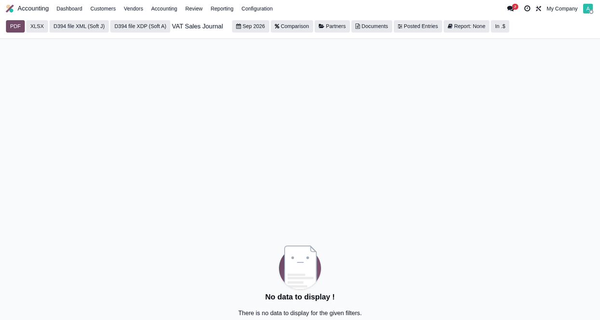
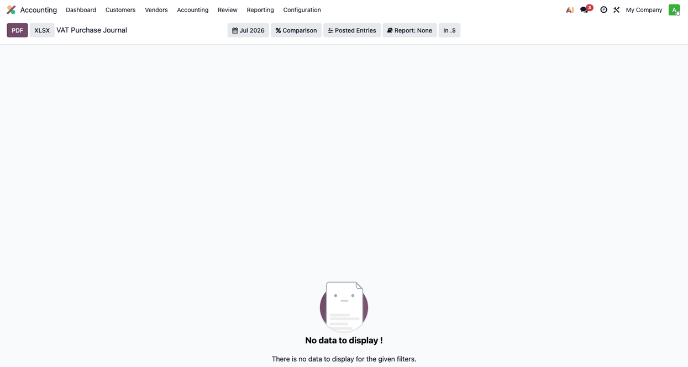
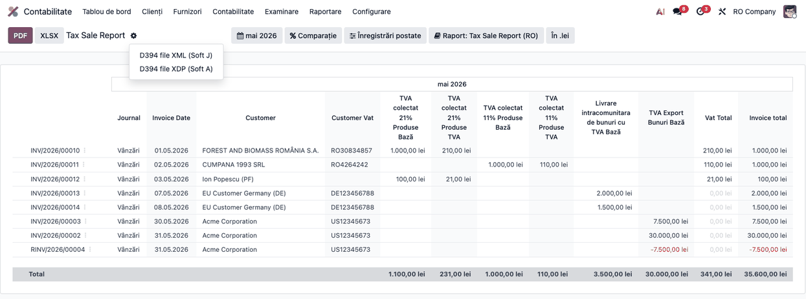

# Fișă Modul: D394 — Declarație informativă TVA pe jurnalele de TVA

**Poziție plan:** C4
**Modul:** `l10n_ro_anaf_d394`
**FR:** FR-28
**Capitol manual:** Cap 4.5
**Utilizator principal:** Contabil TVA, Operator facturare
**Prioritate:** 🔴 Ridicată (declarație informativă obligatorie pentru persoanele înregistrate în scopuri de TVA)

---

## 1. Scop business

Jurnalele **Jurnal TVA Vânzări (RO)** și **Jurnal TVA Cumpărări (RO)** sunt construite din facturile
postate de modulul `l10n_ro_account_vat_journal`; `l10n_ro_anaf_d394` adaugă pe ele exporturile ANAF și, pe baza lor, generează **Declarația informativă D394** pentru operațiunile naționale
relevante TVA. Consultantul prezintă D394 nu ca un simplu export XML, ci ca un raport de **detaliu și
control**: arată documentele și partenerii care stau în spatele totalurilor de TVA declarate.

Fluxul este legat de D300: jurnalele de TVA se reconciliază cu decontul, iar D394 detaliază, pe parteneri
și documente, **partea națională** a acestor operațiuni. Intracomunitarul și importul/exportul nu intră
în D394, deci totalurile D394 nu sunt egale cu rândurile D300. Datele se preiau
automat din facturile înregistrate, fără seeding manual.

## 2. Bază legală și context

D394 raportează **livrările/prestările și achizițiile efectuate pe teritoriul național** de
persoanele înregistrate în scopuri de TVA, în funcție de statutul TVA al
partenerului, tipul documentului și regimul operațiunii. Modelul și conținutul formularului 394 sunt
aprobate prin OPANAF nr. 3769/2015, cu modificările ulterioare; modulul folosește structura ANAF din
15.09.2025 (schema `d394_20250917.xsd`), cu cotele **21%** (standard) și **11%** (redusă). Declarația se
depune până la data de 30 inclusiv a lunii următoare perioadei de raportare.

> Notă consultant: verificați numărul ordinului ANAF în vigoare la data depunerii — modelul
> formularului 394 este actualizat periodic.

Operațiunile intracomunitare și importul/exportul **nu** se includ în D394 (merg în D390 pentru intracomunitar,
respectiv în declarațiile vamale de import/export, și în D300). Operațiunile pe teritoriul național cu parteneri nestabiliți în România intră în D394
(`tip_partener` 3 și 4), dar modulul nu le generează încă — vezi „Limitări cunoscute".

## 3. Utilizatori și roluri

- **Contabil TVA** — pregătește și verifică declarația, corelează cu D300.
- **Operator facturare** — corectează datele partenerilor, ale documentelor și seriile de facturi.
- **Contabil șef** — validează totalurile și reconcilierea cu D300.
- **Consultant implementare** — configurează taxele, tax tags-urile și opțiunile declarației.

Roluri recomandate pentru testare:
- Administrator funcțional: instalează modulul și verifică meniurile;
- Utilizator operațional (Contabil): rulează rapoartele și exportul lunar/trimestrial;
- Contabil/manager: validează totalurile și reconcilierea cu D300.

## 4. Conturi și date implicate

Conturi RO relevante: **4427** (TVA colectată), **4426** (TVA deductibilă), **4428** (TVA neexigibilă
— pentru TVA la încasare). Identificarea operațiunilor se face prin **tax tags**, nu prin conturi
direct, așa că nu există o monografie proprie a modulului — declarația citește notele deja postate.

Date minime pentru demo:
- companie românească cu localizarea contabilă RO instalată și CUI/CAEN/adresă completate;
- perioadă contabilă deschisă, cu facturi emise și primite **postate**;
- parteneri RO cu CUI/CIF valid; persoane fizice fără CUI, cu nume/adresă completă;
- cote TVA 21%/11% și taxe de taxare inversă configurate cu tax tags-urile RO;
- (TVA la încasare nu este încă acoperit complet de modul — vezi „Limitări cunoscute" în secțiunea 7.)

> Capturile fișei se generează pe compania demo a localizării RO (`base.demo_company_ro`), cu facturile
> demo din `l10n_ro_anaf_base` (parteneri RO cu CUI, persoană fizică, parteneri UE, furnizor cu TVA la
> încasare), datate în luna trecută — exact perioada implicită a rapoartelor. Datele demo nu au o
> stornare națională: pentru verificarea stornărilor, creați una manual. Compania demo nu are cod CAEN: valoarea `caen="6201"` din extrasul XML al pasului 4 a fost completată
> manual pe companie înainte de generare, nu vine din datele demo.

## 5. Configurare inițială

1. Instalați `l10n_ro_anaf_d394` pe baza demo (depinde de `l10n_ro`, `account_reports`,
   `l10n_ro_anaf_base`, `l10n_ro_anaf_partner` și `l10n_ro_account_vat_journal`).
2. Verificați taxele TVA și **tax tags**-urile aferente (cotele 21%/11% și taxarea inversă).
3. Completați datele companiei cerute la export: **CUI, adresa fiscală** (stradă, localitate, cod
   poștal, țară), **județul** și **codul CAEN**. Completați și **persoana de contact pentru declarații**
   și **funcția** ei, din setările declarațiilor ANAF — fără ele exportul se oprește. CNP-ul persoanei de
   contact este opțional: dacă există, declarația apare ca întocmită de o persoană fizică
   (`tip_intocmit=1`). Telefonul și e-mailul se trec în declarație, dar nu blochează exportul.
4. Configurați opțiunile D394 în **Setări → Contabilitate** (blocul declarațiilor ANAF; etichetele apar
   deocamdată în engleză):
   - **D394 Period** (`tip_D394`): L / T / S / A, după periodicitatea TVA a firmei (la T/S/A, luna
     declarației este ultima lună a perioadei selectate în raport);
   - **D394 VAT on Collection** (`sistemTVA`): bifați dacă firma aplică sistemul TVA la încasare;
   - **D394 Option** (`optiune`) și **D394 Affiliated Persons** (`prsAfiliat`), după caz.
   (`op_efectuate` se calculează automat: 1 dacă există operațiuni, 0 pentru declarație nulă.)
5. Verificați partenerii: companii RO cu CUI valid; persoane fizice fără CUI, cu nume/adresă completă;
   parteneri neînregistrați în scopuri de TVA.
6. Pregătiți documente demo cu: vânzare către companie RO, achiziție de la companie RO, vânzare către
   persoană fizică, factură storno, taxare inversă pe vânzare (livrare „0% R" → V) și pe achiziție
   (autotaxare → C).
7. Verificați că utilizatorul de test are grupul de acces contabil necesar.

## 6. Flux de utilizare

### Pasul 1 — Verificarea jurnalului TVA Vânzări

**Meniu:** `Contabilitate → Raportare → Declarații ANAF → Declarație 394` (deschide direct raportul de
vânzări). Cele două jurnale sunt disponibile și sub `Contabilitate → Raportare → Taxe și fiscalitate`, ca
**Jurnal TVA Vânzări (RO)** și **Jurnal TVA Cumpărări (RO)**. Perioada implicită este **luna trecută**
(luna închisă care se declară).

*Găsește pe ecran:* fiecare rând este un document postat; coloanele afișează **Nr., Jurnal, Tip
document, Dată document, Rând D300, Client, CUI client**, apoi coloanele pe cotă (bază/TVA), **TVA** și
**Total document (cu TVA)**. Sub totaluri, blocul **„Recapitulație pe rânduri D300"** grupează sumele pe
rândurile decontului. În bara raportului se văd direct butoanele **„D394 file XML (Soft J)"** și
**„D394 file XDP (Soft A)"**, lângă PDF și XLSX. Partenerii RO cu CUI (ex. cu prefix `RO`), persoanele
fizice (fără CUI) și partenerii UE se recunosc după coloana **CUI client**. Jurnalul are multe coloane:
coloanele de total și sumele din recapitulație se văd derulând tabelul spre dreapta.

Rândurile cu parteneri UE (în demo, INV/2026/00013–00014, rândul D300 = 1) apar în jurnal, dar **nu se
regăsesc în D394**: livrările intracomunitare se declară în D390.

*Verifică* (înainte de a continua): toate documentele perioadei sunt **postate**; CUI-urile
partenerilor RO sunt prezente și valide; totalurile pe cotă (21% / 11%) corespund jurnalului de
vânzări; perioada selectată (implicit luna trecută) este luna declarată; persoanele fizice au
localitate, țară și — pentru adrese din România — județ completate (altfel exportul se oprește).



### Pasul 2 — Verificarea jurnalului TVA Cumpărări

**Meniu:** `Contabilitate → Raportare → Taxe și fiscalitate → Jurnal TVA Cumpărări (RO)` (sau din acțiunea raportului
de cumpărări). Raportul listează achizițiile pe furnizori.

*Găsește pe ecran:* coloanele **Nr., Jurnal, Nr. document furnizor, Tip document, Dată document, Rând D300,
Furnizor, CUI furnizor**, coloanele pe cotă
(bază/TVA), **TVA** și **Total document (cu TVA)**; furnizorii cu CUI, achizițiile cu **taxare inversă**
(autotaxare) și achizițiile intracomunitare apar cu baza și TVA deductibilă pe cotă.

*Verifică:* TVA deductibilă pe cotă corespunde jurnalului de cumpărări; achizițiile de la furnizori RO
cu taxare inversă au TVA autotaxată pe cota reală. Jurnalul nu afișează tipul D394 al operațiunii:
încadrarea ca **C** se verifică în XML (`op1 tip="C"`, pasul 4). Achizițiile intracomunitare (în demo,
furnizorul din Franța) **nu intră în D394** — se declară în D390. Rândul `BILL/2026/09/0006` (ELY-CONTAB
SRL), fără rând D300, este o achiziție de la un furnizor cu TVA la încasare (TVA neexigibilă, 4428):
modulul nu o raportează încă în D394 (vezi „Limitări cunoscute"). Coloanele cu sume sunt în dreapta,
în afara cadrului capturii — derulați tabelul.



### Pasul 3 — Reconcilierea cu D300

Înainte de export, corelați **jurnalele de TVA** cu D300:
- jurnalul TVA vânzări cu TVA colectată din D300 (rd. 17);
- jurnalul TVA cumpărări cu TVA deductibilă din D300 (rd. 27).

D394 **nu** se potrivește sumă cu sumă cu rândurile D300: exclude intracomunitarul și importul, iar
rd. 17 din D300 conține și TVA colectată prin autotaxare la achiziții. Între
D394 și D300 corelați doar operațiunile naționale, explicând diferențele prin aceste categorii.

La generarea **D300** (modulul `l10n_ro_anaf_d300`), jurnalele TVA sunt reconciliate **automat** cu
declarația: dacă TVA colectată (rd. 17), deductibilă (rd. 27) sau un rând individual diferă, se înscrie
un **avertisment în jurnalul aplicației** (log), inclusiv eventualele taxe folosite fără tag de
raportare. Reconcilierea este informativă și **nu** blochează generarea. Corectați partenerii invalizi
sau documentele încadrate greșit și regenerați.

### Pasul 4 — Generarea fișierelor ANAF (XML Soft J / XDP / XLSX)

Exporturile ANAF sunt **butoane vizibile direct în bara raportului**, lângă PDF și XLSX. La generare,
modulul validează datele companiei/partenerilor și, pentru XML, structura față de **schema XSD D394**.

*Găsește pe ecran:* în bara raportului, după **PDF** și **XLSX**, butoanele ① **„D394 file XML (Soft J)"**
și ② **„D394 file XDP (Soft A)"**. Ele apar pe ambele jurnale de TVA (vânzări și cumpărări), precum și pe
variantele lor pe regimuri (`Contabilitate → Raportare → Taxe și fiscalitate → Jurnal TVA Vânzări pe regimuri (RO)` /
`Jurnal TVA Cumpărări pe regimuri (RO)`). Indiferent de jurnalul din care apăsați, declarația colectează
atât vânzările, cât și cumpărările perioadei; un eventual filtru pe partener din raport este ignorat
la export.

*Verifică:* datele companiei (CUI, adresă fiscală, județ, CAEN) și persoana de contact cu funcția ei
sunt completate — altfel validarea ridică o eroare blocantă; perioada este cea declarată. Pentru D394 trimestrial, semestrial sau anual, selectați în raport
întreaga perioadă (ex. trimestrul): `luna` din declarație devine ultima lună a perioadei, cum cere
validatorul ANAF (R04) la aceste periodicități. Înainte de scriere, modulul
rulează și regulile validatorului ANAF (codurile R04, R17, R35, R84, R96–R104 etc.) și oprește exportul
dacă găsește erori.

*Treci mai departe (export):*
- **„D394 file XML (Soft J)"** — fișierul de referință, pentru validare și semnare în DUKIntegrator;
- **„D394 file XDP (Soft A)"** — pentru formularul PDF inteligent ANAF (atenție: nu preia toate setările
  și secțiunile — vezi „Limitări cunoscute");
- **Export XLSX** (bara de sus) — pentru analiză și reconciliere internă. În XLSX, coloanele pe cotă
  sunt ordonate determinist (cotă descrescătoare), identic cu raportul afișat.

Arhivați exportul împreună cu raportul de verificare.



*Rezultat (extras ilustrativ, pe datele demo):* antetul cu perioada și datele declarantului,
blocul `informatii`, rezumatul pe partener și cotă și o operațiune `op1` (partener cu CUI) și una `op2`
(încasări de la persoane fizice). Achiziția cu taxare inversă apare în `rezumat1` pe cota reală (21%),
cu TVA autotaxată în `tvaC`. Atributele din `op1` și `rezumat1` se emit doar acolo unde le cere
validatorul ANAF: adresa partenerului apare numai la partenerii fără CUI (tip 2), iar fiecare grup din
`rezumat1` (L, LS, A/AI, V/AS, C) apare doar pe combinațiile tip partener/cotă admise. Extrasul a fost
generat cu validarea XSD oprită, pe datele demo: exportul real cere întâi completarea codului CAEN și a
contactului cu funcția lui pe companie, iar valorile `rezumat1` cu `tip_partener=2` și `nrFacturi` nu
sunt încă cele cerute de ANAF:

```xml
<declaratie394 xmlns="mfp:anaf:dgti:d394:declaratie:v5" luna="9" an="2026" tip_D394="L"
    sistemTVA="0" op_efectuate="1" cui="65379" caen="6201" den="RO Company" totalPlata_A="4403" ...>
  <informatii nrCui1="3" nrCui2="0" nrCui3="0" nrCui4="0" ... incasari_i2="121" ... solicit="0"/>
  <rezumat1 tip_partener="1" cota="21" facturiL="1" bazaL="1000" tvaL="210"
      facturiA="1" bazaA="800" tvaA="168" facturiC="1" bazaC="1200" tvaC="252" .../>
  ...
  <op1 tip="L" tip_partener="1" cota="21" cuiP="30834857"
      denP="FOREST AND BIOMASS ROMÂNIA S.A." nrFact="1" baza="1000" tva="210" .../>
  <op2 tip_op2="I2" luna="9" total="121" baza21="100" TVA21="21" .../>
</declaratie394>
```

Încasările `op2` se declară pe luna documentului (data contabilă a facturii sau a bonului): la D394 trimestrial/semestrial/anual apare câte o secțiune
`op2` pe fiecare lună și tip (I1/I2), iar un document din afara perioadei (ex. TVA la încasare reportată)
se trece pe prima lună a perioadei. Dacă `op2` conține vânzări, `rezumat2` are câte o secțiune pe fiecare
cotă (5, 9, 11, 19, 20, 21), iar schema admite până la 7.

Verificați în fișier că `luna`/`an` sunt perioada declarată (la T/S/A, ultima lună), `cui` și `caen` sunt ale companiei,
iar `bazaL`/`tvaL` din `rezumat1` corespund totalurilor pe cotă din jurnalul de vânzări.

*Atribute condiționate (reguli DUKIntegrator):* validatorul ANAF cere unele atribute doar în anumite
situații și respinge atât lipsa lor unde sunt cerute, cât și prezența lor (chiar goale sau cu 0) unde nu
sunt cerute. Modulul le emite astfel, deci nu vă mirați că unele atribute lipsesc din XML:

| Element | Regulă de emitere |
|---|---|
| `op1` cu partener cu CUI | fără atributele de adresă (`taraP`, `locP`, `judP`, `strP`, `nrP`, `blP`, `apP`, `detP`) — R220–R227 |
| `op1` cu partener tip 2 fără CUI (regula se aplică doar dacă apar astfel de operațiuni; în prezent vânzările către PF merg în `op2`/`rezumat1`, deci nu căutați `op1` de acest tip în XML) | adresa se completează; `locP`, `strP`, `nrP`, `blP`, `apP`, `detP` goale nu se emit; `taraP` și `judP` se emit cu valoarea primită |
| `rezumat1`, cotă nenulă | grupul **L** (`facturiL`, `bazaL`, `tvaL`); pentru tip partener 1 și grupul **A/AI**; pentru tip 1, 3 și 4 și grupul **C** |
| `rezumat1`, cota 0 | pentru tip partener 1: grupurile **V** și **AS**; pentru tip 1, 3 și 4: grupul **LS** — obligatorii chiar cu valoarea 0 (R38–R58) |
| `detaliu` din `rezumat1` | `nrLivV`/`bazaLivV` doar pe grupul V; `nrAchizC`/`bazaAchizC`/`tvaAchizC` doar pe grupul A |

> Spre deosebire de D300, D394 este o **declarație informativă** și nu se integrează în fluxul
> „Returns" (nu are checklist `account.return` propriu).

### Clasificări de urmărit la verificare

| Zonă D394 | Ce verifică consultantul |
|---|---|
| Parteneri RO cu CUI (`op1`, `rezumat1` cu `tip_partener=1`) | CUI valid, țară România |
| Parteneri fără CUI (`op2` — încasări I1 cu bonuri fiscale / I2 alte încasări) | nume și adresă (localitate, țară, județ pentru RO) pentru persoane fizice; tratamentul complet e în lucru (vezi „Limitări cunoscute") |
| Livrare cu taxare inversă → **V** | vânzare „0% R", fără TVA colectată, cotă 0 |
| Achiziție cu taxare inversă → **C** | achiziție autotaxată, pe cota reală, cu TVA autotaxată (`tvaC`) și codul de produs (NC sau categoriile art. 331) |
| Serii facturi (`serieFacturi`) | plajă min/max **numerică** per serie, calculată automat; stornările cu serie proprie apar separat |
| Operațiuni excluse | intracomunitar, import/export — nu apar în `op1`/`op2` |
| Stornări/anulări | serie/număr și semn corect |
| Parteneri inactivi fiscal | modulul **nu** verifică inactivitatea; încadrarea pe perioade de inactivitate se controlează manual |

### Note de monografie și raportare

- Modulul **nu generează note contabile proprii** — citește notele deja postate prin **tax tags**.
- Jurnalele de TVA se reconciliază cu **D300** (rd. 17 / 27); D394 acoperă doar partea națională a
  acestor operațiuni.
- Taxarea inversă **trebuie inclusă**: livrarea (**V**) pe cota 0, fără TVA; achiziția (**C**) pe cota
  reală, cu TVA autotaxată în `tvaC`. Nu trebuie omisă și nici nu dublează TVA.

## 7. Legături cu alte module / declarații

| Modul / declarație | Rol în flux | Tip legătură |
|---|---|---|
| `l10n_ro` | plan de conturi RO și localizare | dependență (manifest) |
| `account_reports` | framework pentru jurnalele de vânzări/cumpărări | dependență (manifest) |
| `l10n_ro_anaf_partner` | aduce codul CAEN pe partener, cerut la export | dependență (manifest) |
| `l10n_ro_account_vat_journal` | definește jurnalele TVA (vânzări/cumpărări, inclusiv pe regimuri) pe care D394 adaugă exporturile | dependență (manifest) |
| `l10n_ro_anaf_base` | infrastructură comună ANAF (validare XSD, butoane XML/XDP, date companie) | dependență (manifest) |
| `l10n_ro_anaf_d300` | la generarea D300, jurnalele TVA sunt reconciliate automat cu decontul (rd. 17/27 + rând cu rând), cu avertisment la neconcordanță; D394 detaliază partea națională | integrare automată |
| `l10n_ro_anaf_d390` | operațiunile intracomunitare se verifică separat, nu se dublează în D394 | corelare |
| `l10n_ro_anaf_d394_pos` | (auto-install cu POS) aduce bonurile fiscale POS în op2 / op1 | extensie |

**Ce este automat:** preluarea datelor din facturile postate, clasificarea pe tipuri de partener (1 și 2;
vezi limitările) și operațiuni, plaja de serii facturi, regulile validatorului ANAF, generarea XML/XDP/XLSX, reconcilierea
jurnalelor cu D300 la generarea acesteia.
**Ce rămâne manual:** corectitudinea datelor partenerilor, documentele speciale (storno, taxare
inversă), verificarea operațiunilor excluse din D394 și a partenerilor inactivi fiscal. Plaja de facturi
**alocate** se declară identică cu cea a facturilor emise; o plajă alocată prin decizie internă nu se
raportează separat.

### Limitări cunoscute (în lucru)

- **Achiziții de la furnizori cu TVA la încasare (tip AI):** nu sunt raportate, indiferent de regimul
  firmei declarante — inclusiv pentru firmele în regim normal. În demo, `BILL/2026/09/0006` (ELY-CONTAB
  SRL, TVA neexigibilă în 4428) lipsește din D394. Adăugați-le manual.
- **Firme care aplică TVA la încasare:** setarea pune doar `sistemTVA=1`; rubricile pe facturi
  achitate/încasate și operațiunile de tip AI nu sunt încă generate.
- **Regim special (LS / AS):** livrările și achizițiile în regim special (agenții de turism, bunuri
  second-hand, art. 311 și 312 din Codul fiscal) sunt operațiuni pe cota 0, nu scutiri. Dacă apar astfel
  de operațiuni în `op1`, grupurile LS/AS din `rezumat1` se calculează din ele; modulul nu le generează
  însă încă din facturi (azi emite doar L, A, V, C).
- **Parteneri nestabiliți în România** (`tip_partener` 3/4) pentru operațiuni pe teritoriul național: nu
  sunt generați; se completează manual.
- **Vânzări către persoane fizice:** facturile intră în `op2` (I2) și direct în `rezumat1` cu
  `tip_partener=2`, fără `op1` pereche, ceea ce validatorul ANAF poate respinge („mod calcul eronat");
  tratamentul este în lucru. La fel, achizițiile de la parteneri RO fără CUI ajung în `rezumat1` cu
  `tip_partener=2`, ca operațiuni A.
- **`nrFacturi`** din blocul `informatii` numără doar livrările naționale incluse în D394, nu toate
  facturile emise în perioadă (cum cere rubrica ANAF și cum arată plaja `serieFacturi`).
- **XDP (Soft A):** fișierul are valori fixe pentru periodicitate, TVA la încasare, opțiune și persoane
  afiliate și nu cuprinde secțiunile de rezumat și `op2`. Folosiți XML-ul (Soft J) ca fișier de referință.
- **`tvaDedAI`** din blocul `informatii` se calculează din achizițiile intracomunitare, deși rubrica
  ANAF privește TVA deductibilă din facturile achitate la furnizori cu TVA la încasare.

## 8. Verificări pentru consultant

- [ ] Modulul se instalează fără erori și meniul **Declarație 394** apare sub Declarații ANAF.
- [ ] Butoanele „D394 file XML (Soft J)" și „D394 file XDP (Soft A)" se văd direct în bara celor patru
      jurnale de TVA (vânzări, cumpărări și variantele pe regimuri).
- [ ] Documentele perioadei sunt postate; facturile apar în jurnalele de vânzări/cumpărări.
- [ ] Partenerii au identificatori fiscali corecți (CUI pentru companii; nume/adresă pentru persoane fizice).
- [ ] Vânzarea către partener RO cu CUI apare în `op1`.
- [ ] Rândurile cu parteneri UE din jurnale nu apar în XML-ul D394.
- [ ] Totalurile pe cote TVA (21%/11%) sunt coerente cu jurnalele TVA.
- [ ] Jurnalele TVA sunt reconciliate cu D300 (verificare automată la generarea D300; controlați logul pentru avertismente).
- [ ] Stornările și documentele negative au seria/numărul și semnul corecte.
- [ ] Taxarea inversă apare ca V (livrări, cota 0) / C (achiziții, cota reală cu `tvaC`) și nu dublează TVA.
- [ ] „D394 file XML (Soft J)" se generează și trece validarea XSD, inclusiv cu `op2` (vânzări către parteneri fără CUI sau bonuri fiscale: un `rezumat2` pe fiecare cotă); cu date companie/partener incomplete → eroare blocantă.
- [ ] La D394 trimestrial (setarea „D394 Period" = T, perioada = trimestrul), `luna` din XML este ultima lună a trimestrului și exportul nu se oprește cu R04; încasările `op2` din luni diferite apar în secțiuni separate.
- [ ] Pentru partenerii cu CUI, `op1` nu are atribute de adresă; `rezumat1` nu conține grupuri de atribute neadmise pe combinația tip partener/cotă.
- [ ] „D394 file XDP (Soft A)" se generează pentru formularul inteligent ANAF (cu limitările din secțiunea 7).
- [ ] Exportul XLSX de detaliu se descarcă cu coloanele pe cotă ordonate determinist.

## 9. Mesaje de eroare frecvente

| Mesaj / simptom | Cauză probabilă | Remediere |
|---|---|---|
| „Adresa fiscală a companiei '…' este incompletă (stradă, localitate, cod poștal, țară)." / „Compania '…' nu are configurat un județ/stat valid din România." | Adresa fiscală sau județul lipsesc pe companie | Completați adresa și județul companiei și regenerați |
| „Compania '…' nu are configurat un contact pentru declarații." / „Compania '…' nu are configurată o funcție pentru declarații." | Persoana de contact pentru declarații sau funcția ei lipsesc | Completați-le în setările declarațiilor ANAF și regenerați |
| Totaluri diferite de D300 | Taxe sau documente încadrate diferit | Avertismentul de reconciliere de la generarea D300 indică rândul (ex. rd. 9) sau taxa nemapată; verificați tax tags și perioada pe elementul semnalat |
| Factură lipsă din raport | Document nepostat sau jurnal exclus | Postați documentul și verificați tipul jurnalului |
| Taxare inversă absentă | Taxă RC configurată greșit (fără tax tags) | Verificați repartition lines și codurile fiscale |
| „Următorii parteneri fără CUI au adresă incompletă în D394 (localitate, țară și — pentru adrese din România — județ sunt obligatorii): …" | Persoană fizică (fără CUI) fără localitate, țară sau județ | Completați pe partener localitatea, țara și, pentru România, județul/sectorul, apoi regenerați |
| „Company '…' does not have a VAT number set." | CUI-ul (codul de TVA) lipsește de pe companie | Completați CUI-ul companiei (câmpul TVA) și regenerați |
| „Company '…' does not have a valid CAEN code configured…" | Codul CAEN lipsește de pe companie | Completați codul CAEN (4 cifre) pe companie și regenerați |
| Butoanele „D394 file XML (Soft J)" / „D394 file XDP (Soft A)" lipsesc din bara jurnalului TVA | Modul neactualizat (sub 19.0.1.3.9) | Actualizați modulul `l10n_ro_anaf_d394` |
| „Validare pre-flight D394: N erori detectate…", cu coduri ANAF (ex. R04, R17, R35, R84, R96–R104) | Datele încalcă o regulă a validatorului ANAF (ex. R04 = periodicitatea nu admite luna declarației — la T/S/A, setați în raport perioada completă, astfel încât luna să fie ultima lună a perioadei; R84 = operațiune fără rezumat pe cotă) | Corectați elementul indicat în mesaj (setări, partener, document) și regenerați |
| DUKIntegrator respinge XML-ul pentru un atribut de adresă sau un grup de atribute lipsă/în plus în `op1` / `rezumat1` | Fișier generat cu un modul sub 19.0.1.3.11, care emitea atribute goale sau grupuri neconforme | Actualizați modulul `l10n_ro_anaf_d394` și regenerați XML-ul |
| Rapoartele apar goale („Nu există date de afișat!") | Perioada selectată nu conține documente postate | Selectați luna/trimestrul cu facturi postate (implicit luna trecută) |

## 10. Capturi de ecran

Capturile (`static/description/`) sunt **generate automat** din `tests/test_screenshots.py` (mixinul
`ScreenshotCase` din `l10n_ro_doc_screenshots`, import defensiv), folosind **datele demo ale localizării RO** (compania `base.demo_company_ro`, facturi datate în luna
trecută). Interfața din capturi trebuie să fie în limba română; titlurile și coloanele rapoartelor sunt cele traduse în modulul
`l10n_ro_account_vat_journal` („Jurnal TVA Vânzări", „Dată document", „Client"/„Furnizor",
„CUI client"/„CUI furnizor", „TVA", „Total document (cu TVA)"). Extrasul XML din pasul 4 este text
inline, nu fișier în `static/description/`.

> ⚠️ **De regenerat înainte de publicare:** capturile din PR au ieșit în engleză, pe compania „My Company",
> cu rapoartele goale („No data to display !"); descrierile de mai jos (recapitulație D300, rânduri
> demo) se confruntă cu imaginile abia după regenerarea pe `base.demo_company_ro`, în limba română.

> ⚠️ Capturile pot fi regenerate **doar pe o bază inițializată cu datele demo ale localizării RO**
> (care conține `base.demo_company_ro`). Pe o bază fără acest demo, rapoartele apar goale.

1. `01_raport_vanzari.png` — jurnalul TVA vânzări (parteneri RO cu CUI, persoane fizice, UE), cu
   recapitulația pe rânduri D300 și butoanele de export în bară (coloanele de total sunt în dreapta,
   în afara cadrului).
2. `02_raport_cumparari.png` — jurnalul TVA cumpărări (furnizori cu CUI, taxare inversă, UE, furnizor
   cu TVA la încasare); coloanele cu sume sunt în dreapta, în afara cadrului.
3. `03_export_xml.png` — jurnalul TVA vânzări pe regimuri, cu butoanele ① „D394 file XML (Soft J)" și
   ② „D394 file XDP (Soft A)" evidențiate.

Regenerare (cu date demo):

```bash
./odoo/odoo-bin -c odoo.conf -d <db> -i l10n_ro_anaf_d394,l10n_ro_doc_screenshots \
    --without-demo=False --test-tags=fise_screenshots --stop-after-init
```

> Notă: rapoartele D394 au perioada implicită „luna trecută" (`previous_month`), iar facturile demo
> sunt datate în luna anterioară → pe baza cu demo l10n_ro rapoartele se afișează populate by default.

## 11. Observații pentru manual

În manualul final, păstrați explicația orientată pe activitatea utilizatorului: D394 este o
**declarație informativă** care detaliază, pe parteneri și documente, operațiunile
naționale relevante TVA. Subliniați fluxul „verifică jurnalele → reconciliază jurnalele cu D300 →
exportă", diferența dintre `op1` (parteneri cu CUI) și `op2` (încasări de la persoane fizice), faptul că
intracomunitarul nu intră în D394 și tratarea taxării inverse (V pe cota 0, C pe cota reală). Menționați
că modulul nu generează note contabile proprii, ci citește notele deja postate prin tax tags.
