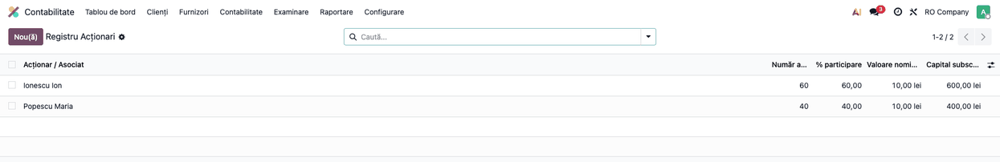
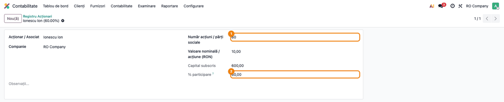
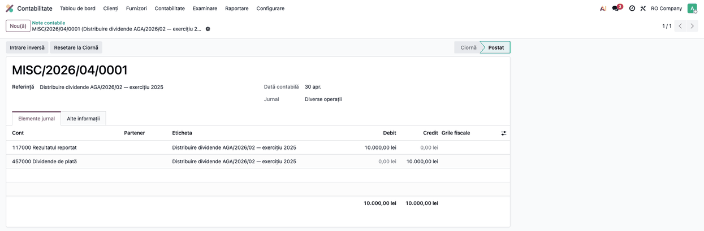
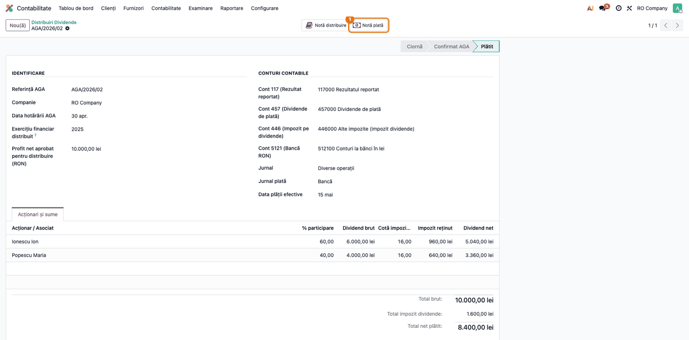

# Fișă Modul: Dividende și Registru Acționari

**Modul:** `l10n_ro_dividends`
**Capitol manual:** Cap 12.1 — Dividende și Registru Acționari
**Utilizator principal:** Contabil, Director Financiar
**Prioritate:** 🟡 Medie (operațiune anuală, după aprobarea situațiilor financiare)

---

## 1. Scop business

Modulul însoțește distribuirea dividendelor de la hotărârea AGA până la plata netă către acționari
și reținerea impozitului. Pe baza registrului acționarilor (asociaților), calculează dividendul brut
al fiecărui acționar proporțional cu participarea, reține impozitul după cota aplicabilă datei
hotărârii AGA și generează notele contabile: distribuirea (Dr 117 = Cr 457) și plata (Dr 457 =
Cr 446 + Cr 5121). Sumele reținute servesc ca bază pentru D100 și D205.

## 2. Bază legală și context

- **Codul fiscal, art. 97** — impozitul pe dividende pentru persoanele fizice, reținut la sursă de
  societatea plătitoare.
- **Legea nr. 141/2025** — cota de 16% pentru dividendele distribuite începând cu 1 ianuarie 2026.
- **Legea 31/1990, art. 67** — dreptul la dividende și aprobarea distribuirii de către AGA.
- **OMFP 1802/2014** — monografia contabilă: Dr 117 = Cr 457 la distribuire; Dr 457 = Cr 446 la
  reținerea impozitului; Dr 457 = Cr 5121 la plată.

Cota se stabilește după **data hotărârii AGA**: distribuirile aprobate în 2025 folosesc cota de 10%,
inclusiv dividendele interimare aferente situațiilor financiare interimare din 2025 regularizate
ulterior; distribuirile aprobate începând cu 1 ianuarie 2026 folosesc cota de 16%, indiferent dacă
profitul provine din exercițiul curent sau din profit reportat. Pentru o dată anterioară anului 2025,
modulul aplică 8%.

CASS de 10% pentru persoanele fizice nu este reținută la sursă de societate în acest flux.
Beneficiarul o datorează prin Declarația unică dacă veniturile extrasalariale cumulate ating
plafoanele de 6, 12 sau 24 de salarii minime brute.

## 3. Utilizatori și roluri

| Rol | Acțiune |
|-----|---------|
| Contabil-șef / administrator contabilitate | ține registrul acționarilor, creează distribuirea, preia acționarii, confirmă, înregistrează plata |
| Contabil | consultă registrul, distribuirile și notele generate (fără modificare) |
| Director financiar | verifică suma votată în AGA înainte de confirmare |

Drepturi: registrul și distribuirile pot fi create și modificate doar de utilizatorii cu dreptul
**Contabilitate: Administrator**; ceilalți utilizatori cu funcțiile contabile complete (de exemplu
**Contabil**, fără drept de administrator) au doar acces de citire.

Roluri recomandate pentru testare: un utilizator **Administrator** contabilitate, care parcurge tot
fluxul, și un utilizator **Contabil**, care trebuie să vadă meniul
**Contabilitate → Contabilitate → Dividende**, dar să nu poată crea sau modifica înregistrări.

## 4. Conturi și date implicate

| Cont | Rol |
|------|-----|
| 117 „Rezultatul reportat” | profitul distribuit (debit la confirmare) |
| 457 „Dividende de plată” | datoria față de acționari (credit la confirmare, debit la plată, pe fiecare acționar) |
| 446 „Alte impozite, taxe și vărsăminte asimilate” | impozitul pe dividende reținut |
| 5121 „Conturi la bănci în lei” | suma netă plătită acționarilor |

Conturile și jurnalele nu au o pagină de setări separată: la crearea unei distribuiri se
precompletează după planul de conturi al companiei (primul cont care începe cu 117, 457, 446,
respectiv 5121; primul jurnal de tip Diverse și primul jurnal de tip Bancă) și pot fi schimbate pe
fiecare distribuire, în grupul **Conturi contabile**.

Date minime pentru demo:
- companie românească, cu planul de conturi RO și moneda RON;
- doi parteneri persoane fizice (acționarii);
- un jurnal de operațiuni diverse și un jurnal de bancă.

## 5. Configurare inițială

1. Instalați modulul `l10n_ro_dividends` (dependențe: `account`, `l10n_ro`).
2. Verificați în **Contabilitate → Configurare → Plan de conturi** că există conturile 117, 457,
   446 și 5121.
3. Verificați că există un jurnal de tip **Diverse** (pentru nota de distribuire) și un jurnal de
   tip **Bancă** sau **Numerar** (pentru plată).
4. Verificați că apare meniul **Contabilitate → Contabilitate → Dividende**, cu submeniurile
   **Distribuiri Dividende** și **Registru Acționari**.
5. Cota impozitului nu necesită configurare: se stabilește din data hotărârii AGA.

## 6. Flux de utilizare

Exemplul din capturi: profit distribuit 10.000 RON, doi acționari, Ionescu Ion (60 de părți, 60%)
și Popescu Maria (40 de părți, 40%), hotărâre AGA din 30.04.2026, deci cota de 16%. Pașii 3–4 arată
distribuirea AGA/2026/01 în Ciornă; pașii 5–7 arată o a doua distribuire, AGA/2026/02, cu aceleași
date, confirmată și plătită.

### Pasul 1 — Registrul acționarilor

Accesați **Contabilitate → Contabilitate → Dividende → Registru Acționari**. Lista arată, pentru
fiecare acționar, numărul de acțiuni, procentul de participare, valoarea nominală și capitalul
subscris. Butonul **Nou** adaugă un acționar.



### Pasul 2 — Definirea unui acționar

În formularul acționarului completați:

| Câmp | Exemplu |
|------|---------|
| **Acționar / Asociat** | Ionescu Ion (persoană fizică) |
| **Număr acțiuni / părți sociale** | 60 (trebuie să fie pozitiv) |
| **Valoare nominală / acțiune (RON)** | 10,00 |

**Capital subscris** = număr de acțiuni × valoare nominală. **% participare** = acțiunile
acționarului raportate la totalul acțiunilor acționarilor activi ai companiei. Procentul nu este
memorat: se recalculează imediat ce se schimbă numărul de acțiuni sau starea (activ / arhivat)
oricărui acționar al companiei, ori când se adaugă sau se șterge un acționar. Un acționar arhivat
are 0% și nu mai intră în total. Numele afișat al acționarului include procentul, de exemplu
„Ionescu Ion (60.00%)”, cum apare în calea de navigare a formularului.



### Pasul 3 — Crearea hotărârii AGA

Accesați **Contabilitate → Contabilitate → Dividende → Distribuiri Dividende → Nou** și completați:

| Câmp | Exemplu | Observație |
|------|---------|-----------|
| **Referință AGA** | `AGA/2026/01` | numărul hotărârii AGA |
| **Data hotărârii AGA** | `30.04.2026` | stabilește cota impozitului |
| **Exercițiu financiar distribuit** | `2025` | exercițiul al cărui profit se distribuie |
| **Profit net aprobat pentru distribuire (RON)** | `10.000,00` | suma votată în AGA |

În grupul **Conturi contabile** verificați conturile 117, 457, 446, 5121, **Jurnal** (operațiuni
diverse) și **Jurnal plată** (bancă), precompletate. Distribuirea este în starea **Ciornă**.


### Pasul 4 — Preluarea acționarilor

Apăsați **Preia acționari din registru**. Tabul **Acționari și sume** se completează cu câte o linie
pentru fiecare acționar activ din registru: **% participare** (procentul curent din registru, cel
din numele afișat al acționarului), **Dividend brut** (profit × %), **Cotă impozit (%)** după data
hotărârii AGA, **Impozit reținut** și **Dividend net**. Preluarea înlocuiește liniile existente.

Dacă distribuirea nu este proporțională cu participarea, puteți modifica manual procentele și
sumele brute pe linii; **Recalculează** reface sumele brute și cota din profit și procente. Ambele
butoane sunt disponibile doar în starea Ciornă. Dacă schimbați **Data hotărârii AGA**, cota se
actualizează pe linii.


| Acționar | % | Brut | Impozit 16% | Net |
|----------|---|------|-------------|-----|
| Ionescu Ion | 60% | 6.000,00 | 960,00 | 5.040,00 |
| Popescu Maria | 40% | 4.000,00 | 640,00 | 3.360,00 |
| **Total** | | **10.000,00** | **1.600,00** | **8.400,00** |

Înainte de confirmare verificați pe ecran: suma procentelor este 100%, **Total brut** este egal cu
profitul aprobat, iar cota corespunde anului hotărârii AGA.

### Pasul 5 — Confirmarea distribuirii

Apăsați **Confirmă distribuirea (Dr 117 = Cr 457)**. Se generează și se postează nota de distribuire,
în jurnalul de operațiuni diverse, la data hotărârii AGA, pentru profitul aprobat. Distribuirea
trece în starea **Confirmat AGA**, iar butonul **Notă distribuire** deschide nota.



### Pasul 6 — Înregistrarea plății

În starea **Confirmat AGA** completați **Data plății efective** (dacă rămâne goală, se folosește
data curentă) și apăsați **Înregistrează plata (Dr 457 = Cr 446 + Cr 5121)**. Se generează și se
postează o singură notă de plată, în jurnalul de plată, la data plății. Distribuirea trece în
starea **Plătit**; butonul **Notă plată** deschide nota.



### Pasul 7 — Verificarea notei de plată

Deschideți nota prin **Notă plată**. Verificați că 457 este debitat pe fiecare acționar cu
dividendul brut (cu partenerul pe linie, pentru fișa contului 457), că 446 este creditat cu
impozitul total și 5121 cu netul total, iar soldul 457 al distribuirii devine zero.


### Note de monografie și raportare

Exemplul din capturi (profit 10.000 RON, cota 16%):

| Moment | Debit | Credit | Sumă |
|--------|-------|--------|------|
| Confirmare AGA (nota de distribuire) | 117 Rezultatul reportat | 457 Dividende de plată | 10.000,00 |
| Plată — impozit reținut (nota de plată) | 457 (pe acționari) | 446 Impozit dividende | 1.600,00 |
| Plată — suma netă (aceeași notă) | 457 (pe acționari) | 5121 Bancă | 8.400,00 |

- Nota de distribuire are o singură linie de 457, fără partener; nota de plată debitează 457 pe
  fiecare acționar cu brutul lui.
- Impozitul reținut în 446 se declară prin D100; datele distribuirii alimentează D205 (vezi
  secțiunea 7).
- Anularea este posibilă doar în starea **Confirmat AGA** (anulează și nota de distribuire);
  o distribuire **Plătită** nu se anulează din modul: se face o stornare manuală.

## 7. Legături cu alte module / declarații

| Modul / declarație | Rol |
|--------------------|-----|
| `account` | notele contabile, jurnalele, fișele conturilor 457, 446, 5121 |
| `l10n_ro` | planul de conturi RO din care se precompletează conturile |
| **D100** | impozitul reținut în contul 446 se declară și se plătește până la data de 25 a lunii următoare celei în care s-au plătit dividendele |
| **D205** | declarația informativă anuală a veniturilor cu reținere la sursă, pe beneficiari; pentru nerezidenți fluxul se corelează cu D207 |
| **Declarația unică / CASS** | CASS pe dividende nu se calculează în nota societății; beneficiarul o datorează prin Declarația unică dacă veniturile extrasalariale cumulate depășesc plafoanele de 6, 12 sau 24 de salarii minime brute |

**Ce e automat:** procentul de participare din registru, dividendul brut, cota după data AGA,
impozitul și netul pe acționar, nota de distribuire și nota de plată (postate).

**Ce rămâne manual:** registrul acționarilor, ajustarea liniilor pentru o distribuire
neproporțională, completarea D100 și D205, stornarea unei distribuiri deja plătite și informarea
acționarilor privind CASS.

## 8. Verificări pentru consultant

- [ ] Registrul arată procentele corecte (ex. 60% / 40%), iar suma lor pe acționarii activi este 100%.
- [ ] La modificarea numărului de acțiuni al unui acționar, procentele celorlalți se schimbă imediat.
- [ ] Un acționar arhivat are 0% și nu mai este preluat în distribuire; ceilalți revin la 100% împreună.
- [ ] Numele afișat al acționarului conține procentul (ex. „Ionescu Ion (60.00%)”).
- [ ] La o distribuire nouă, conturile 117, 457, 446, 5121 și cele două jurnale sunt precompletate.
- [ ] **Preia acționari din registru** creează câte o linie per acționar activ, cu brutul = profit × %.
- [ ] Cota este 16% pentru o dată AGA din 2026 și 10% pentru una din 2025; schimbarea datei actualizează cota pe linii.
- [ ] **Total brut** = profitul aprobat; **Total net plătit** = Total brut − Total impozit dividende.
- [ ] La confirmare, nota Dr 117 = Cr 457 este postată la data AGA, pe profitul aprobat; starea devine Confirmat AGA.
- [ ] Confirmarea este refuzată dacă suma procentelor de pe linii nu este 100%.
- [ ] La plată, nota are 457 în debit pe fiecare acționar, 446 în credit cu impozitul și 5121 în credit cu netul; starea devine Plătit.
- [ ] După plată, soldul contului 457 al distribuirii este zero, iar 446 are soldul de declarat în D100.
- [ ] O distribuire plătită nu se poate anula din modul.

## 9. Mesaje de eroare frecvente

| Mesaj | Cauză | Remediere |
|-------|-------|-----------|
| „Nu există acționari definiți pentru această companie. Adăugați-i în Registrul Acționarilor.” | Registrul nu are acționari activi pe compania distribuirii | Adăugați acționarii în **Registru Acționari** |
| „Numărul de acțiuni trebuie să fie pozitiv.” | Număr de acțiuni 0 sau negativ | Introduceți un număr pozitiv; un acționar ieșit se arhivează |
| „Puteți reîncărca acționarii doar în starea Ciornă.” | Preluare pe o distribuire confirmată sau plătită | Anulați și resetați la Ciornă (doar din Confirmat AGA) |
| „Adăugați cel puțin un acționar înainte de confirmare.” | Distribuire fără linii | Apăsați **Preia acționari din registru** |
| „Suma procentelor (…%) trebuie să fie 100%.” | Procentele de pe linii, modificate manual, nu totalizează 100% | Corectați procentele sau preluați din nou acționarii |
| „Selectați conturile 117 și 457 înainte de confirmare.” | Lipsește contul 117 sau 457 | Completați conturile în grupul **Conturi contabile** |
| „Selectați jurnalul contabil.” | Lipsește jurnalul notei de distribuire | Alegeți un jurnal de tip Diverse |
| „Distribuirea este deja confirmată sau anulată.” | Confirmare repetată | Nicio acțiune: nota există deja |
| „Distribuirea trebuie să fie în starea Confirmat AGA pentru a înregistra plata.” | Plată pe o distribuire neconfirmată | Confirmați întâi distribuirea |
| „Selectați conturile 446 și 5121 pentru plată.” | Lipsește contul 446 sau 5121 | Completați conturile în **Conturi contabile** |
| „Selectați jurnalul de plată (bancă/casă).” | Lipsește **Jurnal plată** | Alegeți un jurnal de bancă sau de numerar |
| „Nu puteți anula o distribuire deja plătită. Generați o stornare manuală.” | Anulare în starea Plătit | Stornați manual nota de plată și nota de distribuire |
| „Doar distribuirile anulate pot fi resetate la ciornă.” | Resetare dintr-o altă stare | Anulați întâi distribuirea |

## 10. Capturi de ecran

Capturile (`static/description/`) sunt **generate automat** din `tests/test_screenshots.py`
(mixinul `ScreenshotCase` din `l10n_ro_doc_screenshots`, import defensiv), în **limba română**, pe
planul de conturi RO, pe „RO Company” în RON. Aceeași listă de shot-uri produce și capturile în
engleză din `static/description/en/`, cu aceleași nume.

1. `01_meniu_registru.png` — lista **Registru Acționari**, cu procentele calculate.
2. `02_registru_actionari.png` — formularul acționarului, cu numărul de acțiuni și % participare.
3. `03_distribuire_ciorna.png` — distribuirea nouă în Ciornă, înainte de preluarea acționarilor.
4. `04_linii_actionari.png` — tabul **Acționari și sume** după preluare (brut, cotă, impozit, net).
5. `05_nota_117_457.png` — nota de distribuire Dr 117 = Cr 457, cu liniile.
6. `06_distribuire_platit.png` — distribuirea în starea Plătit, cu butoanele celor două note.
7. `07_nota_plata_457_446_5121.png` — nota de plată Dr 457 = Cr 446 + Cr 5121, cu liniile pe acționari.

Regenerare:

```bash
./odoo/odoo-bin -c odoo.conf -d <db> -i l10n_ro_dividends,l10n_ro_doc_screenshots \
    --test-tags=fise_screenshots --stop-after-init
```

Necesită `playwright` și `websocket-client` în mediul Odoo și Chrome de sistem; dacă `playwright`
lipsește, testul se sare (nu eșuează).

## 11. Observații pentru manual

- Prezentați fluxul în trei momente: registrul acționarilor → hotărârea AGA (distribuire) → plata.
- Păstrați un singur exemplu numeric (10.000 RON, 60% / 40%, cota 16%) în text, capturi și note.
- Subliniați că procentul de participare urmează imediat registrul: înainte de **Preia acționari
  din registru**, registrul trebuie să fie la zi (acționarii ieșiți arhivați, numărul de acțiuni
  actualizat); după preluare, liniile distribuirii nu se mai schimbă singure.
- **Resetează la Ciornă** (după **Anulează**) șterge nota de distribuire anulată, ca distribuirea să
  poată fi corectată și confirmată din nou.
- Explicați regula cotei după data hotărârii AGA (10% în 2025, 16% de la 1 ianuarie 2026).
- Menționați că CASS nu se reține de societate, ci rămâne obligația beneficiarului.
