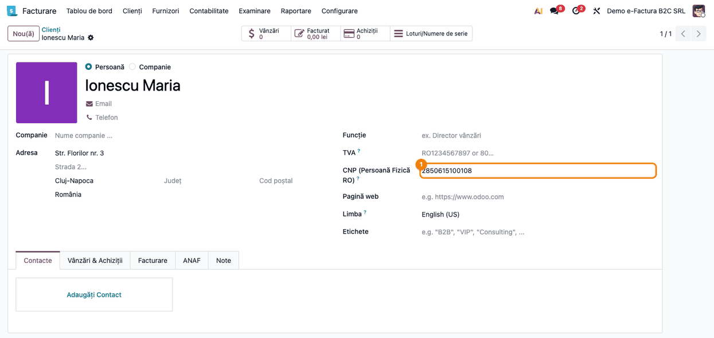
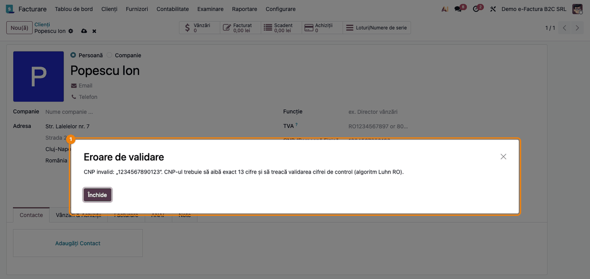
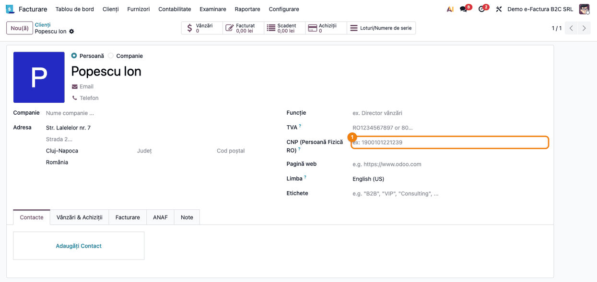
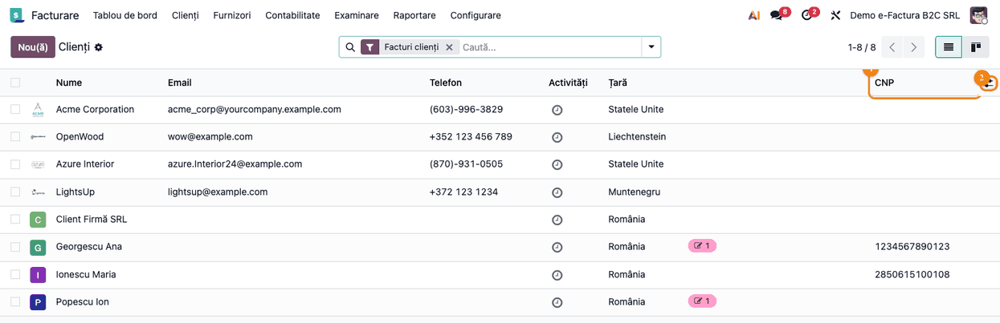
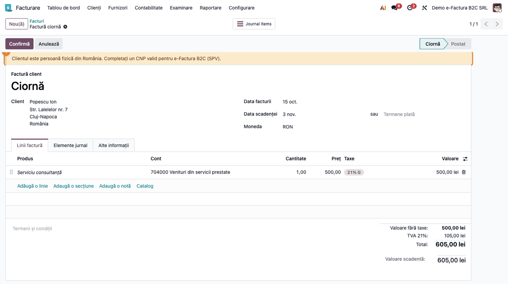
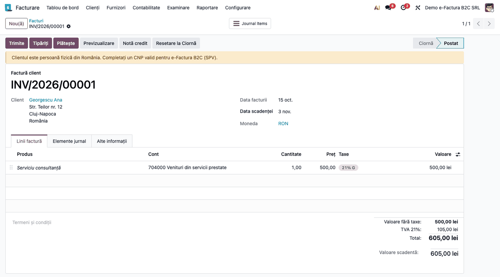

# Fișă Modul: e-Factura B2C (persoane fizice, CNP)

**Poziție plan:** B8.4
**Modul:** `l10n_ro_efactura_consumer`
**FR:** FR-24
**Capitol manual:** Cap 12.6
**Utilizator principal:** Operator facturare, Contabil clienți
**Prioritate:** 🔴 Ridicată (facturile către persoane fizice se transmit și ele prin e-Factura)

---

## 1. Scop business

Firmele care facturează și către persoane fizice (clienți B2C) transmit și aceste facturi prin
e-Factura, în SPV. Standard, `l10n_ro_edi` trece în XML, pentru un client fără cod TVA,
identificatorul anonim `0000000000000`. Modulul permite completarea **CNP-ului** pe client, îl
validează (13 cifre, cifra de control) și, când este valid, îl trece în XML-ul CIUS-RO cu
`schemeID="CNP"`. Pe factură apare un banner când clientul persoană fizică din România nu are un CNP
valid, iar trimiterea în SPV este oprită dacă pe client a ajuns un CNP completat, dar invalid (de
exemplu din date migrate). Firmele care facturează doar către firme cu cod TVA nu au nevoie de modul.

## 2. Bază legală și context

- **OUG 120/2021** privind sistemul național RO e-Factura, cu modificările ulterioare: transmiterea
  prin e-Factura se aplică și facturilor emise către persoane fizice (B2C).
- **Specificația CIUS-RO** (ANAF): identificatorul cumpărătorului (`BT-47`) se transmite în
  `cac:PartyLegalEntity/cbc:CompanyID`; pentru o persoană fizică fără CNP comunicat se folosește
  `0000000000000`.
- **GDPR (Regulamentul UE 2016/679)**: CNP-ul este dată cu caracter personal; câmpul e vizibil doar
  utilizatorilor interni (grupul *Utilizator intern*), nu și celor de portal sau publici.

## 3. Utilizatori și roluri

- **Operator facturare** — completează CNP-ul pe fișa clientului persoană fizică și emite factura.
- **Contabil clienți** — verifică bannerul de pe factură, trimite factura în SPV și controlează XML-ul.
- Rol recomandat la testare: utilizator intern cu drept de facturare (vede clienții și facturile);
  câmpul CNP cere doar drept de *Utilizator intern*.

## 4. Conturi și date implicate

Modulul **nu generează note contabile** și nu schimbă conturile: factura către persoana fizică se
înregistrează standard (4111 = 707/704 + 4427). Datele implicate:

- **CNP** pe partener (`l10n_ro_cnp`, 13 cifre) și **CNP Valid** (`l10n_ro_cnp_valid`, calculat și
  stocat, folosit de banner, de verificarea la trimitere și de XML);
- coloana opțională **CNP** în lista de clienți;
- XML-ul CIUS-RO: `cac:PartyIdentification/cbc:ID` și `cac:PartyLegalEntity/cbc:CompanyID`, ambele cu
  `schemeID="CNP"`.

Date minime pentru demo: o companie cu țara fiscală România (plan de conturi RO, `l10n_ro_edi`), un
client persoană fizică din România cu CNP valid (ex. `2850615100108`), unul fără CNP și o factură de
client către fiecare.

## 5. Configurare inițială

1. Instalați `l10n_ro_efactura_consumer` (depinde de `l10n_ro_edi`). Conexiunea la SPV (certificat,
   token) rămâne cea din `l10n_ro_edi`; modulul nu are setări proprii.
2. Verificați că firma are **țara fiscală România**: câmpul CNP apare pe partener doar dacă printre
   companiile utilizatorului există una cu țara fiscală RO.
3. Dacă folosiți `deltatech_contact`, la instalare CNP-urile din câmpul lui `cnp` se copiază automat
   în câmpul nou, doar unde acesta este gol. Copierea nu trece prin validare: verificați apoi lista de
   clienți (Pasul 2).
4. Opțional, în lista de clienți activați coloana **CNP** din meniul coloanelor opționale (Pasul 2).

## 6. Flux de utilizare

### Pasul 1 — Completați CNP-ul pe client

Mergeți la **Facturare → Clienți → Clienți** (sau **Contacte**, dacă aplicația e instalată) și
deschideți clientul persoană fizică. Câmpul **CNP (Persoană Fizică RO)** ① apare sub **TVA** doar
cât timp partenerul este de tip **Persoană** (nu **Companie**) și firma are țara fiscală România.
Introduceți cele 13 cifre, fără spații, și salvați.



La salvare, CNP-ul se validează: 13 cifre, prima cifră între 1 și 8, cifra de control corectă
(ponderile 2, 7, 9, 1, 4, 6, 3, 5, 8, 2, 7, 9). Un CNP greșit nu se salvează și apare dialogul
**Eroare de validare**:



### Pasul 2 — Identificați clienții fără CNP

Un client persoană fizică fără CNP are câmpul ① gol. Factura către el **nu este blocată**: se trimite
cu identificatorul anonim `0000000000000`, iar pe factură apare bannerul din Pasul 3.



Pentru a vedea toți clienții dintr-o privire, în **Facturare → Clienți → Clienți**, comutați pe
vizualizarea listă, deschideți meniul coloanelor opționale ② din capătul antetului și bifați **CNP**.
Coloana ① arată CNP-ul fiecărui client:

1. **Găsiți pe ecran** — clienții persoane fizice și coloana **CNP**.
2. **Verificați** — fiecare persoană fizică cu care facturați are CNP completat; un CNP care nu
   corespunde clientului (ex. `1234567890123` la Georgescu Ana, venit din migrare) se corectează pe fișa
   clientului înainte de facturare. Firmele (ex. Client Firmă SRL) rămân fără CNP.



### Pasul 3 — Bannerul de pe factură

Mergeți la **Facturare → Clienți → Facturi** și creați factura pentru clientul persoană fizică. Încă
din ciornă (și după **Confirmă**), deasupra formularului apare bannerul galben *„Clientul este persoană fizică din
România. Completați un CNP valid pentru e-Factura B2C (SPV).”* când sunt îndeplinite **toate**
condițiile:

- documentul este **factură de client** sau **notă de credit (storno) de client**;
- clientul (contactul principal) este de tip **Persoană** (nu **Companie**);
- partenerul de pe factură are țara **România**;
- CNP-ul contactului principal **lipsește sau este invalid**.

Bannerul este doar informativ: nu oprește confirmarea și nici trimiterea. Completați CNP-ul pe fișa
clientului (Pasul 1) și redeschideți factura.



### Pasul 4 — Trimiteți factura în SPV

Pe factura confirmată apăsați **Trimite**, bifați **Trimite E-Factura către SPV** și
confirmați. Înainte de trimitere, modulul verifică clientul (contactul principal):

- **CNP completat și valid**, client de tip Persoană → XML-ul pleacă cu CNP-ul (Pasul 5);
- **CNP gol** → factura pleacă normal, cu `0000000000000`; doar bannerul din Pasul 3 semnalează lipsa;
- **CNP completat, dar invalid** (posibil doar pentru date importate sau migrate, fiindcă la salvare
  CNP-ul se validează), client de tip Persoană, factură sau storno de client → trimiterea este oprită, iar
  în istoricul facturii (chatter) apare mesajul *„Factura nu este gata să fie trimisă: CNP invalid pentru
  clientul „…”. Verificați câmpul CNP înainte de trimiterea în SPV.”* Corectați CNP-ul pe fișa
  clientului și retrimiteți.



### Pasul 5 — Verificați XML-ul generat

Pe factura trimisă, deschideți fișierul XML CIUS-RO atașat (în chatter sau în tab-ul **E-Factura**) și
căutați secțiunea `cac:AccountingCustomerParty`:

1. **Găsiți** `cac:PartyIdentification/cbc:ID` și `cac:PartyLegalEntity/cbc:CompanyID`.
2. **Verificați** că ambele conțin CNP-ul clientului cu `schemeID="CNP"` și că `cbc:RegistrationName`
   este numele clientului. `cac:PartyTaxScheme` rămâne `0000000000000` (clientul nu are cod TVA).
3. **Mai departe** — urmăriți starea e-Factura până la validarea de către SPV.

Extras din XML-ul unei facturi către Ionescu Maria:

```xml
<cac:AccountingCustomerParty>
  <cac:Party>
    <cac:PartyIdentification>
      <cbc:ID schemeID="CNP">2850615100108</cbc:ID>
    </cac:PartyIdentification>
    ...
    <cac:PartyTaxScheme>
      <cbc:CompanyID>0000000000000</cbc:CompanyID>
      <cac:TaxScheme><cbc:ID>NOT_EU_VAT</cbc:ID></cac:TaxScheme>
    </cac:PartyTaxScheme>
    <cac:PartyLegalEntity>
      <cbc:RegistrationName>Ionescu Maria</cbc:RegistrationName>
      <cbc:CompanyID schemeID="CNP">2850615100108</cbc:CompanyID>
    </cac:PartyLegalEntity>
  </cac:Party>
</cac:AccountingCustomerParty>
```

Fără CNP valid, `PartyLegalEntity/CompanyID` rămâne `0000000000000` și `PartyIdentification` nu
primește CNP-ul.

### Note de monografie și raportare

Modulul nu creează și nu modifică note contabile. Factura către persoana fizică rămâne:

| Cont debit | Cont credit | Sumă | Explicație |
|---|---|---|---|
| 4111 Clienți | 704/707 Venituri | baza | valoarea fără TVA |
| 4111 Clienți | 4427 TVA colectată | TVA | TVA-ul facturii |

CNP-ul apare doar în XML-ul e-Factura; jurnalele și declarațiile (D300, D394) nu se schimbă.

## 7. Legături cu alte module / declarații

| Modul | Rol în flux |
|---|---|
| `l10n_ro_edi` | generează XML-ul CIUS-RO și îl trimite în SPV; modulul îi extinde identificatorul cumpărătorului și verificările dinainte de trimitere |
| `account` | facturile și notele de credit de client, fișa partenerului |
| `deltatech_contact` (opțional) | sursa CNP-urilor copiate la instalare |

**Ce e automat:** validarea CNP-ului la salvare, calculul **CNP Valid**, bannerul pe factură,
trecerea CNP-ului valid în XML, oprirea trimiterii pentru CNP completat dar invalid, copierea
CNP-urilor din `deltatech_contact` la instalare.

**Ce rămâne manual:** completarea CNP-ului pe client, corectarea CNP-urilor invalide venite din
migrare, verificarea XML-ului.

## 8. Verificări pentru consultant

- [ ] Pe un client de tip Persoană, cu firma în țara fiscală RO, câmpul **CNP (Persoană Fizică RO)**
      apare sub TVA; după trecerea pe tipul Companie, câmpul dispare.
- [ ] Un CNP greșit (`1234567890123`, 12 cifre, litere) nu se salvează și apare *Eroare de validare*.
- [ ] Un CNP valid (ex. `2850615100108`) se salvează fără eroare.
- [ ] În **Facturare → Clienți → Clienți**, coloana opțională **CNP** se poate activa și arată CNP-ul.
- [ ] Pe o factură de client către o persoană fizică din România fără CNP valid apare bannerul galben;
      pe o factură către un client de tip Companie nu apare.
- [ ] Factura către un client fără CNP se trimite în SPV cu `0000000000000`.
- [ ] Factura către un client cu CNP invalid (introdus prin import) nu pleacă în SPV, iar în chatter
      apare *„CNP invalid pentru clientul „…”. Verificați câmpul CNP înainte de trimiterea în SPV.”*
- [ ] XML-ul unei facturi către un client cu CNP valid are `schemeID="CNP"` în `PartyIdentification/ID`
      și în `PartyLegalEntity/CompanyID`.

## 9. Mesaje de eroare frecvente

| Mesaj / simptom | Cauză | Remediere |
|---|---|---|
| Câmpul CNP nu apare pe partener | Partenerul e de tip Companie sau firma nu are țara fiscală România | Treceți partenerul pe tipul Persoană doar dacă e persoană fizică; verificați țara fiscală a firmei |
| *„CNP invalid: „…”. CNP-ul trebuie să aibă exact 13 cifre și să treacă validarea cifrei de control (algoritm Luhn RO).”* la salvare | CNP cu altă lungime, litere, prima cifră 0 sau 9, cifră de control greșită | Corectați CNP-ul după actul de identitate |
| *„Factura nu este gata să fie trimisă: CNP invalid pentru clientul „…”. Verificați câmpul CNP înainte de trimiterea în SPV.”* în chatter | CNP completat, dar invalid pe client (date importate/migrate), client de tip Persoană | Corectați CNP-ul pe fișa clientului și retrimiteți |
| Bannerul galben pe factură | Client persoană fizică din România fără CNP valid | Completați CNP-ul pe client sau ignorați (factura pleacă cu `0000000000000`) |
| SPV respinge factura pe `BT-47` | CNP cu alt număr de cifre sau al altei persoane | Verificați CNP-ul; dacă factura a plecat cu CNP greșit, stornați-o și emiteți alta |

## 10. Capturi de ecran

Capturile sunt **generate automat** din `tests/test_screenshots.py` (mixinul `ScreenshotCase` din
`l10n_ro_doc_screenshots`, import defensiv), în română, pe planul de conturi RO, compania
„Demo e-Factura B2C SRL”. Aceleași shot-uri dau și capturile în engleză din
`static/description/en/`, folosite de `readme/USAGE.md`.

| # | Fișier | Conținut |
|---|--------|----------|
| 1 | `static/description/01_partener_cnp.png` | Clientul Ionescu Maria, de tip Persoană, cu CNP valid ① |
| 2 | `static/description/02_partener_cnp_invalid.png` | Dialogul *Eroare de validare* la salvarea unui CNP greșit |
| 3 | `static/description/03_partener_fara_cnp.png` | Clientul Popescu Ion, cu câmpul CNP ① gol |
| 4 | `static/description/04_lista_clienti_cnp.png` | Lista Clienți cu coloana opțională CNP ① activată din meniul coloanelor ② |
| 5 | `static/description/05_factura_avertizare_cnp.png` | Factura ciornă a clientului fără CNP, cu bannerul galben B2C (Pasul 3) |
| 6 | `static/description/06_factura_eroare_spv.png` | Factura confirmată a clientei cu CNP invalid, înainte de **Trimite** (Pasul 4) |

Regenerare:

```bash
.venv/bin/python odoo/odoo-bin -c odoo.conf -d <db> -i l10n_ro_efactura_consumer \
    --test-tags=/l10n_ro_efactura_consumer:TestEfacturaB2cScreenshots --stop-after-init
```

## 11. Observații pentru manual

- Criteriul „persoană fizică” este tipul **Persoană** (nu **Companie**) al partenerului: pe formular
  pentru câmpul CNP, pe contactul principal pentru bannerul de pe factură, verificarea la trimitere
  și XML. Manualul trebuie să folosească aceeași formulare.
- CNP-ul se citește de pe **contactul principal** al clientului; pe adresele de livrare sau facturare
  nu se completează.
- Bannerul de pe factură este informativ; singura blocare la trimitere este CNP-ul completat, dar
  invalid. Un CNP lipsă nu blochează nimic.
- Un CNP greșit trimis deja în SPV nu se corectează pe factură: se emite factură de stornare, se
  corectează CNP-ul și se emite o factură nouă.
- Datele GDPR: politica de confidențialitate a firmei trebuie să menționeze stocarea CNP-urilor.
