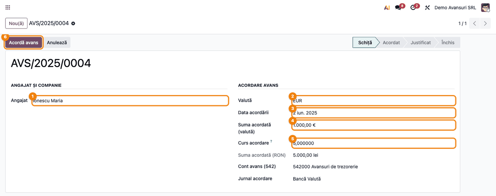
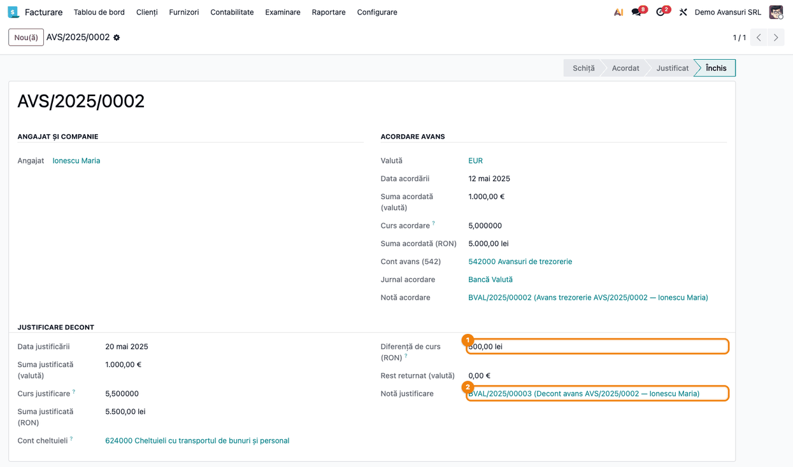
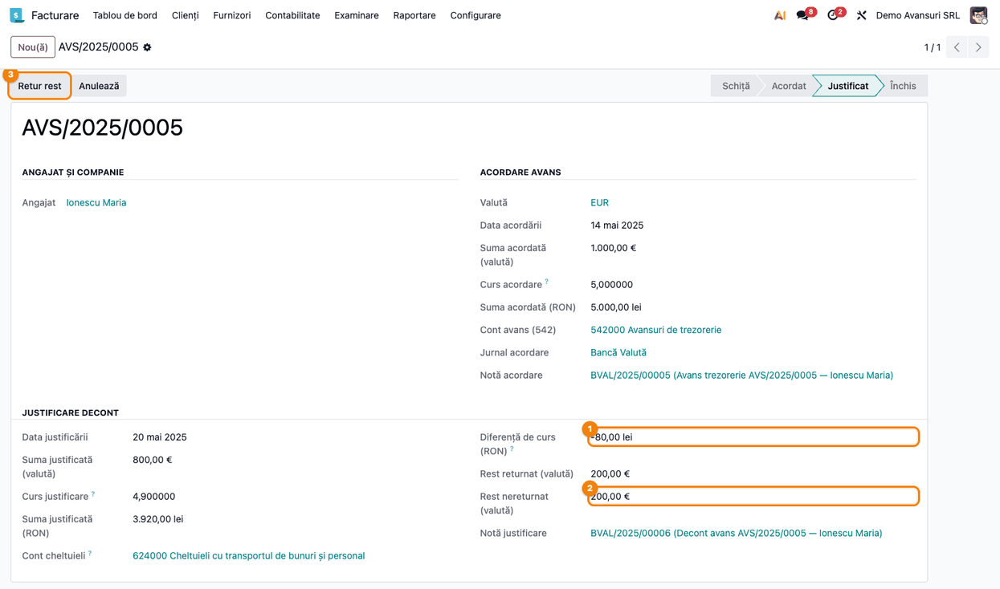
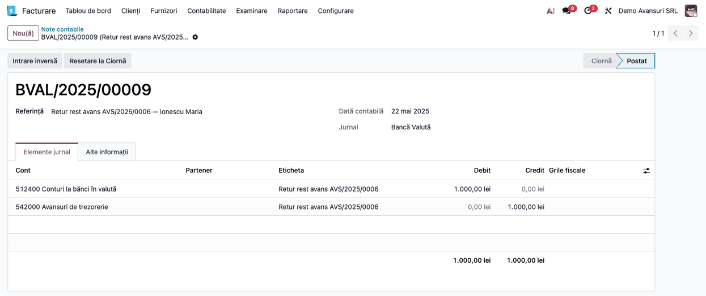
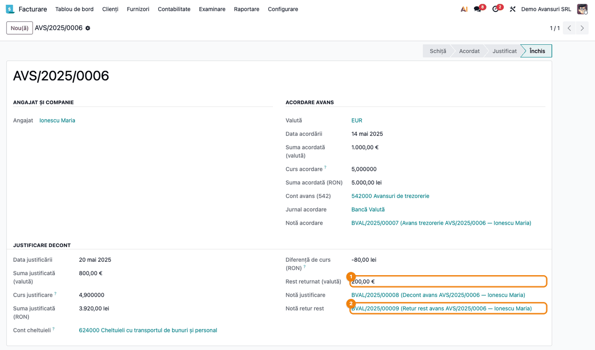

# Fișă Modul: Reevaluare Avansuri Valută (Cont 542)

**Poziție plan:** B4.2
**Modul:** `l10n_ro_expense_currency`
**FR:** FR-12
**Capitol manual:** Cap 8.2
**Utilizator principal:** Contabil, HR
**Prioritate:** 🟡 Medie (doar companii cu deplasări externe)

---

## 1. Scop business

Modulul gestionează fluxul complet al **avansurilor de trezorerie în valută** (cont 542) acordate
angajaților: acordarea din bancă sau casă, justificarea pe baza decontului de cheltuieli, cu
calculul automat al diferenței de curs (665/765), și returnarea eventualului rest. Este indicat
oricărei companii ai cărei angajați primesc avansuri în valută, de exemplu pentru deplasări externe.

## 2. Bază legală și context

OMFP 1802/2014, pct. 319 (funcțiunea contului 542 „Avansuri de trezorerie”): cheltuiala justificată
se înregistrează la cursul din data operațiunii, iar contul 542 se creditează la valoarea cu care a
intrat avansul (cursul acordării). Diferența dintre cele două se recunoaște ca venit (765) sau
cheltuială (665) din diferențe de curs valutar. Astfel, contul 542 se închide la zero atât în
valută, cât și în lei.

## 3. Utilizatori și roluri

- **Contabil:** acordă avansul, înregistrează justificarea și returul restului, verifică notele.
- **HR / responsabil deplasări:** furnizează decontul și documentele justificative ale angajatului.

Roluri recomandate pentru testare:
- Administrator: configurează conturile 542, 665, 765 și jurnalul de acordare în setări.
- Contabil (grup de facturare / contabilitate): parcurge fluxul acordare → justificare → retur.

## 4. Conturi și date implicate

| Cont | Rol |
|------|-----|
| 542 | Avansuri de trezorerie (valută) |
| 5124 / 5314 | Contul în valută al băncii sau casei din care se acordă avansul și în care se returnează restul (contul implicit al jurnalului de acordare) |
| 6xx (ex. 624, 625) | Cheltuiala justificată |
| 665 | Cheltuieli din diferențe de curs valutar (curs în scădere) |
| 765 | Venituri din diferențe de curs valutar (curs în creștere) |

Date minime pentru demo:
- companie românească cu planul de conturi RO și moneda RON;
- valuta EUR activă, cu cursuri pentru datele de acordare și de justificare;
- un angajat (ex. Ionescu Maria) și un jurnal de bancă în valută (ex. „Bancă Valută”) cu contul implicit 5124.

## 5. Configurare inițială

1. Instalați modulul `l10n_ro_expense_currency`.
2. Deschideți **Contabilitate → Configurare → Setări** (sau **Facturare → Configurare → Setări**), blocul **Avansuri Trezorerie Valutare (542)**,
   și completați **Cont 542**, **Jurnal acordare** (bancă sau casă), **Cont 665** și **Cont 765**.
   Conturile 665 și 765 sunt obligatorii doar dacă justificarea are diferență de curs.
3. Activați valuta (ex. EUR) și verificați că există cursul BNR pentru datele avansurilor
   (lista de valute din **Configurare**, sau actualizarea automată a cursurilor cu providerul BNR din setări).
4. Creați angajatul în **Angajați**, dacă nu există.

## 6. Flux de utilizare

### Pasul 1 — Crearea avansului

Deschideți **Contabilitate → Contabilitate → Avansuri 542 → Avansuri Trezorerie Valutare** (fără
aplicația Contabilitate: **Facturare → Contabilitate → Avansuri 542 → Avansuri Trezorerie Valutare**)
și apăsați **Nou**. Completați **Referință**, **Angajat** ①, **Valută** ② (ex. EUR), **Data acordării** ③ și
**Suma acordată (valută)** ④. **Curs acordare** ⑤ se completează automat cu cursul valutei din
tabelul de cursuri al companiei pentru data acordării (cursul BNR, dacă este actualizat); îl puteți
corecta manual. **Suma acordată (RON)**, **Cont avans (542)** și **Jurnal acordare** vin din calcul și
din setări. Avansul este în starea **Schiță**.



### Pasul 2 — Acordarea avansului

Apăsați **Acordă avans** ⑥. Se generează și se postează nota de acordare **Dr 542 = Cr 5124** (sau
5314 la casă în valută; contul implicit al jurnalului ales), la cursul de acordare. Avansul trece în starea **Acordat**, iar câmpul **Notă acordare**
leagă nota contabilă.


Deschideți **Notă acordare** și verificați liniile din tab-ul **Elemente jurnal**:


### Pasul 3 — Justificarea decontului

Când angajatul depune decontul, completați pe avans, în secțiunea **Justificare decont**:
**Data justificării** ①, **Suma justificată (valută)** ② (totalul documentelor justificative, cel mult
suma acordată), **Curs justificare** ③ și **Cont cheltuieli** ④ (ex. 624 sau 625).

**Curs justificare** se completează automat la alegerea **Datei justificării**, din tabelul de
cursuri al companiei pentru acea dată (cursul BNR din data operațiunii, dacă cursurile sunt
actualizate). Dacă pentru dată nu există curs, se preia ultimul curs disponibil: comparați valoarea
cu cursul BNR al zilei și corectați-o manual dacă diferă. **Suma justificată (RON)** și **Diferență de
curs (RON)** se recalculează pe loc. Apoi apăsați **Justifică decont** ⑤.


Cheltuiala se înregistrează la cursul justificării, iar 542 se creditează la cursul acordării
(OMFP 1802/2014, pct. 319). Diferența = suma justificată × (curs justificare − curs acordare):
- curs justificare > curs acordare → **Dr cheltuieli = Cr 542 + Cr 765** (câștig de curs);
- curs justificare < curs acordare → **Dr cheltuieli + Dr 665 = Cr 542** (pierdere de curs);
- cursuri egale → **Dr cheltuieli = Cr 542**, fără 665/765.

Dacă s-a justificat toată suma, avansul trece direct în **Închis**. Dacă suma justificată e mai mică,
avansul rămâne în **Justificat** (vezi pasul 5).


### Pasul 4 — Verificarea avansului închis

Un avans justificat integral este în starea **Închis** și afișează **Diferență de curs (RON)** ①,
pozitivă la câștig și negativă la pierdere, și legătura **Notă justificare** ②.



### Pasul 5 — Justificare parțială și returnarea restului

Dacă angajatul justifică mai puțin decât a primit, după **Justifică decont** avansul rămâne în
starea **Justificat**, iar **Rest nereturnat (valută)** ② arată suma de returnat (în această stare,
**Rest returnat (valută)** afișează deja aceeași sumă, deși restul nu a fost înregistrat; legătura
**Notă retur rest** apare doar după retur). În exemplu, din
1.000 EUR acordați la 5,00 s-au justificat 800 EUR la cursul 4,90, deci **Diferență de curs (RON)** ①
este −80,00 lei (pierdere):



Nota de justificare cu pierdere de curs:


După ce angajatul depune restul în bancă sau casă, apăsați **Retur rest** ③. Se generează nota
**Dr 5124 (sau 5314) = Cr 542** pentru suma nereturnată, **la cursul acordării** (nu la cursul zilei
returului), cu data zilei în care apăsați butonul (în exemplu, 22 mai 2025). Așa, 542 se stinge exact cu valoarea în lei cu
care a intrat restul. Avansul trece în **Închis**.



Avansul închis după retur afișează **Rest returnat (valută)** ① și legătura **Notă retur rest** ②:



### Note de monografie și raportare

| Operațiune | Notă contabilă | Curs |
|---|---|---|
| Acordare | Dr 542 = Cr 5124 / 5314 | cursul acordării |
| Justificare, curs în creștere | Dr 6xx = Cr 542 + Cr 765 | 6xx la cursul justificării, 542 la cursul acordării |
| Justificare, curs în scădere | Dr 6xx + Dr 665 = Cr 542 | 6xx la cursul justificării, 542 la cursul acordării |
| Retur rest | Dr 5124 / 5314 = Cr 542 | cursul acordării |
| Anulare | anularea notelor generate (retur, justificare, acordare) | — |

Exemplele din capturi (avans 1.000 EUR la 5,00 = 5.000,00 lei):
- **Câștig:** justificat 1.000 EUR la 5,50 → Dr 624 5.500,00 = Cr 542 5.000,00 + Cr 765 500,00.
  Sold 542: 5.000,00 − 5.000,00 = 0 lei (0 EUR).
- **Pierdere + retur:** justificat 800 EUR la 4,90 → Dr 624 3.920,00 + Dr 665 80,00 = Cr 542 4.000,00;
  retur 200 EUR → Dr 5124 1.000,00 = Cr 542 1.000,00. Sold 542: 5.000,00 − 4.000,00 − 1.000,00 = 0 lei (0 EUR).

**Anularea** (butonul **Anulează**, disponibil până la închidere) anulează notele generate și trece
avansul în **Anulat**; **Resetează în Schiță** îl readuce în lucru.

## 7. Legături cu alte module / declarații

| Modul / proces | Rol în flux |
|---|---|
| `hr` | angajații cărora li se acordă avansurile |
| `account` | notele contabile pe 542, 5124/5314, 6xx, 665 și 765 |
| `l10n_ro` | planul de conturi RO |
| Cursuri valutare (BNR) | cursul propus la acordare și la justificare |
| `l10n_ro_currency_revaluation` | reevaluarea generală a soldurilor în valută, separată de fluxul avansurilor |

Ce este automat: cursul propus din tabelul de cursuri, suma în lei, diferența de curs, notele de
acordare, justificare și retur, închiderea avansului.
Ce rămâne manual: verificarea cursului de justificare față de cursul BNR al zilei, alegerea contului
de cheltuieli, verificarea documentelor justificative și apăsarea **Retur rest** după depunerea restului.

## 8. Verificări pentru consultant

- [ ] La crearea avansului, **Curs acordare** este cursul BNR al datei acordării și **Suma acordată (RON)** = suma în valută × curs.
- [ ] Nota de acordare este Dr 542 = Cr 5124 (sau 5314), postată, cu suma în valută pe linia 542.
- [ ] La alegerea **Datei justificării**, **Curs justificare** se completează din cursurile companiei; valoarea corespunde cursului BNR al zilei.
- [ ] Nu se poate justifica o sumă mai mare decât cea acordată.
- [ ] Cu curs în creștere (ex. 5,00 → 5,50 pe 1.000 EUR), nota este Dr 624 5.500,00 = Cr 542 5.000,00 + Cr 765 500,00, iar **Diferență de curs (RON)** este +500,00.
- [ ] Cu curs în scădere (ex. 5,00 → 4,90 pe 800 EUR), nota este Dr 624 3.920,00 + Dr 665 80,00 = Cr 542 4.000,00, iar **Diferență de curs (RON)** este −80,00.
- [ ] Justificarea integrală închide avansul; cea parțială îl lasă în **Justificat**, cu **Rest nereturnat (valută)** corect.
- [ ] Nota de retur este Dr 5124 = Cr 542 la cursul acordării (200 EUR × 5,00 = 1.000,00 lei), iar avansul trece în **Închis**.
- [ ] După justificarea integrală și returul restului, contul 542 are sold zero și în valută, și în lei, atât în exemplul cu câștig (5.000,00 − 5.000,00), cât și în cel cu pierdere și retur (5.000,00 − 4.000,00 − 1.000,00).
- [ ] **Anulează** anulează toate notele generate ale avansului.

## 9. Mesaje de eroare frecvente

| Mesaj / simptom | Cauză probabilă | Remediere |
|-----------------|-----------------|-----------|
| „Configurați conturile 665 și 765 pe companie pentru diferențe de curs.” | Justificarea are diferență de curs, dar conturile nu sunt setate | Completați **Cont 665** și **Cont 765** în setări |
| „Suma justificată nu poate depăși suma avansului acordat.” | Suma justificată > suma acordată | Corectați suma; diferența se tratează în afara avansului |
| „Selectați contul de cheltuieli.” / „Introduceți data justificării.” | Câmp de justificare necompletat | Completați **Cont cheltuieli** sau **Data justificării** |
| „Suma justificată trebuie să fie pozitivă.” | Suma justificată zero sau negativă | Introduceți suma din decont |
| „Suma acordată trebuie să fie pozitivă.” | Suma acordată zero sau negativă | Corectați **Suma acordată (valută)** |
| „Jurnalul selectat nu are cont implicit configurat.” | Jurnalul de bancă/casă nu are cont implicit | Setați contul implicit (5124/5314) pe jurnal |
| **Rest returnat (valută)** completat deși restul nu s-a returnat | Câmpul se afișează din starea Justificat, înainte de retur | Verificați **Rest nereturnat (valută)** și existența **Notă retur rest** |
| Curs justificare diferit de cursul BNR al zilei | Lipsește cursul pentru data justificării; s-a preluat ultimul curs disponibil | Adăugați cursul zilei sau corectați manual câmpul |

## 10. Capturi de ecran

Capturile sunt generate automat de `tests/test_screenshots.py` (mixinul `ScreenshotCase` din
`l10n_ro_doc_screenshots`, import defensiv), în română, pe planul de conturi RO, compania în RON.
Aceleași ecrane, în engleză, sunt în `static/description/en/`, pentru `readme/USAGE.md`.

| # | Fișier | Conținut |
|---|--------|----------|
| 1 | `static/description/01_avans_nou.png` | Avans nou în Schiță, cu câmpurile de acordare și butonul Acordă avans |
| 2 | `static/description/02_avans_acordat.png` | Avans în starea Acordat: suma EUR, cursul, suma în lei, Notă acordare |
| 3 | `static/description/03_nota_acordare.png` | Nota Dr 542 = Cr 5124 (acordare avans în valută) |
| 4 | `static/description/04_justificare_completata.png` | Justificarea completată, înainte de Justifică decont |
| 5 | `static/description/05_nota_justificare.png` | Nota Dr 624 = Cr 542 + Cr 765 (justificare cu câștig de curs) |
| 6 | `static/description/06_avans_inchis.png` | Avans închis: diferența de curs și Notă justificare |
| 7 | `static/description/07_avans_justificat_partial.png` | Avans justificat parțial: diferență negativă, rest nereturnat, Retur rest |
| 8 | `static/description/08_nota_justificare_pierdere.png` | Nota Dr 624 + Dr 665 = Cr 542 (justificare cu pierdere de curs) |
| 9 | `static/description/09_nota_retur_rest.png` | Nota Dr 5124 = Cr 542 (retur rest la cursul acordării) |
| 10 | `static/description/10_avans_inchis_retur.png` | Avans închis după retur: rest returnat și Notă retur rest |

Regenerare:

```bash
.venv/bin/python odoo/odoo-bin -c odoo.conf -d <db> -i l10n_ro_expense_currency,l10n_ro_doc_screenshots \
    --test-tags=fise_screenshots --stop-after-init
```

## 11. Observații pentru manual

- Monografia completă: Dr 542 = Cr 5124 (acordare) → Dr 6xx = Cr 542 + Cr 765 (câștig) sau Dr 6xx + Dr 665 = Cr 542 (pierdere) → Dr 5124 = Cr 542 (retur rest, la cursul acordării).
- Diferența de curs: suma justificată × (curs justificare − curs acordare); pozitivă = câștig (765), negativă = pierdere (665).
- Cursul de justificare este propus din tabelul de cursuri, dar rămâne editabil: manualul trebuie să ceară verificarea lui față de cursul BNR din data operațiunii.
- Nota de retur poartă data zilei în care se apasă **Retur rest**: apăsați butonul în ziua depunerii restului.
- Modulul acceptă o singură justificare pe avans; mai multe deconturi se însumează într-o singură justificare.
- Conturile se configurează în **Contabilitate → Configurare → Setări → Avansuri Trezorerie Valutare (542)**.
- La un avans în stare **Justificat**, câmpul **Rest returnat (valută)** afișează restul înainte de retur; starea reală a returului o dau **Rest nereturnat (valută)** și **Notă retur rest**.
