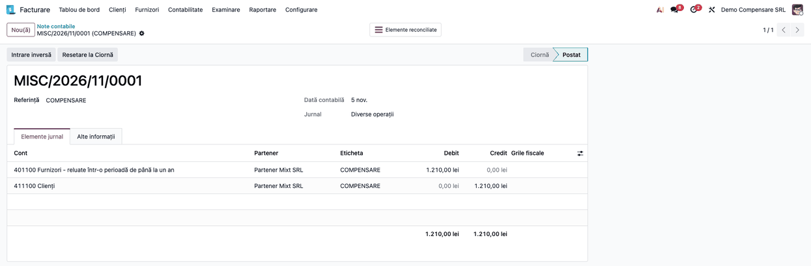
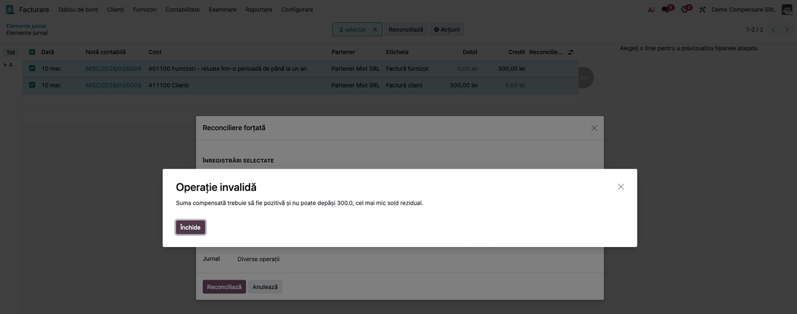

# Fișă Modul: Reconciliere forțată între conturi

**Poziție plan:** C13
**Modul:** `l10n_ro_force_reconcile`
**FR:** FR-29
**Capitol manual:** Cap 12.10
**Utilizator principal:** Contabil, Manager Contabilitate
**Prioritate:** 🟡 Medie (compensările între conturi diferite apar lunar, dar pe volume mici)

---

## 1. Scop business

Reconcilierea standard Odoo leagă doar linii de pe același cont. În practică, o datorie și o creanță
față de același partener stau pe conturi diferite: avansul plătit furnizorului (4091) și factura lui
(401), avansul încasat de la client (419) și factura emisă (4111), creanța și datoria față de un
partener care este și client, și furnizor (4111 ↔ 401). Modulul oferă un wizard care stinge două
astfel de linii printr-o **notă de compensare** postată automat (o linie pe fiecare cont) și
reconciliază fiecare linie inițială cu linia din notă de pe același cont. Soldurile partenerului se
închid, iar legătura dintre documente rămâne vizibilă în reconciliere.

## 2. Bază legală și context

- **Codul civil, art. 1616** — datoriile reciproce se sting prin compensație, până la concurența
  celei mai mici dintre ele. Wizardul respectă regula: suma compensată nu poate depăși cel mai mic
  dintre cele două solduri reziduale.
- **OMFP 1802/2014** — principiul necompensării: creanțele și datoriile nu se compensează direct în
  balanță; compensarea admisă legal se înregistrează printr-o notă contabilă distinctă. Avansurile
  plătite furnizorilor (409) se închid la primirea facturii, iar cele încasate de la clienți (419) la
  emiterea facturii.
- Compensarea între **parteneri diferiți** (de exemplu o compensare tripartită) cere acordul scris al
  părților. Modulul nu verifică acest acord: îl documentează contabilul, iar eticheta notei poate
  purta referința documentului de compensare.

## 3. Utilizatori și roluri

- **Contabil clienți / furnizori** — selectează liniile și propune compensarea.
- **Contabil șef** — verifică suma compensată și nota generată.
- **Administrator** — acordă dreptul **Contabilitate / Administrator** (grupul `account.group_account_manager`).

Roluri recomandate pentru testare:
- un utilizator cu **Contabilitate / Administrator**: vede acțiunea în meniul **Acțiuni** al listei
  **Elemente jurnal**;
- un utilizator doar cu **Contabilitate / Contabil**: nu vede acțiunea.

## 4. Conturi și date implicate

| Cont | Rol în compensare |
|---|---|
| 4111 „Clienți” | creanța față de partener, din factura emisă (sold debitor) |
| 401 „Furnizori” | datoria față de partener, din factura primită (sold creditor) |
| 4091 „Furnizori-debitori pentru cumpărări de bunuri de natura stocurilor” | avans plătit furnizorului (sold debitor) |
| 419 „Clienți-creditori” | avans încasat de la client (sold creditor) |
| 707, 4427, 371, 4426 | contrapartidele facturilor din exemplu (nu intră în nota de compensare) |

Nota de compensare are mereu două linii, pe conturile celor două linii stinse:
**Dr** contul liniei creditoare = **Cr** contul liniei debitoare.

Date minime pentru demo:
- companie românească, cu planul de conturi RO și moneda RON;
- un partener care este și client, și furnizor (în exemplu „Partener Mixt SRL”);
- factura emisă partenerului, postată: Dr 4111 1.210 = Cr 707 1.000 + Cr 4427 210;
- factura primită de la partener, postată: Dr 371 1.500 + Dr 4426 315 = Cr 401 1.815;
- un jurnal de tip **Diverse** (pentru nota de compensare).

În capturi, cele două facturi sunt înregistrate, pentru simplitate, ca note contabile în jurnalul
Diverse (MISC/…), cu etichetele „Factură client” și „Factură furnizor”. În practică sunt facturi de
client și de furnizor obișnuite; wizardul tratează la fel liniile lor de pe 4111 și 401.

## 5. Configurare inițială

1. Instalați modulul `l10n_ro_force_reconcile` (dependență: `account`).
2. Dați utilizatorului dreptul **Contabilitate / Administrator** (**Setări → Utilizatori și companii →
   Utilizatori**).
3. În **Contabilitate → Configurare → Plan de conturi**, deschideți ambele conturi ale compensării
   (de exemplu 4111 și 401) și verificați bifa **Permite reconciliere**; activați-o dacă lipsește.
   Activați-o doar pe conturile de terți, nu pe cele de venituri sau cheltuieli.
4. Verificați că firma are un jurnal de tip **Diverse**: wizardul îl propune pe primul.

## 6. Flux de utilizare

Exemplul folosește aceleași cifre în toți pașii: „Partener Mixt SRL” ne datorează 1.210 lei din
factura emisă (4111), iar noi îi datorăm 1.815 lei din factura primită (401). Se compensează 1.210 lei;
creanța se stinge, iar pe 401 rămân 605 lei de plătit.

### Pasul 1 — Selectarea liniilor și deschiderea wizardului

Mergeți la **Facturare → Examinare → Control → Elemente jurnal** (cu Contabilitatea Enterprise
instalată, meniul principal se numește **Contabilitate**). Filtrați partenerul și bifați
**exact două linii**: linia facturii emise (Dr 4111) și linia facturii primite (Cr 401). Apăsați **Acțiuni →
Reconciliere forțată (conturi diferite)**.

La deschidere, wizardul verifică liniile selectate și se oprește cu un mesaj (vezi secțiunea 9)
dacă nu sunt îndeplinite toate condițiile:

- sunt exact două linii, ale aceleiași companii, din note **postate** și încă nereconciliate complet;
- ambele conturi au bifa **Permite reconciliere**;
- liniile sunt pe **conturi diferite** (două linii de pe același cont se reconciliază standard);
- una este **debitoare** și cealaltă **creditoare**: soldurile reziduale au semne opuse;
- ambele sunt **în moneda companiei** (RON); liniile în valută se compensează altfel (secțiunea 9).

Wizardul **Reconciliere forțată** arată, în blocul **Înregistrări selectate**, **Cont linie 1** și
**Cont linie 2** (în ordinea liniilor selectate) cu **Rezidual linie 1** și **Rezidual linie 2**, iar
în blocul **Notă de compensare**: **Partener**, **Data notei** (azi), **Jurnal** (primul jurnal
Diverse), **Sumă compensată** și **Etichetă** (implicit COMPENSARE). Verificați pe ecran:

- conturile sunt cele două conturi de compensat (4111 și 401);
- **Sumă compensată** = cel mai mic dintre cele două reziduuri (aici 1.210,00, rezidualul creanței).

Puteți micșora **Sumă compensată** pentru o compensare parțială; suma trebuie să fie mai mare decât 0
și cel mult egală cu cel mai mic rezidual. Schimbați, dacă e cazul, **Data notei**, **Jurnal** și
**Etichetă** (de exemplu cu numărul procesului-verbal de compensare). Apăsați **Reconciliază**.


### Pasul 2 — Verificarea notei de compensare

Se deschide nota de compensare, deja postată în jurnalul ales. În tabul **Elemente jurnal**
verificați:

- două linii, cu eticheta COMPENSARE: **Dr 401** 1.210,00 și **Cr 4111** 1.210,00;
- nota este echilibrată;
- fiecare linie poartă **partenerul liniei pe care o stinge**: linia pe 401 are partenerul facturii primite,
  linia pe 4111 partenerul facturii emise. Partenerul din wizard se folosește doar pentru o linie inițială
  fără partener. La o compensare între parteneri diferiți, fișa fiecărui partener se închide corect.



### Pasul 3 — Verificarea reconcilierii

Reveniți în **Elemente jurnal** și filtrați partenerul (sau conturile 4111 și 401). Coloana
**Reconciliere** arată cum s-au legat liniile. Verificați:

- linia facturii emise (Dr 4111 1.210) și linia Cr 4111 din nota de compensare au **același număr**
  de reconciliere: creanța este stinsă complet;
- linia facturii primite (Cr 401 1.815) și linia Dr 401 din notă au același număr, cu prefixul **P**
  (reconciliere parțială): pe factura primită rămân de plătit 605,00 lei, care se sting la plată;
- cu filtrul **Nereconciliat**, linia 4111 nu mai apare, iar factura primită apare cu rezidualul 605,00.

Dacă suma compensată a fost mai mică decât ambele reziduuri, ambele linii rămân parțial
reconciliate; relansați wizardul pe aceleași linii pentru restul.


### Pasul 4 — Sumă peste soldul rezidual (blocare)

Dacă la Pasul 1 introduceți în **Sumă compensată** o valoare mai mare decât cel mai mic rezidual
(sau zero), la **Reconciliază** apare un dialog de eroare și nu se creează nicio notă. În exemplu,
creanța 4111 are 500 lei și datoria 401 are 300 lei, iar suma introdusă este 500. Închideți dialogul, corectați
**Sumă compensată** (cel mult 300) și apăsați din nou **Reconciliază**.



### Note de monografie și raportare

**Compensare client-furnizor (exemplul din pași):**

```
Factură emisă:        Dr 4111  1.210  =  Cr 707   1.000
                                         Cr 4427    210
Factură primită:      Dr 371   1.500  =  Cr 401   1.815
                      Dr 4426    315
Notă de compensare:   Dr 401   1.210  =  Cr 4111  1.210
Plata restului:       Dr 401     605  =  Cr 5121    605
```

**Alte compensări** (nota generată de wizard, fără TVA):

```
Avans încasat de la client cu factura lui:    Dr 419   =  Cr 4111
Avans plătit furnizorului cu factura lui:     Dr 401   =  Cr 4091
```

- Nota de compensare nu atinge TVA-ul, veniturile sau cheltuielile: mută doar solduri între conturi
  de terți, deci nu apare în D300 sau D394.
- Avansurile pentru care s-a emis factură de avans cu TVA se regularizează pe factura finală, cu
  `l10n_ro_advance_invoice`; wizardul de aici închide doar soldurile rămase între conturile de terți.
- Pe balanță și pe fișa partenerului, după compensare soldul 4111 scade cu 1.210, iar soldul 401 cu
  1.210.

## 7. Legături cu alte module / declarații

| Modul / proces | Rol în flux | Tip legătură |
|---|---|---|
| `account` | elemente jurnal, note contabile, reconciliere | dependență (manifest) |
| `l10n_ro` | planul de conturi RO (4091, 401, 419, 4111) | context (nu e în manifest) |
| `l10n_ro_advance_invoice` | avansuri cu factură și TVA, regularizate pe factura finală | alternativă pentru avansurile facturate |
| Rapoarte de parteneri (fișă partener, balanță) | arată soldurile închise după compensare | consultare |

**Ce e automat:** verificarea liniilor selectate, propunerea sumei (cel mai mic rezidual), crearea și
postarea notei de compensare cu partenerul fiecărei linii, reconcilierea fiecărei linii inițiale cu
linia notei de pe același cont.

**Ce rămâne manual:** alegerea celor două linii, decizia de compensare și documentul care o
justifică (proces-verbal, acord), compensările în valută.

## 8. Verificări pentru consultant

- [ ] Acțiunea **Reconciliere forțată (conturi diferite)** apare în **Acțiuni** doar pentru
      utilizatorii cu **Contabilitate / Administrator**.
- [ ] Cu o singură linie sau cu trei linii selectate, wizardul refuză deschiderea.
- [ ] Două linii de pe același cont, două linii debitoare sau o linie în valută sunt refuzate, cu
      mesajul din secțiunea 9.
- [ ] **Sumă compensată** propusă = cel mai mic rezidual (exemplu: 1.210,00).
- [ ] O sumă peste cel mai mic rezidual, sau zero, este refuzată la **Reconciliază**, fără notă creată.
- [ ] Nota de compensare este postată, echilibrată, cu **Dr** pe contul liniei creditoare și **Cr** pe
      contul liniei debitoare (exemplu: Dr 401 / Cr 4111, 1.210,00).
- [ ] Fiecare linie a notei are partenerul liniei pe care o stinge (verificați pe o compensare între
      doi parteneri diferiți).
- [ ] În coloana **Reconciliere**, factura emisă și linia 4111 a notei au același număr; factura
      primită și linia 401 a notei au același număr cu prefixul **P** (parțial), cu rezidual 605,00.
- [ ] Pe fișa partenerului, soldurile 4111 și 401 au scăzut fiecare cu suma compensată.

## 9. Mesaje de eroare frecvente

| Mesaj / simptom | Cauză | Remediere |
|---|---|---|
| Acțiunea nu apare în **Acțiuni** | Utilizatorul nu are **Contabilitate / Administrator** | Acordați dreptul sau cereți compensarea unui administrator contabil |
| „Selectați exact 2 înregistrări contabile.” | S-au bifat mai puțin sau mai mult de două linii | Bifați exact linia debitoare și linia creditoare |
| „Înregistrarea '…' nu este postată. Reconcilierea este posibilă doar pe înregistrări postate.” | Una dintre note e în Ciornă | Postați nota, apoi relansați wizardul |
| „Înregistrarea '…' este deja reconciliată complet.” | Linia nu mai are sold | Alegeți o linie cu rezidual deschis |
| „Contul '…' nu permite reconcilierea. Activați opțiunea 'Permite reconcilierea' pe cont.” | Contul nu are bifa de reconciliere | Bifați **Permite reconciliere** pe cont (doar conturi de terți) |
| „Înregistrările trebuie să aparțină aceleiași companii.” | Liniile sunt din companii diferite | Compensați separat, în fiecare companie |
| „Ambele înregistrări sunt pe același cont: reconciliați-le cu reconcilierea standard.” | Liniile sunt pe același cont | Folosiți reconcilierea standard Odoo, fără notă de compensare |
| „Selectați o înregistrare debitoare și una creditoare: soldurile lor reziduale trebuie să aibă semne opuse.” | Ambele linii sunt debitoare (sau ambele creditoare), deci nu se pot compensa | Alegeți o linie cu sold debitor și una cu sold creditor (de exemplu factura emisă pe 4111 și factura primită pe 401) |
| „Reconcilierea forțată funcționează doar pe înregistrări în moneda companiei; reconciliați înregistrările în valută cu reconcilierea standard.” | Cel puțin o linie are valută (sau sold în valută diferit de cel în lei) | Înregistrați manual o notă de compensare în valută (Dr / Cr pe cele două conturi), apoi reconciliați standard fiecare linie inițială cu linia notei de pe același cont |
| „Suma compensată trebuie să fie pozitivă și nu poate depăși …, cel mai mic sold rezidual.” | **Sumă compensată** este zero, negativă sau mai mare decât cel mai mic rezidual (valoarea maximă apare în mesaj, de exemplu „300.0”) | Introduceți o sumă între 0 și valoarea din mesaj |
| „Wizardul trebuie lansat din lista de înregistrări contabile.” | Wizardul a fost deschis din alt ecran | Lansați-l din **Elemente jurnal → Acțiuni** |

Toate mesajele apar într-un dialog **Operație invalidă** (vezi captura de la Pasul 4); închideți-l cu
**Închide**, corectați selecția sau suma și reluați.

## 10. Capturi de ecran

Capturile din `static/description/` sunt **generate automat** de `tests/test_screenshots.py`
(mixinul `ScreenshotCase` din `l10n_ro_doc_screenshots`, import defensiv), în **limba română**, pe
planul de conturi RO (`setup_country("ro")`). Aceleași ecrane, cu interfața în engleză, se scriu în
`static/description/en/` pentru `readme/USAGE.md`.

1. `01_wizard_compensare.png` — wizardul de reconciliere forțată: conturile 4111 și 401, reziduurile
   și suma compensată propusă (1.210,00).
2. `02_nota_compensare.png` — nota de compensare postată: Dr 401 / Cr 4111, 1.210,00, cu partenerul
   pe fiecare linie.
3. `03_linie_reconciliata.png` — lista **Elemente jurnal** cu liniile inițiale și cele ale notei,
   legate prin numerele din coloana **Reconciliere** (4111 complet, 401 parțial).
4. `04_eroare_suma.png` — dialogul de eroare la o sumă compensată peste cel mai mic sold rezidual.

Regenerare:

```bash
./odoo/odoo-bin -c odoo.conf -d <db> -i l10n_ro_force_reconcile,l10n_ro_doc_screenshots \
    --test-tags=fise_screenshots --stop-after-init
```

## 11. Observații pentru manual

- Explicați întâi de ce reconcilierea standard nu ajunge (conturi diferite), apoi fluxul în trei
  gesturi: selectare → wizard → verificare.
- Păstrați exemplul numeric unic (creanță 1.210, datorie 1.815, rest 605) în text și în capturi.
- Subliniați că suma compensată este cel mult cel mai mic sold (art. 1616 Cod civil) și că wizardul
  o propune singur.
- Pentru compensările între parteneri diferiți, amintiți acordul scris și faptul că fiecare linie a
  notei păstrează partenerul ei.
- Compensările în valută rămân manuale; nu le prezentați ca acoperite de wizard.
