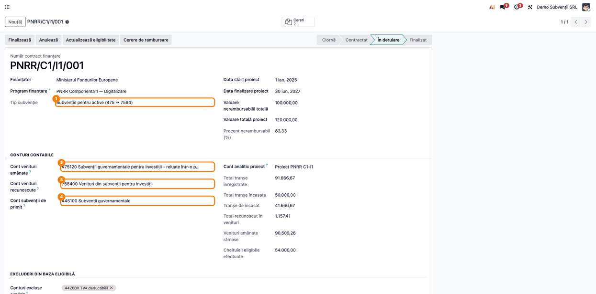
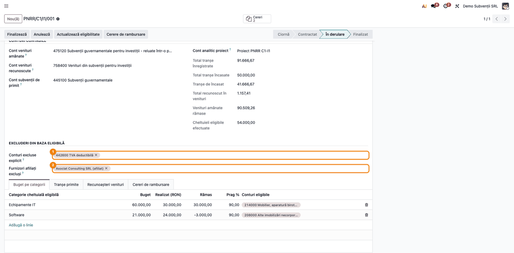
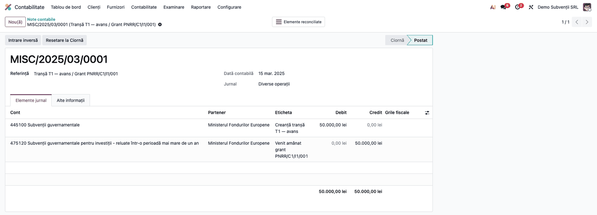
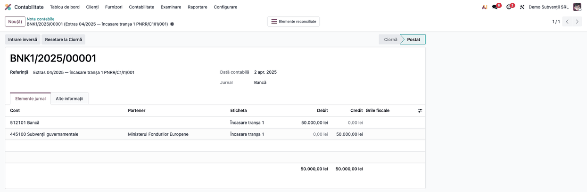
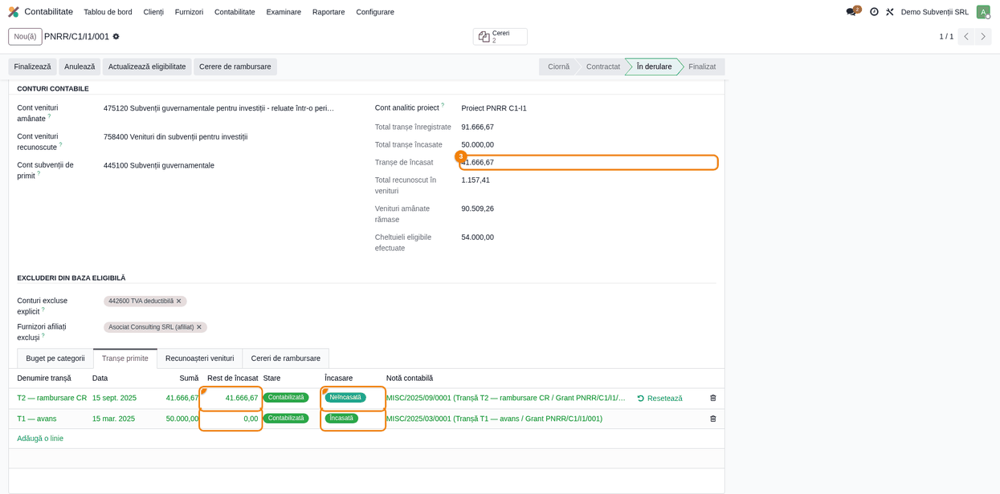
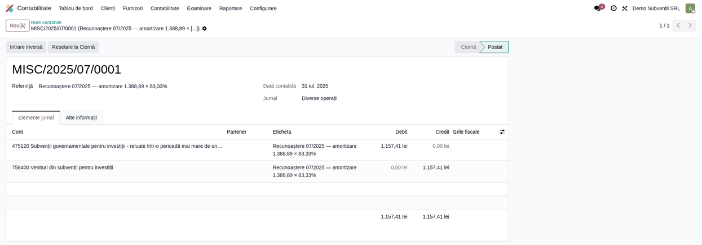
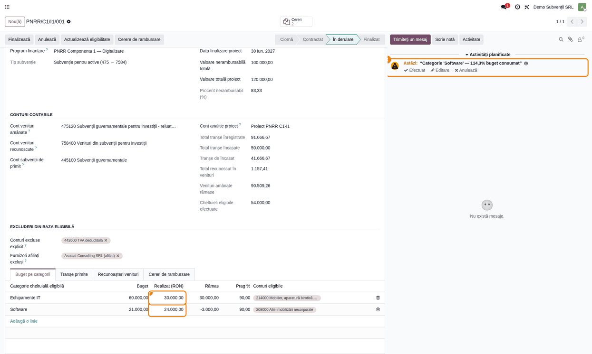
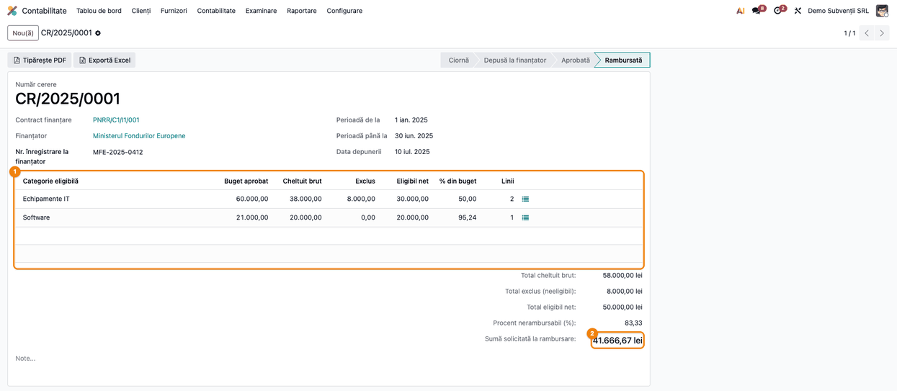
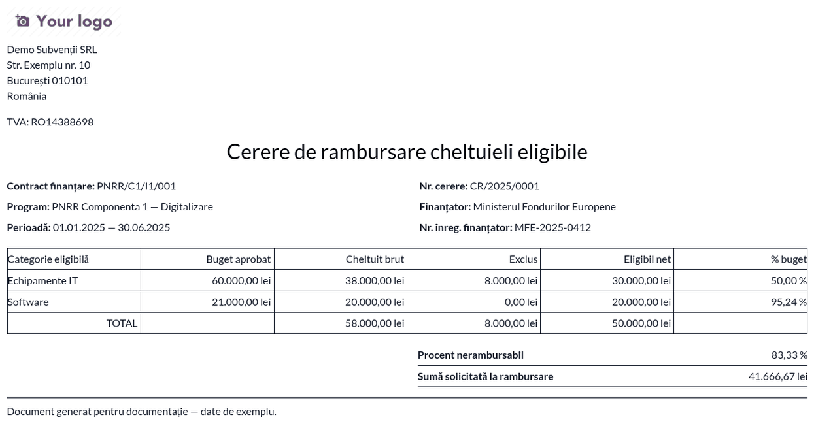
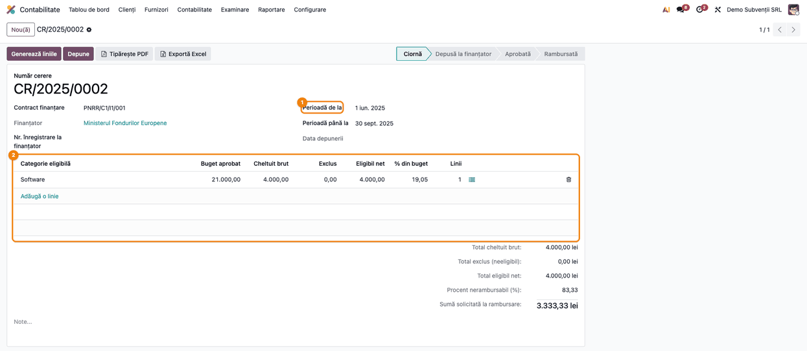

# Fișă Modul: Subvenții și Fonduri Nerambursabile (475/472, 4451)

**Modul:** `l10n_ro_grants`
**FR:** FR-38
**Capitol manual:** Cap 7 / Subvenții
**Utilizator principal:** Contabil, Responsabil proiecte finanțate
**Prioritate:** 🟡 Medie (proiecte PNRR/FEDR la firmele beneficiare, cu raportări periodice către finanțator)

---

## 1. Scop business

O firmă care primește o finanțare nerambursabilă (PNRR, fonduri structurale, Start-Up Nation)
trebuie să urmărească în paralel contractul, tranșele cuvenite și încasate, cheltuielile eligibile
pe categorii de buget, cererile de rambursare depuse la finanțator și trecerea treptată a subvenției
în venituri. Modulul ține toate acestea pe contractul de finanțare: completează conturile după tipul
subvenției, înregistrează tranșa ca subvenție de primit de la finanțator (4451), lasă încasarea să
vină din extrasul bancar, calculează cheltuielile eligibile din contabilitatea analitică a
proiectului și generează cererile de rambursare fără să ceară de două ori aceleași facturi.

## 2. Bază legală și context

- **OMFP 1802/2014, pct. 392–404** — subvențiile acordate de guvern, agenții guvernamentale și
  „instituții similare naționale și internaționale” (pct. 392 alin. (1)) se recunosc ca venituri amânate: pentru active pe **475** (venit 7584, pe măsura
  amortizării, pct. 399 alin. (1) și 402 alin. (2)), aferente veniturilor pe **472** (venit 741x,
  pe măsura cheltuielilor compensate, pct. 398–399).
- **OMFP 1802/2014, pct. 397 alin. (2) lit. b)** — subvenția de primit se recunoaște ca creanță
  (**445**) la data dreptului și se stinge la încasare. Funcțiunea contului 475 prevede creditarea
  prin 445.
- **Planul de conturi OMFP 1802** nu mai conține conturile 131/132 din planul vechi (OMFP 3055/2009).
- **Bilanț, secțiunea „Venituri în avans”** — sumele de reluat până la un an / peste un an se
  raportează separat; analiticele 47511/47512 și 4721/4722 din planul Odoo alimentează direct
  aceste rânduri.
- **Ghidurile apelurilor de finanțare** (PNRR, FEDR) stabilesc cheltuielile eligibile, excluderea
  TVA recuperabile și a furnizorilor afiliați; acestea sunt reguli de program, nu de contabilitate.

## 3. Utilizatori și roluri

| Rol | Ce face în modul | Grup necesar |
|---|---|---|
| Contabil șef / contabilul proiectului | creează contractul, înregistrează tranșele și recunoașterile, generează și depune cererile | Contabilitate / **Administrator** |
| Responsabil proiect, auditor intern | consultă contractul, bugetul, alertele și cererile | Contabilitate / Contabil (doar citire) |

Drepturile modulului: grupul **Administrator** contabilitate are citire, scriere, creare și ștergere
pe contracte, buget, tranșe, recunoașteri și cereri; grupul **Contabil** are doar citire. Utilizatorii
doar cu „Facturare” nu au acces la modul. Reconcilierea extrasului cu tranșa ține de drepturile
obișnuite din Contabilitate. La testare, folosiți un utilizator Administrator pentru tot fluxul și
unul Contabil ca să verificați că poate doar consulta.

## 4. Conturi și date implicate

| Cont | Denumire | Rol în flux |
|---|---|---|
| 4451 | Subvenții guvernamentale (de primit) | debitat la tranșă, creditat la încasare; trebuie să permită reconcilierea |
| 47512 / 47511 | Subvenții guvernamentale pentru investiții (peste / până la un an) | venit amânat pentru active |
| 4721 / 4722 | Venituri înregistrate în avans (până la / peste un an) | venit amânat pentru exploatare și dobânzi |
| 7584 | Venituri din subvenții pentru investiții | venitul subvenției pentru active |
| 7411–7419 | Venituri din subvenții de exploatare (7412–7417 după natura cheltuielii, 7418 pentru dobânzi; 7411 doar aferente cifrei de afaceri) | venitul subvenției de exploatare |
| 5121 | Conturi la bănci în lei | încasarea din extras |
| clasa 2 (ex. 208, 2131, 214), cu 404 | imobilizările finanțate, la subvenția pentru active | baza cererii de rambursare (conturile eligibile ale categoriilor) |
| clasa 6 (ex. 6xx), cu 401 | cheltuielile compensate, la subvenția de exploatare | baza cererii de rambursare |
| 4426 | TVA deductibilă | exclusă: TVA recuperabilă nu e cheltuială eligibilă (vezi Pasul 2) |

Date minime pentru demo (cele din capturi): finanțatorul *Ministerul Fondurilor Europene*, contul
analitic *Proiect PNRR C1-I1*, un contract de **subvenție pentru active** cu două categorii de buget
pe imobilizări (*Echipamente IT* pe 214, *Software* pe 208), un furnizor obișnuit și unul afiliat,
achiziții postate pe 214/208 față de 404 cu distribuție analitică pe proiect, un jurnal de bancă.

## 5. Configurare inițială

1. Instalați `l10n_ro_grants` pe o companie cu planul de conturi RO.
2. Pe contul **4451** bifați **Permite reconcilierea** (*Contabilitate → Configurare → Plan de
   conturi*). În planul RO vine nebifat; fără bifă, tranșa nu se poate contabiliza.
3. **Obligatoriu:** pe conturile **47511** și **47512** schimbați **Tipul** din „Alte venituri” în
   „Datorii Curente”, respectiv „Pasivele Imobilizate” (etichetele din interfața RO). În planul RO din Odoo ele vin cu tip de venit:
   altfel închiderea lunară le trece în 121, calculul impozitului pe profit le adună la venituri,
   iar contul de profit și pierdere arată tranșa ca venit. Verificați că 4721/4722 sunt de tip pasiv.
4. Creați contul analitic al proiectului și puneți-l pe liniile facturilor de cheltuieli ale
   proiectului (distribuție analitică 100%).
5. Creați finanțatorul ca partener (ex. *Ministerul Fondurilor Europene*).
6. Opțional: cronul **Recunoaștere lunară subvenții active (475→7584)** (*Setări → Tehnic → Acțiuni
   planificate*, în modul dezvoltator) este inactiv implicit. Activați-l doar dacă activele
   finanțate se amortizează liniar pe durata proiectului: cronul împarte **valoarea nerambursabilă a
   contractului** la lunile proiectului, nu la durata de amortizare și nu la tranșele înregistrate,
   deci poate recunoaște mai mult decât s-a înregistrat.

## 6. Flux de utilizare

### Pasul 1 — Contractul de finanțare și conturile lui

**Contabilitate → Raportare → Granturi → Contracte finanțare → Nou.** Completați numărul
contractului, finanțatorul, programul, **tipul subvenției**, perioada, valoarea nerambursabilă și
valoarea proiectului. La alegerea tipului, secțiunea **Conturi contabile** se completează singură:

| Tip | Venituri amânate | Venit recunoscut | Subvenții de primit |
|---|---|---|---|
| Active | 47512 | 7584 | 4451 |
| Exploatare | 4721 | se alege 741x după natura cheltuielii | 4451 |
| Dobânzi | 4721 | 7418 | 4451 |
| Mixtă | se completează manual (avertisment) | se completează manual | 4451 |

Schimbarea tipului înlocuiește conturile de venituri amânate și recunoscute; contul 4451 ales manual
rămâne. Procentul nerambursabil se calculează din cele două valori. Apăsați **Aprobă**, apoi
**Activează**: contractul trece prin *Ciornă → Contractat → În derulare*.



### Pasul 2 — Bugetul pe categorii și excluderile din baza eligibilă

Pe fila **Buget pe categorii** adăugați categoriile eligibile, cu bugetul aprobat, conturile eligibile
urmărite (imobilizări la subvenția pentru active, cheltuieli la cea de exploatare) și pragul de alertă
(coloana **Prag %**, implicit 90%). În grupul **Excluderi din baza
eligibilă** treceți, o singură dată, conturile neeligibile și furnizorii afiliați / părțile legate.
Excluderile se aplică automat la fiecare cerere de rambursare, **doar** pe liniile care intră deja în
calcul: cele de pe conturile eligibile ale categoriei, cu distribuția analitică a proiectului. Un
furnizor afiliat pe un cont eligibil apare deci pe coloana *Exclus*. TVA-ul (4426) nu e cont eligibil
al categoriei, deci rămâne oricum în afara bazei; trecut la excluderi, el apare pe coloana *Exclus*
numai dacă a fost adăugat voit printre conturile eligibile ale unei categorii.



### Pasul 3 — Tranșa: subvenția de primit de la finanțator

Pe fila **Tranșe primite** adăugați o linie cu denumirea, **data înregistrării** (data dreptului:
semnarea contractului, aprobarea cererii de rambursare sau notificarea finanțatorului) și suma.
Apăsați **Contabilizează** (bifa). Modulul postează în jurnalul de operații diverse nota
**Dr 4451 = Cr 475x/472**, cu finanțatorul ca partener pe ambele linii. Nota se deschide din câmpul
**Notă contabilă** al tranșei.



### Pasul 4 — Încasarea din extrasul bancar

Când banii intră în cont, din **Contabilitate → Tablou de bord**, pe cardul jurnalului de bancă,
deschideți linia de extras a finanțatorului și potriviți-o cu linia 4451 deschisă a tranșei (filtrați
după partenerul finanțator). Încasarea se înregistrează o singură dată, din extras:
**Dr 5121 = Cr 4451**, reconciliată cu tranșa. Nu înregistrați separat încasarea pe tranșă.



Pe contract, fila **Tranșe primite** arată pentru fiecare tranșă **Încasare** (*Neîncasată*,
*Încasată parțial*, *Încasată*) și **Rest de încasat**. În grupul **Conturi contabile**, coloana din
dreapta, **Total tranșe înregistrate**, **Total tranșe încasate** și **Tranșe de încasat** se
actualizează din reconciliere. În demo, avansul T1 e încasat, iar T2 — tranșa de rambursare
corespunzătoare cererii rambursate — e încă de încasat. Dacă programul recuperează avansul din
cererile de rambursare, tranșa de rambursare se înregistrează la suma aprobată minus avansul
recuperat; o diferență aprobată mai mică se regularizează (vezi monografia).

O tranșă **neîncasată** contabilizată greșit se corectează cu butonul **Resetează** de pe linia ei:
nota se anulează, tranșa revine în ciornă și iese din totaluri. Butonul nu apare pe tranșele încasate
sau încasate parțial: acolo anulați întâi reconcilierea cu extrasul. Nu stornați nota tranșei cu
„Intrare inversă”: stornarea reconciliază linia 4451, iar tranșa ar apărea „Încasată” și ar rămâne
numărată în totaluri.



### Pasul 5 — Recunoașterea venitului din subvenție

Pe fila **Recunoașteri venituri** adăugați descrierea, data și suma și apăsați **Contabilizează**.
Nota este **Dr 475x = Cr 7584** la active, respectiv **Dr 472 = Cr 741x/7418** la exploatare și
dobânzi. Câmpul **Venituri amânate rămase** scade cu aceeași sumă. La subvențiile pentru active,
suma lunară = amortizarea lunii a activelor finanțate × procentul finanțat, începând cu luna
următoare punerii în funcțiune. În demo, activele finanțate (50.000 lei, fără achiziția afiliatului)
sunt puse în funcțiune în iunie 2025 și se amortizează în 36 de luni: pentru iulie 2025,
1.388,89 lei × 83,33% = **1.157,41 lei**. Contractul are un singur cont de venit: o subvenție de exploatare care compensează
cheltuieli de naturi diferite (materiale 7412, servicii 7413, personal 7414) se împarte pe contracte
distincte sau se recunoaște manual, pe conturile potrivite.



### Pasul 6 — Eligibilitatea cheltuielilor și alerta de prag

Apăsați **Actualizează eligibilitate** în antetul contractului.

1. **Găsiți pe ecran** — pe fila **Buget pe categorii**, coloana **Realizat (RON)** arată, pe
   fiecare categorie, cheltuielile postate pe conturile eligibile, cu distribuție analitică pe
   proiect, în perioada contractului, fără excluderi; **Rămas** = aprobat − realizat.
2. **Verificați** — realizatul unei categorii corespunde achizițiilor proiectului de pe conturile ei,
   fără cele ale furnizorului afiliat (în demo, *Echipamente IT* = 30.000 lei, fără cei 8.000 ai
   afiliatului); categoriile peste prag au **o singură** activitate de avertizare în chatter-ul
   contractului (în demo, „Categorie 'Software' — 114,3% buget consumat”).
3. **Continuați** — la un nou recalcul, aceeași activitate primește procentul curent. O activitate
   marcată ca terminată nu se recreează cât timp procentul rămâne același, iar alerta deschisă
   dispare când consumul scade sub prag.



### Pasul 7 — Cererea de rambursare

Apăsați **Cerere de rambursare** în antetul contractului (sau *Contabilitate → Raportare → Granturi →
Cereri de rambursare → Nou*). Perioada propusă începe după ultima cerere nerespinsă a contractului.
Apăsați **Generează liniile**.

1. **Găsiți pe ecran** — fiecare linie este o categorie de buget cu **Eligibil net**, **Exclus**
   (totalul de jos: *Total exclus (neeligibil)*), **Cheltuit brut** și **% din buget**; coloana **Linii** arată câte note contabile
   intră în linie, iar butonul de pe linie le deschide. Jos: totalurile și **Suma solicitată la
   rambursare** = total eligibil net × procentul nerambursabil.
2. **Verificați** — achizițiile furnizorului afiliat sunt pe coloana *Exclus* (în demo, 8.000 lei
   la *Echipamente IT*); notele deschise din butonul **Linii** sunt doar ale perioadei; nicio notă nu
   apare într-o altă cerere depusă. Lăsați sumele cum le generează modulul: liniile sunt editabile în
   ciornă, dar o sumă modificată manual nu mai corespunde notelor contabile din spate.
3. **Continuați** — **Depune** (blocat dacă vreo cheltuială e deja într-o altă cerere depusă),
   apoi **Aprobă** și **Marchează rambursată** (sau **Respinge**). Readucerea în ciornă e
   permisă doar din *Depusă la finanțator* sau *Respinsă*. Stările cererii sunt documentare: banii
   rambursați se înregistrează ca tranșă (Pasul 3) și se urmăresc pe 4451 până la încasare.



Pentru dosarul depus la finanțator folosiți **Tipărește PDF** sau **Exportă Excel**. Documentul arată
contractul, perioada, liniile pe categorii și suma solicitată.



### Pasul 8 — Cererea următoare, fără dublă decontare

Creați o nouă cerere pentru același contract. Perioada propusă începe după ultima cerere
nerespinsă; o puteți lărgi, de exemplu pentru o factură înregistrată cu dată în urmă. Cheltuielile
incluse deja într-o cerere depusă, aprobată sau rambursată nu se mai cer, chiar dacă perioadele se
suprapun. În demo, cererea a doua începe la 1 iunie 2025, în perioada primei cereri: achizițiile din
iunie nu mai apar, intră doar software-ul din august (4.000 lei). Cheltuielile unei cereri respinse se
eliberează și pot fi cerute din nou.



### Note de monografie și raportare

| Operațiune | Debit | Credit | Generată de |
|---|---|---|---|
| Tranșă subvenție pentru active | 4451 (partener finanțator) | 47512 | tranșa (Pasul 3) |
| Tranșă subvenție de exploatare / dobânzi | 4451 (partener finanțator) | 4721 | tranșa (Pasul 3) |
| Încasarea tranșei | 5121 | 4451 (reconciliat cu tranșa) | extrasul bancar (Pasul 4) |
| Recunoaștere venit — active | 47512 | 7584 | recunoașterea (Pasul 5) sau cronul lunar |
| Recunoaștere venit — exploatare | 4721 | 741x | recunoașterea (Pasul 5) |
| Recunoaștere venit — dobânzi | 4721 | 7418 | recunoașterea (Pasul 5) |
| Regularizare sumă neaprobată de finanțator | 475x / 472 | 4451 | manual (pct. 397 alin. (2) lit. b)) |
| Restituire subvenție | 475x / 472 (diferența pe cheltuieli) | 462 / 5121 | manual (pct. 404) |
| Cerere de rambursare | — | — | document justificativ, fără notă contabilă |

În bilanț, soldul 4451 este subvenția aprobată și neîncasată; 475 și 472 apar la „Venituri în
avans”. Tranșele contabilizate înainte de versiunea 19.0.1.4.0 (`Dr 5121 = Cr 475`) rămân neschimbate
și sunt considerate încasate.

## 7. Legături cu alte module / declarații

| Modul | Rol |
|---|---|
| `account` | note contabile, reconcilierea extrasului cu tranșa |
| `analytic` | distribuția analitică pe proiect, baza calculului de eligibilitate |
| `l10n_ro` | planul de conturi RO (4451, 475x, 472x, 7584, 741x) |
| `l10n_ro_anaf_base` | descărcarea documentelor (PDF/XLSX ale cererii) |
| `l10n_ro_fixed_assets` | amortizarea activelor finanțate, după care se dimensionează recunoașterea (legătură procedurală, nu integrare) |

**Ce e automat:** conturile după tipul subvenției; nota tranșei; starea încasării din reconciliere;
realizatul pe categorii; alerta de prag (una pe categorie); liniile cererii, cu excluderile și fără
cheltuielile decontate deja; perioada următoarei cereri; recunoașterea lunară liniară (dacă e
activat cronul).

**Ce rămâne manual:** reconcilierea extrasului cu tranșa; tipul de pasiv pe 47511/47512;
regularizarea sumelor neaprobate și restituirile; suma recunoașterii corelată cu
amortizarea; contul 741x la exploatare; separarea părții pentru active de cea de exploatare la
tipul *Mixtă*; depunerea dosarului la finanțator.

## 8. Verificări pentru consultant

- [ ] Contul 4451 are bifat „Permite reconcilierea”.
- [ ] Conturile 47511/47512 au tipul „Datorii Curente” / „Pasivele Imobilizate” (nu „Alte venituri”);
      închiderea lunară nu le trece în 121.
- [ ] La alegerea tipului, contractul primește 47512/7584 (active), 4721/— (exploatare),
      4721/7418 (dobânzi) și 4451; la *Mixtă* apare avertismentul.
- [ ] Nota tranșei este Dr 4451 = Cr 475x/472, cu finanțatorul ca partener pe ambele linii.
- [ ] Încasarea din extras e reconciliată cu tranșa; nu există note directe Dr 5121 = Cr 475.
- [ ] Tranșa reconciliată apare „Încasată”; „Total tranșe încasate” + „Tranșe de încasat” =
      „Total tranșe înregistrate”.
- [ ] Recunoașterea scade „Venituri amânate rămase” cu aceeași sumă; totalul recunoscut nu
      depășește totalul tranșelor înregistrate.
- [ ] Realizatul pe categorii corespunde achizițiilor proiectului de pe conturile eligibile, fără
      furnizorii afiliați.
- [ ] La recalcule repetate există o singură activitate de alertă pe categorie, cu procentul curent.
- [ ] În cerere, sumele excluse sunt pe coloana „Exclus”; suma solicitată = eligibil net ×
      procent nerambursabil.
- [ ] O a doua cerere cu perioadă suprapusă nu mai conține notele unei cereri depuse/rambursate.
- [ ] Cererea de rambursare nu a generat note contabile.

## 9. Mesaje de eroare frecvente

| Mesaj | Cauză | Remediere |
|---|---|---|
| „Configurați conturile 'Venituri amânate' și 'Subvenții de primit' pe grant …” | contractul nu are contul amânat sau 4451 | completați conturile (sau realegeți tipul subvenției) |
| „Contul … trebuie să permită reconcilierea …” | 4451 fără „Permite reconcilierea” | bifați opțiunea pe cont |
| „… linii contabile din această cerere sunt incluse deja în cererea (cererile) …” | două cereri au prins aceleași facturi | regenerați liniile cererii înainte de depunere |
| „Tranșa '…' este deja încasată. Anulați întâi reconcilierea cu extrasul bancar.” | resetarea unei tranșe încasate, la import sau din operații automate (butonul **Resetează** nu apare pe tranșele încasate) | anulați reconcilierea, apoi resetați |
| „Doar cererile depuse sau respinse pot fi readuse în ciornă.” | cererea e aprobată sau rambursată | nu se modifică; faceți o cerere nouă |
| „Generați liniile cererii înainte de depunere.” | cerere fără linii | apăsați „Generează liniile” |
| „Configurați conturile 'Venituri amânate' și 'Venituri recunoscute' pe grant.” | recunoaștere pe un contract fără cont de venit (ex. exploatare, unde 741x se alege manual) | alegeți contul 741x potrivit |
| „Liniile pot fi regenerate doar pe o cerere în ciornă.” | cererea e depusă, aprobată sau rambursată | readuceți-o în ciornă (din Depusă sau Respinsă) sau faceți o cerere nouă |
| Realizat 0 pe categorie | facturile nu au distribuție analitică pe proiect sau sunt în afara perioadei | puneți contul analitic pe liniile facturilor; verificați perioada |
| Coloana „Exclus” goală | furnizorul afiliat nu e în excluderile contractului (TVA-ul 4426 apare acolo doar dacă e cont eligibil al categoriei) | completați excluderile |

## 10. Capturi de ecran

Capturile sunt generate automat de `tests/test_screenshots.py` (mixinul `ScreenshotCase` din
`l10n_ro_doc_screenshots`, import defensiv), în limba română, pe planul de conturi RO:

```bash
./odoo/odoo-bin -c odoo.conf -d <db> -i l10n_ro_grants,l10n_ro_doc_screenshots --test-tags=fise_screenshots --stop-after-init
```

| # | Fișier | Conținut |
|---|---|---|
| 1 | `static/description/01_contract_conturi.png` | Contract în derulare cu conturile completate după tip (47512 / 7584 / 4451) și totalurile |
| 2 | `static/description/02_excludere.png` | Excluderi din baza eligibilă: 4426 și furnizorul afiliat; categoriile pe 214 și 208 |
| 3 | `static/description/03_transa_nota_contabila.png` | Nota tranșei Dr 4451 = Cr 475, finanțatorul ca partener |
| 4 | `static/description/04_extras_incasare.png` | Nota încasării în jurnalul de bancă: Dr 5121 = Cr 4451, reconciliată cu tranșa |
| 5 | `static/description/05_transe_incasare.png` | Fila Tranșe primite: avansul încasat, tranșa de rambursare neîncasată (cu butonul Resetează), rest de încasat |
| 6 | `static/description/06_recunoastere_venit.png` | Nota de recunoaștere pentru iulie 2025: Dr 475 = Cr 7584, 1.157,41 lei |
| 7 | `static/description/07_buget_alerta.png` | Buget pe categorii cu realizat și alerta de prag unică, în chatter |
| 8 | `static/description/08_cerere_rambursare.png` | Cerere de rambursare: eligibil net / exclus / brut, linii contabile, suma solicitată |
| 9 | `static/description/09_cerere_pdf.png` | Cererea de rambursare tipărită (PDF) |
| 10 | `static/description/10_cerere_urmatoare.png` | Cererea următoare, cu perioadă suprapusă: doar achiziția nouă din august |

## 11. Observații pentru manual

- Tranșa înseamnă **dreptul** la bani, nu încasarea: banii intră o singură dată, din extras. Acesta
  e mesajul cel mai important pentru utilizatorii obișnuiți să înregistreze încasarea direct.
- La subvențiile pentru active, venitul se recunoaște **în ritmul amortizării** activelor finanțate
  (OMFP 1802 pct. 399 alin. (1)). Cronul lunar liniar (total / luni de proiect) este o aproximare,
  corectă doar când activele se amortizează liniar pe durata proiectului; altfel recunoașterile se
  introduc manual, după planul de amortizare.
- Tipul conturilor 47511/47512 din planul Odoo trebuie corectat la pasiv înainte de prima tranșă
  (secțiunea 5); altfel subvenția amânată ajunge în rezultat la închidere.
- La exploatare, contul de venit 741x se alege după natura cheltuielii compensate; 7411 este doar
  pentru subvențiile aferente cifrei de afaceri.
- Tipul *Mixtă* nu are un set de conturi corect pentru ambele componente: recomandați contracte
  separate pentru partea de active și cea de exploatare.
- Lista de excluderi (TVA recuperabilă, furnizori afiliați) vine din ghidul apelului de finanțare;
  confirmați-o cu clientul pentru fiecare program.
