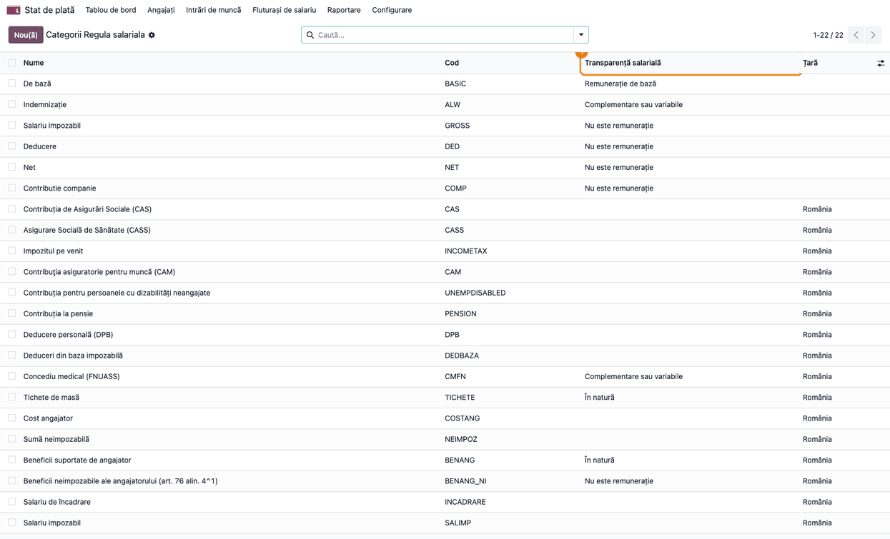
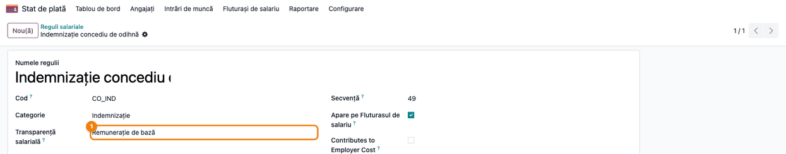
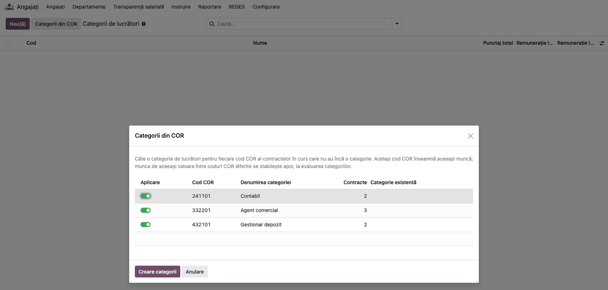
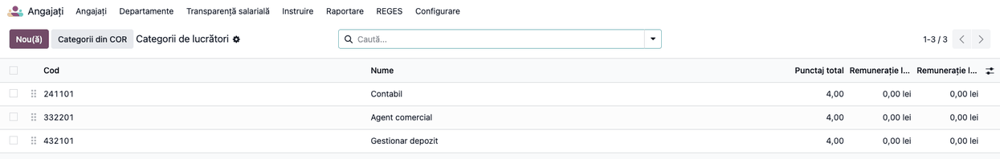
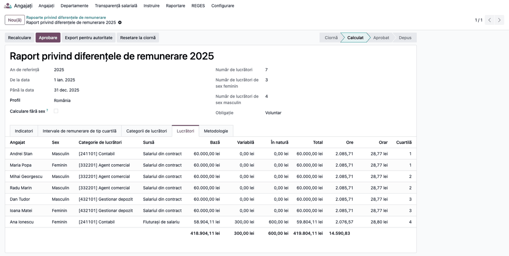

# Fișă Modul: Transparență salarială - salarizarea RO

**Modul:** `l10n_ro_hr_pay_transparency`
**Utilizator principal:** Responsabil salarizare / HR
**Prioritate:** 🔴 Ridicată (primul raport privind diferențele de remunerare se depune până la 7 iunie 2027, pe datele din 2026, pentru angajatorii cu cel puțin 150 de lucrători)

---

## 1. Scop business

Modulul de transparență salarială (`deltatech_hr_pay_transparency`, cu puntea de salarizare `deltatech_hr_pay_transparency_payroll`) calculează raportul privind diferențele de remunerare și răspunsurile la cererile lucrătorilor din fluturașii validați. Ca cifrele să fie corecte pe salarizarea românească, fiecare regulă salarială RO trebuie să intre în raport o singură dată, cu componenta potrivită: remunerație de bază, componentă complementară sau variabilă, remunerație în natură, sau deloc. Modulul acesta face maparea pentru regulile din l10n_ro_ent și propune categoriile de lucrători din codul COR de pe contracte.

## 2. Bază legală și context

- **Directiva (UE) 2023/970**, art. 3 alin. (1) lit. (a): remunerația este salariul de bază plus orice alt avantaj, în bani sau în natură, primit direct sau indirect (componente complementare sau variabile). Considerentul 21 dă exemple: prime, ore suplimentare, facilități de transport, indemnizații de locuință și de masă, indemnizația de boală prevăzută de lege, pensiile ocupaționale.
- **Art. 3 alin. (1) lit. (h) și art. 4:** categoria de lucrători grupează aceeași muncă sau munca de aceeași valoare, după criterii obiective (competențe, efort, responsabilitate, condiții de muncă).
- **Transpunerea în România:** termenul de transpunere (7 iunie 2026) a trecut, iar legea nu era adoptată la 11.10.2026 (proiectul L445/2026, de verificat la publicare). Modulul nu depinde de textul final: maparea urmează directiva.
- **Clasificarea ocupațiilor din România (COR):** codul COR din contract (REGES) identifică ocupația. Gruparea pe cod COR este o propunere de pornire a modulului, nu o regulă a directivei.

## 3. Utilizatori și roluri

| Rol | Ce face |
|---|---|
| Administrator salarizare (*Stat de plată / Administrator*) | Verifică și, la nevoie, schimbă maparea regulilor și a categoriilor salariale |
| Administrator transparență salarială (*Transparență salarială / Administrator*) cu *Angajați / Administrator* | Rulează asistentul *Categorii din COR* și evaluează categoriile |

## 4. Conturi și date implicate

Modulul nu generează note contabile și nu schimbă calculul fluturașului: spune doar raportului de transparență ce înseamnă fiecare linie de fluturaș.

| Regulă / categorie (cod) | Componentă în raport | De ce |
|---|---|---|
| `BASIC` (salariul zilelor lucrate), `CO_IND` (indemnizația de concediu de odihnă) | Remunerație de bază | Indemnizația de CO înlocuiește salariul zilelor de concediu; altfel salariații cu concediu ar avea „variabil” mai mare |
| Sporuri (`SPORPERM`, `SPOR_ORE_SUPL`, `SPOR_NOAPTE`, `SPOR_SARBATOARE`, `SPOR_REPAUS`), prime (`PRIMA`, `PRIMA_NET`), compensarea CO la încetare (`CO_COMP`) | Complementare sau variabile | Din categoria *Indemnizație* |
| Concediu medical plătit de angajator (`CM_FS`) și din FNUASS (categoria `CMFN`) | Complementare sau variabile | Indemnizația de boală prevăzută de lege (considerentul 21) |
| Categoria `TICHETE` (tichete de masă `TICHETE`, vouchere de vacanță `VOUCHER_VAC`) | În natură | Avantaje în natură |
| Categoria `BENANG` (pensie facultativă `PENS_ANG`, pensie ocupațională `POCUP_ANG`, asigurare de sănătate `SAN_ANG`, tichete cadou `CADOU`) | În natură | Totalul plătit de angajator, numărat o singură dată |
| Categoria `BENANG_NI` (partea neimpozabilă) și regulile `AVANTAJ_ANG`, `AVANTAJ_ANG_DED`, `CADOU_IMP`, `CADOU_IMP_DED` | Nu este remunerație | Sunt părți ale totalului de mai sus: numărate, l-ar dubla |
| `REIMBURSEMENT`, `DIURNA_IMP`, `DIURNA_NEIMP` | Nu este remunerație | Rambursări de cheltuieli |
| `INCADRARE`, `SALIMP`, `NEIMPOZ`, `COSTANG`, `DPB`, `DEDBAZA`, `GROSS`, `NET`, contribuțiile și impozitul, avansul, reținerile | Nu este remunerație | Baze de calcul, totaluri, contribuții, decontări |

Date minime pentru demo: angajați cu cod COR pe contract (de exemplu 241101 *Contabil*, 332201 *Agent comercial*, 432101 *Gestionar depozit*), fără categorie de lucrători.

## 5. Configurare inițială

1. Instalați modulul pe o bază cu salarizarea RO și REGES. La instalare, categoriile și regulile salariale RO primesc componenta lor, doar dacă nu aveau deja una.
2. **Stat de plată → Configurare → Salariu → Categorii de reguli**: verificați coloana *Transparență salarială*. O celulă goală înseamnă „ca categoria-părinte”; o categorie goală fără părinte nu este remunerație (contribuții, baze de calcul).

   

3. **Stat de plată → Configurare → Salariu → Reguli**: pe o regulă care trebuie să conteze altfel decât categoria ei, completați *Transparență salarială*. Modulul a făcut-o deja pentru indemnizația de concediu de odihnă (`CO_IND`, din *Indemnizație* devine *Remunerație de bază*), pentru rambursări, diurnă și excedentul beneficiilor.

   

4. Configurați modulul de bază după fișa lui (profilul *România*, responsabilul, criteriile de evaluare).

## 6. Flux de utilizare

### Pasul 1 — Categorii de lucrători din COR

**Angajați → Configurare → Transparență salarială → Categorii din COR** (sau butonul **Categorii din COR** din lista *Categorii de lucrători*). Asistentul strânge contractele în curs care au cod COR și nu au încă o categorie de lucrători și le grupează pe cod.

**Găsiți pe ecran:** pe fiecare rând, codul COR, denumirea categoriei (denumirea ocupației din nomenclatorul REGES, sau „COR” și codul, dacă ocupația nu e în nomenclator), numărul de contracte și categoria existentă cu același cod, dacă există.

**Verificați:** numărul de contracte pe fiecare cod corespunde angajaților cu acea ocupație; denumirile sunt cele pe care le vreți în rapoarte (se pot schimba aici). Debifați codurile pe care nu le vreți ca categorii separate, apoi apăsați **Creare categorii**.



### Pasul 2 — Categoriile create

Odoo creează câte o categorie pe cod COR (codul categoriei = codul COR), cu toate criteriile de evaluare active la punctajul 1, și o completează pe contracte. O funcție primește categoria doar dacă toate contractele ei au același cod COR. Dacă există deja o categorie cu același cod, contractele se adaugă la ea.

**Verificați:** numărul de contracte din asistent (pasul 1) corespunde celor din categorie (tabul *Funcții* al categoriei și, pe fișa angajatului, câmpul *Categorie de lucrători*); o funcție cu ocupații diferite rămâne fără categorie (categoria stă pe contracte). Intervalul de remunerare (coloanele cu 0,00 lei) se completează la pasul 3.



### Pasul 3 — Evaluarea și munca de aceeași valoare

Deschideți fiecare categorie și dați punctaj pe criterii (tabul *Evaluare (art. 4)*), intervalul de remunerare și criteriile de remunerare, ca în fișa modulului de bază. Categoriile cu muncă de aceeași valoare (coduri COR diferite, același punctaj) se unesc manual: mutați contractele pe o singură categorie și arhivați-o pe cealaltă. Invers, aceeași ocupație COR cu niveluri diferite de responsabilitate (de exemplu junior și coordonator) se împarte manual în categorii separate, evaluate fiecare.

### Pasul 4 — Raportul și cererile

Raportul privind diferențele de remunerare și răspunsurile la cererile de informații (fluxul din fișa modulului de bază) iau sumele din fluturașii validați, cu maparea de mai sus.

**Găsiți pe ecran:** pe tabul *Lucrători* al raportului, coloana *Sursă* arată *Fluturași de salariu* pentru angajații cu fluturași validați în anul de referință (și *Salariul din contract* pentru ceilalți), iar coloanele *Bază*, *Variabilă* și *În natură* arată sumele pe componente.

**Verificați:** la angajatul din exemplu (secțiunea 8), *Bază* include indemnizația de CO, *În natură* include tichetele și pensia facultativă o singură dată, iar rambursarea nu apare.



### Note de monografie și raportare

Modulul nu generează note contabile și nu schimbă fluturașul: numai raportul de transparență salarială citește liniile fluturașului după componenta lor.

## 7. Legături cu alte module / declarații

| Modul | Rol |
|---|---|
| `deltatech_hr_pay_transparency` | Raportul, cererile, categoriile de lucrători |
| `deltatech_hr_pay_transparency_payroll` | Citirea fluturașilor validați pe componente |
| `l10n_ro_hr_payroll_enhancement` | Regulile RO: CO, CM, tichete, beneficii, prime |
| `l10n_ro_payroll_allowances` | Sporurile |
| `l10n_ro_reges` | Codul COR pe contract și nomenclatorul COR |
| `l10n_ro_expense_allowance_payroll` (opțional) | Diurna, mapată automat ca *Nu este remunerație* la instalare |

**Ce e automat:** maparea regulilor și a categoriilor RO la instalare și pe cele create ulterior; propunerea categoriilor din COR. **Ce rămâne manual:** schimbarea mapării pentru regulile proprii ale firmei, evaluarea categoriilor și unirea celor de aceeași valoare.

## 8. Verificări pentru consultant

- [ ] Pe *Categorii de reguli*: *Tichete de masă* și *Beneficii suportate de angajator* = *În natură*; *Beneficii neimpozabile ale angajatorului* = *Nu este remunerație*; *Concediu medical (FNUASS)* = *Complementare sau variabile*.
- [ ] Regula `CO_IND` = *Remunerație de bază*; `REIMBURSEMENT`, `AVANTAJ_ANG` și `CADOU_IMP` = *Nu este remunerație*.
- [ ] Un fluturaș cu salariu de bază 3.000, CO 1.000, spor 300, tichete 400, pensie facultativă 200 (din care 150 neimpozabilă și 50 avantaj impozabil `AVANTAJ_ANG`) și rambursare 80 dă în raport: bază 4.000, variabil 300, în natură 600 (400 + 200; avantajul nu se numără a doua oară).
- [ ] O mapare schimbată de mână rămâne după actualizarea modulului.
- [ ] Asistentul *Categorii din COR* nu mai propune nimic după aplicare (toate contractele cu COR au categorie).
- [ ] O funcție cu contracte pe două coduri COR rămâne fără categorie.

## 9. Mesaje de eroare frecvente

| Mesaj | Cauză | Remediere |
|---|---|---|
| Asistentul *Categorii din COR* e gol | Contractele nu au cod COR, au deja categorie sau sunt pe altă companie decât cea curentă | Completați codul COR pe contract (REGES) sau treceți pe compania contractelor |
| Categoria apare ca „COR 123456” | Codul nu e în nomenclatorul COR | Sincronizați nomenclatorul din REGES sau schimbați denumirea în asistent |
| În raport, *Fără categorie* | Contracte fără cod COR și fără categorie pe funcție | Completați categoria pe funcție sau pe contract |

## 10. Capturi de ecran

Capturile sunt **generate automat** din `tests/test_screenshots.py` (mixinul `ScreenshotCase` din `l10n_ro_doc_screenshots`), în limba română, și se scriu în `static/description/`:

| Fișier | Ce arată |
|---|---|
| `01_categorii_reguli.png` | Categoriile de reguli salariale cu componenta lor |
| `02_regula_co_ind.png` | Regula `CO_IND` ca remunerație de bază |
| `03_asistent_cor.png` | Asistentul *Categorii din COR* |
| `04_categorii_create.png` | Categoriile create din COR |
| `05_raport_lucratori.png` | Raportul: tabul *Lucrători*, cu sumele din fluturași pe componente |

Regenerare:

```bash
./odoo/odoo-bin -c odoo.conf -d <db> -i l10n_ro_hr_pay_transparency,l10n_ro_doc_screenshots --test-tags=fise_screenshots/l10n_ro_hr_pay_transparency --stop-after-init
```

## 11. Observații pentru manual

- Explicați de ce beneficiile apar o singură dată: salarizarea RO le împarte în total, parte neimpozabilă și excedent impozabil, iar raportul numără doar totalul.
- Tichetele de masă intră în natură, conform directivei. Dacă legea română sau ghidul Comisiei permit excluderea beneficiilor acordate tuturor, se schimbă maparea categoriei, fără cod.
- Codul COR dă o primă grupare pe *aceeași muncă*; *munca de aceeași valoare* și împărțirea pe niveluri rămân decizii ale angajatorului, pe criterii.
- Excedentul impozabil de diurnă (`DIURNA_IMP`) e tratat ca rambursare de cheltuieli, nu ca remunerație: e o alegere a modulului; fiscal excedentul e venit salarial, iar maparea regulii se poate schimba fără cod.
- Indemnizația de concediu de odihnă (`CO_IND`) intră integral la bază, deși include și media sporurilor permanente: o mică parte din sporuri apare astfel ca remunerație de bază în lunile cu concediu.
