# Fișă Modul: Salarizare RO — Impozit corect, deduceri personale, tichete și beneficii acordate salariaților

**Modul:** `l10n_ro_hr_payroll_enhancement`
**Utilizator principal:** Inspector resurse umane/salarizare, Contabil salarii
**Prioritate:** 🔴 Ridicată (corectitudine fiscală a statului de plată)

---

## 1. Scop business

Modulul **corectează calculul impozitului pe salarii** din structura nativă Odoo Enterprise și completează
statul de plată cu regulile fiscale care lipsesc în nativ:

- impozitul se calculează pe baza corectă (`brut + tichete − suma neimpozabilă − CAS − CASS − deduceri`), nu ca 10% din brut;
- **suma neimpozabilă** acordată la salariul minim (300 lei ian.–iun. 2026, 200 lei din 01.07.2026);
- CAS, CASS și CAM se rețin rotunjite la leu, iar **baza impozabilă** se rotunjește la leu prin neglijarea fracțiunilor
  de până la 50 de bani inclusiv (HG 1/2016, pct. 4 la art. 64); impozitul se rotunjește la leu cu jumătățile în sus
  (bază 6.085 → impozit 609);
- **deducerea personală de bază** pe grila oficială (tranșe de 50 lei), cu salariul minim versionat în timp, acordată în
  limita venitului impozabil al lunii (art. 77 alin. 2): întâi deducerea de bază, apoi cea pentru tineri și pentru copii;
- **persoane în întreținere** cu CNP și perioade, inclusiv deducerea de 100 lei pe lună pentru fiecare copil
  înscris în învățământ;
- **deducere suplimentară pentru angajații sub 26 de ani**;
- bifa **Funcție de bază** și **scutirea de impozit** pentru handicap și cercetare-dezvoltare (art. 60);
- **tichete de masă** incluse corect în CASS și în venitul pentru deducere;
- **rețineri deductibile** (cotizație sindicală, pensie facultativă), **avertizări** pe fluturaș și un **simulator brut/net**;
- **concedii medicale**: certificat cu baza de calcul și indemnizațiile, continuări, fișă de calcul, decontare FNUASS, fila din D112 și monografia 4382/423;
- **concediul de odihnă pe media** ultimelor 3 luni și compensarea concediului neefectuat la încetarea contractului;
- **tichete și beneficii acordate salariaților**: tichete cadou și cadouri în natură cu plafon pe ocazie, vouchere de vacanță, tichete de creșă și culturale,
  beneficiile din art. 76 alin. (4^1) (clauză de mobilitate, hrană, cazare, servicii turistice, pensii, asigurare de sănătate, abonament sport, educație timpurie)
  cu plafonul comun de 33%, avantaje în natură și autoturismul folosit în scop personal, ajutoare și transport la locul de muncă.

Rezultatul: net și impozit corecte pe fluturaș, transferate în D112 prin puntea `l10n_ro_anaf_d112_payroll` (tichete, suma neimpozabilă, deducerile și scutirea art. 60; Pasul 9).

## 2. Bază legală și context

Legea 227/2015 (Codul fiscal): **art. 78** (impozitul lunar pe salarii), **art. 77** (deducerea personală de
bază: grila pe venit și persoane în întreținere; deducerea pentru copii; deducerea pentru tineri) și **art. 60**
(scutiri de impozit pe venit). Plafonul de eligibilitate al deducerii de bază este **salariul minim brut pe
țară + 2.000 lei**. Cote 2026: CAS 25%, CASS 10%, impozit 10%, CAM 2,25% (angajator).

Salariul minim brut pe țară: **4.050 lei până la 30.06.2026 și 4.325 lei din 01.07.2026**; ambele valori se
păstrează în istoricul parametrilor, iar fluturașul o folosește pe cea în vigoare în luna calculată.
Suma neimpozabilă la salariul minim este reglementată de **OUG 89/2025** și **OUG 8/2026** (aceleași acte pe care le folosește `l10n_ro_anaf_d112`): 300 lei în ian.–iun. 2026, 200 lei din 01.07.2026, plafonată la 33% din salariul de bază. Se acordă pe funcția de bază, când **salariul de bază din contract nu depășește salariul minim**, cu normă întreagă și proporțional cu zilele lucrătoare lucrate din lună (angajat pe 21.09.2026: 8 din 22 de zile, 73 de lei din 200); valorile sunt parametri versionați. Grila deducerii se raportează întotdeauna la salariul minim **general** pe țară (art. 77), nu la cel sectorial.
Concediile medicale: **OUG 158/2005** (art. 10 – baza de calcul; art. 12 – suportarea indemnizației de către angajator (zilele 1–5) și din FNUASS; art. 17 alin. (1) – procentele pe durata episodului; alin. (1^2) – diferențele lunii anterioare),
iar **prima zi neplătită** vine din **OUG 91/2025 art. II** (01.02.2026–31.12.2027), cu excepțiile din **Legea 64/2026** (de la 01.06.2026; de confirmat din textul oficial). Concediul de odihnă:
**Codul muncii art. 145, 146 și 150** (indemnizația pe media ultimelor 3 luni; compensarea în bani doar la încetarea contractului). Reținerile deductibile: **art. 78 alin. (2) lit. a
pct. ii–iii** din Codul fiscal, cu plafonul de 400 EUR/an din OUG 8/2026.
Tichetele de masă: **Legea 165/2018 art. 12**, în forma dată de OUG 130/2021 (alineatul de confirmat din textul
consolidat). Valoarea se transferă lunar, pentru luna pentru care se face transferul, conform contractului cu unitatea
emitentă, fără un termen fix în lună. Numărul de tichete nu poate depăși zilele lucrate în acea lună. Tichetele se
impozitează în luna în care sunt primite (**HG 1/2016, Titlul IV pct. 14 alin. 4**), deci tichetele pentru luna
anterioară intră în venitul, în baza CASS și în D112 ale lunii în care se acordă; D112 al lunii anterioare nu se
corectează.
Tichetele, cadourile, avantajele în natură și beneficiile: **art. 76 alin. (2) lit. s), alin. (3)** (avantaje impozabile), **alin. (4) lit. a)** (cadouri de
300 lei pe ocazie, ajutoare, transport), **alin. (4^1) și (4^2)** (beneficiile cu plafon propriu și plafonul cumulat de 33% din salariul de bază, în ordinea aleasă
de angajator), **art. 142** (CAS), **art. 157 alin. (2)** (CASS: doar tichetele de masă și voucherele de vacanță intră în bază) și **art. 220^4** (CAM); evaluarea
avantajelor în natură, inclusiv autoturismul (1,7% pe lună din valoarea de intrare), în **HG 1/2016, Titlul IV pct. 12 alin. (4)–(6)**. Câștigul salarial mediu
pentru serviciile turistice: 9.192 lei în 2026 (**Legea 44/2026**, art. 19).
Facilitățile sectoriale IT/construcții/agro au fost abrogate de la 01.01.2025 și nu sunt incluse.

## 3. Utilizatori și roluri

- **Administrator HR/Payroll** — instalează modulul, verifică parametrii versionați, configurează angajații.
- **Inspector salarizare** — completează câmpurile angajatului și persoanele în întreținere, rulează fluturașul.
- **Contabil salarii** — verifică netul, impozitul și deducerile pe fluturaș.

## 4. Conturi și date implicate

Conturile din structura nativă RO (la contribuții și impozit, analiticele 43151, 43161, 4441, 4361 și 646): 641 (cheltuieli salarii), 421 (personal – salarii datorate), 4315 (CAS),
4316 (CASS), 444 (impozit pe venituri din salarii), 436 (CAM), 6461 (cheltuieli cu CAM), 6422 (tichete de masă), 5328
(tichete de masă în casierie), 5121 (plata netului); pentru concediul medical: 4382 (creanța față de fond, FNUASS), 423 (personal – ajutoare materiale datorate) și 4271 (rețineri în favoarea terților); pentru beneficii: 6456 / 6457 / 6458 (pensii, asigurare de sănătate, alte cheltuieli sociale, inclusiv ajutoarele), 4381 (alte datorii sociale: fonduri de pensii, asigurători), 423 (ajutoare plătite separat), 6422 (tichete cadou, de creșă și culturale) și 6421 (avantaje în natură, din factura furnizorului). Date minime: companie RO în RON, un angajat cu
contract pe structura **„România: Plată obișnuită"**, salariu brut și, după caz, persoane în întreținere.

Modulul instalează în demo 7 angajați cu fluturaș calculat pentru **iulie 2026** (salariu minim 4.325 lei):

| Angajat demo | Cazul ilustrat |
|---|---|
| Ion Popescu | Salariu minim, fără persoane în întreținere; suma neimpozabilă de 200 lei |
| Maria Ionescu | Brut 4.325, 1 persoană, 20 tichete × 45 lei |
| Andrei Dobre | Brut 7.000 — peste plafon, fără deducere de bază |
| Elena Radu | Soț/soție și 2 copii, unul înscris în învățământ |
| Cristina Matei | Sub 26 de ani, deducere suplimentară |
| Vlad Stan | Scutit de impozit (handicap grav, art. 60) |
| Radu Georgescu | Fără funcție de bază — nicio deducere |

## 5. Configurare inițială

1. Instalați `l10n_ro_hr_payroll_enhancement` (necesită Enterprise `l10n_ro_hr_payroll` și `l10n_ro_hr_payroll_account`).
2. Verificați parametrii versionați, descriși la Pasul 1 (**Stat de plată → Configurare → Salariu → Regulă Parametri**, vizibil pentru
   managerul de salarizare, parametrul *Romania Salary Parameters*): salariul minim, procentele grilei, suma
   neimpozabilă, valoarea nominală a tichetului. O valoare
   nouă se adaugă cu o altă **dată de început**, fără intervenție în cod.
3. Pe fiecare angajat completați câmpurile de pe fila **Stat de plată** (Pasul 2).
4. În **Stat de plată → Configurare → Setări**, la **Tichete de masă pentru (România)**, alegeți luna după care se
   propune numărul de tichete: **Luna curentă** (implicit) sau **Luna anterioară**. Alegeți varianta din contractul
   cu unitatea emitentă (Pasul 4). Schimbați setarea doar odată cu contractul: în prima lună după trecerea la
   *Luna anterioară*, tichetele lunii precedente au fost deja acordate, deci corectați manual numărul (de regulă 0);
   la trecerea inversă, adăugați manual tichetele lunii rămase neacordate. Altfel o lună se dublează sau se pierde,
   iar diferența ajunge în baza CASS și a impozitului.

## 6. Flux de utilizare

### Pasul 1 — Parametrii care intră în calculul salariului

**Stat de plată → Configurare → Salariu → Regulă Parametri → Romania Salary Parameters** (vizibil pentru managerul de
salarizare). Fiecare rând din fila *Istoric* are o **dată de început** și o valoare; fluturașul folosește rândul în
vigoare la data lui. Pentru o modificare legislativă adăugați un rând nou, nu editați rândul vechi.

| Parametru | Rol | Valoare 2026 |
|---|---|---|
| `cas`, `cass`, `impozit`, `cam` | cotele de contribuții și de impozit | 25%, 10%, 10%, 2,25% |
| `salariu_minim` | salariul minim brut; `S1` este baza grilei | 4.050 lei (din 01.01), 4.325 lei (din 01.07) |
| `dpb_pct_la_minim` | procentul deducerii la salariul minim, după nr. persoane în întreținere (0, 1, 2, 3, 4+) | 20 / 25 / 30 / 35 / 45% |
| `dpb_transe_lei`, `dpb_scadere_pe_transa` | tranșa de venit și scăderea procentului pe tranșă | 50 lei, 0,5 puncte procentuale |
| `plafon_dpb_peste_minim` | peste salariul minim + plafon nu se acordă deducere | 2.000 lei |
| `deducere_copil`, `varsta_copil_deducere` | deducerea lunară per copil în învățământ și vârsta limită | 100 lei, 18 ani |
| `deducere_tineri_pct`, `varsta_tineri` | deducerea pentru tineri (% din salariul minim) și vârsta limită | 15%, 26 ani |
| `tichet_valoare` | valoarea nominală a unui tichet de masă | 45 lei |
| `suma_neimpozabila`, `suma_neimpozabila_plafon_pct` | suma neimpozabilă la salariul minim și plafonul din salariul de bază | 300 lei (ian.–iun.), 200 lei și 33% (din 01.07) |
| `plafon_cadou` | plafonul neimpozabil al tichetelor cadou și cadourilor pe persoană și ocazie | 300 lei |
| `plafon_deducere_eur`, `plafon_sport_eur` | plafonul anual al pensiilor / asigurării de sănătate, respectiv al abonamentului sport | 400 EUR, 100 EUR |
| `plafon_avantaje_41_pct` | plafonul lunar comun al beneficiilor din art. 76 alin. (4^1), din salariul de bază | 33% |
| `indemnizatie_delegare` | indemnizația de delegare; plafonul clauzei de mobilitate e 2,5 × ea pe zi | 23 lei |
| `plafon_cazare_pct` | plafonul cazării, din cel mai mic salariu minim al lunii | 20% |
| `plafon_educatie_timpurie`, `varsta_educatie_timpurie` | plafonul lunar pe copil al educației timpurii și vârsta limită | 1.500 lei, 6 ani |
| `avantaj_autoturism_pct` | avantajul lunar al autoturismului folosit în scop personal, din valoarea de intrare | 1,7% |

Câștigul salarial mediu brut (plafonul serviciilor turistice) e un parametru separat, **Romania Average Gross Wage**, cu o valoare pe an: 9.192 lei pentru 2026.

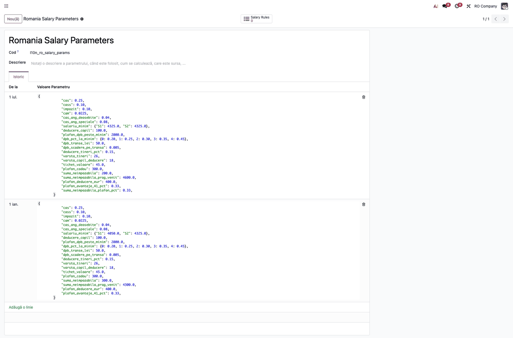

### Pasul 2 — Configurarea angajatului

**Angajați → fișa angajatului → fila Stat de plată.** Câmpurile adăugate de modul:

1. **Tip salariu minim** — S1/S2, doar informativ: grila deducerii folosește mereu salariul minim general;
2. **Persoane în întreținere** — folosit doar dacă nu sunt listate persoane la Pasul 3;
3. **Funcție de bază** — fără bifă nu se acordă nicio deducere personală;
4. **Tichete de masă** — angajatul primește tichete.

Mai sunt **Deducere sub 26 de ani** (se acordă doar cât timp angajatul are sub 26 de ani la sfârșitul lunii
fluturașului) și **Scutire de impozit pe venit** (handicap grav sau accentuat; cercetare-dezvoltare — impozitul
devine 0). Scutirea pentru cercetare-dezvoltare are trei condiții cumulative (art. 60 pct. 3): persoana face parte din echipa
unui proiect conform OG 57/2002, cu indicatori de rezultat; scutirea este în limita cheltuielilor cu personalul din
bugetul proiectului; stat de plată separat pe fiecare proiect. Modulul pune impozit 0 pe **tot** fluturașul, deci
bifați scutirea doar pe fluturașul separat al proiectului.

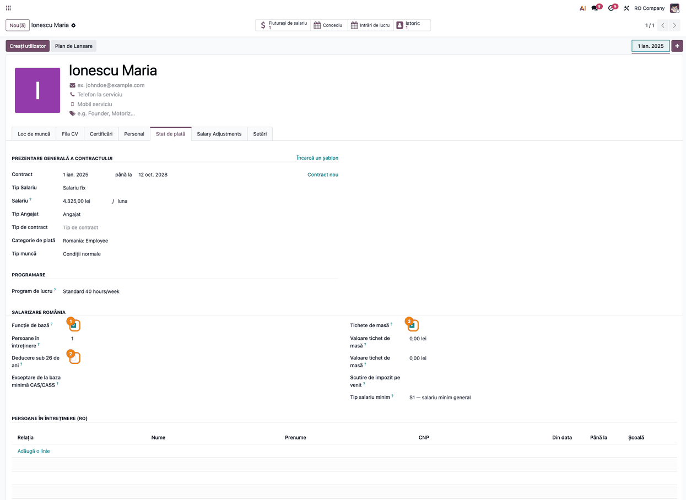

### Pasul 3 — Persoane în întreținere

Pe aceeași filă, lista **Persoane în întreținere (RO)**: relația, nume, prenume, CNP, **Din data**, **Până la**
(se completează când se cunoaște) și bifa **Școală** (doar pentru copii). Datele de început și sfârșit permit
recalcularea fără a modifica lunile anterioare. Când lista are rânduri, ea înlocuiește câmpul numeric
*Persoane în întreținere*.

Pentru fiecare copil în întreținere, înscris în învățământ și sub 18 ani (vârsta se deduce din CNP-ul copilului),
se acordă **100 lei pe lună**, indiferent de nivelul salariului.

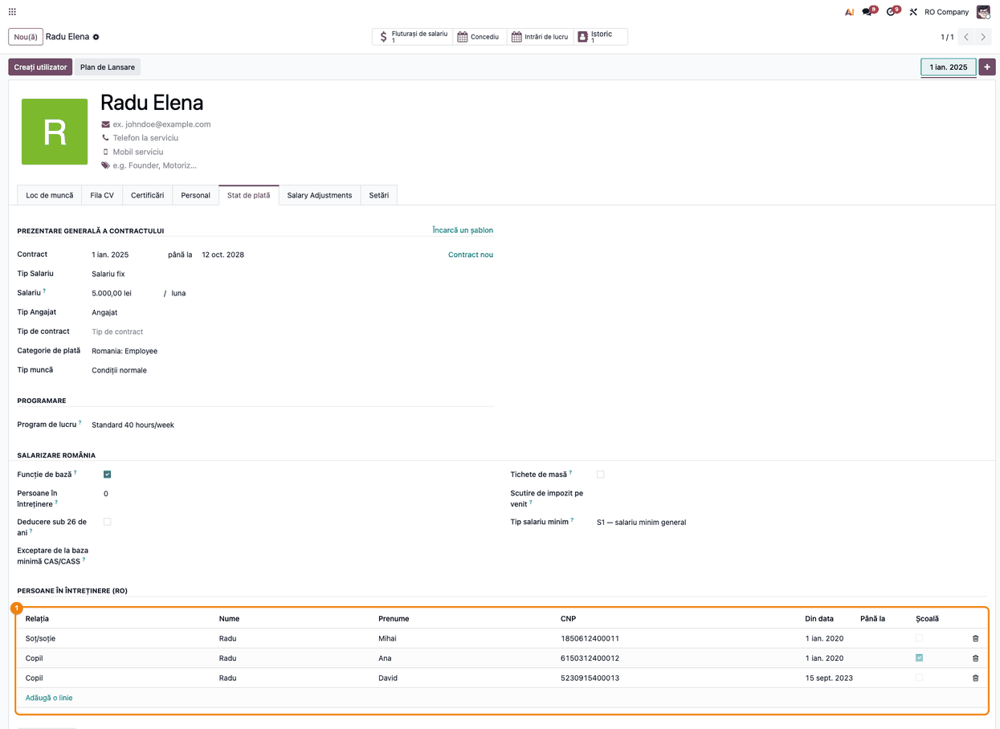

### Pasul 4 — Generarea fluturașului și numărul de tichete

**Stat de plată → Fluturași de salariu → Fluturași de salariu → Nou**: alegeți angajatul, structura **România: Plată obișnuită** și
perioada, apoi apăsați **Calculați bilanțul**. Câmpul **Tichete de masă** apare la angajații cu bifa *Tichete de masă*, și
când valoarea propusă este 0, ca să se poată completa. Este propus automat ca zilele lucrate fără concedii (23 în iulie 2026);
îl puteți modifica manual (aici 20), apoi recalculați fluturașul.

Dacă firma acordă tichetele **pentru luna anterioară** (setarea *Tichete de masă pentru: Luna anterioară*), fluturașul
lunii L propune zilele lucrate fără concedii din fluturașul validat al lunii L-1. Exemplu: în iunie 2026 se lucrează
21 de zile (1 iunie este sărbătoare legală), deci fluturașul din iulie propune 21 de tichete, nu 23 (zilele lucrate în
iulie). Fără fluturașul lunii anterioare, numărul vine din D112 importat, dacă este instalat `l10n_ro_payroll_pack`,
altfel este 0. D112 nu desparte concediul de odihnă de zilele lucrate, deci propunerea poate fi mai mare decât zilele
lucrate efectiv; verificați-o pe primul fluturaș în Odoo. Schimbarea setării nu recalculează fluturașii existenți.

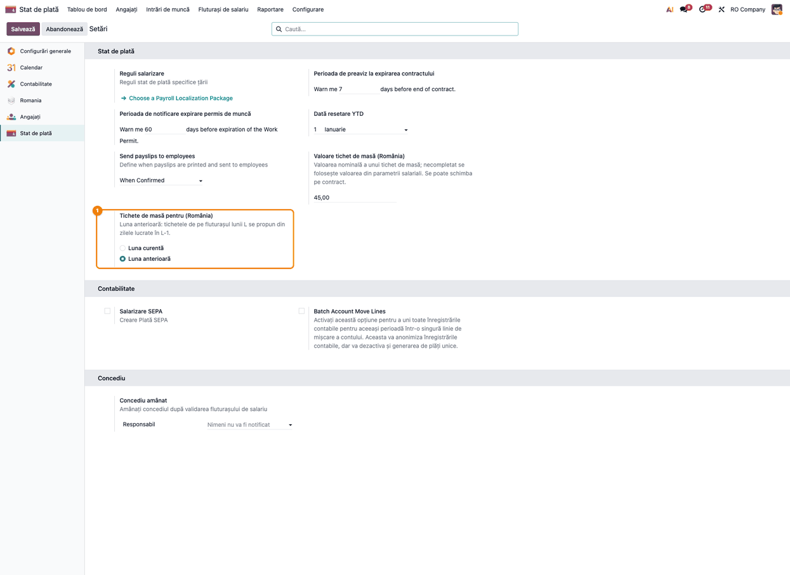

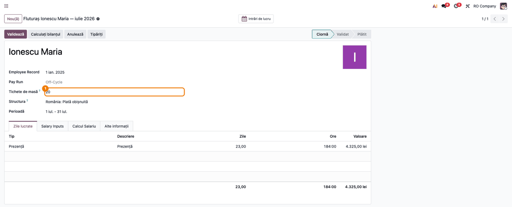

### Pasul 5 — Verificarea liniilor: tichete de masă și suma neimpozabilă

Pe fila **Calcul Salariu** citiți, în ordine (contribuțiile și impozitul sunt rotunjite la leu, de aceea coloana
*Rata* arată ±100%, minus la rețineri): *Salariu brut* = 4.325; *Sumă neimpozabilă* = 200 (salariul de bază din contract este
egal cu salariul minim, iar venitul brut nu trece de 4.600 lei); *Salariu impozabil* = 4.325 − 200 = 4.125; *Tichete de masă* = 20 × 45 = 900; *CAS* = 25% × (4.325 − 200) = 1.031; *CASS* =
10% × (4.325 + 900 − 200) = 502,50 → 503; *Deducere personală (DPB)* = 692 — grila se citește la venitul 5.225
(brut + tichete, fără a scădea suma neimpozabilă), unde 1 persoană în întreținere înseamnă 16% din 4.325;
*Impozitul pe venit* = 10% × (4.325 + 900 − 200 − 1.031 − 503 − 692) = 279,90 → 280.

Verificați că **Salariu net** (2.511) este în bani, fără tichete, și că **Cost angajator** (5.318) = brut + CAM (93) +
tichete. Aceste valori coincid cu exemplul de calcul din cerința clientului.

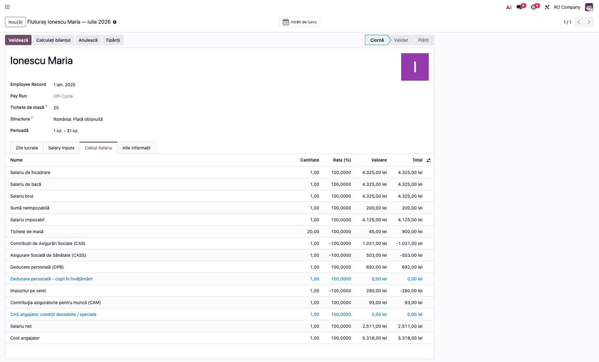

### Pasul 6 — Verificarea liniilor: familie cu copii

La Elena Radu (brut 5.000, 3 persoane în întreținere): *DPB* = 1.211 (28% din 4.325, fiindcă la venitul 5.000
grila a coborât cu 7 puncte procentuale de la 35%), plus *Deducere personală – copii în învățământ* = 100
(doar copilul înscris la școală; celălalt nu se numără). Impozitul este 194 (193,90 rotunjit), netul 3.056.

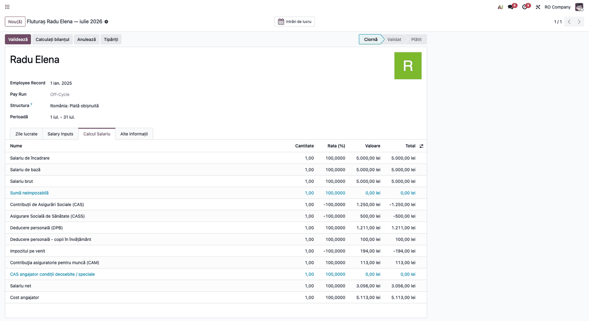

### Pasul 7 — Verificarea liniilor: angajat sub 26 de ani

La Cristina Matei (născută în 2003, brut 4.800) apare linia *Deducere personală – sub 26 de ani* = 15% din salariul
minim = 649 lei, **în plus** față de deducerea de bază (tot 649: la 475 lei peste salariul minim, 10 tranșe de 50
lei coboară procentul de la 20% la 15%). Deducerea pentru tineri se acordă doar dacă venitul se încadrează în
plafon (salariul minim + 2.000 lei). Vârsta se ia din câmpul **Data nașterii** al angajatului; dacă lipsește, din
CNP; dacă diferă, se folosește data nașterii și pe fișă apare un avertisment. Impozitul este 182, netul 2.938.

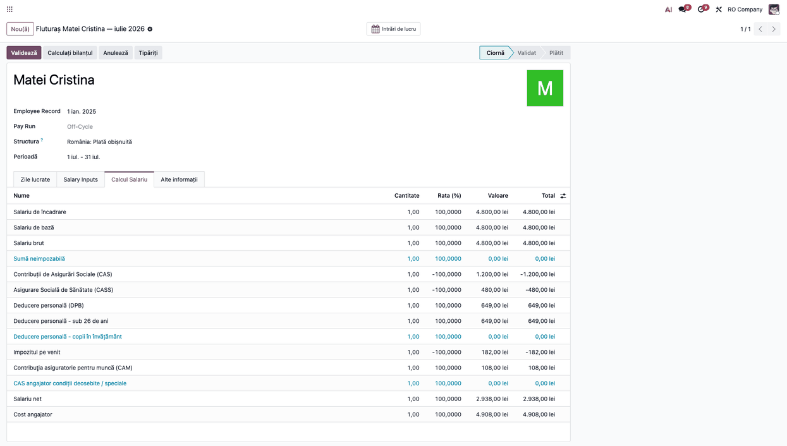

### Pasul 8 — Verificarea liniilor: angajat scutit de impozit

La Vlad Stan (scutire *Handicap grav sau accentuat*), linia *Impozitul pe venit* este 0 și netul este
brut − CAS − CASS = 3.250 lei. Contribuțiile CAS, CASS și CAM se calculează normal.

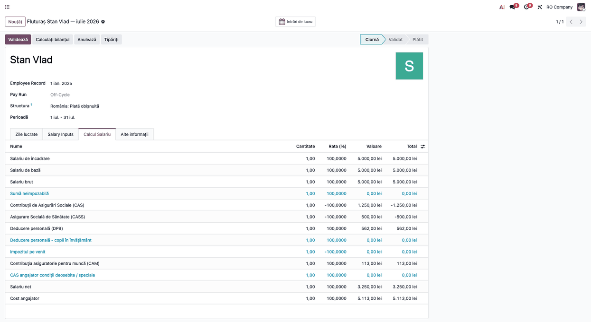

### Pasul 9 — Declarația D112

Cu puntea `l10n_ro_anaf_d112_payroll` instalată: **validați fluturașii lunii**, apoi **Contabilitate → Raportare → Declarația D112 → Nou**
(luna 7, anul 2026, tip *Declarație inițială*) și apăsați **Calculează**. Fila **Angajați** se completează din
fluturași (angajații fără fluturaș validat sunt luați din contract, cu avertisment; de aceea totalurile din antet pot depăși suma fluturașilor validați). Coloanele care vin din regulile acestui modul sunt opționale: activați-le din butonul de coloane din
colțul listei (*Tichete de masă*, *Sumă neimpozabilă*, *Baza CASS*, iar deducerile apar în *Ded. pers.*).

Verificați pe rândul fiecărui angajat că valorile coincid cu fluturașul: la Ionescu Maria, *Tichete de masă* = 900,
*CAS* = 1.031, *CASS* = 503, *Sumă neimpozabilă* = 200, *Ded. pers.* = 692 și *Bază impozabilă* = 2.799. Suma
neimpozabilă se declară în XML ca tip asigurat 51 (câmpul A_13S), iar bazele CAS și CASS ale declarației țin cont de ea
(CAS pe brut − suma neimpozabilă; CASS pe brut + tichete − suma neimpozabilă). Scutirea art. 60 se transferă: la
Stan Vlad (scutit pentru handicap) declarația arată `asigScu` 1, baza impozabilă 2.688 în `E3_14` și `E3_23`, impozitul teoretic 269 în
`E3_24` și impozitul reținut 0; obligația 602 are `A_scutit` și există `angajatorF1`.

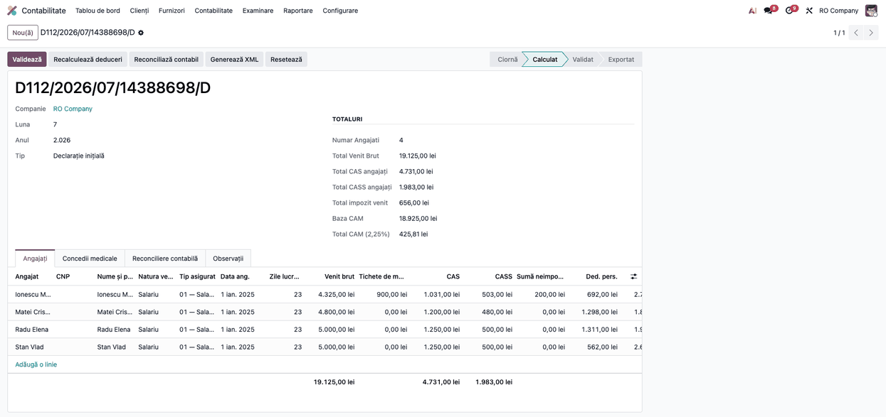

### Pasul 10 — Fluturașul tipărit (PDF)

Din fluturașul calculat sau validat, butonul **Tipăriți** generează fluturașul individual al angajatului (raportul
standard Odoo pentru structura România, în PDF): perioada de plată, zilele lucrate și liniile fluturașului. Linia
**Tichete de masă** arată numărul de tichete și valoarea nominală (20 × 45 lei = 900), iar la contribuții și impozit se
afișează doar valoarea reținută. Documentul se predă angajatului după validare.

Verificați pe document: *Suma neimpozabilă*, *Tichete de masă*, *CAS*, *CASS*, *Deducerea personală*, *Impozit*,
**Salariu net** (2.511) și suma de plată.

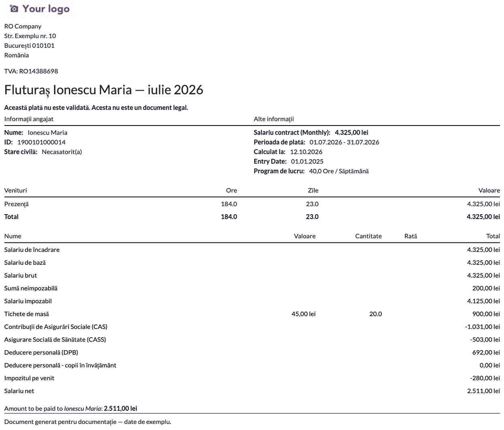

### Pasul 11 — Validarea fluturașului și nota contabilă

La **Validează**, fluturașul generează nota contabilă în jurnalul **Salarii**, datată în ultima zi a lunii (**Contabilitate → Note
contabile**, fila *Elemente jurnal*). Conturile sunt cele implicite din planul RO (vezi mai jos); la fiecare linie, contul 421 are ca
partener angajatul. Verificați că nota e echilibrată și că soldul lui 421 pe angajat este salariul net (la fluturașii cu concediu medical din FNUASS, netul se împarte între 421 și 423 — Pasul 18).

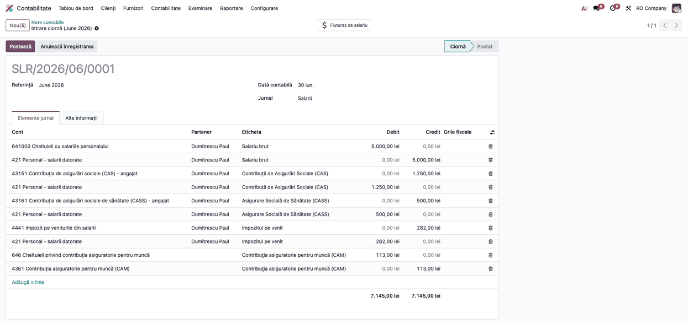

### Pasul 12 — Rețineri deductibile din baza de impozit (sindicat, pensie facultativă)

1. **Stat de plată → Angajați → Salary Adjustments** (Ajustări salariale) **→ Nou**: angajatul, tipul **Cotizație sindicală**, durata nelimitată și
   *Mod de calcul*: **Sumă fixă** (suma lunară, ex. 50) sau **Procent din venitul brut** (implicit 1%). La procent, suma se recalculează pe fiecare
   fluturaș din venitul brut realizat al lunii (cu sporuri, concediu medical și tichete), rotunjită la leu: la brut 5.000, 1% = 50.
2. Pentru pensia facultativă plătită direct de salariat alegeți **Pensie facultativă (doar baza impozabilă)** (ex. 100); dacă o reține
   angajatorul, **Pensie facultativă (reținută)**.
3. Generați fluturașul și citiți fila **Calcul Salariu** la Iliescu Radu (brut 5.000, iulie 2026): apare **Deduceri din baza impozabilă** = 150;
   deducerea personală nu se schimbă (562), impozitul scade la 254, iar **Rețineri voluntare** = −50 scad netul (2.946).
4. Plafonul de 400 EUR/an se aplică automat pensiei facultative și asigurării de sănătate; verificați cursul EUR din companie.
5. În D112 suma ajunge în câmpul «alte deduceri» (`E1_5` / `E3_13`).

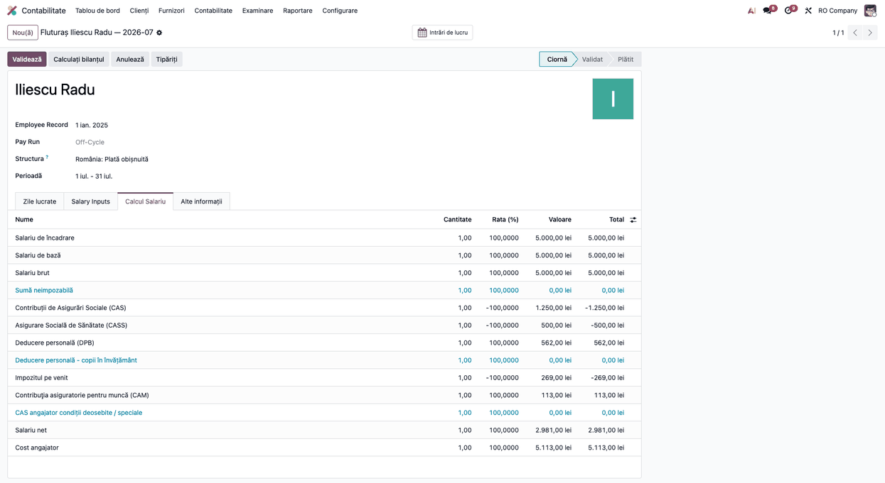

### Pasul 13 — Avertizări pe fluturaș

Înainte de validare, fluturașul în ciornă afișează în partea de sus un **banner de avertizări** cu problemele care schimbă
rezultatul sau fac salariatul de nedeclarat. La Barbu Mihai apar două: **CNP lipsă** (salariatul nu poate fi declarat în D112)
și **copil înscris în învățământ fără CNP valid** (deducerea pentru copil nu se acordă). Fiecare mesaj are un link către
fișa angajatului, unde se corectează datele; apoi recalculați fluturașul cu **Calculați bilanțul**.

Verificați că bannerul nu mai conține mesaje înainte de **Validează**; un fluturaș validat cu avertizări rămase produce
neconcordanțe în D112.

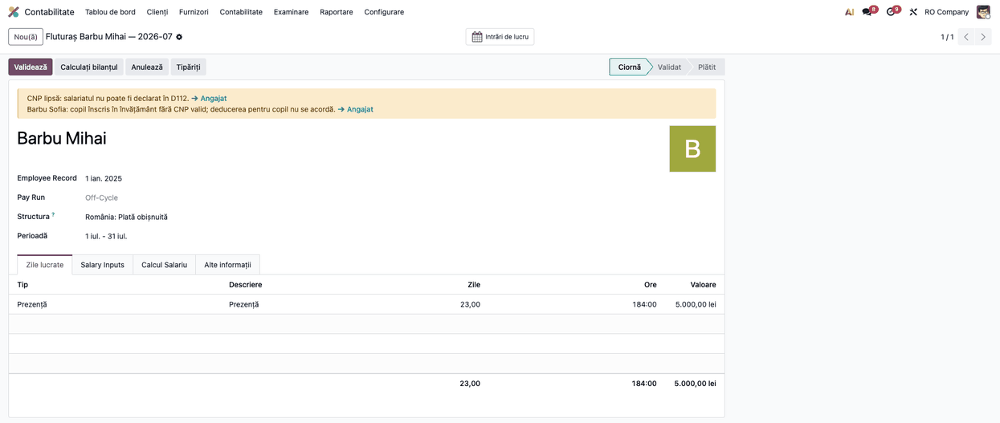

### Pasul 14 — Simulatorul brut / net

**Stat de plată → Raportare → Simulator brut / net (RO)**: alegeți modul (**Brut → net** sau **Net → brut**), luna și suma, completați
datele salariatului sau alegeți un angajat existent (formularul îi preia norma, excepția de la baza minimă și tichetul), apoi apăsați
**Simulează**. Simularea folosește aceleași reguli și parametri ca fluturașul, pe o lună lucrată integral, dar **nu creează** fluturaș
și nu atinge datele salariatului; este utilă la negocieri și oferte.

Exemplul din captură e un contract cu **timp parțial**: ① **Ore pe zi** 4, salariu brut 2.200 și ② **Primă brută** 300. Citiți în
rezultat: *Brut* 2.500; *CAS* −625; *CASS* −250; *DPB* 865; *Impozit* −76; **Net 1.549**; *CAM* 56.
Baza de 2.500 e sub pragul minim de CAS/CASS al lunii (4.325 − 200 = 4.125), deci angajatorul plătește diferența
(art. 146 alin. 5^6 Cod fiscal): ③ **Diferență CAS** 406 și **Diferență CASS** 163, calculate ca în D112 și rotunjite la leu; ④ **Cost
angajator** 3.125 (brut + CAM + diferențe). Aceleași rânduri apar pe fluturașul real și intră în nota contabilă (6451 = 4315, 6453 = 4316);
netul nu se schimbă. Diferența apare doar cu modulul D112 din salarizare (`l10n_ro_anaf_d112_payroll`, inclus în
`l10n_ro_payroll_pack`); fără el, la timp parțial apare o notă. Cu o **excepție de la baza minimă** (de exemplu pensionar pentru limită
de vârstă) diferența nu se datorează.

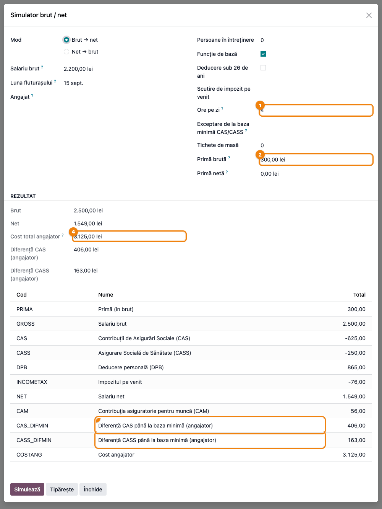

Butonul **Tipărește** dă documentul simulării. Pe exemplul de control, normă întreagă și 5.000 brut, citiți: *Salariu brut* 5.000;
*CAS* −1.250; *CASS* −500; *Deducere personală (DPB)* 562; *Impozit* −269; **Net 2.981**; *CAM* 113; **Cost angajator** 5.113.
Documentul poartă mențiunea „Simulare informativă, nu fluturaș de salarii”. Fără angajat ales, simularea nu include reținerile de la
Pasul 12 (de aceea impozitul diferă de cel din Pasul 12).

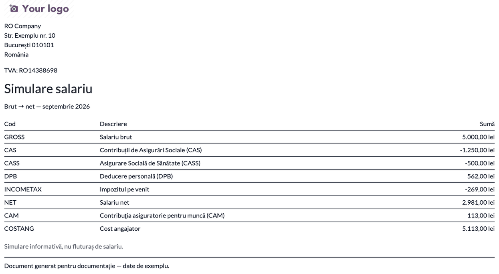

### Pasul 15 — Certificatul de concediu medical

**Stat de plată → Angajați → Certificate medicale (RO) → Nou**: completați angajatul, **seria și numărul certificatului** (D_1, D_2),
data eliberării, perioada **De la / Până la** (D_6, D_7), **Codul de indemnizație** (D_9; aici 01 – boală obișnuită), locul de
prescriere, codul de diagnostic și, după caz, urgența, boala infecto-contagioasă, spitalizarea sau programul național. Apăsați **Confirmă**.
La confirmare se creează automat concediul medical al angajatului (câmpul *Concediu*).

Secțiunea **Baza de calcul (art. 10)** arată venitul pe ultimele 6 luni (D_17), zilele (D_18) și **media zilnică** (D_19). Baza vine din
fluturașii validați; când angajatul vine de la alt angajator se alege sursa *Manual* și se introduc valorile din adeverință (aici 30.000 lei
și 126 zile → 238,10 lei/zi). Procentul (la codul 01 este 55%, 65% sau 75% după durata certificatului; la 10 zile, intervalul 8–14, este 65%), zilele calendaristice (10) și lucrătoare (8), **prima zi neplătită** (D_9b, bifată) și
cele două indemnizații se calculează singure: **zile angajator** (D_14a) = 5, din care 4 plătite, și **zile FNUASS** (D_15) = 3;
indemnizația angajatorului **619 lei** (4 × 238,10 × 65%) și cea din FNUASS **464 lei** (3 × 238,10 × 65%).

Verificați: perioada nu se suprapune cu alt certificat al angajatului, seria/numărul sunt cele din certificat, iar baza de calcul nu e goală.

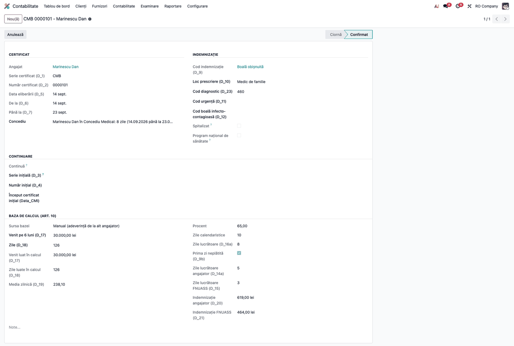

### Pasul 16 — Certificat de continuare

Dacă boala continuă după încheierea certificatului, se introduce un nou certificat: în secțiunea **Continuare** în câmpul **Continuă** alegeți
certificatul inițial (aici CMB 0000201 al Stoicăi Ana, început la 20.08.2026). **Seria inițială (D_3), numărul inițial (D_4) și data de început
a certificatului inițial** se completează singure. Certificatul de continuare **nu are o nouă primă zi neplătită** și nu are zile de angajator
în episod dacă acestea au fost consumate (aici zile angajator = 0, FNUASS = 8): primele 5 zile lucrătoare ale episodului sunt plătite o singură
dată, iar baza de calcul se preia din episodul inițial. **Procentul se stabilește pe durata cumulată a episodului**: aici 22 de zile (20.08–10.09), deci 75%, de aceea *Zile calendaristice* arată 22 și nu 10. Indemnizația FNUASS a lunii este **1.429 lei** (8 × 238,10 × 75%).

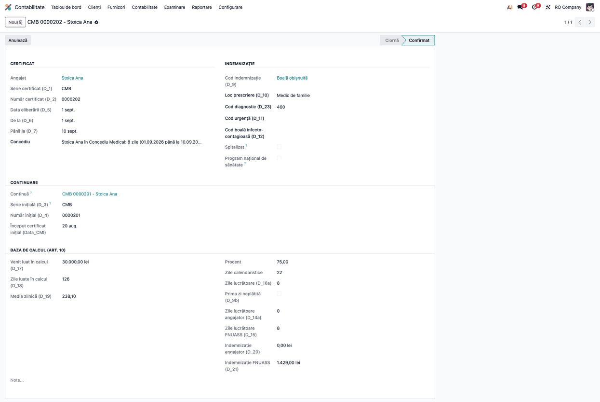

### Pasul 17 — Liniile fluturașului cu concediu medical

Generați fluturașul lunii cu **Calculați bilanțul** și citiți fila **Calcul Salariu** la Marinescu Dan (septembrie 2026):
*Concediu medical (angajator)* = 619; *Concediu medical (FNUASS)* = 464; *Salariu de bază* (partea lucrată, rotunjită la leu) = 3.182;
*Salariu brut* = 3.801 (partea lucrată + indemnizația angajatorului). Contribuțiile se rețin separat pe cele două surse (impozitul total al lunii, 191, se împarte proporțional cu venitul: 170 pe partea impozabilă și 21 pe indemnizația FNUASS):
*CAS* 950 și *CASS* 380 pe salariul brut, plus *CAS pe concediu medical (FNUASS)* 116 și *CASS pe concediu medical (FNUASS)* 46;
*Impozit pe concediu medical (FNUASS)* 21 se adaugă impozitului de 170. **Salariu net** = 2.582.

Indemnizația angajatorului face parte din brut (cheltuială 641), iar cea suportată din FNUASS nu: se datorează angajatului, dar se
recuperează de la fond (vezi Pasul 18 și Pasul 21).

**Baza minimă de CAS/CASS și concediul medical.** Zilele de concediu medical nu se numără ca zile cu contract activ, pentru că
concediul medical suspendă contractul (Codul muncii, art. 50 lit. b). Pragul bazei minime se compară doar cu salariul, fără
indemnizații, care au bazele lor de CAS și CASS (art. 144 și art. 157 Cod fiscal). Un salariat cu normă întreagă căruia brutul
lunii îi scade sub salariul minim din cauza concediului medical nu primește diferențe. Exemplu: 1 zi lucrată și 21 de zile CM
din 22: pragul este 4.125 × 1 / 22 = 188 lei, iar salariul pe ziua lucrată îl depășește. La normă parțială cu concediu medical,
pragul se calculează pe zilele lucrate (și CO): la 12 zile lucrate și 10 de CM, 4.125 × 12 / 22 = 2.250 lei, comparat doar cu
salariul.

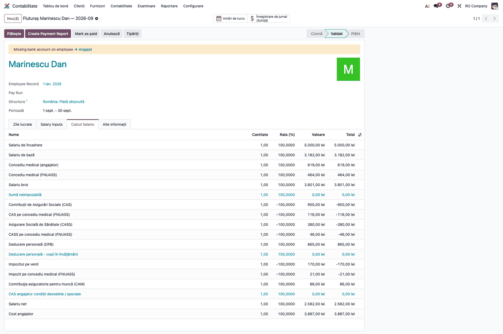

### Pasul 18 — Nota contabilă a fluturașului cu concediu medical

La **Validează**, fluturașul lui Marinescu Dan generează nota contabilă în jurnalul **Salarii** (**Contabilitate → Note contabile**, fila *Elemente jurnal*). Pe lângă
liniile obișnuite, apar cele pentru indemnizația din FNUASS: **Dr 4382 = Cr 423** 464 (creanța față de fond și datoria către angajat), iar contribuțiile și impozitul de pe
indemnizația FNUASS se rețin din 423: **Dr 423 = Cr 43151** 116 (CAS), **Cr 43161** 46 (CASS), **Cr 4441** 21 (impozit). Indemnizația angajatorului intră în salariul impozabil:
**Dr 641 = Cr 421** 3.801. Totalul notei este 6.034. Nota rămâne în **Ciornă** până apăsați **Postează**; abia după postare intră în solduri și în reconcilierea plății.

Verificați: nota e echilibrată; 641 conține doar partea suportată de angajator; **soldul netului se împarte pe două conturi**: 421 = 2.301 și 423 = 281 (464 − 116 − 46 − 21),
iar plata angajatului se reconciliază pe ambele conturi. Recuperarea sumei de la casa de asigurări (închiderea lui 4382) se face în afara modulului.

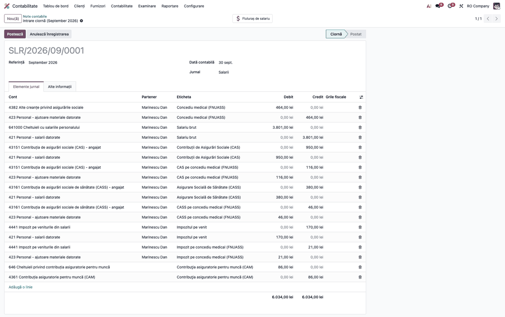

### Pasul 19 — Liniile fluturașului la continuare

La Stoica Ana, în septembrie: *Concediu medical (angajator)* = 95 și *Concediu medical (FNUASS)* = 1.500. Sumele includ **diferențele din
luna anterioară a episodului** (art. 17 alin. 1^2 din OUG 158/2005): la o continuare, indemnizațiile lunilor precedente se recalculează
cu procentul și baza episodului, iar diferența se plătește pe fluturașul curent. Verificați că suma plătită pe episod (suma indemnizațiilor
din fluturașii validați) nu depășește cea datorată.

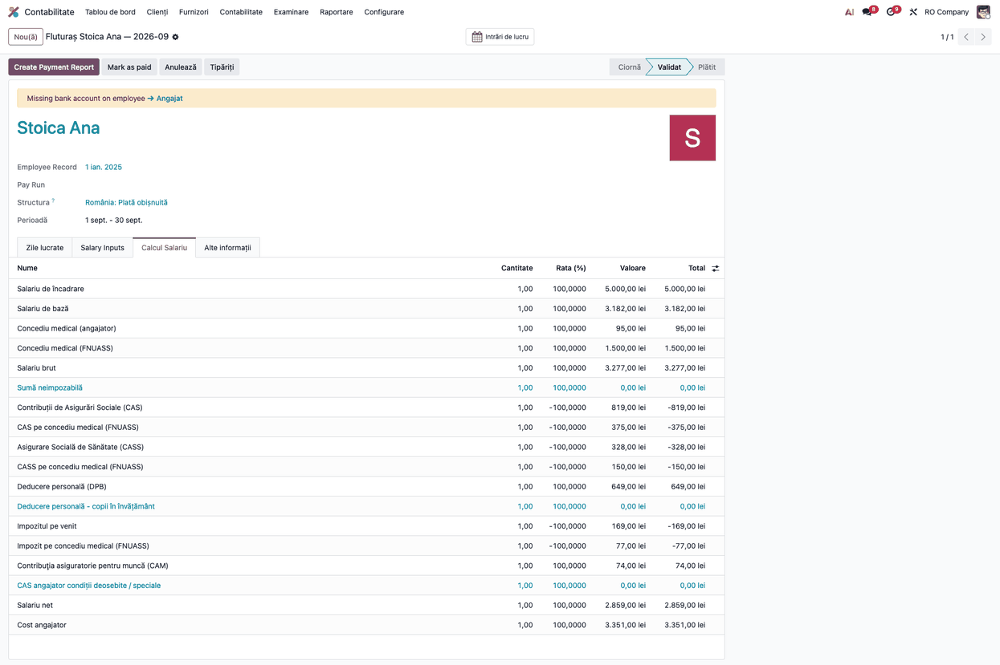

### Pasul 20 — Fișa de calcul a concediului medical (PDF)

Din certificat, meniul ⚙ → **Tipărire** → *Fișa de calcul concediu medical* generează **Fișa de calcul concediu medical**: angajatul, certificatul, codul D_9, perioada, baza de calcul
(art. 10: venit D_17, zile D_18, media D_19), procentul, zilele calendaristice/lucrătoare, D_14a și D_15, prima zi neplătită și un tabel pe luni cu
**zilele plătite de angajator** / **din FNUASS** și indemnizațiile (D_20, D_21). Fișa se anexează dosarului de personal și servește la
verificarea cu certificatul.

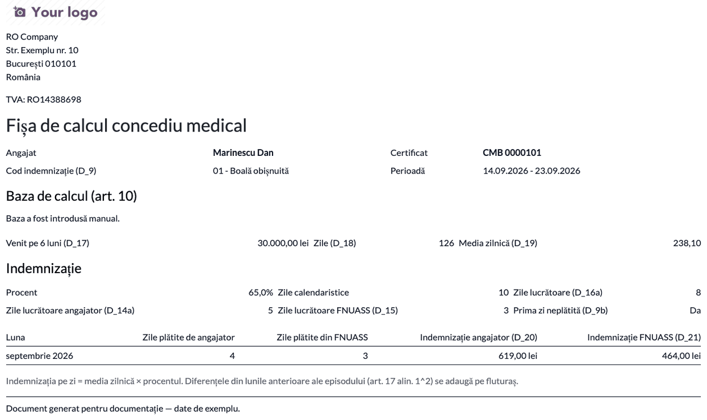

### Pasul 21 — Decontarea concediilor medicale din FNUASS

**Stat de plată → Raportare → Decontare concedii medicale (FNUASS)**: alegeți anul și luna (septembrie 2026) și apăsați butonul de export.
Se generează un fișier **XLSX** cu un rând pe certificat — număr, angajat, CNP, serie și număr certificat, cod, perioadă, zile FNUASS, media zilnică,
procent, **indemnizația FNUASS** și **din care diferența lunii precedente** — și un total (aici 11 zile și 1.964 lei). Fișierul se preia la
cererea de recuperare către Casa de Asigurări de Sănătate.

Verificați înainte de depunere: sunt incluși doar fluturașii **validați** ai lunii; totalul zilelor și al sumelor coincide cu rândurile *Concediu medical (FNUASS)* din
fluturași (464 + 1.500 = 1.964); fiecare certificat apare o singură dată.

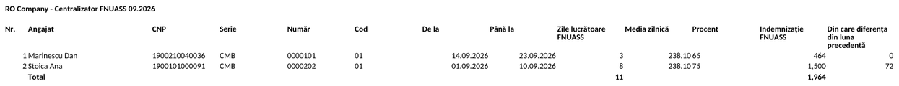

### Pasul 22 — Concediile medicale în D112

Cu puntea `l10n_ro_anaf_d112_payroll`: **Contabilitate → Raportare → Declarația D112 → Nou** (luna 9, 2026) și **Calculează**. Pe lângă fila *Angajați*,
apare fila **Concedii medicale**, cu o linie pe certificat: serie și număr (D_1, D_2), perioadă (D_6, D_7), codul D_9, zilele plătite de angajator,
din FNUASS și totale, indemnizațiile și procentul (D_28). Liniile se pot corecta manual, iar **Validează** semnalează certificatele care nu respectă
structura cerută de declarație.

Verificați pe fila *Concedii medicale*: același număr de linii ca certificatele lunii; indemnizațiile sunt cele din fluturași (619 + 95 angajator,
464 + 1.500 FNUASS); la continuare apar seria/numărul inițial. La **Generează XML** concediile medicale se transferă în declarație (grupa de
asigurat pe concediu medical și secțiunea angajatorului pentru indemnizațiile suportate din FNUASS).

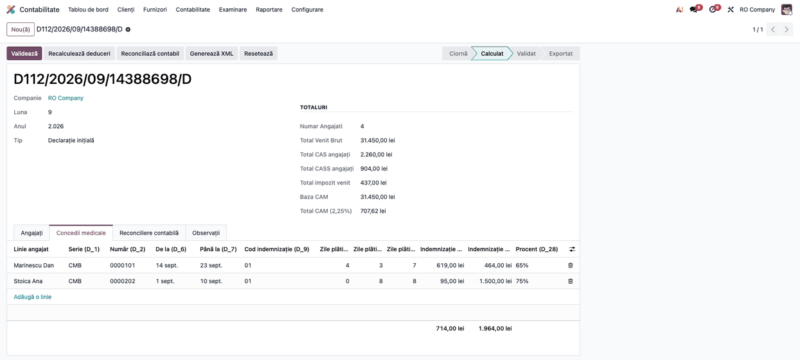

### Pasul 23 — Concediul de odihnă calculat pe medie

Cererea de concediu de odihnă se aprobă normal (modulul *Concedii*); aici Preda Ioana, 14–18.09.2026, 5 zile din alocarea de 21 de zile. La
calculul fluturașului, *Indemnizație concediu de odihnă* se calculează pe **media ultimelor 3 luni** (iunie–august): se iau din
fluturașii validați salariul de bază și **sporurile permanente** (regula la care este bifat **Drept permanent (media concediului de odihnă)** — pe formularul regulii, **Stat de plată → Configurare → Reguli salariale** —, aici *Spor de vechime* 500 lei), iar media zilnică
(250 lei) înmulțită cu cele 5 zile dă **1.250 lei**.

Indemnizația **înlocuiește** salariul și sporurile permanente pentru zilele de concediu (art. 150 din Codul muncii). De aceea regula sporului trebuie scrisă **proporțional cu zilele lucrate**:
în captură, *Salariu de bază* = 3.864 (17 din 22 de zile, rotunjit la leu) și *Spor de vechime* = 386 (500 × 17/22, rotunjit). Brutul lunii este 5.500, ca într-o lună obișnuită:
1.250 + 3.864 + 386. Formula din exemplu: `payslip._l10n_ro_round_lei(500 × zile lucrate / total zile)`; fără rotunjire, sporul rămâne cu bani (386,36). O regulă permanentă intră în înlocuirea de la art. 150 doar dacă secvența ei este mai mică decât cea a indemnizației de concediu de odihnă (49). Dacă sporul rămâne întreg (500), el se plătește de două ori pentru zilele de concediu.
Modulul **nu proratează** automat regulile marcate ca permanente; verificați fiecare regulă de spor din structură.

Verificați: există fluturași validați pe lunile de referință (altfel media pornește de la salariul zilnic din contract); sporurile care trebuie incluse au bifa
*Drept permanent (media concediului de odihnă)* și sunt proratate; zilele de concediu nu depășesc soldul alocării. Brutul de 5.500 dă CAS 1.375, CASS 550, DPB 346, impozit 323, net 3.252.

**Compensarea concediului neefectuat:** în luna încetării contractului, regula de compensare CO adaugă zilele rămase din alocări × media (cel puțin salariul zilnic)
conform art. 146 alin. 3 din Codul muncii. Numărul de zile se poate impune manual cu intrarea de fluturaș *CO_COMP_ZILE*.

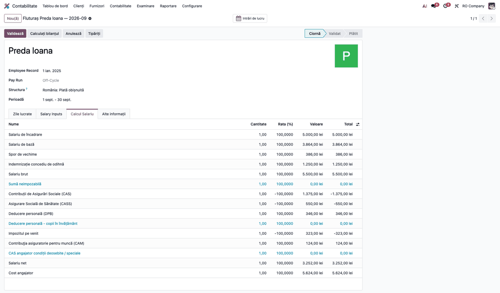

### Pasul 24 — Prime în net (recalculul brutului)

Când firma garantează salariatului o primă **netă** (suma care ajunge în mână), brutul nu se mai calculează de mână. Pe fluturașul în ciornă, în fila de
intrări, adăugați intrarea **Primă (în net)** cu suma netă dorită (aici 1.000 lei) și apăsați **Calculează**. Modulul caută **cel mai mic brut întreg** al primei
pentru care netul fluturașului crește cu cel puțin suma cerută, ținând cont de CAS, CASS, impozit și de deducerea personală, care scade în trepte de 50 lei
când brutul crește. Linia **Primă (în net, brut calculat)** apare pe fluturaș cu brutul găsit, iar prima intră în brutul lunii, deci în CAS, CASS, CAM, impozit și D112.
Pentru o primă dată **în brut** folosiți intrarea **Primă (în brut)**.

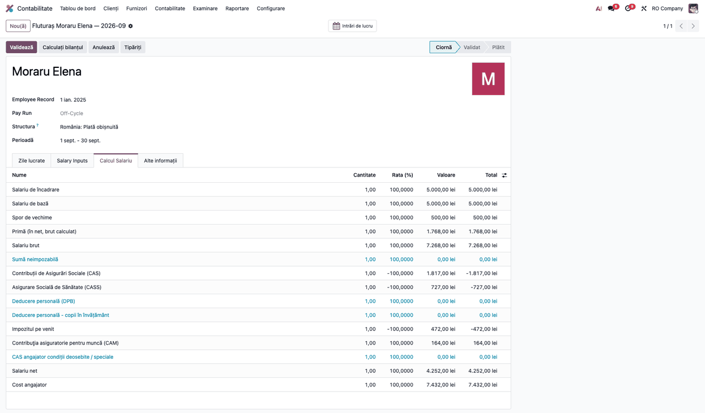

Dacă suma exactă nu se poate atinge (rotunjirea la leu, treptele deducerii), fluturașul are o avertizare cu brutul găsit și netul obținut. Prima se **recalculează la fiecare calcul**:
dacă salariul sau deducerile se schimbă, brutul primei se schimbă și el. Scoaterea intrării și un nou calcul readuc fluturașul la netul inițial.

**Prag:** la salariul minim, o primă care trece venitul brut peste pragul sumei neimpozabile (4.600 lei din iulie 2026) face să se piardă suma neimpozabilă, iar netul scade brusc. Căutarea brutului ține cont de prag: dacă prima cerută încape sub prag, brutul rămâne sub prag; altfel se caută peste prag. Primele din profit (participarea la profit) nu trec prin acest mecanism: se înregistrează Dr 644 = Cr 424.

**Verificați:** netul fluturașului cu prima minus netul fără ea este cel puțin suma cerută (de regulă egal, uneori cu un leu în plus); linia *Primă (în net, brut calculat)* e cea din brut;
brutul total include prima; D112 preia brutul cu tot cu primă.

### Pasul 25 — Tichete cadou și cadouri în natură, pe ocazie

Tichetele cadou și cadourile în natură se introduc pe fluturaș, în fila **Salary Inputs**: tipurile *Tichete cadou (salariat)* /
*Tichete cadou (copii minori)* și *Cadouri în natură (salariat)* / *Cadouri în natură (copii minori)*, cu **Ocazia** completată în coloana
dedicată (Paști, Crăciun, 8 Martie, 1 Iunie, Altă ocazie). Aici Neagu Irina, decembrie 2026: tichete cadou 300 lei și un cadou în natură de 200 lei, ambele de Crăciun.

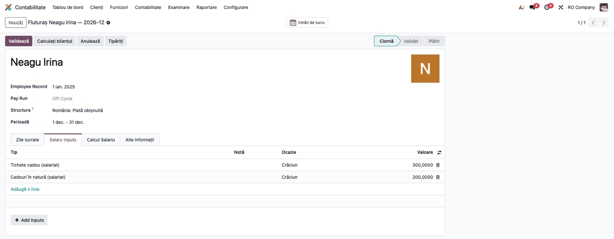

Plafonul neimpozabil de **300 lei pe persoană și pe ocazie** (art. 76 alin. 4 lit. a Cod fiscal) se aplică **cumulat** tichetelor și cadourilor în natură de la
aceeași ocazie; tichetele consumă plafonul primele. Liniile cu aceeași ocazie se adună sub un singur plafon. Plafonul pentru salariat există la Paști și Crăciun, iar la
8 Martie doar pentru angajate (câmpul *Gen* de pe contract); pentru copiii minori din lista persoanelor în întreținere, 300 lei × numărul copiilor, la Paști, Crăciun
și 1 Iunie. *Altă ocazie* (de exemplu ziua de naștere) e integral impozabilă. Liniile fără ocazie, inclusiv cele din *Ajustări salariale*, au împreună un singur
plafon pe lună. Pentru sărbătorile echivalente ale altor culte alegeți *Paști* sau *Crăciun*.

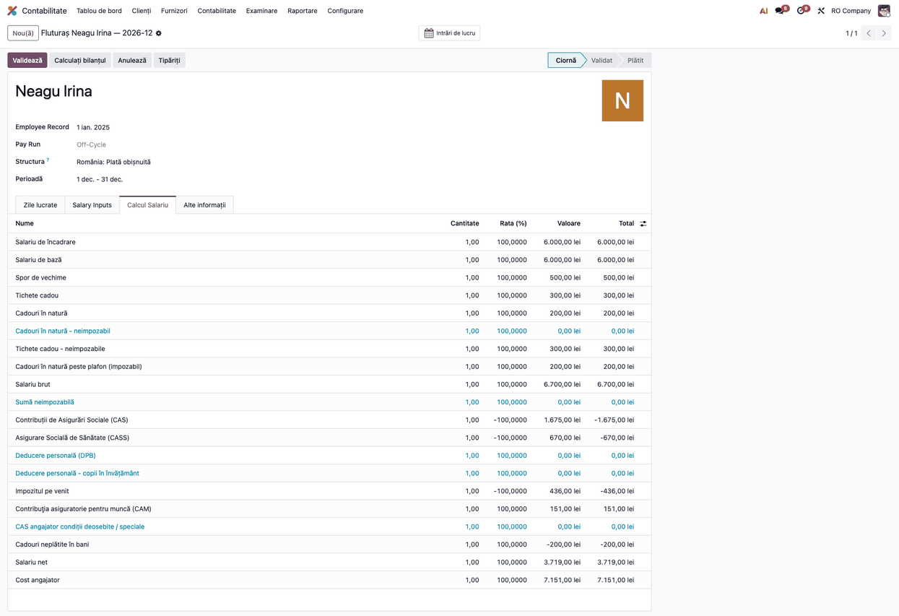

În captură: *Tichete cadou - neimpozabile* 300 (tot plafonul), *Cadouri în natură - neimpozabil* 0, *Cadouri în natură peste plafon (impozabil)* 200. Excedentul intră în
brut (6.700 = 6.000 + sporul de vechime de 500 din exemplul de la Pasul 23 + 200) ca bază pentru CAS 1.675, CASS 670 și impozit 436, apoi iese din net pe linia
*Cadouri neplătite în bani* (−200), fiindcă salariatul nu primește bani: net 3.719. La validare, tichetele cadou se înregistrează **Dr 6422 = Cr 5328** (300), iar
excedentul cadoului în natură nu trece prin 641 (mecanismul din Pasul 29); cadoul în natură se înregistrează din factura furnizorului.

Exemplele din Pașii 25–29 sunt create de testul de capturi (nu sunt în datele demo): pentru a le reproduce, creați angajații și introduceți intrările
de pe fluturaș. Sporul de vechime de 500 lei vine din regula creată la Pasul 23, care în exemplu se aplică tuturor fluturașilor; fără ea, brutul e mai mic cu 500 lei.

### Pasul 26 — Beneficii din art. 76 alin. (4^1): plafonul propriu și plafonul comun de 33%

Beneficiile suportate de angajator se introduc ca tipuri de intrare (în *Ajustări salariale* sau direct pe fluturaș): *Clauză de mobilitate*, *Hrană (angajator)*,
*Cazare (angajator)*, *Servicii turistice și de tratament (angajator)*, *Abonament sport (angajator)*, *Educație timpurie (angajator)* (decont plătit salariatului) sau
*Educație timpurie (plată directă unității)*, alături de pensiile și asigurarea de sănătate deja existente. Fiecare are plafonul propriu:

| Beneficiu | Plafon propriu |
|---|---|
| Clauză de mobilitate (lit. a) | 2,5 × indemnizația de delegare (23 lei) = 57,5 lei pe zi de mobilitate; zilele din intrarea *Zile în regim de mobilitate*, altfel zilele lucrate la locul de muncă (fără telemuncă și concedii) |
| Hrană (lit. b) | valoarea tichetului de masă × zilele lucrate la locul de muncă; 0 la salariații cu tichete de masă |
| Cazare (lit. c) | 20% din cel mai mic salariu minim al lunii (865 lei din iulie 2026) |
| Servicii turistice (lit. d) | un câștig salarial mediu brut pe an (9.192 lei în 2026), cumulat; 0 dacă salariatul are vouchere de vacanță în același an |
| Pensie facultativă / ocupațională, asigurare de sănătate (lit. e, e^1, f) | 400 EUR pe an și pe tip, cumulat |
| Abonament sport (lit. h) | 100 EUR pe an, cumulat |
| Educație timpurie (lit. i) | cel mult 1.500 lei pe lună pentru fiecare copil sub 6 ani din lista persoanelor în întreținere |

Apoi toate împart **plafonul lunar de 33% din salariul de bază din contract**. Ordinea în care îl folosesc o stabilește angajatorul (art. 76 alin. 4^2):
în **Stat de plată → Configurare → Salariu → Salary Input Types**, pe tipul beneficiului, grupul *România* are câmpul **Ordinea în plafonul de 33%** (valorile mici se aplică primele;
la valori egale, ordinea literelor din lege) și bifa **Plătit salariatului în bani**.

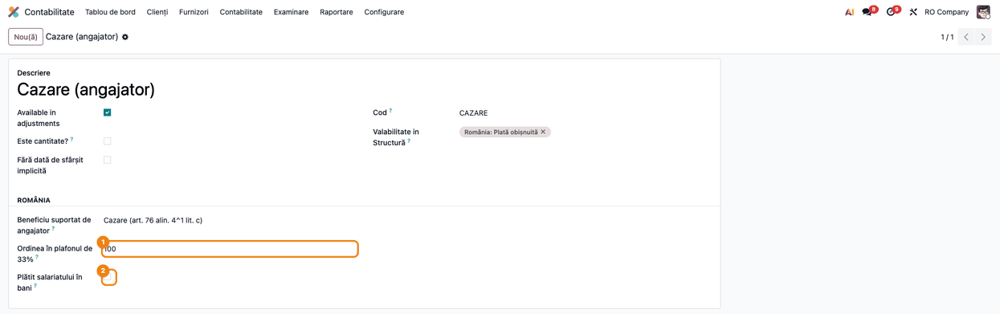

Exemplul Toma Cristian, septembrie 2026, salariu de bază 6.000 (33% = 1.980): clauză de mobilitate 1.000 lei pe 10 zile (plafon 575) și cazare 1.500 lei (plafon 865).

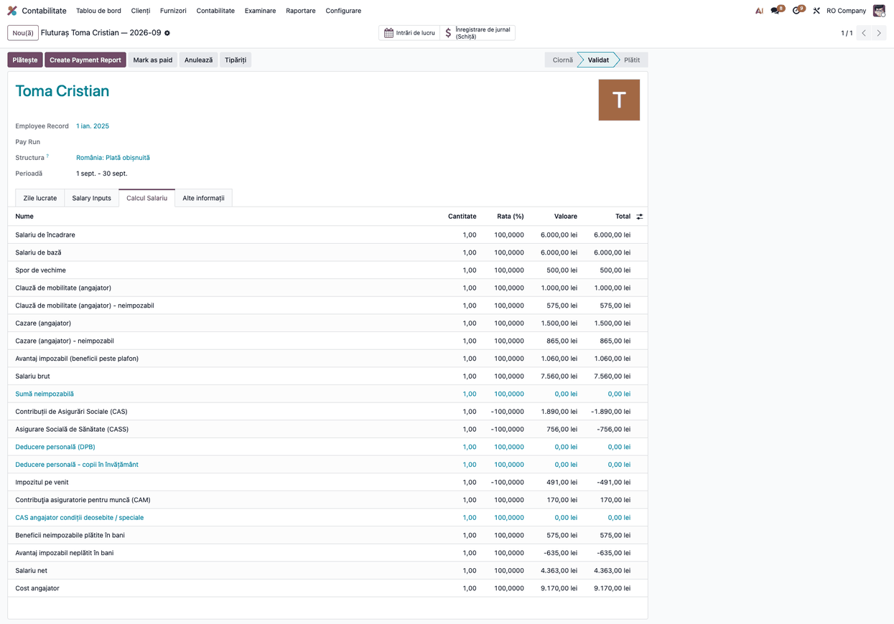

Pe fluturaș, fiecare beneficiu are suma totală (costul angajatorului) și partea neimpozabilă: mobilitate 1.000 / 575, cazare 1.500 / 865. Ce trece de plafoane
(425 + 635 = 1.060) apare pe *Avantaj impozabil (beneficii peste plafon)* și intră în brut (7.560), cu CAS 1.890, CASS 756, CAM 170 și impozit 491. Clauza de mobilitate se
plătește **în bani**: partea neimpozabilă intră în net pe linia *Beneficii neimpozabile plătite în bani* (575), iar excedentul ei se plătește odată cu salariul. Cazarea e
**în natură**: excedentul ei iese din net pe *Avantaj impozabil neplătit în bani* (−635). Netul: 4.363.

### Pasul 27 — Avantaje în natură integral impozabile și autoturismul folosit în scop personal

Bunurile și serviciile acordate gratuit (inclusiv activități casnice și alte avantaje) se introduc cu tipul *Avantaj în natură (impozabil)*, la prețul pieței.
Pentru autoturismul firmei folosit și în scop personal: *Autoturism în scop personal - valoare de intrare* (avantajul lunar e 1,7% din ea), sau *- chirie lunară* pentru
vehiculul închiriat, plus *Autoturism - folosință personală (%)* pentru folosința mixtă (km personali din total km). Pentru vehiculele cu cheltuieli deductibile 50% și
pentru vehiculele firmelor micro sau cu impozit specific care nu sunt folosite exclusiv în activitate nu se introduce nimic: avantajul e neimpozabil (art. 76 alin. 4 lit. ț și ț^1).

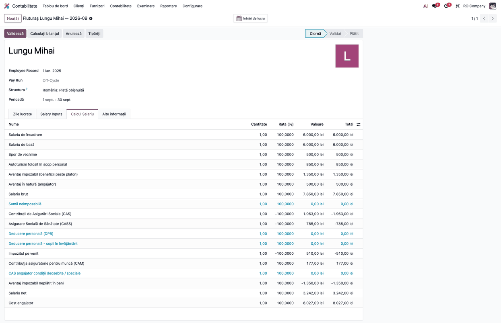

Exemplul Lungu Mihai, septembrie 2026: autoturism cu valoarea de intrare 100.000 lei, folosit 50% în scop personal (1,7% × 100.000 × 50% = **850**), plus un avantaj în
natură de 500 lei. Avantajele sunt integral impozabile și nu consumă plafonul de 33%: *Avantaj impozabil (beneficii peste plafon)* 1.350, brut 7.850, CAS 1.963,
CASS 785, impozit 510, CAM 177; *Avantaj impozabil neplătit în bani* −1.350; net 3.242.

### Pasul 28 — Ajutoare, transport la locul de muncă, tichete de creșă și culturale

- *Ajutoare* (naștere sau adopție, înmormântare, boli grave și incurabile, dispozitive medicale, calamități) și *Transport la locul de muncă*: neimpozabile, fără plafon în Codul fiscal (art. 76 alin. 4 lit. a), plătite
  **în afara statului de plată**. Nu intră în brut sau în net, apar după net, în costul angajatorului și în D112 la 8.4.
- *Tichete de creșă* și *Tichete culturale*: **doar impozit** (fără CAS, CASS sau CAM). Intră în baza impozitului și în venitul după care se alege deducerea personală,
  nu în netul în bani, ca tichetele de masă.

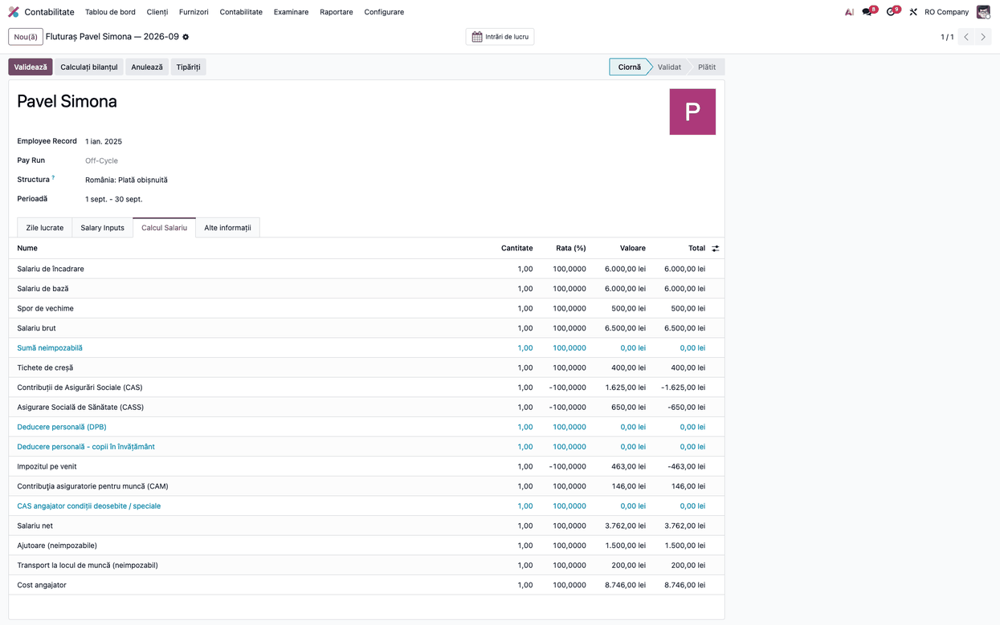

Exemplul Pavel Simona, septembrie 2026: ajutor la naștere 1.500, transport 200, tichete de creșă 400. Brutul rămâne 6.500 (6.000 + sporul de vechime), CAS 1.625 și
CASS 650 sunt calculate doar pe brut, iar impozitul (463) cuprinde și tichetele de creșă; net 3.762; cost angajator 8.746 (brut + CAM + tichete + ajutor + transport).
La validare: **Dr 6458 = Cr 423** 1.500 (ajutorul, pe angajat; se plătește separat, 423 = 5121) și **Dr 6422 = Cr 5328** 400 (tichetele de creșă); transportul se
înregistrează din factura transportatorului sau din decont.

### Pasul 29 — Nota contabilă a beneficiilor

La validarea fluturașului (Toma Cristian, Pasul 26), nota contabilă înregistrează excedentul în natură **doar ca bază de calcul**: brutul se postează Dr 641 = Cr 421
**fără** excedentul cazării (6.925 = 7.560 − 635), iar contul 641 nu are nicio linie pe credit. Partea neimpozabilă a clauzei de mobilitate plătită în bani are linia
proprie Dr 641 = Cr 421 (575), cu angajatul partener. Cheltuiala cu cazarea se înregistrează din factura furnizorului (de exemplu Dr 6421 avantaje în natură = Cr 401,
după politica firmei). Nota rămâne în **Ciornă** până la **Postează**, ca la Pasul 11.

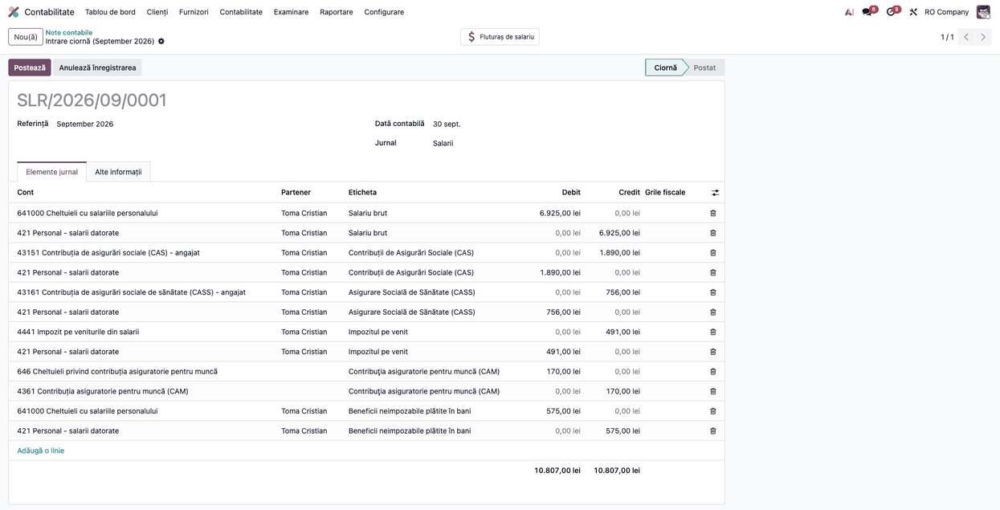

**Verificați:** nota e echilibrată (10.807 = 10.807); 641 debit = brut − *Avantaj impozabil neplătit în bani* + *Beneficii neimpozabile plătite în bani*; toate
liniile 421 au angajatul partener, iar soldul 421 **pe angajat** e egal cu netul (4.363); nicio linie pe 641 credit. În fișa punții D112 același salariat apare fără
sporul de vechime (brut 7.060).

### Note de monografie și raportare

Maparea conturilor (făcută de `l10n_ro_hr_payroll_account_enhancement`) completează conturile implicite pe regulile salariale (doar unde lipsesc; configurările manuale rămân). Monografia generată:
- **Dr 641 = Cr 421** — salariul brut, inclusiv primele (liniile *Primă* nu au conturi proprii: sunt incluse în brut);
- **Dr 421 = Cr 43151 (CAS) + 43161 (CASS) + 4441 (impozit)** — rețineri;
- **Dr 6461 = Cr 4361** — CAM angajator (2,25%); Dr 646 dacă planul nu are 6461;
- **Dr 6422 = Cr 5328** — contravaloarea tichetelor de masă acordate;
- **Dr 421 = Cr 4271** — popriri și alte rețineri în favoarea terților;
- **Dr 6451 = Cr 4311** — CAS angajator pentru condiții deosebite / speciale (regula `PENSION`);
- **beneficii suportate de angajator:** pensia facultativă **Dr 6456 = Cr 4381**, pensia ocupațională **Dr 6458 = Cr 4381**, primele de asigurare voluntară de sănătate
  **Dr 6457 = Cr 4381** (toată suma; factura fondului sau a asigurătorului se închide pe 4381 = 401, nu din nou pe cheltuială); partea neimpozabilă plătită salariatului în
  bani (clauza de mobilitate, decontul educației timpurii) **Dr 641 = Cr 421**; tichete cadou, vouchere de vacanță, tichete de creșă și culturale **Dr 6422 = Cr 5328**;
  ajutoarele **Dr 6458 = Cr 423**, plătite separat (423 = 5121). Hrana, cazarea, serviciile turistice, abonamentul sport, educația plătită unității, avantajele în natură,
  autoturismul, cadourile în natură și transportul nu au cont în fluturaș: cheltuiala se înregistrează din factura furnizorului (de exemplu 6421 pentru avantajele în natură);
- **excedentul în natură peste plafon** (avantajul impozabil neplătit în bani, cadourile peste plafon) e doar bază de calcul: se scade din brut la generarea notei, deci
  rulajul debitor al lui 641 = brutul din stat − *Avantaj impozabil neplătit în bani* − *Cadouri neplătite în bani* (+ *Beneficii neimpozabile plătite în bani*). Diferența față
  de brutul din D112 se explică exact prin aceste linii;
- **concediu medical:** indemnizația suportată de angajator intră în brut (**Dr 641 = Cr 421**); indemnizația din FNUASS se datorează angajatului, dar se
  recuperează de la fond: **Dr 4382 = Cr 423** (sumă datorată de fond / datorată personalului), cu contribuțiile pe indemnizația FNUASS reținute pe contul
  de personal 423 (**Cr 43151 CAS, 43161 CASS, 4441 impozit**). Contabilitatea de recuperare de la CAS se face în afara modulului.
- **diferența până la baza minimă** (salariu sub salariul minim proporțional cu zilele cu contract activ, fără excepție, practic la
  normă parțială): angajatorul datorează CAS și CASS pe baza minimă, iar diferența față de contribuțiile reținute din salariu este
  cheltuiala lui: **Dr 6451 = Cr 43151** (CAS) și **Dr 6453 = Cr 43161** (CASS), fără 421. Exemplu la brut 2.500 în 09/2026: 406 și 163;
  D112 le declară la obligațiile 458 / 459. Zilele de concediu medical nu intră în prag, iar indemnizațiile nu intră în comparație (Pasul 17).

Cifre de control (stat de referință 09/2026, 3 salariați la brut 5.000 — dintre care doi scutiți de impozit conform art. 60 — și unul la salariul minim cu tichete): 641 = 421 19.325; 421 = 43xx/444 7.333 (impozit
549, CAS 4.781, CASS 2.003); 6422 = 5328 900. CAM: 3 × 113 + 93 = 432 lei pe fluturași, față de 430 în XML-ul D112 (care rotunjește pe total; în formular totalul CAM apare cu bani) — diferența de
2 lei se acoperă din toleranța reconcilierii D112 sau printr-o corecție lunară.

Regulile *Sumă neimpozabilă*, *Cost angajator* și deducerile nu generează înregistrări. **Nemapate:** plata netului (reconcilierea se face pe
contul 421, cu partenerul angajat), plata obligațiilor către buget, avansul chenzinal, achiziția tichetelor (Dr 5328 = Cr 401) și `UNEMPDISABLED`
(cota pentru persoanele cu handicap, obligație a firmei).

## 7. Legături cu alte module / declarații

| Modul | Rol |
|---|---|
| `l10n_ro_hr_payroll` (Enterprise) | Structura RO, regulile CAS/CASS/CAM, work entries, fluturaș. |
| `l10n_ro_hr_payroll_account` (Enterprise) | Maparea regulilor pe conturi (note contabile). |
| `l10n_ro_hr_payroll_account_enhancement` | Se instalează automat; mapează regulile modulului pe conturi (inclusiv 4382/423 pentru concediul medical) — Pașii 11 și 18. |
| `l10n_ro_anaf_d112` | Declarația 112. |
| `l10n_ro_anaf_d112_payroll` | Puntea fluturaș → D112: transferă tichetele, suma neimpozabilă, deducerile, bazele CAS/CASS (Pasul 9), concediile medicale (Pasul 22) și beneficiile (Pașii 25–28: rândurile 8.2.5, 8.3.x, 8.4.x, 8.5.x). |
| `hr_holidays` (Enterprise `hr_payroll_holidays`) | Cererile și alocările de concediu de odihnă și medical folosite la Pașii 15 și 23. |

**Ce e automat:** grila deducerii, salariul minim și suma neimpozabilă în vigoare la data fluturașului, deducerea
pentru copii, deducerea pentru tineri (doar sub 26 de ani la data fluturașului), valoarea tichetelor, CASS pe
brut + tichete − suma neimpozabilă, rotunjirea la leu; plafoanele tichetelor cadou și ale cadourilor pe ocazie, plafoanele proprii ale beneficiilor din
art. 76 alin. (4^1) și plafonul comun de 33%, avantajul autoturismului (1,7%), excedentul impozabil și scoaterea lui din net.
**Ce rămâne manual:** completarea câmpurilor angajatului și a persoanelor în întreținere; bifa pentru scutire;
numărul de tichete când diferă de zilele lucrate; actualizarea parametrilor când se modifică legislația; introducerea certificatelor medicale și a bazei din adeverință la angajatorul anterior;
codurile neimpozabile de concediu medical în D112 se verifică manual; depunerea decontării FNUASS la casa de asigurări; ocazia pe fiecare linie de cadou;
zilele de delegare de scăzut din plafonul hranei; codul CAEN al furnizorului de abonamente sport; valoarea de piață a avantajelor în natură și procentul de folosință a autoturismului;
plata ajutoarelor și a transportului, care se fac în afara statului.

## 8. Verificări pentru consultant

- [ ] Parametrul *Romania Salary Parameters* are două valori: 01.01.2026 (S1 = 4.050, suma neimpozabilă 300) și
      01.07.2026 (S1 = 4.325, suma neimpozabilă 200).
- [ ] La brut = salariu minim, fără persoane și fără tichete: *Sumă neimpozabilă* = 200, DPB = 20% × 4.325 = 865,
      CAS = 1.031, CASS = 413 (Ion Popescu).
- [ ] Dacă salariul de bază din contract depășește salariul minim, nu există sumă neimpozabilă; deducerea scade cu 0,5 puncte procentuale la fiecare 50
      lei peste salariul minim și este 0 peste salariul minim + 2.000 lei (Andrei Dobre).
- [ ] CASS = 10% × (brut + tichete − suma neimpozabilă); CAS și CAM = procent × (brut − suma neimpozabilă).
- [ ] Impozitul = 10% × (brut + tichete − suma neimpozabilă − CAS − CASS − deduceri), rotunjit conform regulii de mai sus: baza se rotunjește la leu (0,50 în jos), apoi se aplică cota.
- [ ] Salariul net = brut − CAS − CASS − impozit, fără tichete (Maria Ionescu: 2.511); *Cost angajator* = brut + CAM + tichete.
- [ ] Copil neînscris la școală sau major nu generează cei 100 lei.
- [ ] Fără bifa Funcție de bază, toate deducerile și suma neimpozabilă sunt 0 (Radu Georgescu).
- [ ] Prima în net: netul fluturașului cu prima minus netul fără ea este cel puțin suma cerută (Moraru Elena, 1.000 lei); linia *Primă (în net, brut calculat)* arată brutul găsit și intră în brutul lunii.
- [ ] La scutire (art. 60), impozitul este 0 (Vlad Stan).
- [ ] Cei 100 lei pentru copil se acordă unui singur părinte, pe baza declarației și a documentului de înscriere (se verifică manual).
- [ ] În D112 (cu puntea instalată), linia fiecărui angajat are aceleași tichete, sumă neimpozabilă, deduceri și bază impozabilă ca fluturașul.
- [ ] Un fluturaș cu CNP lipsă sau copil fără CNP afișează avertizări; după corectare bannerul dispare (Barbu Mihai).
- [ ] Simulatorul la 5.000 brut dă net 2.981 și cost angajator 5.113, fără să creeze fluturaș.
- [ ] La 4 ore pe zi, 2.200 brut + 300 primă: net 1.549, diferențe CAS / CASS 406 / 163, cost total angajator 3.125 (cu puntea D112).
- [ ] Reținerile deductibile reduc impozitul, nu și deducerea personală; plafonul de 400 EUR/an se respectă (Iliescu Radu: impozit 254, net 2.946).
- [ ] Certificat CMB 0000101, 14–23.09.2026, cod 01, bază manuală 30.000/126: media 238,10; angajator 619; FNUASS 464.
- [ ] Continuarea (CMB 0000202) are seria/numărul inițial completate, fără a doua zi neplătită, iar suma plătită pe episod nu depășește cea datorată.
- [ ] Normă întreagă, 1 zi lucrată + 21 de zile de concediu medical: fără *Diferență CAS / CASS până la baza minimă* (pragul 188 e
      sub salariul pe ziua lucrată); la normă parțială cu concediu medical, diferența se calculează doar pe salariu.
- [ ] Nota contabilă a fluturașului cu concediu medical: Dr 4382 = Cr 423 464; Dr 423 = Cr 43151 116 / 43161 46 / 4441 21; 641 = 421 doar pe indemnizația angajatorului.
- [ ] Decontarea FNUASS din septembrie: 11 zile, 1.964 lei = suma liniilor *Concediu medical (FNUASS)* din fluturașii validați.
- [ ] D112 septembrie: fila *Concedii medicale* are câte o linie pe certificat, cu aceleași sume ca fluturașii.
- [ ] Concediul de odihnă: 5 zile × media (iunie–august, cu sporul permanent de 500) = 1.250 lei, cu sporul proratat 386 și brut 5.500 (Preda Ioana).
- [ ] Creați și validați fluturașul din iunie 2026 al unui angajat cu tichete (21 de zile lucrate, cu 1 iunie sărbătoare legală în calendar); cu *Tichete de masă pentru: Luna anterioară*, fluturașul din iulie propune 21 de tichete. Fără fluturașul din iunie și fără D112 importat pentru iunie propune 0, iar câmpul rămâne vizibil.
- [ ] Cadouri de Crăciun (Neagu Irina): tichete 300 + cadou în natură 200 → *Tichete cadou - neimpozabile* 300, *Cadouri în natură peste plafon* 200, brut 6.700,
      *Cadouri neplătite în bani* −200, net 3.719. Două linii fără ocazie dau un singur plafon de 300; 8 Martie la un angajat bărbat e integral impozabil.
- [ ] Beneficii art. 76 alin. (4^1) (Toma Cristian, 6.000): mobilitate 1.000 pe 10 zile → 575 neimpozabil; cazare 1.500 → 865; *Avantaj impozabil* 1.060; brut 7.560;
      *Beneficii neimpozabile plătite în bani* 575; *Avantaj impozabil neplătit în bani* −635; net 4.363. Suma părților neimpozabile nu trece de 33% din salariul de bază.
- [ ] Schimbând *Ordinea în plafonul de 33%* pe tipul *Cazare (angajator)* la o valoare mai mică decât a mobilității, cazarea consumă prima plafonul (la 4.325: cazare 865, mobilitate 562).
- [ ] Autoturism (Lungu Mihai): 100.000 × 1,7% × 50% = 850; cu avantajul de 500: *Avantaj impozabil* 1.350, scos din net; plafonul de 33% al celorlalte beneficii rămâne neatins.
- [ ] Ajutor 1.500 + transport 200 + tichete de creșă 400 (Pavel Simona): brut, CAS și CASS neschimbate (6.500 / 1.625 / 650), impozitul crește doar din tichete, cost angajator 8.746.
- [ ] Nota fluturașului cu beneficii: Dr 641 6.925 (brut − 635) + 575 (în bani); fără 641 pe credit; nota echilibrată; liniile 421 cu angajatul partener, sold 421 pe angajat = net.
- [ ] Ajutorul se înregistrează Dr 6458 = Cr 423 cu angajatul partener; tichetele de creșă Dr 6422 = Cr 5328.
- [ ] Verificați manual condiția din art. 77: persoana în întreținere nu are venituri peste 20% din salariul minim
      (modulul nu o verifică).

## 9. Mesaje de eroare frecvente

| Mesaj | Cauză | Remediere |
|---|---|---|
| Deducerea personală este 0 | Lipsește bifa Funcție de bază, sau venitul depășește salariul minim + 2.000 lei | Verificați bifa și venitul brut (inclusiv tichete) |
| Deducerea de bază nu crește cu persoanele | Persoanele listate au perioada încheiată înainte de luna fluturașului | Verificați coloanele Din data / Până la |
| Deducerea pentru copii lipsește | Copilul nu are CNP, nu e bifat Școală sau are 18 ani împliniți | Completați CNP-ul și bifa Școală |
| Avertisment la data nașterii | Data nașterii diferă de cea din CNP | Corectați una dintre ele; se folosește câmpul Data nașterii |
| Tichetele nu apar pe fluturaș | Angajatul nu are bifa Tichete de masă | Bifați-o pe fila Stat de plată |
| CNP lipsă: salariatul nu poate fi declarat în D112 | Angajatul nu are CNP completat | Completați CNP-ul pe fișa angajatului |
| Fluturașul nu arată concediul medical | Certificatul nu e confirmat sau perioada nu intră în luna fluturașului | Confirmați certificatul și recalculați fluturașul |
| Decontarea FNUASS spune că nu există indemnizații | Nu există fluturași validați cu concedii medicale | Validați fluturașii lunii înainte de export |
| Concediul de odihnă se plătește pe salariul curent | Lipsesc fluturașii validați pe lunile de referință | Validați fluturașii lunilor anterioare sau acceptați baza din contract |
| Parametri lipsă la o dată | Lipsește valoarea parametrului pentru perioada respectivă | Adăugați o valoare nouă cu data de început corectă |
| Plafonul anual al deducerilor este în EUR, dar compania nu are curs EUR | Pensii, asigurare de sănătate sau abonament sport fără curs EUR în sistem | Adăugați cursul EUR (Contabilitate → Configurare → Monede) și recalculați |
| Tichetele cadou sunt integral impozabile | Ocazia lipsește sau nu are plafon pentru beneficiar (8 Martie la un bărbat, 1 Iunie pentru salariat, Altă ocazie) | Completați ocazia corectă în fila *Salary Inputs* |
| Hrana are partea neimpozabilă 0 | Salariatul are bifa *Tichete de masă* pe contract | Hrana neimpozabilă nu se cumulează cu tichetele de masă |
| Serviciile turistice au partea neimpozabilă 0 | Salariatul are vouchere de vacanță în același an | Plafonul nu se aplică celor cu vouchere de vacanță |

## 10. Capturi de ecran

Capturile sunt **generate automat** din `tests/test_screenshots.py` (mixin `ScreenshotCase` din
`l10n_ro_doc_screenshots`, import defensiv), în română, pe planul RO, în RON:

1. `01_parametri_salariali.png` — parametrii salariali RO, cu istoric.
2. `02_config_angajat.png` — câmpurile RO pe fila Stat de plată.
3. `03_persoane_intretinere.png` — lista persoanelor în întreținere.
4. `04_fluturas_tichete.png` — fluturaș cu numărul de tichete.
5. `05_linii_tichete.png` — liniile fluturașului cu tichete de masă.
6. `06_linii_familie.png` — familie cu copii în învățământ.
7. `07_linii_tineri.png` — angajat sub 26 de ani.
8. `08_linii_scutit.png` — angajat scutit de impozit.
9. `09_d112_linii_tichete.png` — linia D112 cu tichete, sumă neimpozabilă și deduceri (necesită puntea D112).
10. `10_fluturas_pdf.png` — fluturașul tipărit (PDF) al angajatului cu tichete.
11. `11_nota_contabila.png` — nota contabilă a fluturașului validat.
12. `12_linii_retineri.png` — rețineri deductibile (sindicat, pensie facultativă).
13. `13_avertizari_fluturas.png` — avertizările fluturașului în ciornă.
14. `14_simulator_formular.png` — simulatorul la timp parțial, cu prima brută și diferența CAS/CASS până la baza minimă (necesită puntea D112).
    `14_simulator_brut_net.png` — raportul simulatorului brut / net.
15. `15_certificat_medical.png` — certificat de concediu medical confirmat.
16. `16_certificat_continuare.png` — certificat de continuare.
17. `17_linii_concediu_medical.png` — liniile fluturașului cu concediu medical.
18. `18_nota_contabila_cm.png` — nota contabilă a fluturașului cu concediu medical.
19. `19_linii_continuare.png` — liniile fluturașului la continuare.
20. `20_fisa_calcul_cm.png` — fișa de calcul a concediului medical (PDF).
21. `21_decontare_fnuass.png` — decontarea FNUASS exportată (XLSX).
22. `22_d112_concedii_medicale.png` — D112 cu fila *Concedii medicale* (necesită puntea D112).
23. `23_linii_concediu_odihna.png` — fluturaș cu concediu de odihnă pe medie.
24. `24_prima_in_net.png` — fluturaș cu prima de 1.000 lei net și brutul calculat.
25. `25_setare_luna_tichete.png` — setarea *Tichete de masă pentru (România)*, cu varianta *Luna anterioară* (Pasul 4).
26. `26_intrari_ocazie.png` — intrările fluturașului cu coloana *Ocazie* (Pasul 25).
27. `27_linii_cadouri.png` — tichetele cadou și cadoul în natură peste plafon (Pasul 25).
28. `28_tip_intrare_beneficiu.png` — tipul de intrare *Cazare (angajator)*, cu ordinea în plafonul de 33% și bifa de plată în bani (Pasul 26).
29. `29_linii_beneficii_41.png` — clauza de mobilitate și cazarea, cu plafoanele și plata în bani (Pasul 26).
30. `30_linii_avantaje_natura.png` — autoturismul folosit în scop personal și un avantaj în natură (Pasul 27).
31. `31_linii_ajutoare_tichete.png` — ajutorul, transportul și tichetele de creșă (Pasul 28).
32. `32_nota_contabila_beneficii.png` — nota contabilă a fluturașului cu beneficii, fără 641 pe credit (Pasul 29).

Lunile cazurilor: Pașii 1–13 iulie 2026; Pașii 14–24 și 26–29 septembrie 2026; Pasul 25 decembrie 2026; datele sunt create de test: baza trebuie creată cu limba **română** activă.

```bash
./odoo/odoo-bin -c odoo.conf -d test19 --load-language=ro_RO -i l10n_ro_hr_payroll_enhancement,l10n_ro_anaf_d112_payroll,l10n_ro_doc_screenshots \
  --test-tags=/l10n_ro_hr_payroll_enhancement:TestPayrollRoScreenshots --stop-after-init
```

## 11. Observații pentru manual

- Subliniați eroarea corectată: nativul calcula impozitul pe brut.
- Explicați grila ca pe o tabelă cu trepte de 50 lei și arătați cum se citește la venitul care include tichetele.
- Salariul minim și suma neimpozabilă sunt parametri cu istoric: fluturașii lunilor trecute rămân corecți la recalculare.
- Limite cunoscute:
  - plata netului, avansurile, achiziția tichetelor și contribuțiile în condiții speciale nu sunt încă mapate contabil (vezi monografia);
  - declarația `l10n_ro_anaf_d112` are propria formulă liniară pentru deducere; în ian.–iun. 2026 ea acordă 200 lei
    sumă neimpozabilă și la nivelul S2 (4.325), pe când acest modul acordă 300 lei doar la salariul de bază egal cu
    S1 (4.050) — de aliniat după confirmarea regulii;
  - rotunjirea pe componente (ex. diferența din luna anterioară a unui episod) poate da ±1 leu între certificat, fluturaș și decontare;
  - modulul nu proratează automat regulile de spor marcate ca permanente pentru zilele de concediu de odihnă (Pasul 23);
  - concediile medicale pe condiții deosebite sau speciale și unele coduri de indemnizație (51, 02–04 pentru procent) nu sunt tratate complet;
  - **de confirmat de contabil, din textul OUG 89/2025 și OUG 8/2026:** valorile 300/200 lei și pragurile de
    4.300/4.600 lei, plafonul de 33% (care, la salariul minim, nu limitează practic suma de 200 lei), tratamentul
    concediului medical la proratare,
    rotunjirea CAS/CASS/CAM și vârsta în luna în care se împlinește;
  - suma neimpozabilă se proratează cu zilele lucrate fără concedii și cu partea din lună în care contractul este activ;
  - la tichetele pe luna anterioară, încetarea contractului nu e tratată automat: tichetele pentru ultima lună lucrată
    se trec manual pe ultimul fluturaș, dacă firma le acordă la lichidare; la angajare, prima lună propune 0 (nu există
    luna anterioară), de completat manual dacă este cazul;
  - beneficii (Pașii 25–29): **de confirmat la sursa primară** câștigul salarial mediu 9.192 lei (Legea 44/2026), valoarea maximă a tichetului de masă (45 lei), vârsta copiilor la
    educația timpurie (sub 6 ani) și plafoanele legale ale tichetelor de creșă și culturale (modulul nu le aplică: suma întreagă se impozitează); zilele de delegare nu
    se scad automat din plafonul hranei; educația timpurie numără doar copiii din lista persoanelor în întreținere; abonamentele medicale de la o clinică se
    înregistrează pe 6458, nu pe 6457 (contul de schimbat pe regulă).
