# Fișă Modul: Împrumuturi și Leasing (credite 162/519, leasing 167/21x)

**Poziție plan:** B8.2
**Modul:** `l10n_ro_leasing`
**FR:** FR-37, FR-80
**Capitol manual:** Cap 12.4
**Utilizator principal:** Contabil trezorerie (credite), Contabil imobilizări și furnizori (leasing)
**Prioritate:** 🔴 Ridicată (credite și leasing la majoritatea clienților; datoriile pe termen scurt / lung intră în bilanț)

---

## 1. Scop business

Firmele își finanțează investițiile și activitatea curentă prin credite bancare și leasing. Graficul
de rambursare vine de la bancă sau de la societatea de leasing, iar contabilul trebuie să
înregistreze tragerea, dobânda lunii, fiecare rată, comisioanele și, la închiderea exercițiului, să
împartă datoria în partea scadentă într-un an și partea pe termen lung. Modulul ține contractul și
graficul în Odoo și generează notele din grafic și din extrasul de cont: ratele creditului se leagă
direct de linia de extras, dobânda se angajează lunar, iar datoria se reclasifică automat între
contul „peste un an” și contul „sub un an”. La leasing, generează nota de activare a bunului și
nota contabilă a fiecărei rate (pe baza facturii locatorului). Situația datoriilor pe scadențe dă, la orice dată, cifrele pentru bilanț și pentru
nota explicativă privind datoriile.

## 2. Bază legală și context

- **OMFP 1802/2014:**
  - funcțiunile conturilor 162, 167, 168, 404, 471, 519, 627 și 666;
  - pct. 53 alin. (4): dobânda se recunoaște în perioada la care se referă, deci se angajează la
    sfârșitul lunii, chiar dacă banca o debitează în altă zi;
  - pct. 212–219: leasingul; pct. 213 alin. (2) dă criteriile de leasing financiar, dintre care cel
    puțin unul trebuie îndeplinit (transferul proprietății, opțiune de cumpărare la un preț
    suficient de mic, durata acoperă în cea mai mare parte durata de viață economică, totalul
    ratelor cel puțin egal cu valoarea de intrare, bunuri de natură specială);
  - pct. 321 și 325: soldurile în valută ale creditelor și ale leasingului se reevaluează lunar;
  - pct. 360–363 și 368: datoria se prezintă în bilanț după exigibilitate (sub un an / peste un an);
  - pct. 468 lit. g): nota explicativă cuprinde sumele exigibile după mai mult de cinci ani și
    datoriile acoperite cu garanții reale.
- **Codul fiscal:**
  - art. 281 alin. (8) și art. 291 alin. (4): la leasing, faptul generator al TVA este data
    scadenței ratei, iar cota este cea de la acea dată (19% înainte de 01.08.2025, 21% după);
  - art. 292 alin. (2) lit. a): creditul bancar și comisioanele lui sunt scutite de TVA;
  - art. 292 alin. (2) lit. e) și alin. (3): leasingul de bunuri imobile este scutit, cu opțiune de
    taxare.

Planul de conturi RO din Odoo are pentru 162, 167, 168 și 519 doar analiticele de exigibilitate (de
exemplu 16211 „până la un an” și 16212 „peste un an”). În Odoo codurile apar completate la 6 cifre
(16212 → 162120, 16211 → 162110, 1671 → 167100, 4041 → 404100); fișa folosește codurile din OMFP. De aceea reclasificarea lunară se face printr-o
notă contabilă, ca balanța să arate repartizarea corectă.

## 3. Utilizatori și roluri

- **Contabil trezorerie** — creditele: contractul, tragerea și ratele din extras, notele de sfârșit
  de lună, schimbarea dobânzii, rambursarea anticipată.
- **Contabil imobilizări / furnizori** — leasingul: contractul, activarea bunului, notele ratelor (din
  facturile locatorului).
- **Contabil șef** — tipurile de contract, situația datoriilor pe scadențe la închidere.

Roluri recomandate pentru testare:
- utilizator cu drept **Contabilitate / Contabil** (vede meniurile din **Contabilitate →
  Contabilitate**; fără Contabilitatea enterprise, aplicația se numește **Facturare**, iar meniurile
  sunt în **Facturare → Contabilitate**, ca în capturi);
- utilizator cu drept **Contabilitate / Administrator** pentru **Tipuri de împrumut / leasing**.

## 4. Conturi și date implicate

| Cont | Rol |
|---|---|
| 16212 / 16211 | credit bancar pe termen lung: peste un an / sub un an |
| 51911 | credit bancar pe termen scurt |
| 16821 / 51981 | dobânzi datorate pentru creditul pe termen lung / scurt |
| 1672 / 1671 | datoria de leasing financiar: peste un an / sub un an |
| 21x (2131, 2133, 212) | bunul primit în leasing financiar |
| 666 | cheltuieli cu dobânzile |
| 627 | comisioane bancare |
| 4711 | comisionul de acordare eșalonat |
| 4041 / 401 | furnizori de imobilizări (leasing financiar) / furnizori (leasing operațional) |
| 612 | chirie (leasing operațional) |
| 4426 | TVA deductibilă (leasing) |
| 5121 | contul bancar al creditului |
| 665 / 765 | diferențe de curs (prin reevaluarea valutară) |

Date minime pentru demo:
- companie românească, cu planul de conturi RO;
- o bancă (partener) și o societate de leasing (partener);
- un jurnal de bancă și un jurnal de operațiuni diverse;
- un extras de cont cu linia de tragere a creditului și liniile ratelor.

Exemplul din fișă: **credit de 120.000 RON**, 36 de rate, dobândă 7,2%, zile reale/360, tras pe
15.01.2025, comision de acordare 600 RON reținut din tragere; **leasing financiar** pentru o
autoutilitară: avans 20.000 RON, sumă finanțată 80.000 RON, valoare reziduală 10%, 48 de rate,
dobândă 8,5%.

## 5. Configurare inițială

1. Instalați modulul `l10n_ro_leasing` (dependențe: `account`, `l10n_ro`). Pentru reevaluarea
   valutară a creditelor în valută, instalați și `l10n_ro_currency_revaluation`.
2. Verificați tipurile de contract în **Contabilitate → Configurare → Contabilitate → Tipuri de
   împrumut / leasing** (fără Contabilitatea enterprise: **Facturare → Configurare → Contabilitate**; pasul 2): la planul RO, cele patru tipuri se creează automat.
3. Creați un jurnal de tip **Operațiuni diverse** pentru notele contractelor (de exemplu „Împrumuturi
   și leasing”) și alegeți-l pe tipuri.
4. Pentru credite: verificați că jurnalul de bancă are contul de suspens configurat (5125 în planul
   RO) și importați extrasul de cont.
5. Opțional: activați acțiunea programată **Împrumuturi și leasing RO: rate scadente și note de
   sfârșit de lună** din **Setări → Tehnic → Automatizare → Acțiuni planificate** (cu modul
   dezvoltator activ).

## 6. Flux de utilizare

### Pasul 1 — Lista contractelor

Accesați **Contabilitate → Contabilitate → Împrumuturi și leasing** (fără Contabilitatea enterprise:
**Facturare → Contabilitate → Împrumuturi și leasing**, ca în captură). Lista arată toate contractele:
număr, finanțator, tip, fel (credit bancar, leasing financiar, leasing operațional), date, suma
finanțată, principalul rămas și starea. Filtrele **Credit bancar**, **Leasing financiar**, **Leasing
operațional** și **Activ** restrâng lista. Apăsați **Nou** pentru un contract nou.

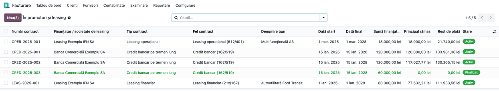

### Pasul 2 — Tipurile de contract

În **Contabilitate → Configurare → Contabilitate → Tipuri de împrumut / leasing** verificați cele
patru tipuri create automat: **Credit bancar pe termen lung**, **Credit bancar pe termen scurt**,
**Leasing financiar**, **Leasing operațional**. Pe fiecare, coloanele **Cont datorie (peste un
an)** și **Cont datorie (sub un an)** arată analiticele folosite (16212 / 16211, 51911,
1672 / 1671), iar **Reclasificare sub un an** e bifată la creditul pe termen lung și la leasingul
financiar. Un tip nou (de exemplu „Credit de investiții EUR”) se adaugă cu **Nou**.

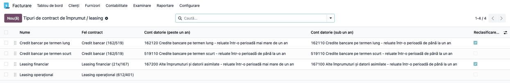

### Pasul 3 — Contractul de credit și graficul

Pe contractul nou alegeți **Tip contract** = *Credit bancar pe termen lung*: felul contractului,
conturile, durata și calculul zilelor se completează din tip. Completați **Număr contract**,
**Finanțator / societate de leasing** (banca), **Dată start** (15.01.2025), **Număr rate lunare**
(36), **Sumă finanțată** (120.000), **Dobândă anuală** (7,2). În pagina **Preluare și comisioane**,
**Comision de acordare** = 600; în pagina **Contabilitate**, **Jurnal bancă** = contul pe care se
trage creditul.

Apăsați **Generează grafic**, apoi **Activează contractul**. Verificați pe ecran:
- rata 1 (15.02.2025) are principal 2.972,23 și dobândă 744,00 (120.000 × 7,2% × 31 / 360), total
  3.716,23; coloana TVA lipsește (creditul e scutit);
- **Sold după rată** scade de la 117.027,77 până la zero la ultima rată;
- totalul coloanei **Principal** = 120.000.

La credit, activarea nu generează notă contabilă: datoria apare la tragere.

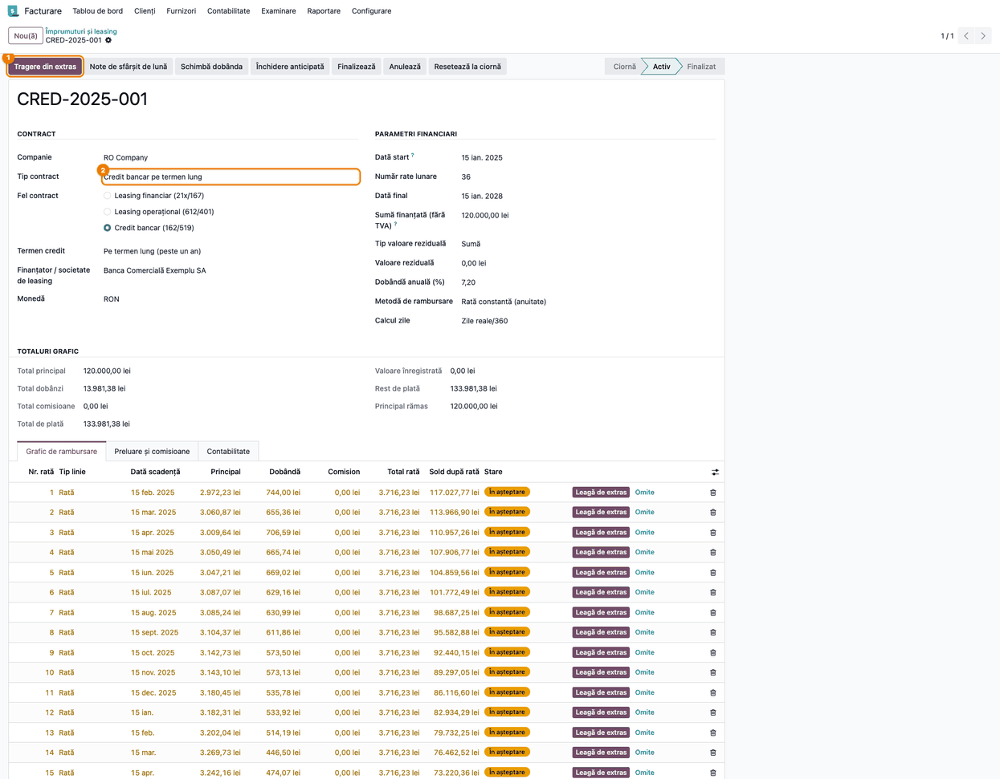

### Pasul 4 — Tragerea creditului din extras

Apăsați **Tragere din extras**. Asistentul **Leagă de extras** propune linia de extras cu suma
apropiată (120.000 − 600 = 119.400), în ±10 zile de data de start; **Sumă așteptată** și **Sumă din
extras** trebuie să coincidă (la plăți, ambele apar cu minus). Dacă linia nu apare, bifați **Afișează toate liniile nereconciliate**.
Apăsați **Confirmă**.

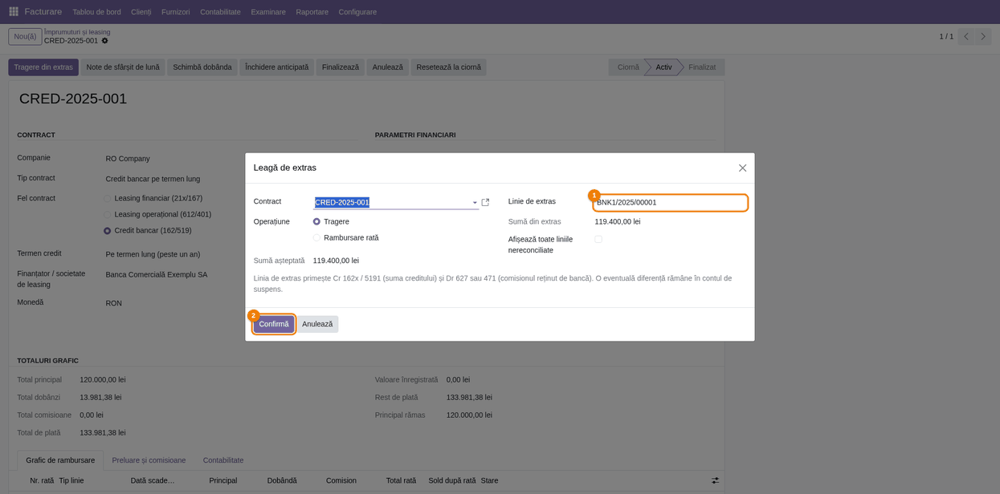

### Pasul 5 — Nota extrasului după tragere

Deschideți linia de extras (din butonul **Note** al contractului) și verificați în **Elemente
jurnal**:
- **Dr 5121** 119.400 (suma încasată) și **Dr 627** 600 (comisionul reținut);
- **Cr 16212** 120.000 (creditul, peste un an);
- linia de suspens 5125 a dispărut: extrasul este reconciliat.

Imediat după tragere, modulul mută în **16211** principalul scadent până la 15.01.2026 (37.065,71):
Dr 16212 = Cr 16211.

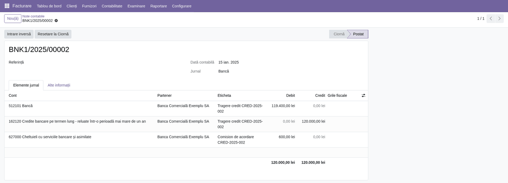

### Pasul 6 — Notele de sfârșit de lună

Apăsați **Note de sfârșit de lună** (sau lăsați acțiunea programată să ruleze). Pagina **Note de
sfârșit de lună** a contractului arată, pe fiecare lună încheiată:
- **Dobândă angajată**: la 31.01.2025, 384,00 = 744 × 16 / 31 zile (Dr 666 = Cr 16821);
- **Reclasificare sub un an**: diferența care aduce 16211 la principalul scadent în 12 luni;
- **Comision eșalonat**, dacă comisionul de acordare se eșalonează (Dr 627 = Cr 4711).

Verificați că la fiecare sfârșit de lună există cel mult o notă pe fel și că fiecare are nota
contabilă legată, înregistrată. În lunile cu o plată de rată apare în plus o notă de dobândă la data
plății (în captură: 15.02.2025, 360,00 — dobânda rămasă din rata 1, angajată la plată).

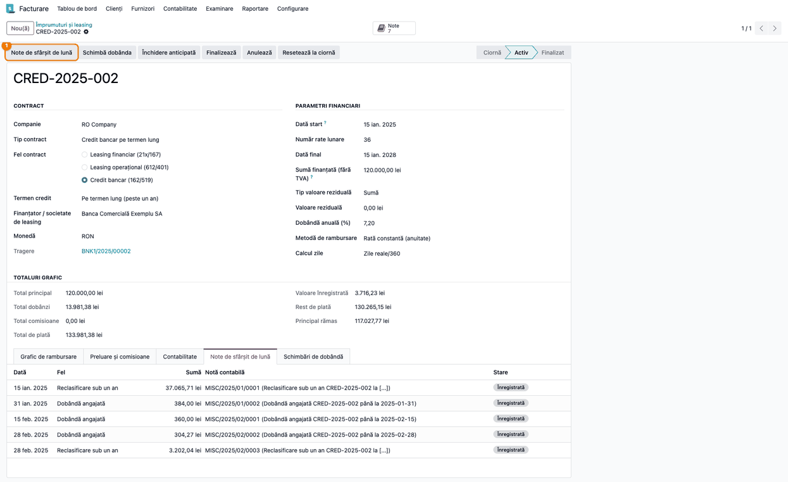

### Pasul 7 — Rata creditului din extras

În **Grafic de rambursare**, pe rata 2 (15.03.2025), apăsați **Leagă de extras**. Asistentul
propune linia de plată de 3.716,23 din 15.03.2025. Verificați **Sumă așteptată** = minus totalul
ratelor selectate și apăsați **Confirmă**. Modulul angajează întâi dobânda rămasă din rată (rata 2
are dobânda 655,36, din care 304,27 angajați la 28.02, deci se angajează 351,09), apoi completează
linia de extras; rata trece în starea **Înregistrată**.

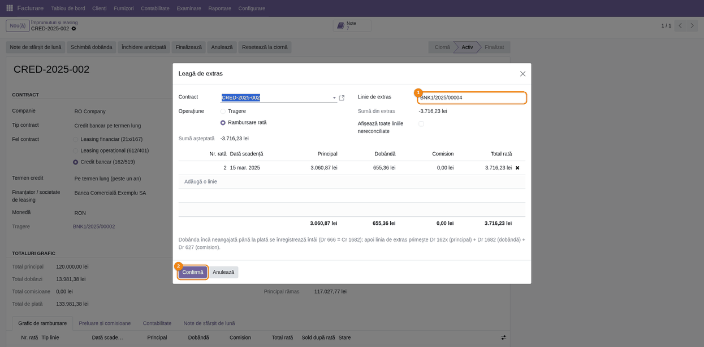

### Pasul 8 — Nota extrasului după rată

Captura arată nota extrasului pentru rata 1 (15.02.2025), legată la fel. Verificați în **Elemente
jurnal** ale liniei de extras:
- **Dr 16211** 2.972,23 (principalul);
- **Dr 16821** 744,00 (dobânda ratei, deja angajată: 384 la 31.01 + 360 la plată);
- **Cr 5121** 3.716,23.

După plată, soldul 16821 al contractului este zero. Dacă anulați reconcilierea liniei de extras,
rata revine în **În așteptare**.

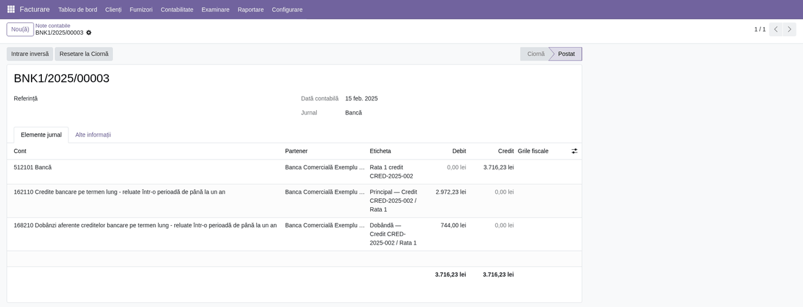

### Pasul 9 — Schimbarea dobânzii

La revizuirea dobânzii (ROBOR, IRCC, EURIBOR + marjă) apăsați **Schimbă dobânda**. Completați **Data
aplicării**, **Dobânda anuală nouă** și **Motiv**, apoi **Aplică**. Se regenerează doar ratele **În
așteptare** cu scadența de la data aplicării, pornind de la principalul lor; ratele înregistrate
rămân neschimbate. Nu se generează notă contabilă. Schimbarea apare în pagina **Schimbări de
dobândă** și în istoricul contractului, cu dobânda rămasă înainte și după.

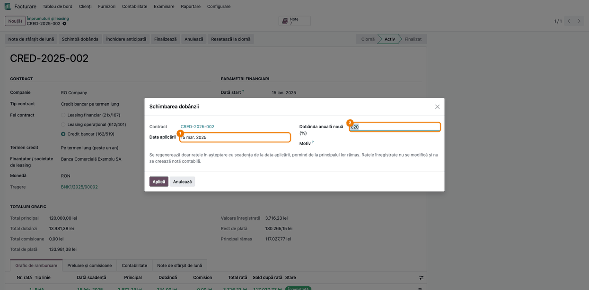

### Pasul 10 — Contractul de leasing financiar

Creați un contract cu **Tip contract** = *Leasing financiar*. Completați **Denumire bun**, **Dată
start** (01.01.2025), **Număr rate lunare** (48), **Sumă finanțată** (80.000), **Avans** (20.000),
**Tip valoare reziduală** = *Procent din valoarea bunului*, **Valoare reziduală (%)** = 10,
**Dobândă anuală** (8,5) și, în pagina **Contabilitate**, **Cont imobilizare (21x)** = 2133. Apăsați **Generează grafic**. Verificați pe ecran:
- **Valoare bun** = 100.000 (avans + sumă finanțată);
- linia 0 este **Avans** (20.000, TVA 3.800); ultima linie (a doua pagină a graficului) este
  **Valoare reziduală** (10.000), separată;
- coloana **Cotă TVA (%)** are 19 pentru avans și ratele scadente până la 01.07.2025 și 21 de la
  rata din 01.08.2025 (TVA 341,28 față de 377,20, pe aceeași bază de rată, 1.796,21);
- dobânda ultimei rate se calculează și pe valoarea reziduală.

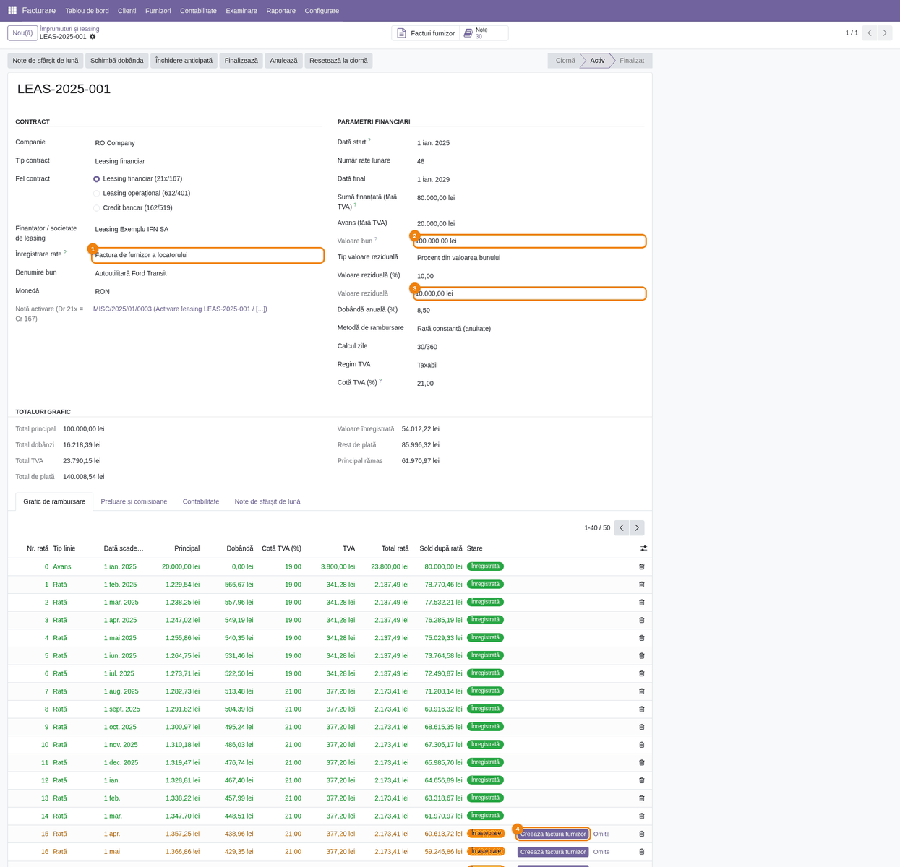

### Pasul 11 — Nota de activare a leasingului

Apăsați **Activează contractul** și deschideți **Notă activare**. Verificați:
- **Dr 2133** 100.000 (bunul, la costul total: avans + sumă finanțată);
- **Cr 1672** 100.000 (datoria de leasing).

Imediat după, reclasificarea mută în **1671** principalul scadent în 12 luni (avansul și primele
rate).

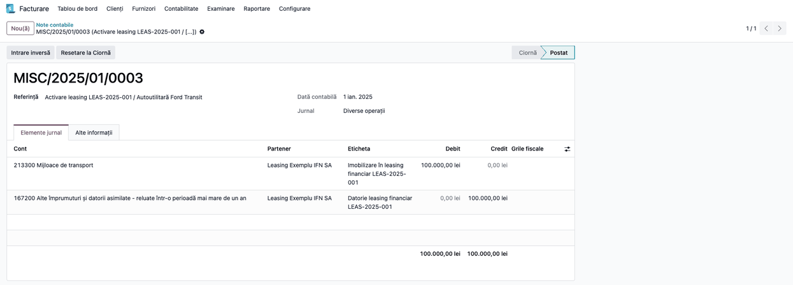

### Pasul 12 — Nota ratei de leasing

La primirea facturii locatorului, pe rata scadentă apăsați **Înregistrează** (sau **Înregistrează
rate scadente** pentru toate). Modulul creează o **notă contabilă** (nu o factură de furnizor) în
jurnalul de operațiuni diverse. Captura arată rata 2 (01.03.2025). Verificați nota ratei:
- **Dr 1671** (principalul), **Dr 666** (dobânda), **Dr 4426** (TVA cu cota ratei);
- **Cr 4041** (totalul facturii locatorului).

> **Atenție la TVA.** Linia 4426 a notei nu are taxă și grile de decont: TVA-ul nu ajunge automat în
> D300, D394, jurnalul de cumpărări sau secțiunea de taxe din SAF-T (D406). Alegeți una dintre
> variante, pentru tot contractul:
> - **Nota din contract** (recomandat): înregistrați rata din contract și adăugați manual TVA-ul
>   facturii în D300 / D394 (dreptul de deducere se exercită pe baza facturii locatorului, art. 299
>   și 301 CF). În SAF-T (D406), soldul 4426 al acestor note nu are corespondent în secțiunea de
>   taxe; diferența se justifică prin facturile locatorului, păstrate la dosar.
> - **Factura din e-Factura:** înregistrați factura locatorului ca factură de furnizor, cu liniile pe
>   1671 (principal) și 666 (dobândă) și taxa de TVA deductibilă; în contract, marcați fiecare rată cu
>   **Omite** imediat ce primiți factura, ca să nu se dubleze. Factura de furnizor nu este legată de
>   contract, deci **debifați Reclasificare sub un an** pe contract înainte de prima notă de sfârșit
>   de lună: altfel reclasificarea automată mută din nou în 1671 principalul deja descărcat de
>   factură și repartizarea 1671 / 1672 din bilanț iese greșită. Reclasificarea 1672 → 1671 se face
>   atunci manual, la închiderea perioadei, după situația datoriilor pe scadențe. Acțiunea
>   programată rulează și notele de sfârșit de lună ale creditelor: dacă o dezactivați, rulați
>   manual **Note de sfârșit de lună** pe fiecare contract. O rată rămasă „În așteptare” apare
>   restantă în situația datoriilor. La închiderea anticipată, înregistrați factura de închidere a
>   locatorului tot ca factură de furnizor, marcați ratele rămase **Omite** și finalizați contractul
>   cu **Finalizează**; nu folosiți asistentul **Închidere anticipată**, care citește doar notele
>   legate de contract.

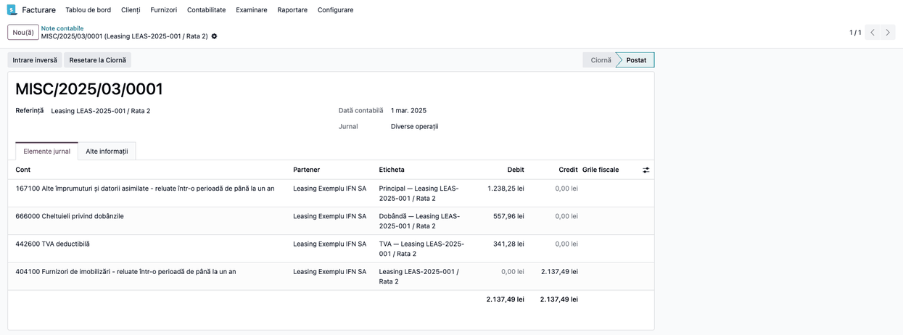

### Pasul 13 — Închiderea anticipată

Apăsați **Închidere anticipată**. La credit, alegeți **Linie de extras** a rambursării: data
închiderii devine data plății. Asistentul arată **Principal sub un an**, **Principal peste un an** și
**Dobândă angajată**; completați **Comision de rambursare anticipată** și **Cont comision** (627,
sau 6581 dacă contractul îl califică drept penalitate). La leasing financiar completați **Dobândă
facturată**; TVA-ul se calculează. Apăsați **Închide contractul**.

Verificați după închidere:
- soldurile 16211 / 16212 / 16821 (la leasing 1671 / 1672) ale contractului sunt zero;
- ratele rămase sunt **Anulate**, iar contractul este **Finalizat**;
- la credit cu comision eșalonat, restul de pe 4711 a trecut pe 627;
- notele de sfârșit de lună datate după închidere au fost anulate (mesaj în istoricul contractului).

Dacă anulați nota de închidere (sau reconcilierea extrasului), contractul se redeschide.

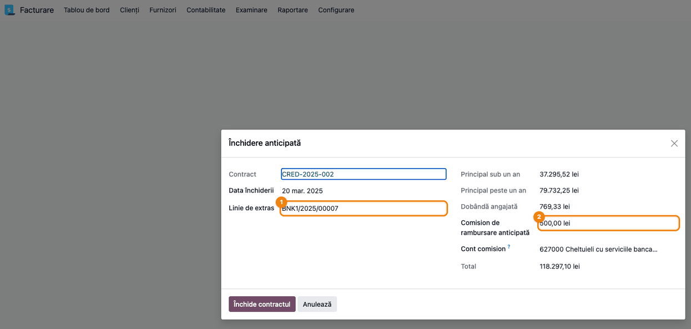

### Pasul 14 — Nota extrasului la închiderea anticipată

Deschideți linia de extras a rambursării (butonul **Note** al contractului). Captura arată creditul
CRED-2025-003 (60.000 RON, tras pe 15.01.2025), rambursat integral pe 20.02.2025, cu un comision de
300. Verificați în **Elemente jurnal**:
- **Dr 16211** 18.532,92 și **Dr 16212** 41.467,08 (tot principalul, pe cele două conturi);
- **Dr 16821** 430,51 (dobânda angajată la 31.01 și la data plății);
- **Dr 627** 300 (comisionul de rambursare anticipată);
- **Cr 5121** 60.730,51.

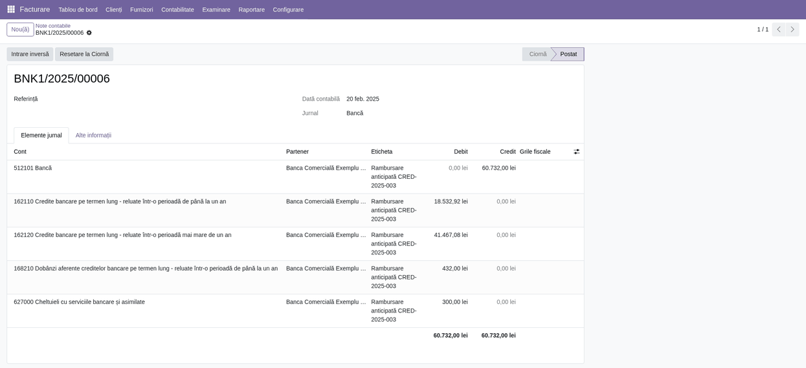

### Pasul 15 — Situația datoriilor pe scadențe

Accesați **Contabilitate → Contabilitate → Situația datoriilor pe scadențe** (sau **Facturare →
Contabilitate → …**), alegeți **La data** (în captură 28.02.2025) și apăsați **Afișează**.

1. **Găsiți pe ecran:** câte un rând pe contract, cu coloanele **Sub un an** (inclusiv restanțele),
   **Între 1 și 5 ani**, **Peste 5 ani**, **Dobândă** (angajată și neplătită), **Total principal**
   și **Garantat** (cu garanții reale).
2. **Verificați:**
   - **Sub un an** al creditului = soldul 16211 la aceeași dată (în captură 37.295,52 =
     37.065,71 reclasificați la tragere − 2.972,23 rata 1 + 3.202,04 reclasificați la 28.02), iar
     **Între 1 și 5 ani** + **Peste 5 ani** = soldul 16212 (la leasing: 1671 / 1672);
   - **Dobândă** = soldul 16821 (304,27, angajați la 28.02);
   - un contract închis anticipat înainte de dată nu mai apare (CRED-2025-003), iar un credit încă
     netras nu apare (CRED-2025-001).
3. **Folosiți rezultatul:** totalul **Sub un an** și suma **Între 1 și 5 ani** + **Peste 5 ani**, pe
   credite, merg la „Sume datorate instituțiilor de credit”, iar cele de leasing la „Alte datorii”
   din bilanț; coloana **Peste 5 ani** și garanțiile, în nota privind datoriile. Pentru export,
   selectați rândurile → **Acțiuni → Exportă**; vederea pivot grupează pe feluri de contract.

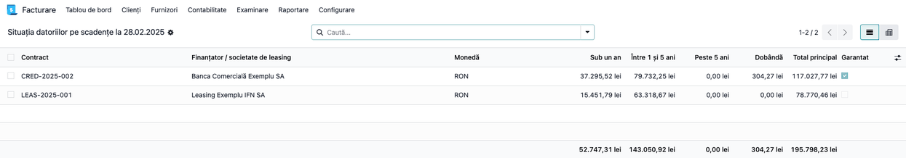

### Pasul 16 — Analiza ratelor

Accesați **Contabilitate → Contabilitate → Analiză rate**. Pivotul arată pe rânduri felul
contractului și pe coloane anul scadenței, cu măsurile **Principal**, **Dobândă** și **Comision**.

Pivotul arată graficul (ratele planificate, înregistrate sau nu), fără ratele anulate.

1. **Găsiți pe ecran:** coloana **Principal** din **Total**, pe fiecare fel de contract.
2. **Verificați:** principalul total = suma finanțată a contractelor active, la leasing financiar
   valoarea bunului (în captură: credite
   2 × 120.000 = 240.000, inclusiv creditul încă netras; leasing financiar 100.000, cu avansul;
   leasing operațional 18.000); creditul rambursat anticipat nu mai apare, pentru că ratele lui
   rămase sunt anulate.
3. **Folosiți rezultatul:** pentru bugetul de trezorerie, grupați după **Luna scadenței**; pivotul
   se descarcă în Excel cu butonul de descărcare din bara pivotului.

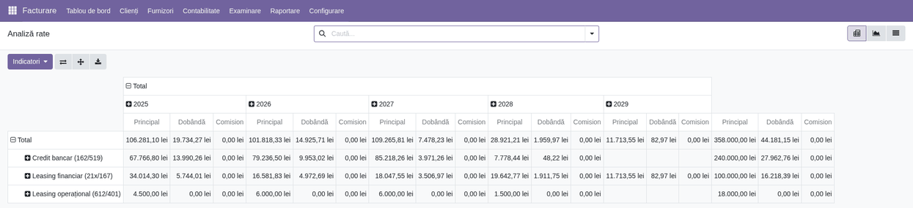

### Note de monografie și raportare

**Credit bancar pe termen lung (120.000 RON, comision 600):**

```
Tragere (din extras):      Dr 5121   119.400  =  Cr 16212  120.000
                           Dr 627        600
Reclasificare 12 luni:     Dr 16212   37.065,71 = Cr 16211  37.065,71
Dobândă 31.01:             Dr 666        384    =  Cr 16821     384
Dobândă la plată (15.02):  Dr 666        360    =  Cr 16821     360
Rata 1 (din extras):       Dr 16211    2.972,23 =  Cr 5121   3.716,23
                           Dr 16821      744
Comision eșalonat (lunar): Dr 627               =  Cr 4711
```

**Leasing financiar (avans 20.000, finanțat 80.000):**

```
Activare:                  Dr 2133   100.000    =  Cr 1672  100.000
Reclasificare 12 luni:     Dr 1672              =  Cr 1671
Nota avansului (factura):  Dr 1671    20.000    =  Cr 4041
                           Dr 4426   (TVA)
Nota ratei (factura):      Dr 1671 (principal) + Dr 666 (dobândă) + Dr 4426 (TVA) = Cr 4041
Plata facturii:            Dr 4041              =  Cr 5121
```

**Leasing operațional:** Dr 612 + Dr 4426 = Cr 401.

**Închidere anticipată, credit:**

```
Dobânda până la data plății:   Dr 666              =  Cr 16821
Comision eșalonat rămas:       Dr 627              =  Cr 4711     (dacă se eșalonează)
Nota extrasului:               Dr 16211 + Dr 16212 + Dr 16821 + Dr 627  =  Cr 5121
```

**Închidere anticipată, leasing financiar:** Dr 1671 + 1672 + 666 + 627 / 6581 + 4426 = Cr 4041.

- Schimbarea dobânzii și preluarea unui contract în curs nu generează note.
- Soldurile în valută din 162 / 167 / 168 / 519 se reevaluează lunar prin
  `l10n_ro_currency_revaluation` (665 / 765).
- Dobânda de leasing se recunoaște la nota ratei. Pct. 215 alin. (2) cere angajarea periodică: la
  raportările lunare sau trimestriale și la închiderea exercițiului, dacă scadența nu cade la
  sfârșitul perioadei, angajați manual dobânda dintre ultima scadență și sfârșitul perioadei,
  **Dr 666 = Cr 16871**, și stornați nota în roșu la 1 ale lunii următoare (**Intrare inversă**
  din notă, cu data stornării), **Dr 666 = Cr 16871 cu minus**. Nota ratei următoare înregistrează
  apoi dobânda întreagă pe 666, fără dublare, iar 16871 revine la zero. Evidența extrabilanțieră
  a dobânzii viitoare (8051) nu este generată de modul.
- Comisionul de acordare eșalonat stă integral pe 4711; la închiderea exercițiului, partea care se
  reia după 12 luni se reclasifică manual pe 4712.

## 7. Legături cu alte module / declarații

| Modul / proces | Rol în flux | Tip legătură |
|---|---|---|
| `account` | note contabile, extrase de cont, jurnale | dependență (manifest) |
| `l10n_ro` | planul de conturi RO cu analiticele X1 / X2 | dependență (manifest) |
| `l10n_ro_currency_revaluation` | reevaluarea lunară a soldurilor în valută 16x / 519 | opțional, automat dacă e instalat |
| `account_asset` (Enterprise) | amortizarea bunului în leasing financiar | manual (fișa mijlocului fix) |
| Bilanț / note explicative | repartizarea datoriilor sub / peste un an, peste 5 ani, garanții | din raportul de scadențe și din conturile X1 / X2 |
| D300 / D394 / SAF-T D406 (taxe) | TVA-ul ratelor de leasing | **nealimentat automat** de nota ratei (vezi pasul 12) |

**Ce e automat:** graficul de rambursare, nota de activare a leasingului, notele ratelor de
leasing, contrapartida tragerii și a ratelor de credit pe extras, dobânda angajată lunar, comisionul
eșalonat, reclasificarea lunară, închiderea anticipată și situația datoriilor pe scadențe.

**Ce rămâne manual:** clasificarea leasingului ca financiar sau operațional, alegerea contului 21x,
compararea graficului cu cel primit de la finanțator (și editarea lui, dacă diferă), legarea
fiecărei linii de extras de rată, fișa de mijloc fix, diferența dintre cursul băncii și cursul BNR
la plată (rămâne pe suspens), angajarea dobânzii de leasing la sfârșitul perioadei (cu stornare),
TVA-ul ratelor de leasing în declarații, reclasificarea 4711 / 4712.

## 8. Verificări pentru consultant

- [ ] La planul RO există cele patru tipuri de contract, cu conturile 16212 / 16211, 51911, 1672 / 1671.
- [ ] Graficul creditului: rata 1 are dobânda 744,00 (31 de zile, Actual/360), fără TVA; suma
      principalului = 120.000.
- [ ] Tragerea din extras: Dr 5121 119.400 + Dr 627 600 = Cr 16212 120.000; linia de extras e
      reconciliată, fără 5125.
- [ ] După tragere, soldul 16211 = principalul scadent în 12 luni (37.065,71).
- [ ] Dobânda angajată la 31.01 = 384,00; o nouă rulare a notelor de sfârșit de lună nu o dublează
      (în lunile cu plată apare în plus nota de dobândă la data plății).
- [ ] Rata 1 din extras: Dr 16211 2.972,23 + Dr 16821 744 = Cr 5121 3.716,23; soldul 16821 = 0.
- [ ] Anularea reconcilierii extrasului readuce rata în **În așteptare**.
- [ ] Schimbarea dobânzii nu modifică ratele înregistrate și nu creează notă.
- [ ] Leasing: valoarea bunului 100.000, avans în linia 0, reziduala separată, cota TVA 19 până la
      rata din 01.07.2025 și 21 de la rata din 01.08.2025.
- [ ] Nota de activare: Dr 2133 = Cr 1672 100.000; rata: 1671 + 666 + 4426 = 4041.
- [ ] Închiderea anticipată aduce la zero 16211 / 16212 / 16821 (1671 / 1672 la leasing) și anulează
      ratele rămase; anularea notei redeschide contractul.
- [ ] Situația datoriilor la o dată: **Sub un an** = sold X1, **Între 1 și 5 ani** + **Peste 5 ani** =
      sold X2, **Dobândă** = sold 16821.
- [ ] Închiderea anticipată CRED-2025-003: 16211 + 16212 + 16821 + 627 = 5121 60.730,51.
- [ ] Analiza ratelor: principalul total pe fel de contract = suma finanțată a contractelor active
      (la leasing financiar, valoarea bunului).

## 9. Mesaje de eroare frecvente

| Mesaj / simptom | Cauză probabilă | Remediere |
|-----------------|-----------------|-----------|
| „Completați pe contract, înainte de activare, conturile: …” | Lipsesc conturile obligatorii pentru felul contractului | Alegeți un tip de contract sau completați conturile din pagina **Contabilitate** |
| „Selectați contul de imobilizare (21x) pe contract înainte de activare…” | Leasing financiar fără cont 21x | Alegeți contul după natura bunului (2131, 2133, 212) |
| „Legați întâi tragerea creditului.” | Rată legată de extras înainte de tragere | Faceți întâi **Tragere din extras** |
| „Linia de extras este deja reconciliată.” | Linia a fost deja legată sau reconciliată | Alegeți altă linie sau anulați reconcilierea existentă |
| Nu apare nicio linie de extras în asistent | Suma sau data diferă mult de rată, ori alt jurnal de bancă | Bifați **Afișează toate liniile nereconciliate** sau verificați **Jurnal bancă** |
| „Ratele creditului bancar se înregistrează din linia de extras.” | **Înregistrează** pe o rată de credit | Folosiți **Leagă de extras** |
| „Data aplicării trebuie să fie după ultima rată înregistrată” | Schimbare de dobândă retroactivă | Alegeți o dată după ultima rată înregistrată |
| „Există rate înregistrate după data închiderii.” | Închidere anticipată datată înaintea unor rate deja plătite | Datați închiderea după ultima rată înregistrată |
| Eroare de perioadă blocată la închiderea anticipată | Notele de sfârșit de lună de anulat sunt într-o perioadă blocată | Deblocați perioada sau datați închiderea după ultima notă de sfârșit de lună |
| Diferență rămasă pe 5125 după legarea extrasului | Suma din extras diferă de rată (comision neprevăzut, curs) | Reconciliați diferența separat (627, 665 / 765) |

## 10. Capturi de ecran

Capturile (`static/description/`) sunt **generate automat** din `tests/test_screenshots.py`
(mixinul `ScreenshotCase` din `l10n_ro_doc_screenshots`, import defensiv), în **limba română**, pe
planul de conturi RO, pe compania „RO Company” în RON:

1. `01_lista_contracte.png` — lista contractelor de credit și leasing.
2. `02_tipuri_contract.png` — tipurile de contract, cu conturile implicite.
3. `03_credit_contract.png` — contractul de credit activ, cu graficul de rambursare.
4. `04_credit_tragere.png` — asistentul de tragere din extras.
5. `05_credit_tragere_nota.png` — nota extrasului după tragere: 5121 + 627 = 16212.
6. `06_credit_note_luna.png` — notele de sfârșit de lună ale creditului.
7. `07_credit_rata.png` — asistentul de legare a ratei cu extrasul.
8. `08_credit_rata_nota.png` — nota extrasului după rată: 16211 + 16821 = 5121.
9. `09_schimbare_dobanda.png` — fereastra de schimbare a dobânzii.
10. `10_leasing_contract.png` — contractul de leasing financiar, cu avans, reziduală și cota TVA pe rată.
11. `11_leasing_nota_activare.png` — nota de activare: 2133 = 1672.
12. `12_leasing_nota_rata.png` — nota ratei de leasing: 1671 + 666 + 4426 = 4041.
13. `13_inchidere_anticipata.png` — asistentul de închidere anticipată a creditului.
14. `14_inchidere_nota.png` — nota extrasului la rambursarea anticipată.
15. `15_situatia_datoriilor.png` — situația datoriilor pe scadențe.
16. `16_analiza_rate.png` — analiza ratelor în pivot.

În listele graficului, datele din anul în care s-au generat capturile apar fără an (convenția
Odoo pentru anul curent).

Regenerare:

```bash
./odoo/odoo-bin -c odoo.conf -d <db> -i l10n_ro_leasing,l10n_ro_doc_screenshots \
    --test-tags=fise_screenshots --stop-after-init
```

Necesită `playwright` în mediul Odoo + Chrome de sistem; dacă lipsește, testul se sare.

## 11. Observații pentru manual

- Prezentați întâi diferența dintre credit și leasing: la credit nota pleacă din extras și dobânda
  se angajează lunar; la leasing nota pleacă din factura ratei.
- Păstrați exemplul numeric unic (credit 120.000, 7,2%, rata 1 = 3.716,23; leasing 100.000 cu avans
  20.000; rambursare anticipată 60.730,51) în toate capturile și notele.
- Explicați reclasificarea X2 → X1 cu balanța: fără ea, bilanțul ar arăta toată datoria pe termen
  lung.
- Subliniați limita de TVA de la pasul 12 (nota ratei de leasing nu alimentează D300 / D394).
- Pentru contractele preluate în derulare, explicați câmpurile din pagina **Preluare și comisioane**:
  ratele deja înregistrate (rambursate la credit, facturate la leasing), principalul rămas, partea
  sub un an și dobânda deja angajată.
