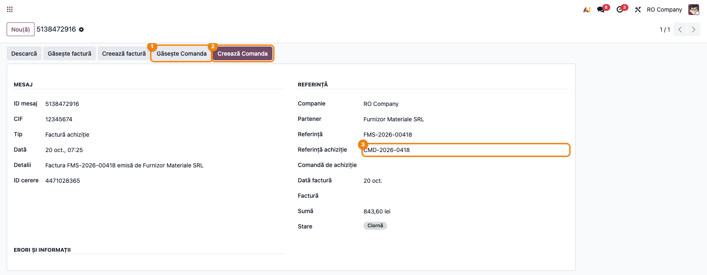
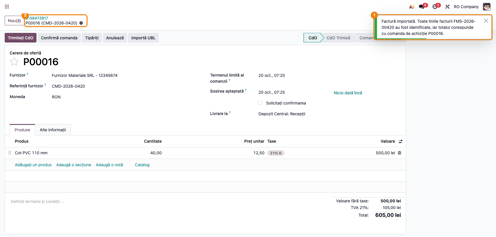
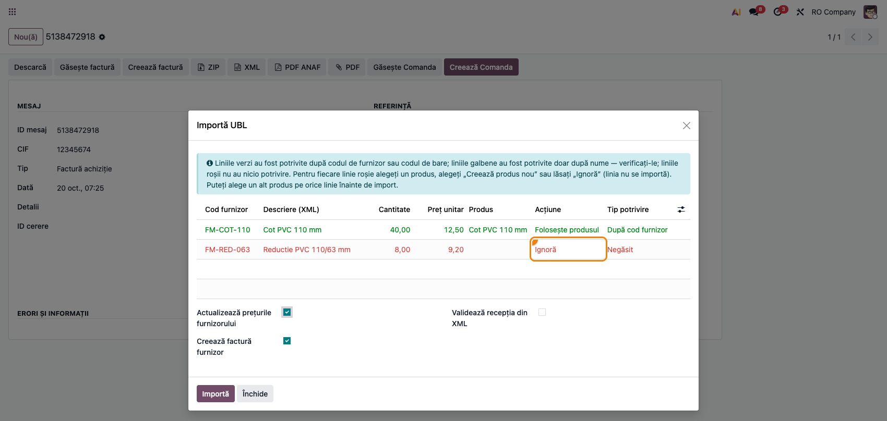

# Fișă Modul: Legarea mesajelor SPV de comenzile de achiziție

**Modul:** `l10n_ro_message_spv_purchase`
**Utilizator principal:** Contabil furnizori, operator achiziții
**Versiune documentată:** 19.0.0.0.10
**Prioritate:** 🔴 Ridicată (verigă centrală în fluxul de facturare furnizori prin e-Factura/SPV; sursa istorică a facturilor duplicate)

---

## 1. Scop business

Modulul face legătura între **mesajul SPV** (factura primită de la furnizor prin e-Factura/ANAF) și
**comanda de achiziție** din Odoo. Fără el, cele două documente trăiesc separat: factura intră din
SPV, comanda rămâne „de facturat", iar operatorul apasă „Creează factură" pe comandă și obține un
al doilea document pentru aceeași achiziție.

Modulul rezolvă asta pe trei planuri:

1. **Identifică comanda** — extrage referința comenzii din XML-ul UBL (`OrderReference/ID`) și o
   folosește pentru a găsi comanda de achiziție corespunzătoare; dacă nu găsește, poate crea una
   nouă (ciornă) pe furnizorul mesajului.
2. **Copiază XML-ul pe comandă și importă factura cu decizia utilizatorului** — atașamentul XML
   din mesajul SPV este *copiat* (nu doar referențiat) pe comanda de achiziție. Din 19.0.0.0.10,
   importul liniilor nu mai rulează nesupravegheat: dacă factura e curată (toate liniile
   identificate după cod și totalul bate), se importă direct, cu o notificare; altfel se deschide
   previzualizarea din `deltatech_purchase_ubl`, unde utilizatorul decide pentru fiecare linie
   (vezi [fișa acelui modul](../deltatech_purchase_ubl/FISA_CONSULTANT.md)).
3. **Leagă efectiv factura de liniile comenzii** — setează `purchase_line_id` pe liniile facturii
   prin ruta standard Odoo, ca `qty_invoiced` să crească și comanda să nu mai apară „de facturat".
   Acesta e mecanismul care oprește la rădăcină facturile duplicate.

Pe lângă asta, modulul semnalizează (fără să blocheze) situațiile de duplicat: comandă care are
deja o factură, sau factură cu aceeași cheie de deduplicare creată de cealaltă stivă SPV.

## 2. Bază legală și context

Modulul nu are temei legal propriu — este instrumentul de reconciliere între documentul fiscal
electronic și documentul comercial. Contextul legal este obligația de facturare electronică prin
**RO e-Factura/SPV** (Legea 296/2023 și normele ANAF subsecvente): furnizorul depune factura la
ANAF în format UBL XML, cumpărătorul o preia din SPV, iar factura din SPV este documentul fiscal —
comanda de achiziție rămâne document comercial intern.

> Modulul **nu** decide regimul de TVA, conturile sau data înregistrării. El doar împerechează
> documentele și populează legătura comandă↔factură. Contabilizarea se face de fluxul standard
> Odoo pe factura creată din mesajul SPV.

## 3. Utilizatori și roluri

Contabil furnizori (procesează mesajele SPV, apasă Găsește/Creează Comanda, verifică factura
rezultată), operator achiziții (verifică că comanda legată e cea corectă și că liniile importate
corespund), administrator funcțional (instalează, verifică cronurile SPV și drepturile).

Roluri recomandate pentru testare:
- Administrator funcțional: instalează modulul, verifică dependențele (`l10n_ro_message_spv`,
  `purchase`) și grupul `l10n_ro_config.group_ro_menus` pentru accesul la meniul SPV
- Contabil (Contabilitate / Contabil): rulează Găsește/Creează Comanda pe mesaje SPV
- Manager achiziții: verifică comenzile create automat și liniile importate

## 4. Conturi și date implicate

Modulul nu impune conturi proprii și nu generează note contabile. Elemente specifice pe care le
scrie, relevante pentru verificare:

- **`purchase_ref`** pe mesajul SPV — referința comenzii, extrasă automat din XML la
  `OrderReference/ID`; dacă lipsește, se folosește `ref` (numărul facturii) ca referință de
  căutare;
- **`purchase_order_id`** pe mesajul SPV — comanda legată; e și garda anti-reprocesare (al doilea
  click pe același mesaj ridică eroare);
- **atașament XML copiat pe comandă** (`ir.attachment` cu `res_model='purchase.order'`), cu
  descriere de trasabilitate „Copie XML din mesajul SPV ... (Ref: ...)"; deduplicat pe **checksum**,
  cu revenire pe nume + mimetype;
- **`account.move.line.purchase_line_id`** — legătura reală factură↔comandă, setată prin metoda
  standard `_find_and_set_purchase_orders` din modulul `purchase`. Modulul **nu** reimplementează
  potrivirea de linii;
- **`invoice_origin`** pe factură — se completează cu numărul comenzii, ca să alimenteze matcherul
  standard;
- **`l10n_ro_edi_is_duplicate`** — marcaj de duplicat, scris doar dacă câmpul există în bază
  (cuplaj slab, fără dependență în manifest).

Date minime pentru demo:
- companie românească cu localizarea contabilă și configurarea SPV/ANAF funcțională;
- un mesaj SPV de tip **In Invoice** cu ZIP-ul ANAF descărcat (câmpurile de atașament populate);
- un furnizor setat pe mesaj (`partner_id`);
- opțional, o comandă de achiziție existentă cu `partner_ref` egal cu referința din XML, pentru a
  demonstra cazul „găsește" în loc de „creează".

## 5. Configurare inițială

1. Instalați modulul `l10n_ro_message_spv_purchase` (dependențe: `l10n_ro_message_spv`,
   `purchase`).
2. **Nu există ecran de configurare dedicat.** Modulul se activează exclusiv prin butoanele de pe
   formularul mesajului SPV.
3. Verificați că cronurile de descărcare SPV din `l10n_ro_message_spv` sunt active — ele aduc
   mesajele pe care lucrează modulul:
   - *Romania e-Invoicing: Download SPV Message* (zilnic) — aduce lista de mesaje;
   - *Romania e-Invoicing: Download ZIP SPV Message* (zilnic, `limit=5`) — aduce ZIP-urile.
4. Meniul de lucru: **Contabilitate → Diverse → SPV → Messages SPV**. Accesul cere grupul
   `l10n_ro_config.group_ro_menus`.
5. **Recomandat: instalați și `deltatech_purchase_ubl` (≥ 19.0.1.4.14)**, altfel butoanele doar
   leagă comanda și atașează XML-ul, fără importul liniilor. Versiunea minimă contează: cu o
   versiune mai veche, importul automat rulează la atașarea XML-ului, iar previzualizarea deschisă
   de buton ar importa a doua oară. La actualizarea proiectelor, modulul din deltatech ajunge
   primul.
6. **Completați cumpărătorul** pe comenzile create din SPV (sau acceptați valoarea implicită dată
   de userul care rulează acțiunea): din `deltatech_purchase_ubl` 19.0.1.4.0, activitatea de
   verificare a importului se atribuie cumpărătorului de pe comandă.
7. Drepturi: acțiunile cer drept de citire pe mesaje SPV și drept de **creare/scriere pe comenzi de
   achiziție**. Copierea atașamentului se face cu `sudo()`, deci nu depinde de drepturile
   utilizatorului pe atașamente.

## 6. Flux de utilizare

### Pasul 1 — Deschideți mesajul SPV

**Contabilitate → Diverse → SPV → Messages SPV**, deschideți mesajul de tip **In Invoice** sau
**In Receipt**. Verificați că **Partenerul** e completat — fără el nu se poate crea o comandă.

Pe formular, sub câmpul **Reference**, modulul adaugă două câmpuri: **Purchase Reference**
(completat automat din XML, dacă factura declară `OrderReference/ID`) și **Purchase Order**
(comanda legată, gol la început).

### Pasul 2 — Alegeți acțiunea: Găsește sau Creează

În bara de sus apar două butoane, vizibile **doar** pe mesajele de achiziție:

- **Găsește Comanda** — caută o comandă după referință și o leagă dacă o găsește. Nu creează
  niciodată nimic.
- **Creează Comanda** — caută la fel; dacă nu găsește nicio comandă, creează una nouă (ciornă) pe
  furnizorul mesajului și o leagă.



Căutarea folosește **Purchase Reference**, iar dacă acesta e gol, **Reference**. Referința se caută
pe trei câmpuri ale comenzii — `partner_ref` (referința furnizorului), `origin` (documentul sursă)
și `name` (numărul comenzii) — restrânsă la partenerul și compania mesajului, când sunt completate.

> **Comenzile complet facturate sunt excluse din căutare** (din 19.0.0.0.6). Motivul: un furnizor
> care reutilizează aceeași referință pe toate facturile (cazul real: referința „ZILNIC", 6 facturi
> în 6 luni) lega toate facturile noi de aceeași comandă deja epuizată. Facturarea parțială nu e
> afectată — o comandă care mai are ce factura rămâne candidat valid.

Rezultate posibile:
- **exact o comandă găsită** — se leagă, se postează nota cu XML-ul și se importă factura (Pasul 3);
- **mai multe comenzi găsite** — se deschide lista filtrată, ca să alegeți manual; nu se leagă și
  nu se creează nimic;
- **nicio comandă** — la **Găsește** apare un mesaj informativ; la **Creează** se creează comanda
  ciornă (`partner_ref` = referința, `origin` = numele mesajului SPV) și se importă factura pe ea
  (Pasul 3).

### Pasul 3 — Importul facturii pe comandă

La legare, modulul:

1. **Copiază XML-ul** pe comandă. Dacă factura nu există încă în Odoo (cazul tipic al comenzii
   create din mesaj), XML-ul se extrage direct din **ZIP-ul brut descărcat de la ANAF** (tichet
   #9287).
2. **Postează o notă** în chatter-ul comenzii: „Legat din mesajul SPV ... (Ref: ...)", cu XML-ul
   atașat. Postarea se face **fără importul automat** (context `purchase_ubl_skip_auto_import`):
   importul îl pornește butonul, ca să poată decide utilizatorul.
3. Dacă factura **există deja**, o leagă imediat de liniile comenzii (`purchase_line_id`).
4. **Importă factura** prin `deltatech_purchase_ubl`, în unul din două moduri:

   - **Factura e curată** — toate liniile sunt identificate după **cod de furnizor** sau **cod de
     bare**, iar după import totalul comenzii bate la ban cu totalul din XML. Importul rămâne,
     jurnalul se postează pe comandă, iar utilizatorul vede doar notificarea **„Invoice imported"**,
     după care se deschide comanda.
   - **Altfel** — o linie găsită doar după nume, o linie neidentificată sau un total diferit.
     Importul de probă se anulează complet și se deschide **previzualizarea**. Pentru fiecare linie
     utilizatorul alege: **Folosește produsul** (implicit pe liniile cu produs), **Ignoră** (implicit
     pe liniile fără produs) sau **Creează produs nou** (doar la alegere explicită). Apoi apasă
     **Importă**, iar din fereastra de rezultat poate deschide comanda.

   **Creează factură furnizor** e bifat doar dacă factura din SPV nu există încă în Odoo; altfel
   importul ar crea o a doua factură.





> Înainte de 19.0.0.0.10, legarea pornea importul automat, fără fereastră, iar liniile pe care
> sistemul nu le identifica se pierdeau de pe comandă (rămâneau doar în jurnalul din chatter).

### Pasul 4 — Legarea facturii de comandă (cele două ordini)

Modulul acoperă ambele ordini de sosire a documentelor:

- **Factura există, comanda se leagă ulterior** — legarea se face în momentul apăsării butonului
  (Pasul 3.4);
- **Comanda e legată prima, factura se creează după** — legarea se face automat la crearea
  facturii din mesajul SPV (`create_invoice`), pe aceeași rută.

Legarea este **idempotentă**: dacă liniile sunt deja legate de acea comandă, nu se mai face nimic.

> **Liniile de servicii în plus din factură** (transport, discount, ambalaje, ecovaloare) rămân pe
> factură **fără** `purchase_line_id`, deci nu umflă `qty_invoiced` pe comandă. Comportamentul e
> asigurat de ramura `subset_match` a matcherului standard Odoo și acoperit de teste
> (`test_link_preserves_extra_service_lines`).

### Pasul 5 — Semnalizarea duplicatelor

Modulul nu blochează niciodată, dar semnalează în chatter în trei situații:

| Situație | Unde apare nota |
|---|---|
| Comanda are deja o factură pe liniile ei, alta decât cea din SPV | pe factura din SPV **și** pe factura existentă; se setează `l10n_ro_edi_is_duplicate` dacă câmpul există |
| Există deja o factură cu aceeași cheie de deduplicare, creată de cealaltă stivă SPV (Enterprise `l10n_ro_edi` vs OCA) | pe factura nouă, cu marcaj de duplicat |
| Utilizatorul apasă „Creează factură" pe o comandă care are deja factură din SPV | pe comandă, înainte de a se crea factura |

### Pasul 6 — Garda anti-reprocesare

Un **al doilea click** pe Găsește/Creează Comanda, pentru un mesaj deja legat la comanda găsită,
ridică o eroare explicită în loc să reproceseze XML-ul. Motivul: reprocesarea reatașează XML-ul și
reimportă factura, ceea ce poate produce linii, recepții și facturi duplicate (tichet #9055).

> Dacă utilizatorul a închis previzualizarea fără să importe, butonul nu mai poate fi folosit pe
> acel mesaj: importul se reia din comandă, cu **Importă UBL** (XML-ul e deja atașat).

## 7. Legături cu alte module / declarații

| Modul / proces | Rol în flux | Tip legătură |
|---|---|---|
| `l10n_ro_message_spv` (OCA) | modelul `l10n.ro.message.spv`, cronurile de descărcare din SPV, crearea facturii din mesaj | dependență (manifest) |
| `purchase` | comenzile de achiziție și matcherul standard `_find_and_set_purchase_orders` | dependență (manifest) |
| `deltatech_purchase_ubl` (≥ 19.0.1.4.14) | importul facturii pe comandă: direct pentru facturile curate, altfel previzualizarea cu decizie pe fiecare linie; respectă contextul `purchase_ubl_skip_auto_import` | **modul separat, necesar practic** — nu e în `depends` |
| `deltatech_purchase_ubl_ai` | în previzualizare, propune cu AI produsul pentru liniile neidentificate | extensie opțională (bitshop_ent, Enterprise) |
| `l10n_ro_efactura_dedup` | furnizează `l10n_ro_edi_dedup_key` pentru semnalizarea duplicatelor cross-stack | cuplaj slab, opțional (gardă pe existența câmpului) |
| `l10n_ro_edi` (Enterprise) | cealaltă stivă SPV, față de care se face verificarea de duplicat | opțional, doar prin cheia de deduplicare |

Ce este automat: extragerea referinței comenzii din XML, căutarea comenzii, copierea XML-ului pe
comandă (cu fallback pe ZIP-ul ANAF), excluderea comenzilor complet facturate, importul direct al
facturilor curate, legarea facturii de liniile comenzii în ambele ordini, semnalizarea
duplicatelor, blocarea reprocesării.

Ce rămâne manual: setarea partenerului pe mesaj, apăsarea butonului Găsește/Creează, alegerea din
listă când există mai multe candidate, decizia în previzualizare pentru liniile neidentificate
(produs existent, produs nou sau ignorare), confirmarea comenzii, verificarea și postarea facturii.

**Limitări cunoscute — de comunicat clientului:**

1. **Nu există declanșare automată.** Legarea mesaj↔comandă și importul facturii se fac doar la
   apăsarea butonului Găsește/Creează Comanda; nu există cron care să lege mesajele SPV de comenzi.
2. **`deltatech_purchase_ubl` nu e în `depends`.** Fără el, comanda primește XML-ul atașat, dar
   **nu primește linii**. Cu o versiune sub 19.0.1.4.14, importul rulează de două ori (automat la
   atașare și din previzualizare). Legătura funcțională există, dependența declarată nu — de
   verificat la fiecare implementare.
3. **Căutarea e pe egalitate exactă**, pe trei câmpuri. O referință cu spații, prefixe sau
   diferențe de scriere între XML și comandă nu se potrivește, iar **Creează Comanda** va crea o
   comandă nouă în loc să o găsească pe cea existentă.
4. **Comanda creată automat e ciornă, neconfirmată.** Consecință directă în
   `deltatech_purchase_ubl`: crearea facturii de furnizor din import se sare, iar confirmarea
   ulterioară **nu** o declanșează retroactiv. Se folosește factura din mesajul SPV, care se leagă
   de comanda confirmată (Pasul 4).
5. **Importul direct cere totalul exact, cu TVA.** Dacă produsele nu au taxele de achiziție
   configurate, totalul nu bate și se deschide previzualizarea chiar dacă toate liniile sunt
   identificate după cod.
6. **Semnalizarea duplicatelor e strict informativă** — nu blochează nici postarea facturii, nici
   crearea unei a doua facturi pe comandă.
7. **Legarea facturii de comandă înghite excepțiile** — dacă matcherul standard eșuează, se
   loghează un `warning` în log-ul serverului și metoda întoarce `False`, fără eroare vizibilă în
   interfață. Comanda rămâne „de facturat" fără explicație pentru operator.
8. **`countries: ["ro"]`** — modulul se propune la instalare doar pe companii românești.

## 8. Verificări pentru consultant

- [ ] Modulul se instalează fără erori (dependențe `l10n_ro_message_spv`, `purchase` prezente).
- [ ] `deltatech_purchase_ubl` e instalat, la versiune **≥ 19.0.1.4.14**.
- [ ] Cronurile *Download SPV Message* și *Download ZIP SPV Message* sunt active.
- [ ] Pe un mesaj SPV de tip **In Invoice**, câmpurile **Purchase Reference** și **Purchase Order**
      sunt vizibile sub Reference.
- [ ] **Purchase Reference** se completează automat din XML când factura declară `OrderReference/ID`.
- [ ] Butoanele Găsește/Creează Comanda **nu apar** pe mesaje SPV de vânzare (`out_invoice`,
      `out_receipt`) sau de tip `message`/`error`.
- [ ] **Găsește Comanda** pe o referință inexistentă dă mesaj informativ și **nu** creează comandă.
- [ ] **Creează Comanda** pe o referință inexistentă creează o comandă ciornă cu `partner_ref` =
      referința și `origin` = numele mesajului SPV.
- [ ] O referință care se potrivește pe **mai multe** comenzi deschide lista filtrată, fără să lege
      și fără să creeze.
- [ ] O comandă **complet facturată** nu mai e candidată: o factură nouă cu aceeași referință
      creează o comandă nouă, nu se lipește de cea închisă.
- [ ] XML-ul apare **copiat** pe comandă (atașament cu `res_model = purchase.order`), nu doar
      referențiat, inclusiv când factura nu există încă (fallback pe ZIP-ul ANAF).
- [ ] Reapăsarea butonului nu duplică atașamentul (dedup pe checksum).
- [ ] Atașarea XML-ului pe comandă **nu** pornește importul automat (comanda rămâne fără linii
      până la import).
- [ ] O factură cu toate liniile identificate după cod și totalul egal cu comanda se importă
      **fără fereastră**, cu notificarea „Invoice imported", apoi se deschide comanda.
- [ ] O factură cu o linie neidentificată (sau găsită doar după nume) ori cu total diferit deschide
      **previzualizarea**, iar comanda rămâne neschimbată până la **Importă**.
- [ ] În previzualizare, linia neidentificată are acțiunea **Ignoră**; nu se creează niciun produs
      decât dacă utilizatorul alege **Creează produs nou** pe acea linie.
- [ ] Când factura din SPV există deja, **Creează factură furnizor** e debifat în previzualizare.
- [ ] Al doilea click pe Găsește/Creează pentru un mesaj deja legat ridică **UserError**, nu
      reprocesează.
- [ ] După crearea facturii din mesaj, liniile facturii au **`purchase_line_id`** setat, iar
      comanda **nu** mai are `invoice_status = 'to invoice'`.
- [ ] Liniile de servicii suplimentare din factură (transport/discount/ecovaloare) rămân pe factură
      **fără** `purchase_line_id` și nu umflă cantitatea facturată pe comandă.
- [ ] „Creează factură" pe o comandă care are deja factură din SPV postează avertismentul de
      duplicat pe comandă.
- [ ] Dacă `l10n_ro_efactura_dedup` e instalat, o factură cu cheie de deduplicare deja existentă e
      marcată duplicat, cu notă în chatter.

## 9. Mesaje de eroare frecvente

| Simptom | Cauză probabilă | Remediere |
|---|---|---|
| „Această acțiune este disponibilă doar pentru facturile de achiziție primite prin SPV." | Mesajul nu e de tip `in_invoice`/`in_receipt` | Verificați tipul mesajului; pe mesaje de vânzare butoanele nu ar trebui nici să apară |
| „Nu există o referință pentru a căuta comanda de achiziție. Completați câmpul Reference sau Purchase Reference." | XML-ul nu declară `OrderReference/ID` și nici `ref` nu e completat | Completați manual **Purchase Reference** cu referința comenzii de la furnizor |
| „Nu a fost găsită nicio comandă de achiziție după referința '...'." | Referința din factură nu se potrivește exact pe `partner_ref`/`origin`/`name`, sau comanda e deja complet facturată | Corectați `partner_ref` pe comandă ca să coincidă exact, sau folosiți **Creează Comanda** |
| „Nu există un partener setat pe mesaj. Setați partenerul înainte de a crea comanda de achiziție." | Mesajul SPV nu a putut identifica furnizorul după CUI | Completați partenerul pe mesaj (verificați CUI-ul furnizorului în Odoo) |
| „Acest mesaj SPV este deja legat de comanda de achiziție ...  Documentul a fost deja procesat — nu-l reprocesați din nou." | Al doilea click pe Găsește/Creează — gardă intenționată (tichet #9055) | Deschideți comanda din câmpul **Purchase Order**; pentru completări folosiți **Importă UBL → Preview** pe comandă |
| Se deschide o listă de comenzi în loc să lege una | Referința se potrivește pe mai multe comenzi | Alegeți manual comanda corectă și legați-o de acolo (sau restrângeți referințele pe comenzi) |
| Comanda e legată, XML-ul e atașat, dar **comanda n-are linii** | `deltatech_purchase_ubl` nu e instalat, sau previzualizarea a fost închisă fără **Importă** | Instalați/actualizați modulul; reluați importul din comandă cu **Importă UBL** |
| Linie din factură lipsă de pe comandă după import | Linia a rămas pe **Ignoră** în previzualizare (implicit pentru liniile fără produs) | Relansați **Importă UBL** pe comandă și alegeți produsul sau **Creează produs nou** |
| Liniile apar de două ori pe comandă | `deltatech_purchase_ubl` sub 19.0.1.4.14: importul automat a rulat la atașare, apoi și din previzualizare | Actualizați `deltatech_purchase_ubl`; corectați manual comanda |
| Se deschide previzualizarea deși toate liniile sunt identificate | Totalul comenzii nu bate cu XML-ul (frecvent: produse fără taxe de achiziție) | Verificați taxele produselor; importați din previzualizare |
| „Atenție duplicat: comanda de achiziție ... are deja factura ..." | Liniile comenzii sunt deja legate de o altă factură ne-anulată | Verificați care factură e cea corectă înainte de a posta; nota e informativă, nu blochează |
| „Posibil duplicat cross-stack SPV: există deja factura ... cu aceeași cheie de deduplicare" | Aceeași factură a fost preluată și de cealaltă stivă SPV (Enterprise vs OCA) | Păstrați o singură factură; anulați/ștergeți duplicatul înainte de postare |
| „Atenție duplicat: pentru această comandă există deja factura/facturile din SPV ..." | S-a apăsat „Creează factură" pe o comandă care are deja factură din SPV | Folosiți factura existentă din SPV în loc să creați una nouă |
| Comanda rămâne „de facturat" deși factura din SPV e legată de mesaj | Legarea liniilor a eșuat — excepția e înghițită, apare doar ca `warning` în log-ul serverului | Căutați în log „Nu s-a putut lega factura"; verificați dacă liniile facturii se potrivesc cu cele ale comenzii |

## 10. Capturi de ecran

Captura `01` e generată **reproductibil** de `tests/test_screenshots.py`, pe compania demo a
localizării RO („RO Company", RON, plan de conturi RO):

```bash
./odoo/odoo-bin -c odoo.conf -d <db> -i l10n_ro_message_spv_purchase,l10n_ro_doc_screenshots --test-tags=fise_screenshots --stop-after-init
```

| # | Fișier | Conținut |
|---|--------|----------|
| 1 | `screenshots/01_mesaj_spv_butoane.png` | Formularul mesajului SPV: ① **Găsește Comanda**, ② **Creează Comanda**, ③ câmpul **Referință achiziție** completat automat din XML |

| # | Fișier | Conținut |
|---|--------|----------|
| 2 | `screenshots/02_notificare_import_direct.png` | **Creează Comanda** pe o factură curată: notificarea „Factură importată" și comanda deschisă |
| 3 | `screenshots/03_preview_decizie_linii.png` | **Creează Comanda** pe o factură cu o linie neidentificată: previzualizarea, cu linia pe **Ignoră** |

Capturile `02` și `03` se generează doar cu `deltatech_purchase_ubl` instalat (instalați-l în
comanda de mai sus). Rămân **de realizat** (extindeți testul de capturi):

| # | Fișier planificat | Conținut vizat | Pas |
|---|---|---|---|
| 4 | `screenshots/04_avertisment_duplicat.png` | Nota „Atenție duplicat: comanda de achiziție ... are deja factura ..." în chatter | 5 |
| 5 | `screenshots/05_garda_reprocesare.png` | Dialogul de eroare la al doilea click pe Găsește/Creează Comanda | 6 |

## 11. Observații pentru manual

Documentația orientată pe utilizator pentru acest flux este în manualul intern, articolul
„Gestionare facturi furnizori prin Mesaje SPV" (https://www.terrabit.ro/odoo/knowledge/686) —
punctul 8 tratează liniile neasociate și **trebuie actualizat** pentru 19.0.0.0.10: liniile
neidentificate se decid acum în previzualizarea deschisă de buton, iar facturile curate trec
direct, cu notificare. Fișa de consultant completează manualul cu perspectiva de
configurare/depanare: dependența nedeclarată de `deltatech_purchase_ubl` și versiunea minimă,
comportamentul căutării pe egalitate exactă, excluderea comenzilor facturate, și mecanismul real
prin care se evită facturile duplicate (`purchase_line_id`, nu doar legătura informativă
mesaj→comandă).

Cele două fișe se citesc împreună: acest modul **livrează XML-ul** pe comandă și pornește
importul, [`deltatech_purchase_ubl`](../deltatech_purchase_ubl/FISA_CONSULTANT.md) **îl transformă
în linii**.
Un incident de tip „comanda din SPV n-are linii" sau „s-au creat produse duplicate" începe aproape
întotdeauna la granița dintre ele.
