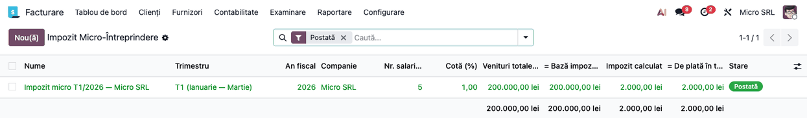
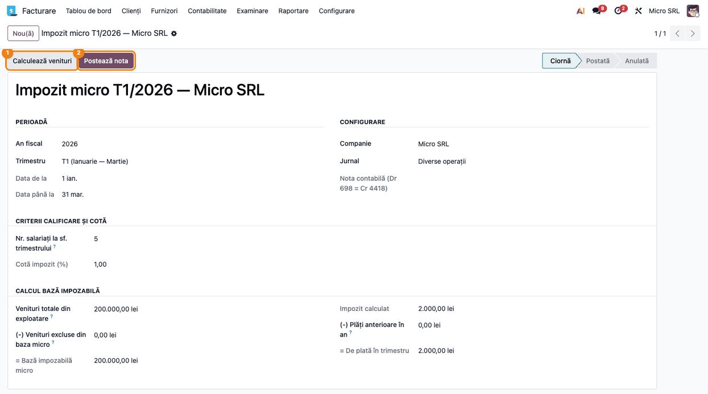
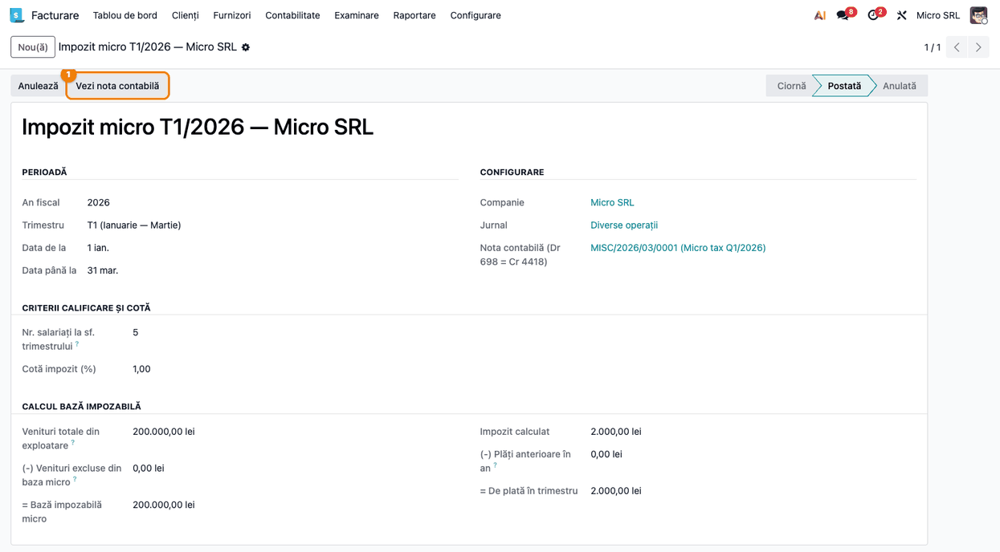
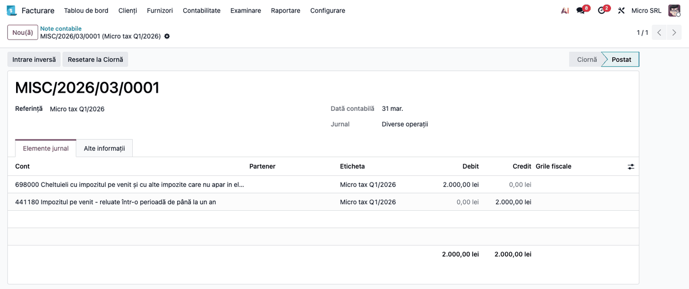
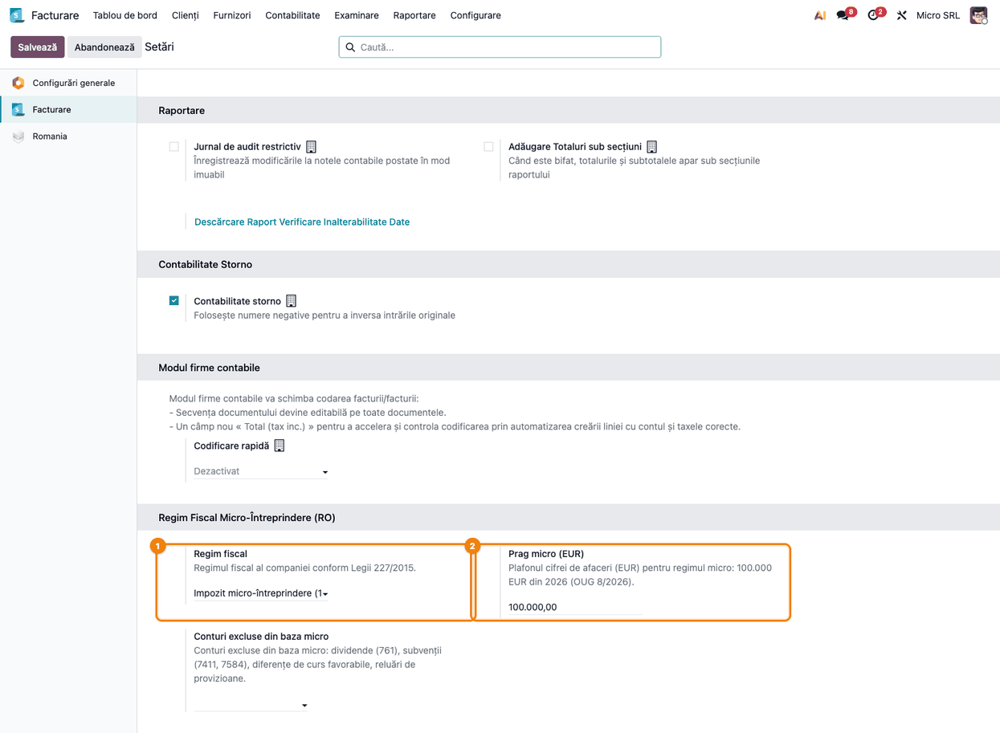

# Fișă Modul: Impozit Micro-Întreprindere

**Poziție plan:** B3.2
**Modul:** `l10n_ro_micro_tax`
**FR:** FR-32
**Capitol manual:** Cap 3.4
**Utilizator principal:** Responsabil fiscal, Contabil șef
**Prioritate:** 🟡 Medie (doar firme micro)

---

## 1. Scop business

Firmele plătitoare de impozit pe veniturile microîntreprinderilor calculează impozitul trimestrial,
din veniturile trimestrului, mai puțin veniturile excluse prin lege, și îl înregistrează contabil la
sfârșitul fiecărui trimestru. Modulul face acest calcul în Odoo: preia veniturile din conturile de
clasa 7 ale trimestrului, scade conturile excluse configurate pe companie, aplică cota (din 2026,
cota unică de 1%), scade plățile anterioare din an și generează nota contabilă a impozitului.
Un job automat lunar urmărește cifra de afaceri cumulată din an față de plafonul micro și trece
compania la impozit pe profit când plafonul este depășit.

## 2. Bază legală și context

- **Legea 227/2015 (Codul fiscal), Titlul III**, actualizat prin **OUG 89/2025** și **OUG 8/2026**:
  - **art. 51 alin. (1)** — din 2026, cota unică de **1%**; pentru anii anteriori, 1% cu cel puțin un
    salariat și 3% fără salariați;
  - **art. 47 alin. (1) lit. c)** — plafonul de **100.000 EUR** din 2026, cifră de afaceri cumulată cu
    întreprinderile legate;
  - **art. 47 alin. (1) lit. g)** — cel puțin un salariat, condiție de încadrare în regim (nu mai
    influențează cota din 2026);
  - **art. 53** — veniturile excluse din baza impozabilă (lista orientativă din secțiunea 5).
- **OMFP 1802/2014** — contul 698 pentru cheltuiala cu impozitul și contul 4418 „Impozitul pe venit”
  pentru obligația de plată.
- Impozitul se declară prin **D100**, trimestrial.

## 3. Utilizatori și roluri

- **Contabil** — creează calculul trimestrial, verifică veniturile și postează nota.
- **Responsabil fiscal / Contabil șef** — verifică încadrarea în regim (salariat, plafon cumulat cu
  întreprinderile legate) și configurează regimul, plafonul și conturile excluse.
- **Administrator** — activează jobul automat de verificare a plafonului.

Roluri recomandate pentru testare:
- utilizator cu drept **Facturare / Contabil**: vede meniul **Impozit Micro-Întreprindere** și
  postează calculul;
- utilizator administrator: are acces la **Setări** și la **Setări → Tehnic → Automatizare →
  Acțiuni planificate**.

## 4. Conturi și date implicate

| Cont | Rol |
|---|---|
| 698 „Cheltuieli cu impozitul pe venit și cu alte impozite...” | cheltuiala cu impozitul micro (debit) |
| 4418 „Impozitul pe venit” | impozitul micro de plată (credit) |
| clasa 7 (venituri, tip *Venituri* / *Alte venituri*) | baza de calcul a trimestrului |
| 761, 7411, 7584, 765, 786 | venituri care pot fi excluse din bază, după caz |

**Contul de credit al notei.** Modulul caută, în această ordine:
1. un cont cu codul exact **4418**, dacă l-ați creat în planul de conturi;
2. altfel, analiticul din planul RO standard al Odoo: **44118** „Impozitul pe venit - reluate într-o
   perioadă de până la un an” (planul RO nu are un cont cu codul exact 4418); acesta este și contul
   citit de rândul 121 din D100;
3. altfel, primul cont care începe cu 4418.

Pe planul RO standard, nota iese deci **Dr 698 = Cr 44118**. Debitul se face pe primul cont care
începe cu 698. În Odoo, planul RO are coduri de 6 cifre, deci pe ecran conturile apar ca **698000** și
**441180**.

Date minime pentru demo:
- companie românească cu planul de conturi RO (`l10n_ro`), în RON;
- un jurnal de tip **Diverse**;
- o factură client postată în trimestru (exemplul fișei: 200.000 RON pe un cont de venituri, în
  T1/2026);
- opțional, moneda EUR cu curs la zi, pentru verificarea plafonului.

## 5. Configurare inițială

1. Instalați modulul `l10n_ro_micro_tax` (dependențe: `account`, `l10n_ro`).
2. În **Contabilitate → Configurare → Setări**, secțiunea **Regim Fiscal Micro-Întreprindere (RO)**,
   alegeți **Regim fiscal**: *Impozit micro-întreprindere (1%/3%)*. Doar după această alegere apar
   câmpurile **Prag micro (EUR)** și **Conturi excluse din baza micro** (captura de la Pasul 4).
3. **Prag micro (EUR)** — plafonul folosit de jobul de verificare. Valoarea implicită este
   **100.000 EUR**. La actualizarea modulului la versiunea 19.0.1.1.0, plafonul vechi implicit de
   **500.000 EUR** trece automat la **100.000 EUR**; un plafon pe care l-ați ales dumneavoastră
   (orice altă valoare) rămâne neschimbat.
4. **Conturi excluse din baza micro** — adăugați conturile de venituri care nu intră în bază, de
   exemplu: 761 (dividende), 7411 (subvenții de exploatare), 7584 (subvenții pentru investiții), 765
   (diferențe de curs favorabile), 786 (reluări de provizioane), după caz. Lista se confirmă cu
   consultantul fiscal, pe situația firmei.
5. Verificați că există un jurnal de tip **Diverse** (de exemplu „Impozit micro”).
6. Verificați în **Contabilitate → Configurare → Plan de conturi** că există contul 698 și contul 4418
   sau 44118 (vezi secțiunea 4).
7. Opțional: cu aplicația **Angajați** instalată, numărul de salariați se preia automat la calcul;
   altfel se completează manual.
8. Opțional: activați jobul **RO: Verificare prag micro-întreprindere** din **Setări → Tehnic →
   Automatizare → Acțiuni planificate** (este inactiv la instalare) și mențineți cursul EUR la zi.

## 6. Flux de utilizare

### Pasul 1 — Lista calculelor trimestriale

Accesați **Contabilitate → Contabilitate → Impozit Micro-Întreprindere** (fără aplicația Contabilitate
din Enterprise, meniul principal se numește **Facturare**, ca în capturi). Lista afișează implicit
calculele postate, cu anul, trimestrul, cota aplicată, veniturile, baza impozabilă și impozitul de
plată.



Apăsați **Nou** pentru a crea un calcul: alegeți **anul fiscal**, **trimestrul** și **jurnalul** de
operațiuni diverse. **Data de la** și **Data până la** se completează automat din trimestru (T1: 1
ianuarie – 31 martie ... T4: 1 octombrie – 31 decembrie).

---

### Pasul 2 — Calculul bazei și al impozitului

Pe formular apăsați **Calculează venituri** ①. Modulul însumează rulajul conturilor de venituri
(clasa 7, tip *Venituri* / *Alte venituri*) din notele postate ale trimestrului și completează
**Venituri totale**, **Venituri excluse** (rulajul conturilor excluse din setări), **baza
impozabilă**, numărul de salariați (dacă aplicația Angajați este instalată) și **cota**:
- pentru un trimestru din **2026** sau ulterior: **1%**, cotă unică, inclusiv cu 0 salariați
  (salariatul e condiție de încadrare, nu criteriu de cotă);
- pentru un trimestru din **2025** sau anterior: **1%** cu cel puțin 1 salariat, **3%** fără
  salariați.



Verificați pe ecran, înainte de postare:
- `Bază impozabilă = Venituri totale − Venituri excluse` (minimum 0);
- `Impozit calculat = Bază impozabilă × Cotă`;
- `De plată = Impozit calculat − Plăți anterioare în an` (minimum 0). **Plăți anterioare în an** se
  completează manual (la T1 rămâne 0; la T2, impozitul plătit pentru T1 etc.).

**Calculează venituri** funcționează doar în starea Ciornă și poate fi apăsat de mai multe ori.

---

### Pasul 3 — Postarea notei contabile

Apăsați **Postează nota** ②. Calculul trece în starea **Postată**, devine needitabil și se
generează automat nota contabilă, datată în ultima zi a trimestrului, în jurnalul ales. Nota se
deschide cu butonul **Vezi nota contabilă** ①. Postarea este refuzată dacă suma de plată este zero
sau dacă lipsește contul 698 ori contul de impozit (secțiunea 4).



În nota deschisă, tabul **Elemente jurnal** arată cele două linii. Pe planul RO standard, creditul
este pe contul **44118**, afișat **441180** (analiticul contului 4418 din plan); dacă ați creat un
cont cu codul exact 4418, nota folosește acel cont.



#### Note de monografie și raportare

Exemplul fișei (T1/2026, venituri 200.000 RON, fără venituri excluse, cota 1%):

```
31.03.2026  Dr 698    2.000 RON   Cheltuieli cu impozitul pe venit și cu alte impozite
              Cr 44118  2.000 RON   Impozitul pe venit (4418; pe un cont 4418 creat manual, acesta)
```

Plata impozitului (scadentă pe 25 ale lunii următoare trimestrului) nu este generată de modul: se
înregistrează din extrasul de bancă, **Dr 44118 (sau 4418) = Cr 5121**. Suma impozitului se
raportează în **D100**, rândul 121.

---

### Pasul 4 — Monitorizarea plafonului

Accesați **Contabilitate → Configurare → Setări**, secțiunea **Regim Fiscal Micro-Întreprindere
(RO)**. Verificați că **Regim fiscal** ① este *Impozit micro-întreprindere (1%/3%)* și că **Prag
micro (EUR)** ② are valoarea corectă (implicit 100.000 EUR).



Jobul lunar **RO: Verificare prag micro-întreprindere** (inactiv la instalare; se activează din
**Setări → Tehnic → Automatizare → Acțiuni planificate**) verifică doar companiile cu regimul micro.
Calculează cifra de afaceri din 1 ianuarie până la data rulării (conturile de venituri, note
postate), o convertește în EUR la cursul zilei și:
- la **≥ 80%** din plafon, postează o **avertizare** pe fișa partenerului companiei;
- la **depășirea** plafonului, trece **Regim fiscal** pe *Impozit pe profit (16%)*, completează
  **Data ieșirii din regimul micro** cu data rulării și postează un mesaj pe fișa partenerului
  companiei.

**Fără curs EUR, verificarea se amână.** Dacă moneda EUR nu există în baza de date sau nu are curs
pentru data rulării, jobul sare compania fără nicio alertă și fără schimbarea regimului (nu compară
suma în lei cu plafonul în EUR). Verificarea se reia la următoarea rulare, după ce cursul este
introdus.

## 7. Legături cu alte module / declarații

| Modul / proces | Rol în flux |
|---|---|
| `account` | notele postate pe conturile de venituri (baza) și nota 698 = 4418/44118 |
| `l10n_ro` | planul de conturi RO, cu 698 și 44118 |
| `l10n_ro_anaf_d100` | declararea impozitului micro în D100 (rândul 121 citește 44118) |
| `l10n_ro_profit_tax` | calculul impozitului pe profit după ieșirea din regimul micro |
| `l10n_ro_period_close_enhanced` | checklist fiscal trimestrial |

Ce este automat: preluarea veniturilor și a veniturilor excluse, cota după an (și după salariați,
pentru anii anteriori 2026), impozitul de plată, nota contabilă la postare, avertizarea la 80% din
plafon și trecerea la impozit pe profit la depășire (cu jobul activ și cursul EUR la zi).

Ce rămâne manual: plățile anterioare din an, validarea condițiilor de încadrare (salariat, plafon
cumulat cu întreprinderile legate), lista conturilor excluse, plata impozitului și depunerea D100.

## 8. Verificări pentru consultant

- [ ] Meniul **Contabilitate → Contabilitate → Impozit Micro-Întreprindere** este vizibil pentru
      utilizatorul cu drept de contabil.
- [ ] Pe un trimestru din 2026 cu 0 salariați, după **Calculează venituri**, cota este **1%**.
- [ ] Pe un trimestru din 2025 cu 0 salariați, cota rămâne **3%**; cu cel puțin 1 salariat, **1%**.
- [ ] **Venituri totale** egalează rulajul creditor al conturilor de venituri din trimestru (în
      exemplu, 200.000 RON).
- [ ] Un cont adăugat la **Conturi excluse din baza micro** scade din bază exact rulajul lui din
      trimestru.
- [ ] **De plată** = Impozit calculat − Plăți anterioare în an (în exemplu, 2.000 RON).
- [ ] Nota postată are data ultimei zile a trimestrului, **698 în debit** și, pe planul RO standard,
      **44118 în credit**, cu suma egală cu **De plată**.
- [ ] Cu un cont 4418 creat manual, o nouă postare folosește contul 4418, nu 44118.
- [ ] Postarea cu suma de plată zero este refuzată cu mesaj.
- [ ] **Anulează** pe un calcul postat anulează și nota; **Resetează la ciornă** permite recalculul.
- [ ] În **Setări**, **Prag micro (EUR)** este 100.000 EUR pe o instalare nouă; după actualizarea de
      la o versiune cu 500.000 EUR, valoarea devine 100.000 EUR, iar o valoare aleasă manual (de ex.
      250.000) rămâne.
- [ ] Cu jobul rulat manual (**Rulează manual**) și cifra de afaceri ≥ 80% din plafon, apare
      avertizarea pe fișa partenerului companiei; peste plafon, regimul trece pe impozit pe profit și
      se completează data ieșirii.
- [ ] Fără curs EUR la data rulării, jobul nu postează nimic și nu schimbă regimul.

## 9. Mesaje de eroare frecvente

| Mesaj / simptom | Cauză probabilă | Remediere |
|-----------------|-----------------|-----------|
| „Impozitul de plată este zero...” la **Postează nota** | Veniturile nu au fost calculate, baza e zero (excluderile depășesc veniturile) sau plățile anterioare acoperă impozitul | Apăsați **Calculează venituri**; verificați veniturile și conturile excluse |
| „Contul 698 (Alte cheltuieli cu impozitele) lipsește din planul de conturi.” | Planul de conturi nu are un cont 698 | Creați contul 698 sau instalați planul RO |
| „Contul 4418 (Alte impozite) lipsește din planul de conturi.” | Nu există nici 4418, nici 44118, nici alt cont 4418x | Creați contul 4418 (sau folosiți planul RO standard, cu 44118) |
| Nota iese pe 44118, nu pe 4418 | Comportament normal pe planul RO standard, care nu are cont cu codul exact 4418 | Dacă vreți 4418, creați contul cu acest cod: va avea prioritate |
| „Doar înregistrările în ciornă pot fi recalculate / postate” | Calculul este Postat sau Anulat | **Anulează**, apoi **Resetează la ciornă** |
| Câmpurile Prag micro și Conturi excluse nu apar în Setări | Regimul fiscal nu este micro | Alegeți *Impozit micro-întreprindere (1%/3%)* la **Regim fiscal** |
| Nicio avertizare, deși cifra de afaceri a depășit 80% din plafon | Jobul este inactiv; sau lipsește moneda EUR ori cursul EUR la data rulării (verificarea se amână fără alertă); sau regimul nu este micro | Activați jobul, introduceți cursul EUR al zilei și rulați din nou |
| Anularea calculului postat eșuează | Nota este într-o perioadă blocată | Deblocați perioada sau corectați printr-o notă în perioada deschisă |

## 10. Capturi de ecran

Capturile (`static/description/`) sunt **generate automat** din `tests/test_screenshots.py`
(mixinul `ScreenshotCase` din `l10n_ro_doc_screenshots`, import defensiv), în **limba română**,
pe planul de conturi RO. Aceleași ecrane, în engleză, sunt în `static/description/en/`, pentru
`readme/USAGE.md`.

1. `01_lista_declaratii.png` — Lista calculelor de impozit micro (filtru implicit „Postată”).
2. `02_formular_calcul.png` — Formularul de calcul în Ciornă, cu veniturile completate, cota 1% și
   butoanele de acțiune.
3. `03_declaratie_postata.png` — Calcul postat, cu butonul către nota contabilă.
4. `04_nota_698_44118.png` — Nota contabilă generată: Dr 698 = Cr 44118 (planul RO standard).
5. `05_setari_plafon.png` — Setările regimului micro: Regim fiscal, Prag micro (EUR), Conturi excluse.

Regenerare:

```bash
./odoo/odoo-bin -c odoo.conf -d <db> -i l10n_ro_micro_tax,l10n_ro_doc_screenshots \
    --test-tags=fise_screenshots --stop-after-init
```

## 11. Observații pentru manual

- Păstrați regula cotei pe ani: 1% unică din 2026; 1%/3% după salariați pentru anii anteriori.
- Explicați de ce nota iese pe 44118 pe planul RO standard și că un cont 4418 creat manual are
  prioritate.
- **Plăți anterioare în an** se completează manual; plata impozitului se înregistrează separat.
- Plafonul de 100.000 EUR din setări se compară cu cifra de afaceri a firmei; cumularea cu
  întreprinderile legate rămâne o verificare manuală.
- Jobul de plafon e inactiv la instalare și are nevoie de cursul EUR la zi.
