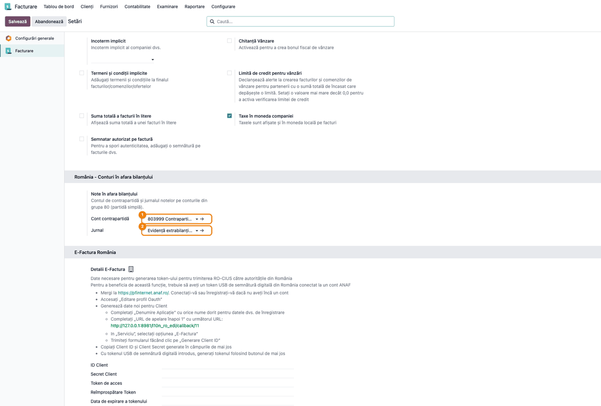
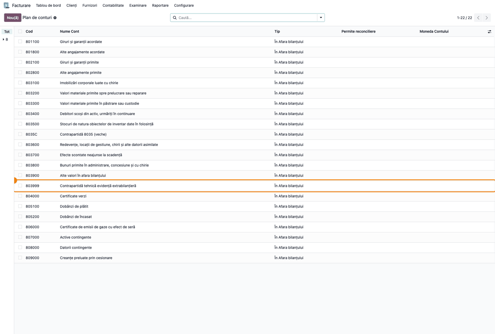
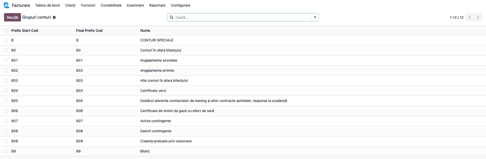
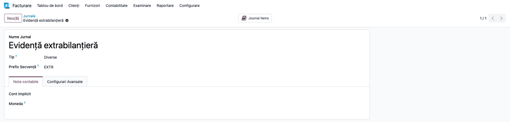
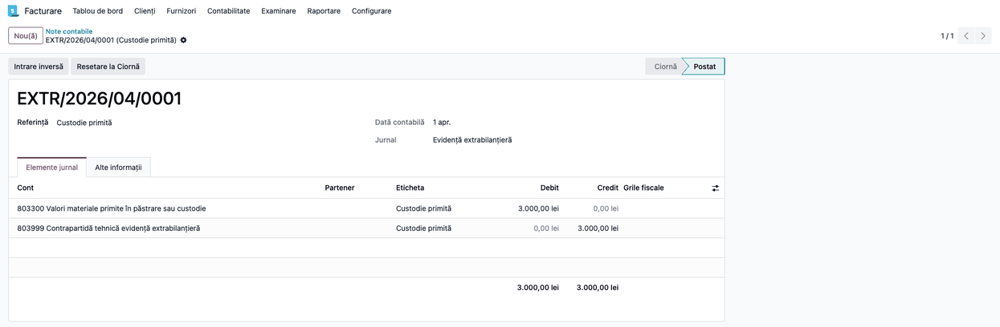
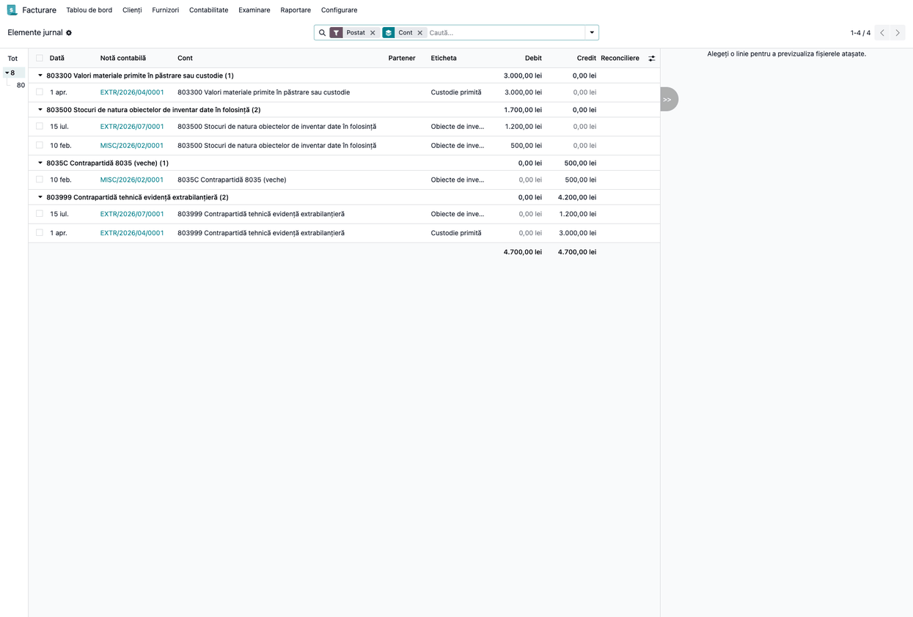
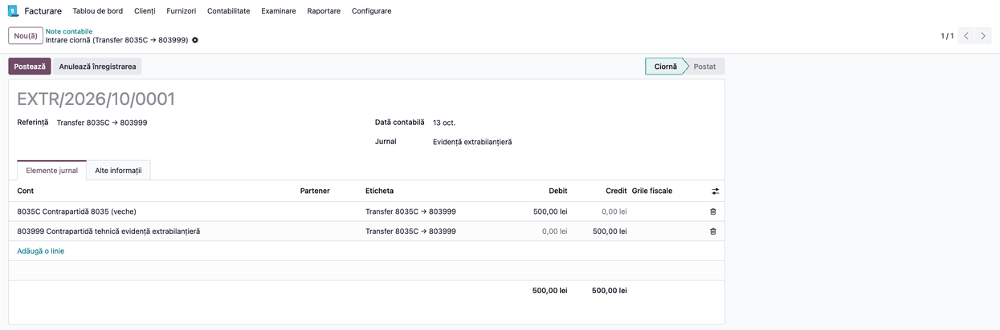

# Fișă Modul: Evidența extrabilanțieră (clasa 8) — contrapartida tehnică 803999 și jurnalul EXTR

**Modul:** `l10n_ro_off_balance`
**Utilizator principal:** Contabil, Contabil șef, Consultant implementare
**Prioritate:** 🟡 Medie (nu are flux propriu, dar toate notele din grupa 80 ale suitei depind de el)

---

## 1. Scop business

Conturile din grupa 80 „Conturi în afara bilanțului” se țin în partidă simplă: o custodie primită se înregistrează doar în debitul lui 8033, fără cont corespondent. Odoo, în schimb, nu salvează o notă contabilă dezechilibrată.

Modulul stabilește o **convenție unică** pentru toate notele extrabilanțiere ale suitei:

- **contul tehnic 803999 — Contrapartidă tehnică evidență extrabilanțieră**, care echilibrează nota (de exemplu 8033 = 803999), fără să schimbe soldul conturilor de evidență;
- **jurnalul EXTR — Evidență extrabilanțieră**, comun pentru toate aceste note;
- **grupele clasei 8** (8, 80, 801–809, 89) în planul de conturi, ca balanța de verificare cu ierarhie să nu mai afișeze conturile clasei 8 sub „No Group”.

Contul, jurnalul și grupele se creează la instalare, pe companiile cu planul de conturi RO, și automat pe companiile care primesc planul RO ulterior. Modulele care scriu note extrabilanțiere le folosesc direct:

- `l10n_ro_stock_consignment` (8033);
- `l10n_ro_inventory_items` (8035);
- `l10n_ro_move_template` (8031).

---

## 2. Bază legală și context

- **OMFP 1802/2014, cap. 16 „Funcțiunea conturilor”, Clasa 8 „Conturi speciale”.** Grupa 80 „Conturi în afara bilanțului” se ține în partidă simplă. Grupa 89 „Bilanț” funcționează în partidă dublă.
- **Nomenclatorul de conturi SAF-T (D406).** În D406, 803999 apare cu propriul cod și se încadrează în nomenclator prin prefixul sinteticului 8039 „Alte valori în afara bilanțului”.
- **OMFP 1802/2014, pct. 65 alin. (2).** Corectarea erorilor se face la data constatării; de aceea, mutarea soldurilor vechilor contrapartide se face prin note noi, nu prin rescrierea notelor postate (Pasul 7).

**Context Odoo.** O notă care amestecă un cont de tip **În Afara bilanțului** cu un cont de bilanț este refuzată (mesajul e în secțiunea 9). Notele pe grupa 80 se fac de aceea în partidă dublă tehnică: toate liniile sunt pe conturi de tip **În Afara bilanțului**, iar 803999 ține locul contului corespondent pe care OMFP nu îl cere.

Contul 803999 nu are conținut economic. Soldul lui creditor este egal cu suma soldurilor debitoare ale conturilor de evidență înregistrate cu el. Valorile reale ale contului 8039, de exemplu bunuri primite în baza altor contracte, fără cont dedicat în OMFP, se țin pe un analitic separat, de exemplu 803901, nu pe 803999. Bunurile primite în custodie sau consignație de `l10n_ro_stock_consignment` merg pe 8033.

**Atenție la sinteticul 8039.** Cum 803999 e analitic al lui 8039, la nivel de sintetic soldul creditor tehnic al lui 803999 se compensează cu valorile reale de pe 8039. Pentru o prezentare fără contrapartidă, folosiți opțiunile balanței din `l10n_ro_reports_fix` (bloc separat pentru grupa 80, fără 803999).

---

## 3. Utilizatori și roluri

| Rol | Ce face |
|-----|---------|
| Consultant implementare | Verifică după instalare contul, jurnalul și grupele; aliniază setările la planul firmei |
| Contabil | Înregistrează sau verifică notele din jurnalul EXTR; face controlul lunar pe 803999 |
| Contabil șef | Validează și postează notele de transfer în ciornă create la actualizarea modulelor consumatoare |

Pentru testare: un utilizator cu drepturi de **Administrator** pe Facturare/Contabilitate (setările și jurnalele cer acest rol) și un utilizator cu drepturi de contabil pentru note și controale.

---

## 4. Conturi și date implicate

| Cont | Rol |
|------|-----|
| 803999 | contrapartida tehnică a tuturor notelor din grupa 80 (creat de modul) |
| 8031 | imobilizări corporale primite cu chirie sau în baza altor contracte similare (inclusiv comodat) — `l10n_ro_move_template` |
| 8033 | valori materiale primite în păstrare sau custodie — `l10n_ro_stock_consignment` |
| 8035 | obiecte de inventar date în folosință — `l10n_ro_inventory_items` |
| 8039 / 803901 | alte valori în afara bilanțului: valorile reale stau pe un analitic propriu, nu pe 803999 |

Datele demo din capturi (lei):

| Data | Operațiune | Jurnal | Notă | Sumă |
|------|------------|--------|------|------|
| 10.02.2026 | Obiecte de inventar, înainte de convenție (contrapartidă veche 8035C) | Diverse | 8035 = 8035C | 500 |
| 01.04.2026 | Custodie primită | EXTR | 8033 = 803999 | 3.000 |
| 15.07.2026 | Obiecte de inventar date în folosință | EXTR | 8035 = 803999 | 1.200 |
| data actualizării | Transfer contrapartidă veche, în ciornă | EXTR | 8035C = 803999 | 500 |

---

## 5. Configurare inițială

1. Instalați `l10n_ro_off_balance` (se instalează automat și ca dependență a modulelor consumatoare). Pe companiile cu planul RO, modulul creează imediat contul 803999, jurnalul EXTR și grupele clasei 8, cu denumiri în română dacă limba e instalată.
2. Pentru o companie nouă, încărcați planul de conturi RO: contul, jurnalul și grupele se creează automat.
3. Verificați setările (Pasul 1). Contul și jurnalul se schimbă doar dacă firma folosește alt analitic tehnic sau alt jurnal.

---

## 6. Flux de utilizare

Modulul nu are meniuri proprii. Fluxul de mai jos e verificarea după instalare și controlul periodic.

### Pasul 1 — Setările evidenței extrabilanțiere

**Facturare → Configurare → Setări** (cu aplicația Contabilitate instalată: **Contabilitate → Configurare → Setări**), secțiunea **România - Conturi în afara bilanțului**.



**Găsiți pe ecran:** blocul **Note în afara bilanțului**, cu câmpurile **Cont contrapartidă** ① și **Jurnal** ②.

**Verificați:**
- **Cont contrapartidă** începe cu codul 803999 (denumirea completă se vede deschizând contul cu săgeata → de lângă câmp);
- **Jurnal** este Evidență extrabilanțieră.

Câmpurile se completează la instalare. Dacă le schimbați, apăsați **Salvează**: modulele consumatoare folosesc noile valori la notele următoare, iar notele existente rămân pe contul și jurnalul lor.

### Pasul 2 — Contul 803999 în planul de conturi

**Facturare → Configurare → Contabilitate → Plan de Conturi**, căutare după cod `80`.



**Găsiți pe ecran:** rândul **803999 Contrapartidă tehnică evidență extrabilanțieră**, după 803900.

**Verificați:**
- coloana **Tip** este **În Afara bilanțului** pentru 803999 și pentru toate conturile grupei 80;
- coloana **Permite reconciliere** e goală pe toată grupa: Odoo nu permite reconcilierea conturilor în afara bilanțului.

În captură apare și contul **8035C**, contrapartida veche a obiectelor de inventar, dinaintea convenției comune. Soldul lui se mută pe 803999 la Pasul 7.

### Pasul 3 — Grupele clasei 8

**Contabilitate → Configurare → Contabilitate → Grupuri conturi**. Meniul apare cu aplicația Contabilitate, în modul dezvoltator (captura e făcută din aplicația Facturare, pe aceeași listă). Fără ea, grupele se văd în balanța de verificare cu **Ierarhia și subtotalurile** (modulul `l10n_ro_reports_fix`).



**Găsiți pe ecran:** 12 grupe: 8 CONTURI SPECIALE, 80, 801–809 și 89 Bilanț.

**Verificați:** fiecare grupă are prefixul de început egal cu cel de sfârșit, iar denumirile sunt cele din OMFP 1802/2014. Grupele existente dinainte nu se dublează: modulul creează doar prefixele lipsă.

### Pasul 4 — Jurnalul EXTR

**Facturare → Configurare → Contabilitate → Jurnale**, jurnalul **Evidență extrabilanțieră**.



**Verificați:**
- **Tip** = Diverse;
- **Prefix Secvență** = EXTR, deci notele se numerotează `EXTR/2026/04/0001`;
- **Cont implicit** e gol: fiecare notă își alege conturile din grupa 80.

### Pasul 5 — O notă extrabilanțieră

Notele EXTR se creează de obicei automat, de modulele consumatoare: recepția în custodie, darea în folosință a obiectelor de inventar, șabloanele de comodat. Manual, se creează din **Facturare → Contabilitate → Tranzacții → Note contabile → Nou**, cu jurnalul **Evidență extrabilanțieră** și numai conturi de tip **În Afara bilanțului**.



**Găsiți pe ecran:** tab-ul **Elemente jurnal**, cu 803300 pe Debit și 803999 pe Credit, câte 3.000,00 lei.

**Verificați:** jurnalul este **Evidență extrabilanțieră**, iar nota nu conține niciun cont de bilanț (fără 371, 401 etc.).

### Pasul 6 — Controlul pe contul 803999

**Facturare → Examinare → Control → Elemente jurnal**. Filtrul **Postat** e activ implicit. Adăugați **Grupează după → Cont**, apoi alegeți **8** în panoul din stânga: lista arată toate conturile clasei 8, din toate jurnalele.



**Găsiți pe ecran:** fațetele **Postat** și **Cont** în bara de căutare, clasa **8** selectată în panoul din stânga și câte un grup pentru fiecare cont, cu totalul Debit / Credit pe rândul grupului.

**Verificați:**
- 803999 are 4.200,00 lei pe Credit: suma notelor de custodie (3.000,00) și de obiecte de inventar (1.200,00) înregistrate cu el;
- 803500 are 1.700,00 lei pe Debit: 1.200 cu contrapartida 803999 și 500 din nota din 10.02.2026, înregistrată în jurnalul Diverse pe vechea contrapartidă 8035C (500,00 pe Credit);
- totalul general are Debit = Credit (4.700,00 / 4.700,00);
- diferența dintre 803999 (4.200) și conturile de evidență (3.000 + 1.700 = 4.700) este exact soldul vechii contrapartide 8035C (500). Ea se aduce pe 803999 prin nota de transfer de la Pasul 7.

Controlul se face pe conturi, nu pe jurnal: `l10n_ro_stock_consignment` poate avea propriul jurnal de custodie.

### Pasul 7 — Nota de transfer a contrapartidei vechi (în ciornă)

La actualizarea modulelor consumatoare pe convenția comună, soldurile vechilor contrapartide (8035C la obiectele de inventar, 8039 la custodie, 800000 la șabloanele de note) se mută pe 803999. Modulul nu modifică notele postate: creează câte o **notă de transfer în ciornă**, în jurnalul EXTR, la data actualizării. Notele de transfer se găsesc în **Facturare → Contabilitate → Tranzacții → Note contabile**, cu filtrul **Nepostat** și jurnalul **Evidență extrabilanțieră**. Referințele lor sunt:

| Modul actualizat | Referința notei | Ce se mută |
|------------------|-----------------|------------|
| `l10n_ro_inventory_items` | Transfer 8035C → 803999 | tot soldul lui 8035C |
| `l10n_ro_move_template` | Transfer 800000 → 803999 | tot soldul lui 800000; liniile șabloanelor trec pe 803999, iar șabloanele extrabilanțiere pe jurnalul EXTR |
| `l10n_ro_stock_consignment` | Transfer 8039xx (custody) → 803999 | doar partea din soldul lui 8039 venită din notele care ating 8033; valorile reale de pe 8039 rămân pe loc |



**Găsiți pe ecran:** referința **Transfer 8035C → 803999**, starea **Ciornă** și liniile 8035C pe Debit și 803999 pe Credit, câte 500,00 lei.

**Verificați:**
- suma este soldul creditor al vechii contrapartide (8035C), la custodie doar partea din notele pe 8033;
- data contabilă este data actualizării, deci corecția intră în perioada curentă, nu modifică o perioadă închisă.

După verificare, apăsați **Postează**. Vechea contrapartidă rămâne cu sold zero, iar 803999 ajunge la 4.700 lei pe Credit, egal cu 8033 (3.000) + 8035 (1.700).

### Note de monografie și raportare

| Operațiune | Partidă simplă (OMFP) | Notă în Odoo (jurnal EXTR) |
|------------|-----------------------|----------------------------|
| Intrare în evidență (custodie, folosință, comodat) | Dr 8033 / 8035 / 8031 | 8033 / 8035 / 8031 = 803999 |
| Ieșire din evidență (restituire, scoatere din folosință) | Cr 8033 / 8035 / 8031 | 803999 = 8033 / 8035 / 8031 |
| Transfer contrapartidă veche (sold creditor) | — | contrapartida veche = 803999 |
| Reclasificare valori reale de pe 8039 din plan | — | 803901 = 803900 |

- Balanța de verificare: cu clasa 8 inclusă, totalul rămâne egal datorită lui 803999. Pentru prezentarea grupei 80 fără contrapartidă sau în afara totalului, folosiți opțiunile din `l10n_ro_reports_fix`.
- SAF-T (D406): 803999 apare cu propriul cod și se încadrează în nomenclator prin prefixul sinteticului 8039 (vezi avertismentul din secțiunea 2 despre compensarea la nivelul lui 8039).

---

## 7. Legături cu alte module / declarații

| Modul | Rol |
|-------|-----|
| `l10n_ro_stock_consignment` | Recepția și restituirea bunurilor în custodie: 8033 = 803999 în EXTR. Poate avea propria contrapartidă (**Cont contrapartidă custodie**) și propriul jurnal (**Jurnal custodie**); goale = 803999 și EXTR |
| `l10n_ro_inventory_items` | Darea și scoaterea din folosință a obiectelor de inventar: 8035 = 803999 în EXTR, doar dacă pe companie e bifat **Utilizare cont 8035 (extracontabil)** |
| `l10n_ro_move_template` | Șabloanele de comodat și alte note extrabilanțiere: 8031 = 803999 în EXTR |
| `l10n_ro_reports_fix` | Balanța de verificare: ascunde clasa 8 sau o pune într-un bloc separat, fără 803999 |
| SAF-T (D406) | 803999 apare cu propriul cod, încadrat prin prefixul 8039; la sinteticul 8039 se compensează cu valorile reale (secțiunea 2) |

**Ce e automat:**
- contul 803999, jurnalul EXTR și grupele clasei 8, la instalare și la încărcarea planului RO;
- alegerea contului și a jurnalului de către modulele consumatoare;
- notele de transfer în ciornă ale contrapartidelor vechi, la actualizarea modulelor consumatoare.

**Ce rămâne manual:**
- verificarea și postarea notelor de transfer;
- reclasificarea valorilor reale de pe 8039 (803900) pe un analitic propriu (803901), dacă e cazul;
- controlul periodic al egalității de pe 803999.

---

## 8. Verificări pentru consultant

- [ ] În Setări, **Cont contrapartidă** = 803999 și **Jurnal** = Evidență extrabilanțieră.
- [ ] 803999 există o singură dată în planul de conturi, de tip **În Afara bilanțului**, fără reconciliere.
- [ ] Grupele 8, 80, 801–809 și 89 există, fiecare o singură dată.
- [ ] Jurnalul EXTR e de tip Diverse, cu prefixul EXTR.
- [ ] O companie nouă, după încărcarea planului RO, primește contul, jurnalul și grupele.
- [ ] Notele generate de custodie / obiecte de inventar (cu bifa **Utilizare cont 8035 (extracontabil)**) / șabloane de comodat sunt în jurnalul EXTR, pe 803999.
- [ ] Soldul creditor al lui 803999 = suma soldurilor debitoare ale conturilor înregistrate cu 803999 (în exemplu: 4.200 = 3.000 + 1.200); diferența față de grupa 80 = soldul contrapartidelor vechi.
- [ ] După actualizarea modulelor consumatoare, există câte o notă de transfer în ciornă pentru fiecare contrapartidă veche cu sold, la data actualizării.
- [ ] După postarea notelor de transfer, 8035C și 800000 au sold zero; pe 8039 rămân doar valorile reale (de reclasificat pe 803901, dacă e cazul).

---

## 9. Mesaje de eroare frecvente

| Mesaj / simptom | Cauză | Remediere |
|---|---|---|
| „Dacă doriți să utilizați conturi "Off-Balance", toate conturile înregistrării jurnalului trebuie să fie de acest tip” | Nota amestecă un cont din grupa 80 cu un cont de bilanț | Folosiți 803999 drept cont corespondent (ex. 8033 = 803999) |
| „Nu puteți utiliza taxe pe linii cu un cont Off-Balance” | O linie a notei EXTR are o taxă | Ștergeți taxa de pe linie: notele extrabilanțiere nu au TVA |
| Câmpul **Cont contrapartidă** nu oferă contul dorit | Lista arată doar conturile de tip **În Afara bilanțului** ale companiei | Schimbați tipul contului sau creați analiticul de tip **În Afara bilanțului** |
| Soldul lui 803999 diferă de suma conturilor de evidență | Note pe grupa 80 înregistrate pe altă contrapartidă (veche sau manuală) | Identificați notele în **Examinare → Control → Elemente jurnal**, clasa 8, grupat pe cont; mutați soldul cu o notă de transfer în EXTR |
| Conturile clasei 8 apar sub „(No Group)” în balanță | Compania nu avea planul RO la instalarea modulului și nici nu l-a încărcat ulterior prin Odoo (plan importat manual) | Contul 803999 și jurnalul EXTR se creează singure la prima notă a unui modul consumator. Grupele lipsă se creează manual din **Grupuri conturi** (prefixele 8, 80, 801–809, 89) sau le creează programatorul, care rulează configurarea modulului pe companie |
| „Un cont extra-bilanțiere nu poate fi reconciliabil” | S-a bifat **Permite reconciliere** pe un cont din grupa 80 | Debifați: conturile în afara bilanțului nu se reconciliază |

---

## 10. Capturi de ecran

Capturile din `static/description/` se generează automat din `tests/test_screenshots.py`, cu mixinul `ScreenshotCase` din `l10n_ro_doc_screenshots` (import defensiv). Sunt în limba română, pe planul de conturi RO, pentru o companie demo cu monedă RON.

1. `01_setari_extrabilantier.png` — Setări, secțiunea România - Conturi în afara bilanțului: contul de contrapartidă și jurnalul.
2. `02_plan_conturi_grupa_80.png` — planul de conturi filtrat pe grupa 80, cu 803999 evidențiat.
3. `03_grupe_clasa_8.png` — grupele de conturi ale clasei 8.
4. `04_jurnal_extr.png` — jurnalul Evidență extrabilanțieră (EXTR).
5. `05_nota_custodie_extr.png` — nota EXTR de custodie primită, 8033 = 803999.
6. `06_control_elemente_jurnal_extr.png` — elementele jurnal ale clasei 8, grupate pe cont, pentru controlul pe 803999.
7. `07_nota_transfer_ciorna.png` — nota de transfer în ciornă a contrapartidei vechi 8035C.

Regenerare:
```
./odoo/odoo-bin -c odoo.conf -d <db> -i l10n_ro_off_balance,l10n_ro_doc_screenshots \
    --test-tags=/l10n_ro_off_balance:TestOffBalanceScreenshots --stop-after-init \
    --http-port=8981 --gevent-port=8982
```

---

## 11. Observații pentru manual

- Prezentați 803999 ca soluție tehnică impusă de Odoo, nu ca regulă contabilă: OMFP cere partidă simplă pentru grupa 80, iar 803999 doar ține locul contului corespondent.
- Explicați egalitatea de control (Pasul 6) ca verificare lunară: o diferență arată o notă pe altă contrapartidă.
- Subliniați că notele postate nu se rescriu: corecția contrapartidelor vechi se face prin note de transfer la data actualizării, verificate și postate de contabil.
- Separați 803999 (fără conținut economic) de valorile reale ale lui 8039, care se țin pe un analitic propriu.
- Trimiteți la fișa `l10n_ro_reports_fix` pentru prezentarea clasei 8 în balanța de verificare.
