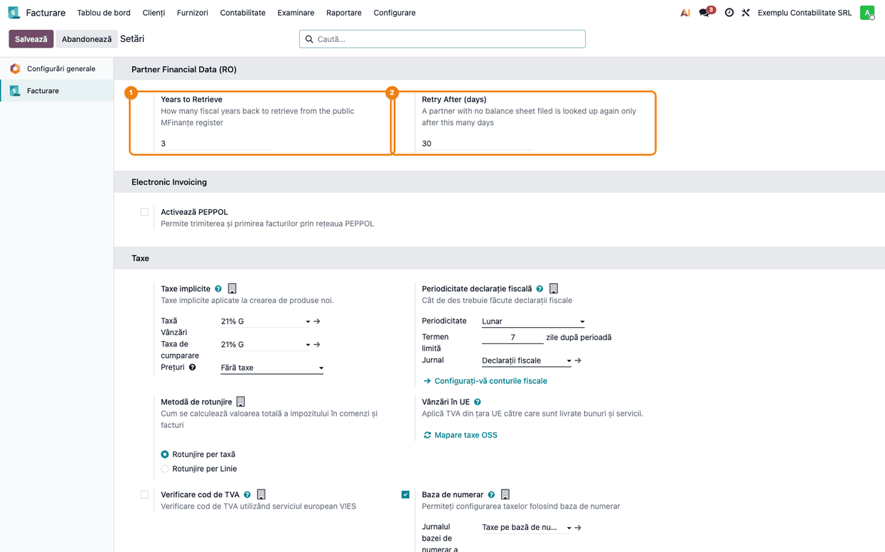
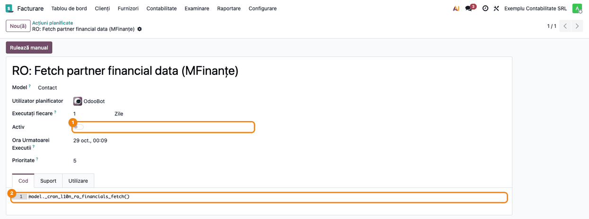
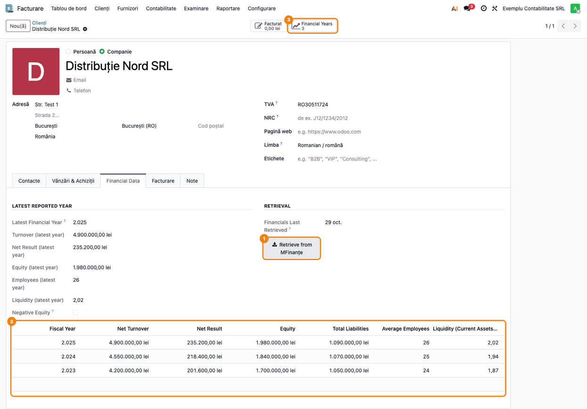
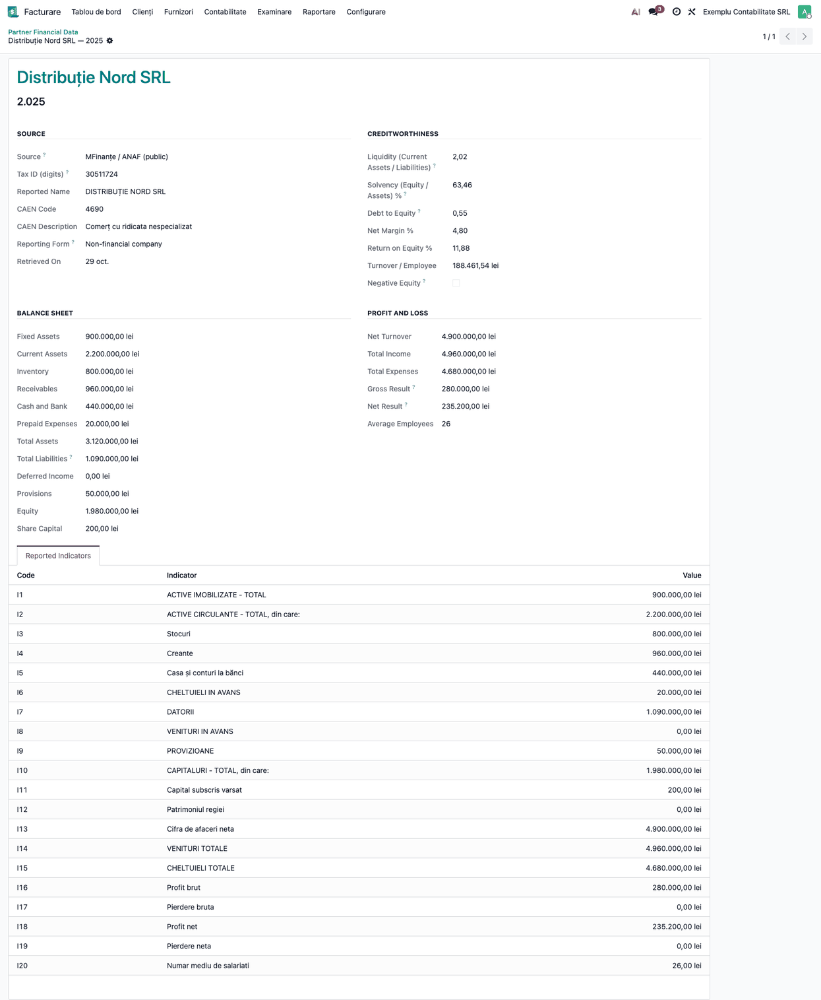
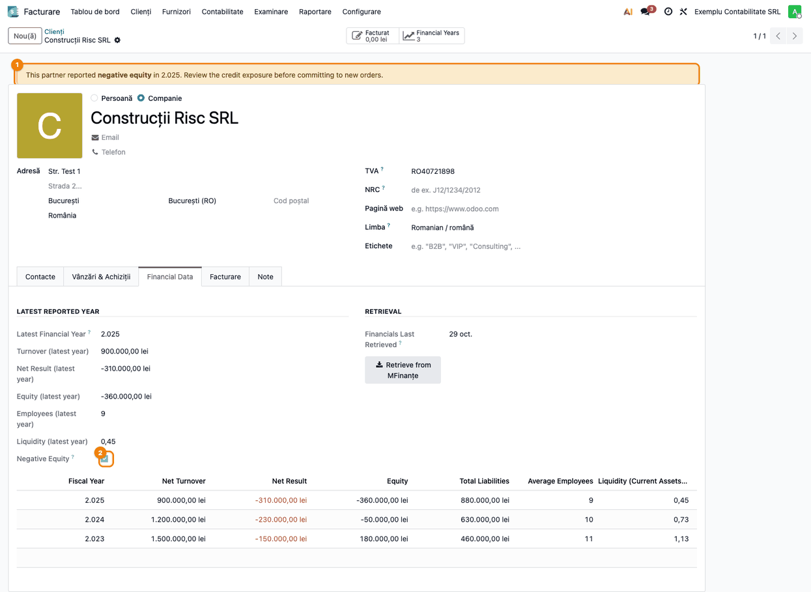
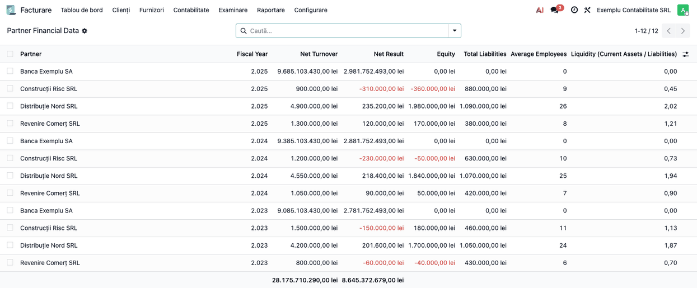
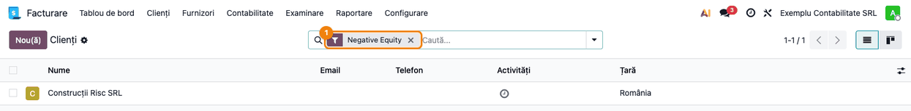

# Fișă Modul: Date financiare ale partenerilor din bilanțurile publice MFinanțe

**Modul:** `l10n_ro_partner_financials`
**Utilizator principal:** Contabil clienți/furnizori, Director Financiar, responsabil de credit comercial
**Prioritate:** 🟡 Medie (informare pentru decizia de credit; nu produce note contabile și nu alimentează declarații)

---

## 1. Scop business

Înainte de a acorda termen de plată unui client nou, de a plăti un avans unui furnizor sau de a continua
livrările către un client cu restanțe, trebuie să știi cât de solidă este firma. Situațiile financiare
anuale depuse la Ministerul Finanțelor sunt publice, iar MFinanțe/ANAF le expune gratuit printr-un serviciu
deschis.

Modulul aduce aceste cifre direct pe fișa partenerului: poziția financiară (active, datorii, capitaluri
proprii), performanța (cifra de afaceri, rezultatul, numărul mediu de salariați) și câțiva indicatori de
bonitate calculați din ele, pe ultimii ani. Semnalează automat partenerii cu **capitaluri proprii negative**,
atât pe fișa lor, cât și printr-un filtru în lista de contacte. Nu e nevoie de abonament la un furnizor
comercial de date despre firme.

## 2. Bază legală și context

- **Situațiile financiare anuale** se depun la MFinanțe în cel mult 150 de zile de la încheierea
  exercițiului, deci până la 30 mai a anului următor, și sunt publice. Publicarea în serviciul ANAF vine cu
  întârziere, așa că modulul consideră anul N disponibil abia din **1 iulie N+1**: până la 30 iunie se cer
  anii până la N−2, de la 1 iulie până la N−1.
- **Legea 31/1990, art. 153^24** — privește situația în care activul net scade sub jumătate din capitalul
  social subscris. Modulul semnalează doar cazul extrem, **capitaluri proprii sub zero** (ultimul bilanț
  preluat), și citează articolul pe banda de avertizare din formularul anului fiscal. O firmă cu capitaluri pozitive, dar sub jumătate
  din capitalul social, **nu** primește semnal.
- **Sursa:** serviciul public `webservicesp.anaf.ro/bilant`, apelat fără autentificare, cu un singur CUI și
  un an pe cerere, la o cadență de cel mult o cerere pe secundă.

Limitări care țin de sursă, nu de modul:

- datoriile nu sunt defalcate pe scadențe, deci lichiditatea curentă în sens strict nu se poate calcula;
- codurile indicatorilor (`I1`, `I2`, …) nu au aceeași semnificație între formularele de raportare (la o
  instituție de credit `I15` nu înseamnă „Cheltuieli totale”); modulul potrivește indicatorii după
  denumire, iar formularele nemodelate își păstrează indicatorii doar ca evidență brută;
- scorurile de tip rating financiar sau probabilitate de insolvență nu există în registrul public.

## 3. Utilizatori și roluri

| Rol | Ce face |
|---|---|
| Contabil clienți | Preia bilanțurile unui client nou sau cu restanțe și verifică semnalul de capitaluri negative |
| Contabil furnizori | Verifică soliditatea unui furnizor cu avansuri sau contracte mari |
| Director Financiar | Urmărește în vederea de ansamblu partenerii pe pierdere sau cu capitaluri negative |
| Administrator | Stabilește numărul de ani și intervalul de reîncercare (*Administrare / Setări*); activează acțiunea programată (tot *Administrare / Setări*, cu modul dezvoltator) |

Drepturi: orice utilizator intern **citește** datele financiare. **Preluarea** (butonul *Retrieve from
MFinanțe*) creează și rescrie înregistrări, deci cere drepturi de administrator contabil (*Contabilitate /
Administrator*); butonul este vizibil tuturor, dar unui utilizator fără acest drept îi întoarce o eroare de
acces (secțiunea 9). Pentru testare: un administrator contabil și un utilizator intern obișnuit.

## 4. Conturi și date implicate

Modulul **nu generează note contabile** și nu folosește conturi din planul de conturi. Datele sunt
preluate din bilanțul public al partenerului:

| Grup | Cifre preluate |
|---|---|
| Bilanț | active imobilizate, active circulante (din care stocuri, creanțe, casa și conturi la bănci), cheltuieli în avans, datorii totale, venituri în avans, provizioane, capitaluri proprii, capital subscris vărsat |
| Cont de profit și pierdere | cifra de afaceri netă, venituri și cheltuieli totale, profit/pierdere brută, profit/pierdere netă, număr mediu de salariați |
| Identificare | denumirea raportată, codul CAEN și descrierea lui, formularul de raportare |

Indicatori calculați din aceste cifre:

| Indicator | Formulă | Atenție |
|---|---|---|
| Lichiditate | active circulante / datorii totale | datoriile nu sunt separate pe scadențe, deci cifra e mai prudentă decât lichiditatea curentă clasică; 0,00 când datoriile sunt zero |
| Solvabilitate % | capitaluri proprii / total active × 100 | total active = active imobilizate + circulante + cheltuieli în avans |
| Grad de îndatorare | datorii totale / capitaluri proprii | 0,00 (necalculat) când capitalurile proprii nu sunt pozitive |
| Marjă netă % | rezultat net / cifra de afaceri × 100 | 0,00 când cifra de afaceri e zero |
| Rentabilitatea capitalului % | rezultat net / capitaluri proprii × 100 | 0,00 (necalculat) când capitalurile proprii nu sunt pozitive |
| Cifră de afaceri / salariat | cifra de afaceri / număr mediu de salariați | 0,00 fără salariați |

Date minime pentru demo: câțiva parteneri de tip **Companie**, români, cu CUI: unul
sănătos, unul cu pierderi și capitaluri proprii negative în ultimul an, unul cu capitaluri negative doar
într-un an mai vechi (pozitive în ultimul) și, opțional, o instituție de credit, pentru formularul
nestandard.

## 5. Configurare inițială

1. Instalează modulul (depinde doar de `account`). Serverul Odoo trebuie să poată face cereri HTTPS către
   `webservicesp.anaf.ro`; nu sunt necesare credențiale.
2. *Facturare/Contabilitate → Configurare → Setări*, blocul **Partner Financial Data (RO)** (①②):
   - *Years to Retrieve* — câți ani fiscali se preiau la fiecare preluare (implicit 3, între 1 și 10);
   - *Retry After (days)* — după câte zile se reinterogează automat un partener fără bilanț găsit
     (implicit 30). Salvează.

   

3. Opțional, pentru preluarea automată în loturi: cu modul dezvoltator activ, *Setări → Tehnic →
   Automatizare → Acțiuni planificate*, deschide **RO: Fetch partner financial data (MFinanțe)** și
   activează comutatorul *Activ* (①). Acțiunea este livrată **dezactivată**, rulează zilnic și apelează
   metoda de preluare în loturi (②).

   

4. Partenerii care vor primi date trebuie să fie de tip **Companie** (alegerea *Persoană / Companie* din
   antetul fișei partenerului), din România (sau fără țară completată), cu CUI în câmpul *TVA*, și să nu fie
   una dintre companiile proprii din baza de date (nici un contact al acestora). Fila **Financial Data** apare
   pe orice partener de tip *Companie*, chiar și fără CUI; pe o persoană (inclusiv contactele unei firme) nu
   apare.

## 6. Flux de utilizare

### Pasul 1 — Preluarea bilanțurilor pentru un partener

Deschide partenerul din *Facturare/Contabilitate → Clienți → Clienți* (sau *Furnizori*), fila
**Financial Data**, și apasă **Retrieve from MFinanțe** (①). Se preiau ultimii ani disponibili (implicit
3); o preluare durează câteva secunde, pentru că modulul face o cerere pe secundă. Reapăsarea reîncarcă
anii existenți și înlocuiește cifrele lor.



Pe ecran:

1. **Găsește** în grupul *Latest Reported Year* cifrele ultimului an preluat (anul, cifra de afaceri,
   rezultatul net, capitalurile proprii, salariații, lichiditatea), în grupul *Retrieval* data ultimei
   interogări (*Financials Last Retrieved*), iar dedesubt lista anilor (②), cel mai recent primul. Butonul
   statistic **Financial Years** (③) din antet deschide istoricul complet.
2. **Verifică** că anul cel mai recent este cel așteptat: din 1 iulie se aduce anul trecut, înainte de
   1 iulie anul de dinainte. Anul apare cu separator de mii („2.025” înseamnă anul 2025), pe fișă, în
   liste și pe banda de avertizare; e doar o particularitate de afișare. Data ultimei interogări se
   actualizează și dacă partenerul nu are bilanț depus; în acest caz lista rămâne goală.
3. **Treci mai departe** la anul care te interesează: un clic pe rândul lui din listă sau pe butonul
   statistic.

Pe un partener de tip *Persoană* (inclusiv contactele unei firme) fila *Financial Data* nu apare. Pe un
partener de tip *Companie* fila apare mereu, dar butonul refuză preluarea (secțiunea 9) dacă partenerul nu
are cod fiscal cu cifre, e o firmă din altă țară sau e una dintre companiile proprii.

### Pasul 2 — Citirea unui an fiscal

Formularul unui an (din lista anilor sau din butonul statistic) este doar de citire. Nu se creează și nu se
modifică manual: cifrele vin numai din preluare.



1. **Găsește** în grupul *Source* CUI-ul folosit, denumirea raportată, codul CAEN, formularul de raportare
   și data preluării; în *Creditworthiness* indicatorii calculați; în *Balance Sheet* și *Profit and Loss*
   cifrele preluate; în fila *Reported Indicators* lista brută a indicatorilor, cu codul și denumirea exact
   cum au venit de la MFinanțe, în ordinea formularului oficial.
2. **Verifică** că:
   - *Reporting Form* este *Non-financial company* pentru o societate comercială obișnuită; altfel apare o
     bandă albastră și doar indicatorii recunoscuți sunt trecuți în câmpuri;
   - bilanțul se închide: *Total Assets* = *Total Liabilities* + *Deferred Income* + *Provisions* +
     *Equity* (în exemplu 3.120.000 = 1.090.000 + 0 + 50.000 + 1.980.000);
   - cifrele din câmpuri corespund liniilor brute (ex. *Net Turnover* = `I13` *Cifra de afaceri neta*).
     În lista brută toate valorile se afișează ca sume în lei, inclusiv `I20` *Numar mediu de salariati*
     („26,00 lei” înseamnă 26 de salariați); numărul corect, fără monedă, este în *Average Employees*.
3. **Treci mai departe** la decizia de credit. Indicatorii se citesc în contextul limitărilor din
   secțiunea 4: lichiditatea folosește datoriile totale, iar îndatorarea și rentabilitatea capitalului rămân
   0,00 când capitalurile proprii nu sunt pozitive.

### Pasul 3 — Partener cu capitaluri proprii negative

Când ultimul an preluat are capitaluri proprii sub zero, fișa partenerului afișează deasupra formularului o
**bandă galbenă de avertizare** (①) cu anul respectiv, iar în fila *Financial Data* este bifat *Negative
Equity* (②). În lista anilor, rezultatele negative sunt marcate cu roșu.



1. **Găsește** banda din antet și anul din ea; în listă, evoluția capitalurilor proprii pe ani.
2. **Verifică** că semnalul privește **ultimul an preluat**: dacă un an mai nou nu a fost încă preluat,
   reapasă *Retrieve from MFinanțe* înainte de a trage o concluzie. În exemplu, capitalurile scad în fiecare
   an exact cu pierderea anului (180.000 − 230.000 = −50.000; −50.000 − 310.000 = −360.000). Deschis din
   listă, formularul anului (ecranul din Pasul 2) are o bandă similară, cu trimiterea la art. 153^24 din
   Legea 31/1990.
3. **Treci mai departe** cu decizia comercială (avans, limită de credit, garanții) — în afara modulului.

### Pasul 4 — Vederea de ansamblu

*Facturare/Contabilitate → Raportare → Partner Financial Data* listează toți anii preluați, pentru toți
partenerii. Sub listă apar totalurile cifrei de afaceri și ale rezultatului net; neagrupate, ele adună ani
și parteneri diferiți și nu au sens economic. Se citesc grupat după *Fiscal Year* sau filtrat pe un an.



1. **Găsește** pe fiecare rând partenerul, anul, cifra de afaceri, rezultatul net, capitalurile proprii,
   datoriile totale, salariații și lichiditatea; rezultatele și capitalurile negative apar cu roșu. Din
   coloanele opționale se pot afișa solvabilitatea, marja netă, codul CAEN, formularul și data preluării.
2. **Verifică** cu filtrele din căutare: **Negative Equity**, **At a Loss** (rezultat net negativ) și
   **Non-standard Form** (alt formular decât cel al societăților nefinanciare); grupează după *Fiscal Year*,
   *Partner* sau *CAEN Code*. La o instituție de credit (formular nestandard), capitalurile proprii și
   datoriile rămân 0,00, pentru că formularul ei nu le raportează sub aceleași denumiri; cifrele ei se
   citesc în fila *Reported Indicators* a anului.
3. **Treci mai departe** la partenerul de urmărit, cu un clic pe rândul lui.

### Pasul 5 — Filtrul „Negative Equity” în lista de contacte

În lista de clienți, furnizori sau contacte, filtrul **Negative Equity** (①, în meniul de filtre, după
„Companii”) păstrează doar partenerii al căror **ultim** bilanț preluat are capitaluri proprii
negative.



1. **Găsește** partenerii rămași în listă după aplicarea filtrului.
2. **Verifică** că un partener cu capitaluri negative doar într-un an mai vechi **nu** apare: filtrul
   privește numai ultimul an preluat. În exemplu, *Revenire Comerț SRL* (capitaluri −40.000 lei în 2023,
   170.000 lei în 2025, vezi Pasul 4) lipsește din listă; apare doar *Construcții Risc SRL*. Lista
   *Clienți* pornește cu filtrul implicit „Clienți”, care păstrează doar partenerii cu documente de
   vânzare; ca să vezi și partenerii fără vânzări (cum sunt cei din exemplu), scoate acel filtru sau
   folosește lista *Contacte*.
3. **Treci mai departe** la fișa fiecăruia (Pasul 3).

### Pasul 6 — Preluarea automată în loturi

Cu acțiunea programată activă (secțiunea 5, pasul 3), zilnic se ia un lot de cel mult **100 de
parteneri** de tip *Companie*, cu cod fiscal completat, care nu au încă bilanțul ultimului an disponibil.
Abia **după** limita de 100 se aplică restul condițiilor: țara (România sau necompletată), excluderea
companiilor proprii și a contactelor lor, cod fiscal cu cifre. Partenerii respinși la acest pas (de exemplu
firmele străine cu cod fiscal) nu primesc dată de interogare, deci ocupă din nou locuri în lot la fiecare
rulare: cu 100 sau mai mulți astfel de parteneri, acțiunea nu mai ajunge la ceilalți (problemă cunoscută
pe 19.0, terrabit-solutions/l10n_ro_ent#986). Pentru partenerii rămași în afara lotului se folosește
butonul din fișă. Un partener eligibil fără bilanț găsit se reia abia după *Retry After (days)*. La fel și
partenerii interogați cât timp serviciul MFinanțe nu a răspuns: o indisponibilitate temporară îi amână cu tot intervalul (implicit
30 de zile); pentru un partener urgent se folosește butonul din fișă. La o cerere pe secundă, un lot de
100 de parteneri × 3 ani durează în jur de cinci minute. Rezultatele se văd în vederea de ansamblu
(Pasul 4).


### Note de monografie și raportare

Modulul **nu generează note contabile** (nu există linii Dr/Cr) și nu alimentează declarații ANAF. Este un
instrument de informare pentru decizia de credit comercial. Bilanțul propriu al companiei nu se preia de
aici: el se obține din contabilitate, iar companiile din baza de date sunt excluse din preluare.

## 7. Legături cu alte module / declarații

| Modul | Rol |
|---|---|
| `account` | Meniurile *Raportare* și *Setări*, lista de clienți/furnizori |
| `l10n_ro_ai_partner_financials` | Pune bilanțurile preluate la dispoziția agentului AI Plutus (bonitatea partenerului, semnale de risc) |
| Conectori comerciali (module separate) | Scoruri proprietare (rating, probabilitate de insolvență), cu abonament la furnizor |

**Ce e automat:** preluarea la cerere sau în loturi, potrivirea indicatorilor după denumire, calculul
indicatorilor de bonitate, sumarul ultimului an pe partener, banda de avertizare și filtrul *Negative
Equity*, reîncercarea partenerilor fără bilanț după intervalul setat.
**Ce rămâne manual:** activarea acțiunii programate, preluarea pentru un partener anume (buton),
interpretarea cifrelor și decizia comercială.

## 8. Verificări pentru consultant

- [ ] În *Setări*, blocul *Partner Financial Data (RO)* arată 3 ani și 30 de zile la o bază nouă.
- [ ] Acțiunea programată *RO: Fetch partner financial data (MFinanțe)* este inactivă după instalare.
- [ ] Pe o firmă română cu CUI, *Retrieve from MFinanțe* aduce anii așteptați (ultimul: anul trecut din
  1 iulie, altfel cel de dinainte); anul apare cu separator de mii (2.025).
- [ ] Fila *Financial Data* apare pe partenerii de tip *Companie* și nu apare pe o persoană (nici pe un
  contact al unei firme); pe o companie fără CUI, butonul afișează mesajul de eroare din secțiunea 9.
- [ ] Pe o firmă din altă țară (cu cod fiscal) sau pe partenerul companiei proprii, butonul afișează
  mesajul de eroare din secțiunea 9.
- [ ] Un utilizator intern fără drept de administrator contabil vede datele, dar la preluare primește
  eroarea de acces.
- [ ] Pe formularul unui an, bilanțul se închide (*Total Assets* = datorii + venituri în avans +
  provizioane + capitaluri proprii), iar câmpurile corespund liniilor din *Reported Indicators*.
- [ ] Reapăsarea butonului actualizează anul existent fără să dubleze înregistrarea sau indicatorii.
- [ ] Un partener cu capitaluri proprii negative în ultimul an are banda galbenă și apare la filtrul
  *Negative Equity* din lista de contacte; unul cu capitaluri negative doar într-un an mai vechi, nu.
- [ ] În vederea de ansamblu funcționează filtrele *Negative Equity*, *At a Loss*, *Non-standard Form*.
- [ ] O instituție de credit primește formularul *Other reporting form* și banda albastră pe formular.
- [ ] Cu acțiunea programată pornită, companiile proprii și firmele străine nu sunt interogate (dar ocupă
  locuri în lotul de 100, vezi Pasul 6), iar un partener eligibil fără bilanț nu se reia înainte de
  *Retry After (days)*.
- [ ] Un indicator raportat nu se poate șterge individual din formular.

## 9. Mesaje de eroare frecvente

| Mesaj | Cauză | Remediere |
|---|---|---|
| Public financial data can only be retrieved for Romanian companies that have a tax ID set. | Partenerul de tip *Companie* nu are cod fiscal cu cifre, e din altă țară sau e una dintre companiile proprii (persoanele nu au deloc fila) | Completează sau corectează codul fiscal ori țara; pentru compania proprie, cifrele vin din contabilitate |
| Nu aveți permisiunea de a crea înregistrările 'Partner Financial Data (public balance sheet)' (l10n.ro.partner.financials)… (sau „modifica”; la reîncărcarea unui an deja preluat, „șterge” pe 'Partner Financial Data — Reported Indicator' (l10n.ro.partner.financials.indicator)); originalul englez: „You are not allowed to create …” | Utilizatorul nu are drept de *Contabilitate / Administrator*; preluarea creează și rescrie înregistrări | Preluarea o face un administrator contabil, sau i se acordă dreptul |
| Reported indicators cannot be deleted individually. Reload the year instead. | Încercare de ștergere a unei linii din *Reported Indicators* | Reapasă *Retrieve from MFinanțe*: liniile anului se rescriu integral |
| Niciun an nou după apăsarea butonului, fără mesaj | Partenerul nu a depus bilanț pentru anii ceruți, serviciul MFinanțe nu a răspuns sau serverul nu poate ieși către `webservicesp.anaf.ro` | Verifică jurnalul serverului; reîncearcă mai târziu cu butonul. *Financials Last Retrieved* se actualizează oricum, deci acțiunea programată nu reia partenerul înainte de *Retry After (days)* |
| Acțiunea programată rulează zilnic, dar unii parteneri români nu primesc niciodată date, fără mesaj | Lotul de 100 se umple cu parteneri respinși abia după limită (firme străine cu cod fiscal, companiile proprii), care nu primesc dată de interogare și revin la fiecare rulare (problemă cunoscută pe 19.0, terrabit-solutions/l10n_ro_ent#986) | Preia partenerii afectați cu butonul din fișă; corecția vine odată cu migrarea modulului pe 20.0 (issue #986) |

## 10. Capturi de ecran

Capturile sunt **generate automat** din `tests/test_screenshots.py` (mixinul `ScreenshotCase` din
`l10n_ro_doc_screenshots`, import defensiv), cu interfața în română, pe planul de conturi RO, pe o companie
de test în RON. **Serviciul MFinanțe nu este apelat**: cererea HTTP este simulată cu răspunsuri în formatul
real al serviciului, iar preluarea trece prin butonul din fișa partenerului, deci cifrele, indicatorii și
semnalele sunt cele calculate de modul. Partenerii, CUI-urile (valide doar ca cifră de control) și cifrele
sunt fictive.

| Fișier | Conținut |
|---|---|
| `01_setari.png` | *Setări*, blocul *Partner Financial Data (RO)*: anii preluați și intervalul de reîncercare |
| `02_actiune_programata.png` | Acțiunea programată de preluare, livrată inactivă (secțiunea 5 și Pasul 6) |
| `03_fila_financial_data.png` | Fișa partenerului, fila *Financial Data*: butonul de preluare, anii preluați, butonul statistic |
| `04_formular_an.png` | Formularul unui an: sursa, indicatorii, bilanțul, contul de profit și pierdere, indicatorii raportați |
| `05_avertizare_capitaluri_negative.png` | Partener cu capitaluri proprii negative: banda de avertizare și semnalul din filă |
| `06_lista_ansamblu.png` | *Raportare → Partner Financial Data*: toți anii preluați, pe parteneri |
| `07_filtru_contacte.png` | Lista clienților filtrată pe *Negative Equity* |

Regenerare:

```bash
./odoo/odoo-bin -c odoo.conf -d <db> -u l10n_ro_partner_financials \
    --test-tags=fise_screenshots/l10n_ro_partner_financials --stop-after-init
```

## 11. Observații pentru manual

- Etichetele modulului (fila *Financial Data*, butonul *Retrieve from MFinanțe*, câmpurile și filtrele)
  apar în engleză și în interfața în română; manualul le citează așa cum se văd pe ecran.
- Subliniază că datele publice au cel puțin un an vechime și că se citește mereu anul bilanțului.
- Precizează că fila *Financial Data* apare pe partenerii de tip *Companie*, nu și pe persoane, și că
  anul apare cu separator de mii („2.025”) în Odoo 19.
- Menționează limita acțiunii programate pe 19.0 (Pasul 6): o bază cu multe firme străine cu cod fiscal
  poate bloca preluarea automată; butonul din fișă funcționează oricum.
- Semnalul de capitaluri proprii negative este un caz extrem al art. 153^24 din Legea 31/1990, nu
  verificarea pragului de jumătate din capitalul social.
- Modulul nu dă rating sau probabilitate de insolvență; acestea vin din conectori comerciali separați.
- Unele etichete din nucleul Odoo apar fără diacritice (ex. „Ora Urmatoarei Executii” pe acțiunea
  programată); nu țin de modul.
