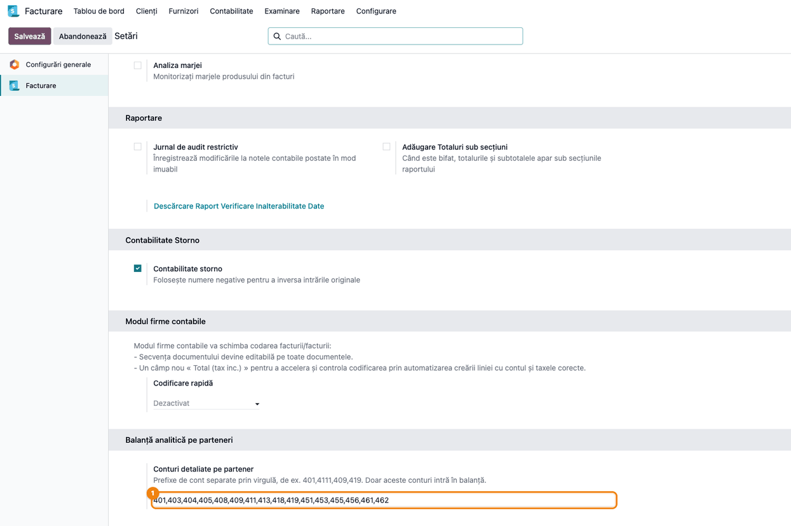
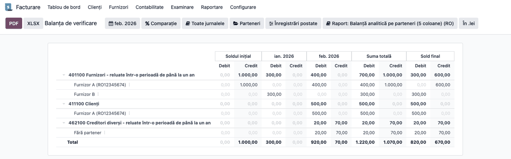
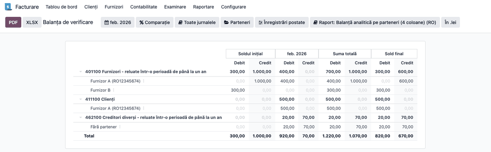
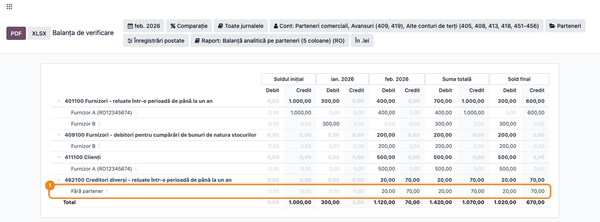
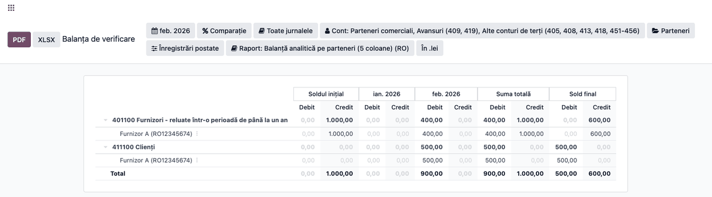
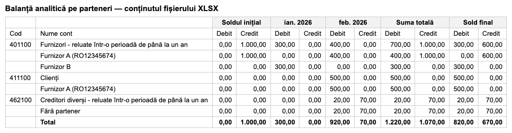

# Fișă Modul: Balanța analitică pe parteneri — 4 și 5 coloane, pentru bănci

**Modul:** `l10n_ro_partner_trial_balance`
**Utilizator principal:** Contabil, Contabil șef
**Prioritate:** 🔴 Ridicată (băncile cer balanța pe parteneri de mai multe ori pe an, la fiecare analiză de credit)

---

## 1. Scop business

Băncile cer, alături de balanța de verificare, **balanța analitică a conturilor de terți**: furnizori (401, 404, 408), clienți (4111, 418), avansuri (409, 419), debitori și creditori diverși (461, 462). Cererea vine în formatul cu 4 sau 5 serii de coloane (uzual, „cu 4 / 5 egalități”) și cu solduri inițiale. Fără modul, contabilul combina fișa partenerului (care are soldurile, dar rulaje cumulate de la început) cu un export din jurnal, apoi completa în Excel coloanele de sold inițial.

Modulul adaugă două variante ale balanței de verificare RO, detaliate pe cont și pe partener:

| Funcționalitate | Ce înseamnă pentru contabil | Unde se vede |
|-----------------|-----------------------------|--------------|
| **Balanță analitică pe parteneri (5 coloane)** | Sold inițial an, sume precedente, rulajul perioadei, total sume, sold final, toate cu Debit / Credit, pe fiecare partener | Pasul 2 |
| **Balanță analitică pe parteneri (4 coloane)** | Sold inițial (la începutul perioadei), rulajul perioadei, total sume, sold final | Pasul 3 |
| **Partenerul pe rând, cu codul fiscal** | Sub fiecare cont, un rând pe partener; CUI-ul apare lângă nume | Pașii 2 și 3 |
| **Sold net pe partener** | Soldul inițial și cel final ale partenerului stau pe o singură coloană, Debit sau Credit | Pașii 2 și 3 |
| **Sold desfășurat pe cont** | Pe rândul contului și la total, soldurile debitoare ale partenerilor se adună pe Debit, cele creditoare pe Credit, fără compensare între parteneri | Pașii 2 și 3 |
| **Rândul „Fără partener”** | Liniile contabile fără partener se adună pe un rând separat, cu sume brute, fără compensare | Pasul 4 |
| **Conturi alese prin prefixe** | În balanță intră doar conturile ale căror coduri încep cu prefixele configurate | Pasul 1 |
| **Filtru pe parteneri și export** | Balanța pentru un singur partener sau un grup; export XLSX și PDF | Pașii 5 și 6 |

---

## 2. Bază legală și context

- **OMFP 1802/2014, pct. 55 și 56.** Pct. 55: componentele elementelor de active și de datorii se evaluează separat. Pct. 56 alin. (1): compensarea între active și datorii este interzisă; alin. (2): creanțele și datoriile se înregistrează distinct; alin. (3): compensarea cu aceeași entitate se face doar în condițiile legii și după înregistrarea creanțelor și datoriilor. De aici rezultă că datoria față de Furnizor A pe 401 și creanța asupra lui pe 4111 nu se compensează.
- **Soldul desfășurat pe cont** e o convenție de prezentare care decurge din aceste principii (OMFP nu reglementează balanța pe parteneri): soldul debitor al lui 401 este o creanță, nu o datorie mai mică.
- **OMFP 1802/2014, cap. 16 „Funcțiunea conturilor”.** 401, 419 și 462 sunt conturi de pasiv; 4111, 409 și 461 de activ. Un sold de semn opus funcțiunii (401 debitor, 4111 creditor) arată de regulă un avans sau o încasare nealocată, nereclasificate în 409 / 419, o plată în plus sau o alocare greșită. Balanța pe parteneri le face vizibile.
- **OMFP 2634/2015** privind documentele financiar-contabile: balanța de verificare face parte din documentele financiar-contabile. Balanța pe parteneri nu e un formular tipizat, ci o balanță analitică. Forma exactă a modelului 14-6-30 trebuie verificată la sursa primară.

**Context.** Balanța pe parteneri nu înlocuiește balanța de verificare: e o detaliere a conturilor de terți, ca balanța analitică pe conturi analitice din alte programe, unde fiecare partener are contul lui analitic (401.00001). În Odoo partenerul e pe linia contabilă, deci rândul de partener ține locul contului analitic.

**Balanța pe parteneri nu are egalitatea Debit = Credit.** Conține doar conturile de terți, nu și contrapartidele lor (bancă, cheltuieli, venituri), deci totalul general nu iese egal. **Controlul pentru bancă** este reconcilierea cu balanța de verificare, pe fiecare cont:

- **rulajele** (sumele precedente și rulajul perioadei) coincid la leu cu balanța de verificare;
- **soldul final net** (Sold final D − Sold final C) coincide cu soldul contului din balanța de verificare;
- soldul inițial și totalul sumelor pot diferi, pentru că pe rândul contului sunt desfășurate pe parteneri, iar balanța de verificare le arată nete.

Pe fiecare rând, Total sume D − C = Sold final D − C. Egalitatea ține prin construcția raportului, deci verifică raportul, nu datele.

---

## 3. Utilizatori și roluri

| Rol | Ce face |
|-----|---------|
| Contabil | Rulează balanța pe parteneri pentru perioada cerută de bancă, o verifică și o exportă |
| Contabil șef | Reconciliază rândurile de cont cu balanța de verificare și semnează documentul trimis băncii |
| Bancă / auditor | Primește balanța și o compară cu balanța de verificare |

Pentru testare, folosiți un utilizator cu drepturi de contabil pe Facturare/Contabilitate. Setarea conturilor cere drept de administrator pe Contabilitate.

---

## 4. Conturi și date implicate

Datele demo (lei, fără TVA, pentru ca sumele să se urmărească ușor). Partenerii: **Furnizor A** (CUI RO12345674), care e și client, și **Furnizor B**.

| Data | Operațiune | Notă contabilă | Sumă |
|------|------------|----------------|------|
| 31.12.2025 | Factură Furnizor A (exercițiul precedent) | 6022 = 401 (Furnizor A) | 1.000 |
| 10.01.2026 | Plată Furnizor B înaintea facturii (Odoo o înregistrează pe 401) | 401 (Furnizor B) = 5121 | 300 |
| 05.02.2026 | Încasare fără partener | 5121 = 462 | 70 |
| 06.02.2026 | Plată fără partener | 462 = 5121 | 20 |
| 10.02.2026 | Salarii (nu intră în balanța pe parteneri) | 641 = 421 | 80 |
| 15.02.2026 | Plată parțială Furnizor A | 401 (Furnizor A) = 5121 | 400 |
| 20.02.2026 | Factură către Furnizor A, ca client | 4111 (Furnizor A) = 707 | 500 |

Balanța se rulează pe **01.02.2026 – 28.02.2026**. Testele automate ale modulului folosesc aceleași sume (pe anul 2024).

**Conturile incluse implicit** (prefixe): 401, 403, 404, 405, 408, 409, 411, 413, 418, 419, 451, 453, 455, 456, 461, 462. Un prefix aduce toate conturile care încep cu el: `409` aduce 4091–4094, `411` aduce 4111 și 4118.

**Conturi care nu intră implicit**, deși în planul de conturi Odoo au tipul Creanțe sau Datorii: 421 (salarii), 425 (avansuri către personal), 4424 (TVA de recuperat), 44231 (TVA de plată), 463. Conturile de personal arată sumele pe fiecare angajat și nu se trimit băncii.

---

## 5. Configurare inițială

1. Instalați `l10n_ro_partner_trial_balance`. `l10n_ro_reports_fix` și `l10n_ro_reports` se instalează automat, ca dependențe.
2. Verificați lista de conturi: **Facturare/Contabilitate → Configurare → Setări**, secțiunea **Balanță analitică pe parteneri → Conturi detaliate pe partener**. Lista implicită acoperă cererile uzuale ale băncilor.
3. Completați partenerul pe notele contabile manuale pe conturile de terți. Liniile fără partener ajung pe rândul „Fără partener”.

---

## 6. Flux de utilizare

### Pasul 1 — Conturile detaliate pe partener

**Facturare/Contabilitate → Configurare → Setări**, secțiunea **Balanță analitică pe parteneri**. Câmpul **Conturi detaliate pe partener** conține prefixele de cont, separate prin virgulă.

**Verificați:** lista conține conturile cerute de bancă. Dacă banca vrea și împrumuturile de la alte firme sau de la entitățile afiliate, adăugați `167` sau `1661` (asociații, prin 455, sunt deja incluși). Nu adăugați conturile de personal (421, 425, 4282). Salvați.

### Pasul 2 — Balanța pe parteneri cu 5 coloane

**Facturare/Contabilitate → Raportare → Registre → Balanța de verificare**. Din butonul **Raport:** alegeți **Balanță analitică pe parteneri (5 coloane)**. Setați perioada **01.02.2026 – 28.02.2026**.

**Găsiți pe ecran:**
- grupurile de coloane, fiecare cu Debit / Credit: **Sold inițial** (la 01.01.2026), **ian. 2026** (sumele precedente), **feb. 2026** (rulajul perioadei), **Suma totală** și **Sold final**;
- conturile 401 și 4111, fiecare cu partenerii dedesubt; numele partenerului are CUI-ul în paranteză: „Furnizor A (RO12345674)”;
- contul 421 nu apare, deși are rulaj în februarie.

**Verificați, pe 401:**

| Rând | Sold inițial D / C | Sume precedente D / C | Rulaj feb. D / C | Total sume D / C | Sold final D / C |
|------|-------------------|-----------------------|------------------|------------------|------------------|
| Furnizor A | 0 / 1.000 | 0 / 0 | 400 / 0 | 400 / 1.000 | 0 / 600 |
| Furnizor B | 0 / 0 | 300 / 0 | 0 / 0 | 300 / 0 | 300 / 0 |
| **401 (cont)** | **0 / 1.000** | **300 / 0** | **400 / 0** | **700 / 1.000** | **300 / 600** |

- pe fiecare partener, soldul final e pe **o singură coloană**: Furnizor A are 600 doar pe Credit;
- **Total sume** = sold inițial + sume precedente + rulajul perioadei: Furnizor A are 0 + 0 + 400 = 400 pe Debit și 1.000 pe Credit;
- pe fiecare rând, Total sume D − C = Sold final D − C: Furnizor A are 400 − 1.000 = 0 − 600;
- rândul contului 401 are soldul **desfășurat**: 300 pe Debit (avansul lui Furnizor B) și 600 pe Credit (datoria față de Furnizor A), nu 300 net pe Credit;
- pe 4111, Furnizor A are 500 pe Debit la rulaj, la total sume și la sold final. Datoria lui de pe 401 nu se compensează cu creanța de pe 4111.

**Reconcilierea cu balanța de verificare.** Balanța de verificare arată 401 cu soldul net: 600 − 300 = **300 creditor**. Balanța pe parteneri arată 300 D și 600 C, iar diferența lor e același sold net. Rulajele (300 D în ianuarie, 400 D în februarie) coincid la leu cu balanța de verificare. Diferența de prezentare la solduri apare pe orice cont cu parteneri de semn opus și e normală.

### Pasul 3 — Balanța pe parteneri cu 4 coloane

Din butonul **Raport:** alegeți **Balanță analitică pe parteneri (4 coloane)**, cu aceeași perioadă.

**Găsiți pe ecran:** grupurile **Sold inițial** (la 01.02.2026), **feb. 2026**, **Suma totală** și **Sold final**. Coloana sumelor precedente lipsește: soldul inițial le include deja.

**Verificați, pe 401:**

| Rând | Sold inițial D / C | Rulaj feb. D / C | Total sume D / C | Sold final D / C |
|------|-------------------|------------------|------------------|------------------|
| Furnizor A | 0 / 1.000 | 400 / 0 | 400 / 1.000 | 0 / 600 |
| Furnizor B | 300 / 0 | 0 / 0 | 300 / 0 | 300 / 0 |
| **401 (cont)** | **300 / 1.000** | **400 / 0** | **700 / 1.000** | **300 / 600** |

- soldul final e același ca în varianta cu 5 coloane;
- soldul inițial al lui Furnizor B (300 D) este avansul din ianuarie, care la 5 coloane apărea la sumele precedente.

### Pasul 4 — Rândul „Fără partener”

În aceeași balanță, sub contul 462 apare rândul **Fără partener**.

**Găsiți pe ecran:** rândul are 20 pe Debit și 70 pe Credit la rulajul din februarie, la total sume și la sold final.

**Verificați:**
- sumele **nu se compensează**: rândul adună note fără legătură între ele, deci la Sold final apar totalurile celor două părți (20 D / 70 C), nu soldul net de 50 C. Soldul net al rândului e diferența lor;
- pe 401 și 4111 rândul „Fără partener” nu ar trebui să apară. Dacă apare, deschideți-l (drill-down) și completați partenerul pe notele contabile respective înainte de a trimite balanța.

### Pasul 5 — Filtrul pe parteneri

Apăsați butonul **Parteneri** și alegeți **Furnizor A**.

**Verificați:** rămân doar rândurile lui Furnizor A, pe 401 și pe 4111. Rândul contului 401 are acum doar soldul lui Furnizor A (0 / 600).

### Pasul 6 — Export XLSX / PDF

Abia după verificările de mai sus, scoateți filtrul pe parteneri și apăsați **XLSX** sau **PDF** în stânga sus.

**Verificați în fișier:** rândurile și sumele coincid cu ecranul; partenerii au CUI-ul lângă nume; rândul „Fără partener” e prezent cu sumele brute.

### Note de monografie și raportare

Modulul **nu generează note contabile**: e un raport. Notele din exemplu sunt înregistrate de operator:

| Operațiune | Notă contabilă | Sumă |
|------------|----------------|------|
| Factură furnizor | 6022 = 401 | 1.000 |
| Plată înaintea facturii | 401 = 5121 | 300 |
| Plată furnizor | 401 = 5121 | 400 |
| Factură client | 4111 = 707 | 500 |
| Încasare / plată fără partener | 5121 = 462; 462 = 5121 | 70; 20 |

Plata înaintea facturii rămâne pe 401 cât timp nu e reclasificată: `4091 = 401` la plată și `401 = 4091` la regularizare, dacă firma folosește contul de avansuri (4093 pentru imobilizări). Dacă furnizorul emite factură de avans, nota este `4091 + 4426 = 401`: TVA devine exigibilă la încasarea avansului (Codul fiscal, art. 282 alin. (2) lit. b)).

---

## 7. Legături cu alte module / declarații

| Modul / proces | Rol în flux |
|---|---|
| `l10n_ro_reports` (Enterprise) | balanța de verificare RO cu 4 și 5 coloane, pe care o detaliază modulul |
| `l10n_ro_reports_fix` | regulile de sold ale balanței RO (sold inițial net, total sume) |
| `account_reports` | motorul rapoartelor, filtrul pe parteneri, exporturile PDF / XLSX, drill-down |
| `l10n_ro_balance_confirmation` | confirmarea de sold trimisă partenerilor, pe documente deschise |
| `l10n_ro_partner_ledger_currency` | fișa partenerului în valută, pentru soldurile în EUR |

**Ce e automat:**
- detalierea pe partener, soldul net pe partener și soldul desfășurat pe cont;
- alegerea conturilor după prefixe și excluderea celorlalte;
- rândul „Fără partener” cu sume brute;
- codul fiscal lângă numele partenerului.

**Ce rămâne manual:**
- lista de prefixe, dacă banca cere și alte conturi;
- completarea partenerului pe notele fără partener;
- reclasificarea avansurilor (401 → 409, 4111 → 419) înainte de a trimite balanța, dacă firma o face.

---

## 8. Verificări pentru consultant

- [ ] Varianta cu 5 coloane: coloanele sunt sold inițial an, sume precedente, rulaj, total sume, sold final, fiecare cu Debit / Credit.
- [ ] Pe fiecare partener, soldul inițial și cel final sunt pe o singură coloană.
- [ ] Pe fiecare rând, Total sume D − C = Sold final D − C.
- [ ] Rândul contului 401 are 300 D / 600 C la sold final (desfășurat), nu 300 C net.
- [ ] Pe fiecare cont, rulajele (sume precedente și rulajul perioadei) coincid la leu cu balanța de verificare.
- [ ] Soldul net al rândului 401 (600 − 300 = 300 C) coincide cu 401 din balanța de verificare.
- [ ] Nu apare rândul „Fără partener” pe 401, 4111, 409 și 419.
- [ ] Furnizorii cu sold debitor pe 401 și clienții cu sold creditor pe 4111 sunt reclasificați sau explicați înainte de predare.
- [ ] La 4 coloane, soldul inițial al partenerului = soldul net din sold inițial an + sume precedente de la 5 coloane (Furnizor B: 300 D).
- [ ] Contul 421 nu apare, deși are rulaj.
- [ ] Partenerul care e și client și furnizor apare pe 401 și pe 4111, fără compensare între conturi.
- [ ] Rândul „Fără partener” are 20 D / 70 C la sold final, nu 50 C.
- [ ] Varianta cu 4 coloane are același sold final ca varianta cu 5 coloane.
- [ ] Cu prefixele schimbate la `401`, contul 4111 dispare din balanță.
- [ ] Exportul XLSX / PDF are aceleași rânduri și sume ca ecranul.

---

## 9. Mesaje de eroare frecvente

| Mesaj / simptom | Cauză | Remediere |
|---|---|---|
| Balanța e goală | Lista de prefixe e goală sau nu se potrivește cu planul de conturi | Completați **Conturi detaliate pe partener** în setări |
| Lipsește un cont cerut de bancă (ex. 167) | Contul nu e în lista de prefixe | Adăugați prefixul în setări |
| Apar conturile de salarii | Cineva a adăugat `42` în lista de prefixe | Scoateți prefixul; balanța ar arăta sumele pe fiecare angajat |
| Totalul general nu are Debit = Credit | Corect: balanța conține doar conturile de terți, nu și contrapartidele lor | Verificați egalitatea Total sume D − C = Sold final D − C pe fiecare rând |
| Soldul inițial sau totalul sumelor de pe rândul contului diferă de balanța de verificare | Corect: soldurile (inițial, total sume, final) sunt desfășurate pe parteneri, balanța de verificare le arată nete | Comparați rulajele, care trebuie să coincidă la leu, și soldul net (Sold final D − C) |
| Un client are sold creditor pe 4111 | Încasare nealocată sau avans nereclasificat în 419 | Alocați încasarea pe factură sau reclasificați: `4111 = 419` |
| Apare rândul „Fără partener” pe 401 / 4111 | Notă manuală sau solduri de deschidere importate fără partener | Deschideți rândul (drill-down) și completați partenerul pe note |
| Aceeași firmă apare de două ori sub un cont | Unele note sunt pe o persoană de contact a firmei, altele pe firmă | Înregistrați notele pe firmă (partenerul comercial) |
| Un furnizor are sold debitor pe 401 | Plată înaintea facturii sau plată în plus, nereclasificată în 409 | Reclasificați în 409 sau alocați plata pe factură |

---

## 10. Capturi de ecran

Capturile **nu sunt încă generate**. Numele planificate, în ordinea pașilor din secțiunea 6, în `static/description/`:

1. `01_setari_conturi.png` — setarea **Conturi detaliate pe partener**, cu lista implicită de prefixe.
2. `02_balanta_parteneri_5_coloane.png` — balanța pe parteneri cu 5 coloane, pe februarie 2026: 401 cu Furnizor A și Furnizor B, 4111 cu Furnizor A.
3. `03_balanta_parteneri_4_coloane.png` — aceeași balanță, varianta cu 4 coloane.
4. `04_rand_fara_partener.png` — contul 462 cu rândul **Fără partener**, cu sume brute.
5. `05_filtru_partener.png` — balanța filtrată pe Furnizor A.
6. `06_export_xlsx.png` — conținutul fișierului XLSX exportat, redat ca tabel.

Se generează cu skill-ul `fisa-screenshots`, din `tests/test_screenshots.py` (mixinul `ScreenshotCase` din `l10n_ro_doc_screenshots`, import defensiv), în română, pe planul de conturi RO, pe datele din secțiunea 4.

---

## 11. Observații pentru manual

- Prezentați balanța pe parteneri ca **detaliere a balanței de verificare** pentru conturile de terți, nu ca balanță separată: are aceleași serii de coloane, dar nu are egalitatea Debit = Credit.
- Explicați soldul desfășurat pe cont cu exemplul 401 (300 D / 600 C) și reconcilierea cu soldul net din balanța de verificare: e întrebarea pe care o pune banca.
- Insistați pe completarea partenerului pe notele manuale pe conturile de terți și pe reclasificarea avansurilor înainte de predare: rândul „Fără partener” și soldurile de semn opus funcțiunii contului sunt primele lucruri pe care le observă un analist de credit.
- Lista de conturi e o setare a companiei: explicați cum se adaugă un cont cerut de o anumită bancă.
