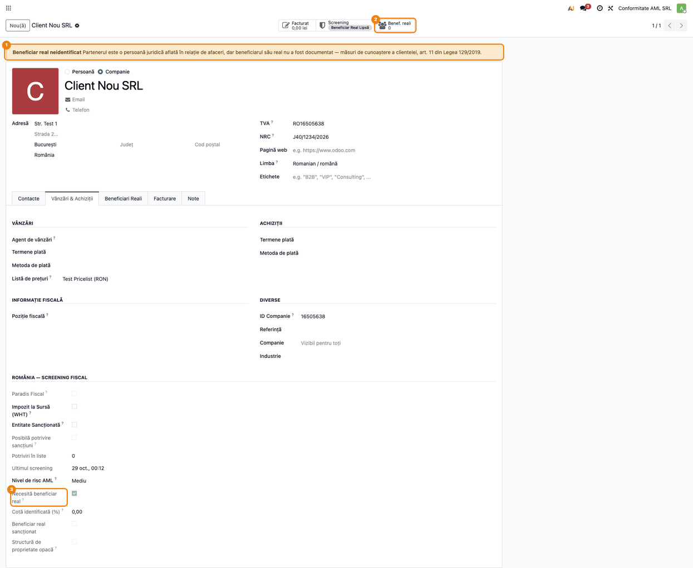
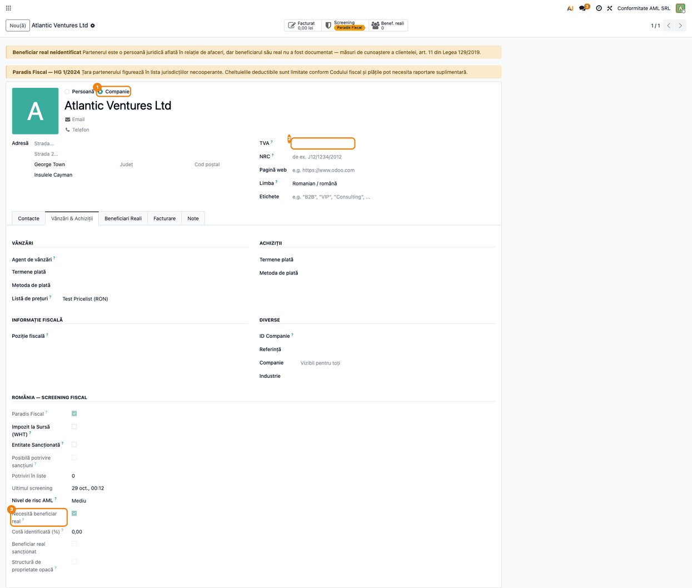
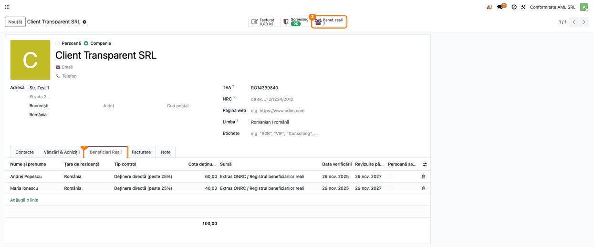
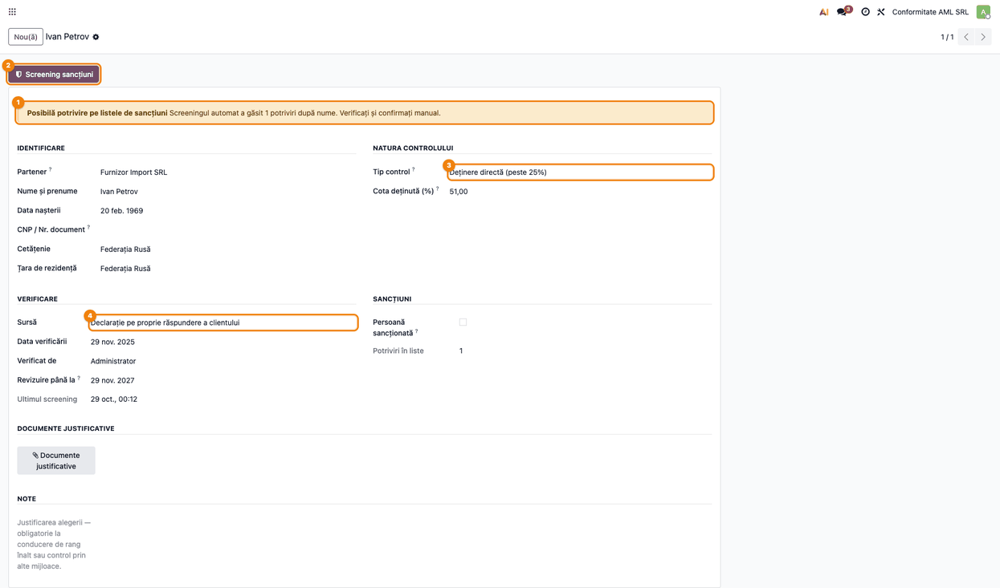
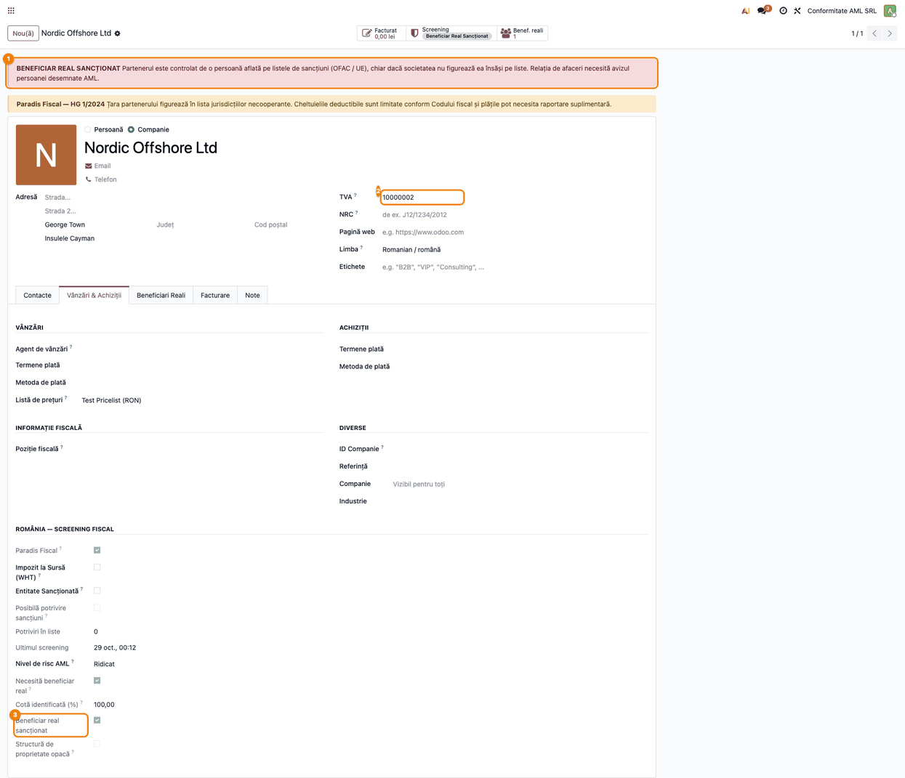
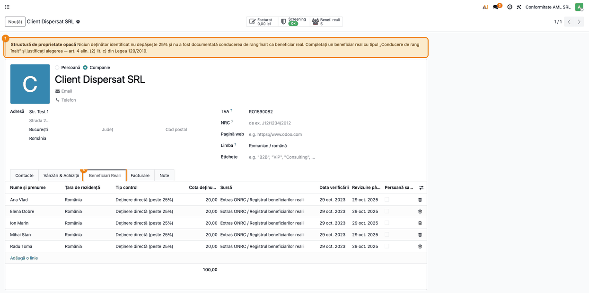
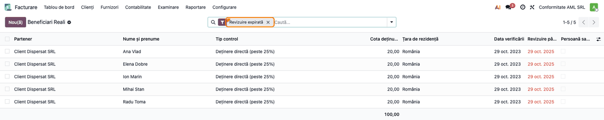
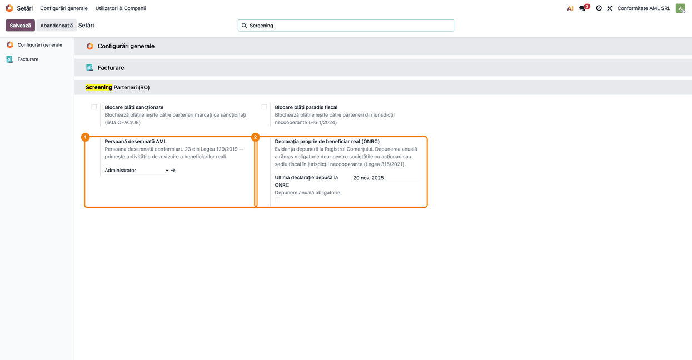

# Fișă Modul: Beneficiarii reali ai partenerilor (UBO) și screeningul persoanelor

**Modul:** `l10n_ro_partner_ubo`
**Utilizator principal:** Ofițer de conformitate AML (persoana desemnată), Contabil șef
**Prioritate:** 🟡 Medie (măsuri de cunoaștere a clientelei la onboarding și revizuire periodică)

---

## 1. Scop business

Modulul ține în Odoo **evidența beneficiarilor reali** (UBO — *Ultimate Beneficial Owner*) ai
clienților și furnizorilor persoane juridice: cine deține sau controlează efectiv firma, în ce
proporție, din ce sursă provine informația și când a fost verificată. Peste această evidență
reutilizează motorul de potrivire din `l10n_ro_partner_screening` și confruntă **persoanele fizice**
care controlează partenerul cu listele de sancțiuni OFAC și UE — riscul este adesea ascuns la nivelul
proprietarului, nu al societății. Rezultatul ajunge în statusul de screening al partenerului
(**Beneficiar Real Lipsă**, **Beneficiar Real Sancționat**), în bannere pe fișa partenerului și în
activități de revizuire periodică pentru persoana desemnată.

## 2. Bază legală și context

- **Legea 129/2019** privind prevenirea și combaterea spălării banilor:
  - **art. 11** — măsurile de cunoaștere a clientelei, inclusiv identificarea beneficiarului real;
    aplicarea lor „în funcție de risc” stă la baza periodicității de revizuire din modul;
  - **art. 4 alin. (2)** — natura controlului (deținere directă, indirectă, control prin alte
    mijloace); **lit. a) pct. 2** — conducerea de rang înalt ca soluție subsidiară când niciun
    deținător nu poate fi identificat;
  - **art. 23** — persoana desemnată, care primește activitățile de revizuire.
- **Legea 315/2021** — după 2022 declarația **proprie** de beneficiar real la ONRC se depune la
  înmatriculare, la orice modificare și la cererea ONRC; anual doar pentru societățile cu acționari
  sau sediu fiscal în jurisdicții necooperante (lista din **HG 1/2024**, întreținută de modulul de
  screening). Declarația se depune la ONRC de administrator, nu din ERP — modulul ține doar evidența.
  Bifa *Depunere anuală obligatorie* este o **aproximare**: se calculează din țara companiei și din
  rezidența beneficiarilor reali proprii (persoane fizice), nu din acționarii persoane juridice —
  un acționar firmă dintr-o jurisdicție necooperantă trebuie verificat manual.

Două ipostaze, adesea confundate: **beneficiarul real propriu** (evidența declarației la ONRC) și
**beneficiarul real al partenerului** (dosarul de cunoaștere a clientelei) — munca efectivă pe care
o susține modulul.

**Cine intră sub obligație în Odoo 19.** Persoana juridică este decisă de tipul partenerului ales de
operator în capul fișei — butonul radio **Persoană / Companie** (câmpul standard `is_company`).
Tipul **Companie** comandă fila *Beneficiari Reali*, butonul *Benef. reali* și câmpurile *Cotă
identificată*, *Beneficiar real sancționat* și *Structură de proprietate opacă*; dacă partenerul este și
client sau furnizor, se bifează automat **Necesită beneficiar real**. Codul fiscal și NRC-ul **nu
contează** pentru această decizie. Consecințe practice:
- o firmă se înregistrează cu tipul **Companie**, cu sau fără cod fiscal — o societate offshore
  pentru care nu aveți codul fiscal intră sub obligație doar prin tipul ales;
- un partener lăsat pe tipul **Persoană** este tratat ca persoană fizică, chiar dacă are cod fiscal sau
  NRC completat: nu are fila, butonul sau bannerul, iar *Necesită beneficiar real* rămâne nebifat — verificați tipul
  la crearea partenerilor (mai ales la cei creați automat, din import sau din ANAF);
- **contactele firmei** (persoanele adăugate în fila *Contacte*) sunt create cu tipul
  *Persoană*, deci nu intră sub obligație; beneficiarii reali se înregistrează pe firmă, nu pe contact.

## 3. Utilizatori și roluri

| Rol | Ce poate face |
|---|---|
| **Ofițer de conformitate AML** (grup nou, *Conformitate AML (RO)*) | singurul care vede câmpul *CNP / Nr. document*; creează, modifică și șterge beneficiari reali |
| **Administrator contabilitate** (`account.group_account_manager`) | creează și modifică beneficiari reali (fără ștergere, fără CNP); vede meniul *Beneficiari Reali* |
| **Utilizator intern** | doar citire |

Atenție la patru limite ale drepturilor:
- doar câmpul *CNP / Nr. document* este restricționat la grupul AML; **documentele justificative**
  atașate sunt vizibile oricărui utilizator intern care deschide beneficiarul real;
- butonul **Screening sancțiuni** (confirmarea potrivirii) nu este restricționat la grupul AML — îl
  poate apăsa și administratorul de contabilitate. Procedura internă trebuie să rezerve confirmarea
  persoanei desemnate;
- bifa **Persoană sancționată** din formularul beneficiarului nu e blocată: oricine are drept de
  scriere (inclusiv administratorul de contabilitate) o poate bifa sau debifa manual, fără buton;
- meniul *Beneficiari Reali* (lista globală și filtrul *Revizuire expirată*) este vizibil doar
  administratorului de contabilitate: persoana desemnată are nevoie și de acest rol.

Roluri recomandate la testare: un utilizator **Ofițer de conformitate AML** (persoana desemnată) și
un **Administrator contabilitate** fără grupul AML, ca să se vadă ascunderea CNP-ului.

## 4. Conturi și date implicate

Modulul **nu generează note contabile** și nu afectează TVA — este un strat de conformitate AML.
Date implicate:
- pe partener: fila **Beneficiari Reali**, **Nivel de
  risc AML** (Redus / Mediu / Ridicat), **Necesită beneficiar real**, **Cotă identificată (%)**, **Beneficiar real sancționat**,
  **Structură de proprietate opacă** și statusul de screening (două trepte noi);
- pe beneficiarul real: nume și prenume, data nașterii, CNP / nr. document (doar grupul AML),
  cetățenie, țara de rezidență, tip control, cota deținută, sursă, data verificării, verificat de,
  revizuire până la, documente justificative, note, rezultatul screeningului;
- pe companie (Setări): **Persoană desemnată AML**, **Ultima declarație depusă la ONRC**,
  **Depunere anuală obligatorie** (calculat).

Date minime pentru demo: o companie RO; listele de sancțiuni cu cel puțin două persoane fizice;
șase parteneri client/furnizor de tip *Companie* — unul fără beneficiari reali, o societate străină
fără cod fiscal,
unul cu asociați peste 25%, unul cu un beneficiar cu nume pe liste, o societate offshore (Insulele
Cayman, cod fiscal străin) și unul cu cinci asociați de câte 20%.

## 5. Configurare inițială

1. Instalați modulul din *Aplicații* (dependență: `l10n_ro_partner_screening`). Instalarea nu cere
   acces la internet.
2. Acordați grupul **Ofițer de conformitate AML** persoanei desemnate: **Setări → Utilizatori și
   Companii → Utilizatori**, secțiunea *Contabilitate* (plus rolul *Administrator* la contabilitate,
   pentru meniul *Beneficiari Reali*). Fără grupul AML, câmpul *CNP / Nr. document* rămâne ascuns.
3. În **Setări → Screening Parteneri (RO)** completați **Persoană desemnată AML** și **Ultima
   declarație depusă la ONRC** (vezi Pasul 8).
4. Stabiliți **Nivelul de risc AML** pe fișa fiecărui partener (fila *Vânzări & Achiziții*, blocul
   *România — Screening fiscal*; implicit Mediu). El dă termenul de revizuire: **12 luni** la risc
   ridicat, **24** la mediu, **36** la redus.
5. Verificați ca toți clienții și furnizorii persoane juridice să aibă tipul **Companie** (inclusiv
   societățile străine fără cod fiscal, vezi Pasul 2): în lista de parteneri, filtrul *Persoane*
   din căutare îi arată pe cei de tip *Persoană* — corectați tipul unde este cazul.
6. Activați acțiunea programată **RO UBO: Revizuirea periodică a beneficiarilor reali** din
   **Setări → Tehnic → Acțiuni programate** (meniul *Tehnic* apare în modul dezvoltator; acțiunea e
   livrată dezactivată și rulează săptămânal). Activitățile se atribuie persoanei desemnate a
   **companiei partenerului**; pe partenerii vizibili pentru toate companiile (fără companie, cazul
   obișnuit) ajung la utilizatorul acțiunii programate — implicit **OdooBot**, deci nu le vede nimeni.
   Setați în acțiunea programată câmpul *Utilizator planificator* pe persoana desemnată AML, ca
   activitățile să ajungă la ea.
7. Verificați că listele de sancțiuni sunt încărcate (meniul *Liste Sancțiuni* din modulul de
   screening). Fără liste, screeningul beneficiarilor reali nu rulează.

## 6. Flux de utilizare

### Pasul 1 — Partenerul persoană juridică fără beneficiar real

Deschideți partenerul din **Facturare/Contabilitate → Clienți → Clienți** (sau **Furnizori →
Furnizori**). Un partener de tip **Companie** aflat în relație de afaceri (este client sau
furnizor) și fără niciun beneficiar real documentat primește:
- bannerul galben **„Beneficiar real neidentificat”** ①, cu trimitere la art. 11 din Legea 129/2019;
- statusul **Beneficiar Real Lipsă** pe butonul *Screening* și butonul **Benef. reali** cu 0 ②;
- bifa **Necesită beneficiar real** ③ în fila *Vânzări & Achiziții*, blocul *România — Screening
  fiscal*.

În exemplu, *Client Nou SRL* are tipul **Companie** (butonul radio din capul fișei), cod fiscal și
NRC; obligația vine din tipul *Companie* și din calitatea de client, nu din codul fiscal.



### Pasul 2 — Tipul „Companie” decide obligația, cu sau fără cod fiscal

În Odoo 19 persoana juridică este decisă **doar** de butonul radio **Persoană / Companie** din capul
fișei ①. O societate străină pentru care nu aveți codul fiscal (câmpul *TVA* gol ②) intră sub
obligație dacă o înregistrați cu tipul **Companie**: **Necesită beneficiar real** ③ se bifează (dacă
este client sau furnizor), apar bannerul *Beneficiar real neidentificat*, fila *Beneficiari Reali*
și butonul *Benef. reali*.

Invers, un partener lăsat pe tipul **Persoană** nu are nimic din acestea, chiar dacă are cod fiscal
sau NRC. Verificați tipul la crearea fiecărui client sau furnizor persoană juridică.

Ce verificați pe ecran: bannerul galben este prezent; statusul de pe butonul *Screening* poate arăta
alt semnal cu prioritate mai mare — aici **Paradis Fiscal**, pentru că societatea este în Insulele
Cayman (HG 1/2024). Dacă aflați ulterior codul fiscal străin, completați-l în *TVA*; obligația nu se
schimbă, pentru că tipul rămâne *Companie*.



### Pasul 3 — Înregistrarea beneficiarilor reali în fila „Beneficiari Reali”

Pe fișa partenerului, fila **Beneficiari Reali** ① permite adăugarea rapidă, pe linii, a persoanelor
fizice care dețin sau controlează partenerul: nume, țara de rezidență, **tip control** (Deținere
directă / indirectă, Control prin alte mijloace, Conducere de rang înalt), **cota deținută**,
**sursa** informației (declarația clientului, extras ONRC, RECOM, registru public al altui stat,
altă sursă) și **data verificării**. Coloana **Revizuire până la** se calculează din data verificării
și nivelul de risc al partenerului; operatorul o poate forța manual (câmpul e editabil). Totalul cotelor apare sub listă; butonul **Benef. reali** ②
deschide aceeași listă separat.

Ce verificați pe ecran: suma cotelor directe și indirecte corespunde extrasului ONRC (aici 60% +
40% = 100%); fiecare linie are sursă și dată de verificare; după salvare, bannerul de la Pasul 1
dispare și statusul *Screening* revine la **OK**.



### Pasul 4 — Formularul beneficiarului real și potrivirea posibilă pe liste

Un clic pe o linie deschide **formularul beneficiarului real**, cu blocurile *Identificare*,
*Natura controlului* ③, *Verificare* (sursa ④, data, cine a verificat, termenul de revizuire,
ultimul screening) și *Sancțiuni*, plus documentele justificative și notele.

La crearea beneficiarului, la modificarea numelui și după fiecare actualizare a listelor, numele este
confruntat automat cu listele OFAC și UE, **doar pe intrările de tip *Persoană* sau *Altele***. O potrivire apare
ca **posibilă**: bannerul galben ① arată numărul de potriviri, iar în chatter-ul partenerului se
consemnează un mesaj. Potrivirea se face **după nume**, deci poate fi un omonim.

Ce face ofițerul AML înainte de orice clic:
1. compară data nașterii, cetățenia și țara de rezidență cu intrarea de pe listă (motivul și țara
   apar în *Liste Sancțiuni*);
2. dacă **este aceeași persoană**, apasă **Screening sancțiuni** ② — apăsarea **înseamnă
   confirmare**: la o potrivire după nume cu o intrare de tip *Persoană* (sau *Altele*), beneficiarul este
   marcat **Persoană sancționată**, cu nota potrivirilor; notificarea „Atenție — beneficiar real
   sancționat” apare la orice potrivire, inclusiv doar cu o entitate, caz în care bifa **nu** se
   setează; fără potriviri apare „Screening OK”;
3. dacă este **un omonim**, **nu apasă butonul**: consemnează în câmpul *Note* verificarea făcută
   (ce date diferă, sursa). Marcajul *Posibilă potrivire* nu se poate șterge manual și rămâne cât
   timp numele figurează pe liste (potrivirea e după nume); la fiecare actualizare a listelor mesajul
   reapare în chatter. Nota din *Note* rămâne dovada analizei.

Din lista *Beneficiari Reali*, acțiunea **Screening sancțiuni** (meniul *Acțiuni*) re-rulează
screeningul automat pe înregistrările selectate, fără să confirme potrivirile.



### Pasul 5 — Beneficiar real confirmat sancționat (societate offshore)

Când beneficiarul real este confirmat sancționat, partenerul primește bannerul roșu **„BENEFICIAR
REAL SANCȚIONAT”** ① și statusul **Beneficiar Real Sancționat**, care **primează asupra oricărui
alt semnal** — inclusiv asupra unei societăți altfel curate pe liste. În blocul de screening, bifa
**Beneficiar real sancționat** ③ este activă.

În exemplu, *Nordic Offshore Ltd* (Insulele Cayman) este de tip *Companie* și are **codul fiscal
străin** în câmpul *TVA* ② — codul este util pentru identificare și screening, dar obligația vine din
tipul *Companie*. Bannerul galben de paradis fiscal (HG 1/2024) vine din modulul de screening.



### Pasul 6 — Structură de proprietate opacă

Dacă niciun deținător nu depășește **25%** și nu este documentat un beneficiar cu tipul *Control
prin alte mijloace* sau *Conducere de rang înalt*, partenerul primește bannerul **„Structură de
proprietate opacă”** ① (art. 4 alin. (2) lit. a) pct. 2 din Legea 129/2019). În exemplu, cinci asociați
dețin câte 20% (fila **Beneficiari Reali** ②).

Situația se rezolvă adăugând un beneficiar real cu tipul **Conducere de rang înalt** și justificând
alegerea în câmpul **Note** — nu prin completarea unei cote fictive. Bannerul nu schimbă statusul de
screening: este un semnal de documentare, nu de sancțiune.



### Pasul 7 — Revizuirea periodică: filtrul „Revizuire expirată”

Meniul **Facturare/Contabilitate → Configurare → Contabilitate → Beneficiari Reali** (vizibil
administratorului de contabilitate) listează toți beneficiarii reali. Filtrul **Revizuire expirată** ①
(din meniul derulant al căutării) arată înregistrările al căror termen de revizuire a ajuns la scadență (inclusiv azi) sau a trecut;
data depășită apare cu roșu (cea scadentă azi nu este colorată) în coloana *Revizuire până la* (coloanele cu nume lung apar trunchiate;
lățimea lor se poate mări din antet). Mai sunt filtrele *Sancționați*, *Potriviri de
verificat*, *Arhivate* și grupările pe partener, tip control și sursă.

Ce verificați pe ecran: fiecare linie are data verificării mai veche decât termenul dat de nivelul de
risc (aici verificări de acum 36 de luni la risc mediu, termen de 24). Pentru fiecare, reconfirmați datele cu partenerul
și actualizați **Data verificării** — termenul se recalculează (un termen forțat manual se rescrie
la schimbarea datei verificării sau a nivelului de risc). Acțiunea programată săptămânală
creează câte o activitate *Revizuire beneficiar real* pe partener, pentru persoana desemnată a
companiei partenerului; pe partenerii fără companie (vizibili pentru toți, cazul obișnuit) activitatea
ajunge la utilizatorul acțiunii programate — implicit OdooBot, dacă nu l-ați schimbat (vezi
secțiunea 5, punctul 6). Acțiunea nu verifică activitățile deja
create, deci la fiecare rulare săptămânală apare o activitate nouă cât timp revizuirea rămâne
expirată — finalizați revizuirea, nu doar activitatea.



### Pasul 8 — Setări: persoana desemnată și declarația proprie la ONRC

În **Setări → Screening Parteneri (RO)** (căutați „Screening”):
- **Persoană desemnată AML** ① — persoana desemnată conform art. 23, care primește activitățile de
  revizuire — doar pentru partenerii care au compania setată (vezi Pasul 7);
- **Declarația proprie de beneficiar real (ONRC)** ② — **Ultima declarație depusă la ONRC** (evidență)
  și **Depunere anuală obligatorie**, bifată automat dacă țara companiei sau rezidența unui beneficiar
  real propriu (înregistrat pe partenerul companiei) este în lista jurisdicțiilor necooperante —
  aproximare care nu prinde acționarii persoane juridice (vezi secțiunea 2).



### Note de monografie și raportare

- Modulul **nu produce note contabile** și **nu afectează TVA**; nu generează declarații.
- Prioritatea statusului de screening: **Beneficiar Real Sancționat** > Sancționat > Paradis
  Fiscal > **Beneficiar Real Lipsă** > WHT > OK. „Beneficiar Real Lipsă” înlocuiește doar statusurile
  *WHT* și *OK*; bannerul *Beneficiar real neidentificat* apare însă indiferent de status.
- Declarația proprie la ONRC se depune în afara ERP; modulul păstrează doar data ultimei depuneri.
- Datele despre beneficiarii reali sunt informații obiective despre partener, nu despre compania care
  le înregistrează, deci nu sunt separate pe companii; trasabilitatea verificării rămâne pe
  înregistrare (*Verificat de*, *Data verificării*, chatter-ul partenerului).

## 7. Legături cu alte module / declarații

| Modul / proces | Rol în flux | Tip legătură |
|---|---|---|
| `l10n_ro_partner_screening` | listele de sancțiuni OFAC/UE, motorul de potrivire, statusul de screening, paradisuri fiscale (HG 1/2024) | dependență (manifest) |
| `mail` (activități) | activitățile de revizuire create de acțiunea programată | indirect |
| ONRC — declarația de beneficiar real | depusă în afara ERP; în Odoo doar evidența | evidență |

**Ce e automat:** decizia „Necesită beneficiar real” (tip *Companie* + client/furnizor), statusul
*Beneficiar Real Lipsă* / *Sancționat*, bannerele, screeningul la creare, la schimbarea numelui și după actualizarea listelor,
mesajul în chatter la potrivire posibilă, termenul de revizuire, activitățile săptămânale, bifa de
depunere anuală la ONRC.
**Ce rămâne manual:** identificarea și documentarea beneficiarilor reali, alegerea tipului *Companie*
pe partenerii persoane juridice, analiza omonimelor și confirmarea potrivirilor (*Screening sancțiuni*), justificarea conducerii de rang înalt, stabilirea nivelului de risc,
reconfirmarea la revizuire, declarația proprie la ONRC.

## 8. Verificări pentru consultant

- [ ] Un client de tip *Companie* fără beneficiari reali are banner galben, status *Beneficiar Real
      Lipsă* și *Necesită beneficiar real* bifat.
- [ ] O societate străină de tip *Companie*, **fără cod fiscal**, are același comportament.
- [ ] Un client de tip *Persoană* nu are fila *Beneficiari Reali*, butonul *Benef. reali* și nici
      banner — chiar dacă are cod fiscal sau NRC.
- [ ] Trecerea aceluiași partener pe tipul *Companie* face să apară fila, butonul și bannerul și
      bifează *Necesită beneficiar real* (dacă e client/furnizor).
- [ ] Un **contact** al unei firme (tip *Persoană*, sub companie) nu are fila *Beneficiari Reali*,
      butonul *Benef. reali* și nici banner.
- [ ] O firmă de tip *Companie* care nu este nici client, nici furnizor are fila *Beneficiari Reali*,
      dar nu are *Necesită beneficiar real* bifat și nici banner.
- [ ] După adăugarea beneficiarilor reali, bannerul dispare și statusul revine la *OK*.
- [ ] Deținere directă/indirectă fără cotă este refuzată la salvare.
- [ ] Un beneficiar cu nume de pe liste produce *Posibilă potrivire* și mesaj în chatter-ul
      partenerului; *Screening sancțiuni* îl marchează *Persoană sancționată* (apăsarea = confirmare).
- [ ] Un beneficiar sancționat ridică partenerul la *Beneficiar Real Sancționat*, peste orice alt
      status.
- [ ] Cinci asociați cu 20% fiecare produc bannerul *Structură de proprietate opacă*; adăugarea unui
      beneficiar *Conducere de rang înalt* îl elimină.
- [ ] *Revizuire până la* = data verificării + 12/24/36 luni după risc (ridicat/mediu/redus).
- [ ] Filtrul *Revizuire expirată* arată înregistrările cu termenul scadent azi sau depășit.
- [ ] Fără grupul *Ofițer de conformitate AML*, câmpul *CNP / Nr. document* nu apare (documentele
      justificative rămân vizibile).
- [ ] Acțiunea programată creează activitatea *Revizuire beneficiar real* pentru persoana desemnată a
      companiei partenerului (pe un partener cu companie setată).

## 9. Mesaje de eroare frecvente

| Mesaj / simptom | Cauză | Remediere |
|---|---|---|
| „Pentru deținere directă sau indirectă trebuie completată cota deținută.” | Tip control *Deținere directă/indirectă* cu cota 0 | Completați cota sau alegeți *Control prin alte mijloace* / *Conducere de rang înalt* |
| „Cota deținută trebuie să fie între 0 și 100%.” | Cotă negativă sau peste 100 | Corectați cota |
| Fila *Beneficiari Reali* lipsește pe un partener firmă | Partenerul are tipul *Persoană* (inclusiv contactele sub o companie) | Schimbați tipul în *Companie* din capul fișei; înregistrați beneficiarii pe firmă, nu pe contact |
| Notificarea „Atenție — beneficiar real sancționat”, dar bifa *Persoană sancționată* rămâne goală | Numele se potrivește doar cu o entitate (companie, navă) de pe liste, nu cu o persoană | Ofițerul AML analizează intrarea; dacă e aceeași persoană, bifează manual și completează *Notă sancțiune* |
| Nu apare *Beneficiar Real Lipsă* deși lipsesc beneficiarii | Partenerul nu e încă client/furnizor sau are deja un status cu prioritate mai mare (sancționat, paradis fiscal) | Comportament normal |
| Screeningul nu găsește nimic | Listele de sancțiuni nu au fost importate | Importați listele în modulul de screening |
| Câmpul *CNP / Nr. document* nu apare | Utilizatorul nu are grupul *Ofițer de conformitate AML* | Acordați grupul persoanei desemnate |
| Nu se creează activități de revizuire | Acțiunea programată este dezactivată | Activați *RO UBO: Revizuirea periodică a beneficiarilor reali* |
| Activitatea de revizuire nu ajunge la persoana desemnată | Partenerul nu are companie setată sau compania lui nu are *Persoană desemnată AML* | Completați *Persoană desemnată AML* pe compania partenerului; pentru partenerii fără companie, setați *Utilizator planificator* al acțiunii programate pe persoana desemnată (implicit e OdooBot) |
| Activități de revizuire duplicate pe același partener | Revizuirea rămâne expirată între rulările săptămânale | Actualizați *Data verificării* pe beneficiarii reali, apoi închideți activitățile |

## 10. Capturi de ecran

Capturile din `static/description/` sunt **generate automat** de `tests/test_screenshots.py` (mixinul
`ScreenshotCase` din `l10n_ro_doc_screenshots`, import defensiv), în limba română, pe planul de conturi
RO (`setup_country("ro")`). Listele de sancțiuni sunt seedate local; descărcarea OFAC/UE este blocată
prin mock, fără cereri externe.

1. `01_partener_beneficiar_lipsa.png` — client de tip *Companie*, fără beneficiar real: banner și
   status *Beneficiar Real Lipsă*.
2. `02_tip_companie_fara_cod.png` — societate străină fără cod fiscal, de tip *Companie*, sub
   obligație.
3. `03_tab_beneficiari_reali.png` — fila *Beneficiari Reali* completată (60% + 40%).
4. `04_formular_beneficiar.png` — formularul beneficiarului real cu potrivire posibilă și butonul
   *Screening sancțiuni*.
5. `05_beneficiar_sanctionat.png` — offshore cu cod fiscal străin și beneficiar real sancționat.
6. `06_structura_opaca.png` — structură opacă (cinci asociați cu 20%).
7. `07_revizuire_expirata.png` — lista *Beneficiari Reali* cu filtrul *Revizuire expirată*.
8. `08_setari_aml.png` — Setări: persoana desemnată AML și declarația proprie la ONRC.

Regenerare:

```bash
.venv/bin/python odoo/odoo-bin -c odoo.conf -d <db> -i l10n_ro_partner_ubo,l10n_ro_doc_screenshots \
    --test-tags=fise_screenshots/l10n_ro_partner_ubo --stop-after-init
```

## 11. Observații pentru manual

Păstrați în manual distincția dintre **beneficiarul real propriu** (declarația la ONRC, în afara ERP)
și **beneficiarul real al partenerului** (dosarul de cunoaștere a clientelei, ținut în Odoo).
Explicați regula Odoo 19 pentru cine intră sub obligație — partenerul de tip **Companie** (butonul radio
din capul fișei), indiferent de codul fiscal sau NRC; partenerii și contactele de tip *Persoană* nu
intră — și că tipul trebuie verificat la fiecare client sau furnizor persoană juridică, inclusiv la
societățile offshore fără cod fiscal. Insistați pe procedura la omonime:
butonul *Screening sancțiuni* confirmă, nu verifică. Subliniați că
modulul **semnalează** (potriviri posibile, structuri opace, revizuiri expirate), dar confirmarea
sancțiunii și decizia de a continua relația de afaceri rămân ale persoanei desemnate AML.
