# Fișă Modul: Adeverințe salariale — venit, bază pentru concediul medical, asigurat, șomaj, creșterea copilului

**Modul:** `l10n_ro_payroll_certificates`
**Utilizator principal:** Inspector resurse umane / salarizare, Contabil salarii
**Prioritate:** 🟡 Medie (cerute lunar de angajați; nu schimbă calculul salariilor)

---

## 1. Scop business

Angajații cer des adeverințe: de venit (bancă, chirie, credit), cu baza pentru concediul medical (la schimbarea angajatorului) sau privind contribuția la sănătate. Modulul le emite **direct din fluturașii validați**, fără recopierea sumelor: textul se precompletează din fișa angajatului, tabelul se calculează, adeverința primește număr din secvență, două semnături și un PDF arhivat pe fișa angajatului.

## 2. Bază legală și context

- **Codul muncii, art. 34 alin. (5):** angajatorul eliberează, la cerere, document care atestă activitatea desfășurată, durata, salariul și vechimea, inclusiv pentru fost salariat.
- **OUG 158/2005**, concediul medical: art. 7 (stagiul de asigurare), **art. 10** (baza de calcul: ultimele 6 luni din cele 12 ale stagiului, venituri pe baza cărora se calculează contribuția asiguratorie pentru muncă; indemnizațiile de concediu medical se cuprind în baza lunii respective, alin. 4 lit. a) și art. 3^1 (adeverința plătitorului de indemnizații cu zilele de concediu medical).
- **Șomaj:** formularul oficial **Anexa nr. 7** (în antetul formularului: „Anexa nr. 26 la Normele metodologice”) de aplicare a **Legii 76/2002**; stagiul minim de cotizare (art. 34 din lege) îl stabilește AJOFM.
- **Concediul pentru creșterea copilului:** formularul oficial **Anexa nr. 2** (model AJPIS), cu veniturile și zilele din luna nașterii și din cele 24 de luni anterioare (**OUG 111/2010**).
- Cele două formulare se pot edita în ciornă și se emit doar după bifa *Model verificat*. Rămân de confirmat cu instituția: ce intră în BCIS (art. 19^1 din Normele Legii 76/2002), dacă lunile fără stagiu se sar, tipul zilelor (lucrătoare, din pontaj) și dacă indemnizația de maternitate intră în venitul net din Anexa 2.
- Textele sunt documente oficiale românești: se scriu doar în limba română. **Modelul unei bănci sau al casei de asigurări prevalează** asupra modelului din modul.
- **De verificat:** dacă există un model obligatoriu de adeverință pentru stagiu și venituri în normele de aplicare (Ordinul MS/CNAS 15/1.311/2006); articolul din actul care fixează suma neimpozabilă pentru 2026.

## 3. Utilizatori și roluri

- **Inspector salarizare** (grupul *Utilizator salarizare*) — creează, editează și emite adeverințele;
- **Manager salarizare** — la fel; **Angajatul** nu are acces la modul.

## 4. Conturi și date implicate

Modulul **nu face înregistrări contabile**. Citește din fluturașii validați sau plătiți liniile: GROSS, CM_FS, CM_FNUASS, CAS, CAS_CM, CASS, CASS_CM, INCOMETAX, TAX_CM, NET, TICHETE, NEIMPOZ și zilele lucrate. Pe fișa angajatului folosește CNP-ul, funcția, datele contractului, iar pe companie denumirea, sediul, CUI și numărul din Registrul Comerțului. Date minime pentru demo: un angajat cu fluturași validați pe lunile cerute.

## 5. Configurare inițială

1. Instalați `l10n_ro_payroll_certificates` (necesită `l10n_ro_hr_payroll_enhancement`).
2. Completați pe companie denumirea, adresa, CUI și numărul din Registrul Comerțului (apar în text).
3. Validați fluturașii lunilor pe care vreți să le adeveriți; la *Venit* și *Asigurat* lunile fără fluturaș validat nu apar; la baza pentru concediul medical și la creșterea copilului apar cu celule goale (pașii 5 și 8), iar la șomaj se sar, ca și lunile cu BCIS zero (pasul 7).
4. Pentru șomaj și creșterea copilului: completați pe angajat seria și numărul actului de identitate, adresa de domiciliu și sexul, iar pe contract numărul CIM și, la încetare, temeiul (câmpurile din `l10n_ro_reges`); codul CAEN vine din setările companiei.

## 6. Flux de utilizare

### Pasul 1 — Lista adeverințelor

**Stat de plată → Angajați → Adeverințe salariale (RO)**. Lista arată numărul (pentru cele emise), data, angajatul, tipul, destinatarul și starea (*Ciornă*, *Emisă*, *Anulată*).

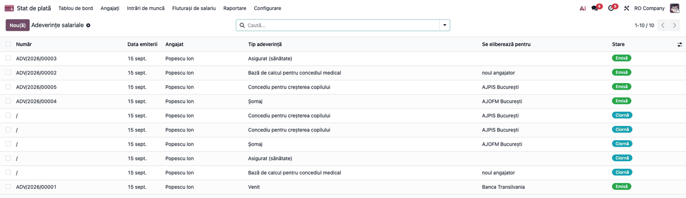

### Pasul 2 — Crearea adeverinței

Apăsați **Nou**: alegeți **angajatul** și **tipul adeverinței** (*Venit*, *Bază de calcul pentru concediul medical*, *Asigurat (sănătate)*). Pentru tipurile *Venit* și *Asigurat* completați **numărul de luni** (implicit 6; se iau lunile încheiate înainte de data emiterii), apoi **Data emiterii** și **Se eliberează pentru** (destinatarul; se tipărește în text). Completați cele două semnături (nume și funcție).

Pentru *Șomaj* (formularul Anexa 7) *Luni* este 12, iar pentru *Concediu pentru creșterea copilului* (formularul Anexa 2) este 24; la creșterea copilului completați obligatoriu **Data nașterii copilului**. Formularul afișează o notă că adeverința urmează formularul oficial și trebuie verificată cu modelul cerut de instituție (pașii 7 și 8).

Fila **Text** se precompletează din fișa angajatului: CNP, funcție, data angajării, durata contractului; contractul încetat apare ca „a fost salariat(ă) … în perioada …", nu ca „în derulare". Textul se poate edita cât timp adeverința e în ciornă, dar se recalculează, iar editările se pierd fără avertisment, când schimbați oricare dintre câmpurile formularului: angajatul, tipul, *Luni*, data emiterii, destinatarul, semnatarii (nume și funcție), data nașterii copilului, *Numele înainte de căsătorie* sau datele din *Secțiunea I*. **Completați întâi toate câmpurile și editați fila *Text* la sfârșit**, chiar înainte de **Emite**.

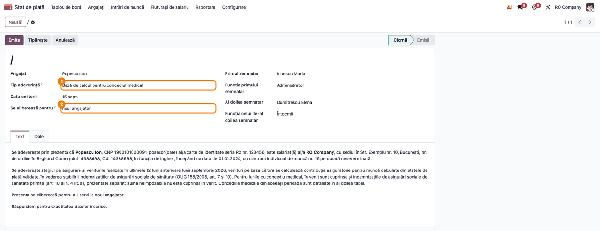

### Pasul 3 — Verificarea datelor înainte de emitere

Deschideți fila **Date**: aici se vede tabelul exact cum se va tipări. Verificați:

1. **Avertismentul** din partea de sus (dacă există): „Doar X din cele N luni acoperite au fluturași validați" — validați fluturașii lipsă sau micșorați numărul de luni;
2. la **Venit**: *Venit net* = *Venit brut* − CAS − CASS − impozit; coloanele *Tichete de masă*, *Rețineri / popriri* și *din care indemnizații CM* apar doar când există;
3. la **Bază pentru concediul medical**: toate cele 12 luni anterioare lunii emiterii, inclusiv cele fără venit; *Venit realizat* este baza contribuției asiguratorii (fără suma neimpozabilă, cu indemnizațiile de concediu medical din FNUASS), iar al doilea tabel listează concediile medicale confirmate din perioadă, cu codul de indemnizație și zilele. *Venit mediu zilnic pe 12 luni (informativ)* apare doar în fila *Date*, nu pe documentul tipărit; al doilea tabel apare doar dacă există concedii medicale confirmate. Noul angajator își calculează baza la data concediului medical de la el;
4. la **Asigurat**: contribuția CASS reținută pe luni;
5. la **Șomaj**: vezi pasul 7;
6. la **Concediu pentru creșterea copilului**: vezi pasul 8;
7. la **Emite** (șomaj și creșterea copilului): bifa **Model verificat** e obligatorie; fără ea apare eroarea „Confirmați că ați verificat textul și coloanele față de modelul cerut în prezent de instituție (AJOFM / AJPIS) înainte de a emite această adeverință.”

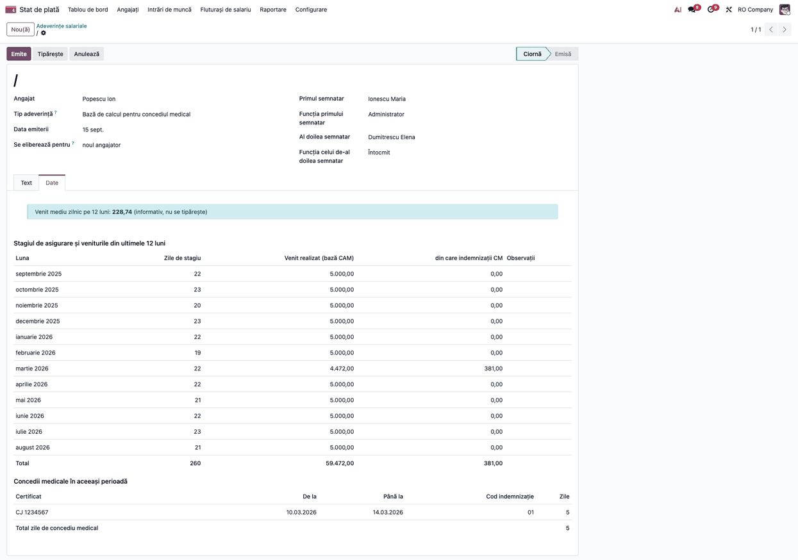

### Pasul 4 — Emiterea și adeverința de venit (PDF)

Apăsați **Emite**: adeverința primește numărul (`ADV/an/nr`), starea devine *Emisă*, iar PDF-ul se arhivează ca atașament pe fișa angajatului (câmpul *PDF*). **Tipăriți** generează documentul pentru semnat. Verificați pe document: datele angajatului, perioada, tabelul, destinatarul, formula „Răspundem pentru exactitatea datelor înscrise" și cele două semnături.

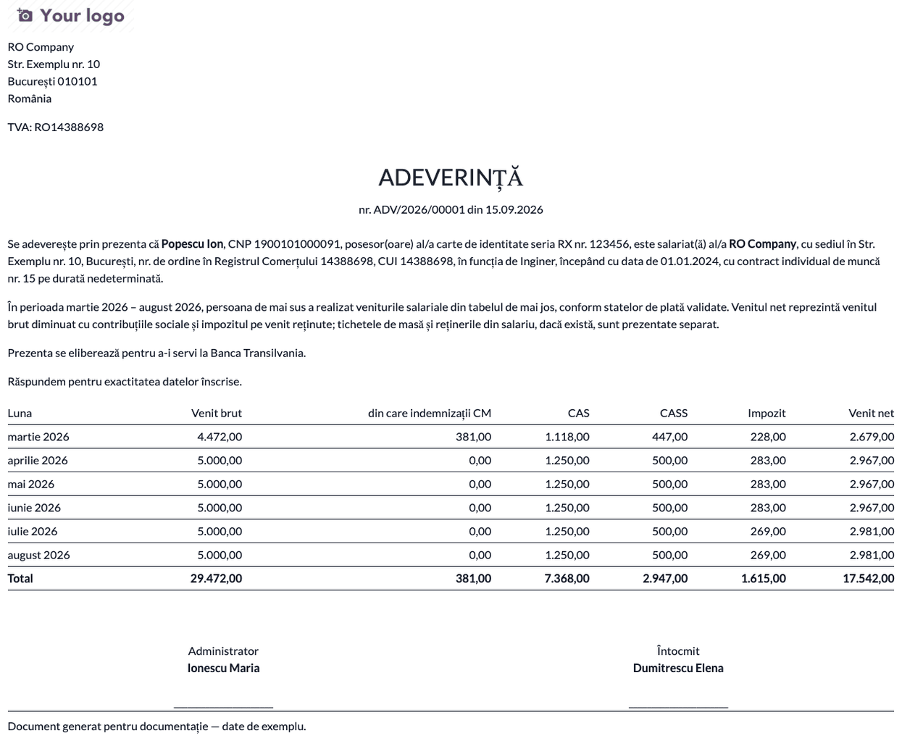

### Pasul 5 — Adeverința cu baza pentru concediul medical

Se emite la fel. Textul cuprinde stagiul de asigurare și veniturile din ultimele 12 luni (OUG 158/2005, art. 7 și 10) și precizează că indemnizațiile de concediu medical sunt prezentate separat, iar suma neimpozabilă nu e cuprinsă în venit; trimiterea la al doilea tabel apare doar când există concedii medicale confirmate. Lunile fără fluturaș (de exemplu cele dinaintea punerii în funcțiune a Odoo) apar cu celule goale și observația „situația se completează de angajator” (sau „înainte de data angajării”), nu ca 0 zile și 0,00: completați situația reală înainte de emitere, altfel noul angajator poate calcula o bază mai mică. Zilele de concediu medical se adeveresc pe 12 luni; cazul de 24 de luni din art. 3^1 OUG 158/2005 nu e acoperit.

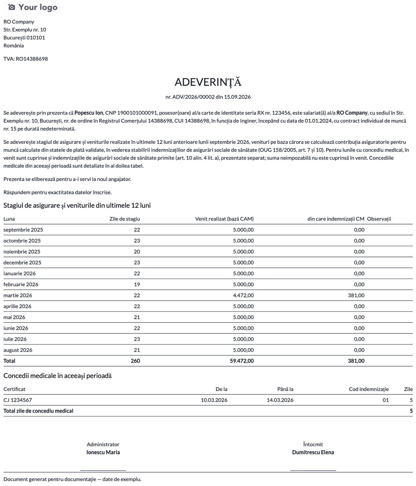

### Pasul 6 — Adeverința de asigurat

Atestă că societatea a calculat și a reținut contribuția CASS pe lunile din tabel și, dacă e cazul, că la data eliberării contractul este în derulare. **Nu atestă calitatea de asigurat** — aceasta o stabilește casa de asigurări de sănătate.

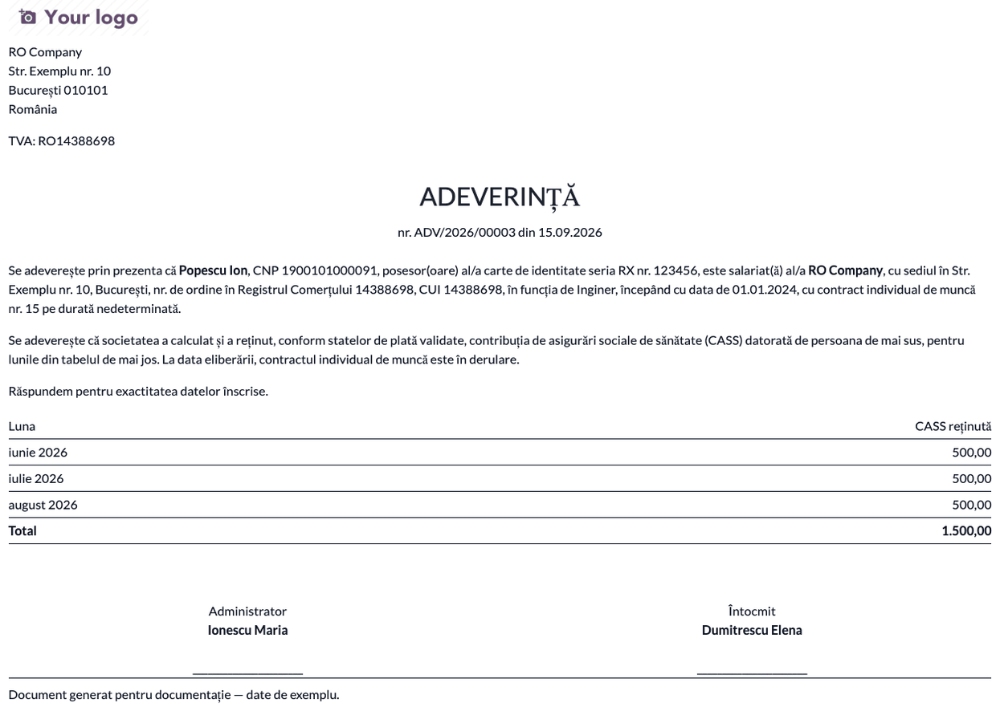

### Pasul 7 — Adeverința pentru șomaj (formularul Anexa 7)

Se creează cu tipul *Șomaj*. Adeverința este formularul oficial **Anexa nr. 7**, la Normele metodologice de aplicare a Legii 76/2002, cu antetul „ANEXA Nr. 7 (Anexa nr. 26 la Normele metodologice)”. *Luni* este 12: tabelul B.1 cuprinde cel mult 12 luni cu stagiu, descrescător de la luna încetării contractului (de la luna anterioară, când încetarea e pe data de 1), căutate în ultimele 24 de luni; lunile fără stat de plată sau cu BCIS zero se sar. Înainte, completați pe angajat seria și numărul actului de identitate, iar pe contract numărul CIM și, la încetare, temeiul. La contract în derulare (ca în captură), tabelul pornește de la luna dinaintea emiterii, iar în secțiunea C data și temeiul încetării rămân necompletate. Formularul arată nota că adeverința urmează formularul oficial și bifa **Model verificat**, necompletată în ciornă.

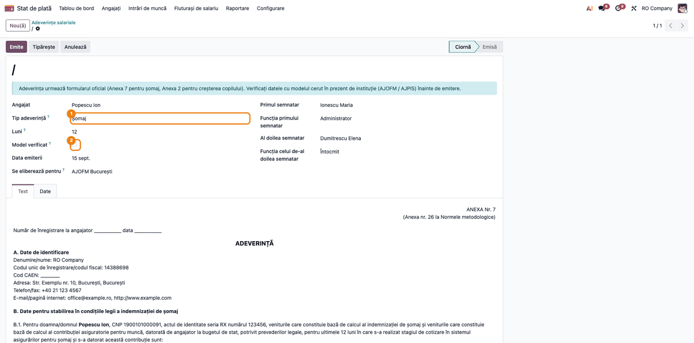

În fila **Date** verificați tabelul B.1:

- *BC* (baza de calcul a contribuției asiguratorii pentru muncă) și *BCIS* (baza de calcul a indemnizației de șomaj): din D112-ul validat al lunii, când e instalat `l10n_ro_anaf_d112`; altfel din fluturaș, cu aceeași regulă ca în D112 (brut fără tichete și fără indemnizațiile din FNUASS, minus suma neimpozabilă). În captură, martie 2026 are 4.472,00: salariul zilelor lucrate plus indemnizația de concediu medical suportată de angajator (381,00), care intră în bază;
- *Natura veniturilor*: salariu, cu indemnizația de concediu de odihnă sau de concediu medical suportată de angajator, când există;
- coloana 5 (numărul de înregistrare al declarației D112) rămâne goală: se completează în fila *Text* de angajator.

Media BCIS pe cele 12 luni apare doar în fila *Date*, informativ, nu pe document. Sub 12 luni cu stagiu apare avertismentul „Doar N luni cu venit sau zile plătite din cele 12 acoperite”; stagiul de cotizare îl stabilește AJOFM.

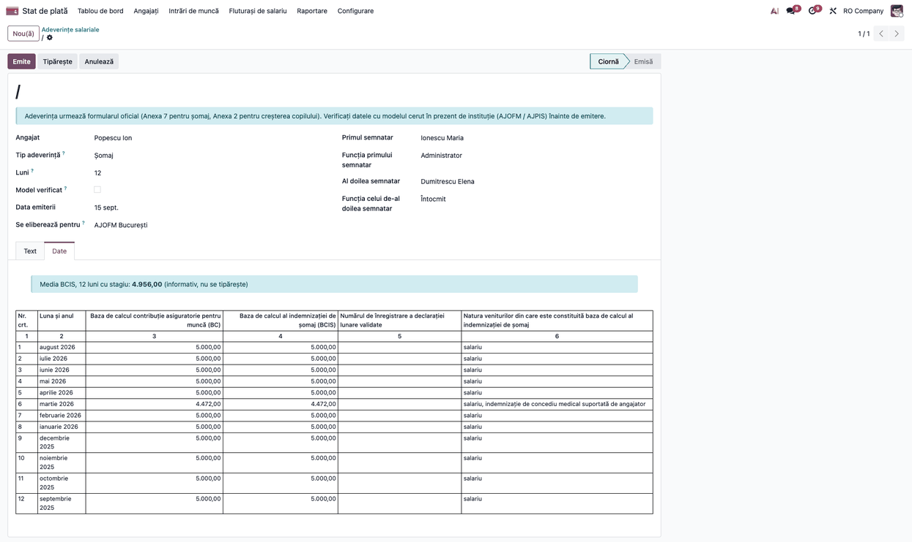

Fără bifa *Model verificat*, **Emite** este refuzat cu eroarea „Confirmați că ați verificat textul și coloanele față de modelul cerut în prezent de instituție (AJOFM / AJPIS) înainte de a emite această adeverință.”:

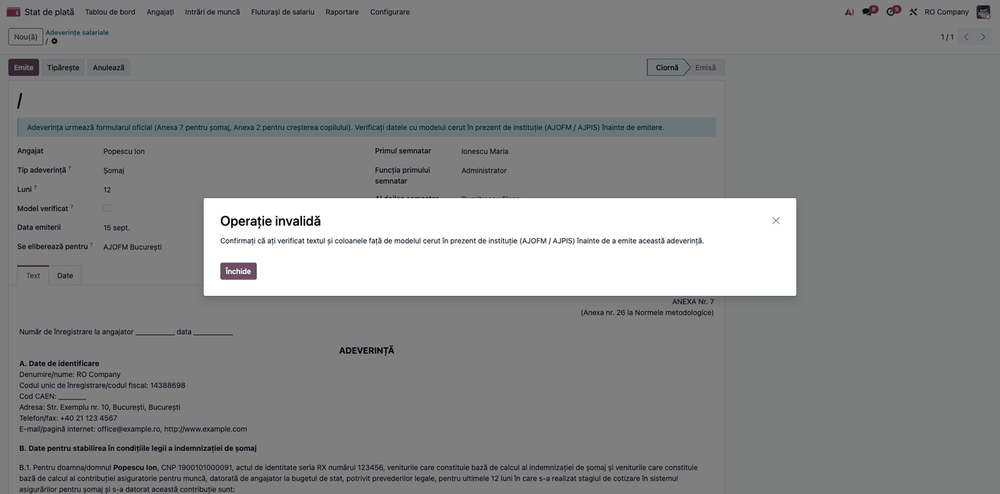

După ce ați comparat adeverința cu modelul AJOFM, bifați *Model verificat* și apăsați **Emite**: numărul și data adeverinței se completează în antetul formularului. Documentul tipărit, fără antetul firmei și cu tabel cu chenar, cuprinde:

- secțiunea A: datele angajatorului (CUI, cod CAEN din setările companiei, adresă, contact);
- secțiunea B.1: salariatul, cu CNP și actul de identitate, apoi tabelul și nota formularului;
- secțiunea B.2: situația dinainte de 1.01.2018, de bifat de angajator;
- secțiunea C: actul de încadrare (CIM, număr și dată), data angajării, data și temeiul încetării și perioadele de suspendare. Concediile medicale confirmate apar cu numărul de zile; în captură, 10–14.03.2026, 5 zile;
- semnăturile: reprezentantul legal (primul semnatar) și compartimentul care a întocmit adeverința (al doilea semnatar; la funcție treceți compartimentul, de exemplu „Resurse umane”).

Media BCIS nu apare pe document.

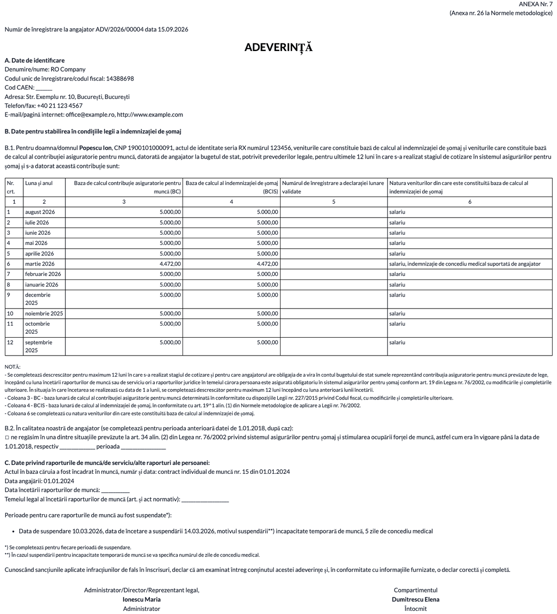

### Pasul 8 — Adeverința pentru concediul de creștere a copilului (formularul Anexa 2)

Se creează cu tipul *Concediu pentru creșterea copilului*. Adeverința este formularul oficial **Anexa nr. 2** (model AJPIS). Completați obligatoriu **Data nașterii copilului** și, dacă e cazul, *Numele înainte de căsătorie*. *Luni* este 24.

În grupul **Secțiunea I (Anexa 2)**:

- perioada indemnizației de maternitate se preia din certificatele medicale confirmate cu codul 08 care cuprind data nașterii (în captură e goală: nu există certificat 08);
- *Ziua a 42-a de lăuzie* se calculează din data nașterii; ambele se pot corecta;
- perioada indemnizației de creștere deja primite și *Concediu aprobat de la* se completează manual.

Fila **Date** cuprinde tabelul din secțiunea II: luna nașterii și cele 24 de luni anterioare (25 de rânduri), cu zilele lucrate, de concediu medical, de concediu de odihnă, fără plată / absențe nemotivate și venitul net realizat (brut − CAS − CASS − impozit). Zilele sunt zilele lucrătoare din fluturaș. Lunile fără stat de plată, inclusiv cele dinaintea punerii în funcțiune a Odoo, au celulele goale, nu 0 (în captură, iulie–octombrie 2024). Situația lor reală se completează în fila *Text* înainte de emitere. Media venitului net pe ultimele 12 luni cu venit apare doar în fila *Date*, informativ.

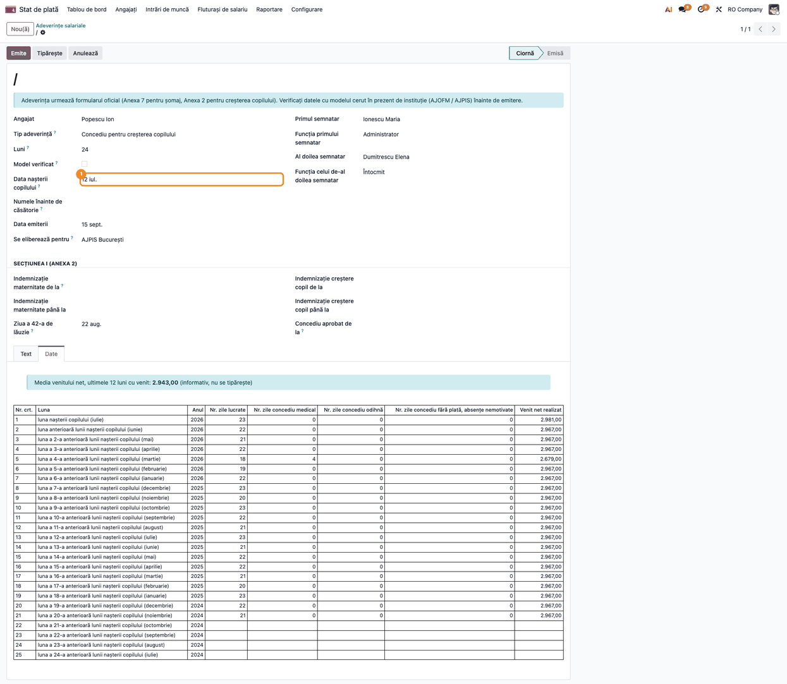

Sub 12 luni cu venit apare avertismentul din partea de sus a formularului: în exemplu, „Doar 8 luni cu venit sau zile plătite din cele 24 acoperite; verificați stagiul minim cerut de instituție.”. Numărătoarea include și luna nașterii: în exemplu, iunie 2025 și cele 7 luni anterioare cu fluturaș (noiembrie 2024 – mai 2025). Ca la șomaj, bifa **Model verificat** este obligatorie la **Emite**.

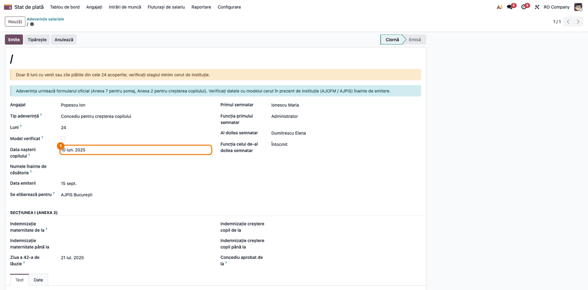

După emitere, documentul tipărit are antetul cu Nr. ORC și CUI, datele salariatului, secțiunea I, tabelul din secțiunea II și declarația pe proprie răspundere. Anexa 2 are o singură semnătură, a reprezentantului legal (primul semnatar).

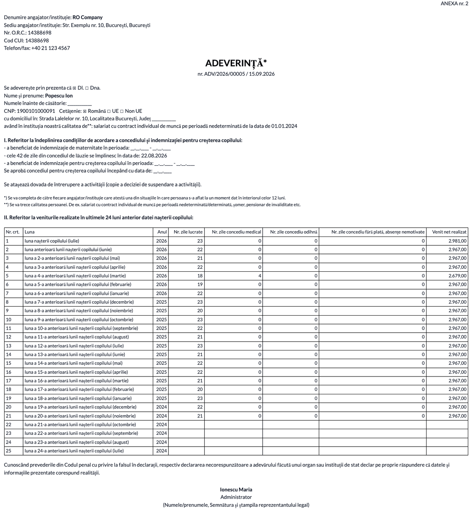

Pentru ambele tipuri puteți edita textul în ciornă dacă instituția cere altă formulare. Declarația de venituri peste salariul minim nu face parte din modul.

### Pasul 9 — Adeverința emisă

După emitere, câmpurile și tabelul sunt blocate (**Anulează** o scoate din uz, iar după anulare **Setează ca ciornă** o redeschide; la reemitere adeverința primește un număr nou); o adeverință emisă **nu se șterge**. Tabelul și textul emise nu se recalculează la retipărire, deci documentul rămâne identic cu PDF-ul arhivat.

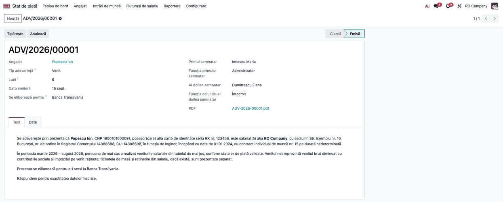

## 7. Legături cu alte module / declarații

| Modul | Rol |
|---|---|
| `l10n_ro_hr_payroll_enhancement` (19.0.2.6.3+) | Fluturașii, regulile salariale și certificatele medicale din care se citesc veniturile și concediile |
| `l10n_ro_anaf_d112` (opțional) | La șomaj, BC și BCIS din D112-ul validat al lunii |
| `l10n_ro_config` (opțional) | Codul CAEN al companiei, în secțiunea A din Anexa 7 |
| `l10n_ro_reges` (opțional) | Actul de identitate, numărul CIM și temeiul încetării, din Anexa 7 și Anexa 2 |

**Ce e automat:** textul din fișa angajatului, tabelul din fluturașii validați, numărul, PDF-ul arhivat. **Ce rămâne manual:** destinatarul, semnăturile, verificarea modelului cerut de destinatar, concediile medicale de la alt angajator (nu apar).

## 8. Verificări pentru consultant

- [ ] Adeverința de venit pe 6 luni are câte o linie pe lună cu fluturaș validat; lunile cu ciornă sau fără fluturaș lipsesc și apare avertismentul.
- [ ] *Venit net* = brut − CAS − CASS − impozit; reținerile (sindicat, popriri) apar separat.
- [ ] La baza pentru concediul medical sunt 12 luni, cu zilele de stagiu și concediile medicale din perioadă (cu cod de indemnizație).
- [ ] La un salariat plătit cu salariul minim, venitul din baza CM nu include suma neimpozabilă, iar certificatul medical din `l10n_ro_hr_payroll_enhancement` dă aceeași bază.
- [ ] Contractul încetat apare la timpul trecut, fără „durată determinată".
- [ ] Textul editat nu se pierde la emitere; tabelul nu se schimbă la retipărire.
- [ ] Numărul urmează secvența `ADV/an/nr`; PDF-ul e pe fișa angajatului.
- [ ] Șomaj (Anexa 7): tabelul B.1 are cel mult 12 luni cu stagiu, descrescător de la luna încetării; BC și BCIS coincid cu D112-ul validat al lunii (fără D112, cu baza CAM din fluturaș); secțiunea C are actul de încadrare, data angajării și perioadele de suspendare.
- [ ] Creșterea copilului (Anexa 2): fără data nașterii adeverința nu se salvează; tabelul are luna nașterii și cele 24 de luni anterioare; venitul net = brut − CAS − CASS − impozit; avertisment sub 12 luni cu venit; lunile fără stat de plată au celulele goale, nu 0.
- [ ] Pe angajat sunt seria și numărul actului de identitate, iar pe contract numărul CIM (și, la încetare, temeiul); fără *Model verificat* adeverința nu se emite.
- [ ] Coloana 5 din Anexa 7 (numărul de înregistrare al D112) a fost completată în text; formularele au fost comparate cu modelul cerut de AJOFM / AJPIS.

## 9. Mesaje de eroare frecvente

| Mesaj | Cauză | Remediere |
|---|---|---|
| Nu există fluturași validați de adeverit pentru … | Lunile acoperite nu au fluturaș validat/plătit | Validați fluturașii sau micșorați numărul de luni |
| Nu există fluturași validați pentru lunile acoperite. | Niciuna dintre lunile acoperite nu are fluturaș validat (avertisment în ciornă) | Validați fluturașii sau schimbați perioada |
| Se pot emite doar adeverințe în ciornă. | **Emite** pe o adeverință deja emisă sau anulată | Folosiți **Setează ca ciornă** (după **Anulează**), apoi emiteți din nou |
| Doar X din cele N luni acoperite au fluturași validați | Unele luni lipsesc (venit, asigurat) | Validați fluturașii lipsă |
| Doar N luni cu venit sau zile plătite din cele M acoperite; verificați stagiul minim cerut de instituție. | Șomaj sau creșterea copilului: sub 12 luni cu venit | Verificați stagiul minim cerut de instituție; validați fluturașii lipsă |
| Doar N din cele 6 luni ale bazei de calcul au venit. | Baza pentru concediul medical: sub 6 luni cu venit | Validați fluturașii lipsă; noul angajator calculează baza la data concediului |
| Confirmați că ați verificat textul și coloanele față de modelul cerut în prezent de instituție (AJOFM / AJPIS) înainte de a emite această adeverință. | **Emite** la șomaj sau creșterea copilului fără bifa *Model verificat* | Comparați adeverința cu modelul instituției, apoi bifați *Model verificat* |
| Data nașterii copilului este obligatorie pentru concediul pentru creșterea copilului. | Tip *Concediu pentru creșterea copilului* fără data nașterii | Completați *Data nașterii copilului* |
| Completați data nașterii copilului. | Aceeași situație, avertisment în ciornă | Completați *Data nașterii copilului* |
| Numărul de luni trebuie să fie între 1 și 36 | Valoare în afara intervalului | Corectați câmpul *Luni* |
| O adeverință emisă nu poate fi ștearsă; anulați-o | Încercare de ștergere după emitere | Folosiți **Anulează** |

## 10. Capturi de ecran

Capturile sunt **generate automat** din `tests/test_screenshots.py` (mixin `ScreenshotCase` din `l10n_ro_doc_screenshots`, import defensiv), în română, pe planul RO:

1. `01_lista_adeverinte.png` — lista adeverințelor.
2. `02_formular_adeverinta.png` — formularul, cu tipul și destinatarul.
3. `03_date_baza_cm.png` — fila *Date* a bazei pentru concediul medical.
4. `04_pdf_venit.png` — adeverința de venit (PDF).
5. `05_pdf_baza_cm.png` — adeverința cu baza pentru concediul medical (PDF).
6. `06_pdf_asigurat.png` — adeverința de asigurat (PDF).
7. `07_adeverinta_emisa.png` — adeverința emisă, cu numărul și PDF-ul arhivat.
8. `08_somaj_formular.png` — adeverința de șomaj (Anexa 7): tip, nota despre formularul oficial, bifa *Model verificat*.
9. `09_somaj_date.png` — adeverința de șomaj, fila *Date*: tabelul B.1 cu cele 12 luni de stagiu, BC, BCIS și natura veniturilor.
10. `10_somaj_eroare_model_neverificat.png` — eroarea la **Emite** fără *Model verificat*.
11. `11_pdf_somaj.png` — adeverința de șomaj, formularul Anexa 7 (PDF).
12. `12_crestere_copil_date.png` — concediul pentru creșterea copilului (Anexa 2): secțiunea I și fila *Date*, cu luna nașterii și cele 24 de luni anterioare.
13. `13_crestere_copil_avertisment.png` — avertismentul sub 12 luni cu venit (8 din 24, inclusiv luna nașterii).
14. `14_pdf_crestere_copil.png` — adeverința pentru creșterea copilului, formularul Anexa 2 (PDF).

```bash
./odoo/odoo-bin -c odoo.conf -d test19 --load-language=ro_RO -i l10n_ro_payroll_certificates,l10n_ro_doc_screenshots,l10n_ro_reges \
  --test-tags=/l10n_ro_payroll_certificates:TestPayrollCertificatesScreenshots --stop-after-init
```

## 11. Observații pentru manual

- Subliniați că adeverința nu înlocuiește modelul cerut de bancă sau de casa de asigurări: textul se editează în ciornă.
- Baza pentru concediul medical e un **document informativ pentru noul angajator**: baza efectivă o calculează el, la data concediului.
- Limite cunoscute:
  - șomajul și creșterea copilului urmează formularele Anexa 7 și Anexa 2; punctele de confirmat cu instituția sunt în secțiunea 2, iar coloana 5 din Anexa 7 (numărul de înregistrare al D112) se completează manual;
  - **declarația de venituri peste salariul minim nu este implementată**: ține de cumulul de contracte (art. 146 alin. 5^7 lit. e din Codul fiscal) și de un ordin al ministerului finanțelor al cărui număr și model nu sunt confirmate;
  - la șomaj, fără D112 validat, BC și BCIS se calculează din fluturaș și sunt egale (baza CAM); stagiul de cotizare îl stabilește AJOFM;
  - zilele din Anexa 2 sunt zilele lucrătoare din fluturaș, pe tipurile de pontaj (lucrate, concediu medical, concediu de odihnă, fără plată și absențe nemotivate);
  - la baza pentru concediul medical, zilele de concediu medical se adeveresc pe 12 luni; cazul de 24 de luni din art. 3^1 OUG 158/2005 nu e acoperit;
  - la șomaj, lunile fără stat de plată sau cu BCIS zero se sar; la creșterea copilului, lunile dinaintea punerii în funcțiune a Odoo apar cu celule goale, deși salariatul a lucrat: situația se completează manual în textul editabil;
  - la baza pentru concediul medical, lunile fără fluturaș (inclusiv cele dinaintea Odoo) apar cu celule goale și observație; completarea lor rămâne în sarcina angajatorului;
  - baza CM raportează venitul realizat; plafonul de 12 salarii minime îl aplică angajatorul care plătește concediul medical, nu adeverința;
  - concediile medicale înregistrate la alt angajator nu apar;
  - baza concediului medical din certificatul medical (`l10n_ro_hr_payroll_enhancement` 19.0.2.6.3+) exclude, ca și adeverința, suma neimpozabilă (art. 10 alin. 1); **de verificat** actul care fixează suma neimpozabilă pentru 2026.
