# Fișă Modul: Checklist Închidere Perioadă

**Poziție plan:** B2.4
**Modul:** `l10n_ro_period_close_enhanced`
**FR:** FR-27
**Capitol manual:** Cap 11.1
**Utilizator principal:** Contabil șef, Manager Contabilitate
**Prioritate:** 🟡 Medie

---

## 1. Scop business

Această fișă descrie utilizarea modulului `l10n_ro_period_close_enhanced` pentru scenariul **Checklist Închidere Perioadă**.
Consultantul folosește documentul pentru reproducerea fluxului în baza demo și
pentru pregătirea capitolului Cap 11.1 din manualul utilizator.

## 2. Bază legală și context

- **OMFP 1802/2014** — planul de conturi pe care se sprijină controalele. **581** „Viramente
  interne” e un cont de trecere pentru transferurile de numerar între casă și bancă sau între
  conturi bancare: nu rămâne cu sold după ce ambele părți ale transferului sunt înregistrate.
  **471** „Cheltuieli înregistrate în avans” și **472** „Venituri înregistrate în avans” se descarcă
  pe cheltuieli, respectiv pe venituri, pe măsura perioadelor la care se referă. **121** „Profit sau
  pierdere” preia la închidere soldurile conturilor din clasele 6 și 7.
- **Termenele declarațiilor** urmărite de checklist se calculează din luna următoare perioadei de
  raportare: **D300** — 25 (Codul fiscal, art. 323); **D390** — 25, lunar (Codul fiscal, art. 325);
  **D112** — 25 (Codul fiscal, art. 147); **D394** — 30 (OPANAF 3769/2015).
- **Context operațional.** Închiderea în 121 se poate face lunar sau doar la sfârșitul anului.
  Verificarea claselor 6 și 7 pleacă de la închiderea lunară. La firmele care închid doar anual, se
  dezactivează golind prefixul (secțiunea 5).

## 3. Utilizatori și roluri

Contabil Șef

Roluri recomandate pentru testare:
- Administrator funcțional: instalează modulul și verifică meniurile
- Utilizator operațional: rulează fluxul zilnic sau lunar
- Contabil/manager: validează rezultatele contabile și rapoartele

## 4. Conturi și date implicate

Modulul nu generează note contabile proprii: el **confruntă** ce există deja. Conturile de mai jos
sunt cele pe care le citește, fiecare configurabil prin prefix (vezi secțiunea 5).

| Cont | Rol în verificare |
|---|---|
| 531x | soldul casei, confruntat cu jurnalele de casă |
| 4426 / 4427 | TVA deductibilă și colectată, confruntate cu liniile de taxă ale perioadei |
| 4428 | TVA neexigibilă — confruntare **unidirecțională** (vezi nota de mai jos) |
| 681x | cheltuiala cu amortizarea, confruntată cu notele generate de active |
| 21x / 28x | valoarea brută și amortizarea cumulată, confruntate cu registrul imobilizărilor |
| 408 | furnizori-facturi nesosite, confruntat cu recepțiile rămase nefacturate |
| 409 / 419 | avansuri acordate și primite, verificate pentru linii rămase nereconciliate |
| 3xx | conturile de stoc, confruntate cu valorizarea |
| 581 | viramente interne — fără sold la sfârșitul perioadei |
| 6xx / 7xx | cheltuieli și venituri — fără sold după închiderea în 121 (sold cumulat de la începutul exercițiului) |
| 471 / 472 | cheltuieli și venituri înregistrate în avans — repartizarea lunii postată pentru fiecare document repartizat |

> **Despre verificarea lui 408.** Cu modulul `l10n_ro_rni_report` instalat, verificarea
> confruntă soldul din checklist cu ce vede raportul ca rămas deschis pe furnizori. Cele două
> nu sunt surse independente — amândouă citesc înregistrări de pe 408 — dar nu citesc aceleași
> conturi: checklistul folosește prefixul configurat în Setări, raportul contul de recepție
> fără factură de pe gestiune sau companie. **Divergența dintre aceste două configurări e ceea
> ce prinde verificarea**, și e o eroare care altfel se vede abia când cineva confruntă manual
> raportul cu balanța. Butonul deschide raportul. Fără modul, cade pe o verificare de
> consistență între sold și existența recepțiilor pe aviz.

> **Despre 4428.** În România contul nu ține doar TVA-ul la încasare, ci și contrapartida de TVA a
> facturilor nesosite (408) și a celor de întocmit (418). De aceea verificarea nu cere egalitate — ar
> raporta anomalie permanentă la orice companie cu recepție pe aviz. Se semnalează un singur lucru,
> cel care e sigur o eroare: există taxă cu exigibilitate la încasare în perioadă, dar contul nu s-a
> mișcat deloc. Un sold mai mare decât taxa la încasare e normal.

> **Despre 471/472.** Verificarea nu compară un sold, ci **documente**. Ia fiecare factură sau
> notă postată care are pe linii **Dată început** și **Dată sfârșit** (perioada de repartizare) și
> cere ca nota de repartizare a lunii să fie postată. Contează doar documentele repartizate pe
> conturile din prefix. În 19.0, contul de repartizare este cel al companiei (**Cheltuială amânată**,
> respectiv **Venit amânat** din Setări). Conturile 4711/4721 le setează modulul
> `l10n_ro_deferred_entries`; fără el, Odoo pune la încărcarea planului primul cont curent găsit
> (de exemplu 301), iar atunci verificarea 471/472 nu apare deloc în checklist. Verificarea
> funcționează cu ambele metode de generare din Odoo, **la validarea facturii** și **manual și
> grupat**.

Date minime pentru demo:
- companie românească cu localizarea contabilă instalată
- o lună cu documente postate: extrase, registru de casă, facturi de intrare și ieșire
- cel puțin un activ amortizabil și o recepție, dacă se testează fazele de imobilizări și stoc
- o ridicare de numerar de la bancă (Dr 581 = Cr 5121) fără intrarea în casă, ca să apară anomalia pe 581
- o factură de furnizor cu perioadă de repartizare pe trei luni, cu contul de cheltuieli amânate 471
- perioada precedentă blocată, ca punct de pornire curat

## 5. Configurare inițială

1. Instalați modulul `l10n_ro_period_close_enhanced` pe baza demo.
2. Accesați **Configurare → Setări**, secțiunea **Conturi de control pentru
   închiderea periodică (RO)**, și verificați cele douăsprezece prefixe de cont. Implicitele urmează
   OMFP 1802 (531, 4426, 4427, 4428, 681, 21, 28, 408, 409/419, 581, 6/7, 471/472), dar planurile
   analitice ale clienților diferă — ajustați-le după planul real. Ultimele trei stau în blocul
   **Solduri închise la sfârșitul perioadei**: **Conturi de viramente interne** (581), **Conturi de
   cheltuieli și venituri** (6,7) și **Conturi de repartizare** (471,472).
3. Rețineți regula: **un prefix golit scoate verificarea din checklist**, în loc să o lase să
   raporteze fals. Este mecanismul prin care se elimină verificările irelevante pentru client. Mai
   multe prefixe se despart prin virgulă. Exemplul tipic: la o firmă care închide conturile de
   venituri și cheltuieli în 121 doar la sfârșitul anului, goliți **Conturi de cheltuieli și
   venituri**. La actualizarea modulului pe o bază existentă, prefixul se golește automat la
   companiile fără închidere lunară în 121 în ultimii doi ani. La o instalare nouă rămâne `6,7` și se
   ajustează aici.
4. Verificați ce module opționale sunt instalate — verificările de stoc, e-Factura, imobilizări și
   declarații apar **doar** dacă modulul care furnizează datele există. O instalare fără stoc nu
   primește verificări de stoc.
5. Pentru verificarea repartizărilor, instalați `l10n_ro_deferred_entries`, care setează conturile
   4711/4721 (din Setări nu se pot alege: câmpurile acceptă doar conturi curente). Apoi verificați în
   Setări, în blocurile **Înregistrări de cheltuieli amânate** și **Înregistrări de venituri
   amânate**, că **Cheltuială amânată** = 4711 și **Venit amânat** = 4721, jurnalul și metoda de
   generare (la validare sau manual și grupat).
6. Pregătiți un set minim de documente postate pentru luna de test și verificați că utilizatorul are
   grupul de contabilitate necesar.

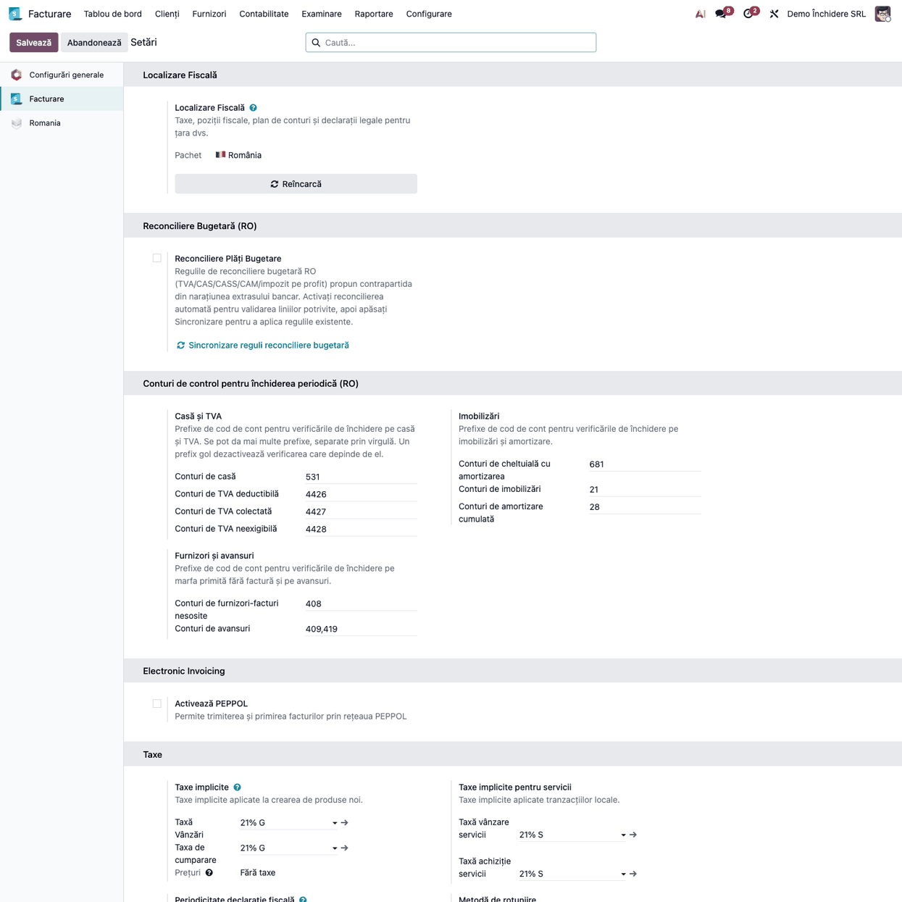

## 6. Flux de utilizare

Modulul transformă procedura de închidere lunară într-o sarcină cu stări, termen și verificări în
Odoo. **26 de verificări rulează cod** și se recalculează la fiecare reîmprospătare; restul rămân
bife manuale pentru pașii care țin de decizia contabilului. Câte apar efectiv depinde de modulele
instalate: o verificare pe care instalarea curentă n-o poate evalua nu e afișată deloc.

### Pasul 1 — Deschiderea checklist-ului lunii

Accesați **Contabilitate → Închidere → Închidere Perioadă (RO)**. Lista arată câte o fișă pe lună,
cu starea ei și cu verificările aferente. Deschideți luna care se închide, sau creați-o dacă nu a
fost generată automat.

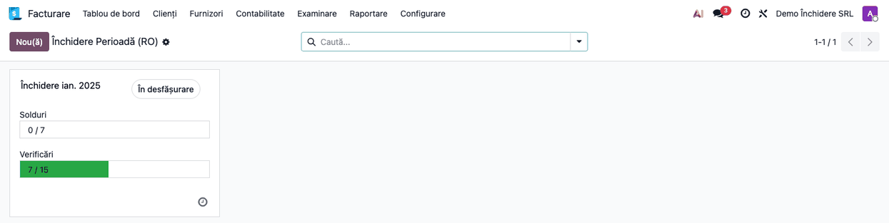

### Pasul 2 — Citirea verificărilor

Fișa lunii afișează verificările grupate pe cicluri, cu etichetele din interfață — „Conformitate
reglementară", „Trezorerie și finanțare", „Inventar", „Active fixe", „Salarizare", „Achiziții".
Fiecare verificare are unul din trei rezultate:

| Rezultat | Sens | Ce faceți |
|---|---|---|
| **Verificat** | confruntarea a trecut | nimic |
| **Anomalie** | s-a găsit o divergență | se rezolvă înainte de validare |
| **În așteptare** | obligație care încă are termen, sau bifă manuală | se reia mai târziu, ori se marchează |

Distincția dintre „anomalie" și „în așteptare" contează la declarații: o declarație nedepusă pe 3 ale
lunii nu e o eroare, ci o sarcină care are timp până pe 25. Abia după termenul legal devine anomalie.

**Verificările de confruntare a soldurilor** — fiecare compară o sursă operațională cu rulajul
contabil, iar mesajul arată ambele sume și diferența dintre ele:

| Verificare | Confruntă | Ce prinde |
|---|---|---|
| Sold registru de casă | jurnalele de casă ↔ 531x | postare pe contul de casă dintr-un alt jurnal |
| Jurnale TVA | liniile de taxă ↔ 4426 / 4427 | taxă mapată pe alt cont, postare manuală pe contul de TVA |
| TVA neexigibil | taxa la încasare ↔ 4428 | exigibilitate incompletă înainte de decont |
| Balanța de verificare | total debit ↔ total credit | dezechilibru pe rulaje sau pe solduri |
| Amortizare | notele activelor ↔ 681x | amortizare postată manual, în afara registrului |
| Registrul imobilizărilor | registrul ↔ 21x și 28x | divergență pe valoare brută sau amortizare cumulată |

**Verificările de completitudine operațională** — întreabă dacă o operațiune a rămas neterminată:

| Verificare | Semnalează |
|---|---|
| Stoc negativ | cantitate negativă pe locație internă, care face valorizarea nedeterminată |
| Recepții fără factură (408) | soldul contului nu corespunde recepțiilor rămase nefacturate, furnizor cu furnizor |
| Valorizare vs conturi de stoc | produse cu diferență între valorizare și 3xx |
| Mesaje SPV | e-factură descărcată și netransformată în factură |
| Avansuri (409/419) | linii rămase nereconciliate deși soldul e zero |

**Verificările de declarații** — D300, D390, D394, D112 și recipisele ANAF. O declarație nedepusă
apare **în așteptare** până la termenul legal și **anomalie** după el. Termenul este pe 25 ale lunii
următoare perioadei de raportare pentru D300, D390 și D112, respectiv pe 30 pentru D394.

> **Despre periodicitate.** Închiderea e lunară, dar declarația nu neapărat. Termenul se calculează
> pe **perioada de raportare**, nu pe lună: la un plătitor trimestrial, luna ianuarie face parte
> dintr-o perioadă care se încheie pe 31 martie, deci scadența e 25 aprilie. Când declarația are tip
> propriu de raportare (D300, D390, D112) se citește direct termenul calculat de Odoo pentru ea;
> altfel (D394) se deduce din periodicitatea configurată în **Configurare → Setări →
> Periodicitate declarație fiscală**.
>
> **Excepții de la periodicitatea de TVA**, când declarația nu e încă generată: **D390** are mereu
> termen lunar, și la plătitorul trimestrial de TVA; **D112** urmează regimul de declarare D112 al
> anului din `l10n_ro_anaf_d112` (lunar, implicit, sau trimestrial), nu periodicitatea de TVA.
>
> **D390 apare doar când e cazul:** verificarea se declară numai dacă perioada chiar are operațiuni
> intracomunitare, recunoscute după tag-urile fiscale folosite de declarație. La o companie care
> lucrează numai pe piața internă nu apare deloc în checklist.


Verificările cu cod stau mai jos în listă, sub bifele manuale. Mesajul fiecăreia poartă ambele
sume comparate și diferența dintre ele — inclusiv atunci când verificarea trece, fiindcă la
audit contează ce s-a confruntat, nu doar verdictul:

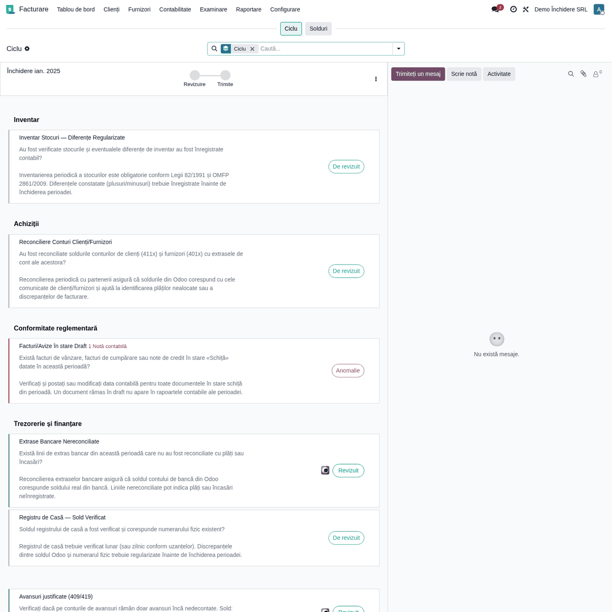

**Soldurile care trebuie închise** la sfârșitul lunii. Aici nu se compară două surse: contul trebuie
să fie la zero, iar mesajul listează conturile rămase cu sold și suma fiecăruia.

| Verificare | Ce trebuie să fie adevărat | Ce înseamnă o anomalie |
|---|---|---|
| Viramente interne fără sold (581) | 581 are sold zero la sfârșitul lunii | un transfer înregistrat doar pe jumătate — de regulă lipsește extrasul băncii care primește banii |
| Conturi de cheltuieli și venituri închise (6xx/7xx) | soldul cumulat de la începutul exercițiului e zero pe fiecare cont din clasele 6 și 7 | închiderea în 121 nu s-a făcut, sau s-a postat o cheltuială ori un venit după nota de închidere |
| Repartizări lunare postate (471/472) | fiecare document repartizat are nota lunii postată, cât timp mai are ceva de recunoscut | cheltuiala sau venitul lunii a rămas în 471/472, iar rezultatul lunii e denaturat |

Cu metoda **manual și grupat**, nota cerută e nota grupată datată în ultima zi a lunii. Ea e cerută
pentru orice document postat până la sfârșitul lunii care mai are ceva de recunoscut după această
dată, inclusiv o factură a cărei repartizare începe luna viitoare. În ultima lună a repartizării,
documentul nu mai intră în nota grupată și nu e semnalat.

Cele trei verificări apar în ecranul verificărilor printre celelalte; captura de mai jos le arată
filtrate, pentru claritate. În ea, ridicarea de numerar de 1.000 lei e înregistrată printr-o notă Dr 581 = Cr 5121,
fără intrarea în casă, deci 581 are sold. Factura de abonament din ianuarie e repartizată corect, iar
verificarea 471/472 trece. Cheltuiala lunii n-a fost încă închisă în 121, așa că 6xx/7xx apare în
anomalie, cu contul rămas cu sold:

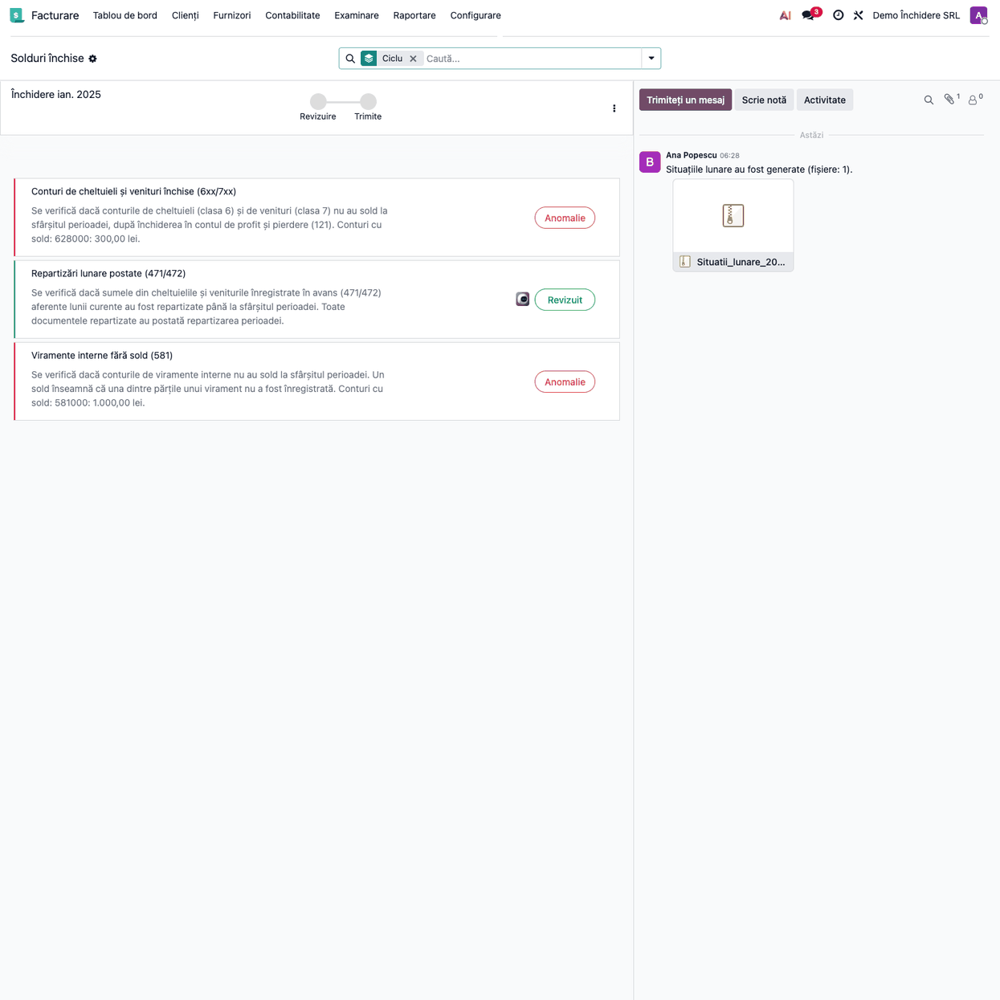

### Pasul 3 — Rezolvarea anomaliilor

Fiecare verificare are un buton care deschide exact înregistrările vinovate: liniile contabile de pe
conturile confruntate, cantitățile negative, mesajele SPV neprocesate, declarația lipsă. Nu căutați
manual — porniți din verificare.

Rezolvați anomalia în modulul ei (postați documentul, reconciliați, rulați coeficientul K), apoi
reîmprospătați verificările pe fișa lunii. Valorile se recalculează de la zero, nu se memorează.

Butonul duce în trei feluri de ecrane, după natura verificării.

**Confruntările de sold și soldurile închise** deschid liniile contabile de pe conturile verificate —
aici, nota manuală de 190 lei postată direct pe TVA deductibilă, cea care a produs divergența. La 581
se deschid toate liniile postate pe 581 până la sfârșitul lunii, ca să se vadă și o jumătate de
virament rămasă din lunile anterioare. La 6xx/7xx se deschid liniile din exercițiu ale conturilor
rămase cu sold, iar la 471/472, documentele fără nota lunii:

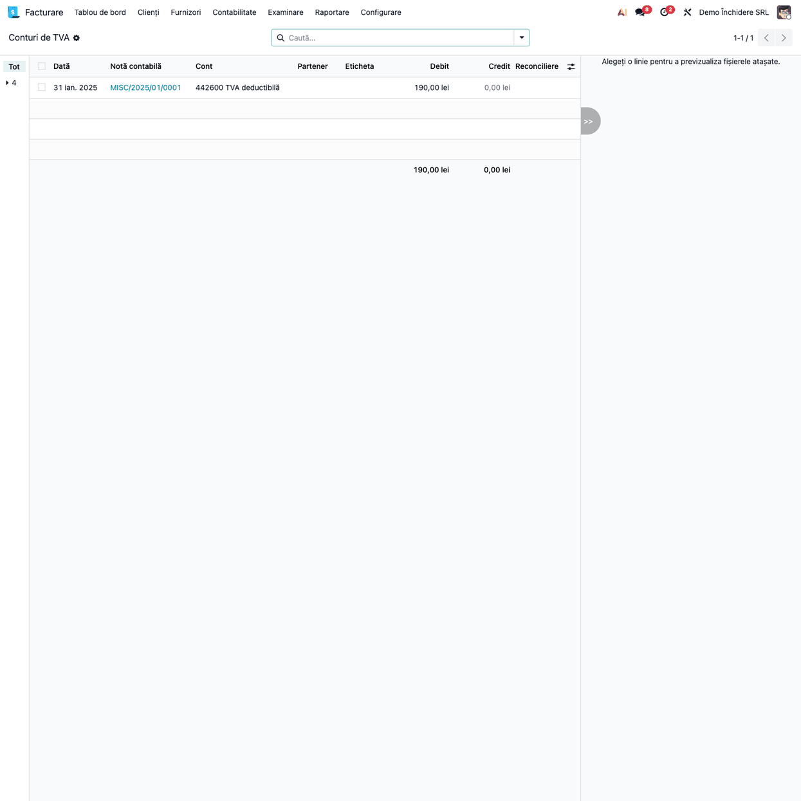

**Verificarea recepțiilor fără factură** deschide raportul dedicat, cu soldul lui 408 desfăcut pe
furnizori și cu vechimea fiecărei recepții:

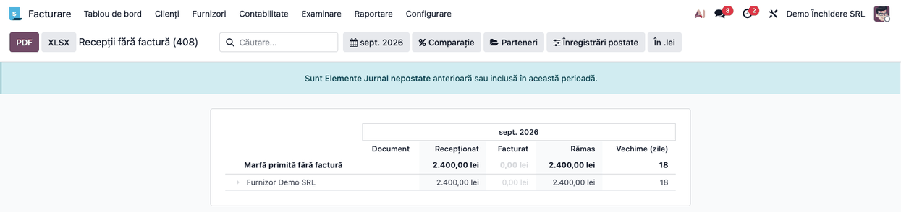

**Verificările de completitudine** deschid documentele rămase neterminate — factura în ciornă,
mesajul SPV neprocesat, cantitatea negativă:

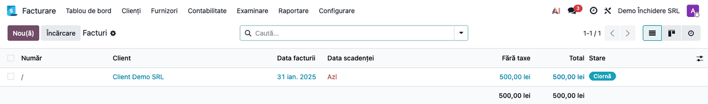

Rezolvările tipice pentru soldurile închise:
- **581** — înregistrați partea lipsă a transferului: la o depunere, extrasul băncii care a primit
  banii (Dr 5121 = Cr 581); la o ridicare, intrarea în casă (Dr 5311 = Cr 581); sau corectați
  împerecherea greșită;
- **471/472** — cu metoda „la validare”, notele viitoare se postează automat la data lor. Dacă una a
  rămas în ciornă sau a fost ștearsă, postați-o din documentul original. Cu metoda „manual și
  grupat”, deschideți **Examinare → Înregistrări de regularizare → Cheltuieli reportate** (respectiv
  **Venituri reportate**) pe luna închisă și apăsați **Generează înregistrări**;
- **6xx/7xx** — rulați închiderea lunii în 121 (**Contabilitate → Închidere → Rulați închiderea
  P&L**, din `l10n_ro_account_return_pl_closing`), apoi verificați că nu mai există postări pe
  6xx/7xx datate după nota de închidere.

Ordinea contează: generați **întâi repartizările lunii, apoi închiderea în 121**. Ambele note sunt
datate în ultima zi a lunii; cu ordinea inversă, cota repartizată ajunge pe 6xx/7xx după închidere,
iar verificarea 6xx/7xx iese în anomalie.

Pe fiecare verificare există și butonul **De revizuit**, care o marchează manual ca verificată. E
calea pentru bifele care nu pot fi confruntate automat — cele care țin de decizia contabilului — și
pentru declarațiile aflate încă în termen. O verificare marcată manual rămâne verificată până la
următoarea reîmprospătare, care o reevaluează dacă are cod în spate.

### Pasul 4 — Procesul-verbal de pre-închidere

Raportul listează toate verificările cu rezultatul lor și sumele comparate, plus loc de semnături.
Este documentul care arată **ce s-a verificat**, nu doar că s-a închis luna.

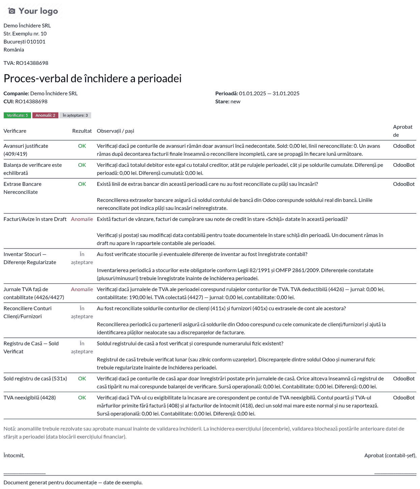

### Pasul 5 — Situațiile lunare

**Pregătire (o singură dată).** Setul propus de asistent se stabilește pe companie, în
**Configurare → Setări**, blocul **Situații lunare (RO)**: rapoartele bifate
implicit, conturile pentru fișele de cont, formatul (PDF, XLSX sau PDF și XLSX) și bifa
**Generează situațiile lunare la validare** (implicit oprită).

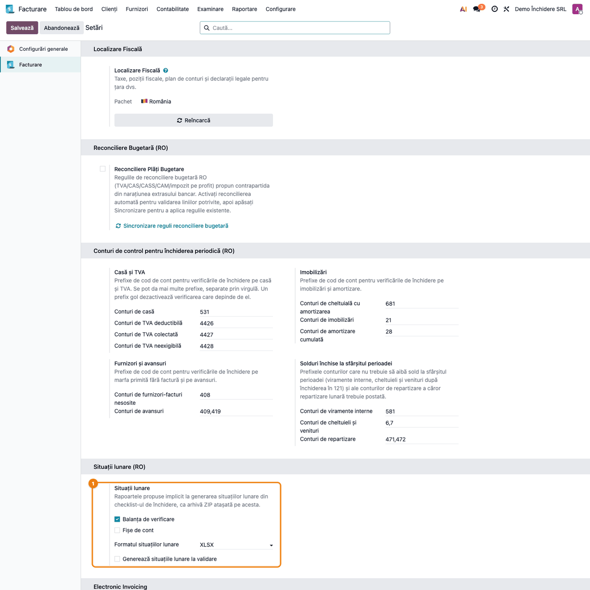

**Generarea.** Pe cardul lunii din **Contabilitate → Închidere → Închidere Perioadă (RO)**, din
meniul **⋮** alegeți **Situații lunare** (intrarea apare doar pe checklist-ul de închidere
lunară și doar pentru utilizatorii cu drept de contabil). Se deschide asistentul, cu perioada
checklist-ului, formatul și rapoartele bifate din Setări; completați ce diferă pentru luna
curentă și apăsați **Generează**.

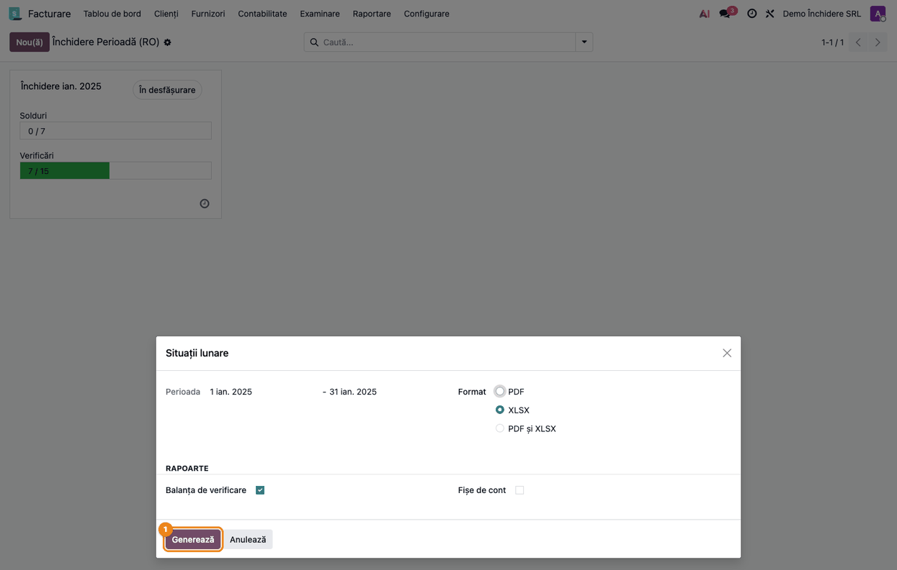

| Raport | Modul |
|---|---|
| Balanța de verificare | `l10n_ro_reports` (balanța cu 5 coloane); altfel balanța standard |
| Jurnalul de vânzări, jurnalul de cumpărări | `l10n_ro_account_vat_journal` |
| Registrul-jurnal | `l10n_ro_registru_jurnal` |
| Registrul de casă | `l10n_ro_cash_register_report` |
| Jurnalul de bancă | `l10n_ro_bank_register_report` |
| Fișa de cont — câte o fișă pe fiecare cont ales | `l10n_ro_account_fisa_cont`; altfel Cartea mare standard |

Perioada și compania vin din checklist și nu se modifică în asistent (compania se afișează doar
într-un mediu multi-companie). Rapoartele al căror modul nu e instalat nu apar în asistent;
balanța și fișa de cont sunt mereu disponibile, datorită rapoartelor standard de rezervă.
Câmpul **Conturi** apare doar cu **Fișe de cont** bifat și atunci e obligatoriu.

**Rezultatul.** Browserul descarcă arhiva `Situatii_lunare_<an>-<lună>.zip`, atașată și pe
checklist și anunțată în istoricul lui. Fișierele din arhivă sunt numerotate în ordinea
rapoartelor (`01_...`, `02_...`), cu câte un fișier pe format ales, iar fișele de cont poartă
codul contului. O nouă generare pe aceeași lună înlocuiește arhiva anterioară. Un raport care
nu se poate genera e sărit și numit în mesajul **Sărite: …** din istoric; restul arhivei se
generează. Dacă niciun raport nu iese, asistentul afișează eroarea.

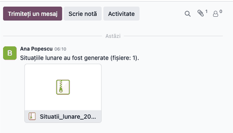

Cu **Generează situațiile lunare la validare** bifată, la validarea checklist-ului se generează
automat arhiva cu setul implicit din Setări; aici nu apare asistent, iar un eșec total se vede
doar ca mesaj în istoric, fără să blocheze validarea.

### Pasul 6 — Validarea și blocarea

Validați fișa lunii. La validare, modulul aplică blocarea perioadei: la închiderea lunii **decembrie**
setează blocarea exercițiului (`fiscalyear_lock_date`), avansând-o doar, niciodată retrăgând-o.
Pentru ianuarie–noiembrie blocarea de TVA rămâne pe seama fluxului D300. Cu bifa **Generează
situațiile lunare la validare** din Setări, validarea generează și arhiva situațiilor lunare.

Validarea nu trece cât timp o verificare a stadiului curent e în **anomalie** sau **în așteptare** —
acesta e rostul controalelor blocante. Practic: anomaliile se rezolvă, iar cele rămase în așteptare
se marchează cu **De revizuit** înainte de validare. Mesajul afișat altfel este „Unele verificări au eșuat în această etapă".

Butonul **Validează** apare în capul ecranului de verificări abia când nu mai rămâne nicio
verificare în anomalie sau în așteptare — aici, luna februarie, cu toate verificările **Revizuit**:

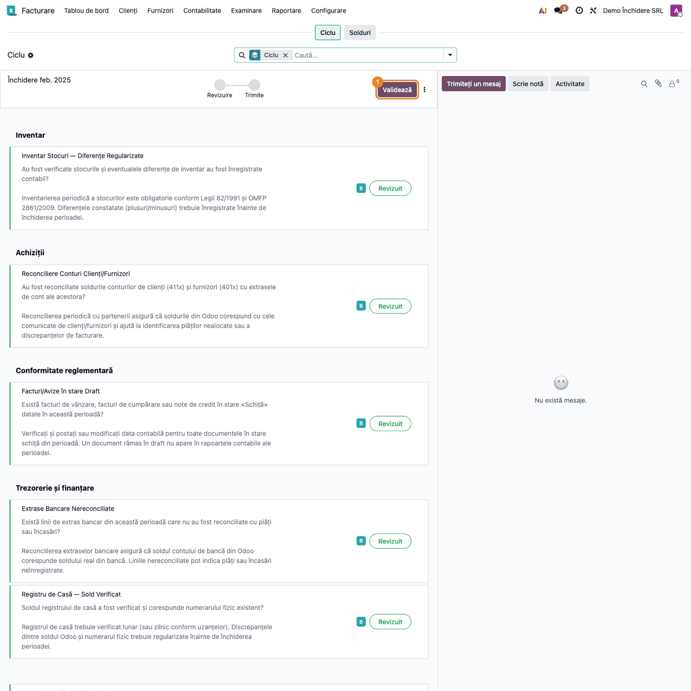

### Pasul 7 — Blocare configurabilă per jurnal (FR-27)

Pe lângă blocarea anuală a exercițiului, fiecare **jurnal** poate avea o **Dată blocare jurnal**
proprie. Astfel se pot bloca, de exemplu, jurnalele de TVA după depunerea D300, păstrând deschis
jurnalul de salarii. Accesați **Configurare → Jurnale**, deschideți un jurnal și
completați câmpul **Dată blocare jurnal** ①.

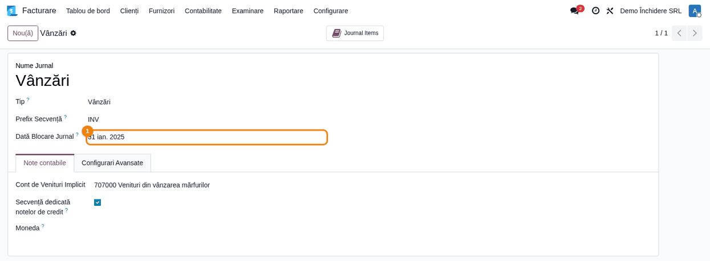

Postarea unei înregistrări datate la sau înainte de această dată, în jurnalul respectiv, este blocată
cu un mesaj clar — independent de blocările la nivel de companie.

### Note de monografie și raportare

Modulul **nu generează note contabile proprii**. Verificările sunt read-only: citesc rulaje, solduri,
mișcări de stoc și mesaje, fără să scrie nimic în contabilitate. Singurele scrieri sunt data de
blocare a perioadei, la validare, procesul-verbal și arhiva situațiilor lunare, atașate pe checklist.

Monografia operațiunilor pe care le verifică, așa cum trebuie să arate ca luna să treacă
(exemplu: abonament de 900 lei + TVA 21%, pe trei luni):

| Operațiune | Notă contabilă | Unde se produce |
|---|---|---|
| Depunere numerar la bancă — ieșirea din casă | Dr 581 = Cr 5311 | registrul de casă |
| Depunere numerar la bancă — intrarea în bancă | Dr 5121 = Cr 581 | extrasul de cont |
| Ridicare numerar de la bancă — ieșirea din bancă | Dr 581 = Cr 5121 | extrasul de cont |
| Ridicare numerar de la bancă — intrarea în casă | Dr 5311 = Cr 581 | registrul de casă |
| Factura de abonament, cu perioadă de repartizare (metoda „la validare”) | Dr 471 900 + Dr 4426 189 = Cr 401 1.089 | factura de furnizor (efectul net, vezi nota); la „manual și grupat” factura rămâne pe 628: Dr 628 900 + Dr 4426 189 = Cr 401 1.089 |
| Repartizarea lunii — metoda „la validare” | Dr 628 = Cr 471 300, la sfârșitul fiecărei luni | nota de repartizare a facturii |
| Repartizarea lunii — metoda „manual și grupat” | Dr 471 = Cr 628 pe restul nerecunoscut (600 în ianuarie, 300 în februarie), la ultima zi a lunii, stornată pe 1 ale lunii următoare | nota grupată din raportul de cheltuieli reportate (efect net: 300 pe lună) |
| Factură de venit facturat în avans (abonament vândut pe trei luni) | Dr 4111 1.089 = Cr 472 900 + Cr 4427 189 | factura de vânzare (efectul net, vezi nota) |
| Repartizarea lunară a venitului (metoda „la validare”) | Dr 472 = Cr 704/706/708 | repartizarea Odoo; la „manual și grupat”, nota grupată e Dr 70x = Cr 472 pe rest, stornată pe 1 |
| Închiderea cheltuielilor | Dr 121 = Cr 6xx | `l10n_ro_account_return_pl_closing` |
| Închiderea veniturilor | Dr 7xx = Cr 121 | `l10n_ro_account_return_pl_closing` |

> **Limitare a mecanismului Odoo: rulaje umflate pe conturile de rezultat.** Factura se
> înregistrează pe contul de cheltuială (Dr 628 = Cr 401), iar Odoo mută suma în avans printr-o notă
> tehnică, Dr 471 = Cr 628 900 (la venituri, în oglindă, Dr 70x = Cr 472). Cu metoda „manual și
> grupat”, mutarea se repetă lunar, prin nota grupată și stornarea ei. Soldurile și rezultatul lunii
> sunt corecte: soldul lui 628 în luna facturii e doar cota lunii, 300 lei. Rulajele 6xx/7xx sunt
> însă umflate cu sumele transferate și întoarse, iar creditarea unui cont de cheltuieli (debitarea
> unui cont de venituri) în cursul anului nu corespunde funcțiunii contului. Efectul se vede în
> rulajele din balanța de verificare, în Registrul-jurnal și în D406 (SAF-T), precum și în cifra de
> afaceri citită pe rulaje. La clienții la care rulajele contează, alternativa e factura înregistrată
> direct pe 471/472 și note lunare manuale; atunci verificarea 471/472 nu mai urmărește documentul.

Notele contabile ale închiderii rămân în modulele care le produc: regularizarea TVA în
`l10n_ro_vat_regularization`, închiderea 6xx/7xx în `l10n_ro_account_return_pl_closing`, reevaluarea
în `l10n_ro_currency_revaluation`.

## 7. Legături cu alte module / declarații

Modulul e un consumator: fiecare verificare depinde de modulul care furnizează datele și dispare
dacă acela lipsește.

| Modul / proces | Rol în flux |
|---|---|
| `account_accountant` (repartizări) | perioada de repartizare pe linii și notele lunare 471/472 |
| `l10n_ro_deferred_entries` | conturile de repartizare 4711/4721 pe companie |
| `l10n_ro_vat_regularization` | regularizarea TVA, verificată ca postată |
| `l10n_ro_account_return_pl_closing` | închiderea 6xx/7xx în 121 |
| `l10n_ro_currency_revaluation` | reevaluarea valutară lunară |
| `l10n_ro_stock_k_coefficient` / `l10n_ro_stock_cmp_periodic` | procese de stoc înainte de închidere |
| `l10n_ro_wip_closing` | producția în curs (331/711) |
| `l10n_ro_stock_provision` | provizioane pentru stoc cu mișcare lentă (39x) |
| `l10n_ro_stock_account` | mecanismul recepției pe aviz, în spatele contului 408 |
| `l10n_ro_stock_account_check` | raportul care confruntă valorizarea cu conturile de stoc |
| `l10n_ro_message_spv` | mesajele e-Factura din SPV |
| `l10n_ro_anaf_d300` / `_d390` / `_d112` | declarațiile cu tip propriu de raportare |
| `l10n_ro_anaf_submission` | registrul de depuneri și recipisele ANAF |
| `account_asset` | registrul de imobilizări și notele de amortizare |
| `l10n_ro_reports`, `l10n_ro_account_vat_journal`, `l10n_ro_registru_jurnal`, `l10n_ro_cash_register_report`, `l10n_ro_bank_register_report`, `l10n_ro_account_fisa_cont` | rapoartele strânse în arhiva situațiilor lunare |

**Ce e automat:** cele 26 de verificări cu cod, recalculate la fiecare reîmprospătare; blocarea perioadei la
validare; procesul-verbal atașat în chatter; arhiva situațiilor lunare, la cerere sau la validare.

**Ce rămâne manual:** rezolvarea anomaliilor în modulele lor (extrasul care închide 581, închiderea
în 121, postarea repartizărilor), bifele pentru pașii care țin de
decizia contabilului, și decizia finală de validare a lunii.

## 8. Verificări pentru consultant

Configurare:
- [ ] Modulul se instalează fără erori pe baza demo.
- [ ] Meniul **Contabilitate → Închidere → Închidere Perioadă (RO)** e vizibil pentru contabil.
- [ ] Cele douăsprezece prefixe de cont din Setări corespund planului de conturi al clientului.
- [ ] Un prefix golit scoate verificarea din listă, fără eroare și fără să o lase „în așteptare".
- [ ] La un client care închide în 121 doar anual, prefixul `6,7` e golit.

Verificări de sold — pentru fiecare, provocați deliberat divergența și confirmați că e prinsă:
- [ ] O notă pe contul de casă dintr-un jurnal divers → anomalie pe soldul casei.
- [ ] O postare manuală pe 4426 fără linie de taxă → anomalie pe jurnalele de TVA.
- [ ] Amortizare postată manual → anomalie pe cheltuiala cu amortizarea.
- [ ] Mesajul verificării arată ambele sume și diferența, nu doar verdictul.

Solduri închise la sfârșitul lunii:
- [ ] O ridicare de numerar fără intrarea în casă (Dr 581 = Cr 5121) → anomalie pe 581, cu contul
      și suma în mesaj; după intrarea în casă (Dr 5311 = Cr 581) → verificat.
- [ ] O cheltuială postată în lună, fără închidere în 121 → anomalie pe 6xx/7xx, cu contul în mesaj;
      după nota de închidere → verificat.
- [ ] Soldul claselor 6/7 se ia de la începutul exercițiului: lunile anterioare închise nu
      influențează rezultatul.
- [ ] Metoda „la validare”: o factură repartizată pe trei luni → verificat în luna facturii; cu nota
      lunii următoare trecută în ciornă → anomalie în acea lună, iar butonul deschide factura.
- [ ] Metoda „manual și grupat”: fără nota grupată a lunii → anomalie; după generarea ei din raportul
      **Cheltuieli reportate** → verificat; ultima lună a repartizării nu e semnalată.
- [ ] O factură din luna curentă cu repartizare care începe luna viitoare (metoda grupată) → anomalie
      în luna facturii, până la generarea notei grupate.

Verificări operaționale:
- [ ] O cantitate negativă pe locație internă → anomalie pe stoc.
- [ ] Sold pe 408 care nu se regăsește în raportul recepțiilor fără factură → anomalie.
- [ ] Un mesaj SPV descărcat și netransformat în factură → anomalie.
- [ ] Linii de avans care se anulează între ele, rămase nereconciliate → anomalie.

Declarații:
- [ ] Luna curentă, fără declarații depuse → rezultat „în așteptare", nu anomalie.
- [ ] O lună veche, fără declarații depuse → anomalie.
- [ ] O depunere respinsă în registrul ANAF → anomalie pe verificarea recipiselor.
- [ ] D394 nedepusă (plătitor lunar de TVA): între 26 și 30 ale lunii următoare → „în așteptare”; după 30 → anomalie.
- [ ] La un plătitor trimestrial de TVA, cu operațiuni intracomunitare în ianuarie și D390 negenerată → anomalie după 25 februarie.

Validare:
- [ ] Validarea nu trece cât timp o verificare e în anomalie sau în așteptare.
- [ ] Butonul „De revizuit" marchează manual o verificare și deblochează validarea.
- [ ] Procesul-verbal se generează și se atașează în chatter.
- [ ] Închiderea lunii decembrie avansează blocarea exercițiului; ianuarie–noiembrie nu o ating.
- [ ] Verificările modulelor neinstalate nu apar deloc în listă.

Situații lunare:
- [ ] Asistentul ia perioada din checklist și bifează setul implicit din Setări.
- [ ] Rapoartele fără modul instalat nu apar în asistent.
- [ ] Arhiva ZIP are câte un fișier pe raport și câte o fișă pe fiecare cont ales.
- [ ] Arhiva e atașată pe checklist; o a doua generare pe aceeași lună o înlocuiește.
- [ ] Fără niciun raport bifat, sau cu fișe de cont fără conturi, **Generează** afișează eroare.
- [ ] Cu **Generează situațiile lunare la validare** bifată, validarea atașează arhiva; fără bifă, nu.

## 9. Mesaje de eroare frecvente

| Mesaj / simptom | Cauză probabilă | Remediere |
|-----------------|-----------------|-----------|
| O verificare așteptată nu apare în listă | Prefixul de cont e gol, sau modulul care furnizează datele nu e instalat | Completați prefixul în Setări, ori instalați modulul; verificările pe care instalarea nu le poate evalua sunt omise intenționat, ca să nu blocheze validarea |
| „Unele verificări au eșuat în această etapă" la validare | Au rămas verificări în anomalie sau în așteptare | Rezolvați anomaliile și marcați cu „De revizuit" ce rămâne în așteptare |
| Anomalie pe D390 | Perioada are operațiuni intracomunitare și declarația nu e depusă după termen (lunar, și la TVA trimestrial) | Depuneți D390, sau verificați tag-urile fiscale ale operațiunilor |
| Anomalie pe 581 deși banii au ajuns în bancă | Extrasul băncii nu e încă importat sau reconciliat pe 581 | Importați extrasul și reconciliați linia transferului pe 581 |
| Anomalie pe 6xx/7xx în fiecare lună | Firma închide în 121 doar anual (la upgrade prefixul se golește singur doar dacă n-a existat nicio închidere lunară în ultimii doi ani) | Goliți prefixul **Conturi de cheltuieli și venituri** în Setări |
| Anomalie pe 6xx/7xx după închiderea în 121 | O cheltuială sau un venit a fost postat după nota de închidere | Reluați închiderea lunii în 121 |
| Anomalie pe 471/472 deși notele de repartizare există | Nota lunii e în ciornă (așteaptă postarea automată la dată), a fost ștearsă, sau nota grupată a lunii nu e generată | Postați nota din documentul original, sau generați nota grupată a lunii |
| Verificarea 471/472 nu apare în listă, deși prefixul `471,472` e completat | Contul de repartizare al companiei nu e în prefix (de exemplu 301, pus de Odoo la încărcarea planului fără `l10n_ro_deferred_entries`), deci nimic nu poate fi urmărit | Corectați contul de repartizare al companiei instalând `l10n_ro_deferred_entries`; **nu** extindeți prefixul cu un cont de stoc |
| Termenul unei declarații pare greșit | Periodicitatea fiscală a companiei nu corespunde realității | Verificați „Periodicitate declarație fiscală" în Setări — termenul se calculează pe perioada de raportare, nu pe lună |
| Anomalie pe soldul casei, deși registrul pare corect | Cineva a postat pe contul de casă dintr-un alt jurnal | Deschideți liniile din verificare și mutați-le pe jurnalul de casă |
| Anomalie pe jurnalele de TVA fără nicio postare manuală | O taxă e mapată pe alt cont decât cel din prefix | Verificați repartizarea taxei, sau extindeți prefixul configurat |
| Declarație marcată „în așteptare" deși a fost depusă | Depunerea nu e înregistrată nici ca `account.return`, nici în registrul ANAF | Înregistrați depunerea pe calea pe care o folosește compania |
| Validarea nu trece | O verificare e în anomalie | Rezolvați anomalia; acesta e rostul controalelor blocante |
| Un raport lipsește din asistentul Situații lunare | Modulul raportului nu e instalat | Instalați modulul raportului (vezi tabelul de la Pasul 5) |
| Mesajul „Situațiile lunare nu au putut fi generate” după validare | Generarea automată de la validare a eșuat; checklist-ul e totuși validat | Generați arhiva din meniul **⋮** → **Situații lunare** și verificați motivul din mesaj |
| Mesajul „Sărite: …” după generarea situațiilor lunare | Exportul unui raport a eșuat, de exemplu PDF fără wkhtmltopdf | Generați raportul în XLSX sau verificați motivul din mesaj; restul arhivei e valid |
| „Selectați cel puțin un raport." la Generează | Niciun raport nu e bifat în asistent | Bifați cel puțin un raport |
| „Selectați conturile pentru fișele de cont." | Doar **Fișe de cont** e bifat și lista de conturi e goală | Alegeți conturile, sau completați-le implicit în Setări |
| „Nu s-a putut genera nicio situație lunară." | Toate exporturile au eșuat; motivele sunt în mesaj | Corectați cauza (de exemplu wkhtmltopdf pentru PDF) sau alegeți XLSX |
| Verificarea de valorizare durează mult | Confruntă toate mișcările perioadei | Normal pe baze mari; rulează pe intervalul lunii, nu pe istoric |

## 10. Capturi de ecran

| # | Fișier | Conținut |
|---|--------|----------|
| 1 | `static/description/01_setari_conturi_control.png` | Conturile de control în Setări — cele douăsprezece prefixe care alimentează verificările |
| 2 | `static/description/02_checklist_kanban.png` | Lista checklist-urilor de închidere, câte unul pe lună |
| 3 | `static/description/03_verificari_fisa.png` | Verificările lunii, grupate pe ciclu, cu rezultatul fiecăreia |
| 4 | `static/description/04_confruntare_sold.png` | Confruntările de sold — jurnale TVA, casă, balanță, avansuri, 4428 — cu sumele și diferența |
| 13 | `static/description/13_solduri_inchise.png` | Soldurile care trebuie închise: 581, 6xx/7xx, 471/472 (Pasul 2) |
| 5 | `static/description/05_drill_linii_contabile.png` | Drill-down dintr-o confruntare de sold: înregistrările de pe conturile comparate |
| 6 | `static/description/06_drill_raport_408.png` | Drill-down din verificarea de 408: raportul recepțiilor fără factură, pe furnizori |
| 7 | `static/description/07_drill_documente.png` | Drill-down către documentele rămase neterminate |
| 8 | `static/description/08_raport_pv.png` | Procesul-verbal de pre-închidere (PDF), cu totalurile verificat / anomalie / în așteptare |
| 10 | `static/description/10_setari_situatii_lunare.png` | Blocul „Situații lunare (RO)" în Setări (Pasul 5) |
| 11 | `static/description/11_asistent_situatii_lunare.png` | Asistentul „Situații lunare", cu perioada, formatul și rapoartele (Pasul 5) |
| 12 | `static/description/12_arhiva_situatii_lunare.png` | Mesajul din istoricul checklist-ului cu arhiva ZIP atașată (Pasul 5) |
| 14 | `static/description/14_validare.png` | Butonul „Validează”, vizibil când toate verificările sunt revizuite (Pasul 6) |
| 9 | `static/description/09_blocare_jurnal.png` | Câmpul „Dată blocare jurnal" ① pe formularul jurnalului (FR-27) |

Capturile sunt generate automat din `tests/test_screenshots.py` (mixinul `ScreenshotCase` din
`l10n_ro_doc_screenshots`), în română, pe planul de conturi RO. Baza demo conține deliberat mai
multe anomalii: o factură rămasă în ciornă, o notă postată direct pe contul de TVA deductibilă, cu
contrapartidă pe contul tehnic 473, o ridicare de numerar de 1.000 lei fără intrarea în casă (581) și
o factură de abonament de 900 lei repartizată pe trei luni, cu cheltuiala lunii neînchisă în 121
(6xx/7xx). Furnizorul abonamentului e neplătitor de TVA, deci factura nu are 4426, spre deosebire de
exemplul din monografie. La acestea se adaugă D300 nedepus, fiindcă perioada demo e ianuarie 2025. Procesul-verbal arată astfel și verificări căzute, nu doar verificări trecute.
Raportul recepțiilor fără factură are propriul seed, datat în luna curentă: filtrul lui implicit
e luna în curs, deci pe date din 2025 s-ar captura gol.

Regenerare:

```bash
./odoo/odoo-bin -c odoo.conf -d <bază> -i l10n_ro_period_close_enhanced,l10n_ro_doc_screenshots --test-tags=/l10n_ro_period_close_enhanced:TestPeriodCloseScreenshots --stop-after-init
```

> Notă: eticheta **Stare** din antetul procesului-verbal apare încă în engleză („new"), fiindcă
> valorile stării vin din `account_reports` (Enterprise), nu din acest modul. Denumirile și
> descrierile verificărilor sunt traduse integral.

## 11. Observații pentru manual

În manualul final, păstrați explicația orientată pe activitatea utilizatorului:
ce problemă rezolvă modulul, când se rulează, ce date trebuie pregătite și cum se verifică rezultatul.
