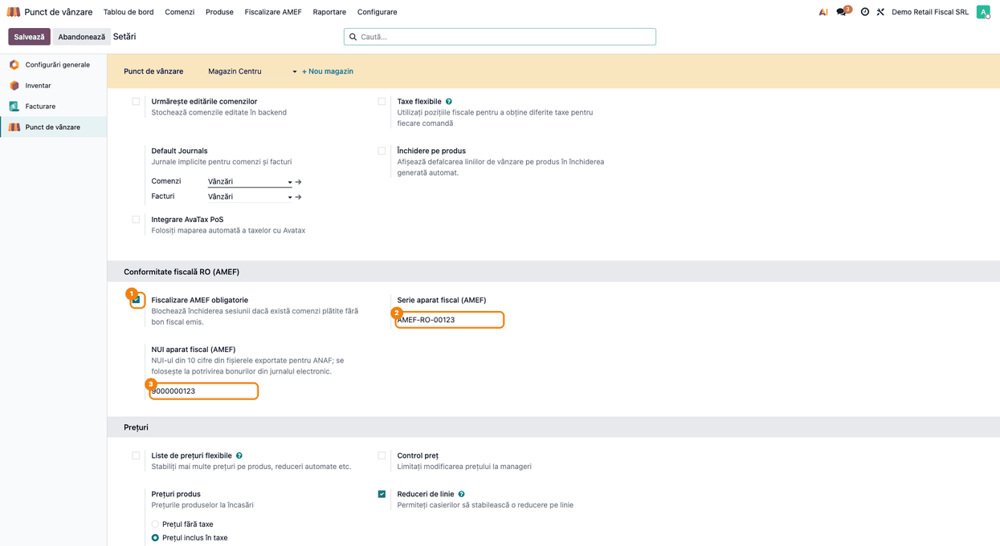
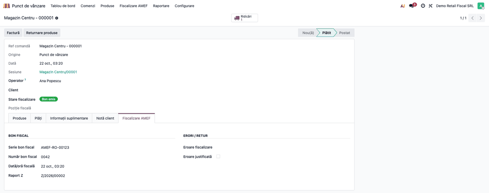
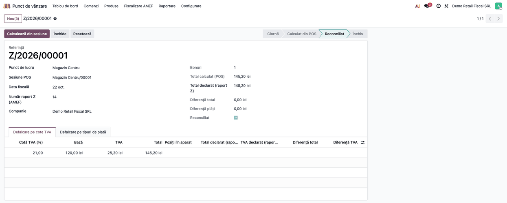
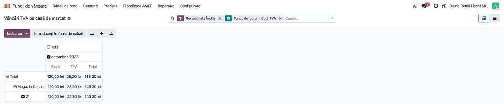
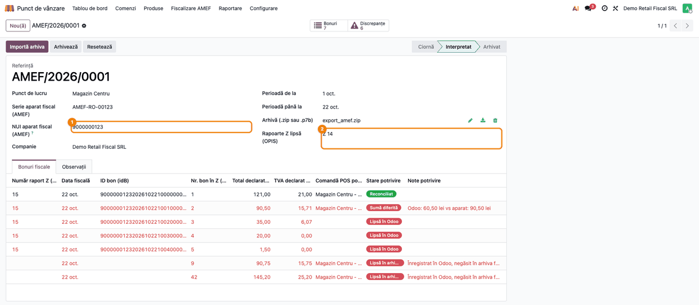
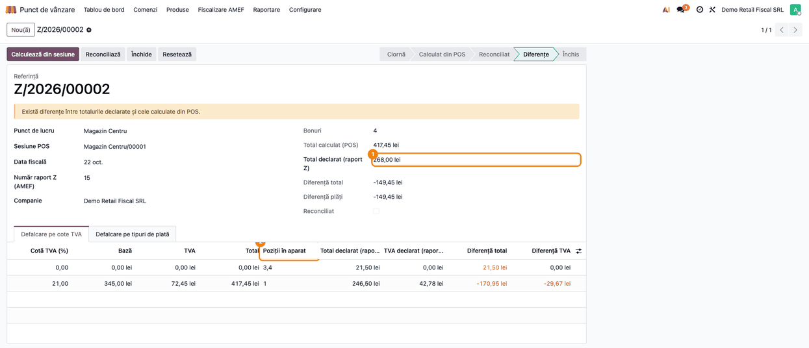
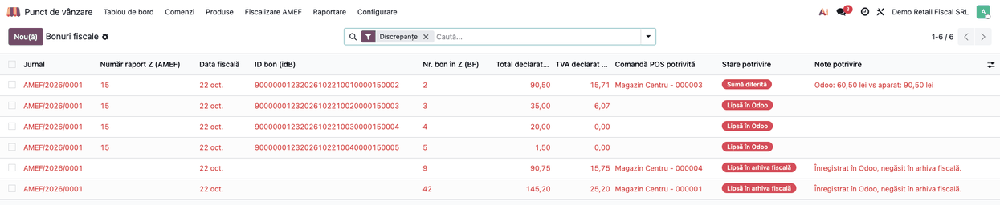
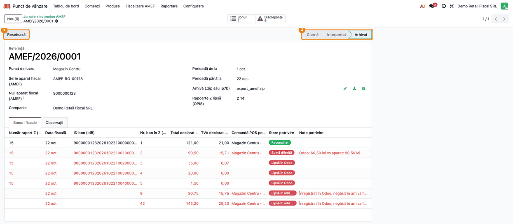

# Fișă Modul: Conformitate fiscală POS (AMEF)

**Modul:** `l10n_ro_pos_fiscal_compliance`
**FR:** FR-47
**Utilizator principal:** Operator POS / casier, Contabil retail
**Prioritate:** 🟡 Medie (zilnic în retail)

---

## 1. Scop business

Această fișă descrie utilizarea modulului `l10n_ro_pos_fiscal_compliance` pentru **conformitatea fiscală
a vânzării cu amănuntul prin POS** (aparate de marcat electronice fiscale — AMEF). Modulul completează
POS-ul Odoo cu evidența cerută în România: urmărirea seriei și numărului bonului fiscal pe fiecare
comandă, blocarea închiderii sesiunii dacă există comenzi plătite fără bon fiscal, raportul Z fiscal
reconciliat cu vânzările și încasările, și arhivarea jurnalului electronic AMEF.

Modulul **importă exportul casei de marcat pentru ANAF** (o arhivă `.zip` cu fișierele `.p7b` sau un
singur `.p7b`) și reconciliază automat, bon cu bon, ce a emis fizic aparatul fiscal față de ce a
înregistrat Odoo. Raportul Z al fiecărei zile se completează cu cifrele aparatului: totalul, plățile pe
tip și valoarea și TVA-ul pe fiecare cotă, cu diferența față de Odoo. Din versiunea 19.0.2.3.0,
fișierele se citesc după structura publicată de ANAF, verificată pe exporturi reale de la case Datecs.

## 2. Bază legală și context

OUG 28/1999 — obligația operatorilor economici care fac vânzări cu amănuntul către populație să
utilizeze aparate de marcat electronice fiscale și să emită bon fiscal; HG 479/2003 (normele de
aplicare). OPANAF 627/2018 reglementează procedura de transmitere a datelor din aparat către ANAF.

Structura fișierelor exportate din aparat este cea din **OPANAF 146/2018, anexa 2**: un **opis** al
perioadei (A4200, `Perioada_raportare.p7b`), cu primul și ultimul număr de raport Z, și câte un fișier
pe **zi fiscală** (A4203), cu bonurile zilei și raportul Z. Fiecare fișier e semnat de aparat (`.p7b`).
În fișiere, aparatul e identificat prin **NUI** (numărul unic de identificare, 10 cifre), nu prin
seria tipărită pe casă.

> Modulul acoperă latura de conformitate (evidență, blocaj, raport Z, arhivă) peste POS-ul Odoo.
> Comunicarea efectivă cu aparatul fiscal se face printr-un driver (ex. `deltatech_pos`, opțional),
> care apelează metoda publică de înregistrare a răspunsului fiscal. Modulul **nu depinde** de un
> driver anume.

## 3. Utilizatori și roluri

Operator POS / casier (emite bonuri), Contabil retail (reconciliază raportul Z, arhivează jurnalul).

Roluri recomandate pentru testare:
- Administrator funcțional: instalează modulul, activează fiscalizarea pe punctul de lucru.
- Operator POS: înregistrează bonurile fiscale pe comenzi.
- Contabil/manager retail: generează și reconciliază raportul Z, arhivează jurnalul electronic.

## 4. Conturi și date implicate

Modulul **nu generează note contabile** — gestionează evidența fiscală a vânzărilor POS. Datele
implicate:
- **bon fiscal** pe `pos.order`: serie, număr, dată/oră fiscală, stare (de fiscalizat / emis / eroare);
- **punct de lucru** (`pos.config`): fiscalizare obligatorie, serie aparat fiscal și **NUI aparat fiscal**
  (cel din fișierele ANAF);
- **raport Z**: defalcare pe cote TVA și pe tipuri de plată; valori calculate din Odoo față de cele
  declarate de aparat (total, plăți pe tip, valoare și TVA pe cotă);
- **jurnal electronic AMEF**: arhiva `.zip` cu fișierele `.p7b` (sau un singur `.p7b`) pe perioadă și
  aparat;
- **bonuri fiscale reconciliate**: câte o linie per bon din arhivă, cu starea potrivirii cu comanda
  Odoo corespunzătoare (Reconciliat / Sumă diferită / TVA diferit / Lipsă în Odoo / Lipsă în arhiva
  fiscală).

Date minime pentru demo:
- companie românească cu localizarea contabilă și `point_of_sale` instalate;
- un punct de lucru POS cu fiscalizare activă, NUI completat și metode de plată;
- una sau mai multe comenzi POS plătite în sesiune.

## 5. Configurare inițială

1. Instalați modulul `l10n_ro_pos_fiscal_compliance`.
2. În **Punct de vânzare → Configurare → Setări**, selectați punctul de lucru și, la secțiunea
   **Conformitate fiscală RO (AMEF)**, bifați **Fiscalizare AMEF obligatorie** și completați **Serie
   aparat fiscal (AMEF)** și **NUI aparat fiscal (AMEF)**. NUI-ul are 10 cifre și apare la începutul
   numelui fișierelor exportate (ex. `9000000123_Z0015.p7b`) sau în raportul de programare al aparatului.
3. Verificați metodele de plată ale punctului de lucru (**Punct de vânzare → Configurare → Metode de
   plată**) și câmpul **Tip de plată AMEF** al fiecăreia
   (numerar, card, tichete etc.): raportul Z al aparatului dă câte un total pe tip, iar reconcilierea
   se face pe acest tip.
4. Verificați că operatorul are grupul **Punct de vânzare / Utilizator**.

## 6. Flux de utilizare

### Pasul 1 — Activarea fiscalizării pe punctul de lucru

În **Punct de vânzare → Configurare → Setări**, la secțiunea **Conformitate fiscală RO (AMEF)**, activați
**Fiscalizare AMEF obligatorie** și completați seria aparatului fiscal și **NUI aparat fiscal (AMEF)**.
De acum, comenzile plătite din acest punct de lucru trebuie să aibă bon fiscal emis înainte de
închiderea sesiunii.

NUI-ul e cheia cu care importul recunoaște aparatul: un fișier cu alt NUI e refuzat. Seria tipărită pe
casă (ex. `AMEF-RO-00123`) și NUI-ul (ex. `9000000123`) sunt numere diferite.



### Pasul 2 — Bonul fiscal pe comandă

Pe fiecare comandă POS (**Punct de vânzare → Comenzi → Comenzi**), fila **Fiscalizare AMEF** arată starea
și datele bonului. Driverul aparatului fiscal completează automat seria și numărul (prin metoda de
integrare); alternativ, le puteți introduce manual și apăsa **Înregistrează bon fiscal**, ceea ce trece
comanda în starea **Bon emis**. La introducerea manuală, ca bonul să se potrivească la importul
exportului AMEF (Pasul 5), completați ca serie **NUI-ul** (sau seria aparatului) și ca număr **numărul
bonului în raportul Z** (BF, tipărit pe bon), nu numărul documentului fiscal. Dacă aparatul a întors
eroare, comanda rămâne **Eroare fiscalizare** și poate fi marcată drept eroare justificată.



### Pasul 3 — Raportul Z fiscal

La finalul zilei, în **Punct de vânzare → Fiscalizare AMEF → Rapoarte Z**, apăsați **Nou**, alegeți
**Punct de lucru**, **Sesiune POS** și **Data fiscală**, și completați **Număr raport Z (AMEF)** exact ca
pe raportul Z tipărit, fără zerouri în față (ex. `14`). Apăsați **Calculează din sesiune**: se agregă
vânzările sesiunii pe cote TVA și încasările pe tipuri de plată.

Completați apoi cifrele din raportul Z tipărit: **Total declarat (raport Z)** în antet și, în fila
**Defalcare pe tipuri de plată**, coloana declarată a fiecărui tip. Coloana declarată pornește egală cu
cea calculată, deci trebuie rescrisă cu cifrele din Z, altfel diferența iese zero. Apăsați
**Reconciliază**: raportul trece în **Reconciliat** doar dacă totalul și fiecare tip de plată coincid;
altfel trece în **Diferențe**.

Raportul pornește de la ipoteza **o sesiune = un raport Z = o zi**, pe fiecare casă: se calculează din
vânzările sesiunii, iar importul (Pasul 5) caută comenzile unui Z după ziua lui.

> **Retururile nu intră în comparația cu aparatul.** Casa de marcat nu înregistrează vânzări
> negative: returul se face cu **factură storno** (notă de credit) către client și cu **scoatere de
> numerar**. De aceea, comenzile de retur ale sesiunii (total negativ) nu intră în cotele și plățile
> calculate, ci apar separat în câmpul **Retururi (în afara aparatului)**. Pentru ca sertarul să
> corespundă cu raportul Z, scoaterea de numerar se face și pe aparat, ca **sume de serviciu scoase**,
> în aceeași zi, pe lângă dispoziția de plată din registrul de casă. Comenzile de retur trebuie
> facturate pe client, ca factura storno să fie singura reducere a vânzărilor și să nu se dubleze cu
> nota contabilă a sesiunii.
Dacă sesiunea rămâne deschisă peste noapte (mai multe Z-uri), diferențele apar pe fiecare raport Z;
închideți sesiunea la sfârșitul zilei.



### Pasul 4 — Raportul TVA pe interval, per casă de marcat

Pentru un sumar centralizat pe o perioadă oarecare (nu doar sesiune cu sesiune), deschideți
**Punct de vânzare → Fiscalizare AMEF → Vânzări TVA pe casă de marcat**. Raportul pornește implicit
grupat pe **punct de lucru** și **cotă TVA**, filtrat pe rapoartele Z reconciliate/închise, și
însumează pentru fiecare combinație baza fără TVA, TVA-ul și totalul — indiferent de metoda de
încasare (numerar, card, tichete etc.), pentru că liniile provin din defalcarea pe cote TVA a
raportului Z, nu din liniile de plată.

**Găsește pe ecran** — vederea implicită e de tip pivot: rândurile grupează punctul de lucru și
cota de TVA, coloanele defalcă pe lună (interval de dată). Fiecare celulă arată baza, TVA-ul și
totalul agregat. Câmpul **Serie dispozitiv fiscal** (vizibil în vederea listă) identifică aparatul
fizic, după seria configurată pe punctul de lucru.

**Verifică** — înainte de a trimite cifrele mai departe (ex. către contabilitatea externă),
confirmați: intervalul de dată selectat corespunde perioadei cerute; toate punctele de lucru cu
vânzări în perioadă apar în raport (nu doar unul); suma totalurilor pe cote TVA ale unui punct de
lucru coincide cu totalul din raportul Z declarat/reconciliat al aceluiași punct de lucru pentru
aceeași perioadă. Dacă filtrul „Reconciliat / Închis" e activ și lipsesc zile din perioadă, e
posibil ca acele rapoarte Z să fie încă în starea „Ciornă"/„Calculat din POS" — verificați Pasul 3 pentru
zilele lipsă înainte de a trage concluzii.

> **Limitări de citit înainte de a trimite cifrele mai departe.** Raportul **nu** e o citire directă
> a jurnalului/arhivei ANAF — e calculat din datele Odoo ale raportului Z (Pasul 3); valorile
> declarate de aparat pe cote se văd pe raportul Z completat din export (Pasul 6), nu în acest
> sumar. Tratați-l ca sursă de lucru, nu ca substitut al arhivei oficiale.
> Cota de TVA a fiecărei linii se ia din **prima taxă procentuală** a liniei — vânzările scutite și
> cele cu taxe fixe (fără procent) apar toate cumulat pe rândul „0", care merită verificat separat.
> Agregarea include vânzările sesiunii care nu sunt ciornă/anulate, deci și comenzile POS
> facturate, dar nu și retururile (raportate separat prin factura storno, vezi Pasul 3) — pentru un
> total strict pe bonuri fiscale, verificați și distincția factură/bon din Pasul 2.

**Treci mai departe** — pentru detaliere pe bon individual sau pe sesiune, treceți din pivot în
vederea **listă** (butonul din colțul din dreapta sus): fiecare linie arată raportul Z sursă,
data, punctul de lucru, seria aparatului și cota de TVA. Din listă, exportul standard Odoo (XLSX)
e disponibil pentru a transmite datele mai departe.



### Pasul 5 — Importul exportului AMEF

În **Punct de vânzare → Fiscalizare AMEF → Jurnale electronice AMEF**, creați o înregistrare nouă:
selectați punctul de lucru (**Serie aparat fiscal (AMEF)** și **NUI aparat fiscal (AMEF)** se preiau
din el), perioada (dată
început/sfârșit) și atașați exportul primit de la casa de marcat: arhiva `.zip` cu fișierele `.p7b`
sau un singur fișier `.p7b`. Apăsați **Importă arhiva**.

Modulul citește conținutul fiecărui `.p7b` (semnătura garantează doar autenticitatea, nu e nevoie de
cheie sau certificat). Din fiecare zi fiscală ia numărul raportului Z, data, bonurile și raportul Z
al aparatului. Fiecare bon se potrivește cu comanda din Odoo pe **aparat, numărul bonului în Z și ziua
bonului**. Când bonul a fost tipărit prin driverul de casă de marcat, potrivirea se face pe numărul Z
și numărul bonului în Z salvate de driver pe comandă. Starea jurnalului trece în **Interpretat**.

Un bon cu același total ca al comenzii, dar cu alt TVA (peste un ban de rotunjire), apare **TVA
diferit**: comanda are altă defalcare pe cote decât bonul tipărit, iar nota arată cele două valori.

> **Un singur raport Z pe zi și casă.** Potrivirea manuală (aparat, număr bon în Z, zi) și verificarea
> „Lipsă în arhiva fiscală" lucrează pe zi. Dacă pe aceeași casă se scot două rapoarte Z în aceeași zi,
> același număr de bon există în ambele, iar comenzile unui Z apar „Lipsă în arhiva fiscală" la
> celălalt. Cu driverul de casă (puntea ECR), potrivirea folosește numărul Z al comenzii și evită
> primul caz, dar nu și al doilea. Recomandați magazinului un singur raport Z pe zi.

Un bon pentru care nu se găsește comanda după aparat și număr poate fi totuși marcat **Reconciliat**
dacă există o comandă nefiscalizată din aceeași zi cu aceeași sumă; în acest caz, coloana **Note
potrivire** spune că potrivirea s-a făcut după dată și sumă. Verificați aceste bonuri: legătura nu e
sigură.



În exemplu, Z 14 a fost scos în aceeași zi și lipsește din export: de aceea bonul lui (42) apare
„Lipsă în arhiva fiscală", iar Z 14 apare în **Rapoarte Z lipsă (OPIS)**.

**Găsește pe ecran** — în fila **Bonuri fiscale** e câte o linie pentru fiecare bon din export, cu
numărul raportului Z, numărul bonului în Z (**Nr. bon în Z (BF)**), totalul și TVA-ul declarate de
aparat, comanda Odoo găsită și starea potrivirii. Rândurile **Lipsă în arhiva fiscală** vin din
comenzile Odoo, nu din export: n-au **ID bon (idB)**, iar numărul bonului în Z e cel de pe comandă.
Numărul raportului Z apare doar când bonul a fost tipărit prin driverul de casă (puntea ECR); la
bonurile înregistrate manual rămâne gol. Deasupra filelor, câmpul **Rapoarte Z lipsă (OPIS)**
listează Z-urile din intervalul declarat în opis care nu sunt în export. În fila **Observații** apar
abaterile de coerență ale fiecărui Z și fișierele ignorate.

**Verifică** — înainte de a trece la discrepanțe:
- câmpul **NUI aparat fiscal (AMEF)** al jurnalului e cel al casei din care vine exportul;
- câmpul **Rapoarte Z lipsă (OPIS)** nu apare (apare doar când lipsesc Z-uri); dacă apare, cereți de la
  magazin Z-urile lipsă și reimportați. Fără `Perioada_raportare.p7b` în export, Z-urile lipsă nu se
  pot verifica;
- fila **Observații** nu are abateri de coerență (total Z diferit de suma bonurilor sau a plăților,
  TVA diferit de suma pe cote, bonuri lipsă din numerotare). O astfel de abatere înseamnă un fișier
  incomplet sau modificat, nu o diferență față de Odoo.

**Treci mai departe** — la raportul Z completat din export (Pasul 6) și la lista discrepanțelor
(Pasul 7).

> Exportul aplicației fiscalwire conține, pe lângă `Perioada_raportare.p7b`, și un fișier
> `OPIS_fiscalwire_*.xml`. Acesta e o copie a opisului salvată ca text, care nu se mai poate citi:
> importul îl ignoră și lasă o notă în fila **Observații**. Opisul se citește din
> `Perioada_raportare.p7b`.

### Pasul 6 — Raportul Z completat din export

Pentru fiecare zi importată, modulul completează raportul Z al punctului de lucru (**Punct de vânzare →
Fiscalizare AMEF → Rapoarte Z**) cu același număr Z și aceeași dată. Dacă nu există, completează
raportul Z al zilei creat fără număr Z; altfel creează unul nou, calculat din sesiunea bonurilor
găsite. De aceea, un raport Z creat manual cu alt număr Z sau cu altă dată duce la un al doilea raport
pe aceeași zi. În raport, totalul declarat devine totalul Z-ului din aparat,
plățile declarate se aliniază pe tipul de plată AMEF, iar liniile pe cotă primesc valoarea și TVA-ul
declarate de aparat. Apoi raportul se reconciliază automat.



**Găsește pe ecran** — în fila **Defalcare pe cote TVA**, fiecare rând e o cotă: baza, TVA-ul și
totalul calculate din Odoo, apoi **Total declarat (raport Z)** (valoarea cu TVA din aparat),
**TVA declarat (raport Z)** și diferențele **Diferență total** și **Diferență TVA**. Coloana
**Poziții în aparat** arată pozițiile din raportul Z al aparatului adunate pe acea cotă (ex. „3,4"). În
fila **Defalcare pe tipuri de plată**, fiecare tip are suma calculată și cea declarată.

**Verifică**:
- **Total declarat (raport Z)** din antet este totalul raportului Z tipărit de casă în acea zi;
- diferențele pe cote sunt zero sau de cel mult 0,01 lei (rotunjire: aparatul calculează TVA-ul pe
  totalul cotei, Odoo pe linii);
- pe cota 0% pot fi adunate mai multe poziții ale aparatului, de exemplu vânzări scutite și garanția
  SGR; în Odoo, ambele sunt tot pe cota 0%;
- fiecare tip de plată din **Defalcare pe tipuri de plată** are suma declarată egală cu cea calculată
  (un plus pe card și un minus egal pe numerar nu se compensează);
- starea raportului este **Reconciliat**. Starea **Diferențe** cere lămurire în Pasul 7. Partea
  calculată cuprinde vânzările sesiunii, inclusiv cele „Lipsă în arhiva fiscală": acestea apar ca
  diferență pe cotă până sunt lămurite. Retururile nu intră în ea: le vedeți în **Retururi (în afara
  aparatului)** și le verificați cu facturile storno ale zilei.

**Treci mai departe** — la lista discrepanțelor bon cu bon (Pasul 7).

### Pasul 7 — Verificarea discrepanțelor

Din butonul statistic **Discrepanțe** de pe jurnal (sau din meniul **Punct de vânzare → Fiscalizare
AMEF → Discrepanțe bonuri fiscale**) se deschide lista completă a bonurilor cu probleme, cu
filtre pe starea potrivirii: bonuri fără corespondent în Odoo, sume sau cote TVA diferite între
aparat și Odoo, și — simetric — comenzi fiscalizate în Odoo care nu apar în arhiva fiscală a
aparatului pentru ziua respectivă.



Lista se deschide filtrată pe **Discrepanțe**; scoateți filtrul ca să vedeți și bonurile reconciliate.

După ce discrepanțele sunt lămurite (corectare manuală în Odoo sau justificare), reveniți pe jurnal
și apăsați **Arhivează** pentru a-l marca drept închis pentru perioada respectivă. Notați lămurirea în
chatter-ul jurnalului, nu în fila **Observații**: aceasta se rescrie la fiecare reimport care produce
mesaje.



### Note de monografie și raportare

Modulul **nu produce note contabile** — nota contabilă agregată a sesiunii POS rămâne cea generată de
`point_of_sale` la închidere. Aportul modulului este: evidența seriei/numărului de bon fiscal,
**blocarea închiderii sesiunii** dacă există comenzi plătite nefiscalizate fără eroare justificată,
raportul Z reconciliat (pe cote TVA și metode de plată) și arhiva jurnalului electronic AMEF.
Returul fiscal referențiază bonul inițial (câmpurile „Bon inițial (retur)").

Returul unei vânzări cu bon fiscal nu trece prin aparat. Se documentează cu factură storno către
client, la cota de TVA a vânzării inițiale, și cu restituirea numerarului pe dispoziție de plată.
Exemplu: un retur de 240 lei la 21% (bază 198,35, TVA 41,65):

- factura storno: `4111 = 707 / 4427`, în roșu (−240,00 = −198,35 / −41,65);
- restituirea numerarului: `4111 = 5311` (240,00);
- reintrarea în stoc, la cost: `607 = 371`, în roșu.

Vânzările zilei se iau din raportul Z, iar returul intră separat, prin factura storno. Dacă comanda
de retur din POS nu e facturată, ea rămâne în nota contabilă a sesiunii și, împreună cu o factură
storno emisă separat, reducerea vânzărilor s-ar înregistra de două ori.

La importul exportului (Pasul 5), raportul Z al fiecărei zile se completează și reconciliază automat
(Pasul 6): totalul declarat este totalul Z-ului din aparat; plățile declarate vin pe tipul de plată
ANAF (1 card, 2 avans în numerar, 3 numerar, 4 tichete de masă, 5 tichete valorice, 6 voucher,
7 credit, 8 metode moderne, 9 alte metode); liniile pe cotă primesc valoarea cu TVA și TVA-ul
declarate de aparat. Raportul e **Reconciliat** când totalul și plățile coincid, iar pe fiecare cotă
diferența e de cel mult 0,01 lei.

Raportul **Vânzări TVA pe casă de marcat** (Pasul 4) nu recalculează nimic — citește direct liniile
de TVA deja calculate de fiecare raport Z (butonul **Calculează din sesiune**) și le însumează pe
interval, punct de lucru și cotă. De aceea reflectă întotdeauna starea curentă a rapoartelor Z din
perioadă: dacă un raport Z e încă „Ciornă"/„Calculat din POS" (necalculat sau nereconciliat),
valorile lui intră totuși în sumă doar dacă filtrul „Reconciliat / Închis" e dezactivat — cu filtrul
activ (implicit), doar rapoartele Z finalizate contează. Chiar și așa, raportul rămâne o citire a
datelor Odoo, nu a arhivei ANAF — vezi rezerva de la Pasul 4 privind bucketul de cotă „0" și
comenzile facturate.

## 7. Legături cu alte module / declarații

| Modul / proces | Rol în flux | Tip legătură |
|---|---|---|
| `point_of_sale` | comenzi, sesiuni, metode de plată, nota de sesiune | dependență (manifest) |
| `account` | nota contabilă de sesiune (generată de POS) | dependență (manifest) |
| `l10n_ro` | plan de conturi și taxe RO | dependență (manifest) |
| `deltatech_pos` / `deltatech_pos_base` | driver fiscal AMEF: trimite bonul la casă și înregistrează răspunsul aparatului pe comandă | integrare opțională (nu dependență) |
| `l10n_ro_pos_fiscal_compliance_ecr` | puntea cu driverul: starea fiscală din răspunsul aparatului și potrivirea bonurilor din export pe numărul Z și numărul bonului în Z | modul punte, instalat automat când e prezent și `deltatech_ecr_fiscal` (adus de `deltatech_pos`) |
| `l10n_ro_anaf_d394_pos` | agregarea bonurilor fiscale POS în declarația D394 (dacă e instalat) | integrare prin convenție (realizată de modulul D394 POS, nu de acesta) |

> Raportul **Vânzări TVA pe casă de marcat** (Pasul 4) e o vedere peste datele deja calculate ale
> rapoartelor Z — nu are dependențe suplimentare și e disponibil oricărui client cu modulul
> instalat, nu doar celor care importă arhiva jurnalului electronic (Pasul 5).

Ce este automat: marcarea stării de fiscalizare, blocarea închiderii sesiunii, importul și
reconcilierea bon-cu-bon din exportul `.zip`/`.p7b`, verificarea aparatului (NUI) și a coerenței
fiecărui Z, lista Z-urilor lipsă, completarea raportului Z cu cifrele aparatului (total, plăți, cote),
reconcilierea cu vânzările/încasările POS, și agregarea pe interval/casă de marcat/cotă TVA a
liniilor deja calculate ale rapoartelor Z.
Ce rămâne manual: configurarea fiscalizării și a NUI-ului pe punctul de lucru, obținerea exportului de la
casa de marcat și încărcarea ei, lămurirea discrepanțelor semnalate (corectare în Odoo sau
justificare), și justificarea erorilor de fiscalizare.

## 8. Verificări pentru consultant

- [ ] Modulul se instalează fără erori (cu `point_of_sale` prezent).
- [ ] În Setări POS apare secțiunea **Conformitate fiscală RO (AMEF)** cu fiscalizarea obligatorie,
      seria și NUI-ul aparatului.
- [ ] Pe comanda POS apare fila **Fiscalizare AMEF** cu starea bonului.
- [ ] O comandă plătită fără bon fiscal blochează închiderea sesiunii (cu mesaj clar).
- [ ] „Înregistrează bon fiscal" trece comanda în starea „Bon emis" și salvează seria/numărul.
- [ ] Raportul Z agregă corect pe cote TVA și pe metode de plată; reconcilierea semnalează diferențele.
- [ ] **Vânzări TVA pe casă de marcat** grupează corect pe punct de lucru și cotă TVA; totalul pe un
      punct de lucru pentru o zi coincide cu totalul raportului Z reconciliat al aceleiași zile.
- [ ] Cu filtrul „Reconciliat / Închis" activ, rapoartele Z în starea „Ciornă"/„Calculat din POS" nu
      intră în sumă (dezactivând filtrul, intră și ele).
- [ ] Coloana **Serie dispozitiv fiscal** din vederea listă a raportului corespunde cu seria
      configurată pe punctul de lucru (Pasul 1) și cu cea din jurnalul AMEF importat (Pasul 5).
- [ ] Jurnalul electronic AMEF poate fi arhivat cu fișier atașat.
- [ ] „Importă arhiva" pe un jurnal cu un `.zip` valid de `.p7b` (sau cu un singur `.p7b`) trece starea
      în „Interpretat" și populează fila **Bonuri fiscale** cu câte o linie per bon, cu numărul Z și
      numărul bonului în Z completate.
- [ ] Jurnalul preia NUI-ul din punctul de lucru; un export de la alt aparat, sau cu fișiere de la mai
      multe aparate, e refuzat cu mesaj clar.
- [ ] Un bon înregistrat pe o comandă Odoo cu același aparat, același număr în Z și aceeași zi, cu sumă
      identică, apare **Reconciliat**; cu sumă diferită apare **Sumă diferită**. Același număr de bon
      dintr-o altă zi nu se potrivește.
- [ ] Un bon cu același total ca al comenzii, dar cu alt TVA, apare **TVA diferit**.
- [ ] Un bon din export fără nicio comandă Odoo corespunzătoare apare **Lipsă în Odoo**; o comandă
      fiscalizată în Odoo absentă din exportul zilei respective apare **Lipsă în arhiva fiscală**.
- [ ] Cu opisul inclus, un Z din intervalul opisului absent din export apare în **Rapoarte Z lipsă
      (OPIS)**; cu exportul complet, câmpul nu apare.
- [ ] Raportul Z al zilei are totalul declarat egal cu totalul Z-ului tipărit de casă, plățile pe tip
      egale cu cele din Z, iar pe cote valoarea și TVA-ul declarate de aparat.
- [ ] Pe un export cu garanție SGR, pozițiile aparatului cu cota 0% se adună pe aceeași linie 0%
      (coloana **Poziții în aparat** arată, de exemplu, „3,4").
- [ ] Un Z modificat (de exemplu, plăți care nu dau totalul) lasă o notă de coerență în fila
      **Observații**; un Z corect nu lasă nicio notă.
- [ ] Fișierul `OPIS_fiscalwire_*.xml` din exportul fiscalwire e ignorat, cu notă în **Observații**.
- [ ] Lista de discrepanțe (buton statistic sau meniu dedicat) se deschide filtrată pe **Discrepanțe**
      și filtrează corect după starea potrivirii.
- [ ] Un raport Z creat manual pentru zi, fără număr Z, e completat de import; nu apare un al doilea
      raport Z pe aceeași zi și casă.
- [ ] Un raport Z cu plăți declarate care diferă pe tipuri, dar dau același total, rămâne **Diferențe**.
- [ ] Pe o sesiune cu un retur, raportul Z calculează doar vânzările, arată returul în **Retururi (în
      afara aparatului)** și iese **Reconciliat** față de Z-ul aparatului.
- [ ] Jurnalul nou preia **Serie aparat fiscal (AMEF)** și **NUI aparat fiscal (AMEF)** din punctul de
      lucru.
- [ ] Un fișier care nu e nici `.zip`, nici `.p7b` semnat produce un mesaj de eroare clar, nu o eroare
      tehnică.

## 9. Mesaje de eroare frecvente

| Mesaj / simptom | Cauză probabilă | Remediere |
|-----------------|-----------------|-----------|
| „Nu se poate închide sesiunea …: … comenzi plătite nu au bon fiscal emis." | Comenzi plătite nefiscalizate într-o sesiune cu fiscalizare obligatorie | Emiteți bonul fiscal sau marcați eroarea ca justificată pe comenzile listate |
| „Completați numărul bonului fiscal pentru comanda …" | „Înregistrează bon fiscal" apăsat fără număr completat | Completați numărul (și seria) bonului fiscal |
| „Încărcați fișierul jurnalului electronic înainte de arhivare." | „Arhivează" apăsat fără fișier atașat | Atașați fișierul jurnalului electronic AMEF |
| „Fișierul atașat nu este nici arhivă .zip, nici fișier AMEF semnat (.p7b)." | Fișierul atașat e corupt sau de alt tip (ex. `.xml` simplu) | Atașați arhiva `.zip` originală sau un fișier `.p7b` exportat de casă |
| „Fișierele provin de la aparatul fiscal cu NUI …, dar acest jurnal este setat pentru NUI …" | Exportul e de la altă casă decât punctul de lucru ales, sau NUI-ul de pe punctul de lucru e greșit | Alegeți punctul de lucru al casei respective sau corectați NUI-ul în Setări POS |
| „Arhiva conține fișiere de la mai multe aparate fiscale (NUI …)." | Exporturile mai multor case sunt puse în aceeași arhivă | Importați fiecare casă pe un jurnal separat |
| „…: nu a putut fi decodat ca fișier CMS/PKCS7 (.p7b) valid." (în fila **Observații**, după import) | Un fișier `.p7b` din arhivă e corupt | Verificați exportul de la casa de marcat; restul fișierelor se importă normal |
| „…: ignorat, este o copie text a opisului care nu se mai poate citi…" (în fila **Observații**) | Exportul fiscalwire conține și `OPIS_fiscalwire_*.xml` | Nimic de făcut: opisul se citește din `Perioada_raportare.p7b` |
| „Z …: totalul Z diferă de suma plăților (Z: …, calculat: …)." și altele similare (în fila **Observații**) | Fișierul zilei e incomplet sau a fost modificat după export | Cereți din nou exportul de la casa de marcat și reimportați |
| „Opisul este emis pentru codul fiscal …, nu pentru companie (…)." (în fila **Observații**) | Exportul e al altei firme, sau codul fiscal al companiei e completat diferit | Verificați exportul și codul fiscal al companiei |

## 10. Capturi de ecran

Capturile (`static/description/`) sunt **generate automat** din `tests/test_screenshots.py`
(mixinul `ScreenshotCase` din `l10n_ro_doc_screenshots`, import defensiv), în **limba română**,
pe planul de conturi RO (`setup_country("ro")`):

1. `01_config_fiscal.png` — setări POS, secțiunea „Conformitate fiscală RO (AMEF)".
2. `02_comanda_fiscal.png` — comanda POS, fila „Fiscalizare AMEF".
3. `03_raport_z.png` — raportul Z fiscal (defalcare TVA + metode de plată, reconciliere).
4. `07_raport_tva_casa_marcat.png` — raportul „Vânzări TVA pe casă de marcat" (pivot pe interval,
   punct de lucru și cotă TVA).
5. `05_import_arhiva.png` — jurnalul AMEF după import, fila „Bonuri fiscale" cu bonurile reconciliate și
   Z-ul lipsă din opis.
6. `08_raport_z_declarat.png` — raportul Z completat din export: cote declarate de aparat, cu
   diferențele față de Odoo.
7. `06_discrepante.png` — lista discrepanțelor bonurilor fiscale.
8. `04_jurnal_amef.png` — jurnalul electronic AMEF arhivat (pasul final, după lămurirea discrepanțelor).

Regenerare:

```bash
./odoo/odoo-bin -c odoo.conf -d <db> -i l10n_ro_pos_fiscal_compliance,l10n_ro_doc_screenshots \
    --test-tags=fise_screenshots --stop-after-init
```

## 11. Observații pentru manual

În manualul final, păstrați explicația orientată pe activitate: obligația bonului fiscal la vânzarea cu
amănuntul, ce înseamnă blocarea închiderii sesiunii, cum se citește raportul Z reconciliat și de ce se
arhivează jurnalul electronic. Subliniați că modulul nu modifică contabilitatea POS, ci adaugă
controlul fiscal cerut de lege; comunicarea cu aparatul fiscal fizic se face prin driverul de
fiscalizare instalat separat.

Explicați diferența dintre **seria aparatului** (tipărită pe casă) și **NUI** (numărul din fișierele
pentru ANAF): fără NUI corect pe punctul de lucru, importul refuză exportul. Precizați și că raportul Z
completat din export arată cifrele aparatului, deci diferențele pe cote sunt diferențe reale între casă
și Odoo, nu erori de import.

Pentru fluxul de import arhivă, precizați clar diferența dintre cele două stări de reconciliere pe
care le poate întâlni consultantul: **Reconciliat/Sumă diferită/TVA diferit** (bonul există și în
arhivă, și în Odoo — verificarea e pe conținut) versus **Lipsă în Odoo/Lipsă în arhiva fiscală**
(bonul există doar de o parte — verificarea e pe existență). A doua categorie e cea care necesită
investigație operațională (vânzare neînregistrată în Odoo sau bon emis manual fără corespondent
fizic), nu doar o corecție de sumă.
