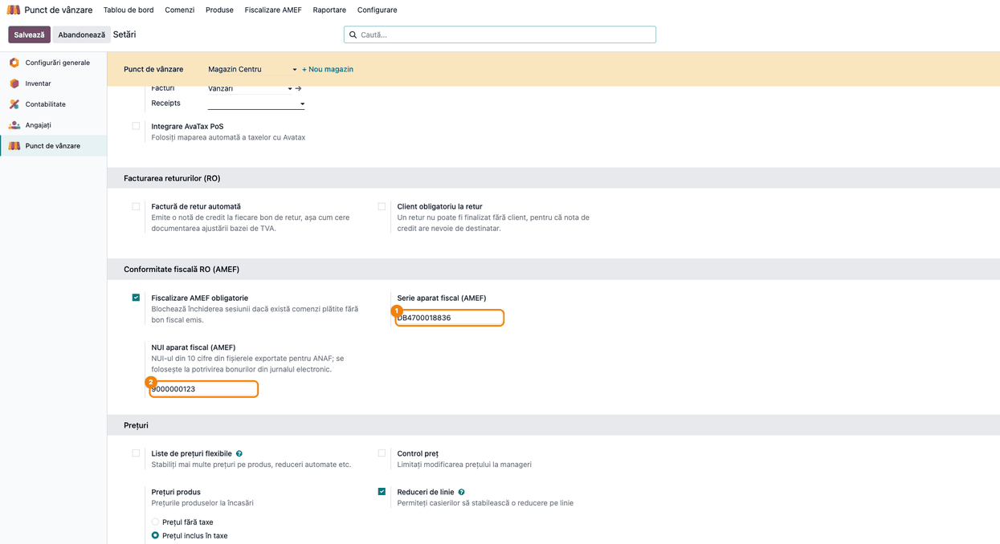
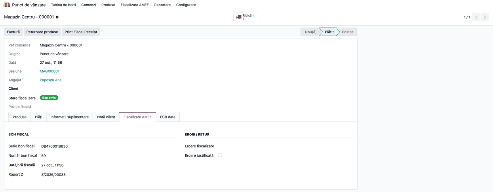
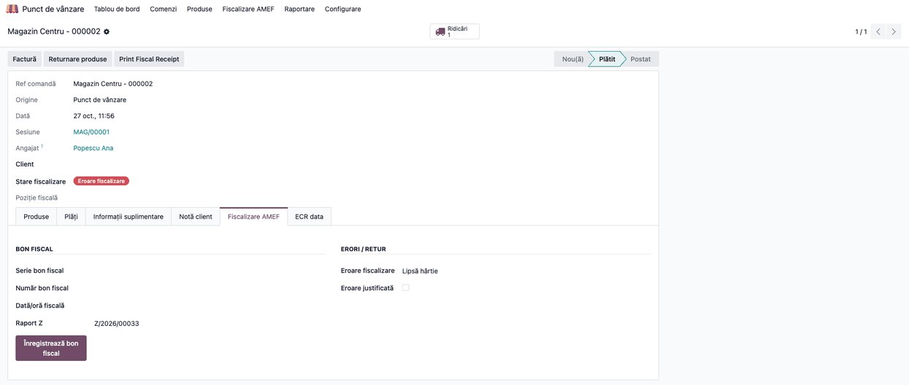
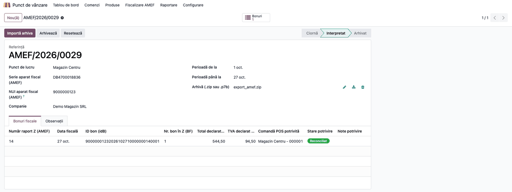

# Fișă Modul: Punte POS ↔ casă de marcat (AMEF)

**Modul:** `l10n_ro_pos_fiscal_compliance_ecr`
**Utilizator principal:** Consultant de implementare, responsabil magazin
**Prioritate:** 🟡 Medie (lucrează automat; se verifică la punerea în funcțiune a casei)

---

## 1. Scop business

Driverul casei de marcat (`deltatech_pos`, prin agentul local Terrabit Connect) scrie pe comanda POS răspunsul aparatului:
numărul documentului fiscal (NR), numărul bonului în raportul Z (BF), numărul raportului Z, starea și eroarea.
Conformitatea fiscală (`l10n_ro_pos_fiscal_compliance`) urmărește separat starea bonului cerută de OUG 28/1999 — de
fiscalizat, emis sau eroare —, pe care se sprijină blocarea închiderii sesiunii, raportul Z și potrivirea cu jurnalul
electronic. Puntea leagă cele două: răspunsul aparatului devine starea fiscală a comenzii, iar la importul jurnalului
electronic bonul din aparat se potrivește cu comanda pe numărul Z și numărul bonului. Modulul nu are ecrane proprii și
se instalează automat când ambele module sunt prezente.

## 2. Bază legală și context

- **OUG 28/1999** și **HG 479/2003** — obligația de a emite bon fiscal prin aparatul de marcat electronic fiscal (AMEF);
  starea bonului pe comandă arată dacă obligația a fost îndeplinită.
- **OPANAF 146/2018, anexa 2** — structura fișierelor exportate din aparat: în fișierul zilei fiscale, bonul e
  identificat prin `idB`, care conține NUI-ul aparatului, numărul raportului Z și numărul bonului în Z (BF).
- Seria casei și NR-ul nu apar în fișierele ANAF; de aceea potrivirea cu jurnalul se face pe (Z, BF), iar seria și NR-ul
  rămân pe comandă ca identificare a bonului tipărit.

## 3. Utilizatori și roluri

Consultant de implementare (verifică legătura casă ↔ Odoo la punerea în funcțiune), responsabil magazin (urmărește
comenzile în eroare și importă jurnalul electronic), casier (nu interacționează cu modulul).

Roluri recomandate pentru testare:
- **Administrator Punct de vânzare**: configurează seria și NUI-ul aparatului;
- **Utilizator Punct de vânzare**: vinde, iar casa răspunde;
- **Responsabil magazin**: verifică starea bonurilor și importă jurnalul electronic.

## 4. Conturi și date implicate

Modulul nu generează note contabile; lucrează doar pe starea fiscală a comenzilor POS.

Date minime pentru demo:
- un punct de vânzare cu **Fiscalizare AMEF obligatorie**, **Serie aparat fiscal (AMEF)** și **NUI aparat fiscal (AMEF)**;
- o comandă POS plătită, confirmată de casa de marcat (NR, BF, Z);
- o comandă POS cu eroare de tipărire;
- un export al jurnalului electronic al aparatului (`.zip` cu fișierul zilei fiscale).

## 5. Configurare inițială

1. Instalați `l10n_ro_pos_fiscal_compliance` și driverul `deltatech_pos`; puntea se instalează automat.
2. În **Punct de vânzare → Configurare → Setări**, secțiunea **Casa de marcat**: transportul ECR pe **Terrabit Connect**,
   cu adresa agentului local. Pe transportul „fișier” aparatul nu întoarce niciun răspuns, iar comenzile rămân „de
   fiscalizat”.
3. Agentul Terrabit Connect instalat și pornit pe calculatorul casei.
4. Seria și NUI-ul aparatului completate (pasul 1 de mai jos).

## 6. Flux de utilizare

Capturile folosesc punctul de vânzare „Magazin Centru”, cu casa de marcat seria DB4700018836 și NUI 9000000123.

### Pasul 1 — Seria și NUI-ul aparatului

Accesați **Punct de vânzare → Configurare → Setări**, alegeți punctul de vânzare și coborâți la secțiunea
**Conformitate fiscală RO (AMEF)**. Cu **Fiscalizare AMEF obligatorie** bifată, completați:

1. **Serie aparat fiscal (AMEF)** — puntea o pune ca serie pe fiecare bon confirmat de casă;
2. **NUI aparat fiscal (AMEF)** — cele 10 cifre din fișierele exportate pentru ANAF, folosite la importul jurnalului.



### Pasul 2 — Bonul confirmat de casa de marcat

Casierul validează plata; driverul trimite bonul la casă și scrie răspunsul pe comandă. Deschideți comanda din
**Punct de vânzare → Comenzi → Comenzi**, fila **Fiscalizare AMEF**:

1. **Găsiți pe ecran**: *Stare fiscalizare*, sub *Client*, iar în fila *Fiscalizare AMEF* seria, numărul bonului fiscal,
   *Dată/oră fiscală* și raportul Z.
2. **Verificați**: starea e *Bon emis*; seria e cea din pasul 1; *Număr bon fiscal* e NR-ul întors de aparat (în demo,
   59), nu numărul bonului din raportul Z, care se reia la fiecare Z; *Eroare fiscalizare* e goală.

Dacă aparatul nu întoarce NR, puntea folosește BF-ul. Dacă nu întoarce niciun număr, comanda trece în *Eroare*, nu în
*Bon emis*: fără număr, bonul nu poate fi potrivit cu jurnalul.



### Pasul 3 — Bonul în eroare

Când casa raportează o eroare de tipărire sau bonul e anulat la casă, comanda trece în *Eroare fiscalizare*, cu mesajul
aparatului:

1. **Găsiți pe ecran**: *Stare fiscalizare* = *Eroare fiscalizare*, iar în fila *Fiscalizare AMEF* câmpul *Eroare
   fiscalizare* (în demo, „Lipsă hârtie”) și butonul **Înregistrează bon fiscal**.
2. **Verificați**: seria și numărul bonului sunt goale; o astfel de comandă blochează închiderea sesiunii.
3. Remediați: reemiteți bonul din casă sau, dacă bonul a fost emis manual, completați-l cu **Înregistrează bon fiscal**;
   altfel, bifați **Eroare justificată**.



### Pasul 4 — Potrivirea cu jurnalul electronic AMEF

Exportați jurnalul electronic din aparat și importați-l din **Punct de vânzare → Fiscalizare AMEF → Jurnale electronice
AMEF**, cu **Importă arhiva**. În fila **Bonuri fiscale**:

1. **Găsiți pe ecran**: fiecare rând e un bon din aparat, cu *Număr raport Z (AMEF)*, *ID bon (idB)*, *Nr. bon în Z
   (BF)*, totalul și TVA-ul declarate, *Comandă POS potrivită* și *Stare potrivire*.
2. **Verificați**: bonul e potrivit cu comanda care are același raport Z și același BF salvate de driver (în demo, Z 14,
   BF 1, comanda Magazin Centru - 000001, 544,50 lei), iar starea e *Reconciliat*. Un BF egal din alt raport Z nu se
   potrivește.
3. Abia apoi, după lămurirea discrepanțelor, apăsați **Arhivează**.



### Note de monografie și raportare

Modulul nu generează note contabile. Starea fiscală pe care o completează alimentează:
- blocarea închiderii sesiunii (comenzi plătite fără bon emis);
- raportul Z al sesiunii și raportul **Vânzări TVA pe casă de marcat**;
- potrivirea cu jurnalul electronic AMEF.

## 7. Legături cu alte module / declarații

| Modul / proces | Rol în flux | Tip legătură |
|---|---|---|
| `l10n_ro_pos_fiscal_compliance` | starea fiscală, blocarea sesiunii, raportul Z, jurnalul electronic | dependență (manifest) |
| `deltatech_ecr_fiscal` | câmpurile răspunsului aparatului pe comandă (NR, BF, Z, stare, eroare) | dependență (manifest) |
| `deltatech_pos` | driverul care trimite bonul și scrie răspunsul casei | se instalează alături (nu e dependență) |
| `l10n_ro_pos_pack` | pachetul care le instalează împreună | opțional |

Ce e automat: trecerea comenzii în *Bon emis* sau *Eroare fiscalizare* la răspunsul casei, seria bonului din
configurare, potrivirea cu jurnalul electronic pe (Z, BF).
Ce rămâne manual: configurarea transportului Terrabit Connect, a seriei și a NUI-ului; tratarea comenzilor în eroare;
importul jurnalului electronic.

## 8. Verificări pentru consultant

- [ ] O vânzare de probă ajunge pe comandă cu *Stare fiscalizare* = *Bon emis*, seria casei și NR-ul întors de aparat.
- [ ] O eroare provocată la casă (de exemplu, fără hârtie) lasă comanda în *Eroare fiscalizare*, cu mesajul aparatului.
- [ ] O comandă în eroare blochează închiderea sesiunii până la reemitere, înregistrare manuală sau eroare justificată.
- [ ] La importul jurnalului electronic, bonurile se potrivesc cu comenzile (*Reconciliat*) pe numărul Z și BF.
- [ ] Pe o arhivă reală, `idB` din fișierul zilei corespunde NR-ului salvat pe comenzi (presupunerea din
      `readme/CONTEXT.md`).

## 9. Mesaje de eroare frecvente

| Mesaj / simptom | Cauză probabilă | Remediere |
|---|---|---|
| Comenzile rămân „de fiscalizat” deși bonul s-a tipărit | Transportul ECR e pe „fișier”, deci aparatul nu întoarce răspuns | Treceți transportul pe *Terrabit Connect* și porniți agentul |
| „The cash register confirmed the receipt without returning its number.” (mesaj încă netradus) | Aparatul a confirmat tipărirea fără NR și fără BF | Verificați bonul pe casă și înregistrați-l cu **Înregistrează bon fiscal** |
| „Receipt cancelled at the cash register.” (mesaj încă netradus) | Bonul a fost anulat pe aparat | Reemiteți bonul sau bifați *Eroare justificată* |
| Bonul din jurnal nu se potrivește cu nicio comandă | Comanda nu are Z și BF salvate (bon emis manual sau înainte de punte) sau NUI-ul diferă | Completați bonul pe comandă; verificați NUI-ul din pasul 1 |

## 10. Capturi de ecran

Capturile din `static/description/` sunt **generate automat** din `tests/test_screenshots.py` (mixinul
`ScreenshotCase` din `l10n_ro_doc_screenshots`, import defensiv), în limba română, pe planul de conturi RO:

1. `01_serie_aparat.png` — seria și NUI-ul aparatului în conformitatea fiscală AMEF.
2. `02_bon_emis.png` — comanda confirmată de casa de marcat, cu *Bon emis*.
3. `03_bon_eroare.png` — comanda cu eroare de tipărire.
4. `04_potrivire_jurnal.png` — bonul din jurnalul AMEF potrivit cu comanda.

Regenerare:

```bash
./odoo/odoo-bin -c odoo.conf -d <db> -i l10n_ro_pos_fiscal_compliance_ecr,l10n_ro_doc_screenshots \
    --test-tags=/l10n_ro_pos_fiscal_compliance_ecr:TestEcrBridgeScreenshots --stop-after-init
```

## 11. Observații pentru manual

Prezentați puntea ca pe partea invizibilă a fluxului: casierul nu vede nimic nou, dar fără ea comenzile rămân „de
fiscalizat” și sesiunea nu se poate închide cu fiscalizarea obligatorie activă. Insistați pe diferența dintre NR
(numărul documentului fiscal, unic pe aparat, păstrat pe comandă) și BF (numărul bonului în Z, care se reia), și pe
faptul că jurnalul electronic se potrivește pe (Z, BF).
