# Fișă Modul: Pachet vânzare POS și bon fiscal

**Modul:** `l10n_ro_pos_pack`
**Utilizator principal:** Consultant de implementare, responsabil magazin, contabil
**Prioritate:** 🟡 Medie (se folosește la implementarea unui magazin, nu în fluxul zilnic)

---

## 1. Scop business

Pachetul instalează dintr-o singură mișcare tot ce trebuie pentru vânzarea cu amănuntul prin Odoo
Point of Sale cu o casă de marcat fiscală în România: driverul care trimite bonul la casa de marcat
prin agentul local Terrabit Connect, prețul blocat la casă și închiderea casei de către casier, evidența fiscală AMEF (starea bonului pe comandă, blocarea
sesiunii fără bonuri, raportul Z reconciliat, jurnalul electronic), factura de retur, bonurile în
D394 (de verificat, vezi §2) și registrul de casă. Consultantul nu mai alege modul cu modul, iar magazinul primește un flux
în care bonul, raportul Z, returul și registrul de casă pornesc din aceleași comenzi. Pachetul nu
are cod propriu și nu schimbă nimic la instalare: fiecare setare se face pe punctul de vânzare.

## 2. Bază legală și context

- **OUG 28/1999** — obligația operatorilor care vând cu amănuntul către populație să folosească
  aparate de marcat electronice fiscale (AMEF) și să emită bon fiscal; **HG 479/2003** — normele de
  aplicare. Pe ele se sprijină starea bonului pe comandă și blocarea sesiunii fără bon.
- **OPANAF 146/2018, anexa 2** — structura fișierelor exportate din aparat (opisul perioadei și
  fișierul fiecărei zile fiscale), folosită la importul jurnalului electronic.
- **Cod fiscal, art. 319 alin. (10) lit. a)** — vânzarea la casa de marcat e scutită de factură,
  dar returul cere, pentru reducerea bazei de TVA, o factură cu valori negative (**HG 1/2016,
  pct. 32 alin. (1)**, în aplicarea art. 287).
- **OMFP 2634/2015** — registrul de casă (cod 14-4-7A), cu încasările și plățile pe rânduri
  separate.
- **D394** — încasările prin AMEF se declară agregat, cu numărul de bonuri și de aparate. Preluarea
  bonurilor din POS în D394 este **de verificat cu validatorul DUK** înainte de depunere: tipul
  operației folosit pentru bonurile anonime și retururile facturate către persoane fizice sunt în
  corectare (issue terrabit-solutions/l10n_ro_ent#952).

## 3. Utilizatori și roluri

Consultant de implementare (instalare și configurarea fiecărei case), casier (vânzare și retur la
casă), responsabil magazin (închiderea zilei, raportul Z, jurnalul electronic), contabil (factura de
retur, registrul de casă, D394).

Roluri recomandate pentru testare:
- **Administrator Punct de vânzare**: configurează casa de marcat, AMEF, D394 și retururile;
- **Utilizator Punct de vânzare**: vinde și înregistrează returul;
- **Contabil**: verifică factura de retur, raportul Z și registrul de casă.

## 4. Conturi și date implicate

5311 (casa în lei), 4111 (clienți — și contul intermediar al încasărilor POS), 707 (venituri din
vânzarea mărfurilor), 4427 (TVA colectată). Cu evaluarea perpetuă a stocului pe categoria
produsului (conturile 371 / 607 pe categorie), POS-ul postează și descărcarea de gestiune; la
evaluarea periodică nu se postează nicio notă de stoc. Magazinele cu evidența la preț de vânzare
folosesc în plus 378 și 4428, pe care pachetul nu le configurează.

Date minime pentru demo:
- companie românească cu planul de conturi RO;
- un jurnal de numerar cu cont implicit 5311 și un jurnal de vânzări (pentru facturile de retur);
- un punct de vânzare cu metoda de plată „Numerar” pe jurnalul de numerar;
- un produs vândut în POS, cu TVA 21%;
- un client identificat (țară, județ, oraș, stradă), pentru retur;
- agentul Terrabit Connect pornit pe calculatorul casei (în demo, răspunsul casei e simulat).

## 5. Configurare inițială

1. Instalați `l10n_ro_pos_pack`. Se instalează și driverul casei de marcat, conformitatea AMEF cu
   puntea spre driver, retururile, D394 pentru POS și registrul de casă.
2. Pe calculatorul la care e legată casa de marcat, instalați și porniți agentul **Terrabit Connect**.
3. Pentru fiecare punct de vânzare, urmați pașii 2–8 din fluxul de mai jos: casa de marcat, codul ECR
   al metodelor de plată, conformitatea AMEF, seria pentru D394, facturarea retururilor, prețul blocat și
   închiderea casei de către casier.
4. În **Contabilitate → Configurare → Setări**, secțiunea **Registrul de casă (RO)**, lăsați bifată
   **Separă încasările de restituirile POS în numerar** (activă implicit la instalare).
5. Verificați că punctul de vânzare are un jurnal de facturi (cerință a POS-ului pentru facturile
   de retur) și că jurnalul de numerar are contul implicit 5311.

## 6. Flux de utilizare

Capturile urmează un singur scenariu: punctul de vânzare „Magazin Centru”, o vânzare de 3 aspiratoare
× 450 lei + TVA 21% (1.633,50 lei) și returul unuia (544,50 lei), apoi închiderea zilei. Produsul din
demo nu are evaluare perpetuă, deci capturile nu conțin note de stoc.

### Pasul 1 — Instalarea pachetului

Accesați **Aplicații**, căutați „Pachet vânzare POS și bon fiscal” și instalați. Descrierea de pe
pagina pachetului începe cu ce primiți și continuă, mai jos, cu lista modulelor incluse; prețul
pachetului e simbolic, se plătesc modulele incluse. Captura arată pagina după instalare.

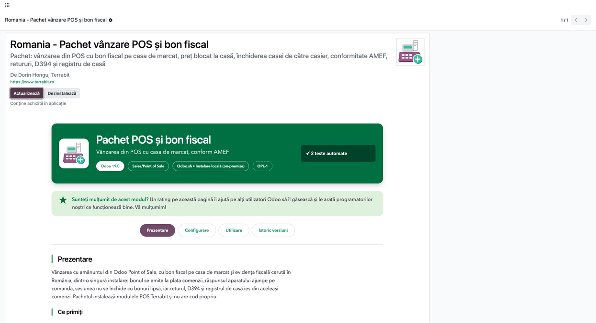

### Pasul 2 — Casa de marcat

Accesați **Punct de vânzare → Configurare → Setări**, alegeți punctul de vânzare și coborâți la
secțiunea **Casa de marcat**:

1. **Tip casa marcat** — protocolul aparatului (în demo, *FiscalWire*, pentru casele Datecs);
2. **ECR transport** — *Terrabit Connect (local agent)*. Pe *File* aparatul nu întoarce niciun
   răspuns, iar comenzile rămân „de fiscalizat”;
3. **Agent URL** — adresa agentului local (implicit `http://127.0.0.1:8765`), afișată imediat după
   etichetă.

O parte din etichetele acestei secțiuni sunt încă în engleză (*ECR transport*, *File prefix*,
*File extension*).

Salvați.

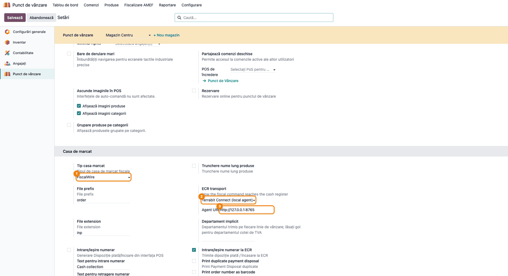

### Pasul 3 — Codul ECR al metodelor de plată

Accesați **Punct de vânzare → Configurare → Metode de plată**, deschideți fiecare metodă și completați
**Cod ECR** așa cum îl așteaptă aparatul (de regulă 1 pentru numerar, 2 pentru card). Dacă aparatul
lucrează cu categorii de TVA, completați **Cod ECR** și pe taxe. Pe același formular, verificați
**Tip de plată AMEF** (Numerar, Card…): de el depinde defalcarea pe tipuri de plată din raportul Z;
se completează singur la metodele obișnuite, dar se verifică la cele adăugate de dumneavoastră.

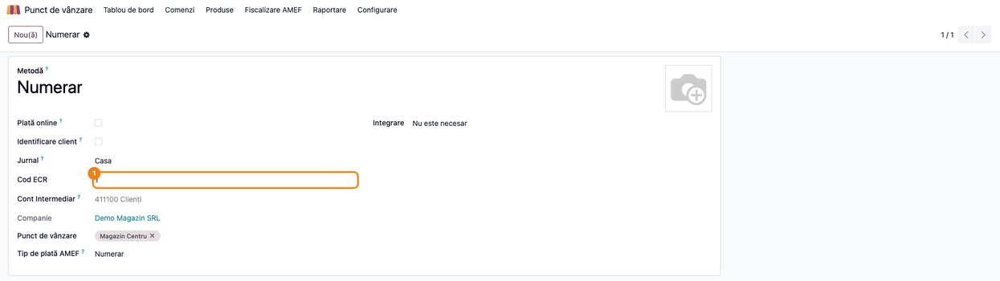

### Pasul 4 — Conformitatea fiscală AMEF

În aceleași setări ale punctului de vânzare, secțiunea **Conformitate fiscală RO (AMEF)**:

1. **Serie aparat fiscal (AMEF)** — seria casei; devine seria bonului emis;
2. **NUI aparat fiscal (AMEF)** — cele 10 cifre din fișierele exportate pentru ANAF (nu seria
   tipărită pe casă), pentru potrivirea cu jurnalul electronic;
3. **Fiscalizare AMEF obligatorie** — bifați-o după ce primele bonuri ajung „Bon emis”. Cu ea
   activă, sesiunea nu se închide cât timp există comenzi plătite fără bon.

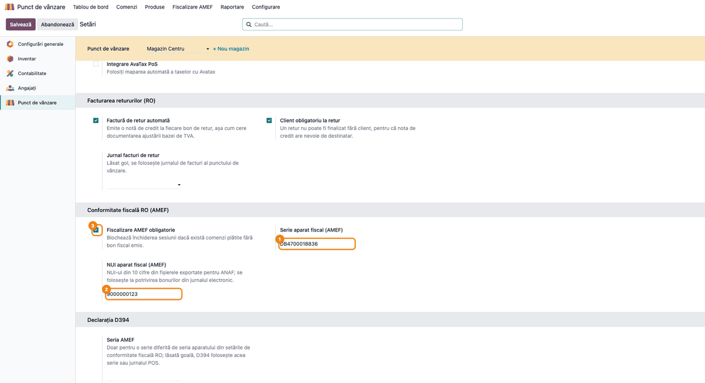

### Pasul 5 — Seria AMEF pentru D394

Tot în **Punct de vânzare → Configurare → Setări**, cu punctul de vânzare ales în bara de sus (fără el, blocul nu apare), imediat sub conformitatea AMEF, blocul **Declarația D394** are câmpul **Seria AMEF**. D394 numără casele de marcat după seria aparatului,
luată în această ordine:

1. **Seria AMEF** de aici, dacă e completată;
2. altfel, **Serie aparat fiscal (AMEF)** de la pasul 4;
3. altfel, jurnalul POS, ca aproximare.

Cu seria completată la pasul 4, lăsați **Seria AMEF** goală: D394 o preia de acolo. O completați doar dacă, pentru
D394, aparatul trebuie raportat cu o serie diferită.

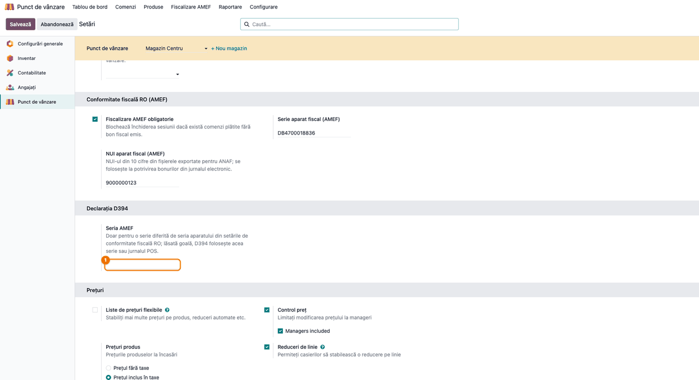

### Pasul 6 — Facturarea retururilor

Înapoi în **Punct de vânzare → Configurare → Setări**, secțiunea **Facturarea retururilor (RO)**,
bifați împreună **Factură de retur automată** și **Client obligatoriu la retur**. Opțional, alegeți
un **Jurnal facturi de retur** separat; lăsat gol, se folosește jurnalul de facturi al punctului de
vânzare. Nu lăsați doar clientul obligatoriu bifat: casa ar bloca retururile fără client fără să
emită factura.

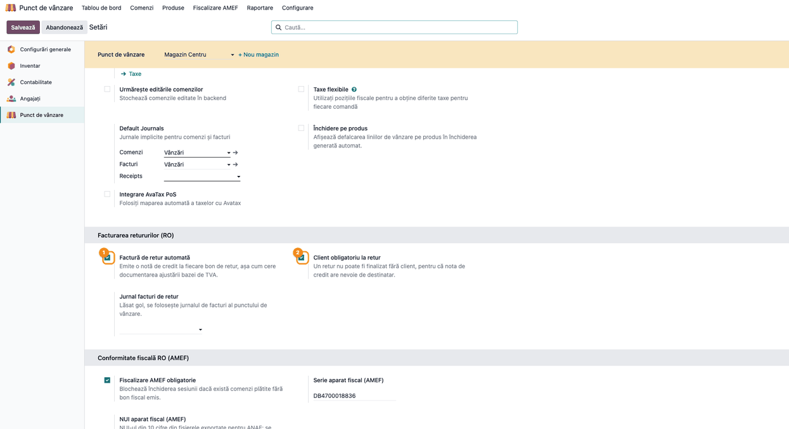

### Pasul 7 — Prețul blocat la casă

Tot în **Punct de vânzare → Configurare → Setări**, secțiunea **Prețuri**:

1. bifați **Control preț** — restricția Odoo: doar managerii pot schimba prețul pe bon;
2. bifați **Managers included**, apărută imediat dedesubt (eticheta e încă în engleză): prețul nu-l mai poate schimba
   nimeni la casă, nici managerii. Tasta *Preț* de pe tastatura casei rămâne dezactivată.

Listele de prețuri, pozițiile fiscale și taxele incluse în preț funcționează în continuare; doar schimbarea manuală e
blocată. Un preț greșit se corectează pe produs. Dacă sesiunea e deschisă, reîncărcați casa: setarea se citește la
deschiderea ei. Blocarea e făcută pe ecranul casei; serverul nu reverifică prețul comenzilor.

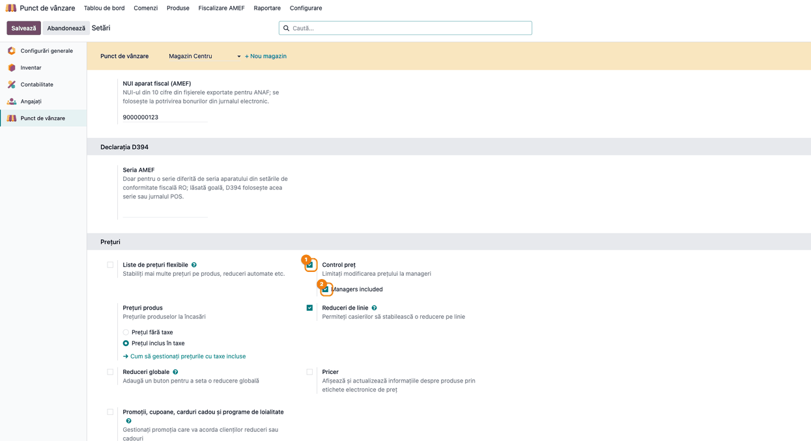

### Pasul 8 — Închiderea casei de către casier

În secțiunea **Interfață PoS**, cu **Autentificare cu angajați** activă și angajații cu *Drepturi de bază* aleși,
**Cashiers Close the Register** e bifată implicit (eticheta e încă în engleză). Casierul de pe tură găsește *Închide
casa* în meniul casei, fără să primească celelalte drepturi de manager (intrări și ieșiri de numerar, modificarea
plăților, schimbarea prețului). Cu *Setați diferența maximă*, o diferență de numerar peste limita admisă cere în
continuare un manager. Debifați opțiunea pe casele unde închiderea rămâne la manager.

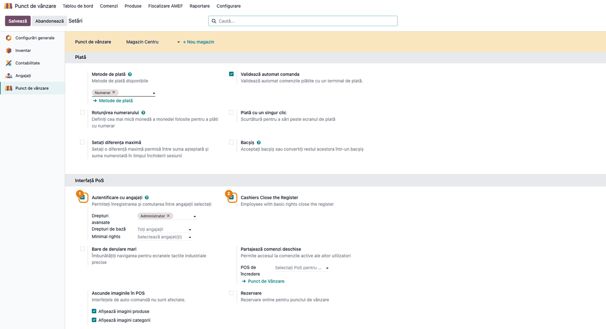

### Pasul 9 — Vânzarea și bonul fiscal

Casierul deschide sesiunea, adaugă produsele și validează plata. Bonul pleacă spre casa de marcat
prin Terrabit Connect, iar răspunsul aparatului se salvează pe comandă. Deschideți comanda din
**Punct de vânzare → Comenzi → Comenzi**, fila **Fiscalizare AMEF**:

1. **Găsiți pe ecran**: *Stare fiscalizare*, sub *Client*, iar în fila *Fiscalizare AMEF* seria,
   numărul bonului fiscal, *Dată/oră fiscală* și raportul Z.
2. **Verificați**: starea e *Bon emis*, seria e cea a casei din pasul 4, numărul bonului e numărul
   documentului fiscal întors de aparat (în demo, 59), iar *Eroare fiscalizare* e goală.
3. Dacă starea e *Eroare*, mesajul aparatului apare în *Eroare fiscalizare*: reemiteți bonul sau,
   dacă bonul a fost emis manual, bifați *Eroare justificată*.

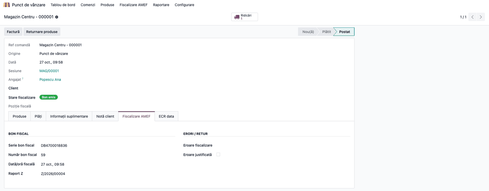

### Pasul 10 — Returul și factura de retur

La retur, casierul selectează cumpărătorul (obligatoriu, cu adresa completă) și finalizează bonul de
retur. Casa de marcat nu înregistrează vânzări negative: driverul trimite returul ca **dispoziție de
plată** (ieșire de numerar), nu ca bon fiscal. Documentul fiscal al returului este **factura de
retur**, emisă și postată automat la finalizare. O găsiți din bonul de retur sau în **Contabilitate →
Clienți → Note credit**, fila **Elemente jurnal**:

1. **Găsiți pe ecran**: clientul, liniile pe 707, 4427 și 4111 și banda *Inversat*.
2. **Verificați**: clientul e cel de pe bon, cu adresa completă; nota e un storno în roșu al vânzării,
   cu sumele cu minus (în demo, 707: −450,00, 4427: −94,50, 4111: −544,50 lei, TVA 21%). Banda
   *Inversat* e normală: nota de credit e stinsă de nota de plată POS a returului (plata facturii
   în numerar). În fila *Linii factură* sumele apar pozitive, ca pe orice notă de credit.

Dacă aveți instalat și modulul de casierie (`l10n_ro_cash_bank_enhanced`), bonul de retur are butonul
**Dispoziție de casă**, pentru documentul de plată al numerarului restituit.

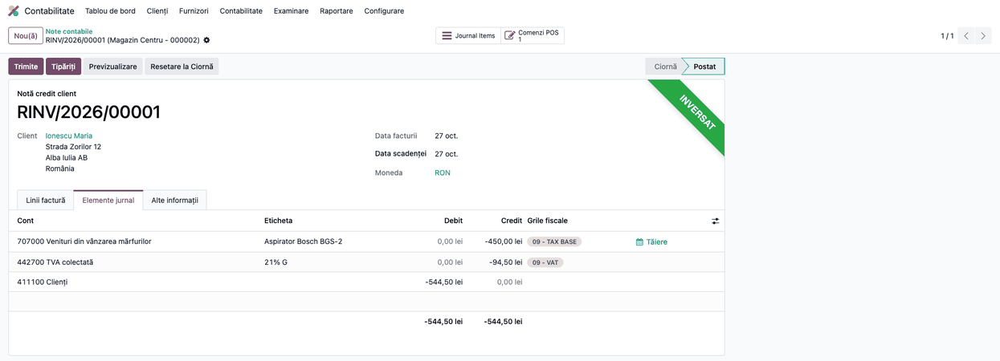

### Pasul 11 — Închiderea zilei și raportul Z

Pe parcursul zilei, intrările și ieșirile de numerar se fac din casă, cu butonul **Intrare/Ieșire numerar**, și se
tipăresc pe casa de marcat. La închidere, deschideți sesiunea din **Punct de vânzare → Comenzi → Sesiuni**: butonul
**Tipărire X** tipărește raportul X (sesiune deschisă), iar **Tipărire Z** raportul Z, pe casa de marcat. În Odoo, creați raportul Z al sesiunii din
**Punct de vânzare → Fiscalizare AMEF → Rapoarte Z**, completați **Număr raport Z (AMEF)** și apăsați **Calculează din
sesiune**. Apoi introduceți manual cifrele de pe raportul Z tipărit:

- **Total declarat (raport Z)** — totalul raportului Z;
- în fila **Defalcare pe tipuri de plată**, suma declarată pe fiecare tip de plată (numerar, card…).

Fără ele, *Reconciliază* trece raportul în discrepanță. Apoi citiți ecranul:

1. **Găsiți pe ecran**: *Bonuri*, *Total calculat (POS)*, *Total declarat (raport Z)*, *Diferență
   total*, *Retururi (în afara aparatului)*, *Diferență plăți* și fila *Defalcare pe cote TVA*.
2. **Verificați**: *Diferență total* și *Diferență plăți* sunt 0,00; defalcarea pe cote arată baza și
   TVA-ul calculate din POS (în demo, 1.350,00 + 283,50 = 1.633,50 lei la 21%). Coloanele declarate
   ale defalcării pe cote (*Total declarat*, *TVA declarat*) rămân goale aici: se completează la
   importul jurnalului electronic. Returul apare separat, la *Retururi (în afara aparatului)*
   (−544,50 lei), pentru că nu trece prin aparat; *Bonuri* numără toate comenzile sesiunii, inclusiv
   returul.
3. Abia apoi apăsați **Reconciliază**, apoi închideți sesiunea. Dacă există comenzi plătite fără bon,
   închiderea sesiunii se oprește cu lista lor.

Jurnalul electronic exportat din aparat se importă periodic din **Punct de vânzare → Fiscalizare AMEF → Jurnale
electronice AMEF**, unde bonurile se potrivesc cu comenzile pe numărul Z și numărul bonului (fluxul
complet e în fișa modulului `l10n_ro_pos_fiscal_compliance`).

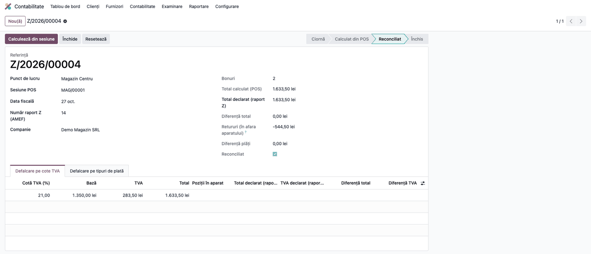

### Pasul 12 — Nota de închidere a sesiunii

La închiderea sesiunii, Odoo postează nota sesiunii în jurnalul de vânzări, cu referința sesiunii
(în demo, MAG/00001). O găsiți în **Contabilitate → Contabilitate → Note contabile**, căutând după
referința sesiunii:

1. **Găsiți pe ecran**: liniile pe 707 și 4427 (vânzarea), liniile pe 4111 cu eticheta sesiunii și a
   metodei de plată și linia *Din încasarea facturii*.
2. **Verificați**: 707 + 4427 = vânzările sesiunii (1.350,00 + 283,50 lei); 4111 are pe debit
   încasarea vânzării (1.633,50 lei) și, separat, pe credit restituirea returului (544,50 lei), nu o
   singură sumă netă; linia *Din încasarea facturii* (Dr 4111 intermediar, 544,50 lei, fără partener)
   închide contul intermediar pentru returul facturat. Nota e echilibrată (2.178,00 lei pe fiecare
   parte).

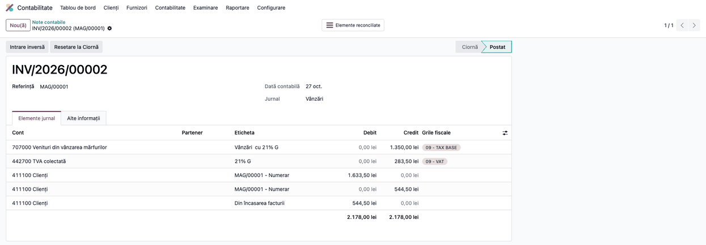

### Pasul 13 — Registrul de casă

Accesați **Contabilitate → Raportare → Rapoarte de extras → Registru de casă**, alegeți perioada și
jurnalul de numerar și desfășurați ziua:

1. **Găsiți pe ecran**: secțiunea zilei, rândul *Report (sold ziua precedentă)*, liniile de casă ale
   sesiunii, cu *Încasări*, *Plăți* și *Cont corespondent*, și rândul *Sold final (report ziua
   următoare)*.
2. **Verificați**: încasările sesiunii și restituirile de retur sunt pe rânduri separate (în demo,
   1.633,50 lei încasări și 544,50 lei plăți), nu o singură sumă netă; soldul final = report +
   încasări − plăți (1.089,00 lei); contul corespondent e 4111.
3. Abia apoi exportați cu **PDF** sau **XLSX** din bara raportului.

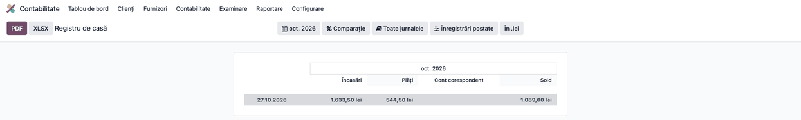

### Pasul 14 — Declarația D394

Accesați **Contabilitate → Raportare → Declarații ANAF → Declarație 394** (se deschide jurnalul TVA vânzări) și alegeți
luna declarată; implicit e luna trecută.

1. **Găsiți pe ecran**: în bara raportului, butoanele **D394 file XML (Soft J)** și **D394 file XDP (Soft A)**, lângă
   PDF și XLSX. Bonurile POS nefacturate nu apar ca rânduri în jurnal: modulul D394 POS le adaugă la generarea
   declarației, agregate pe cote, cu numărul de bonuri și de aparate (după seria de la pașii 4–5).
2. **Verificați**: perioada e luna declarată; facturile emise din POS și facturile de retur apar în jurnal ca documente
   obișnuite; nota de închidere a sesiunii nu se numără a doua oară.
3. Apăsați **D394 file XML (Soft J)** și treceți fișierul prin **validatorul DUK** înainte de depunere. Până la
   rezolvarea issue-ului terrabit-solutions/l10n_ro_ent#952, secțiunea bonurilor POS poate fi respinsă de validator
   (vezi §2).

Captura arată bara raportului cu cele două butoane de export.

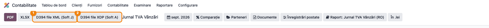

### Note de monografie și raportare

- **Vânzarea la casa de marcat** (nota de închidere a sesiunii): **Dr 4111 = Cr 707 + Cr 4427**
  (1.633,50 = 1.350,00 + 283,50);
- **Încasarea în numerar** (jurnalul de casă): **Dr 5311 = Cr 4111** (1.633,50);
- **Factura de retur**, storno în roșu al vânzării: **Dr 4111 = Cr 707 + Cr 4427**, cu sumele în
  minus (−544,50 = −450,00 − 94,50). Cifra de afaceri scade direct prin rulajul creditor al 707;
- **Stingerea notei de credit**, prin nota de plată POS a facturii de retur: **Dr 4111 (client) =
  Cr 4111 (intermediar POS)** (544,50); în nota sesiunii, linia *Din încasarea facturii*
  (Dr 4111 intermediar, fără partener) închide contul intermediar;
- **Restituirea numerarului** (jurnalul de casă): **Dr 4111 = Cr 5311** (544,50), pe rândul de plăți
  al registrului de casă;
- **Stocul**, doar cu evaluare perpetuă pe categorie: descărcarea la vânzare **Dr 607 = Cr 371** și
  reintrarea la retur, storno în roșu al descărcării, la costul articolului;
- **D300**: TVA-ul vânzărilor și al facturilor de retur intră prin taxele de pe note; returul reduce
  TVA-ul colectat;
- **D394**: încasările prin casa de marcat se raportează agregat, cu numărul de bonuri și de aparate;
  facturile către clienți cu CUI sunt în livrările pe facturi. Preluarea bonurilor POS și a
  retururilor facturate către persoane fizice este **de verificat cu validatorul DUK** până la
  rezolvarea issue-ului terrabit-solutions/l10n_ro_ent#952.

## 7. Legături cu alte module / declarații

| Modul / proces | Rol în flux | Tip legătură |
|---|---|---|
| `deltatech_pos` (+ `deltatech_pos_base`, `deltatech_ecr_connect`, `deltatech_ecr_fiscal`) | trimite bonul la casa de marcat prin Terrabit Connect, rapoarte X / Z, intrări și ieșiri de numerar | dependență (manifest) |
| `deltatech_pos_price_lock` | prețul blocat la casă, inclusiv pentru manageri | dependență (manifest) |
| `deltatech_pos_cashier_close` (+ `pos_hr`) | casierul își închide singur casa | dependență (manifest) |
| `l10n_ro_pos_fiscal_compliance` | starea bonului, blocarea sesiunii, raportul Z, jurnalul electronic AMEF | dependență (manifest) |
| `l10n_ro_pos_fiscal_compliance_ecr` | duce răspunsul casei de marcat în starea fiscală AMEF | dependență (manifest) |
| `l10n_ro_pos_returns` | factura de retur, clientul obligatoriu, separarea restituirilor în registrul de casă | dependență (manifest) |
| `l10n_ro_anaf_d394_pos` (+ `l10n_ro_anaf_d394`) | bonurile din POS în D394 | dependență (manifest) |
| `l10n_ro_cash_register_report` | registrul de casă ca raport pe interval (Enterprise) | dependență (manifest) |
| `l10n_ro_cash_register` (suita `l10n-romania`) | registrul de casă ca document numerotat | opțional, se poate instala alături |

Ce e automat: trimiterea bonului și salvarea răspunsului casei pe comandă, starea *Bon emis* /
*Eroare*, blocarea sesiunii fără bonuri, factura de retur, separarea încasărilor de restituiri,
preluarea bonurilor în D394 (de verificat cu validatorul DUK, vezi §2).
Ce rămâne manual: instalarea agentului Terrabit Connect, setările fiecărei case (pașii 2–8), crearea și reconcilierea raportului Z, importul jurnalului
electronic.

## 8. Verificări pentru consultant

- [ ] Pachetul se instalează fără erori, cu toate modulele incluse.
- [ ] Pe fiecare punct de vânzare: transportul ECR e *Terrabit Connect*, metodele de plată au Cod ECR,
      seria și NUI-ul AMEF sunt completate, iar Seria AMEF pentru D394 e goală sau, dacă e completată,
      e seria cu care aparatul trebuie raportat în D394.
- [ ] Cu *Control preț* și *Managers included* bifate, tasta *Preț* e dezactivată la casă pentru orice utilizator,
      iar lista de prețuri a clientului se aplică în continuare.
- [ ] Un casier cu drepturi de bază vede *Închide casa* în meniul casei și închide sesiunea.
- [ ] O vânzare de probă ajunge pe comandă cu *Stare fiscalizare* = *Bon emis*, seria casei și
      numărul bonului.
- [ ] Un retur fără client este refuzat la casă; cu client, casa tipărește dispoziția de plată și se
      emite factura de retur postată, storno în roșu, cu TVA pe cota articolului.
- [ ] Închiderea unei sesiuni cu o comandă plătită fără bon este refuzată, cu lista comenzilor.
- [ ] După introducerea totalului și a sumelor pe tipuri de plată de pe raportul Z tipărit, raportul Z
      are *Diferență total* și *Diferență plăți* 0,00.
- [ ] Nota de închidere a sesiunii e echilibrată și are încasarea și restituirea pe linii 4111
      separate.
- [ ] *Separă încasările de restituirile POS în numerar* e bifată în setările contabile, secțiunea
      *Registrul de casă (RO)*.
- [ ] Registrul de casă arată încasările și restituirile pe rânduri separate, iar soldul final = report
      + încasări − plăți.
- [ ] Arhiva jurnalului electronic exportată din aparat se importă cu **Importă arhiva** în **Punct de vânzare →
      Fiscalizare AMEF → Jurnale electronice AMEF**, iar bonurile se potrivesc cu comenzile pe numărul Z și numărul
      bonului; discrepanțele rămase sunt lămurite înainte de **Arhivează**.
- [ ] XML-ul D394 pe luna de probă trece de validatorul DUK și are numărul de bonuri și de aparate
      așteptat (până la rezolvarea issue-ului #952, rezultatul poate fi respins).
- [ ] Testul pachetului trece: `--test-tags=/l10n_ro_pos_pack`.

## 9. Mesaje de eroare frecvente

| Mesaj / simptom | Cauză probabilă | Remediere |
|---|---|---|
| Comenzile rămân „de fiscalizat” deși bonul s-a tipărit | Transportul ECR e pe *File*, deci aparatul nu întoarce răspuns | Treceți transportul pe *Terrabit Connect* și porniți agentul |
| Stare *Eroare*, cu mesajul aparatului în *Eroare fiscalizare* | Bonul a fost anulat la casă sau tipărirea a eșuat | Reemiteți bonul; dacă a fost emis manual, bifați *Eroare justificată* |
| „Nu se poate închide sesiunea …: … comenzi plătite nu au bon fiscal emis.” | Comenzi plătite fără bon, cu fiscalizarea obligatorie activă | Emiteți bonul sau marcați eroarea ca justificată pe comenzile listate |
| „Bonul de retur … nu are client. Nu se poate emite o factură de retur fără destinatar…” | Retur finalizat fără client | Selectați cumpărătorul pe bon și reluați |
| „The contact «…» on return receipt … is missing: county, street…” (mesaj încă netradus) | Contactul clientului e incomplet | Completați țara, județul, orașul și strada |
| „«…» is a collective contact for anonymous receipts and cannot be the buyer…” (mesaj încă netradus) | S-a ales contactul folosit pentru vânzările anonime | Identificați persoana care aduce marfa înapoi; factura se emite pe numele ei |
| Raportul Z trece în discrepanță la *Reconciliază* | *Total declarat* sau sumele pe tipuri de plată nu au fost introduse | Completați-le de pe raportul Z tipărit, apoi reconciliați |
| „Fișierele provin de la aparatul fiscal cu NUI …, dar acest jurnal este setat pentru NUI …” | Exportul e de la altă casă sau NUI-ul de pe punctul de vânzare e greșit | Alegeți punctul de vânzare al casei respective sau corectați NUI-ul (pasul 4) |
| „Fișierul atașat nu este nici arhivă .zip, nici fișier AMEF semnat (.p7b).” | Fișierul importat nu e exportul aparatului | Importați arhiva `.zip` originală sau un fișier `.p7b` exportat de casă |
| D394 numără jurnale POS, nu aparate | Nicio serie pe punctul de vânzare: *Serie aparat fiscal (AMEF)* (pasul 4) și *Seria AMEF* (pasul 5) sunt goale | Completați *Serie aparat fiscal (AMEF)* la pasul 4 |
| D394 numără o casă de două ori | Aceeași casă are serii diferite pe două puncte de vânzare (de exemplu, *Seria AMEF* completată greșit pe unul) | Lăsați *Seria AMEF* goală sau corectați-o, ca aceeași casă să aibă aceeași serie |
| D394 numără o serie veche, care nu se mai vede în setări | *Serie aparat fiscal (AMEF)* a rămas completată după ce s-a debifat *Fiscalizare AMEF obligatorie*; câmpul e ascuns, dar valoarea se folosește | Bifați temporar *Fiscalizare AMEF obligatorie*, corectați seria, apoi debifați; sau completați *Seria AMEF*, care are prioritate |
| Restituirile apar cumulat cu încasările în registrul de casă | Sesiunea fusese închisă înainte de activarea separării | Separarea se aplică sesiunilor închise după activare |

## 10. Capturi de ecran

Capturile din `static/description/` sunt **generate automat** din `tests/test_screenshots.py`
(mixinul `ScreenshotCase` din `l10n_ro_doc_screenshots`, import defensiv), în limba română, pe planul
de conturi RO, cu un singur punct de vânzare configurat cu toate modulele pachetului:

1. `01_instalare_pachet.png` — pagina pachetului în Aplicații.
2. `02_setari_casa_marcat.png` — tipul casei de marcat, transportul Terrabit Connect și adresa agentului.
3. `03_metoda_plata_cod_ecr.png` — metoda de plată Numerar cu Cod ECR.
4. `04_setari_amef.png` — seria și NUI-ul aparatului, fiscalizarea AMEF obligatorie.
5. `05_serie_amef_d394.png` — câmpul Seria AMEF din blocul Declarația D394 al setărilor, gol (seria vine din
   conformitatea AMEF).
6. `06_setari_retururi.png` — factura de retur automată și clientul obligatoriu.
7. `07_pret_blocat.png` — *Control preț* și *Managers included*.
8. `08_inchidere_casier.png` — *Autentificare cu angajați* și *Cashiers Close the Register*.
9. `09_comanda_bon_emis.png` — comanda POS cu bonul fiscal emis.
10. `10_factura_retur.png` — factura de retur emisă automat, cu elementele jurnal.
11. `11_raport_z.png` — raportul Z reconciliat cu sesiunea.
12. `12_nota_inchidere_sesiune.png` — nota de închidere a sesiunii.
13. `13_registru_casa.png` — registrul de casă cu încasarea și restituirea separate.
14. `14_d394_export.png` — jurnalul TVA vânzări cu butoanele de export D394.

Regenerare (doar clasa pachetului, ca să nu se rescrie capturile modulelor incluse):

```bash
./odoo/odoo-bin -c odoo.conf -d <db> -i l10n_ro_pos_pack,l10n_ro_doc_screenshots \
    --test-tags=/l10n_ro_pos_pack:TestPosPackScreenshots --stop-after-init
```

## 11. Observații pentru manual

Prezentați pachetul ca setul de pornire al unui magazin cu casă de marcat: instalarea e o singură
mișcare, dar fiecare casă se configurează separat (pașii 2–8), iar agentul Terrabit Connect trebuie
să ruleze pe calculatorul casei. Insistați pe ordinea de punere în funcțiune: întâi transportul
*Terrabit Connect* și câteva bonuri de probă ajunse „Bon emis”, abia apoi **Fiscalizare AMEF
obligatorie** — altfel prima închidere de sesiune se blochează. Semnalați că seria aparatului se
introduce o singură dată, în conformitatea AMEF (D394 o preia de acolo), că returul se tipărește pe casă ca dispoziție
de plată, iar documentul lui fiscal este factura de retur, și că D394 din bonuri se verifică cu DUK
până la rezolvarea issue-ului #952. Detaliile fiecărei părți (importul jurnalului
electronic, emiterea retroactivă a facturilor de retur, registrul de casă pe mai multe zile) rămân
în fișele modulelor incluse.
