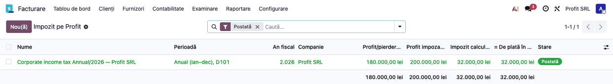
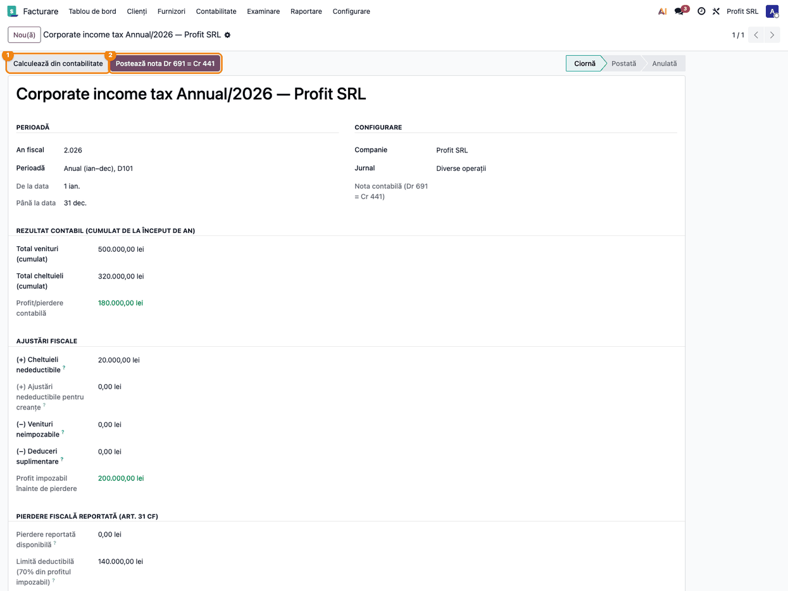
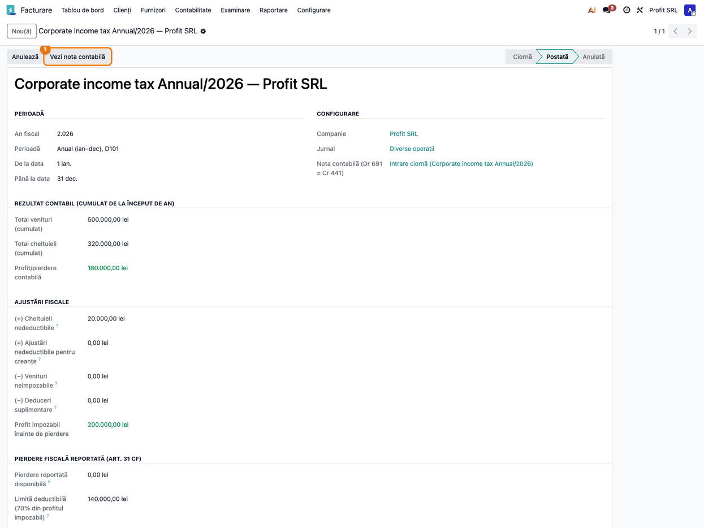
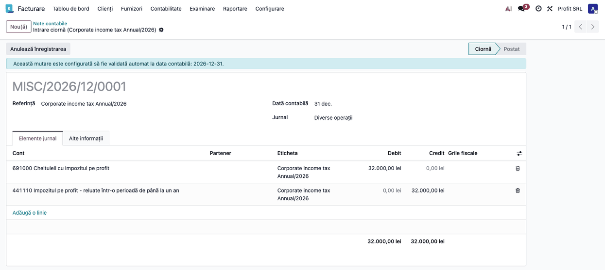
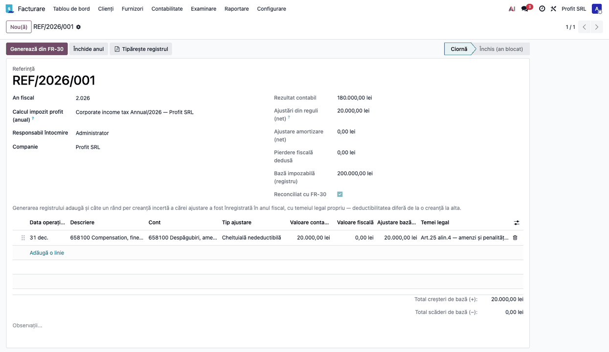

# Fișă Modul: Impozit pe Profit (D100/D101)

**Poziție plan:** B3.3
**Modul:** `l10n_ro_profit_tax`
**FR:** FR-30
**Capitol manual:** Cap 3.5
**Utilizator principal:** Responsabil fiscal, Contabil șef
**Prioritate:** 🟡 Medie (doar firme plătitoare profit)

---

## 1. Scop business

Această fișă descrie utilizarea modulului `l10n_ro_profit_tax` pentru scenariul **Impozit pe Profit (D100/D101)**.
Consultantul folosește documentul pentru reproducerea fluxului în baza demo și
pentru pregătirea capitolului Cap 3.5 din manualul utilizator.

## 2. Bază legală și context

Codul Fiscal Titlul II — 16% impozit profit; ajustări nedeductibile/neimpozabile

Registrul de evidență fiscală: art. 19 alin. (7) Cod fiscal, pct. 8 din Normele metodologice
(Titlul II) aprobate prin HG 1/2016 și **OMF 808/2026** (MO nr. 556 din 7 iulie 2026), care a abrogat OMFP 870/2005. Modelul
din anexa ordinului are trei coloane — Nr. crt., Explicații, Valoarea (lei) — și este obligatoriu și
în forma electronică (art. 5).

## 3. Utilizatori și roluri

Contabil, Responsabil Fiscal

Roluri recomandate pentru testare:
- Administrator funcțional: instalează modulul și verifică meniurile
- Utilizator operațional: rulează fluxul zilnic sau lunar
- Contabil/manager: validează rezultatele contabile și rapoartele

## 4. Conturi și date implicate

691 (cheltuieli impozit profit), 441 (impozit profit de plată); citite din rulaje: clasele 6 și 7,
121 (doar pentru a recunoaște notele de închidere), 691/692/694/697 (impozit pe profit), 6231
(protocol), 6811 (amortizare), 6582 (sponsorizare), conturile financiare 76x/786 și 663–668/686.

Date minime pentru demo:
- companie românească cu localizarea contabilă instalată
- perioadă contabilă deschisă
- jurnale și conturi configurate conform scenariului
- documente de test postate, acolo unde fluxul pornește din contabilitate, stocuri, HR sau vânzări

## 5. Configurare inițială

1. Instalați modulul `l10n_ro_profit_tax` pe baza demo.
2. **Contabilitate → Configurare → Setări**, blocul **Impozit pe profit (RO)**:
   - **Ajustări fiscale →** — regulile per cont (amenzi 6581, dividende 761 etc.).
     Nu e nevoie de reguli pe 691, 692, 694, 697, 6231 sau 6582: calculul le preia singur, iar regulile pe
     aceste conturi sunt ignorate, ca suma să nu se numere de două ori.
   - **Conturi financiare D101** — prefixele conturilor de venituri financiare (implicit 761, 762,
     763, 764, 765, 766, 767, 768, 786) și de cheltuieli financiare (implicit 663, 664, 665, 666, 667, 668,
     686), separate prin virgulă; un prefix cuprinde și analiticele (766 → 766.01).
   - **Pierderi reportate →** — pierderile fiscale din anii anteriori.
3. Pregătiți un jurnal de operațiuni diverse pentru nota de impozit și un set minim de documente
   postate pentru perioada de test.
4. Verificați că utilizatorul de test are grupurile de acces necesare.

## 6. Flux de utilizare

### Pasul 1 — Lista calculelor de impozit pe profit

Accesați **Contabilitate → Contabilitate → Impozit pe Profit**. Lista afișează calculele, cu profitul
contabil, profitul impozabil, impozitul calculat și suma de plată per perioadă (T1–T3 cumulate = D100,
Anual = D101).



Apăsați **Nou** și alegeți **anul fiscal**, **perioada** și **jurnalul** de operațiuni diverse.

---

### Pasul 2 — Calculul rezultatului fiscal

Apăsați **Calculează din contabilitate** ①. Modulul citește **rulajele** de la 1 ianuarie (YTD), nu
soldurile, și lasă deoparte **notele de închidere pe 121** (orice notă care are o linie pe contul 121).
Astfel, închiderea lunară a conturilor de venituri și cheltuieli nu golește calculul. Se completează:
- **veniturile** și **cheltuielile** din conturile de clasa 7, respectiv 6, cu **din care venituri /
  cheltuieli financiare** pe prefixele din setări (D101 rd. 4 și 5). Cât calculul e în ciornă, aceste
  câmpuri se pot corecta manual, dar un nou **Calculează din contabilitate** le suprascrie; pentru o
  corecție permanentă schimbați prefixele din setări;
- **ajustările fiscale** configurate per cont (nedeductibile, neimpozabile, deduceri suplimentare);
- **(+) Cheltuieli cu impozitul pe profit** — rulajul 691, 692, 694, 697 (D101 rd. 23), cheltuială
  nedeductibilă; se poate corecta manual;
- grupul **Cheltuieli de protocol** — rulajul 6231, **limita deductibilă** = 2% × (profit contabil +
  impozit pe profit + protocol), 0 dacă baza e ≤ 0, și **partea nedeductibilă** = protocol − limită
  (D101 rd. 26);
- grupul **Amortizare** — **amortizarea contabilă** (rulajul 6811, D101 rd. 28) și **amortizarea
  fiscală** (D101 rd. 11), egală implicit cu cea contabilă. Dacă modificați amortizarea fiscală, se
  bifează **Amortizare fiscală modificată manual** și un nou calcul nu o mai suprascrie; debifați ca să
  se preia din nou cea contabilă. Rândurile „din care” se completează **manual**, numai dacă firma are
  astfel de active, cu amortizarea fiscală integrală (deducerea dintr-o dată) inclusă în rd. 11:
  - *din care: mijloace fixe pentru prevenirea accidentelor* (rd. 11.1) — mijloacele fixe destinate
    prevenirii accidentelor de muncă și bolilor profesionale;
  - *din care: mijloace fixe pentru cabinete medicale* (rd. 11.2) — mijloacele fixe pentru înființarea
    și funcționarea cabinetelor medicale;
  - *din care: mijloace fixe sub limita valorică* (rd. 11.3) — mijloacele fixe a căror valoare fiscală
    la intrare a fost sub limita stabilită prin hotărâre a Guvernului.

  Suma lor nu poate depăși rd. 11 (validatorul ANAF verifică rd. 11 ≥ 11.1 + 11.2 + 11.3);
- **(+) Cheltuieli cu sponsorizarea** — rulajul 6582, adăugat automat la baza impozabilă (D101 rd. 27)
  și folosit la creditul de sponsorizare, împreună cu **cifra de afaceri** netă (701–708 minus 709);
- baza pentru **pierderea reportată** (limita 70%), plus **Pierdere de recuperat la începutul anului** (soldul la 1 ianuarie, fără pierderile
  expirate, D101 rd. 39).



Opțional, apăsați **Sugerează deducere pierdere** pentru a aplica FIFO pierderile reportate (în limita
a 70% din profitul impozabil, art.31 CF). Rezultatul: `Bază impozabilă × 16% = Impozit calculat`,
ajustat cu creditul de sponsorizare și impozitul datorat pentru trimestrele anterioare → **De plată**.

Baza impozabilă, impozitul, creditul de sponsorizare și suma de plată sunt **în lei întregi**, rotunjite
0,50 în sus (7.440,49 → 7.440; 7.440,50 → 7.441), ca în declarație: baza se adună din aceleași
componente rotunjite ca rândurile D101.

---

### Pasul 3 — Postarea notei contabile

Apăsați **Postează nota Dr 691 = Cr 441** ②. Calculul trece în **Postată** și devine readonly, iar
nota se accesează prin **Vezi nota contabilă**.



Nota contabilă înregistrează obligația fiscală, cu suma rotunjită la leu, egală cu impozitul de
plată din declarație (D101 rd. 52, respectiv diferența față de D100). Creditul se înregistrează pe
contul **4411** „Impozitul pe profit”, chiar dacă planul are și alte conturi 441x (4417, 4418); doar
dacă 4411 lipsește se folosește primul cont 441x:



```
Dr 691   32.000 RON   (Cheltuieli cu impozitul pe profit)
  Cr 4411  32.000 RON   (Impozitul pe profit)
```

---

### Pasul 4 — Registrul de evidență fiscală (OMF 808/2026)

Din **Contabilitate → Contabilitate → Registru de evidență fiscală** creați un registru pentru anul
fiscal, selectați calculul anual (D101) și apăsați **Generează din calculul D101**. Registrul listează
ajustările fiscale pe rânduri (cu temei legal) și se **reconciliază** automat cu calculul de impozit.
Pe lângă regulile de ajustare, generarea adaugă trei rânduri luate din calcul, fiecare cu temeiul
legal:

| Rând | Valoare contabilă | Valoare fiscală | Ajustare | Temei |
|---|---|---|---|---|
| **Cheltuieli cu impozitul pe profit (691, 692, 694, 697)** | rulajul conturilor | 0 | + toată suma | art. 25 alin. (4) lit. a) CF |
| **Cheltuieli de protocol peste limita de 2% (6231)** | rulajul 6231 | limita de 2% | + protocolul peste limită | art. 25 alin. (3) lit. a) CF |
| **Cheltuieli cu sponsorizarea (6582)** | rulajul 6582 | 0 | + toată suma | art. 25 alin. (4) lit. i) CF |

Reconcilierea compară ajustările din registru cu: nedeductibile + impozit pe profit + protocol
nedeductibil + sponsorizare − neimpozabile − deduceri suplimentare din calcul.

**Tipărește registrul** produce documentul pe modelul din anexa OMF 808/2026, cu trei coloane:
Nr. crt., Explicații, Valoarea (lei). Rândurile urmăresc trecerea de la rezultatul contabil la
impozit:

1. venituri și cheltuieli pe conturi, cu totalurile lor;
2. rezultatul contabil;
3. ajustările fiscale — în explicație apar contul (după caz), temeiul legal, valoarea contabilă și
   cea fiscală;
4. rezultatul fiscal, pierderea fiscală recuperată și profitul impozabil;
5. impozitul de 16%, sumele scăzute din impozit (sponsorizări), impozitul declarat în perioadele
   anterioare și impozitul de plată (sau de recuperat).

Valorile sunt cu semn; fiecare subtotal se obține din rândurile grupului său. Când rezultatul fiscal
e negativ, pierderea de reportat apare ca rând informativ, iar profitul impozabil este zero.

Două rânduri apar doar când e cazul:

- **Diferență față de calculul D101** sub cheltuieli — s-au postat sau anulat note după rularea
  calculului. Rulați din nou calculul și regenerați registrul înainte de tipărire.
- **Diferență față de baza impozabilă din calculul D101** — de regulă diferența de amortizare:
  registrul o ia pe fiecare activ (art. 28 CF), iar calculul din amortizarea contabilă și fiscală
  (rd. 28 și rd. 11). Rândul arată ce bază s-a folosit pentru impozit; detaliul e în situația analitică.

> ⚠️ **Limită:** modulul produce azi doar registrul **anual**. Plătitorii trimestriali (D100) și
> firmele trecute de la micro la profit în cursul anului nu sunt încă acoperite (vezi ROADMAP).

Tabelul detaliat pe coloane (valoare contabilă, valoare fiscală, ajustare, temei) se tipărește
separat, din meniul de tipărire, ca **Situație analitică a ajustărilor fiscale** — notă de lucru, nu registrul.



La **Închide anul**, registrul devine imutabil (retenție legală).

## 7. Legături cu alte module / declarații

| Modul / proces | Rol în flux |
|---|---|
| `l10n_ro_anaf_d100` / `l10n_ro_anaf_d120` | declararea impozitului |
| `account` | venituri, cheltuieli și note 691/441 |
| `l10n_ro_anaf_d107` | credit sponsorizări |
| `l10n_ro_financial_statements` | corelare rezultat fiscal/contabil |

Ce este automat: calcul YTD din rulaje (fără închiderile pe 121), partea financiară, impozitul pe
profit, protocolul peste limită, amortizarea contabilă, ajustările fiscale configurate, rotunjirea la leu.
Ce rămâne manual: amortizarea fiscală acolo unde diferă de cea contabilă; validarea nedeductibilelor,
neimpozabilelor și pierderilor reportate; TVA colectată pe cadourile de protocol (alt cont decât 6231).

## 8. Verificări pentru consultant

- [ ] Modulul se instalează fără erori pe baza demo.
- [ ] Meniurile și acțiunile sunt vizibile pentru rolul de utilizator potrivit.
- [ ] Fluxul poate fi reprodus de la cap la coadă cu date fictive românești.
- [ ] Rezultatul contabil sau operațional corespunde descrierii din plan.
- [ ] Mesajele de eroare sunt clare pentru un utilizator non-tehnic.
- [ ] Exporturile sau rapoartele se descarcă și conțin datele testate.
- [ ] Cu închidere lunară pe 121, veniturile și cheltuielile din calcul sunt rulajele anului, nu 0.
- [ ] *Din care venituri / cheltuieli financiare* cuprind conturile cu prefixele din setări, inclusiv analiticele.
- [ ] *Cheltuieli cu impozitul pe profit* = rulajul 691 (+ 692, 694, 697); o stornare în credit îl micșorează.
- [ ] O regulă de ajustare pe 691, 6231 sau 6582 nu mai adaugă nimic la *Cheltuieli nedeductibile*.
- [ ] *Cifra de afaceri* = rulajul conturilor 70x (fără 76x, 75x, 78x); sponsorizarea 6582 e adăugată la baza impozabilă.
- [ ] Nota de impozit se înregistrează pe 4411, chiar dacă planul are și alte conturi 441x.
- [ ] Protocolul: limita este 0 când profitul contabil + impozit + protocol e ≤ 0, iar tot protocolul e nedeductibil.
- [ ] Amortizarea fiscală modificată manual rămâne după un nou **Calculează din contabilitate**.
- [ ] Impozitul și nota 691 = 441 sunt în lei întregi (0,50 în sus).
- [ ] Registrul de evidență fiscală are rândurile de impozit pe profit, protocol (valoarea fiscală = limita de 2%) și sponsorizare (6582) și e reconciliat.
- [ ] Diferența de reconciliere e 0 și când există sponsorizare (formula include *Cheltuieli cu sponsorizarea*).

## 9. Mesaje de eroare frecvente

| Mesaj / simptom | Cauză probabilă | Remediere |
|-----------------|-----------------|-----------|
| Meniul nu este vizibil | Utilizatorul nu are grupurile necesare | Verificați drepturile de acces și reîncărcați aplicațiile |
| Nu se generează linii | Lipsesc documente postate în perioada aleasă | Creați și postați datele de test necesare |
| Cont lipsă sau jurnal lipsă | Configurarea contabilă este incompletă | Completați conturile și jurnalele în setările modulului |
| Perioada este blocată | Data documentului este într-o perioadă închisă | Folosiți o perioadă deschisă sau ajustați lock date-ul în demo |

## 10. Capturi de ecran

Capturile (`static/description/`) sunt **generate automat** din `tests/test_screenshots.py`
(mixinul `ScreenshotCase` din `l10n_ro_doc_screenshots`, import defensiv), în **limba română**,
pe planul de conturi RO:

1. `01_lista_calcule.png` — Lista calculelor de impozit pe profit.
2. `02_formular_calcul.png` — Formularul de calcul cu rezultatul fiscal (venituri, cheltuieli, ajustări, bază).
3. `03_declaratie_postata.png` — Calcul postat, cu link către nota contabilă.
4. `04_nota_691_441.png` — Nota contabilă generată: Dr 691 = Cr 441.
5. `05_registru_evidenta_fiscala.png` — Registrul de evidență fiscală, reconciliat cu calculul D101.

Regenerare:

```bash
./odoo/odoo-bin -c odoo.conf -d <db> -i l10n_ro_profit_tax,l10n_ro_doc_screenshots \
    --test-tags=fise_screenshots --stop-after-init
```

## 11. Observații pentru manual

În manualul final, păstrați explicația orientată pe activitatea utilizatorului:
ce problemă rezolvă modulul, când se rulează, ce date trebuie pregătite și cum se verifică rezultatul.
