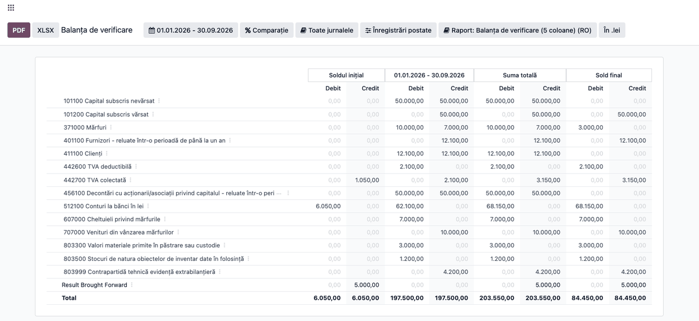
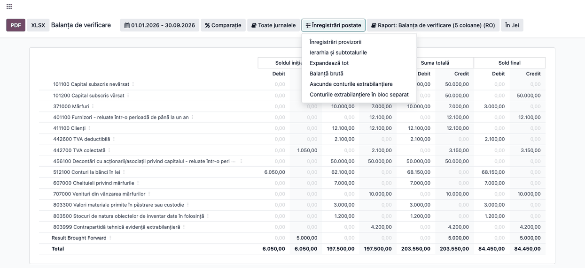
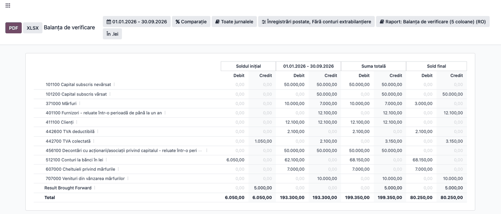
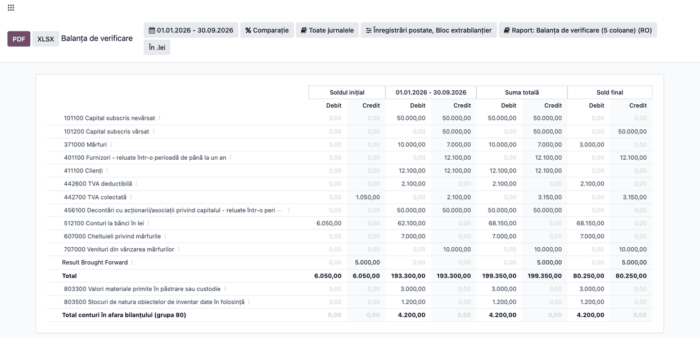
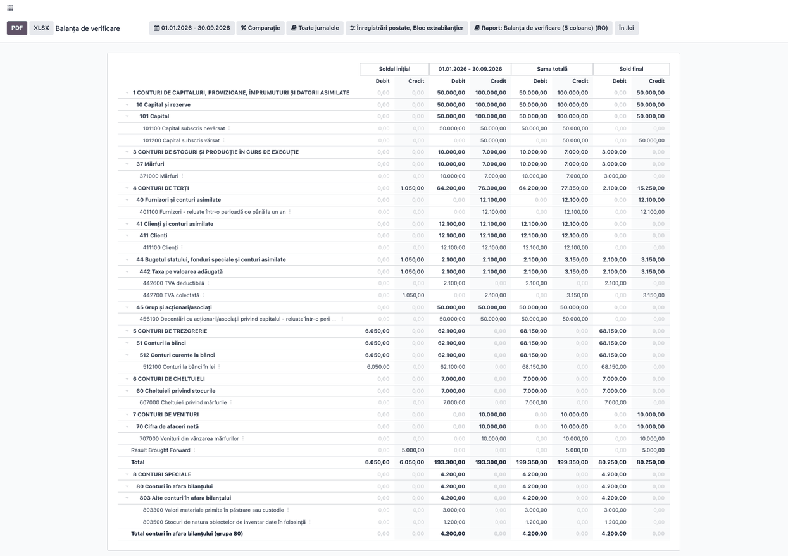
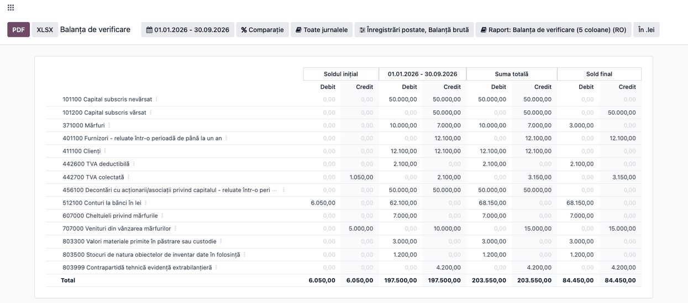
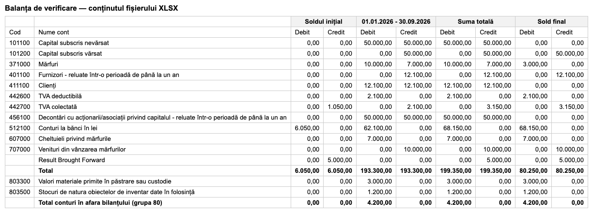

# Fișă Modul: Balanța de verificare RO — solduri corecte și conturi extrabilanțiere

**Poziție plan:** C15
**Modul:** `l10n_ro_reports_fix`
**FR:** FR-43
**Capitol manual:** Cap 11.6
**Utilizator principal:** Contabil, Contabil șef, Consultant raportare
**Prioritate:** 🔴 Ridicată (balanța de verificare se întocmește lunar și stă la baza situațiilor financiare)

---

## 1. Scop business

Modulul corectează balanța de verificare RO (4 și 5 coloane) din `l10n_ro_reports`, astfel încât să poată fi predată contabilului șef sau auditorului fără corecții manuale în Excel.

Modulul face trei lucruri:

- **Sold inițial și sold final pe o singură coloană.** Fiecare cont are soldul inițial și soldul final net, pe Debit sau pe Credit, nu pe ambele. **Suma totală** este soldul inițial net plus rulajele. Totalurile pe grupe și totalul general se recalculează din soldurile conturilor, fără compensare între conturi.
- **Balanță brută.** Opțiunea **Balanță brută** scoate linia tehnică Odoo „Result Brought Forward” și arată soldurile exact cum sunt în conturi.
- **Trei variante pentru conturile extrabilanțiere** (clasa 8): în totalul general (implicit), ascunse sau într-un bloc separat sub total.

### Ce înseamnă fiecare funcționalitate

| Funcționalitate | Ce se schimbă față de balanța standard Odoo | Ce înseamnă pentru contabil | Unde se vede |
|-----------------|---------------------------------------------|-----------------------------|--------------|
| **Sold inițial net** (mereu activ) | Odoo pune la Soldul inițial sumele debitoare și creditoare cumulate până la începutul perioadei, deci un cont poate avea sume pe ambele coloane | Fiecare cont are soldul de deschidere pe o singură coloană, Debit sau Credit, ca în balanța RO. Un client facturat și încasat anul trecut începe cu 0 / 0 | Pasul 1 |
| **Sold final** (mereu activ) | Era deja net pe cont în `l10n_ro_reports` | Modulul corectează grupele (fără compensare) și aplică natura contului, dacă e definită | Pasul 1 |
| **Suma totală recalculată** (mereu activ) | Suma totală pornea de la soldul inițial cumulat | Suma totală = Soldul inițial net + rulajul perioadei; egalitatea Debit = Credit se păstrează | Pasul 1 |
| **Grupe și total fără compensare** (mereu activ) | Grupele și totalul se recalculează din soldurile netate ale conturilor | Pe o grupă, soldurile debitoare și cele creditoare ale conturilor se adună separat: o grupă poate avea sold și pe Debit, și pe Credit (de exemplu 4 Conturi de terți) | Pașii 1 și 5 |
| **Natura contului activ / pasiv** (doar cu `l10n_ro_storno_enhancement`) | — | Contul marcat activ își arată soldul doar pe Debit, cel pasiv doar pe Credit. Un sold „pe partea greșită” apare cu minus (de exemplu un furnizor plătit în avans: −500 pe Credit), ca să iasă în evidență | Secțiunea 7 |
| **Balanță brută** (opțiune) | La începutul fiecărui exercițiu, Odoo mută soldurile din anii precedenți ale conturilor 6xx, 7xx **și 121** pe linia „Result Brought Forward” | Opțiunea oprește această închidere virtuală: fiecare cont își arată soldul real, iar linia „Result Brought Forward” dispare. La firmele care înregistrează notele de închidere, e varianta corectă pentru RO (121 cu soldul lui, 6 și 7 cu zero); altfel, arată notele de închidere lipsă | Pasul 6 |
| **Ascunde conturile extrabilanțiere** (opțiune) | — | Balanța conține doar conturile din bilanț (clasele 1–7); clasele 8 și 9 nu apar nici în linii, nici în totaluri | Pasul 3 |
| **Conturile extrabilanțiere în bloc separat** (opțiune) | — | Grupa 80 apare sub totalul general, cu subtotal propriu, ca evidență în partidă simplă; contrapartida tehnică 803999 nu apare; grupa 89 rămâne în totalul general | Pașii 4 și 5 |
| **Export** | — | PDF și XLSX păstrează varianta aleasă pe ecran | Pasul 7 |

---

## 2. Bază legală și context

- **OMFP 1802/2014, cap. 16 „Funcțiunea conturilor”, Clasa 8 „Conturi speciale”.** Grupa 80 „Conturi în afara bilanțului” se ține **în partidă simplă**, fără conturi corespondente. Grupa 89 „Bilanț” funcționează în partidă dublă.
- **OMFP 1802/2014, pct. 354 și 356.** Conturile în afara bilanțului sunt conturi de ordine și evidență și se prezintă în notele explicative, nu în bilanț.
- **OMFP 2634/2015** privind documentele financiar-contabile: balanța de verificare face parte din documentele financiar-contabile și se arhivează împreună cu registrele contabile.

**Context Odoo.** Odoo nu acceptă o notă contabilă care amestecă un cont de tip **În Afara bilanțului** cu un cont de bilanț. Mesajul de eroare este în secțiunea 9. De aceea, notele pe grupa 80 se fac în partidă dublă tehnică, pe o contrapartidă comună: **803999** (analitic al lui 8039), în jurnalul **EXTR**. Exemplu: `8033 = 803999` la custodia primită.

Contrapartida nu are conținut economic propriu: soldul ei este suma, cu semn opus, a celorlalte conturi din grupa 80. Varianta cu bloc separat o ascunde și calculează subtotalul grupei 80 fără ea.

---

## 3. Utilizatori și roluri

| Rol | Ce face |
|-----|---------|
| Contabil | Rulează balanța lunară, verifică egalitățile, o exportă |
| Contabil șef | Validează balanța înainte de închiderea lunii și de situațiile financiare |
| Auditor / cenzor | Verifică soldurile finale și conturile din afara bilanțului |

Pentru testare, folosiți un utilizator cu drepturi de contabil pe Facturare/Contabilitate sau, minimal, cu drept de citire a contabilității.

---

## 4. Conturi și date implicate

Datele demo din capturi (lei, TVA 21%):

| Data | Operațiune | Notă contabilă | Sumă |
|------|------------|----------------|------|
| 15.12.2025 | Vânzare (exercițiul precedent) | 4111 = 707 + 4427 | 6.050 = 5.000 + 1.050 |
| 20.12.2025 | Încasare | 5121 = 4111 | 6.050 |
| 05.01.2026 | Capital subscris | 456 = 1011 | 50.000 |
| 10.01.2026 | Vărsarea capitalului | 5121 = 456; 1011 = 1012 | 50.000 |
| 10.03.2026 | Recepție mărfuri | 371 + 4426 = 401 | 10.000 + 2.100 = 12.100 |
| 01.04.2026 | Custodie primită (jurnal EXTR) | 8033 = 803999 | 3.000 |
| 20.05.2026 | Vânzare mărfuri | 4111 = 707 + 4427 | 12.100 = 10.000 + 2.100 |
| 20.05.2026 | Descărcarea gestiunii | 607 = 371 | 7.000 |
| 05.06.2026 | Încasare | 5121 = 4111 | 12.100 |
| 15.07.2026 | Obiecte de inventar date în folosință (jurnal EXTR) | 8035 = 803999 | 1.200 |

Exemplul nu cuprinde decontul de TVA, de aceea 4426 și 4427 rămân cu sold la 01.01.2026 și la 30.09.2026.

Conturile din grupa 80 și rolul lor:

| Cont | Rol |
|------|-----|
| 8033 | valori materiale primite în păstrare sau custodie |
| 8035 | obiecte de inventar date în folosință |
| 803999 | contrapartida tehnică a notelor din grupa 80 |
| 891 / 892 | grupa 89 „Bilanț”: dacă are rulaj, rămâne în corpul balanței în varianta cu bloc separat |

---

## 5. Configurare inițială

1. Instalați `l10n_ro_reports_fix`. `l10n_ro_reports` se instalează automat, ca dependență.
2. Opțional, instalați `l10n_ro_off_balance`. La instalare, acesta creează contul 803999, jurnalul EXTR și grupele de conturi 8 / 80 / 801–809 / 89. Fără el, contul 803999 se creează manual în **Facturare/Contabilitate → Configurare → Contabilitate → Plan de Conturi**, cu tipul **În Afara bilanțului**.
3. Dacă notele extrabilanțiere se înregistrează pe alt cont decât 803999, setați-l în **Facturare/Contabilitate → Configurare → Setări**, secțiunea **România - Conturi în afara bilanțului → Note în afara bilanțului → Cont contrapartidă**. Câmpul vine din `l10n_ro_off_balance`. Fără setare, modulul caută contul 803999.
4. Pentru ierarhia pe grupe, activați **Opțiuni → Ierarhia și subtotalurile** în balanță. Grupele de conturi trebuie să existe.

---

## 6. Flux de utilizare

### Pasul 1 — Deschiderea balanței (varianta implicită)

**Facturare/Contabilitate → Raportare → Registre → Balanța de verificare**. Din butonul **Raport:** alegeți **Balanța de verificare (5 coloane) (RO)** sau **(4 coloane)**. Varianta cu 5 coloane adaugă coloana rulajelor de la începutul anului când perioada nu începe la 01.01; altfel cele două variante coincid. Corecțiile modulului se aplică la fel în ambele. Setați perioada din butonul cu calendar, de exemplu **01.01.2026 – 30.09.2026**.



**Găsiți pe ecran:**
- grupurile de coloane **Soldul inițial**, perioada (**01.01.2026 – 30.09.2026**), **Suma totală** și **Sold final**, fiecare cu Debit / Credit;
- conturile 803300, 803500 și **803999**, înainte de linia **Total**;
- linia **Result Brought Forward**, cu rezultatul exercițiului precedent (5.000 lei, credit, la Soldul inițial). Odoo adună aici soldurile din anii precedenți ale conturilor de venituri, de cheltuieli și ale contului 121, chiar dacă anul a fost închis cu note reale; eticheta nu e tradusă în nucleu.

**Verificați:**
- fiecare cont are soldul inițial și soldul final pe **o singură coloană**: 411100 Clienți e închis la 01.01.2026 (0 / 0 la Soldul inițial), 512100 are 6.050,00 doar pe Debit la Soldul inițial și 68.150,00 la Sold final, 401100 are 12.100,00 doar pe Credit la Sold final;
- **Suma totală** = Soldul inițial + rulajul perioadei, pe fiecare parte: 512100 are 6.050 + 62.100 = 68.150,00 pe Debit;
- linia **Total** are Debit = Credit pe fiecare grup de coloane: 6.050 / 197.500 / 203.550 / 84.450;
- 803999 are pe Credit (4.200,00) exact suma lui 803300 și 803500 de pe Debit (3.000 + 1.200). De aceea totalul rămâne egal și cu clasa 8 inclusă.

**Coloana Soldul inițial** arată soldul net al contului la începutul perioadei, nu sumele debitoare și creditoare cumulate până atunci. Rulajele din anul precedent nu se reportează: 411100, facturat și încasat integral în decembrie 2025, începe anul cu 0 / 0. Pe liniile de grupă și pe Total, soldurile debitoare și cele creditoare ale conturilor se adună separat, fără compensare.

Varianta implicită e cea de **reconciliere**: o diferență între contul 803999 și suma conturilor din grupa 80 arată o notă extrabilanțieră fără contrapartidă.

### Pasul 2 — Meniul Opțiuni

Apăsați butonul **Opțiuni** (iconița cu glisoare; eticheta arată opțiunile active, de exemplu „Înregistrări postate”). Opțiunile modulului sunt:

| Opțiune | Efect |
|---------|-------|
| **Balanță brută** | scoate „Result Brought Forward”; soldurile vin direct din conturi (Pasul 6) |
| **Ascunde conturile extrabilanțiere** | scoate toate conturile de tip **În Afara bilanțului**, clasele 8 și 9 (Pasul 3) |
| **Conturile extrabilanțiere în bloc separat** | mută grupa 80 sub totalul general (Pașii 4 și 5) |



Opțiunile se pot combina între ele. Dacă sunt bifate și **Ascunde**, și **Bloc separat**, are prioritate **Ascunde**.

### Pasul 3 — Balanța fără conturile extrabilanțiere

Bifați **Opțiuni → Ascunde conturile extrabilanțiere**. Eticheta butonului devine „Înregistrări postate, Fără conturi extrabilanțiere”.



**Găsiți pe ecran:** lista conturilor se oprește la 707000. Nu mai apare niciun cont 8xxxxx sau 9xxxxx.

**Verificați:**
- totalul pe perioadă scade cu 4.200 pe ambele coloane (193.300 / 193.300 față de 197.500 / 197.500), deci rămâne egal;
- soldurile finale ale conturilor din bilanț sunt identice cu cele din Pasul 1.

### Pasul 4 — Grupa 80 într-un bloc separat sub total

Debifați **Ascunde** și bifați **Opțiuni → Conturile extrabilanțiere în bloc separat**. Eticheta butonului arată „Bloc extrabilanțier”.



**Găsiți pe ecran:**
- linia **Total**, acum fără conturile din grupa 80;
- sub ea, blocul cu 803300 și 803500;
- linia **Total conturi în afara bilanțului (grupa 80)**.

**Verificați:**
- **Totalul general** e egal pe fiecare pereche Debit / Credit (193.300 / 193.300, 80.250 / 80.250) și coincide cu cel din Pasul 3;
- **Subtotalul grupei 80** (4.200 pe Debit) e suma conturilor din bloc. Nu trebuie să aibă Debit = Credit, pentru că grupa 80 e în partidă simplă;
- contul **803999 nu apare**, nici separat, nici în sumele grupelor din care face parte (803, 80, 8).

### Pasul 5 — Blocul separat cu ierarhia pe grupe

Bifați în plus **Opțiuni → Ierarhia și subtotalurile**. Grupele care conțin numai conturi din grupa 80 (8 „Conturi speciale”, 80, 803) se mută în bloc, împreună cu conturile lor.



**Găsiți pe ecran:** grupele claselor 1–7 deasupra liniei **Total**. Sub ea urmează **8 CONTURI SPECIALE → 80 → 803**, conturile 803300 și 803500 și subtotalul grupei 80.

**Verificați:**
- grupele 8, 80 și 803 au aceleași sume ca subtotalul (4.200 pe Debit), adică fără 803999;
- dacă grupa 89 are rulaj, grupa 8 rămâne deasupra liniei Total, doar cu sumele grupei 89, iar grupa 80 trece în bloc. Grupa 89 e în partidă dublă și intră în totalul general.

În planul RO din Odoo, 891 și 892 sunt de tip **În Afara bilanțului**. De aceea nu se pot înregistra în corespondență cu conturi de bilanț, cum prevede OMFP: grupa 89 are rulaj doar din note tehnice între conturile ei.

Grupa 8039 nu e creată de `l10n_ro_off_balance`. Dacă o creați manual, se comportă la fel ca 803.

### Pasul 6 — Balanța brută (fără „Result Brought Forward”)

Bifați **Opțiuni → Balanță brută**. Eticheta butonului arată „Balanță brută”.



**Găsiți pe ecran:** linia **Result Brought Forward** a dispărut. Venitul din exercițiul precedent apare pe contul lui, 707000 (5.000,00 la Soldul inițial Credit).

**Verificați:**
- soldurile inițiale ale celorlalte conturi sunt aceleași ca în Pasul 1 (411100 are 0 / 0), iar totalul Soldului inițial rămâne 6.050 / 6.050;
- totalul rămâne egal pe fiecare pereche de coloane;
- **conturile din clasele 6 și 7 au Soldul inițial zero.** Dacă nu au, ca 707000 în exemplu (5.000,00 pe Credit, apoi 15.000,00 la Sold final, adică cifra de afaceri a doi ani), anul precedent nu are notele de închidere (`7xx = 121`, `121 = 6xx`). Exemplul demo e construit intenționat fără ele.

Opțiunea arată soldurile exact cum sunt în conturi, fără rezultatul calculat de Odoo:

- **la firmele care înregistrează notele de închidere**, Balanța brută e varianta corectă pentru RO. În varianta implicită, 121 apare cu 0 la Soldul inițial, iar soldul lui trece pe „Result Brought Forward”; în Balanța brută, 121 își are soldul, iar clasele 6 și 7 încep cu zero. Cele două variante coincid doar ca totaluri;
- **la soldurile preluate dintr-un alt program**, cele de pe 117 apar la fel în ambele variante, cele de pe 121 doar în Balanța brută;
- **fără note de închidere**, Balanța brută arată clasele 6 și 7 cu sold la deschidere, deci semnalează închiderea lipsă.

Opțiunea modifică doar afișarea, nu face închiderea contabilă.

### Pasul 7 — Export XLSX / PDF

După ce ați verificat balanța pe ecran, apăsați **XLSX** sau **PDF** în stânga sus. Exportul păstrează varianta aleasă. În exemplu, cu blocul separat, linia „Total” e urmată de conturile grupei 80 și de subtotalul lor.



Captura arată conținutul fișierului XLSX redat ca tabel, nu fereastra Excel.

**Verificați în fișier:** ordinea liniilor e aceeași ca pe ecran: conturile din bilanț, „Total”, conturile din grupa 80 și „Total conturi în afara bilanțului (grupa 80)”. Sumele coincid cu ecranul.

### Note de monografie și raportare

Modulul **nu generează note contabile**: corectează doar afișarea balanței. Notele extrabilanțiere sunt înregistrate de operator sau de modulele de evidență:

| Operațiune | Notă contabilă | Jurnal |
|------------|----------------|--------|
| Custodie primită | 8033 = 803999 — 3.000 | EXTR |
| Obiecte de inventar date în folosință | 8035 = 803999 — 1.200 | EXTR |
| Restituirea custodiei | 803999 = 8033 | EXTR |

Nota `8035 = 803999` însoțește nota bilanțieră de dare în folosință, `603 = 303`. Contul 803999 se închide pe măsură ce valorile din grupa 80 ies din evidență.

---

## 7. Legături cu alte module / declarații

| Modul / proces | Rol în flux |
|---|---|
| `l10n_ro_reports` (Enterprise) | balanța de verificare RO cu 4 și 5 coloane, pe care o corectează modulul |
| `account_reports` | motorul rapoartelor, exporturile PDF/XLSX, ierarhia pe grupe |
| `l10n_ro_off_balance` | contrapartida 803999, jurnalul EXTR și grupele clasei 8 (opțional) |
| `l10n_ro_inventory_items`, `l10n_ro_stock_consignment`, `l10n_ro_move_template` | generează note pe grupa 80 cu contrapartida comună |
| `l10n_ro_storno_enhancement` | câmpul de natură a contului (activ / pasiv), opțional, pentru soldul inițial și cel final: un cont pasiv cu sold debitor apare cu valoare negativă pe Credit, un cont activ cu sold creditor, negativ pe Debit |
| `l10n_ro_financial_statements` | situațiile financiare anuale, pornite de la balanță |

**Ce e automat:**
- sold inițial net, pe o coloană; grupe și totaluri fără compensare; Suma totală din soldul inițial net;
- recalcularea totalurilor;
- mutarea grupei 80 în bloc și ascunderea lui 803999 (cu opțiunea bloc separat).

**Ce rămâne manual:**
- alegerea variantei de afișare;
- reconcilierea lui 803999 cu grupa 80 (varianta implicită);
- notele contabile extrabilanțiere.

---

## 8. Verificări pentru consultant

- [ ] Varianta implicită: fiecare cont are soldul inițial și soldul final pe o singură coloană (411100 = 0 / 0 la Soldul inițial, în exemplu).
- [ ] Suma totală = Soldul inițial + rulajul perioadei, pe fiecare parte.
- [ ] Varianta implicită: totalul are Debit = Credit pe fiecare grup de coloane.
- [ ] Varianta implicită: soldul lui 803999 = suma, cu semn opus, a celorlalte conturi din grupa 80.
- [ ] **Ascunde conturile extrabilanțiere**: nu apare niciun cont de clasa 8 sau 9; totalul rămâne egal.
- [ ] **Bloc separat**: grupa 80 apare sub linia **Total**, cu subtotalul **Total conturi în afara bilanțului (grupa 80)**.
- [ ] **Bloc separat**: totalul general coincide cu cel din varianta **Ascunde** când nu există note pe 89 sau pe clasa 9.
- [ ] **Bloc separat**: contul 803999 nu apare, iar grupele 803 / 80 / 8 nu îl conțin.
- [ ] **Bloc separat cu ierarhie**: grupele formate numai din grupa 80 sunt sub Total; grupa 89 rămâne deasupra.
- [ ] **Balanță brută**: „Result Brought Forward” dispare; 121 apare cu soldul lui la Soldul inițial; conturile din clasele 6 și 7 au Soldul inițial zero. Un sold inițial pe 6xx / 7xx (707000 = 5.000 pe Credit, în exemplu) semnalează lipsa notelor de închidere ale anului precedent.
- [ ] Exportul XLSX / PDF are aceleași linii și sume ca ecranul.

---

## 9. Mesaje de eroare frecvente

| Mesaj / simptom | Cauză | Remediere |
|---|---|---|
| „Dacă doriți să utilizați conturi "Off-Balance", toate conturile înregistrării jurnalului trebuie să fie de acest tip” (în engleză: „If you want to use "Off-Balance Sheet" accounts…”) | Nota amestecă un cont extrabilanțier cu unul de bilanț | Înregistrați nota pe contrapartida 803999 (ex. `8033 = 803999`), nu pe un cont de bilanț |
| Totalul nu e egal în varianta implicită | O notă din grupa 80 e înregistrată fără contrapartidă, sau un cont de clasa 8 nu e de tip **În Afara bilanțului** | Comparați soldul lui 803999 cu suma grupei 80; corectați tipul contului |
| Contrapartida apare în blocul separat | Contul din setări diferă de cel folosit în notele din jurnalul EXTR | Aliniați **Facturare/Contabilitate → Configurare → Setări**, secțiunea **România - Conturi în afara bilanțului → Note în afara bilanțului → Cont contrapartidă** cu contul din note |
| Grupa 80 nu apare în bloc, ci în corpul balanței | Opțiunea **Bloc separat** nu e bifată sau e bifată și **Ascunde** | Verificați eticheta butonului **Opțiuni** |
| Conturile din clasa 8 apar sub „(No Group)” în ierarhie | Lipsesc grupele 8 / 80 / 803 | Instalați `l10n_ro_off_balance`, care creează grupele clasei 8 |
| Soldul inițial al unui cont apare pe ambele coloane | Modulul nu e la zi (versiunile anterioare lui 19.0.0.0.10 netau Soldul inițial doar cu **Balanță brută**) | Actualizați `l10n_ro_reports_fix` și reîncărcați raportul |
| Grupa are sold inițial și pe Debit, și pe Credit | Corect: grupa adună separat conturile debitoare și pe cele creditoare, fără compensare, în spiritul principiului necompensării (OMFP 1802/2014, pct. 56) | Nu e nevoie de corecție |

---

## 10. Capturi de ecran

Capturile din `static/description/` se generează automat din `tests/test_screenshots.py`, cu mixinul `ScreenshotCase` din `l10n_ro_doc_screenshots` (import defensiv). Sunt în limba română, pe planul de conturi RO, pentru o companie demo cu monedă RON.

1. `01_balanta_implicit.png` — balanța RO cu 5 coloane, varianta implicită: clasa 8 și 803999 în totalul general.
2. `02_meniu_optiuni.png` — meniul **Opțiuni** deschis, cu opțiunile modulului.
3. `03_balanta_fara_extrabilantiere.png` — opțiunea **Ascunde conturile extrabilanțiere**.
4. `04_balanta_bloc_grupa_80.png` — opțiunea **Conturile extrabilanțiere în bloc separat**: grupa 80 sub total, cu subtotal.
5. `05_balanta_bloc_ierarhie.png` — blocul separat cu ierarhia pe grupe (8 / 80 / 803 sub total).
6. `06_balanta_bruta.png` — opțiunea **Balanță brută**, fără „Result Brought Forward”.
7. `07_export_xlsx_bloc.png` — conținutul fișierului XLSX exportat, cu blocul grupei 80.

Regenerare:
```
./odoo/odoo-bin -c odoo.conf -d <db> -u l10n_ro_reports_fix -i l10n_ro_doc_screenshots \
    --test-tags=/l10n_ro_reports_fix:TestReportsFixScreenshots --stop-after-init \
    --http-port=8979 --gevent-port=8980
```

---

## 11. Observații pentru manual

- Prezentați cele trei variante pentru clasa 8 ca **alegeri de prezentare**, nu ca reguli diferite:
  - varianta implicită servește reconcilierii contrapartidei;
  - **Ascunde** dă balanța doar cu conturile din bilanț;
  - **Bloc separat** urmează OMFP 1802/2014, cap. 16, Clasa 8 (grupa 80 în partidă simplă).
- Explicați rolul contului 803999: o contrapartidă tehnică, impusă de Odoo, fără conținut economic.
- Semnalați că grupa 89 rămâne în balanță în varianta cu bloc separat, pentru că funcționează în partidă dublă. În Odoo, 891/892 sunt de tip **În Afara bilanțului** și nu se pot înregistra cu conturi de bilanț.
- Explicați că Soldul inițial e un sold net, pe o singură parte, iar Suma totală = Soldul inițial + rulaje; rulajele anului precedent nu se reportează.
- La **Balanță brută**, subliniați că opțiunea modifică doar afișarea; închiderea conturilor 6 / 7 și repartizarea rezultatului se fac prin note contabile reale.
