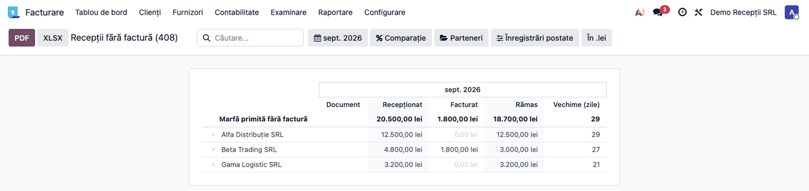
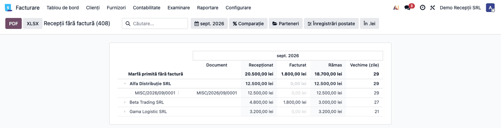
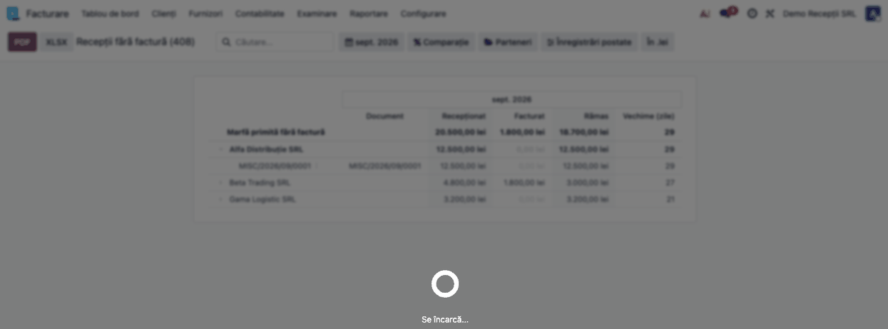
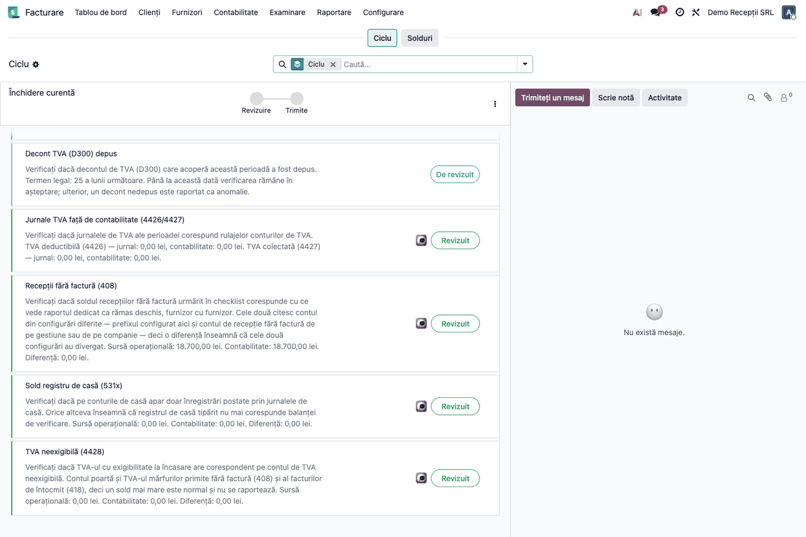

# Fișă Modul: Recepții fără factură — soldul contului 408

**Modul:** `l10n_ro_rni_report`
**Utilizator principal:** Contabil furnizori, Contabil șef
**Prioritate:** 🟡 Medie (necesar la fiecare închidere de lună, la companiile cu recepție pe aviz)

---

## 1. Scop business

Soldul creditor al contului 408 spune *cât* datorează firma pentru marfă primită fără factură,
dar nu și *pentru ce*. La închiderea lunii tocmai asta se cere: lista recepțiilor care încă își
așteaptă factura, cu furnizorul de la care au venit și de câte zile stau deschise.

Raportul desface soldul pe furnizor și pe document, arată cât s-a recepționat, cât s-a decontat
prin facturi și cât a rămas. Fără el, un sold 408 greșit — o decontare care nu s-a făcut, o notă
postată direct pe cont — se descoperă abia la inventarierea datoriilor sau la un control.

## 2. Bază legală și context

OMFP 1802/2014 — funcțiunea contului **408 „Furnizori – facturi nesosite"**: se creditează cu
valoarea bunurilor aprovizionate pentru care nu s-au primit facturi și se debitează la primirea
facturii. Soldul creditor reprezintă datoriile pentru care nu s-a primit încă documentul.

Contextul operațional: în România recepția se face frecvent pe aviz de însoțire, iar factura
sosește ulterior. Între cele două momente, valoarea stă pe 408.

## 3. Utilizatori și roluri

Contabil furnizori (urmărirea curentă), Contabil șef (verificarea la închidere).

Roluri recomandate pentru testare:
- Administrator funcțional: instalează modulul și verifică apariția meniului
- Contabil: deschide raportul, verifică soldurile și exportă
- Operator recepție: creează recepțiile pe aviz care alimentează contul

## 4. Conturi și date implicate

| Cont | Rol |
|---|---|
| **408** | Furnizori – facturi nesosite; contul urmărit de raport |
| 371 / 3xx | Contul de stoc debitat la recepție, contrapartida lui 408 |
| 401 | Furnizori; preia datoria la sosirea facturii |

Conturile 408 nu sunt codificate în raport. Se iau, în ordine:

1. contul de recepție fără factură configurat **pe gestiune**;
2. contul configurat **pe companie**;
3. dacă niciunul nu e configurat (instalările fără modulul de gestiuni), conturile al căror cod
   începe cu **408**.

Date minime pentru demo:
- companie românească cu planul de conturi RO
- cel puțin o recepție fără factură postată, cu furnizor completat pe linia de 408
- opțional, o factură care decontează parțial una dintre recepții, ca să se vadă diferența

## 5. Configurare inițială

1. Instalați modulul `l10n_ro_rni_report` pe baza demo.
2. Verificați că apare meniul **Contabilitate → Rapoarte → Situații legale → Recepții fără
   factură (408)**.
3. Dacă folosiți gestiuni contabile, verificați contul de recepție fără factură pe fiecare
   gestiune; altfel, pe companie. Raportul urmează configurarea, nu invers.
4. Asigurați-vă că **partenerul e completat pe linia de 408**. Raportul grupează pe furnizor, iar
   liniile fără partener ajung într-un rând propriu, fără nume — soldul e corect, dar nu știi pe
   cine urmărești.

## 6. Flux de utilizare

### Pasul 1 — Deschiderea raportului

Accesați **Contabilitate → Rapoarte → Situații legale → Recepții fără factură (408)**. Raportul
se deschide pe luna curentă și listează furnizorii care au sold rămas.

**Ce găsiți pe ecran:** fiecare rând este un furnizor. Coloana **Recepționat** arată cât s-a
creditat pe 408 pentru el, **Facturat** cât s-a decontat prin facturi, **Rămas** diferența, iar
**Vechime (zile)** de câte zile stă deschisă cea mai veche recepție nedecontată, socotită
până la **data de sfârșit a perioadei** selectate, nu până azi.

**Ce trebuie să fie adevărat** înainte de a merge mai departe:
- totalul de pe rândul principal corespunde soldului contului 408 din balanța de verificare;
- furnizorii cu sold zero nu apar — ei au recepționat și au și facturat;
- coloana **Rămas** e creditoare (pozitivă) pe fiecare furnizor; o valoare negativă înseamnă că
  s-a facturat mai mult decât s-a recepționat.



> Soldul e **cumulat**, nu al perioadei: o recepție din august nefacturată încă apasă soldul lui
> octombrie. Altfel raportul ar arăta zero exact în cazul care contează.

### Pasul 2 — Desfășurarea pe documente

Apăsați pe un furnizor pentru a vedea înregistrările din spatele soldului lui. Fiecare rând e un
document, cu data și valoarea lui.

**Ce găsiți pe ecran:** coloana **Document** arată recepția — transferul de stoc, atunci când
legătura către el există — sau, în lipsa ei, nota contabilă. Rândurile cu valoare pe
**Recepționat** sunt intrări; cele cu valoare pe **Facturat** sunt decontări.

**Ce trebuie să fie adevărat:** fiecare document cu sold rămas corespunde unei recepții reale
pentru care factura chiar n-a sosit. Un document vechi de câteva luni, cu furnizorul care susține
că a facturat, e semnalul unei decontări ratate.



### Pasul 3 — Tipărirea sau exportul

Abia după ce datele de pe ecran sunt confirmate, folosiți butoanele din antet: **PDF** pentru
lista tipărită care se atașează la dosarul de închidere, **XLSX** pentru prelucrare.



### Pasul 4 — Verificarea din checklistul de închidere

Dacă modulul de închidere periodică e instalat, verificarea **Recepții fără factură (408)** din
checklist confruntă soldul urmărit acolo cu suma pe care raportul o vede deschisă pe furnizori.
Cele două citesc contul din configurări diferite — prefixul din setările de închidere, respectiv
contul de recepție fără factură de pe gestiune sau companie — deci verificarea semnalează exact
situația în care aceste configurări au divergat. Butonul deschide raportul.



### Note de monografie și raportare

Modulul **nu generează note contabile**. Este strict un raport: citește înregistrările de pe
conturile 408 și le grupează. Notele care alimentează contul vin din modulele de stoc:

- recepție fără factură: **Dr 371 = Cr 408**;
- sosirea facturii: **Dr 408 + Dr 4426 = Cr 401**, cu diferențele de preț și de curs tratate de
  modulul care a generat recepția.

Raportul nu apare în nicio declarație. Este un instrument de control intern, folosit la
inventarierea datoriilor și la închiderea lunii.

## 7. Legături cu alte module / declarații

| Modul / proces | Rol în flux | Tip legătură |
|---|---|---|
| `account_reports` | framework-ul de rapoarte contabile (filtre, perioadă, export) | dependență (manifest) |
| `l10n_ro` | planul de conturi RO | dependență (manifest) |
| `l10n_ro_stock_gestiune` | nota `371 = 408` la recepție și contul configurat pe gestiune | opțional, detectat la rulare |
| `l10n_ro_stock_account` (OCA) | pivotul 408 alimentat din valorizarea recepției pe aviz | opțional, detectat la rulare |
| `l10n_ro_period_close_enhanced` | verificarea de închidere care confruntă soldul cu raportul | opțional, consumator |

Raportul funcționează cu **ambele mecanisme** de 408 din suită, fiindcă pornește din
contabilitate — singura lor sursă comună. Acolo unde mecanismul păstrează legătura către recepție,
raportul afișează transferul în locul numărului de notă.

Ce este automat: gruparea pe furnizor, calculul soldului rămas și al vechimii.
Ce rămâne manual: decizia asupra fiecărei recepții vechi — se urmărește factura, se stornează, sau
se reclasifică.

## 8. Verificări pentru consultant

- [ ] Modulul se instalează fără erori pe baza demo.
- [ ] Meniul **Rapoarte → Situații legale → Recepții fără factură (408)** e vizibil pentru contabil.
- [ ] Totalul raportului corespunde soldului contului 408 din balanța de verificare.
- [ ] Un furnizor cu recepție și factură completă **nu** apare în raport.
- [ ] O decontare parțială lasă în raport exact diferența.
- [ ] Desfășurarea pe un furnizor arată documentele lui, nu ale altuia.
- [ ] Vechimea e zero pe furnizorii fără sold și crește pe cei cu recepții vechi.
- [ ] Exportul PDF și XLSX conțin aceleași sume ca ecranul.
- [ ] Pe o instalare fără conturi 408 configurate, raportul se deschide gol, fără eroare.
- [ ] Verificarea din checklistul de închidere deschide raportul și semnalează divergențele.

## 9. Mesaje de eroare frecvente

| Mesaj / simptom | Cauză probabilă | Remediere |
|-----------------|-----------------|-----------|
| Raportul e gol, deși contul 408 are sold | Perioada selectată e anterioară recepțiilor, sau conturile 408 nu sunt cele configurate | Verificați perioada; verificați contul de recepție fără factură de pe gestiune sau companie |
| Un rând din raport nu are nume de furnizor | Înregistrări pe 408 fără partener completat | Completați partenerul pe liniile respective; soldul e corect, dar recepția nu poate fi urmărită |
| Totalul raportului nu corespunde soldului din balanță | Contul citit de raport diferă de cel din balanță — configurare pe gestiune vs. companie | Verificați contul de recepție fără factură pe fiecare gestiune și pe companie |
| Un furnizor apare cu sold negativ pe „Rămas" | S-a facturat mai mult decât s-a recepționat, sau factura a fost postată de două ori | Verificați documentele lui din desfășurare |
| Un furnizor decontat complet apare totuși în raport | Decontarea s-a făcut pe alt cont decât cel de recepție fără factură | Verificați contul de pe linia facturii |
| Raportul nu apare în meniu | Modulul nu e instalat, sau utilizatorul nu are drepturi de contabilitate | Instalați modulul și verificați grupurile utilizatorului |

## 10. Capturi de ecran

| # | Fișier | Conținut |
|---|--------|----------|
| 1 | `static/description/01_raport_furnizori.png` | Raportul, cu soldul lui 408 desfăcut pe furnizori și vechimea fiecăruia |
| 2 | `static/description/02_drill_documente.png` | Desfășurarea pe un furnizor: documentele din spatele soldului |
| 3 | `static/description/03_raport_pdf.png` | Raportul tipărit (PDF), pentru dosarul de închidere |
| 4 | `static/description/04_verificare_inchidere.png` | Verificarea corespunzătoare din checklistul de închidere periodică |

Capturile sunt **generate automat** din `tests/test_screenshots.py` (mixinul `ScreenshotCase` din
`l10n_ro_doc_screenshots`, import defensiv), în limba română, pe planul de conturi RO.

Regenerare:

```bash
./odoo/odoo-bin -c odoo.conf -d <bază> -i l10n_ro_rni_report,l10n_ro_doc_screenshots --test-tags=/l10n_ro_rni_report:TestRniReportScreenshots --stop-after-init
```

## 11. Observații pentru manual

Păstrați distincția care contează pentru utilizator: **408 nu e un cont de erori**. Un sold pe el
e normal între recepție și factură; ce trebuie urmărit e *vechimea*. O recepție de trei zile e
firească, una de trei luni înseamnă fie o factură pierdută, fie o decontare ratată.

Merită explicat și de ce furnizorii decontați nu apar: raportul e o listă de lucru, nu o
recapitulare a mișcărilor contului. Pentru istoricul complet se folosește fișa contului 408.
