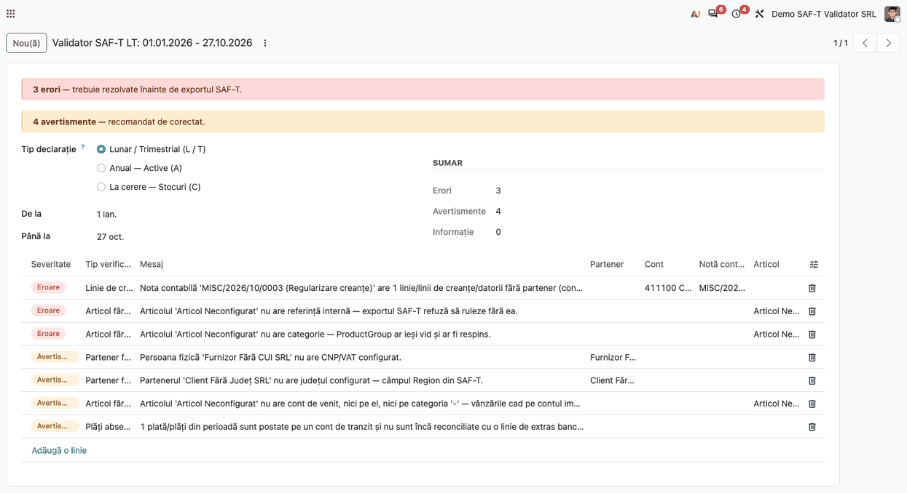
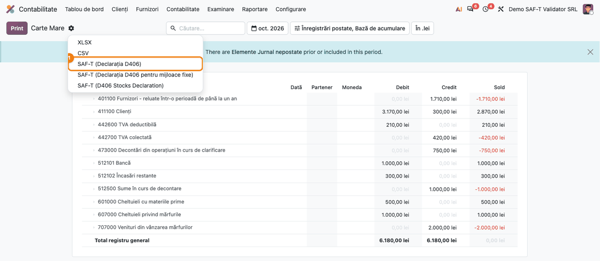

# Fișă Modul: SAF-T D406 — Speța L/T (Lunar / Trimestrial)

**Modul:** `l10n_ro_saft_validator` + `l10n_ro_saft`
**Tip declarație ANAF:** **L** (lunar) sau **T** (trimestrial)
**Capitol manual:** Cap 5 / SAF-T / Lunar-Trimestrial
**Utilizator principal:** Contabil, Responsabil SAF-T
**Prioritate:** Mare (e depunerea principală)

---

## 1. Scop business

D406 Lunar/Trimestrial este depunerea curentă SAF-T — cuprinde **toate** datele contabile ale
perioadei: registre, parteneri, facturi vânzare/cumpărare, plăți, taxe. Se depune până în ultima
zi calendaristică a lunii următoare perioadei de raportare (lună sau trimestru, în funcție de
perioada fiscală a contribuabilului). Pentru trimestrul IV, termenul poate fi extins conform
reglementărilor în vigoare.

## 2. Bază legală

- **OPANAF 1783/2021** cu modificările și completările ulterioare (OPANAF 2210/2021,
  1191/2022, 1907/2022, 6/2023, 1730/2023, 1234/2024) — natura informațiilor SAF-T,
  modelul de raportare, procedura, condițiile și termenele de transmitere a fișierului D406.
- Codul depunerii în câmpul `HeaderComment` al XML: **`L`** pentru lunar, **`T`** pentru trimestrial
  (deduse de Odoo din perioada selectată în raport).

## 3. Utilizatori și roluri

- Responsabil SAF-T: rulează validatorul + exportul la sfârșit de lună/trimestru.
- Contabil: corectează datele semnalate (parteneri, conturi, taxe).

## 4. Date implicate

- companie (CUI, adresă completă, județ, telefon, cont bancar, contact cu nume și telefon,
  baza de impozitare SAF-T);
- parteneri cu rulaj pe conturi de creanțe/datorii (CUI/CNP, țară ISO2, localitate, județ);
- conturi contabile (account_type completat);
- taxe (câmp `l10n_ro_saft_tax_type_id` din l10n_ro_saft Enterprise);
- articole facturate (referință internă, categorie, conturi de venit/cheltuială);
- facturi de vânzare **și** de cumpărare postate, linii de extras bancar sau plăți postate direct
  pe contul jurnalului, note contabile.

## 5. Configurare inițială

1. Instalați `l10n_ro_saft` (Enterprise) + `l10n_ro_saft_validator`. Enterprise trebuie să
   conțină fix-ul Odoo opw-6568174 (commit 35ee49d, pe 20.0 din 27.10.2026): pe o versiune mai veche,
   exportul ia plățile doar din extrase, iar validatorul ar considera acoperită o secțiune `Payments`
   pe care exportul o scoate goală.
2. Completați datele companiei: CUI, județ, cod poștal, **telefon** și **cont bancar**.
3. Setați **baza de impozitare SAF-T** pe companie (câmpul din l10n_ro_saft).
4. Adăugați companiei cel puțin un **contact** cu nume din două cuvinte (nume și prenume) și
   telefon — declarația îl cere, iar exportul îl ia doar pe acesta.
5. Asigurați că taxele active au tipul SAF-T configurat.
6. Asigurați că articolele vândute și cumpărate au **referință internă** și **categorie**.
7. Bifați **Non-comercial** (Contabilitate → Configurare → Plan de conturi) pe conturile de
   decontări cu personalul și cu statul (421, 423, 425, 427, 431, 437, 4423, 444…). Pe ele notele
   nu au client/furnizor, iar validatorul nu le mai cere partener (40x/41x rămân verificate
   oricum). Planul `l10n_ro` nu le bifează implicit, așa că o notă de salarii pe 421 dă eroarea `move_line_no_partner` până la bifare.

## 6. Flux de utilizare

1. **Pre-validare:**
   1. Deschideți **Contabilitate → Raportare → Validator SAF-T**.
   2. Selectați **Tip declarație = Lunar / Trimestrial (L / T)**.
   3. Setați **De la / Până la** = perioada de raportare (lună sau trimestru).
   4. Apăsați **Validează** — lista de probleme se populează, iar titlul ferestrei arată
      „Validator SAF-T LT: <de la> - <până la>”.
   5. Corectați și re-rulați până la 0 erori.
2. **Generare D406:**
   1. Deschideți **Contabilitate → Raportare → Ledgers → General Ledger** (raportul „Carte Mare”).
   2. Selectați perioada (tipul declarației se deduce automat: lună → L, trimestru → T).
   3. Apăsați **SAF-T (Declarația D406)** → descărcați XML-ul.
3. **Validare oficială:** rulați XML-ul prin DUK Integrator.
4. **Depunere:** încărcați XML-ul + zip-ul DUK în portalul ANAF (sau prin SPV).

## 7. Reguli funcționale (verificări rulate pentru LT)

| Verificare | Severitate | Ce semnalează |
|---|---|---|
| `company_incomplete` | error / warning | date companie lipsă: CUI, adresă, județ, telefon, cont bancar, bază de impozitare SAF-T, contact cu nume și telefon |
| `partner_no_vat` | error / warning | partener cu rulaj fără CUI (PJ) sau fără CNP (PF) |
| `partner_no_country` | error | partener fără țară configurată |
| `partner_invalid_country` | warning | cod de țară non-ISO2 |
| `partner_no_city` | error | partener fără localitate — exportul refuză să ruleze |
| `partner_no_state` | warning | partener român fără județ |
| `partner_invalid_state` | warning | județ în afara nomenclatorului ISO 3166-2:RO (`RO-B`, `RO-AB`…) |
| `partner_fiscal_type_mismatch` | error / warning | țara și prefixul codului de TVA se contrazic — decid rubrica din declarație (operator român, UE, non-UE) |
| `move_line_no_partner` | error | notă contabilă cu linii pe conturi de creanțe/datorii (40x/41x) fără partener; conturile bifate „Non-comercial” (421, 425, 4423…) nu sunt verificate |
| `account_no_type` | error | conturi cu rulaj fără `account_type` (lipsesc din SAF-T) |
| `tax_no_saft_type` | warning | taxe fără tipul SAF-T configurat |
| `export_section_empty` | error | o secțiune a declarației ar ieși goală (vânzări, achiziții sau plăți) |
| `payments_not_exported` | warning | plăți din perioadă postate pe un cont de tranzit și nereconciliate încă cu o linie de extras bancar |
| `product_no_default_code` | error | articol facturat fără referință internă — exportul refuză să ruleze |
| `product_no_category` | error | articol facturat fără categorie |
| `product_no_account` | warning | articol fără cont de venit/cheltuială, nici pe el, nici pe categorie |

> Verificarea partenerilor pe CUI, localitate și tip fiscal se face doar pentru cei cu rulaj pe
> conturi de creanțe/datorii (`asset_receivable` / `liability_payable`).

### Două capcane pe care interfața Odoo nu le arată

**Secțiunile goale invalidează tot fișierul.** Exportul scrie necondiționat secțiunile de vânzări,
achiziții și plăți, iar validatorul ANAF cere minimum un document în fiecare secțiune prezentă. O
lună fără nicio achiziție — sau fără nicio încasare — produce o declarație respinsă integral, cu o
eroare de structură care nu spune nimic despre cauza reală.

**Plățile intră în declarație dintr-un extras bancar sau direct de pe contul jurnalului.** Exportul
ia liniile de extras și, de la fix-ul Odoo opw-6568174, plățile înregistrate prin „Înregistrează
plata" care sunt postate direct pe contul de bancă / casă al jurnalului. Asta se întâmplă când
metoda de plată a jurnalului are drept cont chiar contul jurnalului (5121 / 5311). Nu e
configurarea implicită: în planul RO metodele de plată nu au cont, iar „Înregistrează plata"
creează o plată **fără notă contabilă**, care nu apare nici în 5311, nici în D406 — mișcarea intră
doar prin extras. Pentru casierie fără extrase, setați 5311 pe metoda de plată a jurnalului de casă.

| Operațiune | Notă contabilă | Intră în `Payments`? |
|---|---|---|
| Încasare directă în casă | Dr 5311 = Cr 4111 | da |
| Plată directă din bancă | Dr 401 = Cr 5121 | da |
| Încasare pe cont de tranzit | Dr 512102 = Cr 4111 | nu |
| Linia de extras care o decontează | Dr 5121 = Cr 512102 | da, pe data extrasului |
| Plată către furnizor pe cont de tranzit | Dr 401 = Cr 512103 | nu |
| Linia de extras care o decontează | Dr 512103 = Cr 5121 | da, pe data extrasului |

Nota plății de tranzit (512102 „Încasări restante” / 512103 „Plăți restante”) nu intră niciodată în
fișier; mișcarea ajunge acolo prin nota extrasului. 512102 / 512103 sunt analitice create de Odoo sub
5121, deci în balanță sumele în tranzit se adună la „Conturi la bănci”; dacă le vreți separat, ca
sume în curs de decontare, folosiți pe metoda de plată un analitic **separat** al lui 5125 (ex.
512510), nu contul de așteptare al extraselor (5125).
O plată de tranzit decontată printr-un extras din luna următoare lipsește din perioada
curentă și apare în luna extrasului — corect, mișcarea bancară are data extrasului. Validatorul
semnalează situația înainte de export: eroare când secțiunea de plăți ar ieși goală, avertisment
pentru plățile rămase pe contul de tranzit și nereconciliate.

Nu înregistrați aceeași mișcare de casă și ca plată directă pe 5311, și într-un extras de casă:
apare de două ori în 5311 și în `Payments`.

## 8. Scenarii de test pentru consultant

| ID | Scenariu | Rezultat așteptat |
|---|---|---|
| LT-01 | Partener fără CUI cu rulaj de încasare | warning `partner_no_vat` (Odoo 20 tratează partenerul fără CUI drept persoană fizică) |
| LT-02 | Partener fără țară setată | problemă `partner_no_country` error |
| LT-03 | Cont fără `account_type` cu rulaj | problemă `account_no_type` error |
| LT-04 | Taxă cu rulaj fără `l10n_ro_saft_tax_type_id` | problemă `tax_no_saft_type` warning |
| LT-05 | Companie fără județ | warning `company_incomplete` |
| LT-06 | Partener român fără județ | warning `partner_no_state` |
| LT-07 | Partener cu județ creat manual („Sector 3", cod `B3") | warning `partner_invalid_state` |
| LT-08 | Partener cu țară străină și fără prefix de TVA | error `partner_fiscal_type_mismatch` |
| LT-09 | Notă manuală pe 401 fără partener | error `move_line_no_partner` |
| LT-09b | Notă de salarii pe 421 bifat „Non-comercial”, fără partener | nicio problemă `move_line_no_partner` |
| LT-10 | Lună cu vânzări, dar fără nicio factură de achiziție | error `export_section_empty` |
| LT-11 | Perioadă fără extras bancar și fără plăți postate direct pe contul jurnalului | error `export_section_empty` |
| LT-12 | Plată înregistrată din factură pe cont de tranzit, nereconciliată cu extrasul | warning `payments_not_exported` |
| LT-13 | Articol facturat fără referință internă | error `product_no_default_code` |
| LT-14 | Articol facturat fără categorie | error `product_no_category` |
| LT-15 | Partener cu rulaj fără localitate | error `partner_no_city` |
| LT-16 | Companie fără telefon / cont bancar / contact cu telefon | error `company_incomplete` |
| LT-17 | Toate datele complete | listă goală → export D406 cu HeaderComment `L`/`T`, acceptat de DUK Integrator |

## 9. Legături cu alte module / declarații

| Modul | Rol |
|---|---|
| `l10n_ro_saft` (Enterprise) | exportul efectiv lunar/trimestrial |
| `l10n_ro_anaf_d300` | verificare cross — soldurile SAF-T trebuie să corespundă cu D300 al perioadei |

## 10. Verificări pentru consultant

- [ ] Tip declarație în wizard = **LT**.
- [ ] Perioada de raportare corespunde periodicității fiscale (lună/trimestru).
- [ ] Compania are CUI, adresă completă, județ, telefon, cont bancar și bază de impozitare SAF-T.
- [ ] Compania are cel puțin un contact cu nume din două cuvinte și telefon.
- [ ] Toți partenerii cu rulaj au CUI/CNP, țară ISO2, localitate și județ din nomenclator.
- [ ] Niciun partener nu are țara și prefixul de TVA în contradicție.
- [ ] Conturile de decontări cu personalul și cu statul (421, 425, 4423…) sunt bifate „Non-comercial”.
- [ ] Nicio notă contabilă din perioadă nu are linii pe 40x/41x comerciale fără partener.
- [ ] Toate conturile cu rulaj au `account_type` setat.
- [ ] Taxele cu rulaj au tip SAF-T configurat.
- [ ] Articolele facturate au referință internă și categorie.
- [ ] Perioada conține cel puțin o factură de vânzare, una de achiziție și o plată (extras sau plată
      postată direct pe contul jurnalului).
- [ ] Plățile de pe conturile de tranzit sunt reconciliate cu liniile de extras bancar.
- [ ] Validatorul returnează 0 erori.
- [ ] XML-ul exportat trece prin DUK Integrator fără erori („Validare fara erori").

## 11. Mesaje de eroare frecvente

| Simptom | Cauză | Remediere |
|---|---|---|
| Listă lungă de parteneri fără CUI | parteneri importați incomplet | completați CUI/CNP pe parteneri |
| Conturi nemapate | conturi noi fără tip | setați `account_type` pe contul respectiv |
| Taxe semnalate | taxe fără tip SAF-T | configurați `l10n_ro_saft_tax_type_id` pe taxă |
| Notă de salarii (421) semnalată „fără partener” | contul 421 nu e bifat „Non-comercial” (planul `l10n_ro` nu-l bifează implicit) | bifați „Non-comercial” pe 421 și pe celelalte conturi de decontări cu personalul și statul, apoi rulați din nou validatorul |
| DUK: „elementul 'Payment' ar fi trebuit sa apara de minimum 1 ori" | perioada nu are nicio linie de extras bancar și nicio plată postată direct pe contul jurnalului, deci secțiunea de plăți iese goală | importați sau introduceți extrasul bancar al perioadei, sau postați plățile direct pe contul jurnalului (5121 / 5311, vezi §7), apoi regenerați |
| DUK: „elementul ''lipsa'' ar fi trebuit sa apara de minimum 1 ori" pe `PurchaseInvoices` | luna nu are nicio factură de achiziție | verificați dacă lipsesc facturi de înregistrat; altfel discutați cu ANAF depunerea pentru o perioadă fără achiziții |
| DUK: „atribut prezent dar vid nepermis" pe `ProductGroup` | articol fără categorie (în Odoo 19 categoria nu mai are valoare implicită) | completați categoria pe articolele semnalate |
| DUK: „elementul 'Contact' ar fi trebuit sa apara de minimum 1 ori" | compania nu are contact cu nume din două cuvinte și telefon | adăugați un contact „Nume Prenume" cu telefon pe fișa companiei |
| Exportul refuză să pornească, fără fișier generat | lipsesc telefonul, contul bancar, baza de impozitare SAF-T, localitatea unui partener sau referința internă a unui articol | rulați validatorul — el arată exact care dintre ele lipsește |
| Plățile nu apar în declarație, deși există în Odoo | plățile sunt postate pe un cont de tranzit (512102 „Încasări restante” / 512103 „Plăți restante”) și nu sunt încă reconciliate cu extrasul, sau metoda de plată nu are cont și plata nu are notă contabilă | importați extrasul perioadei și reconciliați-l cu plățile; la casierie fără extrase, setați 5311 pe metoda de plată a jurnalului de casă (fie plăți directe, fie extras de casă — nu ambele pentru aceeași mișcare) |

## 12. Capturi de ecran

**Pas 1 — Wizard validare LT cu rezultate** ①:

**Pas 2 — Buton de export D406 lunar/trimestrial pe raportul Carte Mare** ② — deschis prin
icon-ul de cog (engrenaj) lângă titlul raportului:

| # | Fișier | Conținut |
|---|--------|----------|
| 1 | `static/description/01_saft_validator_wizard_lt.png` | Wizard cu **Tip declarație = LT** ① — radio LT selectat, sumar Errors/Warnings, listă probleme pe parteneri/conturi |
| 2 | `static/description/03_saft_export_button_lt.png` | Cog menu deschis pe Carte Mare ② cu opțiunea **„SAF-T (Declarația D406)"** evidențiată — export-ul D406 lunar/trimestrial |
