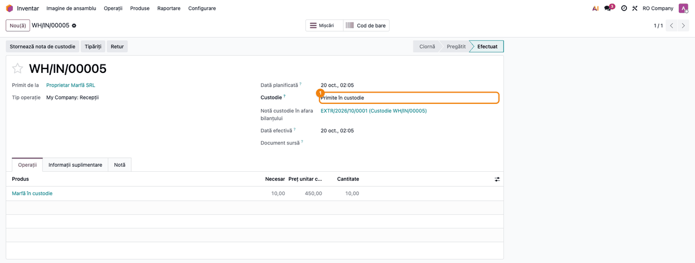
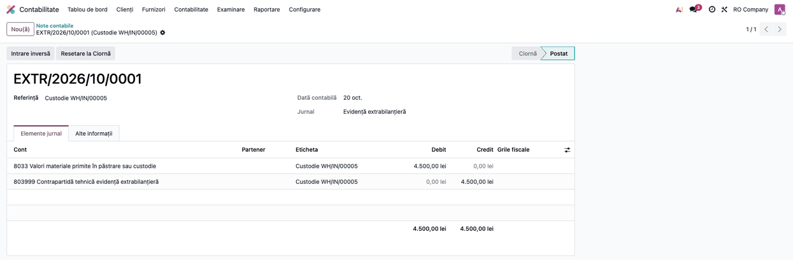
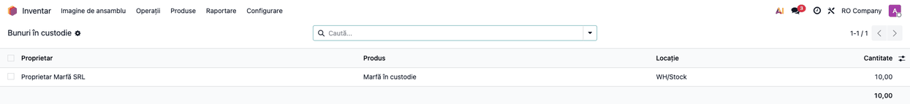
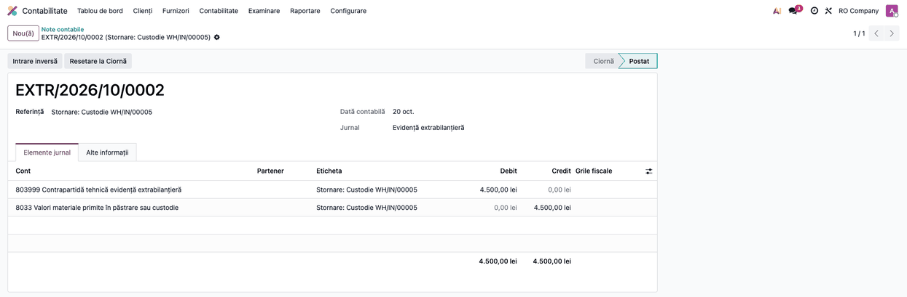
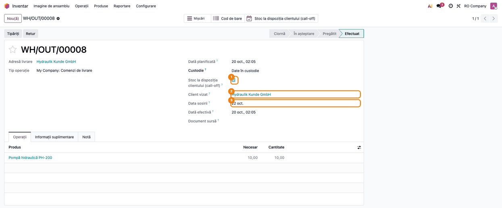
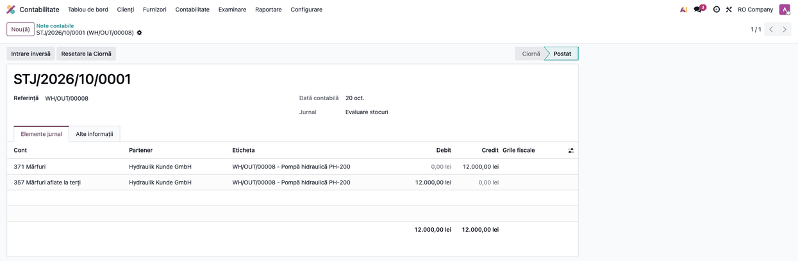
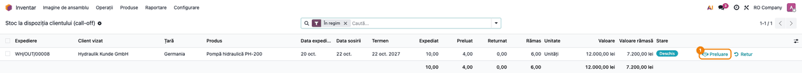
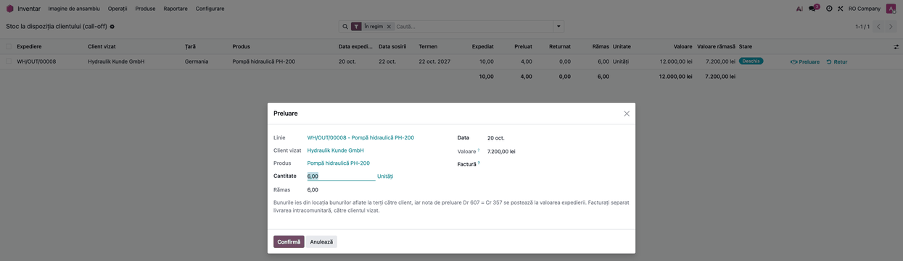
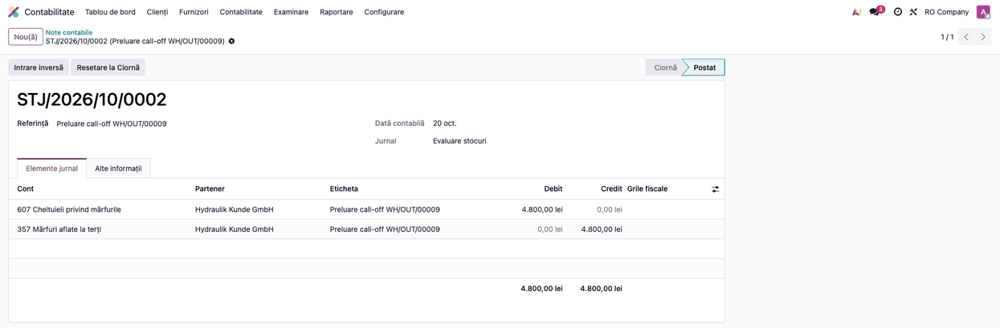

# Fișă Modul: Custodia Stocurilor (8033, 35x) și stocurile la dispoziția clientului

**Modul:** `l10n_ro_stock_consignment` (plus puntea `l10n_ro_stock_consignment_d390` pentru D390)
**Utilizator principal:** Gestionar, Contabil stocuri
**Prioritate:** 🟡 Medie (mărfuri ale terților în gestiune; mărfuri proprii la clienți UE, cu termen fiscal)

---

## 1. Scop business

Modulul gestionează **bunurile primite în custodie** (fără transfer de proprietate) — mărfuri ale
terților ținute spre păstrare/custodie. Evidența se ține în afara bilanțului, pe contul **8033**,
iar stocul nu intră în valorizarea proprie. Gestionează și **bunurile proprii date în custodie** la
terți, care rămân în patrimoniu, pe conturile 351–358 „aflate la terți”. Rezolvă o nevoie frecventă: să ai mărfurile terțului în
gestiune fizic, dar separate contabil de stocul propriu.

Pe custodia dată se sprijină și **stocurile la dispoziția clientului** (*call-off stock*): mărfuri
proprii trimise la un client dintr-un alt stat membru UE, care le preia mai târziu. Până la preluare,
marfa rămâne a firmei, în contul 357, iar factura de livrare intracomunitară se emite abia la
preluare. Modulul ține evidența pe produs și urmărește termenul de 12 luni de la sosire, după care
regimul se încheie prin lege.

## 2. Bază legală și context

OMFP 1802/2014 — contul în afara bilanțului **8033 „Valori materiale primite în păstrare sau
custodie"**, distinct de obiectele de inventar date în folosință (8035). Evidența extrabilanțieră a
bunurilor terților, fără impact pe bilanț sau pe contul de profit și pierdere.

Stocurile la dispoziția clientului — Codul fiscal:

- **art. 270^1** — regimul: condițiile (alin. (2)), preluarea în 12 luni de la sosire (alin. (3),
  (4)), returul (alin. (5)), înlocuirea clientului (alin. (6)), livrarea către altă persoană
  (alin. (8));
- **art. 270 alin. (10)** — transferul asimilat livrării, la expirarea termenului;
- **art. 294 alin. (2) lit. a) și d)** — scutirea livrării intracomunitare, respectiv a transferului;
- **art. 319 alin. (9) și (15)** — autofactura la transfer și termenul facturii (15 ale lunii
  următoare);
- **art. 321 alin. (6)** — registrul furnizorului (conținutul în art. 54a din Regulamentul (UE)
  282/2011);
- **art. 325 alin. (1^1) și (2)** — declararea în D390, în luna expedierii și în luna modificării.

OMFP 1802/2014: mărfurile aflate la terți se țin în **357** (pct. 276 alin. (2)); la vânzarea de la
terț, scăderea din gestiune se face **Dr 607 = Cr 357**, la valoarea din contabilitate (pct. 95
alin. (1)).

## 3. Utilizatori și roluri

Gestionar (recepție/retur custodie, expediere și preluare call-off), Contabil stocuri (verifică notele,
evidența call-off și D390).

Roluri recomandate pentru testare:
- Utilizator Inventar (fără drepturi contabile): marchează transferul ca custodie sau call-off,
  validează, înregistrează preluarea și returul. Notele contabile se generează și fără drepturi
  contabile. Meniul **Inventar → Raportare** e vizibil doar pentru Administrator Inventar: utilizatorul
  ajunge la evidența call-off prin butonul **Stoc la dispoziția clientului (call-off)** de pe expediere.
- Administrator Inventar: rapoartele „Bunuri în custodie" și evidența call-off, din meniu.
- Contabil: verifică notele, termenele din evidența call-off, factura de preluare și D390.

## 4. Conturi și date implicate

- **8033** — Valori materiale primite în păstrare sau custodie (debit la recepție).
- **803999** — Contrapartidă tehnică evidență extrabilanțieră (analitic al lui 8039, comun suitei; credit la recepție). Partida simplă nu are contrapartidă: linia există doar pentru că Odoo cere note echilibrate.
- Jurnalul **EXTR** (Evidență extrabilanțieră) pentru nota de custodie primită, dacă nu se configurează alt jurnal de custodie.
- **351 / 354 / 356 / 357 / 358** — stocuri aflate la terți (custodie dată): debit la ieșirea către
  locația „la terți”, credit la retur. Contul se alege după contul de stoc al produsului (301-303 → 351,
  341, 345-347 → 354, 361 → 356, 371 → 357, 381 → 358) și se pune pe locația „la terți”, ca cont de evaluare.
- **607** — Cheltuieli privind mărfurile: debit la preluarea call-off (Dr 607 = Cr 357). Contul se ia
  din contul de variație a stocului de pe contul de stoc al produsului (pentru 371: 607), ca la
  livrarea nativă; nota se face în jurnalul de stoc al categoriei.
- Mărfurile primite **în consignație** (spre vânzare) se țin, după OMFP 1802/2014, în **8039**, nu în 8033: pentru ele, setați **Cont custodie** pe un analitic real al lui 8039 (de exemplu 803901).

Date minime pentru demo: companie RO (plan de conturi cu 8033; 803999 și jurnalul EXTR vin din `l10n_ro_off_balance`), un produs, un partener (terțul),
o locație de recepție. Pentru call-off: o categorie de mărfuri cu contul de stoc 371, o locație „la
terți” cu contul 357 (de exemplu „Mărfuri la clienți UE”) și un client dintr-un alt stat UE, cu țara
și codul de TVA completate.

## 5. Configurare inițială

1. Instalați `l10n_ro_stock_consignment`.
2. În **Contabilitate → Configurare → Setări**, secțiunea **România - Custodie stocuri**, verificați/setați **Cont custodie**
   (implicit 8033), **Cont contrapartidă** (gol = 803999) și **Jurnal custodie** (gol = EXTR).
3. Dacă nu sunt setate, modulul le caută automat după cod în planul RO.
4. Pentru custodia dată, creați locațiile „la terți” (tip Client, cu compania setată), câte una
   pentru fiecare cont 35x, cu contul în câmpul **Cont stocuri aflate la terți (35x)** (vezi CONFIGURE).
5. Pentru call-off, în aceeași secțiune de setări, **Reamintire stoc la dispoziția clientului**
   stabilește cu câte zile înainte de termen se programează reamintirea (implicit 30). Activitatea se
   atribuie responsabilului transferului de expediere.
6. Pe fișa clientului UE completați **țara** (alt stat membru decât România) și **codul de TVA** din
   statul de destinație.
7. Pentru D390, modulul `l10n_ro_stock_consignment_d390` se instalează automat când se instalează
   custodia sau D390. Pe o bază care le are deja pe amândouă, instalați-l din **Aplicații**.

## 6. Flux de utilizare

### Pasul 1 — Marcarea și validarea recepției în custodie

Pe transferul de stoc (recepție), setați câmpul **Custodie** = „Primite în custodie", completați
partenerul și, în coloana **Preț unitar custodie**, prețul din procesul-verbal, apoi **Validează**.
Înainte de mișcarea de stoc, modulul pune terțul ca proprietar — consignație nativă Odoo, deci
bunurile **nu** intră în valorizarea proprie — și generează nota extrabilanțieră.



### Pasul 2 — Nota extrabilanțieră Dr 8033 = Cr 803999

Din transfer, deschideți nota de custodie generată automat: un articol pe conturi în afara bilanțului,
echilibrat, fără impact pe bilanț/CPP.



### Pasul 3 — Raportul „Bunuri în custodie"

Accesați **Inventar → Raportare → Bunuri în custodie** (Administrator Inventar).

- **Găsiți pe ecran:** fiecare rând e un stoc ținut pe seama unui terț, într-o locație internă:
  coloanele **Proprietar**, **Produs**, **Locație** și **Cantitate**.
- **Verificați:** apar doar bunurile terților (proprietarul nu e compania), iar cantitatea pe
  proprietar și produs corespunde recepțiilor în custodie minus retururile.
- **Exportați** (opțional): selectați rândurile → **Acțiuni → Export**, pentru inventarierea
  bunurilor terților. Gruparea pe proprietar: **Grupează după → Proprietar** (cu setarea **Consignație** activă în Inventar → Configurare → Setări) sau **Adaugă grupare personalizată → Proprietar**.



### Pasul 4 — Stornarea la retur

La returul bunurilor către terț, validați returul (butonul **Retur**, total sau parțial) — se generează
nota de stornare (Dr 803999 = Cr 8033) pentru cantitatea returnată, la prețul din nota inițială.
**Stornează nota de custodie** pe recepție stornează restul; după stornarea integrală butonul dispare.



### Pasul 5 — Expedierea în regimul stocurilor la dispoziția clientului

Din **Inventar → Operațiuni → Livrări**, creați transferul din stocul propriu către locația „la
terți” (de exemplu **Mărfuri la clienți UE**, cont 357). Setați **Custodie** = „Date în custodie”,
bifați ① **Stoc la dispoziția clientului (call-off)**, verificați ② **Client vizat** (implicit
partenerul transferului) și completați ③ **Data sosirii** în statul de destinație (goală = data
validării). Apăsați **Validează** în ziua plecării bunurilor: data validării dă luna expedierii din
D390.

La validare, modulul verifică clientul vizat: din alt stat membru UE și cu cod de TVA. Odoo face
nota Dr 357 = Cr 371, la costul ieșirii, iar modulul creează liniile din evidența call-off. Pe
transfer apare butonul **Stoc la dispoziția clientului (call-off)**.



Din **Contabilitate → Contabilitate → Note contabile** (jurnalul Evaluare stocuri, referința
expedierii), verificați nota expedierii: **Dr 357 = Cr 371**, la costul ieșirii (aici 10 × 1.200 =
12.000 lei), cu clientul ca partener. Această valoare apare în evidență, în coloana **Valoare**.



### Pasul 6 — Evidența call-off și termenul de 12 luni

Accesați **Inventar → Raportare → Stoc la dispoziția clientului (call-off)** (Administrator
Inventar) sau butonul cu același nume de pe expediere. Implicit vedeți filtrul **În regim**.

- **Găsiți pe ecran:** fiecare rând e un produs expediat. Coloanele **Data sosirii** și **Termen**
  (12 luni de la sosire) arată până când poate fi preluată marfa. **Expediat**, **Preluat**,
  **Returnat** și **Rămas** dau cantitățile, iar **Valoare** și **Valoare rămasă** valoarea din 357.
- **Verificați:** **Termen** = **Data sosirii** + 12 luni; **Rămas** = Expediat − Preluat − Returnat. Dacă locația are un analitic propriu al lui 357 (de
  exemplu 357001), folosit doar pentru call-off, totalul **Valoare rămasă** este egal cu soldul lui
  din Balanță (afișați coloana **Locație** din ⚙ pentru a filtra). Rândurile expirate apar cu roșu,
  în starea **Expirat**.
- **Exportați:** selectați rândurile → **Acțiuni → Export** (Excel). Lista servește drept suport
  pentru registrul cerut de art. 321 alin. (6) Cod fiscal; câmpurile complete din art. 54a al
  Regulamentului (UE) 282/2011 nu sunt încă toate în evidență.
- **Mai departe:** de pe rând, butonul ① **Preluare** (pasul 7) sau **Retur** (pasul 9).

Verificarea zilnică programează o activitate de reamintire pe expediere cu numărul de zile setat
înainte de termen. În ziua de după termen, linia trece în **Expirat** și se programează o activitate
care cere autofactura. Dacă schimbați **Data sosirii**, termenul și reamintirea se reiau.



### Pasul 7 — Preluarea de către client

Apăsați **Preluare** pe rând. În fereastră completați **Cantitate** (implicit tot ce a rămas),
**Data** preluării și, dacă există deja, **Factură**. Câmpul **Valoare** arată ce iese din 357:
pro rata pe cantitate, iar ultima preluare ia exact valoarea rămasă. Apăsați **Confirmă**.

Bunurile ies din locația „la terți” către client, fără să treacă prin depozit, iar modulul postează
nota de preluare.

Factura de livrare intracomunitară scutită (art. 294 alin. (2) lit. a)) se emite **clientului
vizat**, cel târziu pe 15 ale lunii următoare preluării, ca **factură directă** din **Contabilitate →
Clienți → Facturi**, cu poziția fiscală pentru livrări intracomunitare (taxa de livrare
intracomunitară scutită). **Nu** o emiteți dintr-o comandă de vânzare cu livrare: Odoo ar crea o
livrare din depozit, iar bunurile ar ieși a doua oară din stoc (dacă s-a creat, anulați livrarea).
Factura apare în D300 la livrările intracomunitare scutite și în D390 ca **L**. Se trece apoi pe
transferul de preluare, în **Factură de preluare**: o factură către alt client este refuzată.



### Pasul 8 — Nota de preluare Dr 607 = Cr 357

Din transferul de preluare, deschideți **Notă de preluare**: Dr **607** = Cr **357**, la valoarea
expedierii (aici 4 × 1.200 = 4.800 lei, nu la costul curent al produsului), în jurnalul de stoc, cu
clientul vizat ca partener. Verificați că după ultima preluare soldul 357 al liniei este zero.



### Pasul 9 — Returul și ce se întâmplă după termen

**Retur** pe rândul din evidență (sau butonul **Retur** de pe expediere) deschide returul nativ Odoo,
ca la custodia dată: nota **Dr 371 = Cr 357**, la valoarea ieșirii inițiale, o face Odoo, pe
mișcarea de retur (oglinda notei de la pasul 5, fără captură separată). Returul apare în D390 ca
rând B, motiv 1.

În ziua de după cele 12 luni, bunurile rămase sunt considerate transferate în statul de destinație:
preluarea și returul din evidență sunt refuzate. Emiteți autofactura pentru transfer până pe 15 ale
lunii următoare, scutită conform art. 294 alin. (2) lit. d), și declarați transferul în D390. Aveți
nevoie de un cod de TVA în statul de destinație, conform legii acelui stat. Autofactura transferului
nu generează venit: bunurile rămân ale firmei, iar valoarea rămasă stă în 357 până la vânzarea din
statul de destinație, când descărcarea se face manual, **Dr 607 = Cr 357**.

### Pasul 10 — D390, secțiunea III

Din **Contabilitate → Raportare → Declarații ANAF → Declarație 390**, alegeți luna.

- **Găsiți:** secțiunea III (`cos`) apare în XML înaintea operațiunilor: un rând **A** pentru fiecare
  client vizat al expedierilor din lună și un rând **B, motiv 1** pentru fiecare client cu retur în lună.
  Preluarea nu intră aici: factura ei apare la operațiuni, ca **L**, în luna exigibilității.
- **Verificați:** clienții din rândurile A sunt cei din coloana **Client vizat** pentru liniile cu
  **Data expedierii** în luna declarată; codul de TVA apare fără prefixul țării; o lună fără nicio
  factură intracomunitară, dar cu expedieri call-off, are rezumatul pe zero și tot se declară.
- **Exportați:** butonul **XML (Soft J)**. Exportul XDP (Soft A) nu are încă secțiunea III și se
  oprește cu un mesaj pentru lunile cu mișcări call-off.

Extras din XML, din testul de validare (alt exemplu decât capturile: un client din Germania, o
expediere, un retur și o factură de preluare de 300 lei; validat cu DUKIntegrator):

```xml
<rezumat nr_pag="1" nrOPI="1" bazaL="300" bazaT="0" bazaA="0" bazaP="0" bazaS="0" bazaR="0" total_baza="300"/>
<cos tip="A" tara_m1="DE" cod_m1="811569869"/>
<cos tip="B" tara_m1="DE" cod_m1="811569869" motiv="1"/>
<operatie tip="L" tara="DE" denO="Kunde DE GmbH" baza="300" codO="811569869"/>
```

### Note de monografie și raportare

- Recepție custodie: **Dr 8033 = Cr 803999** (valoarea bunurilor, în afara bilanțului).
- Retur custodie: **Dr 803999 = Cr 8033** (stornare).
- Custodie dată (bunuri proprii la terți): **Dr 357 „Mărfuri aflate la terți” = Cr 371**; materiile
  și materialele pe 351, produsele pe 354, activele biologice de natura stocurilor pe 356, ambalajele
  pe 358, după contul de stoc al produsului. Nota o face Odoo, prin contul de evaluare al locației „la
  terți”, la costul real al ieșirii. La retur, **Dr 371 = Cr 357**, la valoarea ieșirii.
- Call-off — expediere: **Dr 357 = Cr 371** (nativ, ca la custodia dată).
- Call-off — preluare: **Dr 607 = Cr 357**, la valoarea din 357 (nota modulului); factura separată:
  **Dr 4111 = Cr 707**, scutită, fără 4427. Dacă factura vine în luna următoare, la sfârșitul lunii
  preluării venitul se recunoaște prin **Dr 418 = Cr 707**, iar la emiterea facturii **Dr 4111 = Cr 418**.
- Call-off — retur: **Dr 371 = Cr 357** (nativ).
- D390: secțiunea III — A în luna expedierii, B motiv 1 în luna returului; preluarea ca L din factură.

## 7. Legături cu alte module / declarații

| Modul | Rol |
|---|---|
| `stock` / `stock_account` (nativ) | Consignația (proprietar pe stoc), transferurile, nota 35x/3xx prin contul locației. |
| `l10n_ro` | Planul de conturi RO (8033, 357, 371, 607). |
| `l10n_ro_off_balance` | Contrapartida tehnică 803999 și jurnalul EXTR, comune notelor extrabilanțiere. |
| `l10n_ro_stock_consignment_d390` | Secțiunea III (`cos`) din D390, din evidența call-off; se instalează automat lângă D390. |
| `l10n_ro_anaf_d390` | Declarația D390; preluarea apare la operațiuni ca L, din factura de livrare intracomunitară. |

**Ce e automat:** proprietarul pe stoc, nota 8033/803999 la recepție, stornarea ei (și parțială) la retur, verificarea destinației la custodia dată, nota 35x/3xx (făcută de Odoo prin contul locației), raportul; la call-off: verificarea clientului vizat, evidența și termenul, reamintirea și expirarea, nota Dr 607 = Cr 357 la preluare, secțiunea III din D390.
**Ce rămâne manual:** marcarea transferului ca custodie (primită sau dată) sau call-off; data sosirii;
factura de livrare intracomunitară la preluare și legarea ei de transfer; la expirare, autofactura și
declararea transferului. Nu sunt încă automatizate: înlocuirea clientului (B, motiv 2), transferul la
expirare sau la pierderea bunurilor, expedierea mai departe în alt stat și registrul complet din art. 54a.

## 8. Verificări pentru consultant

- [ ] Recepția marcată „custodie primită" setează proprietarul terț pe quant (stoc neevaluat propriu).
- [ ] Se generează nota **Dr 8033 = Cr 803999**, echilibrată și exclusiv pe conturi off-balance.
- [ ] Nota nu afectează bilanțul sau contul de profit și pierdere.
- [ ] Raportul „Bunuri în custodie" listează doar stocurile pe seama terților.
- [ ] Returul parțial generează stornarea (Dr 803999 = Cr 8033) la prețul inițial, pentru cantitatea returnată.
- [ ] **Stornează nota de custodie** stornează restul și dispare după stornarea integrală (soldul 8033 pe transfer = 0).
- [ ] Custodia dată către locația „Mărfuri la terți” (cont 357) generează pe mișcarea de stoc nota Dr 357 = Cr 371.
- [ ] Custodia dată către o locație internă sau cu alt cont 35x decât cel al produsului este refuzată.
- [ ] Returul de la terț generează Dr 371 = Cr 357, iar soldul 357 pentru transfer ajunge la 0.
- [ ] Bunurile de la terți se readuc în stoc doar prin **Retur**; vânzarea sau consumul se fac din stoc, nu direct din locația „la terți” (altfel 35x rămâne cu sold). Excepție: preluarea call-off, cu butonul **Preluare**. Lipsurile constatate la terț se înregistrează manual: Dr 6xx = Cr 35x.
- [ ] Expedierea call-off către un client din România sau fără cod de TVA este refuzată.
- [ ] În evidența call-off, **Termen** = **Data sosirii** + 12 luni, iar **Rămas** = Expediat − Preluat − Returnat.
- [ ] Preluarea parțială postează **Dr 607 = Cr 357** pro rata; după ultima preluare, **Valoare rămasă** = 0 și soldul 357 al liniei e zero.
- [ ] Preluarea nu modifică stocul depozitului (bunurile ies direct din locația „la terți”).
- [ ] Un Utilizator Inventar fără drepturi contabile validează recepția în custodie și expedierea call-off, iar notele se generează.
- [ ] Factura de preluare e o factură directă, fără livrare din depozit.
- [ ] O factură de preluare emisă altui client decât cel vizat este refuzată.
- [ ] După termen, **Preluare** și **Retur** sunt refuzate, iar activitatea de expirare cere autofactura.
- [ ] D390 (XML) are câte un rând **A** pe client vizat în luna expedierii și **B, motiv 1** în luna returului; o lună doar cu expedieri call-off se exportă.

## 9. Mesaje de eroare frecvente

| Mesaj | Cauză | Remediere |
|---|---|---|
| „Configurați contul de custodie în afara bilanțului (8033) în setările de Contabilitate." | Contul nu este setat și nu există în plan | Setați contul în Contabilitate → Configurare → Setări sau verificați planul RO |
| „Nu există un jurnal de tip Diverse pentru nota de custodie." | Nu e setat jurnalul de custodie și lipsește EXTR (din `l10n_ro_off_balance`); sau stornarea unei note vechi de custodie dată | Setați **Jurnal custodie** sau verificați jurnalul EXTR |
| „Acest transfer nu are o notă de custodie de stornat." | Stornare cerută fără notă de custodie | Stornarea se aplică doar transferurilor cu notă de custodie |
| „Nota de custodie a acestui transfer este deja stornată integral." | Nota a fost deja stornată integral (retur sau buton) | Nimic de făcut |
| „Custodie dată: … trebuie să meargă într-o locație pentru bunuri aflate la terți…" | Destinație internă, fără cont de evaluare sau cu alt cont decât 35x-ul produsului | Folosiți locația „la terți” potrivită (tip Client, cont 35x) |
| „Custodie dată: … trebuie să plece dintr-o locație internă a firmei…" | Sursa nu e stocul propriu valorizat | Expediați din depozitul propriu |
| „Custodie dată: … aparține unui terț…" | Bunurile au proprietar terț | Doar bunurile proprii se dau în custodie |
| „Custodie dată: nu există cont „aflate la terți” (35x)…" | Contul de stoc al categoriei nu e 301-303, 341, 345-347, 361, 371 sau 381 | Corectați contul de stoc al categoriei |
| „Completați partenerul (proprietarul bunurilor)…" | Custodie primită fără partener | Completați partenerul (terțul) pe recepție |
| „Stoc la dispoziția clientului …: setați Custodie la „Date în custodie”…" | Call-off bifat pe un transfer care nu e custodie dată | Setați **Custodie** = „Date în custodie” |
| „… clientul vizat … trebuie să fie din alt stat membru UE." | Client din România, din afara UE sau fără țară | Alegeți clientul din statul de destinație sau completați țara |
| „… clientul vizat … nu are cod de TVA…" | Lipsește codul de TVA al clientului | Completați codul de TVA din statul de destinație |
| „… cele 12 luni s-au încheiat pe …" | Preluare sau retur după termen | Înregistrați transferul cu autofactură, nu ca preluare sau retur |
| „Factura de preluare trebuie emisă clientului vizat…" | Factura are alt client | Emiteți factura clientului vizat; livrarea către altul încheie regimul |
| „Cantitatea preluată trebuie să fie pozitivă și cel mult…" | Cantitate zero sau peste ce a rămas | Corectați cantitatea |
| „Preluare …: setați contul de variație a stocului (607)…" | Lipsește 607 pe contul de stoc sau 357 pe locație | Completați contul de variație pe 371 și contul de evaluare pe locație |
| „Data sosirii nu poate fi înaintea datei expedierii." | Dată de sosire greșită | Corectați data sosirii |
| „Perioada are mișcări de stocuri la dispoziția clientului (D390, secțiunea III)…" | Export XDP pe o lună cu call-off | Folosiți exportul XML (Soft J) |
| „Stoc la dispoziția clientului …: completați clientul vizat." | Call-off bifat fără client vizat | Completați **Client vizat** |
| „Pe aceste linii nu a mai rămas nimic în regimul call-off." | Preluare sau retur pe o linie închisă | Nimic de făcut |
| „D390, stocuri la dispoziția clientului: clientul … are nevoie de țară și cod de TVA." | Clientul vizat și-a pierdut țara sau codul de TVA după expediere | Completați-le pe fișa clientului |

## 10. Capturi de ecran

Se **generează automat** din `tests/test_screenshots.py` (mixin `ScreenshotCase` din
`l10n_ro_doc_screenshots`, import defensiv), în RO, pe planul RO, în `static/description/`:

1. `02_receptie_validata.png` — recepție validată, marcată custodie primită (prețul din PV, 450 lei/buc.).
2. `03_nota_8033.png` — nota Dr 8033 = Cr 803999.
3. `04_raport_custodie.png` — raportul Bunuri în custodie.
4. `05_storno_custodie.png` — stornarea la retur (Dr 803999 = Cr 8033).
5. `06_expediere_call_off.png` — expediere call-off: client vizat și data sosirii.
6. `07_nota_expediere.png` — nota expedierii Dr 357 = Cr 371.
7. `08_evidenta_call_off.png` — evidența stocurilor la dispoziția clientului, cu termenul.
8. `09_preluare_wizard.png` — fereastra de preluare.
9. `10_nota_preluare.png` — nota de preluare Dr 607 = Cr 357.

```bash
./odoo/odoo-bin -c odoo.conf -d test19 -u l10n_ro_stock_consignment \
  --test-tags=fise_screenshots --stop-after-init
```

## 11. Observații pentru manual

- Subliniați separarea contabilă: bunurile în custodie NU sunt stoc propriu (off-balance 8033).
- Explicați diferența 8033 (primite în custodie, extrabilanțier) vs 35x (date la terți, bilanțier: Dr 357 = Cr 371 pentru mărfuri).
- Menționați mecanismul de consignație nativ (proprietar pe quant) care exclude valorizarea proprie.
- La call-off, insistați pe **data sosirii** (de la ea curge termenul) și pe validarea expedierii în
  ziua plecării (luna din D390).
- Explicați că preluarea e o vânzare de la terț: nota Dr 607 = Cr 357 o face modulul, factura de
  livrare intracomunitară o emite operatorul, separat, clientului vizat.
- Termenul de 12 luni nu se prelungește: după el, regimul se încheie prin lege, iar transferul se
  documentează cu autofactură.
