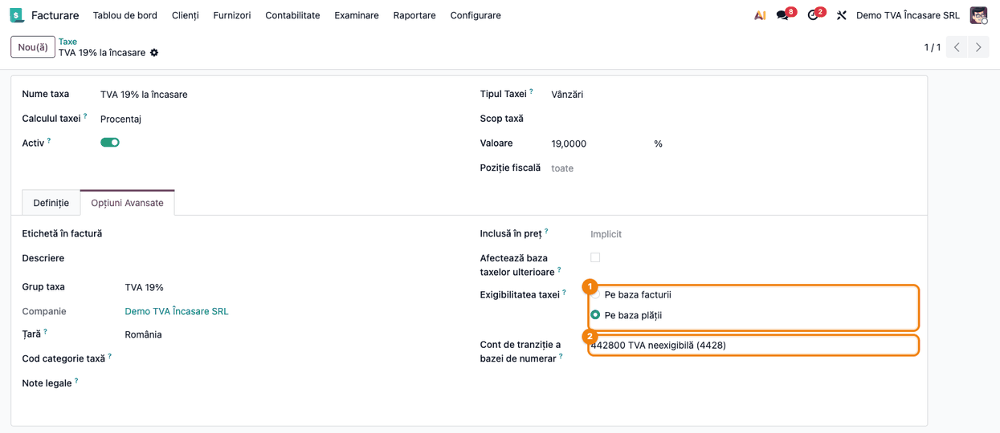
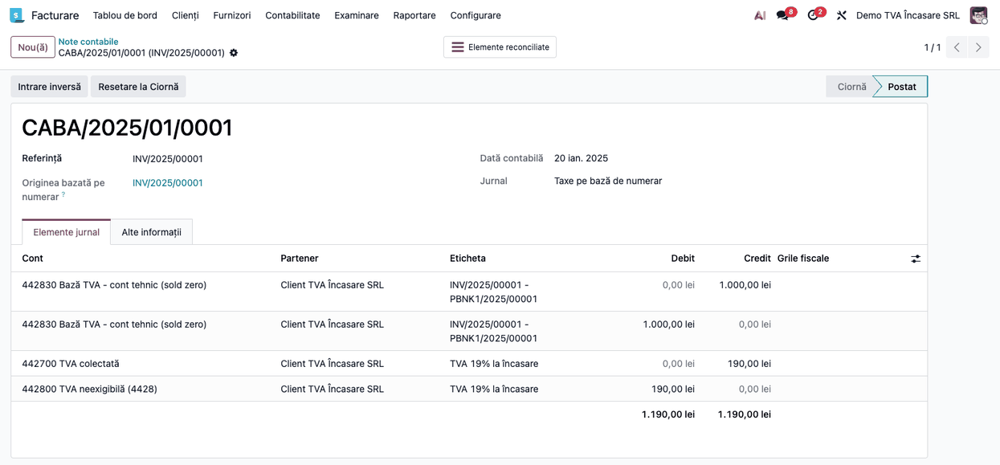
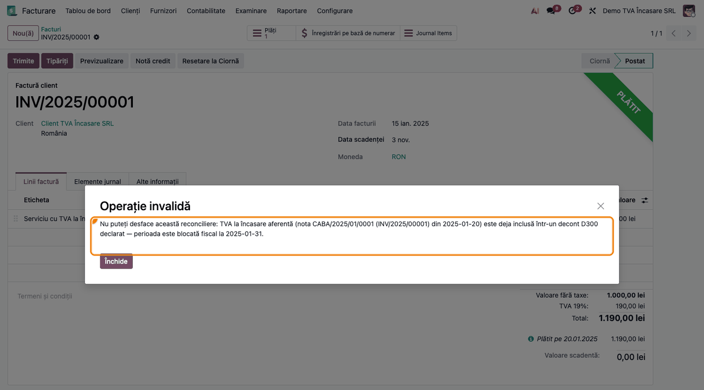

# Fișă Modul: Blocare storno TVA la încasare declarat (4428)

**Modul:** `l10n_ro_vat_on_payment_lock`
**FR:** FR-16
**Utilizator principal:** Contabil TVA, Contabil-șef
**Prioritate:** 🟡 Medie (control de conformitate; previne stornarea retroactivă a TVA declarat)

---

## 1. Scop business

Modulul împiedică **desfacerea reconcilierii** unei încasări atunci când TVA la încasare aferentă
(exigibilitate amânată pe contul **4428**, mecanismul *cash-basis*) a fost deja inclusă într-un
**decont D300 declarat**. Astfel, contabilul nu poate storna retroactiv — din greșeală — TVA-ul
care a devenit deja exigibil și a fost raportat la ANAF. Este un control de fundal, fără ecran
propriu: acționează în momentul în care cineva încearcă să desfacă reconcilierea încasării cu
factura (**Anulare reconciliere**), să modifice suma sau să șteargă o încasare readusă la ciornă,
într-o perioadă închisă fiscal.

## 2. Bază legală și context

- **Cod Fiscal, art. 282** — TVA la încasare: exigibilitatea se amână până la încasarea facturii;
  la încasare (inclusiv parțială) TVA neexigibilă (4428) devine exigibilă și se transferă la
  4426/4427.
- Odată inclusă într-un **D300 validat**, exigibilitatea este definitivă: desfacerea ulterioară a
  reconcilierii ar storna retroactiv TVA-ul deja declarat, ceea ce nu este permis.
- Reperul tehnic pentru „perioadă declarată" este **data de blocare a TVA** (`tax_lock_date`) a
  companiei, pe care fluxul de declarații fiscale Enterprise o mută pe sfârșitul lunii la blocarea
  D300 (vezi `l10n_ro_anaf_d300`); modulul nu setează el însuși data, doar o citește.

## 3. Utilizatori și roluri

- **Contabil TVA** — operează încasările și reconcilierile; primește mesajul de blocare.
- **Contabil-șef** — gestionează data de blocare fiscală (blocarea D300) și deblocarea controlată.

Roluri recomandate pentru testare:
- Administrator funcțional: instalează modulul, activează **Baza de numerar** (TVA la încasare) pe companie.
- Utilizator operațional: emite factura cu TVA la încasare, încasează, încearcă desfacerea reconcilierii.
- Contabil/manager: blochează D300 (setează data de blocare a TVA) și confirmă comportamentul de blocare.

## 4. Conturi și date implicate

| Cont | Rol |
|---|---|
| `4428` | TVA neexigibilă (cont de tranziție cash-basis) |
| `4427` | TVA colectată (devine exigibilă la încasare) |
| `4426` | TVA deductibilă (la achiziții cu TVA la încasare) |
| `442830` | Bază TVA — cont tehnic cu sold zero (baza în oglindă din nota de exigibilitate) |
| `4111` | clienți (creanța care se încasează) |
| `5121`/`5311` | bancă / casă (încasarea) |

Date minime pentru demo:
- companie românească cu **Baza de numerar** activată (TVA la încasare, cash-basis);
- o taxă de vânzare cu **Exigibilitatea taxei = Pe baza plății** și cont de tranziție `4428`;
- o factură client cu această taxă, postată și încasată (generează nota de exigibilitate);
  exemplul din capturi e din ianuarie 2025, deci cu cota de 19% în vigoare atunci; pentru operațiuni
  de după 01.08.2025 folosiți cota standard de 21% (mecanismul de blocare este același);
- o dată de blocare a TVA (`tax_lock_date`) care acoperă luna încasării.

## 5. Configurare inițială

1. Instalați modulul `l10n_ro_vat_on_payment_lock` pe baza demo (depinde de `account` și `l10n_ro`).
2. Activați **Contabilitate → Configurare → Setări**, secțiunea **Taxe**, opțiunea **Baza de numerar**
   (`tax_exigibility`, exigibilitate TVA la încasare) pe companie.
3. Configurați o taxă de vânzare (fila **Opțiuni Avansate**) cu **Exigibilitatea taxei = Pe baza plății** și **Cont de tranziție a bazei de numerar** `4428`.
4. **Setați contul de bază pentru notele cash-basis** — câmpul **„Cont de primire fiscală de bază"**
   (*Base Tax Received Account*, `account_cash_basis_base_account_id`), afișat sub opțiunea
   **Baza de numerar** din aceeași secțiune **Taxe** a setărilor.
   Recomandat: un **cont tehnic cu sold zero**, **`442830` „Bază TVA - cont tehnic (sold zero)"**,
   analitic al lui 4428 (îl creează și îl setează automat `l10n_ro_caba`). Nu `473`, care înseamnă
   sume neclarificate, și nu contul de tranziție 44281/44282.
   Liniile de bază din nota de exigibilitate sunt o mișcare în oglindă (Dr = Cr, sold 0) folosită doar
   pentru raportarea bazei în grilele de TVA; dacă acest câmp este gol, baza rulează pe **contul de
   venituri/cheltuieli** al facturii (ex. 7xx), ceea ce nu este corect. Setând `442830`, baza nu mai
   atinge conturile de rezultat.
5. Asigurați-vă că utilizatorul de test are drepturi de Contabilitate.
6. Nu este nevoie de meniuri noi — modulul nu adaugă interfață proprie; acționează automat.

## 6. Flux de utilizare

### Pasul 1 — Taxa „TVA la încasare"

Verificați taxa de vânzare folosită: **Contabilitate → Configurare → Contabilitate → Taxe**, fila **Opțiuni
Avansate**. Câmpul **Exigibilitatea taxei** trebuie să fie **Pe baza plății**, cu **Cont de tranziție
a bazei de numerar** `4428`. Aceasta este taxa care amână exigibilitatea TVA până la încasare.



### Pasul 2 — Factura încasată și nota de exigibilitate (4428 → 4427)

Emiteți și postați o factură client cu taxa de mai sus, apoi înregistrați încasarea
(butonul **Plătește**). La reconcilierea încasării cu factura, Odoo generează automat **nota de
exigibilitate** (cash-basis): TVA-ul trece din **4428** (neexigibil) în **4427** (colectat),
proporțional cu suma încasată. Liniile de **bază** apar în oglindă pe contul tehnic configurat la
punctul 4 din *Configurare inițială* (`442830`) — se anulează între ele și poartă baza în grilele de
TVA ale taxei (în exemplul din captură taxa de test nu are grile D300, deci coloana **Grile fiscale** e goală).



### Pasul 3 — După declararea D300: desfacerea reconcilierii este blocată

După ce TVA-ul lunii este declarat, D300 se blochează din **Contabilitate → Contabilitate → Închidere
→ Declarații fiscale** (Enterprise, `l10n_ro_anaf_d300`), iar data de
blocare a TVA (`tax_lock_date`) a companiei ajunge pe sfârșitul lunii (în exemplu, 31.01.2025). Din
acest moment, orice operațiune care ar **desface reconcilierea** încasării cu factura — și deci ar
storna nota de exigibilitate dintr-o perioadă deja declarată — este **blocată**:

- pe factură, în zona de plăți, butonul **ⓘ** de lângă „Plătit pe …" → **Anulare reconciliere**;
- orice altă desfacere a aceleiași reconcilieri, din orice ecran (verificarea se face la ștergerea
  reconcilierii parțiale, nu pe un buton anume);
- pe o încasare readusă la ciornă: **modificarea sumei** sau **ștergerea** ei (ambele ar rupe reconcilierea).

**Resetare la Ciornă** pe încasare rămâne permisă: în Odoo 19 plata trece în ciornă păstrând
reconcilierea, iar nota de exigibilitate rămâne postată, deci TVA-ul declarat nu se stornează.

Fiind un control de fundal (fără ecran propriu), blocarea apare ca dialogul **Operație invalidă**
peste ecranul curent, cu mesajul (datele apar în format AAAA-LL-ZZ):

> Nu puteți desface această reconciliere: TVA la încasare aferentă (nota CABA/2025/01/0001
> (INV/2025/00001) din 2025-01-20) este deja inclusă într-un decont D300 declarat — perioada este
> blocată fiscal la 2025-01-31.



Operatorul închide dialogul (**Închide**); reconcilierea și nota de exigibilitate rămân neschimbate.
Pentru o corecție legitimă, contabilul-șef trebuie întâi să **deblocheze** perioada: în
**Contabilitate → Contabilitate → Închidere → Blochează datele…** (rol Administrator contabilitate)
mută **Blochează declarația fiscală** înaintea lunii. Resetarea D300 din **Declarații fiscale** nu
ajunge: golește doar blocarea declarației, nu și data de blocare a TVA a companiei. Nici o excepție
de blocare nu ridică blocajul, pentru că modulul citește direct data de blocare a companiei. După
corecție, D300 rectificativ se depune conform procedurii — nu prin storno retroactiv tăcut.

### Note de monografie și raportare

- La emiterea facturii (exemplul din capturi, 1.000 lei + TVA 19%): **Dr 4111 1.190 = Cr 70x 1.000
  + Cr 4428 190** — TVA-ul stă pe 4428 (neexigibil) până la încasare.
- La încasare: **Dr 5121 1.190 = Cr 4111 1.190**; reconcilierea încasării cu factura generează nota
  de exigibilitate de mai jos.
- La încasare (exigibilitate), nota cash-basis generată automat de Odoo: **Dr 4428 = Cr 4427**
  (latura neexigibil → colectat), pe baza facturii cu TVA la încasare; la achiziții, simetric
  **Dr 4426 = Cr 4428**.
- Modulul **nu** generează note contabile proprii — adaugă doar **controlul de blocare** la
  desfacerea reconcilierii care ar storna nota de exigibilitate dintr-o perioadă declarată.
- Reperul „declarat" = `tax_lock_date`; perioadele de după data de blocare rămân editabile normal.

## 7. Legături cu alte module / declarații

| Modul / proces | Rol în flux | Tip legătură |
|---|---|---|
| `account` | reconciliere, note cash-basis (4428), data de blocare TVA | dependență (manifest) |
| `l10n_ro` | plan de conturi RO (4428/4426/4427), țară fiscală RO | dependență (manifest) |
| `l10n_ro_vat_on_payment` (OCA) | regimul „TVA la încasare" pe partener + țintirea contului 4428 | companion (recomandat) |
| `l10n_ro_anaf_d300` | declarația D300: la blocare, fluxul Enterprise mută `tax_lock_date` pe sfârșitul lunii; resetarea declarației nu o readuce înapoi | integrare prin convenție |
| `l10n_ro_caba` | creează și setează contul tehnic `442830` pentru baza notelor cash-basis | companion (recomandat) |

Ce este automat: blocarea desfacerii reconcilierii când nota de exigibilitate cade în perioadă declarată.
Ce rămâne manual: retragerea `tax_lock_date` pentru rectificare, din **Blochează datele…** (setarea o face blocarea D300).

## 8. Verificări pentru consultant

- [ ] Modulul se instalează fără erori pe o companie RO.
- [ ] Cu **Baza de numerar** activă și taxa „Pe baza plății", încasarea unei facturi generează nota 4428 → 4427.
- [ ] Cu `tax_lock_date` ≥ data notei de exigibilitate, **Anulare reconciliere** pe factură este **blocată** cu mesaj explicit (dialog „Operație invalidă").
- [ ] În aceeași situație, **Resetare la Ciornă** pe încasare reușește, dar reconcilierea și nota de exigibilitate rămân; modificarea sumei sau ștergerea încasării în ciornă sunt **blocate**.
- [ ] Cu `tax_lock_date` mai vechi decât data notei (perioadă nedeclarată), desfacerea este **permisă**.
- [ ] Fără `tax_lock_date`, desfacerea este permisă.
- [ ] Pe o companie cu țară fiscală non-RO, controlul nu se aplică.

## 9. Mesaje de eroare frecvente

| Mesaj / simptom | Cauză probabilă | Remediere |
|---|---|---|
| „Nu puteți desface această reconciliere: TVA la încasare aferentă (nota … din …) este deja inclusă într-un decont D300 declarat — perioada este blocată fiscal la …" | Se încearcă stornarea/desfacerea unei încasări a cărei TVA exigibilă e deja declarată | Contabilul-șef mută **Blochează declarația fiscală** înaintea lunii, din **Închidere → Blochează datele…** (resetarea D300 nu ajunge) și corectează prin D300 rectificativ, conform procedurii |
| Blocarea nu apare deși perioada e declarată | Compania nu are țara fiscală RO sau `tax_lock_date` nu acoperă data notei de exigibilitate | Verificați țara fiscală a companiei și data de blocare a TVA |
| Încasarea a trecut în ciornă fără niciun mesaj | Comportament normal în Odoo 19: **Resetare la Ciornă** păstrează reconcilierea și nota de exigibilitate | Nimic de corectat; blocarea apare abia la desfacerea reconcilierii, modificarea sumei sau ștergerea încasării |
| Nu se generează nota de exigibilitate la încasare | Taxa nu are exigibilitatea „Pe baza plății" sau lipsește contul de tranziție 4428 | Configurați taxa cu exigibilitatea „Pe baza plății" și cont de tranziție 4428 |

## 10. Capturi de ecran

Capturile (`static/description/`) sunt **generate automat** din `tests/test_screenshots.py`
(mixinul `ScreenshotCase` din `l10n_ro_doc_screenshots`, import defensiv), în **limba română**,
pe planul de conturi RO (`setup_country("ro")`):

1. `01_taxa_tva_incasare.png` — taxa de vânzare, fila Opțiuni Avansate: exigibilitate „Pe baza plății" + cont tranziție 4428 (Pasul 1).
2. `02_nota_exigibilitate.png` — nota de exigibilitate (taxe pe bază de numerar) generată la încasare: 4428 → 4427, baza în oglindă pe 442830 (Pasul 2).
3. `03_blocare_desfacere.png` — factura încasată, cu dialogul „Operație invalidă" afișat la **Anulare reconciliere** într-o perioadă declarată (Pasul 3).

Aceleași capturi, în engleză, sunt în `static/description/en/` (pentru `readme/USAGE.md`).

Regenerare:

```bash
./odoo/odoo-bin -c odoo.conf -d <db> -i l10n_ro_vat_on_payment_lock,l10n_ro_doc_screenshots \
    --test-tags=/l10n_ro_vat_on_payment_lock:TestVatOnPaymentLockScreenshots --stop-after-init
```

## 11. Observații pentru manual

Modulul este un **control de conformitate fără interfață proprie**: în manual, prezentați-l ca o
„plasă de siguranță" pentru TVA la încasare — explicați când apare blocajul (după declararea D300,
prin `tax_lock_date`, la desfacerea reconcilierii încasării), de ce (art. 282 — exigibilitate
definitivă), că **Resetare la Ciornă** pe încasare nu este blocată (în Odoo 19 nu desface
reconcilierea) și care e procedura corectă de corecție (deblocare + D300 rectificativ, nu storno
retroactiv).
