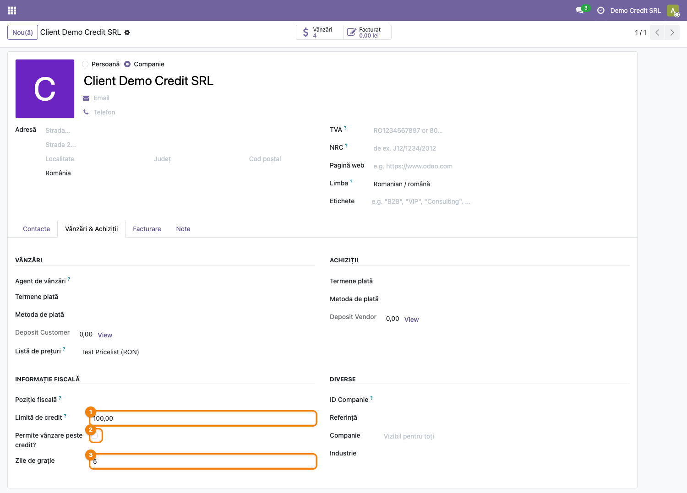
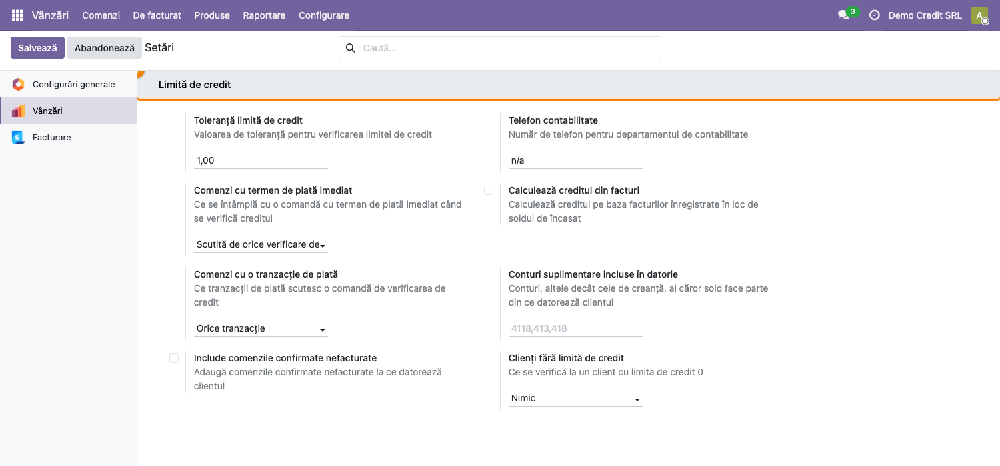
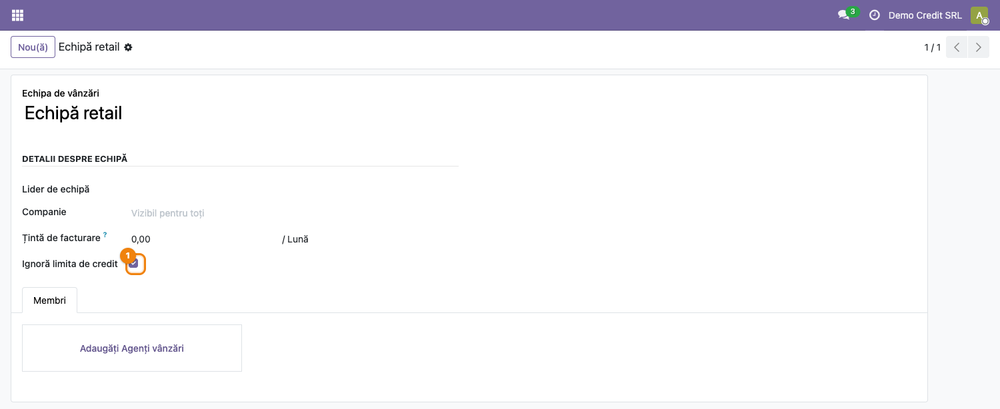
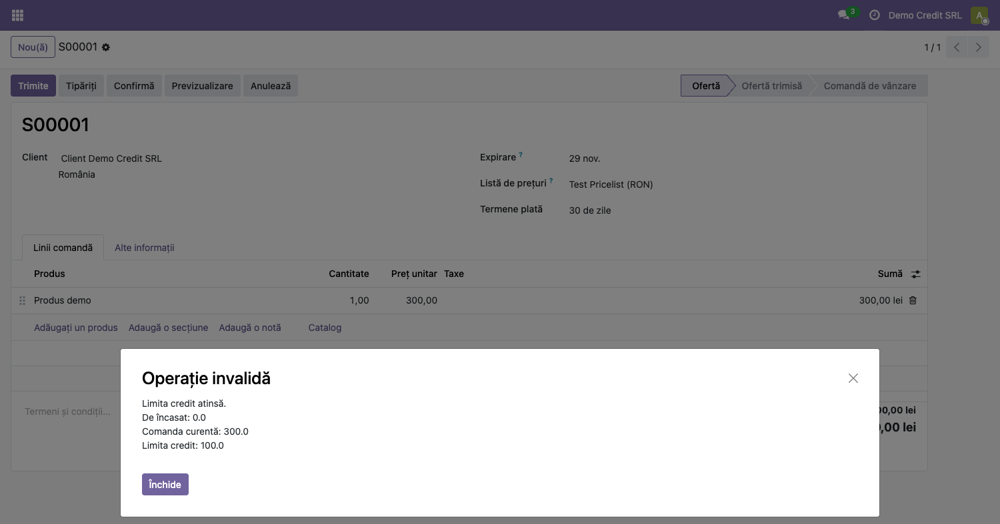
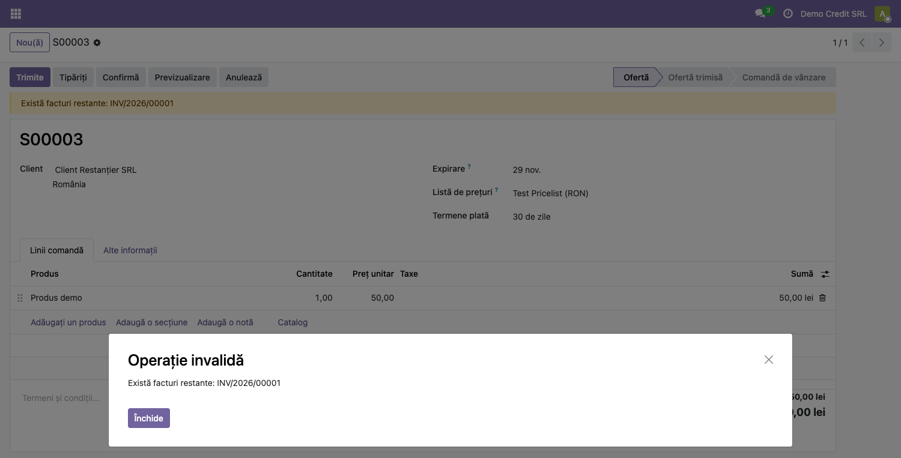
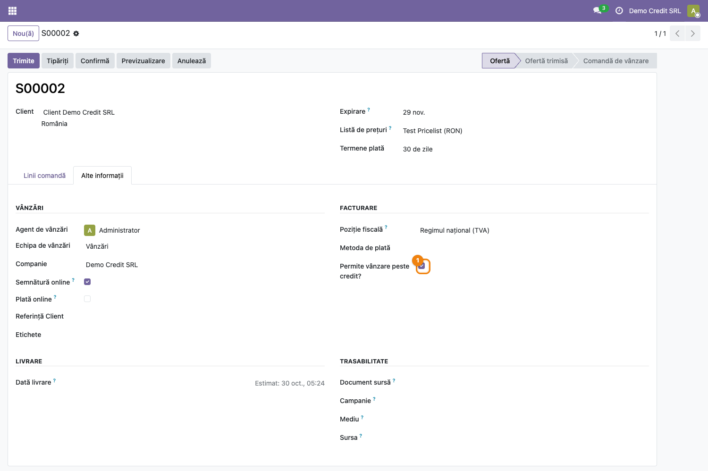
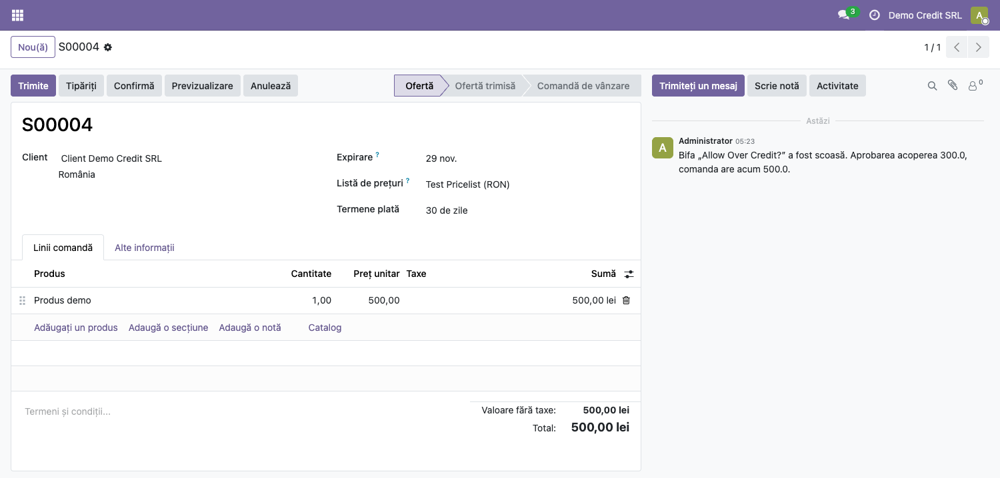
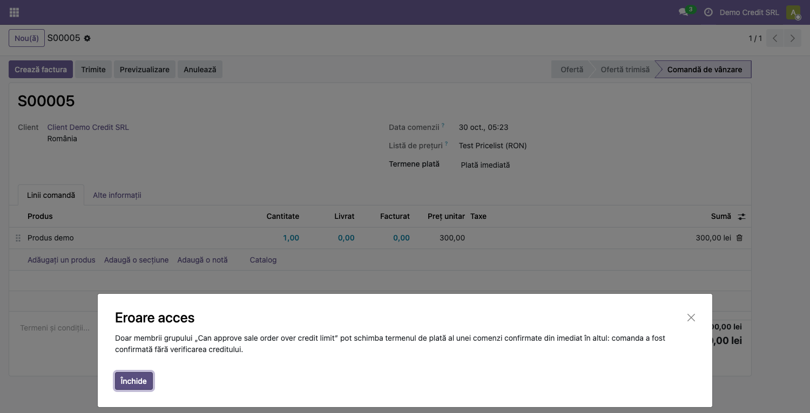

# Fișă Modul: Control limită de credit pentru parteneri

**Modul:** `terrabit_partner_credit_limit`
**Utilizator principal:** Contabil clienți, Manager vânzări, Operator comercial
**Prioritate:** 🟡 Medie (control de risc financiar, nu obligație legală)

---

## 1. Scop business

Această fișă descrie utilizarea modulului `terrabit_partner_credit_limit` pentru scenariul
**Control limită de credit pentru parteneri**. Modulul blochează confirmarea comenzilor de vânzare
atunci când datoria clientului (soldul de încasat, opțional comenzile confirmate încă nefacturate și
soldul unor conturi suplimentare) ar depăși limita de credit stabilită pe firma clientului, sau când
clientul are facturi restante. Derogarea se face controlat, prin roluri, cu aprobare pe o sumă
precisă, iar excepțiile se pot da pe echipă de vânzări, pe partener sau pe tranzacție de plată.
Consultantul folosește documentul pentru reproducerea fluxului în baza demo.

## 2. Bază legală și context

Nu există o obligație legală specifică — este un control intern de gestiune a riscului de credit
comercial. Contextul operațional: firma acordă termene de plată clienților și dorește să limiteze
expunerea față de un client la o valoare maximă (limita de credit), eventual cu o marjă de toleranță
și cu o perioadă de grație (`clemency_days`) înainte ca o rată scadentă să fie considerată
restantă.

**Limita se aplică pe firmă.** Verificarea citește limita, datoria și restanța **partenerului
comercial** (firma), nu ale contactului de pe comandă (adresă de livrare, persoană de contact). O
limită trecută pe un contact nu produce niciun efect; Odoo copiază singur limita de pe firmă pe
contactele ei, deci valoarea de pe contacte este o copie, nu o decizie. Limita se setează pe firmă.

## 3. Utilizatori și roluri

Contabil clienți, Manager vânzări, Operator comercial (întocmește comenzi).

Roluri specifice introduse de modul:
- **Manage credit limits** (`group_credit_limit`; în interfața RO „Modifică limite de credit") — poate
  modifica limita de credit, marcajul „Allow Over Credit?" și zilele de grație pe partener, în
  câmpurile adăugate de modul. Pe server sunt păzite doar „Allow Over Credit?" și „Zile de grație": un
  utilizator din afara grupului nu le poate seta nici prin import sau API (fluxurile de sistem sunt
  excepție). **Limita de credit în sine nu e păzită pe server**: ea se poate modifica și din tabul
  standard **Facturare → Limite de credit** al partenerului (când setarea companiei e activă), de
  oricine are drepturi de facturare. **Nu** ocolește blocajul la confirmarea comenzii — dimpotrivă, cui are
  acest grup i se ascunde și butonul „Req. confirm" (vezi Pasul 4/6).
- **Can approve sale order over credit limit** (`group_credit_limit_sale_order`; în interfața RO „Poate
  aproba comenzi de vânzare peste limita de credit") — singurul grup care ocolește verificarea la
  confirmare (`action_confirm`) și care poate schimba, pe o comandă confirmată, termenul de plată din
  „imediat" în altul (Pasul 8). Tot el vede câmpul „Allow Over Credit?" pe comandă; restricția este
  **doar în interfață**: câmpul nu e verificat pe server, intenționat, ca importurile din marketplace
  (eMAG, Trendyol, Doraly) să-l poată seta.

Grupurile se acordă din formularul utilizatorului (cu modul dezvoltator activ).

> Atenție la testare: un utilizator cu **doar** „Manage credit limits" (fără „Can approve…") rămâne
> blocat la confirmarea unei comenzi peste limită și nu vede nici butonul „Req. confirm" — pentru
> deblocare are nevoie explicit de grupul „Can approve sale order over credit limit".

Roluri recomandate pentru testare:
- Administrator funcțional: instalează modulul și configurează parametrii globali.
- Operator comercial (fără grupurile de mai sus): creează comenzi și observă blocajul.
- Contabil cu grupul „Manage credit limits": ajustează limita pe firmă.
- Manager vânzări cu grupul „Can approve…": aprobă depășirile pe comandă.

## 4. Conturi și date implicate

Modulul nu introduce conturi noi și nu generează note contabile. Datoria clientului se calculează din:

- **soldul de încasat al firmei** (`credit` pe `res.partner`: liniile postate și nereconciliate ale
  conturilor de tip creanță, deci și 461, nu doar 4111; încasările și notele de credit nealocate îl
  scad); sau, dacă setarea „Calculate Credit from Invoices" este activă, **facturile de client
  postate și neplătite sau parțial plătite**. În acest mod se scad notele de credit neachitate, dar
  **nu** se scad încasările nealocate și nu contează soldurile inițiale sau notele fără factură
  (intenționat);
- opțional, **comenzile confirmate încă nefacturate** („Count Confirmed Orders Not Yet Invoiced");
- opțional, **soldul conturilor suplimentare** din „Extra Accounts Counted as Debt" (de exemplu
  `4118`, `413`, `418`, care pentru Odoo nu sunt conturi de creanță).

**Restanța** se calculează separat de limită, pe **liniile de creanță** ale firmei (postate,
nereconciliate), a căror **scadență proprie** (`date_maturity`) plus zilele de grație a trecut.
Deci o factură cu rate devine restantă rată cu rată, iar soldurile preluate și notele manuale, care
nu au factură, sunt și ele văzute. Din suma restantă se scad **încasările și notele de credit
nealocate** ale firmei: contează doar diferența, comparată cu toleranța.

Comparația se face cu valoarea comenzii **cu TVA**, ca soldul clientului. În Odoo 19, limita de credit
poate avea și o valoare implicită pe companie (setarea de contabilitate): dacă e completată, „limita 0
= fără limită" nu mai e valabilă pentru clienții care nu au valoare proprie.

Date minime pentru demo:
- companie cu localizare contabilă instalată și jurnal de vânzări funcțional;
- un partener de test cu `credit_limit` setat (ex. 100);
- cel puțin o factură de client postată și neîncasată pe acel partener, pentru a genera sold;
- o factură cu scadență depășită, pentru scenariul de restanță (Pasul 5);
- o echipă de vânzări (`crm.team`) de test.

## 5. Configurare inițială

1. Instalați modulul `terrabit_partner_credit_limit` pe baza demo (depinde de `account_payment`,
   `sale_management` și `terrabit_partner_payable_receivable`).
2. Verificați elementele nou apărute: câmpurile de limită de credit pe formularul partenerului și
   blocul „Limită de credit" din **Vânzări → Configurare → Setări** (Pasul 2).
3. Setați parametrii globali din Setări. La instalare vin valori care păstrează comportamentul
   anterior: toleranță 1, telefon `n/a`, termenul „imediat" **scutit de orice verificare**,
   calcul din soldul contabil, orice tranzacție de plată scutește comanda, clienții cu limita 0 nu
   sunt verificați, comenzile nefacturate și conturile suplimentare nu intră în calcul.
4. Configurați `credit_limit` pe **firma** partenerului de test și, dacă e cazul, bifați „Ignore
   credit limits" pe echipa de vânzări folosită la testare.
5. Verificați că utilizatorul de test are/nu are grupurile „Manage credit limits" și „Can approve
   sale order over credit limit", după scenariul urmărit.

## 6. Flux de utilizare

### Pasul 1 — Setarea limitei de credit pe firmă

Accesați **Contacte → deschideți firma clientului → tab Vânzări & Achiziții**, secțiunea
**Informație fiscală**, și completați **Limită de credit**. Câmpurile **Permite vânzare peste
credit?** (`Allow Over Credit?`, ignoră permanent limita și restanța pentru acest partener) și
**Zile de grație** (`Clemency Days`, zile înainte ca o rată scadentă să conteze ca restantă) sunt
editabile doar de utilizatorii din grupul „Manage credit limits" — pentru ceilalți apar
needitabile (iar un vânzător fără drepturi de facturare nu vede deloc grupul „Informație fiscală").

Limita se pune pe **firmă**, nu pe adrese de livrare sau pe persoane de contact: verificarea nu
citește limita contactelor.



### Pasul 2 — Parametrii globali de verificare

Accesați **Vânzări → Configurare → Setări**, secțiunea **Limită de credit**. Setările sunt valabile pentru
toată baza de date. Mai jos, fiecare setare cu ce face și cu efectul fiecărei valori.

**1. Toleranță limită de credit** (`credit_limit.tolerance`, implicit 1)

O singură sumă, în moneda companiei, folosită în trei locuri:
- **limita:** comanda e refuzată doar dacă datoria + comanda depășesc limita cu **mai mult** decât toleranța
  (limita 100, toleranța 1: o comandă care duce totalul la 100,50 trece, la 101,50 e refuzată);
- **restanța:** clientul e considerat restant doar dacă restanța netă (după scăderea încasărilor nealocate)
  depășește toleranța;
- **aprobarea:** bifa „Allow Over Credit?" cade dacă comanda crește peste suma aprobată **plus** toleranța.

**2. Telefon contabilitate** (`credit_limit.accounting_phone`, implicit `n/a`)

Numărul departamentului de contabilitate. Nu apare în mesajul de eroare al modulului; este expus în
rezultatul verificării pentru modulele care îl afișează (de exemplu `terrabit_partner_credit_limit_website`,
pe pagina de plată).

**3. Comenzi cu termen de plată imediat** (`credit_limit.skip_term_immediate`, implicit *Scutită de orice verificare de credit*)

Ce se întâmplă cu o comandă al cărei termen de plată este „Plată imediată" (clientul plătește înainte de livrare, deci
riscul de credit al comenzii e mic). Se aplică doar când termenul este setat efectiv; un câmp gol, deși afișează gri
„Imediat", se verifică normal.

| Valoare | Efect la confirmarea comenzii |
|---|---|
| *Verificată ca oricare alta* | Comanda se verifică la fel ca oricare alta: limita și restanța. Protecția din Pasul 8 e oprită. |
| *Scutită doar de limită* | Comanda nu se compară cu limita de credit, dar **restanțele clientului se verifică în continuare**. |
| *Scutită de orice verificare de credit* (implicit) | Comanda trece fără nicio verificare. În plus, **facturile cu termen imediat nu mai intră în restanța** clientului, pentru nicio comandă. |

**4. Calculează creditul din facturi** (`credit_limit_from_invoices`, implicit oprit)

Stabilește de unde vine datoria folosită la comparația cu limita.

| Valoare | Datoria clientului este |
|---|---|
| Oprit (implicit) | Soldul de încasat din contabilitate (liniile de creanță postate și nereconciliate): include încasările și notele de credit nealocate (care îl scad), soldurile inițiale și notele fără factură. |
| Pornit | Suma facturilor de client postate și neplătite sau parțial plătite, plus notele de credit neachitate (care o scad). **Nu** se scad încasările nealocate și **nu** contează soldurile inițiale sau notele fără factură. Un client fără facturi neplătite este totuși verificat: comanda singură nu poate depăși limita. O plată online autorizată scade datoria doar cu suma ei, nu scoate factura. |

În modul „pornit", parametrul `credit_limit_check_supplier_invoices` (în Parametri de sistem) hotărăște dacă intră și
facturile de furnizor ca o compensare.

**5. Comenzi cu o tranzacție de plată** (`terrabit_partner_credit_limit.transaction_exemption`, implicit *Orice tranzacție*)

Ce tranzacție de plată asociată comenzii (plata online, ramburs, transfer) o scutește de verificare.

| Valoare | Efect |
|---|---|
| *Orice tranzacție* (implicit) | Orice tranzacție scutește comanda, chiar și una refuzată sau anulată. |
| *O plată care nu a eșuat* | Scutesc tranzacțiile autorizate, finalizate sau în așteptare (de exemplu un ramburs sau un transfer încă neîncasat); cele refuzate, anulate sau neîncepute nu. |
| *O plată finalizată care acoperă totalul* | Scutesc doar tranzacțiile autorizate sau finalizate, **și numai dacă împreună acoperă valoarea comenzii**. O plată parțială nu scutește. |

Parametrul `terrabit_partner_credit_limit.skip_only_card` (în Parametri de sistem) se aplică peste oricare dintre
valori: dacă e pornit, tranzacțiile prin transfer bancar și ramburs nu mai scutesc deloc comanda.

**6. Conturi suplimentare incluse în datorie** (`credit_limit.extra_receivable_accounts`, implicit gol)

Coduri de conturi separate prin virgulă, de exemplu `4118,413,418`. Un cod potrivește toate conturile care încep cu
el. Soldul postat și nereconciliat al clientului pe aceste conturi se **adaugă la datorie**, pentru că Odoo numără doar
conturile de tip creanță, iar acestea nu sunt. Se aplică **doar la verificarea limitei** și doar clienților care au
limită: restanța se caută numai pe conturile de tip creanță, deci un client mutat pe 4118 (incert, în litigiu) nu e
blocat pentru restanță din cauza acestor conturi. Exemplu: datoria e 800 pe 4111 și 300 pe 4118, limita 1.000: cu
`4118` în listă, datoria folosită e 1.100, deci o comandă nouă e refuzată.

**7. Include comenzile confirmate nefacturate** (`credit_limit.include_uninvoiced_orders`, implicit oprit)

| Valoare | Efect |
|---|---|
| Oprit (implicit) | Datoria nu cuprinde comenzile confirmate care nu au fost încă facturate. |
| Pornit | Partea încă nefacturată a celorlalte comenzi confirmate ale clientului se adaugă la datorie, în ambele moduri de calcul. Comenzile cu facturare la livrare, nelivrate încă, nu intră. Se aplică clienților cu limită. |

**Atenție:** nu activați opțiunea împreună cu contul `418` din setarea 6, dacă livrările nefacturate se înregistrează
pe 418: aceeași livrare ar fi numărată de două ori.

**8. Clienți fără limită de credit** (`credit_limit.check_without_limit`, implicit *Nimic*)

Ce se verifică la un client cu limita 0. „Allow Over Credit?" (pe client sau pe comandă) scutește în continuare de
orice valoare de mai jos.

| Valoare | Efect |
|---|---|
| *Nimic* (implicit) | 0 înseamnă „fără limită": clientul nu e verificat deloc, nici pentru restanțe. |
| *Doar facturile restante* | Clientul nu are plafon, dar comanda e refuzată dacă are rate scadente neîncasate. |
| *Tot ce e deschis* | Comanda e refuzată dacă clientul are comenzi confirmate nefacturate, facturi ciorne sau neplătite (chiar nescadente), sau restanțe. Mesajul listează primele 5 documente. Regula „client cash". |



> Parametrii `credit_limit_check_supplier_invoices` (setarea 4) și
> `terrabit_partner_credit_limit.skip_only_card` (setarea 5) nu au câmp în Setări. Se editează din
> **Setări → Tehnic → Parametri → Parametri de sistem**, cu modul dezvoltator activ.

### Pasul 3 — Excepție pe echipă de vânzări

Accesați **Vânzări → Configurare → Echipe de vânzări → deschideți o echipă** și bifați
**Ignoră limita de credit** (`Ignore credit limits`) dacă acea echipă (ex. retail cu plată la
livrare) nu trebuie supusă verificării.



### Pasul 4 — Blocarea comenzii care depășește limita

Creați o comandă de vânzare pentru partenerul de test, cu o valoare care, adunată la datoria curentă,
depășește limita de credit plus toleranța. La **Confirmă**, dacă utilizatorul nu are grupul
„Can approve sale order over credit limit" și comanda nu are bifat „Allow Over Credit?", confirmarea
este blocată cu mesajul **„Limita credit atinsă"** (EN: „Cannot confirm order"), care arată datoria
de încasat, valoarea comenzii curente și limita de credit. Verificarea rulează **înainte** de
confirmare: o comandă refuzată nu pornește livrări, rezervări sau mesaje.

Pe formularul comenzii apare un avertisment de depășire, dar numai dacă firma are deja un sold de
încasat și limita este depășită; nu ține cont de toleranță, de conturile suplimentare sau de modul
„din facturi", deci blocajul de la confirmare rămâne singura verificare completă. Avertismentul citește
datoria și limita **firmei**, și pentru comenzile făcute pe un contact al firmei.



### Pasul 5 — Restanța

Pe un client cu o rată scadentă neîncasată (peste zilele de grație), comanda este blocată la
confirmare cu mesajul **„Există facturi restante: …"** (EN: „There are overdue invoices: …"), chiar
dacă limita nu este depășită; pe formular apare și avertismentul de restanță. Restanța se verifică
și la clienții fără limită, dacă setarea „Clienți fără limită de credit" nu este pe *Nimic*.

Din suma restantă se scad încasările și notele de credit pe care contabilitatea nu le-a alocat încă:
dacă acestea acoperă restanța (sau diferența rămasă e sub toleranță), comanda nu mai este blocată.



### Pasul 6 — Derogare controlată cu sumă aprobată

Pe formularul comenzii, tabul **Alte informații**, utilizatorii din grupul „Can approve sale order
over credit limit" văd câmpul **Allow Over Credit?** — bifarea lui permite confirmarea comenzii
peste limită (sau cu restanțe). La bifare, **se reține valoarea comenzii** ca sumă aprobată, la salvarea unei comenzi
existente. O comandă creată direct cu bifa (de un aprobator care o bifează înainte de prima salvare,
sau prin importul din marketplace) nu are sumă reținută, iar aprobarea ei acoperă orice valoare;
comportamentul este intenționat, bifa fiind pusă oricum de un aprobator sau de un import de
încredere. Suma nu apare pe formular; o vedeți doar în mesajul din Pasul 7.
Utilizatorii care **nu** au grupul „Manage credit limits" (indiferent dacă au sau nu „Can
approve…") văd în schimb butonul **Cere confirmare** (`Req. confirm`) în antet — vizibil doar pe
ofertă/ofertă trimisă, când verificarea semnalează depășire sau restanțe — care deschide o activitate
(`mail.activity`) adresată responsabilului echipei de vânzări, cerându-i să aprobe depășirea.

Dacă vânzătorul mărește apoi comanda peste suma aprobată (plus toleranța) — inclusiv prin schimbarea
listei de prețuri, a poziției fiscale sau a monedei, dacă totalul ajunge peste sumă — bifa se scoate
singură și mesajul apare în chatter (Pasul 7); la confirmare, comanda este refuzată cu mesajul
obișnuit de limită. Aprobările date înainte de versiunea 19.0.1.5.0 nu au
sumă și acoperă orice valoare. Bifa nu se copiază la duplicarea comenzii.



### Pasul 7 — Aprobarea cade la creșterea comenzii

După bifarea „Allow Over Credit?", adăugați pe comandă o linie care o face mai mare decât suma
aprobată plus toleranța. Bifa se scoate singură și în discuțiile comenzii (chatter) apare mesajul
**„Bifa „Allow Over Credit?" a fost scoasă. Aprobarea acoperea X, comanda are acum Y."** Aprobatorul
trebuie să aprobe din nou, pentru noua sumă.



### Pasul 8 — Schimbarea termenului „imediat" după confirmare

O comandă cu termen de plată imediat poate sări peste verificare (sau o parte din ea), după setarea
din Pasul 2. Ca să nu se confirme fără verificare și apoi să se treacă pe 30 de zile, schimbarea
termenului din „imediat" în altul, pe o comandă **confirmată**, cere grupul „Can approve sale order
over credit limit"; pentru ceilalți, modificarea este refuzată cu mesajul **„Doar membrii grupului
„Can approve sale order over credit limit" pot schimba termenul de plată al unei comenzi confirmate
din imediat în altul…"**. Celelalte schimbări de termen rămân libere: înainte de confirmare, spre
„imediat" sau între termene cu plată amânată. Protecția nu mai funcționează dacă setarea „Comenzi cu
termen de plată imediat" este pe *Verificată ca oricare alta*.



### Note de monografie și raportare

Modulul nu generează note contabile proprii — se bazează pe soldul standard `res.partner.credit`
(sau pe facturile `account.move` neplătite, dacă `credit_limit_from_invoices` e activ) și doar
condiționează **confirmarea comenzii de vânzare** (`sale.order.action_confirm`), fără a atinge
înregistrările contabile ale facturilor.

## 7. Legături cu alte module / declarații

| Modul / proces | Rol în flux | Tip legătură |
|---|---|---|
| `account_payment` | soldul de încasat al partenerului, tranzacții de plată | dependență (manifest) |
| `sale_management` | comanda de vânzare și fluxul de confirmare | dependență (manifest) |
| `terrabit_partner_payable_receivable` | secțiunea de sold client/furnizor pe formularul comenzii, unde apare avertizarea de depășire | dependență (manifest) |
| `crm_team` (`sales_team`) | excepția „Ignore credit limits" pe echipă | extindere |
| `mail` (`mail.activity`) | activitatea de solicitare de aprobare (**Req. confirm**) | integrare |
| `terrabit_partner_credit_limit_review` | regulile de revizuire a comenzilor (limită depășită, facturi restante), mutate acolo prin migrarea 19.0.1.4.0 | punte opțională |

> Notă: modulul suprascrie și `mail.activity._default_activity_type_for_model`, la nivel global
> (pentru toate modelele, nu doar `sale.order`) — dacă există un tip de activitate implicit definit
> pentru modelul respectiv, acela e folosit în locul celui standard.

Ce este automat: blocarea confirmării comenzii, calculul datoriei și al restanței, scăderea
încasărilor nealocate din restanță, afișarea avertizărilor, scoaterea aprobării când comanda
crește, precompletarea activității de aprobare către responsabilul echipei.
Ce rămâne manual: decizia de a bifa „Allow Over Credit?" sau de a acorda grupurile de derogare,
stabilirea limitei de credit pe firmă și a parametrilor globali, alocarea încasărilor pe facturi.

## 8. Verificări pentru consultant

- [ ] Modulul se instalează fără erori pe baza demo (dependențe: `account_payment`,
      `sale_management`, `terrabit_partner_payable_receivable`).
- [ ] Câmpurile de limită de credit de pe partener sunt needitabile pentru un utilizator fără
      grupul „Manage credit limits" și editabile pentru unul cu acest grup.
- [ ] O comandă de vânzare care depășește limita + toleranța este blocată la confirmare, cu mesaj
      clar (datorie, valoare comandă, limită), fără ca verificarea să înceapă livrări sau mesaje.
- [ ] O comandă pe un contact (adresă de livrare) al firmei arată avertismentele firmei.
- [ ] O rată scadentă peste zilele de grație blochează comanda; o încasare nealocată egală cu restanța
      o deblochează.
- [ ] Bifarea „Ignore credit limits" pe echipa de vânzări permite confirmarea fără verificare.
- [ ] Bifarea „Allow Over Credit?" pe partener sau pe comandă (cu grupul potrivit) permite
      confirmarea peste limită; mărirea comenzii peste suma aprobată scoate bifa și o refuză din nou.
- [ ] Butonul „Req. confirm" apare doar pentru utilizatorii fără grupul „Manage credit limits" și
      deschide corect activitatea către responsabilul echipei de vânzări.
- [ ] Un utilizator din afara grupului „Can approve…" nu poate muta o comandă confirmată din termen
      „imediat" în alt termen.
- [ ] Un utilizator cu doar „Manage credit limits" rămâne blocat la confirmare.
- [ ] Setările din Pasul 2 (toleranță, telefon, termen imediat, calcul din facturi, tranzacții,
      conturi suplimentare, comenzi nefacturate, clienți fără limită) se salvează și influențează
      verificarea așa cum este descris.
- [ ] Un client cu limita 0 nu este verificat (setarea implicită) și este verificat pe restanțe sau
      pe tot ce e deschis, după alegere.

## 9. Mesaje de eroare frecvente

| Mesaj / simptom | Cauză probabilă | Remediere |
|-----------------|-----------------|-----------|
| „Limita credit atinsă. De încasat: … Comanda curentă: … Limita credit: …" (EN: „Cannot confirm order. To receive: … Current order: … Credit limit: …") | Datoria + valoarea comenzii depășesc limita de credit + toleranța | Bifați „Allow Over Credit?" (dacă utilizatorul are dreptul), măriți limita pe firmă, sau folosiți fluxul „Req. confirm" |
| Mesajul din chatter „Bifa „Allow Over Credit?" a fost scoasă. Aprobarea acoperea X, comanda are acum Y." | Comanda a crescut peste suma aprobată | Aprobatorul bifează din nou „Allow Over Credit?" pentru noua valoare. Mesajul apare doar în chatter; la confirmare, refuzul are textul obișnuit de limită |
| „Există facturi restante: …" (EN: „There are overdue invoices: …") | Există rate scadente (peste zilele de grație) neîncasate pe firma clientului, cu diferența peste toleranță după scăderea încasărilor nealocate | Încasați/alocați plățile pe facturi, regularizați restanțele sau bifați „Allow Over Credit?" |
| „Nu se poate confirma comanda. Clientul are comenzi confirmate nefacturate: …" | Setarea „Clienți fără limită de credit" este pe *Tot ce e deschis* | Facturați comenzile sau schimbați setarea |
| „Nu se poate confirma comanda. Clientul are facturi ciorne sau neplătite: …" | Aceeași setare, pe *Tot ce e deschis* | Postați/încasați facturile sau schimbați setarea |
| „Doar membrii grupului „Can approve sale order over credit limit" pot schimba termenul de plată al unei comenzi confirmate din imediat în altul…" | Utilizatorul fără grupul de aprobare a încercat să schimbe termenul unei comenzi confirmate | Adăugați utilizatorul în grup sau lăsați termenul „imediat" |
| „Doar membrii grupului „Manage credit limits" pot seta „Allow Over Credit?" sau „Clemency Days" pe un client." | Utilizatorul fără grup a scris câmpul prin import sau API | Folosiți un utilizator din grupul „Manage credit limits" |
| Câmpul „Limită de credit" apare needitabil pe partener | Utilizatorul curent nu are grupul „Manage credit limits" | Adăugați utilizatorul în grupul „Manage credit limits" |
| Câmpul „Allow Over Credit?" nu apare pe comanda de vânzare | Utilizatorul nu are grupul „Can approve sale order over credit limit" | Adăugați utilizatorul în grupul respectiv sau folosiți butonul „Req. confirm" |
| Limita pusă pe un contact nu se aplică | Verificarea citește limita firmei, nu a contactului | Setați limita pe firma clientului |
| Verificarea nu ține cont de o comandă cu tranzacție de plată | Setarea „Comenzi cu o tranzacție de plată" este pe *Orice tranzacție* (implicit) sau parametrul `terrabit_partner_credit_limit.skip_only_card` exclude tranzacțiile prin transfer bancar/ramburs | Alegeți o valoare mai strictă în Setări sau verificați parametrul |

## 10. Capturi de ecran

Capturile (`readme/screenshots/`) sunt generate din `tests/test_screenshots.py` (mixinul
`ScreenshotCase` din `l10n_ro_doc_screenshots`), în limba română, pe planul RO:

1. `01_partner_credit_limit.png` — formularul firmei cu limita de credit, Allow Over Credit și
   Clemency Days.
2. `02_settings_credit_limit.png` — setările globale de limită de credit din
   Vânzări → Configurare → Setări.
3. `03_sale_team_ignore.png` — echipa de vânzări cu opțiunea „Ignore credit limits".
4. `04_sale_order_blocked.png` — mesajul de eroare la confirmarea comenzii peste limita de credit.
5. `05_sale_order_overdue_blocked.png` — comanda blocată din cauza facturilor restante.
6. `06_sale_order_allow_overcredit.png` — comanda cu bifa „Allow Over Credit?" bifată de un
   aprobator (tab „Alte informații").
7. `07_sale_order_approval_dropped.png` — mesajul din chatter după creșterea comenzii peste suma
   aprobată.
8. `08_immediate_term_change_blocked.png` — mesajul la schimbarea termenului din „imediat" pe o
   comandă confirmată.

Regenerare (test Playwright, `tests/test_screenshots.py`):

```bash
./odoo/odoo-bin -c odoo.conf -d <db> -u terrabit_partner_credit_limit,l10n_ro_doc_screenshots \
    --test-tags=fise_screenshots --stop-after-init
```

## 11. Observații pentru manual

În manualul final, păstrați explicația orientată pe activitatea utilizatorului: modulul nu
generează note contabile, ci doar condiționează confirmarea comenzii de vânzare pe baza datoriei și
a restanței clientului. Insistați pe patru lucruri: (1) limita se pune pe **firmă**, nu pe adrese de
livrare; (2) distincția dintre cele două grupuri de acces (administrare limită vs. aprobare
depășire pe comandă); (3) aprobarea are o **sumă** și cade dacă se mărește comanda; (4) restanța se
vede pe rate și se reduce cu încasările nealocate. Rolul echipei de vânzări ca excepție rapidă
rămâne pentru canale fără risc de credit (ex. plată la livrare/card).

Observație de implementare, pentru instalare: versiunea 19.0.1.5.0 creează un index pe
`account_move.commercial_partner_id`; pe baze mari, `CREATE INDEX` ține un lock pe tabel, deci
actualizarea se face în afara programului de lucru.
